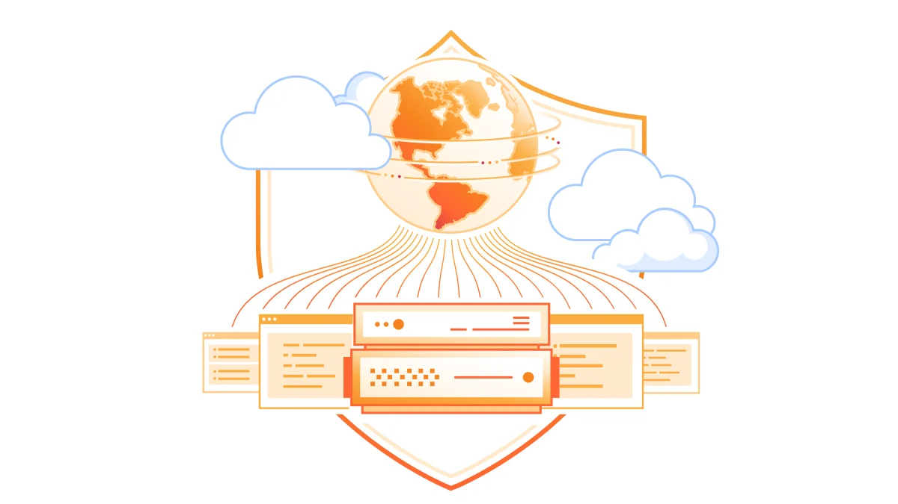
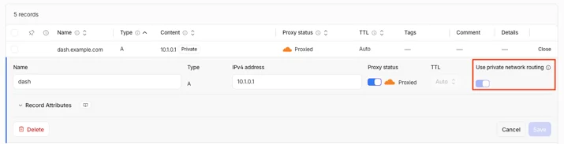
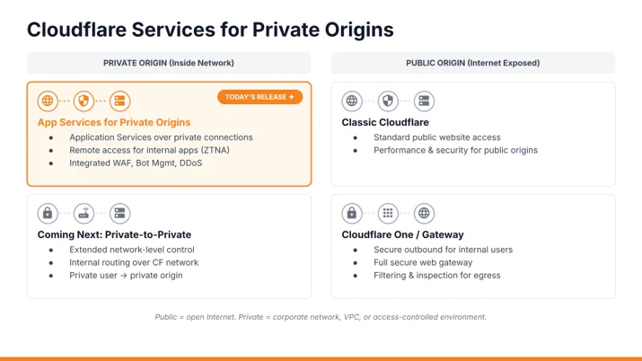

# Cloudflare services for private origins is now generally available

> **来源**: [https://blog.cloudflare.com/private-origins-public-to-private](https://blog.cloudflare.com/private-origins-public-to-private)  
> **作者**: 未知 | **发布时间**: 2026-10-30T14:23:43.668000+00:00  
> **深度调研**: [查看专题调研报告](research.md)  
> **标签**: Cloudflare Private Origins, 私有网络路由, DNS, WAF, Cloudflare One, Cloudflare Tunnel

---

## AI 导读

内部接口和业务工具可能需要接收合作方、客户或自动化程序的互联网请求，但不希望为后端服务器配置公网入口。文章介绍的做法是：创建由 Cloudflare 代理的域名系统（DNS）地址记录，将其指向后端私有地址，再通过已有的 Cloudflare One 网络连接转发请求。请求仍先经过 Cloudflare 的加密连接终止、Web 应用防火墙（WAF）、规则处理和缓存，再进入私有网络。

文章给出创建记录的接口示例，并说明 private_routing 字段会指示代理使用私有网络路径。指定的私有及共享地址范围会自动启用此设置，且不能关闭；仅能通过私有网络访问的公网地址则可手动启用。接入仍需要账号功能授权和受支持的网络连接；除 Cloudflare Tunnel 外，还需启用统一路由。使用 Cloudflare WAN 或 Mesh 时，必须配置返回 Cloudflare 源地址范围的回程路由，文章称缺少该路由是测试期间最常见的配置故障。

当前版本支持互联网请求到达私有后端，后端无需增加入站防火墙例外；是否需要连接器取决于接入方式。部分功能仍不支持，包括 Argo Smart Routing 和 Dedicated CDN Egress IPs，源站健康检查需要负载均衡功能。私有网络之间的访问仍在开发中，2027 年初封闭测试只是计划。文章提供了接入路径和注意事项，但没有给出性能测量、部署测试结果或完整的底层路由说明。

---

## 原文整理

# Cloudflare services for private origins is now generally available



Today, Cloudflare services for private origins is generally available. Point a proxied DNS record at a private IP, and Cloudflare reaches the origin over your existing [<u>Cloudflare One connection</u>](https://developers.cloudflare.com/cloudflare-one/networks/connectivity-options/). Your origin stays private, while web application firewall ([<u>WAF</u>](https://www.cloudflare.com/products/waf/)), [<u>caching</u>](https://developers.cloudflare.com/cache/), [<u>bot management</u>](https://developers.cloudflare.com/bots/get-started/bot-management/), and [<u>Workers</u>](https://developers.cloudflare.com/workers/) work just as they do for public origins.

In June, [<u>we launched this capability in closed beta</u>](https://blog.cloudflare.com/private-origins-dns-routing/) to address a problem we kept hearing from customers: Their internal APIs, AI agent backends, MCP servers, and operational tools weren’t built to face the Internet, but those services still need to accept requests from partners, customers, or agents over the Internet. Before the beta, putting Cloudflare in front of these services meant exposing a public IP, opening a firewall port, or running `cloudflared` alongside the origin.

Those requirements often left private applications without the same protections and controls they used for public applications, including WAF, bot management, rate limiting, caching, traffic acceleration, rewrites, and Workers.

### What is generally available today

During the closed beta, eligible customers requested access through their account team. Today, we’re opening access beyond that beta group.

Point a proxied A or AAAA record at a private IP, and Cloudflare’s application services work as they do for public origins:

- WAF and managed rules
- Bot management
- Rate limiting
- Caching
- Transform and rewrite rules
- Workers

Some limitations remain. [<u>Argo Smart Routing</u>](https://developers.cloudflare.com/argo-smart-routing/) and [<u>Dedicated CDN Egress IPs</u>](https://developers.cloudflare.com/smart-shield/configuration/dedicated-egress-ips/) aren’t supported, and origin health checks require [<u>Load Balancing</u>](https://developers.cloudflare.com/load-balancing/). See the [<u>developer documentation</u>](https://developers.cloudflare.com/dns/private-origins/) for the full list of current limitations.

Your origin keeps its private IP, with no inbound firewall exception required. With [<u>Cloudflare WAN</u>](https://developers.cloudflare.com/cloudflare-wan/),  no connector software on the origin is required. With [<u>Cloudflare Mesh</u>](https://developers.cloudflare.com/cloudflare-one/networks/connectors/cloudflare-mesh/), a connector runs within your private network and can serve multiple origins.

### How it works

Create a proxied A or AAAA record pointing to your origin. For supported private IP ranges, **use private network routing** is enabled automatically. If your origin uses a public IP that’s reachable only through your private network, you can enable the setting manually.

The rest of the request flow stays the same: TLS termination, WAF, rules, and caching continue to run on Cloudflare’s network.



The setting turns on automatically for RFC 1918 private IPv4 addresses, RFC 6598 CGNAT addresses (100.64.0.0/10), and RFC 4193 unique local IPv6 addresses (fc00::/7). It can’t be turned off for these ranges; attempts to disable it through the API return an error.

### What the API looks like

For customers automating deployments through the API, private routing is simply an additional attribute on a standard DNS record.

```
POST /zones/{zone_id}/dns_records
{
 "type": "A",
 "name": "app.example.com",
 "content": "10.0.0.50",
 "ttl": 300,
 "proxied": true,
 "private_routing": true
}
```
Behind the scenes, Cloudflare's proxy platform determines where to send traffic for `app.example.com` by querying Cloudflare's Origin API. The response includes metadata indicating that the destination should be reached through a private network path:

```
{
 "zone_name": "example.com",
 "ipv4_addresses": ["10.0.0.50"],
 "private_routing": true
}
```
The `private_routing` flag is the key signal. When our proxy sees it, instead of attempting to connect directly to the private IP address over the public Internet, it hands the request to our private networking layer, which then routes the connection across the customer's existing private network connectivity, whether that's [<u>IPsec</u>](https://www.cloudflare.com/learning/network-layer/what-is-ipsec/), [<u>GRE</u>](https://www.cloudflare.com/learning/network-layer/what-is-gre-tunneling/), [<u>Cloudflare Tunnel</u>](https://developers.cloudflare.com/tunnel/), [<u>CNI</u>](https://developers.cloudflare.com/network-interconnect/), or Cloudflare Mesh.

The [<u>beta post</u>](https://blog.cloudflare.com/private-origins-dns-routing/) covers the routing layer in more detail.

### Get started

Before you begin, you’ll need:

1. The Private Origins entitlement on your account. Ask your account team to turn it on.
2. [<u>Cloudflare One connectivity</u>](https://developers.cloudflare.com/cloudflare-one/networks/connectivity-options/) using IPsec, GRE, CNI, Cloudflare Tunnel, or [<u>Cloudflare Mesh</u>](https://developers.cloudflare.com/cloudflare-one/networks/connectors/cloudflare-mesh/).
3. Unified Routing enabled on your account, unless you connect over Cloudflare Tunnel (Tunnel doesn't need it). New and existing accounts can upgrade through their account team.
4. If you connect over Cloudflare WAN or Cloudflare Mesh, configure a return route for Cloudflare’s source ranges: 100.64.0.0/12 for IPv4 and 2606:4700:cf1:5000::/64 for IPv6. Then, create a proxied A or AAAA record for the private IP and confirm that **Use private network routing** is enabled. Your existing WAF, cache, and bot management configuration applies to that hostname without further changes.

Then, create a proxied A or AAAA record for the private IP and confirm that **Use private network routing** is enabled. Your existing WAF, cache, and bot management configuration applies to that hostname without further changes.

One note from the beta: if requests time out and nothing arrives at the origin, check the return route first. A missing route for Cloudflare’s source range was the most common setup failure we saw.

Once enabled, follow our [<u>developer documentation</u>](https://developers.cloudflare.com/dns/private-origins/), which walks through the full setup.

### What comes next

Today’s release covers public traffic reaching private origins. Next, we’re working on private-to-private traffic: users, services, and AI agents on private networks reaching applications on other private networks through Cloudflare’s application services.



Engineering work is underway, and we’re targeting a closed beta in early 2027. If you’d like to participate, talk to your account team.

The goal is to give private applications the same protections and controls as public applications. An employee opening `wiki.company.internal`, for example, could benefit from WAF, rate limiting, and bot management. Service-to-service traffic between clouds and data centers could use those controls too, even when neither side touches the public Internet.

For now, today’s release brings the WAF, caching, bot management, and Workers you use for public applications to private origins over connectivity you already operate.

Questions or feedback? Join the conversation in our [<u>community forums</u>](https://community.cloudflare.com/) or reach out to your account team.
