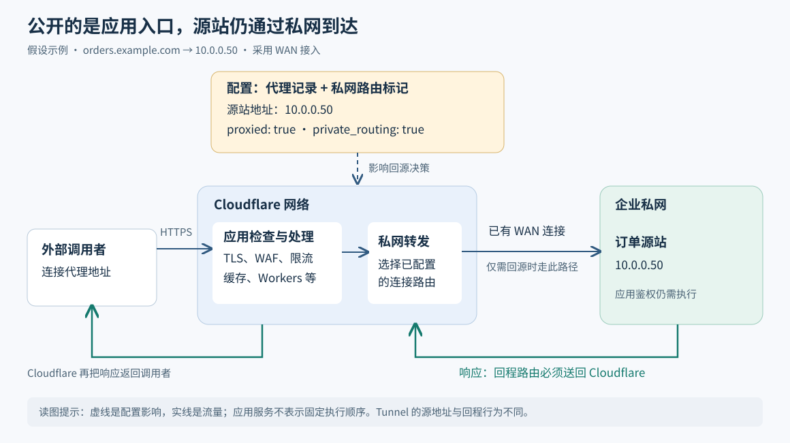

# Cloudflare 私有源站：不开放源站公网入口，怎样接收互联网请求

> 来源：[blog.cloudflare.com](<https://blog.cloudflare.com/private-origins-public-to-private>)  
> 作者：未知 · 发布时间：2026-10-30 22:23（Asia/Shanghai）  
> 翻译正文：[阅读中文正文](article-zh-CN.md)

企业常有这样的需求：一个接口只在内网运行，现在要让合作伙伴通过互联网调用，同时还要检查恶意请求、限制调用频率。给服务器增加公网入口会扩大暴露面；另外部署一套代理，又会增加维护工作。Cloudflare 的私有源站能力把两件事接起来：请求先到 Cloudflare 接受应用层检查，需要访问后端时，再沿企业已有的私网连接到达实际处理请求的后端服务器，也就是“源站”。

它最值得已有 Cloudflare 私网连接、又需要对外提供 HTTP/HTTPS 服务的团队关注。这里的“私有”描述的是源站的网络位置，不代表公开域名自动拥有身份认证，也不代表应用从此无法被攻击。

本文以 2026 年 10 月 30 日发布的 [《Cloudflare services for private origins is now generally available》](https://blog.cloudflare.com/private-origins-public-to-private)为研究主体，核验截至 2026 年 11 月 5 日可访问的官方资料。下文明确标出原文陈述、外部补充、假设例子和分析建议；本文没有开展产品实测。

## 先看一个接口怎样从内网走向外部

**假设**一家小型软件公司有一个订单查询接口，运行在 `10.0.0.50`，希望合作伙伴访问 `orders.example.com`。公司已经用 Cloudflare WAN——连接企业网络与 Cloudflare 的网络服务——接通办公机房，但订单服务器没有公网地址。

若只把域名解析成 `10.0.0.50`，外部合作伙伴仍然连不上：这个地址只在相应私网里有意义，互联网不会替它找到公司机房。域名系统（DNS）负责回答“域名对应什么地址”，不能凭空建立网络通路。

常见做法是部署一个公网入口，再把请求转给内网服务器；也可以使用 Cloudflare Tunnel，由内网的 `cloudflared` 进程先向 Cloudflare 建立连接，再通过这些连接接收请求。后者本来就能避免源站开放公网入站端口，所以“没有公网地址也能发布服务”并非这次才出现的能力。Tunnel 的官方说明还明确指出，连接器可以转发到它在网络中能够访问的资源，并不必然与每台源站同机部署。[外部补充：[Tunnel 工作原理](https://developers.cloudflare.com/tunnel/concepts/)]

这次原文强调的变化是：企业可以复用已有的 Cloudflare One 私网连接，在开启代理的 A 或 AAAA 记录中直接填写源站地址。A 记录保存 IPv4 地址，AAAA 记录保存 IPv6 地址。应用团队不必为了这条访问路径，再为源站增加公网入口；使用 WAN 时，也不要求在源站安装连接器。使用 Cloudflare Mesh 时，连接器运行于私网内，可以服务多个源站。[原文证据：[正式发布公告](https://blog.cloudflare.com/private-origins-public-to-private)]

**分析：**它减少的是“把现有应用代理接到现有私网”这一段的额外配置和部署，收益取决于现有基础设施。如果团队还没有任何私网连接，接入、冗余和排障工作仍然需要有人承担。

## 一次请求经过哪些环节

理解这项功能，要分清“保存访问配置”和“实际传输请求”两条路径。前者决定去哪里，后者才承载用户流量。



图中以假设订单接口和 WAN 接入为例。实线表示请求或响应，虚线表示配置对转发决策的影响；应用检查框只列职责，不表示所有 Cloudflare 产品固定的执行顺序。

### 浏览器连接的是 Cloudflare

管理员在 Cloudflare 中保存 `orders.example.com → 10.0.0.50`，并开启代理。外部客户端查询这个域名时，获得的是 Cloudflare 的代理地址，而不是直接拿着 `10.0.0.50` 连接公司机房。这是代理记录的一般行为，私有源站没有把互联网客户端变成企业私网成员。[外部补充：[DNS 代理状态](https://developers.cloudflare.com/dns/proxy-status/)]

客户端与 Cloudflare 建立 HTTPS 连接。保护这段连接的传输层安全协议称为 TLS；Cloudflare 在这里终止 TLS，即解密请求并进行后续处理。网页应用防火墙（WAF）依据规则检查请求，限流控制请求频率，机器人管理识别自动化访问；Workers 则允许团队运行自定义代码。原文表示这些应用服务仍在 Cloudflare 网络中工作。

“支持缓存”也不是每次都回源。对于符合缓存规则、且可直接使用已有副本的请求，Cloudflare 可以在边缘返回内容；需要后端处理的请求，才进入接下来的私网访问路径。因此，测试网络是否畅通时，不能只请求一个已经缓存的页面。

### 代理根据标记选择私网通路

按原文的实现说明，代理查询 Cloudflare 内部的 Origin API，取得域名对应的源站地址及 `private_routing` 标记。这里的 Origin API 是 Cloudflare 内部用于取得源站信息的接口，不是用户订单接口，也不是浏览器发起的普通 DNS 查询。

当标记为真时，代理将连接交给私网网络层，由后者利用已经配置的连接和路由，到达 `10.0.0.50`。标记的作用是选择访问路径，不是授予某个调用者业务权限，也不会自动创建缺失的隧道和路由。[原文证据：[请求转发机制](https://blog.cloudflare.com/private-origins-public-to-private)]

原文说明，下列目标地址会自动启用私网路由，而且不能通过 API 将其关闭：RFC 1918 规定的私有 IPv4 网段、`100.64.0.0/10` 这一用于运营商级地址转换的共享地址空间，以及 `fc00::/7` 这一 IPv6 本地地址空间。RFC 是互联网技术规范文档。对于只有经私网才能到达的公网地址，则需要手动打开该设置。这里决定路径的不只是“地址长得像不像内网地址”，还有明确的路由配置。

### 源站必须知道响应怎样回来

在 WAN 或 Mesh 路径下，源站收到的是 Cloudflare 发起的后端连接。网络设备必须把发往这条连接源地址的响应送回 Cloudflare；若响应走了默认互联网出口，连接就可能超时。请求方向有路由，并不能证明响应方向也正确。

原文要求为 Cloudflare 源地址范围配置回程路由。外部文档进一步说明：IPv4 默认使用 `100.64.0.0/12`，允许调整；IPv6 使用 `2606:4700:cf1:5000::/64`，不可调整。应以账户实际分配为准，尤其要检查与企业已有地址空间是否冲突。注意，目标地址自动识别中的 `/10` 与这里的回程源地址 `/12` 用途不同，不能相互替换。[外部补充：[Cloudflare 源地址配置](https://developers.cloudflare.com/cloudflare-wan/configuration/how-to/configure-cloudflare-source-ips/)]

**假设**订单服务器看见连接来自默认 `/12` 内的某个地址，它会把响应交给自己的路由系统。若相关路由把该地址范围指向 WAN 隧道，响应可以沿私网返回；若指向普通互联网网关，连接可能无法完成。排查时要分别观察请求是否到达、响应是否发出，不能仅凭浏览器超时断定“源站没收到请求”。官方排障文档同样把缺少回程路由列为故障原因，但没有提供发生比例。[外部证据：[私有源站排障](https://developers.cloudflare.com/dns/private-origins/troubleshooting/)]

这一源地址规则不能照搬到 Cloudflare Tunnel。官方文档说明，Tunnel 后方资源看到的源地址来自运行 `cloudflared` 的主机，而不是上述 Cloudflare 源地址网段。接入方式不同，防火墙规则和回程检查也应相应调整。[外部补充：[不同连接器的源地址行为](https://developers.cloudflare.com/cloudflare-wan/configuration/how-to/configure-cloudflare-source-ips/)]

## “源站留在内网”解决了什么，又没有解决什么

**分析：**这项设计改变的是源站的可达路径。企业可以不给服务器提供公网直接入口，让外部流量先经过 Cloudflare，再到达后端。这有助于减少绕过入口检查的网络路径，但保护是否完整，还取决于其他公网入口是否关闭、边缘策略是否正确，以及内网本身的访问控制。

订单接口仍需回答三个不同的问题：调用者是谁、能读取哪些订单、一次能做多少操作。WAF 可以识别一部分攻击模式，却不知道合作伙伴甲是否拥有订单乙。把接口放在私网地址上，也不会替应用补上对象级权限检查。

外部调用者需要身份校验时，可以评估 Cloudflare Access 等额外控制。Access 的服务令牌为自动化系统提供客户端标识和密钥，用于访问受 Access 保护的应用；这是另行配置的认证能力，不是 `private_routing` 的附带效果。订单级授权仍应由业务系统执行。[外部补充：[Access 服务令牌](https://developers.cloudflare.com/cloudflare-one/access-controls/service-credentials/service-tokens/)]

另外，客户端到 Cloudflare 和 Cloudflare 到源站是两段连接。私网可达不等于已经验证后端服务器身份。对于支持 HTTPS 的源站，应配置适当的证书校验；例如 Full (strict) 模式会验证源站证书的有效期、信任来源和主机名匹配。若接入方式使用连接器，也要检查连接器到应用这一段的实际加密设置。[外部补充：[Full (strict)](https://developers.cloudflare.com/ssl/origin-configuration/ssl-modes/full-strict/)]

缓存则要从数据归属出发。**建议**订单等个性化接口在试验阶段明确绕过共享缓存，再为真正可共享的资源逐项开启。不能假设请求带了 `Authorization` 认证头就永远不会缓存：官方资料指出，其行为受源站缓存控制、套餐和规则配置影响。[外部证据：[未缓存响应与缓存条件](https://developers.cloudflare.com/cache/troubleshooting/investigating-uncached-responses/)]

## 与其他接入办法相比，成本移到了哪里

下表是基于上述机制的选型分析，不是性能测试或报价比较。

| 做法 | 主要维护对象 | 可靠性与协作代价 | 适合的起点 |
| :-- | :-- | :-- | :-- |
| 公网源站或公网反向代理，再接 Cloudflare | 公网入口、防火墙、证书及代理配置 | 要防止流量绕过 Cloudflare；应用与网络团队需共同维护入口 | 已有成熟公网接入和严格入口控制 |
| Cloudflare Tunnel 发布应用 | 连接器、凭据、转发规则与副本 | 连接器要升级和监控；同样可以不开放源站公网端口 | 服务较少、尚无企业级私网连接 |
| 私有源站复用 WAN 或 Mesh | 私网连接、路由、DNS 配置和应用策略 | 减少源站侧部署，但多个应用可能共同依赖同一连接；需要跨团队排查 | 已有私网接入，多个服务需要统一对外入口 |

**复杂度与成本。**已有 WAN 的企业可能减少新增组件；从零开始的小团队则可能为一个接口引入账户授权、网络服务和持续运维。原文没有公开完整价格，也没有与 Tunnel 的总拥有成本比较，因此不能据此认定一定更便宜。

**可靠性。**共用连接可以集中维护，也会形成共同故障点。若多个域名都依赖同一条私网路径，路径故障可能同时影响它们。WAN 设置指南建议部署两条 IPsec 隧道——用 IP 层安全协议保护网络传输——并配置不同优先级的路由。这里要区分“隧道还活着”和“订单服务还能完成查询”：网络检查正常，应用仍可能故障。原文明确说明，源站健康检查需要 Load Balancing，即根据健康状态等条件选择后端的负载均衡产品。[外部补充：[WAN 设置指南](https://developers.cloudflare.com/dns/private-origins/set-up-via-cloudflare-wan/)；原文限制见[发布公告](https://blog.cloudflare.com/private-origins-public-to-private)]

**性能。**缓存命中可能减少回源；动态请求仍需经过边缘处理和私网路径。原文没有提供延迟分布、吞吐上限、连接规模或对照实验。不能从“复用连接”推导出动态接口一定更快，也不能将其他 Cloudflare 产品的测试成绩当作本功能的成绩。

**团队协作。**应用人员负责域名、接口、认证和缓存，网络人员负责连接、路由与地址规划，安全人员负责边缘规则及审计。一个 DNS 修改可能改变后端访问路径，因此应同时记录应用负责人和网络负责人。少部署一个进程不等于少了这些责任。

## 正式可用的边界，要以哪些证据判断

截至本次核验，官方资料存在版本不同步：正式发布公告宣布一般可用（GA），但私有源站概览仍显示测试版、仅企业套餐，并标注 2026 年 5 月更新。由此可以确认公告所述发布状态，但不能推断所有套餐都能自助开通。原文仍要求通过账户团队启用 Private Origins 权限。[原文与外部资料对照：[发布公告](https://blog.cloudflare.com/private-origins-public-to-private)、[开发文档概览](https://developers.cloudflare.com/dns/private-origins/)]

部署时至少要确认以下边界：

- **账户与连接前提。**需要 Private Origins 权限及受支持的 Cloudflare One 连接。原文要求启用 Unified Routing，也就是账户的统一私网路由模式；Cloudflare Tunnel 是该要求的例外。只有 DNS 托管权限并不足够。
- **产品兼容性。**原文明确不支持 Argo Smart Routing（按网络状况优化访问路径的服务）和 Dedicated CDN Egress IPs（专用回源出口地址）。依赖这些能力的现有系统不能假设可以原样迁移。
- **地址与域名行为。**当前路由文档说明流量走默认虚拟网络，不能选择特定虚拟网络；虚拟网络用于区分独立的路由空间。同名多个 A/AAAA 记录中只要一个启用私网路由，全部都会使用私网路由。文档仍带测试版标记，这些限制须在目标账户再次确认，尤其不能未经验证就混用公私地址实现故障切换。[外部证据：[私网路由文档](https://developers.cloudflare.com/dns/private-origins/private-network-routing/)]
- **协议与处理时限。**本文讨论的是 HTTP/HTTPS 应用入口，不能据此认为普通数据库连接也能直接获得 HTTP 防火墙保护。代理本身仍有请求大小和读取超时限制；长任务接口应核对这些限制。[外部补充：[代理行为与限制](https://developers.cloudflare.com/dns/proxy-status/)]
- **未来能力。**原文把“私网调用方经过应用服务访问另一个私网应用”列为后续工作，目标是 2027 年初封闭测试。这个时间是计划，不能作为已经交付的内网互访能力。

**分析：**服务数量并没有一个由公开证据支持的“超过多少就值得使用”的分界线。更有用的判断是：团队是否已有稳定私网路径，是否有人能维护双向路由，是否接受第三方代理处理应用流量，以及实际功能和合同是否满足业务。对只有一个接口、没有网络运维人员的团队，先评估 Tunnel 通常更容易控制试验范围；这是一项建议，不是通用成本结论。

## 进阶：自动化配置时不要混用字段名

原文的配置入口是普通 DNS 记录，而不是另一套应用部署描述。以下为沿用官方接口结构的**示例**，仅用于说明请求体；域名、地址和账户需替换，执行前应完成权限与网络准备。

```http
POST /zones/{zone_id}/dns_records
Content-Type: application/json

{
  "type": "A",
  "name": "orders.example.com",
  "content": "10.0.0.50",
  "ttl": 1,
  "proxied": true,
  "private_routing": true
}
```

`proxied` 让访问经过 Cloudflare；`private_routing` 选择后端私网路径；`ttl: 1` 在 API 中表示自动 TTL，即 DNS 答案的缓存有效期由平台管理。这些字段不会替代接口认证或路由部署。当前官方 API 定义包含 `private_routing`，与正式发布原文一致。[外部核验：[创建 DNS 记录 API](https://developers.cloudflare.com/api/resources/dns/subresources/records/methods/create/)]

需要注意，原文链接的[早期文章](https://blog.cloudflare.com/private-origins-dns-routing/)示例使用 `use_private_routing`。不要把两套字段名拼在一起；应根据当前 API 定义创建记录，再读取记录确认实际状态。关于 Cloudflare 内部 Origin API 的描述，本文依据官方文章，没有内部服务源码或运行追踪可用于独立验证，因此不进一步推测其内部调用次数、缓存方式或故障恢复算法。

## 小团队怎样做一次可退出的验证

以下是实践建议，不是 Cloudflare 官方基准。目标是证明路径正确、权限正确、故障可控，再决定是否迁移真实服务。

**第一步，先判断试验是否有必要。**确认账户权限、套餐费用和连接方式。若仅为一个测试接口就需要新建整套 WAN，应先与 Tunnel 方案比较；没有现成连接或维护人员，也可以在此结束评估。

**第二步，只发布一个无敏感数据的测试接口。**选独立测试域名，让响应返回固定内容和本次请求编号，便于关联边缘与源站日志。先设置调用者认证、绕过共享缓存，保留原有可用访问路径。不要通过关闭所有检查来换取“首次访问成功”。

**第三步，先通网络，再开域名。**网络维护者确认去往源站的路由、实际源地址范围、回程路径与防火墙许可；WAN/Mesh 按源地址范围检查，Tunnel 按连接器实际路径检查。发布记录后，从外网查询 DNS 并调用接口，确认取得代理地址、请求经过边缘、源站收到预期请求。遇到禁止私有 IP 的错误，可按官方排障说明先检查账户授权；遇到超时则沿双向路径检查。[外部依据：[私有源站排障](https://developers.cloudflare.com/dns/private-origins/troubleshooting/)]

**第四步，用同一批请求比较，并在测试环境演练故障。**保持客户端位置、接口、并发量和响应大小一致，记录下列指标；如果要测缓存，应把缓存命中与回源结果分别统计。

| 要验证的事 | 观察方法 | 继续或退出的依据 |
| :-- | :-- | :-- |
| 请求是否可用 | 成功率、超时率、错误码，及边缘和源站对应日志 | 达到试验前写下的业务容忍范围 |
| 路径是否拖慢接口 | 比较基线与新路径的中位延迟、95 分位延迟；后者表示 95% 请求不超过的耗时 | 若持续超出既有预算，先定位路径或处理开销 |
| 权限是否生效 | 无凭据、错误凭据和正确凭据分别调用；检查跨用户数据隔离 | 任一未授权读取成功，立即停止扩大范围 |
| 故障是否可恢复 | 中断测试连接器或测试主隧道，观察恢复时间和业务请求 | 只有真正配置了备用路径，才验证自动切换；无备用路径时验证告警与人工恢复 |
| 运维是否可承担 | 记录定位所需时间、参与人员与新增费用 | 长期超出团队预算或无法明确责任人，就不迁移 |

退出时撤回测试发布配置，或切回事先验证过的代理后端，并停止试验流量。不能把“关闭代理”当作通用回滚：域名如果直接返回私网地址，外部客户端通常仍然无法访问。若试验发现地址冲突、无法接受的数据处理方式或关键能力缺失，应保留现有方案，而不是为了完成迁移继续叠加补丁。

Cloudflare 私有源站的实际价值，是让已有私网连接承载经过应用检查的外部请求。能否采用，要落到三个可验证的结果上：请求和响应都走对路径，调用者只能访问被授权的数据，连接故障时团队知道如何恢复。原文证明了产品提供这一接入方式；性能收益、费用节省和本团队的运维改善，仍需由自己的试验回答。
