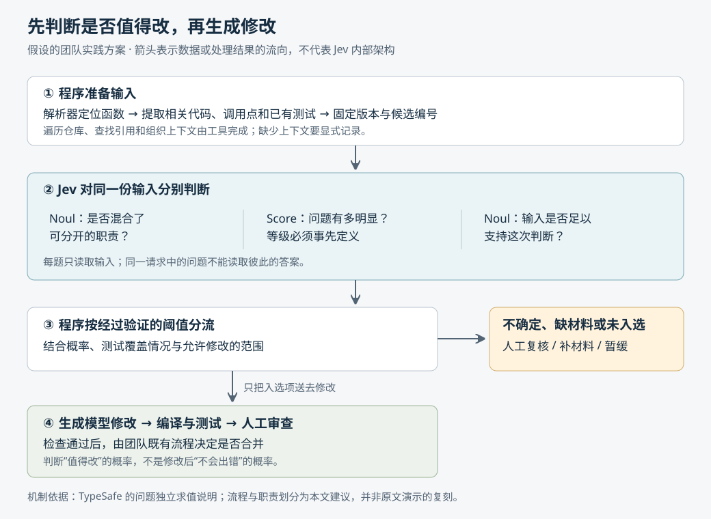

# Jev 决策模型：把小判断交给模型，把执行权留在程序里

> 来源：[www.thoughtworks.com](<https://www.thoughtworks.com/insights/blog/generative-ai/jev-decision-models-what-need-know-why>)  
> 作者：Ken Mugrage · 发布时间：2026-10-12 08:00（Asia/Shanghai）  
> 翻译正文：[阅读中文正文](article-zh-CN.md)

如果程序只想知道“这条工单该分给谁”或“这个函数是否值得重构”，让模型写一段分析、再从中提取答案，可能增加等待、费用和处理错误的机会。Jev 的做法是让开发者先规定问题和允许的答案，模型直接返回选择、评分或概率。它值得关注的场景，是大量、重复、边界明确的小判断；需要写代码、长篇解释或连续规划的任务，仍要另找合适的工具。

本文以 Thoughtworks 的原文 [《Jev and the rise of decision models》](https://www.thoughtworks.com/insights/blog/generative-ai/jev-decision-models-what-need-know-why)为研究主体，结合截至 **2026 年 11 月 5 日**查阅的官方文档、公开项目和研究论文。下文将原文观察、外部证据和本文建议分别说明；自拟场景均标为假设，未实际调用 Jev 做性能测试。

TypeSafe 把这类产品称为“系统一模型”（System One model），借用人类快速直觉判断与缓慢分析思考的区分。这个名称有助于说明使用定位，但不是已经确立的统一架构标准，也不能据此推断模型具有人类的思考机制。[厂商发布说明](https://typesafe.ai/blog/introducing-system-one-models-and-jev)

## 一、真正要省下的，是不必要的生成过程

原文展示的用途是筛选代码重构候选：工具解析代码，模型根据预设的代码问题判断哪些地方值得改。这里的“代码问题”指职责混杂、重复逻辑等可能增加维护负担的现象，不意味着程序已经出错。演示者认为，用通用模型提供大量修改建议，有时超出了筛选阶段的实际需要。

这说明了一个有价值的任务拆分：**发现值得查看的位置，与生成正确的修改，是两项不同工作。**不过，原文没有提供可复现的仓库、固定测试集、请求日志和完整耗时对照。因此，它能证明有人尝试了这种工作方式，不能证明 Jev 普遍优于编码模型，更不能证明它筛出的修改更安全。

举一个**假设例子**：小团队想整理订单服务中的长函数。解析工具先找出候选函数，再提供函数体、相关调用点和已有测试。程序问模型：“这个函数是否同时承担了输入校验和账单计算两类可分开的职责？”筛选结果只决定谁先进入人工查看清单，不直接修改仓库。

这个例子也说明原有方案各自的不足。仅按代码行数筛选，容易把长但清晰的函数误判为问题；通用大语言模型（LLM，即通过大量文本训练、能够生成语言的模型）可以理解更多语境，但若让它为每个函数写完整评审，可能做了不需要的工作。Jev 尝试提供介于手写规则和自由生成之间的接口。

## 二、从输入到决定，究竟发生了什么

### 先规定答案，再让模型判断

Jev 接收两类主要材料：`state` 是待评估的内容，例如代码片段或工单；`questions` 是问题及其判定标准。围绕原文涉及的三种文本判断，官方接口的含义如下。这里采用当前文档中的名称，原文所说的 ratings 对应 `Score`。

| 接口 | 开发者需要规定什么 | 返回结果怎样理解 |
| --- | --- | --- |
| `Noul` | 一个是非问题，必要时明确“是”和“否”的条件 | 返回 0 到 1 的数，表示模型判断“是”的概率，不直接返回布尔值 |
| `Choice` | 有限个选项及各自含义 | 返回选项、各选项概率以及 `confidence` |
| `Score` | 从低到高排列、用文字描述的等级 | 返回评分、各等级概率以及 `confidence`，评分可以落在等级之间 |

这些差异来自官方的 [Noul](https://docs.typesafe.ai/primitives/noul)、[Choice](https://docs.typesafe.ai/primitives/choice) 和 [Score](https://docs.typesafe.ai/primitives/score) 文档。`Score` 适合“问题有多明显”这类分级判断，不宜拿来计算精确金额或日期差。

在上述假设中，团队可以分别询问“是否混合职责”“问题有多明显”“提供的上下文是否足够”。但不能假定第三个问题会读取前两个问题的答案。官方说明，同一请求中的问题都独立地读取同一份输入，并行求值；需要依赖前一个答案时，应由程序取得结果后再发请求。[官方概念说明](https://docs.typesafe.ai/introduction)

图中是本文建议的职责划分，不是对 Jev 内部架构或原文演示实现的复刻。读取仓库、寻找引用、执行修改都由外围工具完成。所谓编码代理的 `harness`，在这里就是组织这些工具调用、记录结果并决定下一步的外围程序。

### 少生成文字，为什么可能更快

通常的文本生成采用自回归方式：先产生一个文本片段，再根据已有内容产生下一个；这些片段称为 token，是模型处理文本的计量单位。输出越长，通常需要越多连续生成步骤。

TypeSafe 在[发布说明](https://typesafe.ai/blog/introducing-system-one-models-and-jev)中称，Jev 使用面向结构化判断的架构、并行输出机制，以及 RLCD——“面向校准决策的强化学习”，也就是把概率估计是否可信作为训练目标之一。限制输出空间，可以省去组织长篇答案的工作，为降低延迟提供合理解释。

但这只是厂商公开的机制描述。它不足以还原模型内部网络、训练数据或损失函数，也不能据此确认模型参数有多小。公开的 [Python SDK](https://github.com/typesafe-ai/typesafe-sdk-python)是调用服务的客户端，不等于公开了模型实现。因此，原文把 Jev 描述为“更小、更轻”，不应进一步理解为已证实的参数规模，或可直接下载到本地运行。

## 三、固定格式、稳定输出和可信概率，要分别验证

原文用“不是非确定性的，而是概率性的”区分 Jev 和 LLM。这个表述容易混淆两个层次：**输出什么，与重复运行是否相同，并不是同一个问题。**

一个程序完全可以每次都返回相同的概率分布；另一个程序也可以根据同一分布随机抽取答案。前者输出概率，却不必随机。反过来，即便每次都选同一个选项，也可能一直选错。原文中“没有注入随机性”的采访说法，不能单独证明服务在版本更新、不同部署条件或输入改写后都保持相同结果。

同样，“答案只能在预设选项中出现”，限制的是格式和取值范围。如果三个选项都不合适，模型仍可能选出其中一个。减少自由生成的编造空间，并不等于消除语义错误。实际使用时，应保留“其他”“材料不足”等出口，或另问是否存在合适选项。

### `confidence` 不是另一位独立评审者

官方当前定义中，`Choice` 的 `confidence` 由最高选项概率换算而来。若有 n 个选项，最高概率为 p_max，则：

`confidence = (p_max − 1/n) / (1 − 1/n)`

例如，三个选项的概率是 0.60、0.30、0.10，`confidence` 就是 0.40。它不是“选中项只有 40% 正确率”，也不是对 0.60 这个概率再次验真的结果。同一选项集合下，同时检查最高概率和 `confidence`，没有增加独立证据。`Noul` 则没有单独的 `confidence` 字段。[官方置信度定义](https://docs.typesafe.ai/confidence)

那么，0.60 到底能不能信？这涉及**概率校准**：假设在一批相似任务中，模型给某类判断约 80% 的概率，这些判断实际成立的比例也应接近 80%。这是对一批预测的统计性质，不是给某一次判断出具保证。[Guo 等人的校准研究](https://arxiv.org/abs/1706.04599)说明，神经网络输出的概率可能与真实正确率不符，也介绍了事后调整概率的方法。

据此，本文建议把两项检查分开：先测模型有没有选对，再测它说“有多大把握”是否可信。还要按代码类型、语言和风险类别分别看，避免总体表现掩盖某个薄弱子集。更换模型、问题措辞或选项集合后，原来的阈值也需要重新验证。

## 四、外部证据支持到哪一步

### 低成本的小判断，有初步实测支持

Deußer 等人的[公开评测第二版](https://arxiv.org/html/2609.37647v2)于 2026 年 10 月 29 日更新，测试了 `jev-1.13.0`：在 37 个数据集上使用固定问题模板，不针对任务训练模型。主要评测共发送 346,009 个请求，报告输入量约 2.179 亿 token、接口费用 9.15 美元；32 个并发请求条件下，平均客户端延迟为 0.36 秒，包含网络时间。

这支持“可以低成本完成大量有限选项判断”的判断，但不直接支持“比所有 LLM 快多少倍”。该研究没有给出与所有替代服务同环境的延迟对照；平均延迟也不能代表最慢一批请求的等待时间。论文还指出语言、细分类别和评分任务存在弱项，连续行动时会重复无效动作；它没有测量同一请求多次运行的变化。研究提供了[评测代码](https://github.com/AppliedMachineLearning-Lab/jev-benchmarking)，本文未重新运行。

原文中“每天一千美元”与“每天一美元”的对比，缺少工作量、模型版本和验收标准。它是成本讨论中的采访表达，不能作为同一业务节省千倍费用的证据。

### 概率可信度仍需按任务检验

另一项[Sys1Cal-v1 研究](https://arxiv.org/abs/2609.35342)构造了答案概率可知的是非问题，检查 Jev 返回的分布是否接近目标分布。作者发现 `Choice` 和 `Score` 存在需要进一步解释的行为，并提出可能缺少“不知道”这一状态的假说。

这项预印本的任务和指标不同于一般分类评测，不能据此断言 Jev 在所有业务中都不可信；同样，也不能用某些分类任务校准较好，推导出所有返回概率都有准确的数值意义。两项研究合起来提示：**“能输出概率”已经得到接口层面的确认，“概率能支持什么自动化动作”仍是具体应用需要验证的问题。**

### 用模型评审模型，并不要求对抗训练

原文把 LLM-as-a-judge 描述为训练一个模型去对抗性地评估另一个更大模型。更一般的含义只是“让语言模型按照标准进行评审”，并不要求评审者更小，也不要求重新训练。

例如 [Zheng 等人的研究](https://arxiv.org/abs/2306.05685)使用强语言模型评估回答，同时分析位置、篇幅和自我偏好等偏差。因此，比较 Jev 与语言模型评审时，应在同一批人工标注样本上测错误、概率和费用；不能仅凭“一个输出文本、一个输出概率”就判定后者更可靠。

## 五、限制输出之后，复杂度转移到了哪里

Jev 把模型的自由度收窄了，但开发者需要更认真地定义问题。对于“是否值得重构”，团队至少要先约定什么算问题、哪些上下文必不可少、什么情况下不应作答，以及判断结果可以触发哪些动作。

以下是针对这一场景的工程分析，不是统一性能排名。

| 方案 | 可能更合适的条件 | 复杂度、成本与可靠性取舍 |
| --- | --- | --- |
| 手写规则、静态分析 | 条件可清楚编码，例如函数长度、禁止依赖 | 结果易复现、解释直接；语义规则复杂时维护负担增加 |
| 专用分类器 | 标签稳定，团队有足够标注样本 | 可自行部署和优化；需承担训练、更新与监测成本 |
| Jev 等决策接口 | 判断边界明确，需要语义理解，又不需要生成文字 | 接入相对直接；需维护判定标准、验证概率，并处理网络和服务版本变化 |
| LLM 配合结构化输出 | 还需要解释、生成内容或处理复杂上下文 | 能在同一系统中覆盖更多工作；实际延迟、费用和概率质量仍需测量 |

最后一项是重要的比较对象。LLM 不一定只能返回自由文本：[Outlines 的官方项目](https://github.com/dottxt-ai/outlines)已支持用枚举、数值类型和对象结构限制输出。因此，Jev 的价值不能仅归结为“输出格式固定”，还要看专门优化后的判断质量、概率和成本是否适合自己的任务。

对于必须本地处理数据的团队，[Laya 的模型页面](https://huggingface.co/convaiinnovations/laya)提供了公开权重与许可信息，可作为另一条调查路径。但自建部署意味着承担硬件、依赖、容量和模型更新工作。Laya 作者关于“更早提出”的[文章](https://laya.convaiinnovations.com/)是当事方陈述；公开时间先后不足以证明两者内部技术相同，也不足以裁定创新归属。本文不将双方不同测试口径下的速度数字直接排名。

团队协作上的变化同样具体：业务负责人或代码维护者需要定义判定标准，开发者把阈值与分流逻辑写进程序，评审者记录误判。修改一个等级描述，可能改变许多候选的排序，因此这些描述也应版本化、接受评审，并与回归样本一起维护。

## 六、哪些边界会让方案失效

首先，模型只能根据收到的材料判断。函数看起来只负责计算，实际可能通过调用链修改数据库；缺少调用点和副作用信息时，模型可能在不完整材料上作出很明确的判断。收窄问题的同时，必须保留回答所需的上下文。

其次，有限选项不能防止输入诱导。提示注入是指输入材料夹带指令，诱使模型偏离原本任务。代码注释、工单或文档都可能携带这类内容。TypeSafe 的[已知局限文档](https://docs.typesafe.ai/model-jaggedness)明确列出对抗性内容、无关长上下文、复杂间接推理、数字精度和选项顺序等风险。输出一个合法选项，仍然可能造成错误分流。

再次，单步判断准确不意味着长任务能完成。一个动作看起来合理，可能让后面的选择更困难；反复作出局部判断，也不自动获得计划、记忆和失败恢复能力。连续任务需要外围程序保存进度、识别循环，并在无进展时停止或升级处理。

因此，更适合尝试的是：判定标准相对稳定、存在可核对答案、错误可回退的筛选与排序。若只有少量任务，新增接口和评测流程可能不划算；若必须生成新内容、精确计算，或无法承担误判，则不能仅靠这种接口完成工作。特别是“这个函数值得修改”的概率，不能当成“修改后不会破坏行为”的概率。

## 七、小团队可以怎样做最小实践

建议从**重构候选排序**开始，只影响查看顺序，暂不自动合并修改。这样可以直接检验原文最有价值的想法，又不必搭建复杂的代理平台。

1. **先定义一个窄问题。** 例如只判断函数是否混合输入校验与账单计算。写清正例、反例、材料不足的情形，并约定模型只提出查看建议。
2. **建立小型人工样本集。** 从自己仓库选择几十到几百个候选作为起点，这是试验规模建议，不是统计充分性的保证。由熟悉代码的人标注，保留分歧；将调问题和阈值的样本，与最终验收样本分开。
3. **只比较必要基线。** 比较现有静态规则、团队已有模型的受限输出和 Jev。使用相同上下文、标签和验收标准，固定模型版本，记录输入长度、失败和重试，避免边测边改验收集。
4. **先并行观察，再有限启用。** 初期让模型产生结果但不影响实际流程，这称为影子运行。通过后，才让它调整候选顺序；修改仍交给生成模型、编译、测试和人工审查。超时、返回异常或材料不足，一律回到人工流程。

验收时，至少记录以下指标，不能只看总准确率：

| 指标 | 它回答的问题 |
| --- | --- |
| 入选候选的实际有效比例 | 人工查看清单里，有多少确实值得重构？ |
| 漏检比例 | 人工认定值得查看的候选，有多少被模型跳过？ |
| 不同概率区间的正确比例 | 模型更有把握时，是否真的更可靠？ |
| 人工复核比例与耗时 | 省下的筛选工作，是否被处理误判抵消？ |
| 第 95 百分位延迟、失败率 | 95% 的请求能在多久内完成，服务异常会增加多少等待？ |
| 每个有效候选的总成本 | 纳入调用、重试、工具与人工后，是否仍值得使用？ |

阈值应由可接受的错误代价决定。若“跳过”会让候选长期不再被查看，就要重点检查漏检；若只是排到后面，容忍范围可以不同。不要直接复制文档示例中的概率阈值。

还应预先约定退出条件：在独立验收集上没有优于现有简单方案；人工处理误判抵消了节省；模型或问题版本变化后表现明显下降；敏感代码无法按要求发送到外部服务。出现这些情况，就退回原有流程，保留样本与错误记录，而不是不断添加判断问题来掩盖效果不足。

Jev 所提示的可实践方向，是把软件里的小判断单独拿出来评估：模型提供有边界的判断，程序明确规定判断能触发什么动作。能否采用它，最终取决于自己的样本是否证明这些判断足够有用、概率足够可信，以及整条流程的成本是否合算。
