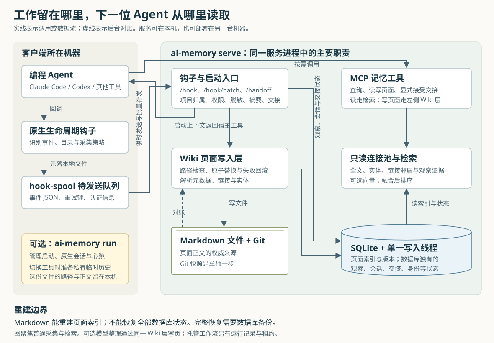
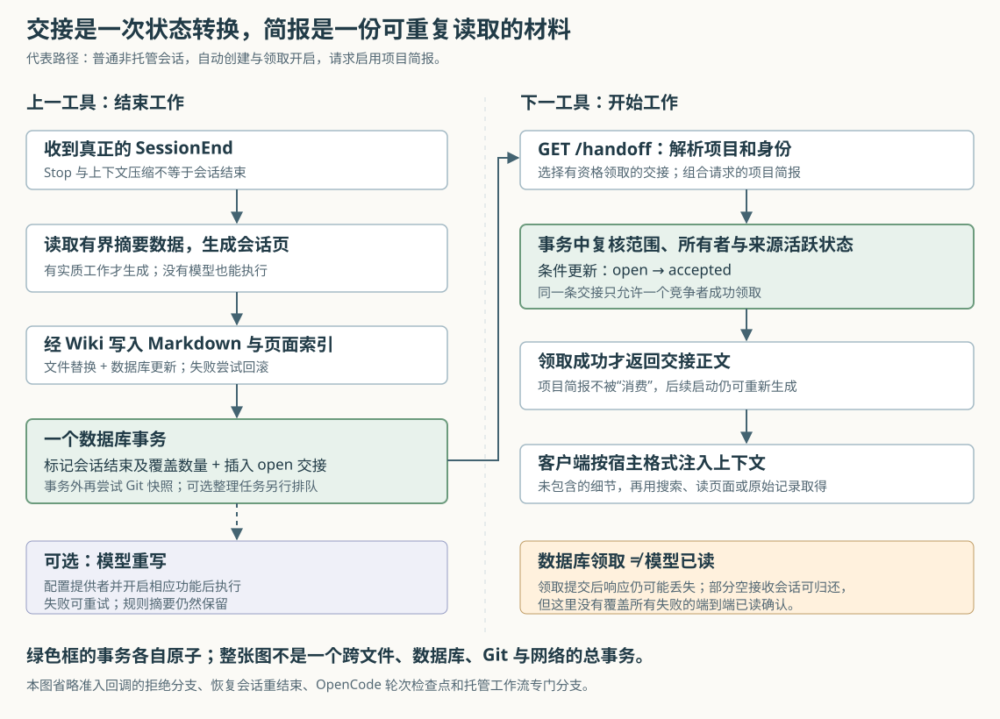

# ai-memory 如何让不同编程 Agent 接着工作：从事件采集到知识检索与会话交接

假设你用 Claude Code 排查一个接口超时问题：改过两个文件，试过一种无效方案，最后还留下“是否应该调整连接池”的疑问。第二天换成 Codex，代码仍在，先前为什么这样改、哪些办法已经失败，却未必还在它的上下文里。

ai-memory 为这类工作保存一份独立于具体编程工具的记忆。它通过工具的生命周期钩子——在会话开始、用户提问、工具调用和会话结束时执行的回调——采集事件，把会话整理成 Markdown 页面，再通过启动上下文和搜索交给后续 Agent。它还单独保存“下一棒该做什么”的交接记录，避免把一次性的未完成任务永久当成项目规则。

这个例子是本文自拟场景，不是项目的实测案例。本文基于执行器提供的本地源码，版本为 Cargo 清单中的 **3.1.2**，源码快照为 `5519b89cc653bec4cfccbb770c6b4e5dcfcda759`；历史研报为空，因此先建立整体认识。文中源码链接指向仓库对应文件，线上主分支以后可能变化。本次只读源码与测试，没有安装依赖、启动服务或运行项目测试。

## 先弄清它保存的三种东西

理解 ai-memory，最有用的起点不是“它用了哪种数据库”，而是区分三个用途。

| 保存的内容 | 解决的问题 | 主要落点与使用方式 |
| --- | --- | --- |
| 原始观察事件 | 当时问了什么、调用了什么工具，摘要漏了什么 | SQLite 的会话与观察记录；供整理、原始记录查询和搜索补充使用 |
| 项目知识页面 | 这个项目有哪些约定、决策、经验和历史 | 磁盘上的 Markdown；数据库保存可检索的页面版本、全文索引、实体与链接等 |
| 会话交接记录 | 接下来谁继续、还有什么没做完 | SQLite 的 handoff 记录；带来源、所有者、工作目录及领取状态 |

这里的“观察”是一次捕获事件，不等于经过验证的事实；“知识页面”也可能只是会话历史，不一定是长期有效的规则。代码用 `Tier` 标记工作、事件、语义、过程等记忆层级，用页面路径和元数据进一步区分用途。例如 `sessions/` 保存会话摘要，`decisions/` 可以保存决策，`_rules/` 保存项目规则。

**Markdown 是页面知识的权威来源，但不是整个系统全部状态的备份。** `reindex` 可以从文件重建页面索引和工作区、项目标识，却不能恢复原始观察、交接、用户、审计记录或访问计数。这个限制直接写在重建命令中，也体现在它只接受干净数据库的实现里。因此，迁移可阅读知识和恢复完整服务是两种不同操作。[依据：`observation.rs`、`handoff.rs`、`reindex::run`](https://github.com/akitaonrails/ai-memory/blob/main/crates/ai-memory-cli/src/commands/reindex.rs)

## 一个程序，分成客户端动作和服务端职责

项目用 Rust 编写，按职责拆成多个 crate，也就是 Rust 的包级编译单元，最终由 `ai-memory-cli` 装配为同一个程序。它不是必须部署一组微服务：钩子命令、启动包装器和服务端可以使用同一程序的不同子命令，但通常是不同进程。

图中的服务既可以运行在本机，也可以运行在另一台自建机器上。跨机器延续的前提，是客户端连接同一个服务，并解析到同一个工作区和项目；它不会因为两台机器上目录名称相同，就自动证明它们是同一个仓库。

| 模块 | 在这条链路中实际负责什么 |
| --- | --- |
| `ai-memory-cli` | 解析配置与命令，安装集成，执行钩子、本地排队、服务启动和 `run` 包装启动 |
| `ai-memory-core` | 定义会话、观察、页面、交接、身份等数据类型，以及脱敏规则 |
| `ai-memory-hooks` | 统一不同工具的事件格式，接收 HTTP 事件，生成规则摘要和启动上下文 |
| `ai-memory-store` | 管理 SQLite、事务、单一写入线程、只读连接池及查询排序 |
| `ai-memory-wiki` | 管理 Markdown 路径、原子替换、页面与索引协作、文件监听和 Git 快照 |
| `ai-memory-mcp` | 向 Agent 提供搜索、读写页面、交接等工具，并处理请求身份与权限 |
| `ai-memory-consolidate`、`ai-memory-llm` | 前者组织整理与维护流程，后者对接可选的大语言模型和向量生成服务 |
| `ai-memory-workstream` | 为 `ai-memory run` 提供不同工具原生会话的发现、恢复参数和只读历史导出 |
| `ai-memory-web` | 提供网页访问；管理界面还受编译功能与运行参数控制 |

MCP 是“模型上下文协议”，这里用于让编程 Agent 调用统一的记忆工具。HTTP 模式将 `/mcp`、`/hook`、`/handoff` 等入口装配在同一服务中；标准输入输出模式也能提供 MCP，但不能把它与完整 HTTP 钩子服务的能力画等号。需要通过生命周期自动采集时，必须有相应的 HTTP 接收端。默认 HTTP 地址是本机回环地址 `127.0.0.1:49374`。[依据：工作区模块清单与依赖](https://github.com/akitaonrails/ai-memory/blob/main/Cargo.toml)、[`serve::run`](https://github.com/akitaonrails/ai-memory/blob/main/crates/ai-memory-cli/src/commands/serve.rs)、[`Config::default`](https://github.com/akitaonrails/ai-memory/blob/main/crates/ai-memory-cli/src/config.rs)

这套架构没有强制要求外部向量数据库，也没有强制要求大语言模型 API。默认的采集、规则摘要、搜索和交接都能走本地计算路径。向量检索、模型重写和模型重排属于另外配置的增强能力，不能把它们算成所有安装都会执行的步骤。

## 顺着一次真实调用链：工作如何被记下来

仍以上面的接口排查为例。下面描述普通、非 `ai-memory run` 托管会话的代表路径；不同工具的事件名和注入方式存在差异。

### 1. 先确定事件属于哪里，再决定是否采集

原生钩子的入口是 `commands/hook.rs` 的 `run`，它读取工具传来的 JSON，再进入 `run_with_payload`。代码先识别工具和事件，提取会话标识、当前目录，并检查附近的 `.ai-memory.toml` 设置。

目录不是简单的附带标签。它参与选择项目、服务器配置以及采集策略。针对能够识别的文件工具，客户端会检查目标路径；若请求实际访问另一个仓库，还会检查目标仓库的采集设置。策略可以保留事件、只留元数据，或直接丢弃。被判定丢弃的事件会在进入本地队列之前返回。

普通用户提问、文件工具调用和任意 shell 命令，不能假定拥有完全相同的路径识别精度。源码专门保留工具类别、路径提取状态和降级结果，说明策略依赖对事件结构的理解，而不是能够识别一切敏感访问的通用沙箱。[依据：`run_with_payload`、`foreign_capture_decision`](https://github.com/akitaonrails/ai-memory/blob/main/crates/ai-memory-cli/src/commands/hook.rs)、[`CapturePolicy`](https://github.com/akitaonrails/ai-memory/blob/main/crates/ai-memory-hooks/src/capture_policy.rs)

服务端还会重新解析项目范围。已有会话在满足目录与显式设置约束时，会沿用它原来的项目归属，避免一次 `cd subdir/` 把记录拆成几个项目；明确的标记文件切换则可能改变归属。这里的“工作区”是项目的上一级命名范围，不应直接当作用户隔离边界。[依据：`process_authorized` 的会话归属与 `resolve_project_ids_inner`](https://github.com/akitaonrails/ai-memory/blob/main/crates/ai-memory-hooks/src/router.rs)

### 2. 高频事件先写本地队列，再发送

为了减少远程服务对编程过程的影响，原生钩子通常先把事件写入 `hook-spool`，也就是待发送文件队列。一个事件只生成一次 `ingest_key`，后续重试一直使用同一个键，服务端可以据此判断是否重复处理。

会话开始时会在限定时间内清理积压；停止、压缩上下文、会话结束等边界可以触发后台发送；繁忙会话也会按队列规模做短时间补发。发送器用锁避免多个进程同时处理同一队列，现代服务端支持把多条事件合成 `/hook/batch` 请求。

这不是“永不丢失”的队列。源码设置了事件年龄、容量和失败次数限制：一般事件超过七天可以清理，生产配置的文件数上限为一万，默认失败次数上限为八；完全无法连到服务器与收到失败响应的计数策略又不同。队列写入失败时，钩子会发出警告并跳过捕获，不阻止 Agent 继续工作。原生发送与仓库保留的 shell 集成也不能假定具备完全一样的排队行为。[依据：`hook_spool::entry_for`、`enqueue_with_config`、`drain_with_max_attempts`](https://github.com/akitaonrails/ai-memory/blob/main/crates/ai-memory-cli/src/commands/hook_spool.rs)

### 3. 服务端把不可信输入变成受约束的观察记录

`hook_router` 注册入口后，`HookEnvelope` 把不同工具的字段转为统一事件。服务端执行采集过滤、限流和并发容量检查，再进入 `process_authorized`，解析项目并检查写权限。

它构造 `NewObservation`，内容包括会话、工作区、项目、事件种类、标题、正文和重要程度。随后调用 `Sanitized::new`：先清除控制字符和匹配到的敏感内容，再截断标题与正文。先脱敏后截断很关键，否则一个横跨截断位置的密钥可能只剩半截，反而避开完整模式匹配。

`Sanitized<T>` 是一个受约束的包装类型，观察写入接口要求拿到经过该处理的记录。这能在代码接口上减少绕过脱敏的机会，却不意味着正则表达式可以识别所有业务秘密。[依据：`process_authorized`](https://github.com/akitaonrails/ai-memory/blob/main/crates/ai-memory-hooks/src/router.rs)、[`Sanitized::new`、`Sanitizer::scrub`](https://github.com/akitaonrails/ai-memory/blob/main/crates/ai-memory-core/src/sanitize.rs)

最终，`admit_hook_session_event` 把会话接纳、观察写入和重复键处理放进同一数据库事务。即使用户提问比会话开始事件先到，也不必依赖一个已经存在的会话行。对于带键重发，服务端区分三种结果：新观察、观察已经存在但后续工作未完成、整条处理已完成。第二种会继续页面与交接等后续动作，而不是再插入一条观察。

同一个项目和键还受进程内互斥门控制，避免重试与第一次处理同时改页面。但页面、Git 和数据库毕竟属于不同存储动作：中断后可能重复执行某些后续动作，不能将整个链路称为严格的“恰好执行一次”。[依据：`admit_hook_session_event` 与完成标记](https://github.com/akitaonrails/ai-memory/blob/main/crates/ai-memory-store/src/ops.rs)、[`IngestGates` 和重放分支](https://github.com/akitaonrails/ai-memory/blob/main/crates/ai-memory-hooks/src/router.rs)

## 会话结束：先留下可用摘要，再考虑模型整理

`Stop` 表示一轮回答结束，`SessionEnd` 才表示会话结束，两者不能通用替换。上下文压缩前后的检查点也可以刷新会话页，但不会因此结束会话。OpenCode 另有根会话轮次检查点，这是适应其会话生命周期的专门分支。

正常 `SessionEnd` 路径先判断是否发生过实质工作。只有开始、结束等边界事件的空会话，不会制造摘要、交接和模型整理任务；含用户提问或工具活动的会话，才进入主要分支。

随后 `SessionDigest::load` 读取会话计数、工具使用情况、首尾提示和交接所需事实。它不会为生成摘要一次加载全部观察：页面展示的原始事件行最多五百条，大会话取头尾两段；提示标题列表也有上限。这是输出与内存的约束，不是“系统只保存五百条观察”。

`synthesize_session_page` 再生成稳定路径 `sessions/<会话标识>.md`，填入会话来源工具、事件层级、摘要等信息。规则方法主要依靠首尾提问、工具活动和已有事件组织内容。因此，它可以保留任务线索，却不能保证准确判断“上次方案失败的根本原因”。记录没有捕获、被裁掉，或只隐含在推理中的信息，都不能指望这一步凭空补全。[依据：`SessionDigest::load`、`synthesize_session_page`](https://github.com/akitaonrails/ai-memory/blob/main/crates/ai-memory-hooks/src/synth.rs)

接下来，`build_auto_handoff` 生成交接摘要、待解问题、下一步和涉及文件。它同样使用启发式规则，例如提取最后一次有效用户请求；这些是继续工作的线索，不是对任务完成状态的权威判定。页面先经过 Wiki 层写入，数据库再把会话结束时间、已覆盖观察数量以及自动交接一起提交。已覆盖数量用于区分重复结束事件与恢复会话后出现的新一轮工作。最后尝试给 Wiki 创建 Git 快照。[依据：`process_authorized`、`build_auto_handoff`](https://github.com/akitaonrails/ai-memory/blob/main/crates/ai-memory-hooks/src/router.rs)、[`end_admitted_session_with_handoff`](https://github.com/akitaonrails/ai-memory/blob/main/crates/ai-memory-store/src/ops.rs)

大语言模型整理不是这个基本流程的前提。尤其要分清两个开关：配置模型服务，不等于打开 `consolidate_on_session_end`；后者默认关闭。二者满足时，会话结束路径才把重写任务存入持久队列，后台工作者领取任务，调用 `Consolidator::consolidate_session`，再经 `Wiki::write_page` 保存新版本。模型输入也受预算限制，不保证包含完整会话。

模型工作失败后，工作者按错误类型和尝试次数决定重试或终止，原来的规则摘要仍然保留。多页面整理另有 `consolidate_session_multi`，可生成不同类型的页面，通过 `Wiki::apply_batch` 成批写入；不能把它说成每次会话结束必经的默认分支。[依据：`enqueue_session_end_consolidation`](https://github.com/akitaonrails/ai-memory/blob/main/crates/ai-memory-hooks/src/router.rs)、[`run_session_consolidation_worker`](https://github.com/akitaonrails/ai-memory/blob/main/crates/ai-memory-cli/src/commands/serve.rs)、[`Consolidator`](https://github.com/akitaonrails/ai-memory/blob/main/crates/ai-memory-consolidate/src/consolidator.rs)

还需单独留意后台自动改进：它与会话结束重写不是同一个开关。源码默认启用自动改进调度设置，但没有模型提供者时不启动相应任务；有模型时，符合条件的新完成会话可以被定期审查，提案默认自动批准。若希望先审核，应显式启用 `require_approval`。因此，“我没有打开会话结束重写”并不等于“配置模型后绝不会发生后台知识写入”。[依据：`AutoImproveSettings::default`、`AutoImproveSchedulerSettings::default`](https://github.com/akitaonrails/ai-memory/blob/main/crates/ai-memory-cli/src/config.rs)、[服务端自动改进调度装配](https://github.com/akitaonrails/ai-memory/blob/main/crates/ai-memory-cli/src/commands/serve.rs)

## 页面、索引和 Git 怎样协作

一次正常页面写入并非分别向文件和数据库随意写两遍。`Wiki::write_page_inner` 会检查路径能否安全、跨平台地落盘，执行脱敏和可选准入回调，再从最终正文与元数据提取标题、实体、链接和过期时间。

真正写入时，同一路径受锁保护，避免两个调用交错造成“磁盘是甲版本，数据库认为乙版本最新”。程序保存旧文件的回滚快照，原子替换 Markdown，然后让数据库写入页面版本及索引。数据库写入失败或条件不再成立，就恢复旧文件；恢复本身失败时，返回明确的不一致状态错误。

SQLite 开启 WAL，即预写日志模式，让读取可与单一写入者并行。所有数据库修改通过容量为 1024 的通道交给独立写入线程；页面版本、实体、链接等数据库内部更新可以在事务内共同提交。相同内容还有避免重复造版本的处理。[依据：`Wiki::write_page_inner`](https://github.com/akitaonrails/ai-memory/blob/main/crates/ai-memory-wiki/src/wiki.rs)、[`WriterHandle::spawn`](https://github.com/akitaonrails/ai-memory/blob/main/crates/ai-memory-store/src/writer.rs)、[`Store::open`](https://github.com/akitaonrails/ai-memory/blob/main/crates/ai-memory-store/src/lib.rs)、[页面更新事务](https://github.com/akitaonrails/ai-memory/blob/main/crates/ai-memory-store/src/ops.rs)

这套设计在可控失败下努力回滚，在进程突然终止时仍依赖后续恢复；文件系统、SQLite 和 Git 没有共享一个总事务。Git 提交失败在会话结束路径中被记录为警告，不会撤销已写好的页面和会话状态。因此，“页面可读取”“索引已更新”“Git 已留快照”是三个应分别观察的结果。

用户手工修改 Markdown 后，文件监听器会重新建立索引；它还每三十秒做一次对账，弥补遗漏通知。删除则更保守：默认不开启“文件消失就给数据库页面做删除标记”的补偿机制，不能假定手工删文件会马上让搜索结果消失。可选机制还要求连续两次发现缺失，并设置批量异常保护，避免挂载或目录读取故障被误判为大量真实删除。[依据：`watcher::reconcile`、`reconcile_missing_pages`](https://github.com/akitaonrails/ai-memory/blob/main/crates/ai-memory-wiki/src/watcher.rs)

**设计取舍的推断：**作者把可人工检查、编辑和迁移的知识正文放在普通文件中，把高频查询和状态转换放在数据库里。这样减少了内容被专有存储绑定的程度，但也把一致性维护变成一个必须认真处理的系统问题；单写入线程简化了事务顺序，也形成集中写入点。本文没有负载测试，不据此推导吞吐量上限。

## 换一个 Agent，哪些内容会进入上下文

下一个 Agent 并不是读取整个 Wiki。支持启动注入的集成会在开始时调用 `GET /handoff`，服务端按工作区、项目、接收目录和身份选择交接，再组合启动材料。以 Claude Code 的脚本为例，返回内容被放进 `hookSpecificOutput.additionalContext`，由宿主工具注入模型上下文；有些工具不消费启动输出，代码就不会在该入口盲目领取，改由其他受支持入口或 MCP 工具取得。[依据：原生钩子的启动分支](https://github.com/akitaonrails/ai-memory/blob/main/crates/ai-memory-cli/src/commands/hook.rs)、[`hooks/claude-code/session-start.sh`](https://github.com/akitaonrails/ai-memory/blob/main/hooks/claude-code/session-start.sh)

启动材料中至少要区分两种行为。

**交接会改变状态。** `fetch_and_accept_handoff_at` 先选择候选，再调用写入者完成领取。数据库用包含项目、所有者和 `state = 'open'` 的条件更新，将其改成 `accepted`；并发竞争者只有实际更新成功的一方拿到交接正文。启动路径还会复核来源会话是否重新活跃，避免把正在工作的会话接力棒拿走。默认自动领取可以关闭，改成只提示交接标识，由 Agent 显式接受。

这里“只能领取一次”准确地指数据库状态转换。领取在响应返回之前已经持久化，因此若响应丢失，不能自动推导模型已经看见内容；只含生命周期事件的空接收会话另有归还逻辑，但它不是覆盖所有断网与崩溃情况的端到端确认协议。[依据：`fetch_and_accept_handoff_at`](https://github.com/akitaonrails/ai-memory/blob/main/crates/ai-memory-hooks/src/router.rs)、[`accept_handoff_in_transaction`](https://github.com/akitaonrails/ai-memory/blob/main/crates/ai-memory-store/src/ops.rs)

**项目简报可以反复生成。** 请求启用简报时，服务端选择固定、规则、槽位等核心页面和近期页面，受预算约束地渲染。这里“槽位”是用于保留当前工作状态的一类页面。核心页面先尽量各显示一段短摘要，再把剩余空间用于更长摘要和完整正文；固定或槽位页面优先加深。完整正文只有整篇放得下才进入，不是随意截断到一半。放不下的内容会留下路径或省略提示，供后续查询。

默认简报预算为 4000 **字节**，不是四千词元，也不是整个启动包的总上限；交接、个人偏好摘要等另有组成与预算。这样做控制了自动注入成本，但重要结论可能只显示摘要，仍需要 Agent 主动读取页面。[依据：`render_requested_session_brief`、`render_session_brief`](https://github.com/akitaonrails/ai-memory/blob/main/crates/ai-memory-hooks/src/router.rs)、[`brief_tiers::assign_tiers`](https://github.com/akitaonrails/ai-memory/blob/main/crates/ai-memory-hooks/src/brief_tiers.rs)

启动包还可以带跨项目偏好，例如常用包管理器或测试布局。文档将其定位为低于当前指令、仓库规则和项目记忆的默认偏好。服务端把它放在交接和项目简报之前，并将动态历史放进“不可信历史”边界，转义内容里伪造的边界标记。这有助于模型识别来源，但最终是否正确遵守优先级，仍取决于宿主 Agent 和模型行为，不能当作强制执行隔离。[依据：`render_requested_profile_digest`、历史边界渲染](https://github.com/akitaonrails/ai-memory/blob/main/crates/ai-memory-hooks/src/router.rs)、[跨项目偏好说明](https://github.com/akitaonrails/ai-memory/blob/main/docs/cross-project-profile.md)

## 启动材料不够时，搜索怎样找回细节

Agent 通过 `memory_query` 提问，例如“上次连接池调整为什么没继续”。普通项目查询先确定允许访问的项目范围，再组合几路候选。

1. **全文搜索。** SQLite FTS5 是内置全文索引，查页面中的词语。
2. **实体匹配。** 查页面元数据里明确列出的技术名词等实体；没有声明实体的页面不会凭空贡献实体索引命中。
3. **链接邻居。** 以全文、实体或可选向量命中的页面为起点，补充它们链接到或被链接到的相关页面。
4. **观察证据。** 默认启用的观察全文检索，让匹配的会话为自己的最新、未过期摘要页投票；没有摘要页的会话不能凭此产生页面命中。
5. **可选向量。** 配置后，把文字转换成数值表示，按相似度寻找不一定出现相同词语的页面。

这些结果用 RRF，也就是“倒数排名融合”，把各路排名转换为分数再相加。它避免直接比较全文分数与向量相似度这种量纲不同的数字；代价是融合结果仍受候选窗口、各路召回和参数影响。之后代码按页面类型、层级、固定标记和明确标签等施加有界权重，让维护过的规则与决策有机会在相近候选中靠前；这种权重不是事实正确率。[依据：`ReaderPool::hybrid_search_inner`、`observation_stream_votes`、`PageAuthority`](https://github.com/akitaonrails/ai-memory/blob/main/crates/ai-memory-store/src/reader.rs)

如果项目页面完全没有命中，`memory_query` 可以回退到有权限阅读的原始观察，返回 `raw_hits`。这缓解了“摘要遗漏细节后再也找不到”的问题。若配置了模型重排，还可以重新评价一小批候选；重排失败时保留本地顺序。查询结果命中不等于已经完成阅读，完整正文应继续通过 `memory_read_page` 获取。

不同查询模式也有实际差别：显式多项目 `scopes` 会按选定范围搜索；`global=true` 的跨项目查询走页面全文搜索，不能认为它会完整复用项目内全部混合检索与原始观察回退。时间点查询也有自己的版本筛选路径。[依据：`memory_query`、`search_scopes`、`rerank_page_hits`](https://github.com/akitaonrails/ai-memory/blob/main/crates/ai-memory-mcp/src/server.rs)

## `ai-memory run` 多做了什么

普通钩子负责捕获与送回上下文；`ai-memory run claude`、接着 `ai-memory run codex` 则额外管理一个跨工具的工作流。这里的工作流指“同一项持续工作的标识和运行记录”，不等于某个工具自身的会话。

启动器先请求服务端准备运行，取得工作流和租约。租约用于表示谁当前持有这次运行，启动器再按具体工具构造恢复或新建参数，并在子进程运行时发送心跳。钩子把原生会话关联到这次运行。托管会话的结束路径会抑制普通自动交接创建，采用工作流连续性机制；启动时已有的普通交接仍可以与工作流材料一起送达。

当确实从一种工具切换到另一种工具时，还有一条独立的本机补充路径：服务端返回前一个工具及原生会话标识；启动器验证它属于当前检出目录，使用只读适配器导出可见的用户、助手和已完成工具活动，写成私有临时 `history.md`，再用 `AI_MEMORY_PREVIOUS_SESSION_HISTORY` 告诉子进程位置。这个补充文件的正文与路径不通过该交接协议上传服务端，临时目录由对象生命周期管理，在正常退出清理。

它不是把 Claude 的内部会话格式变成 Codex 的原生会话，也不导出隐藏推理。前一会话在别的机器、源存储不可读或超出适配器安全范围时，这份本地历史可能不可用；启动器警告后继续依赖服务端的可携带材料。同一工具恢复则可以利用它自己的原生会话机制。[依据：`commands/run.rs` 的准备、子进程、心跳与 `PreviousSessionHistory`](https://github.com/akitaonrails/ai-memory/blob/main/crates/ai-memory-cli/src/commands/run.rs)、[原生历史只读适配器](https://github.com/akitaonrails/ai-memory/blob/main/crates/ai-memory-workstream/src/transcript.rs)、[`workstream_router`](https://github.com/akitaonrails/ai-memory/blob/main/crates/ai-memory-hooks/src/workstream.rs)

这条本地历史路径只说明“临时补充文件不上传”。它不能扩大解释为“托管运行不向服务器发送任何会话内容”：正常记忆采集仍然有自己的上传链路。

## 失败、隐私与共享的实际边界

最重要的可靠性区别是：直接 `POST /hook` 可以先返回 `202 queued`，再在后台处理，所以收到 202 不是已经持久化的证明；`/hook/batch` 则在请求内处理各项，并返回逐项结果，使发送器能区分完成、重放、策略丢弃等情况。拥堵时返回 429，客户端是否补发取决于具体集成。服务端退出也不能一概视为完整排空：当前 `main.rs` 明确说明，运行时退出可能丢下尚在写入者队列中的工作。[依据：`admit_hook`、`handle_hook_batch`](https://github.com/akitaonrails/ai-memory/blob/main/crates/ai-memory-hooks/src/router.rs)、[程序退出处理](https://github.com/akitaonrails/ai-memory/blob/main/crates/ai-memory-cli/src/main.rs)

隐私方面，服务端观察写入和正常 Wiki 写入都有脱敏措施，但**本地队列不等于已脱敏存储**。原生钩子在做采集策略、助手消息过滤和大小处理后，仍可把一般事件 JSON 直接交给 `entry_for`；该函数保存正文，不运行通用 `Sanitizer::scrub`，静态认证令牌也可能随队列条目保存。Unix 上使用私有目录和 `0600` 文件权限来限制访问。因此应把客户端数据目录视为敏感材料，不能仅凭服务端脱敏就放心同步它。[依据：`run_with_payload`](https://github.com/akitaonrails/ai-memory/blob/main/crates/ai-memory-cli/src/commands/hook.rs)、[`SpoolEntry`、`entry_for`、`write_private`](https://github.com/akitaonrails/ai-memory/blob/main/crates/ai-memory-cli/src/commands/hook_spool.rs)

共享方面，还要区分“允许进入项目”和“谁能读原始会话”。多用户项目默认 `open`；改成 `restricted` 后，项目权限判定允许 root、项目创建者或持有匹配授权的人进入。进入同一项目的人读的是共享页面，不按页面作者筛选；原始会话内容与个人交接则另受所有者规则约束。

这意味着：Alice 的原始观察摘要片段可以不展示给 Bob，但如果相应内容被整理进共享页面，Bob 仍可能看到页面正文。甚至默认观察检索可以让 Alice 的观察为共享摘要页投票，只是不把原始片段与观察标识交给 Bob。它提供的是不同数据层的可见性规则，不是“所有衍生内容都自动保持个人私密”。[依据：项目授权规则](https://github.com/akitaonrails/ai-memory/blob/main/crates/ai-memory-store/src/project_authz.rs)、[`memory_query` 及所有者测试](https://github.com/akitaonrails/ai-memory/blob/main/crates/ai-memory-mcp/src/server.rs)

认证也依赖部署配置：本机零配置场景可以匿名访问，HTTP 机器接口使用 Bearer 令牌，团队部署再识别具体操作者。仅按项目分目录，或者仅配置一个大家共用的令牌，都不能替代明确的个人身份和项目授权。[依据：HTTP 认证中间件](https://github.com/akitaonrails/ai-memory/blob/main/crates/ai-memory-mcp/src/auth.rs)

## 记忆会老化，但“忘记”不等于抹除所有副本

系统会增加经常被检索、阅读或探索到的页面的访问权重，让有用内容更难被淘汰。默认维护调度开启；普通衰减淘汰针对事件型页面，固定页面及其他层级不会进入同样的淘汰判断。

冷页面经 Wiki 层移除权威文件并留下数据库删除标记，后续再按期限清理版本链。明确设置的 `expires_at` 是另一条更强的过期要求，达到时间后可以硬删除，即使页面固定也不例外。可选压缩、冷内容去重、原始观察保留期限和模型后台重写分别受设置控制，不能合称为一个默认打开的“自动遗忘”。默认原始观察按年龄裁剪关闭；启用后，清理还要检查摘要存活、整理任务状态及会话是否有更新观察。

这里的硬删除只描述相应当前文件或数据库记录的动作，不意味着旧 Git 提交、备份或远程镜像里的内容同时被擦除；反过来，原始观察一旦清掉，重建索引也不能恢复它。生命周期设置既影响隐私，也影响以后重新整理记忆的能力。[依据：`is_decayable`、清理各阶段](https://github.com/akitaonrails/ai-memory/blob/main/crates/ai-memory-consolidate/src/sweep.rs)、[保留分数实现](https://github.com/akitaonrails/ai-memory/blob/main/crates/ai-memory-store/src/decay.rs)、[默认维护与衰减设置](https://github.com/akitaonrails/ai-memory/blob/main/crates/ai-memory-cli/src/config.rs)

## 测试证明了哪些设计意图

本次没有运行测试，但阅读了几组能与实现互相核对的断言：

- `completed_session_end_replay_does_not_duplicate_handoff` 并发发送同键结束事件，断言只产生一份交接和一条结束观察，覆盖重复投递的主要收敛目标。
- `opencode_turn_checkpoint_handoffs_are_project_scoped_and_claimed_once` 为两个项目制造检查点，断言结果不串项目，且第二次领取为空。这证明的是特定路由与状态转换契约，不是网络响应一定到达模型。
- `write_page_rolls_back_file_when_store_upsert_fails` 故意制造数据库外键失败，断言磁盘恢复旧正文，数据库旧版本仍是最新。
- `memory_query_shows_observation_text_only_to_its_sessions_owner` 断言 Bob 能检索到共享会话页，但拿不到 Alice 的原始观察片段与标识；Alice 自己可以拿到。

这些测试分别位于 [`hooks/router.rs`](https://github.com/akitaonrails/ai-memory/blob/main/crates/ai-memory-hooks/src/router.rs)、[`wiki/wiki.rs`](https://github.com/akitaonrails/ai-memory/blob/main/crates/ai-memory-wiki/src/wiki.rs) 和 [`mcp/server.rs`](https://github.com/akitaonrails/ai-memory/blob/main/crates/ai-memory-mcp/src/server.rs)。它们增强了对设计契约的理解，但本文不据此声称整套集成、生产负载或所有崩溃窗口已经验证通过。

## 适合怎样使用，也适合借鉴什么

ai-memory 适合反复在同一批项目上工作、经常更换编程 Agent 或机器，并且愿意管理一套自建记忆服务的人。它尤其适合把可阅读、可修改的项目知识，与需要事务保护的会话接力结合起来。若宿主工具只有 MCP、没有可靠生命周期钩子，搜索和显式读写仍可用，但不能期待同等程度的自动捕获与启动注入。

落地时，可以先沿一个小项目检查整条链：事件是否到达正确项目、会话是否真实结束、摘要是否存在、接收工具是否显示交接、查询能否读回页面。再决定是否启用模型整理、团队共享和更积极的生命周期策略。团队场景应先明确项目的开放或限制模式，以及哪些内容会进入共享页面；备份则应区分 Wiki 镜像与包含数据库状态的完整恢复材料。

从实现思想看，最值得借鉴的是三件事：把原始证据、可复用知识和一次性交接分开建模；先用确定性路径保住可用结果，再让模型做增强；把重要承诺落实为具体状态转换、事务和失败补偿，而不是只在说明里写“自动记住”。

首篇核对后，仍值得继续研究的问题是：页面替换与进程退出之间的恢复能覆盖哪些中断窗口；模型整理怎样保住被预算筛选掉的关键细节；共享页面、个人原始会话与个人偏好之间，内容转换时如何维持预期的可见性。它们需要继续追踪具体分支与测试，不能仅凭本篇架构全貌下结论。
