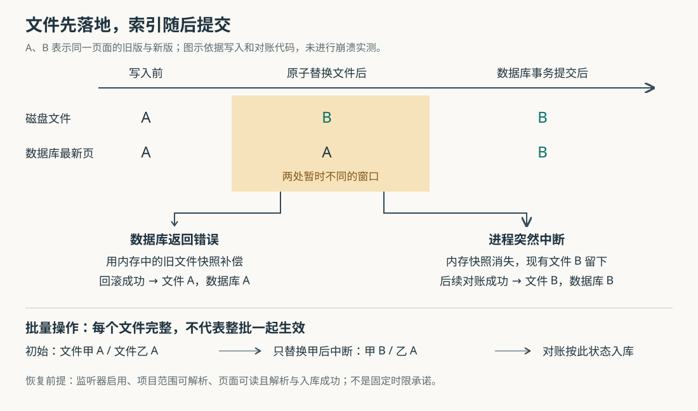
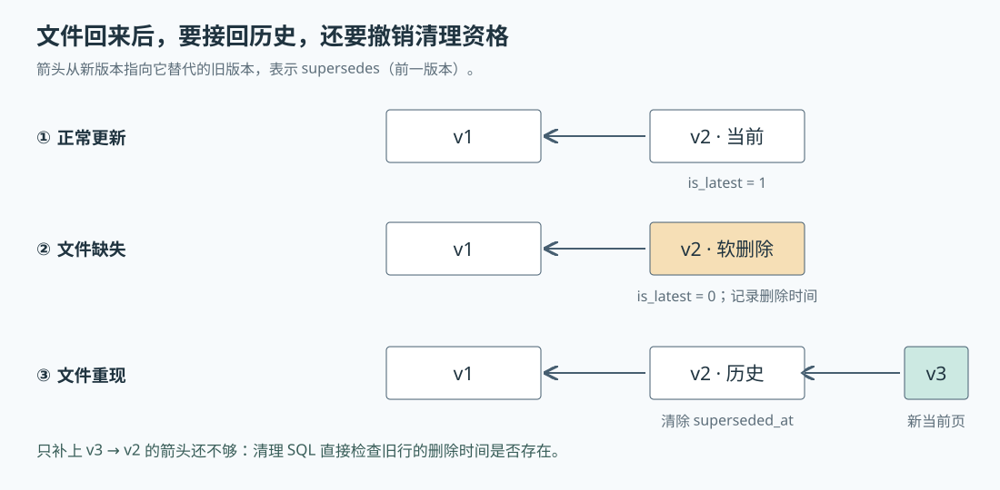

# ai-memory 的页面改了一半会怎样：文件、索引与删除恢复的真实边界

假设你把项目记忆里的“接口超时设为 30 秒”改成“改用分阶段超时”，服务刚写好 Markdown 文件就退出了。下一次 Agent 搜索时，会看到旧结论还是新结论？如果同时更新两篇互相引用的说明，或者删掉一篇过时页面，结果还一样吗？

这些是本文自拟场景。ai-memory 把可阅读的知识放在 Markdown 文件中，把检索所需的页面副本、版本和关联放在 SQLite 数据库中。源码给出的处理方式是：**写入时先换文件，再提交数据库；数据库返回失败时尝试恢复文件，进程突然中断后则依靠后续对账接受磁盘现状。** 这保护了普通文件作为知识来源的地位，却不等于文件、数据库和 Git 历史能够一起成功、一起失败。

首篇研报已经串起记忆采集、整理、检索与交接。本篇继续研究一个更窄的问题：页面在写入、手工编辑、删除和恢复之间，哪些状态受到保护，哪些窗口仍需使用者理解。依据仍是执行器提供的源码快照 `5519b89cc653bec4cfccbb770c6b4e5dcfcda759`；历史研报只用于辨别已覆盖内容，以下结论重新核对了当前实现。本次只读源码、测试和设计文档，没有启动服务、运行项目测试或进行断电与崩溃实验。下文源码链接使用该快照，便于复核。

## 同一篇记忆，读取与搜索走不同的路

先看一个容易被忽略的事实：数据库不只是保存几个关键词，它也保存页面正文。因此系统里同时有磁盘正文和数据库正文，读取入口需要决定取哪份。

Agent 调用 `memory_read_page` 读取完整页面时，服务端先解析并授权项目范围，再优先用 `Wiki::read_page` 读取磁盘。如果文件不存在，就尝试从数据库的当前页面记录返回正文，并在结果中注明 `served_from: "db-fallback"`。其他磁盘错误不会统一降级成数据库读取，例如路径安全检查失败不能被这条回退绕过。

搜索则从数据库出发。普通页面全文查询把全文索引与页面表连接，再筛选 `is_latest = 1` 等条件；`is_latest` 表示这条记录是否为当前版本。于是，当你刚手改文件、监听器尚未更新数据库时，直接读页面可能得到新正文，搜索却仍按旧正文匹配。**“文件是权威来源”在这里说明同步与恢复的方向，不表示每次读取都来自同一个即时快照。** [依据：`memory_read_page`](https://github.com/akitaonrails/ai-memory/blob/5519b89cc653bec4cfccbb770c6b4e5dcfcda759/crates/ai-memory-mcp/src/server.rs)、[`ReaderPool::search_pages` 所在实现](https://github.com/akitaonrails/ai-memory/blob/5519b89cc653bec4cfccbb770c6b4e5dcfcda759/crates/ai-memory-store/src/reader.rs)。

这也解释了为什么文件监听不是附属功能。它是让人工编辑重新进入搜索体系的连接处。

## 一次写入，分三层保护

通过 MCP——模型上下文协议，也就是 Agent 调用记忆工具的接口——执行 `memory_write_page` 时，请求最终进入 `Wiki::write_page` 或带条件的 `Wiki::write_page_if`。主要调用链是：

`memory_write_page → write_page_in_scope → Wiki::write_page_inner → WriterHandle → ops::upsert_page_in_tx`

这条路径分别处理三件不同的事。

**第一层，先决定究竟允许写入什么。** Wiki 层检查路径是否限制在项目目录内、能否在支持的平台安全落盘，并对正文脱敏。配置了准入回调时，外部服务可以修改或拒绝页面；回调返回后再次脱敏，再提取标题、链接、实体和过期时间。实体是页面元数据明确列出的技术名词等对象，并非在此处任意推断出的事实。这样最终落盘的正文与进入索引的正文来自同一份处理结果。[依据：`Wiki::write_page_inner`](https://github.com/akitaonrails/ai-memory/blob/5519b89cc653bec4cfccbb770c6b4e5dcfcda759/crates/ai-memory-wiki/src/wiki.rs)。

**第二层，让同一路径的内部写入按顺序完成。** 它先取得 Wiki 范围的共享变更锁，再取得由“工作区、项目、页面路径”组成的页面锁。前者与项目移动、保留清理等需要独占操作的流程协调；后者让同页写入与重新索引串行执行，而不同页面仍可推进。重新索引从读取文件之前就持有页面锁，直到数据库更新结束，避免拿着旧文件内容，在另一个写入完成后反过来覆盖索引。

这里的锁由同一个 `Wiki` 实例及其克隆共享。外部编辑器不会取得这把锁，读页面也没有因此变成持锁快照读取。不能把这套保证扩大成“所有来源、所有进程的操作都统一排队”。[依据：`Wiki::lock_page`、`reindex_page_locked` 与页面锁字段](https://github.com/akitaonrails/ai-memory/blob/5519b89cc653bec4cfccbb770c6b4e5dcfcda759/crates/ai-memory-wiki/src/wiki.rs)。

**第三层，在数据库内部一起更新版本与检索关系。** `WriterHandle` 把命令交给独立写入线程，`ops` 层在数据库事务内执行更新。事务在这里指一组数据库修改共同提交或撤销：旧版本失去当前标记，新的页面记录指向它替代的旧版本，实体、链接、证据关联和审计也随之更新。

全文索引使用 SQLite 的 FTS5，即按词语查找文本的索引模块。它通过数据库触发器——页面插入、修改或删除时自动执行的 SQL——跟随页面表变化，因此这一部分与页面数据处于同一事务中。**可选的向量索引不在这个事务里。** 向量是模型把文本转换成的数值表示，用于按相似含义搜索；相关调用发生在页面提交、释放锁之后。[依据：`WriterHandle::spawn` 与命令分发](https://github.com/akitaonrails/ai-memory/blob/5519b89cc653bec4cfccbb770c6b4e5dcfcda759/crates/ai-memory-store/src/writer.rs)、[`upsert_page_in_tx`](https://github.com/akitaonrails/ai-memory/blob/5519b89cc653bec4cfccbb770c6b4e5dcfcda759/crates/ai-memory-store/src/ops.rs)、[全文索引触发器](https://github.com/akitaonrails/ai-memory/blob/5519b89cc653bec4cfccbb770c6b4e5dcfcda759/crates/ai-memory-store/migrations/V17__pages_fts_index_path.sql)。

## 锁能防交错，版本条件才能防旧内容覆盖新内容

假设两个 Agent 都读过旧版页面。甲先补充了一条结论，乙随后拿旧正文重写，即使两次写入严格串行，乙仍可能覆盖甲的新内容。页面锁解决的是操作交错，不能自行判断乙的依据已经过时。

ai-memory 为此提供条件写入：读取结果里的 `page_id` 是数据库页面版本标识，调用方把它作为 `expected_page_id` 带回，要求“只有当前版本仍是我读过的这一版才写入”。新页面可用 `create_only: true`，要求当前没有页面；两个条件不能同时使用。冲突会返回 `precondition_failed` 和当前版本信息，交给调用方重新读取并决定怎样合并。

Wiki 在有读取连接时先检查一次，避免普通冲突触碰文件；真正有约束力的检查在数据库事务里再次执行。如果第二次检查才发现冲突，就尝试把已替换文件恢复。没有预检查所需的读取连接时，数据库检查仍然存在。[依据：`write_page_in_scope`、`page_precondition`、`precondition_failed`](https://github.com/akitaonrails/ai-memory/blob/5519b89cc653bec4cfccbb770c6b4e5dcfcda759/crates/ai-memory-mcp/src/server.rs)、[`Wiki::write_page_inner`](https://github.com/akitaonrails/ai-memory/blob/5519b89cc653bec4cfccbb770c6b4e5dcfcda759/crates/ai-memory-wiki/src/wiki.rs)、[`ops::upsert_page_if`](https://github.com/akitaonrails/ai-memory/blob/5519b89cc653bec4cfccbb770c6b4e5dcfcda759/crates/ai-memory-store/src/ops.rs)。

这个条件是可选的，普通写入不会自动获得“防止旧修改覆盖新修改”的语义。它比较的也是**数据库版本**：尚未被监听器入库的外部编辑不会改变版本标识。另外，`memory_read_page` 查询版本标识与读取文件是两个动作，没有放在同一页面锁内。由此推断，这套机制适合协调经服务写入的协作修改，但不能当作覆盖任意外部编辑的完整冲突协议。

## 中断发生在哪里，决定恢复后接受什么

文件替换由 `atomic::write_atomic` 完成：在同目录写临时文件，执行数据同步，再用重命名替换目标文件，并尽力同步父目录。它的目标是避免目标页面出现写了一半的正文；父目录同步错误被忽略，因此不能据此承诺各种文件系统与断电情况下的绝对持久性。

替换前，Wiki 还读取旧文件字节，保存在内存中的 `InstalledFile.previous`。随后才向数据库提交新版本。这里没有一个横跨文件系统与数据库的共同事务，补偿全靠调用流程继续运行。[依据：`atomic::write_atomic`](https://github.com/akitaonrails/ai-memory/blob/5519b89cc653bec4cfccbb770c6b4e5dcfcda759/crates/ai-memory-wiki/src/atomic.rs)、[`replace_file_with_rollback_snapshot` 与 `rollback_installed_files`](https://github.com/akitaonrails/ai-memory/blob/5519b89cc653bec4cfccbb770c6b4e5dcfcda759/crates/ai-memory-wiki/src/wiki.rs)。

| 中断或失败位置 | 已经发生的变化 | 后续行为与边界 |
| --- | --- | --- |
| 文件替换完成，数据库明确返回错误 | 文件是新版，数据库事务未提交 | 调用方尝试恢复旧文件；回滚也失败时返回 `INCONSISTENT STATE`，同时包含两次失败原因 |
| 文件替换完成，数据库提交前进程突然退出 | 新文件可能保留，旧数据库版本仍在；内存快照消失 | 后续成功对账会按现存文件建立版本，不会自动恢复旧正文 |
| 数据库提交完成，向量生成或存储失败 | 文件、页面记录及全文索引已更新 | 记录警告并尽力登记失败，页面写入仍成功；向量另行补齐 |
| 页面写入成功，Git 检查点失败 | 当前页面与数据库已更新 | MCP 路径记录警告，检查点结果为空，不撤销页面 |

第二行是根据写入顺序与对账实现推导的恢复结果，本次没有故障注入实测。它也有前提：文件可读、项目范围可解析、页面能解析并成功入库，且监听器没有被关闭。

还需收窄“错误会回滚”的说法。底层原子写入在重命名之后仍会执行 `sync_data`；如果这一步报错，上层可能尚未拿到完整的安装记录，不能保证按数据库失败分支恢复文件。因此，源码支持的是对特定失败路径的补偿，不能推成“只要接口报错，磁盘就一定没变化”。[依据：`atomic::write_atomic`](https://github.com/akitaonrails/ai-memory/blob/5519b89cc653bec4cfccbb770c6b4e5dcfcda759/crates/ai-memory-wiki/src/atomic.rs)、[`embed_page_version`](https://github.com/akitaonrails/ai-memory/blob/5519b89cc653bec4cfccbb770c6b4e5dcfcda759/crates/ai-memory-wiki/src/wiki.rs)、[`checkpoint_or_warn`](https://github.com/akitaonrails/ai-memory/blob/5519b89cc653bec4cfccbb770c6b4e5dcfcda759/crates/ai-memory-mcp/src/server.rs)。

### 批量写入只在数据库内保持整批提交

`Wiki::apply_batch` 用于一次保存多篇页面。它先准备所有正文与临时文件，再按稳定顺序取得页面锁，逐个安装文件，最后调用 `upsert_pages_batch`，在一个数据库事务里提交整批页面。如果安装中途或 SQL 返回失败，程序逆序补偿已经安装的文件。

但进程如果在“文件甲已换、文件乙未换”时退出，回滚代码不会执行。后续对账看到的就是甲新版、乙旧版，并分别入库。**每篇文件完整、数据库批次完整，仍不能推出整批业务修改在崩溃后完整。** 如果两篇页面共同表达一个不可拆分的决策，这个边界就有实际意义。[依据：`Wiki::apply_batch`](https://github.com/akitaonrails/ai-memory/blob/5519b89cc653bec4cfccbb770c6b4e5dcfcda759/crates/ai-memory-wiki/src/wiki.rs)、[`ops::upsert_pages_batch`](https://github.com/akitaonrails/ai-memory/blob/5519b89cc653bec4cfccbb770c6b4e5dcfcda759/crates/ai-memory-store/src/ops.rs)。

实现没有为整个批次留下持久的“进行中”恢复记录；至少在本文跟踪的写入与监听恢复路径中，未见重启后统一提交或撤销这些文件的协议。这是对该路径的判断，并非对全部生命周期命令的概括。

## 对账接受现存文件，却谨慎解释文件缺失

`WatcherHandle::start` 启动文件监听任务。创建、修改等事件经过 300 毫秒的合并窗口后进入重新索引；另有每 30 秒的目录扫描，补上遗漏通知。循环明确跳过首次立即触发的计时，因此这里并不是“启动时先扫完全部页面，才对外服务”。这些时间是调度配置，也不是恢复时限承诺：同一循环处理事件、扫描与索引，实际完成还受工作量和错误影响。

扫描会排除范围清单 `_meta.md`、待审核目录、原始事件日志等保留内容，也跳过数据库不认识的项目目录。正常页面读入后，重新提取元数据，再调用 `upsert_page_from_disk`。重复扫描不会单凭时间流逝制造版本：数据库比较正文的 SHA-256 摘要——根据正文计算的内容指纹——以及元数据、标题、记忆层级和固定标记；忽略每版生成时间后均相同时，沿用当前版本。[依据：`run_loop`、`handle_event`、`reconcile`](https://github.com/akitaonrails/ai-memory/blob/5519b89cc653bec4cfccbb770c6b4e5dcfcda759/crates/ai-memory-wiki/src/watcher.rs)、[`upsert_page_in_tx`](https://github.com/akitaonrails/ai-memory/blob/5519b89cc653bec4cfccbb770c6b4e5dcfcda759/crates/ai-memory-store/src/ops.rs)。

删除则刻意不对称。收到文件删除事件时，监听器只报告路径供之后的 Git 提交使用，不直接删除数据库页面。默认周期扫描也不因缺文件而清索引。这既解释了旧搜索结果为什么可能留下，也解释了读取页面为什么还能走数据库回退。

需要文件缺失影响索引时，可打开 `reconcile_tombstones_deleted_pages`。它不会马上硬删正文，而是把当前版本改为非当前，并记录删除时间。这种保留记录的删除方式称为**软删除**；留下的标记常称“墓碑”。实现采取了以下约束：

- 扫目录前先取得数据库候选快照，避免把扫描期间新写入的页面算成缺失。
- 只考虑扫描原本就能发现的页面形态；会话摘要 `sessions/<会话标识>.md` 也被排除，不能假定所有 Markdown 都受同样处理。
- 对同一版本累计两次有效的缺失观察；中间不完整或可疑扫描不累计，也不一定清零，因而不是严格的连续两次计时触发。
- 扫描一个文件也没找到时直接停止该范围的删除判断；缺失数严格大于 `max(3, ceil(候选数 × 0.5))` 时也停止，避免把目录或挂载异常当作批量删除。
- 真正落标记前，在独占变更锁内复查版本仍相同、文件仍不存在；数据库更新再次带版本条件。

这意味着，即便开了此选项，手工删空整个项目也可能一直触发保护而不清掉索引。它的设计目标是保守补偿少量缺失，不是把目录镜像成数据库的无条件同步器。上述阈值以实际比较表达式为准，不能从注释中“半数缺失”的概述推成“达到半数就必定触发”。[依据：`reconcile_missing_pages`、`could_have_been_walked`](https://github.com/akitaonrails/ai-memory/blob/5519b89cc653bec4cfccbb770c6b4e5dcfcda759/crates/ai-memory-wiki/src/watcher.rs)、[`tombstone_missing_page_if_latest`](https://github.com/akitaonrails/ai-memory/blob/5519b89cc653bec4cfccbb770c6b4e5dcfcda759/crates/ai-memory-wiki/src/wiki.rs)。

另外，扫描中的单页索引失败只会记录警告并继续，整个扫描仍可能返回成功。循环累计多次整体失败才发出的降级日志，不能覆盖所有“某一页持续无法更新”的情况；排查时还应看逐页警告。

## 被判为缺失的文件回来后，历史怎样避免被误清

假设一次短暂目录异常最终导致页面被软删除，之后文件重新出现。只把新版插回数据库还不够：旧版如果继续带着可清理标记，后台保留任务以后仍可能删除那段历史。

当前 `upsert_page_in_tx` 在同一路径没有当前版本时，会查找最近的软删除记录。写入新版时做两个动作：把新版的 `supersedes` 指向旧记录，让它继续属于同一条版本链；同时清除旧记录的 `superseded_at`，撤销它作为老化删除起点的资格。这里两个名字容易混淆：`supersedes` 指向前一版本，`superseded_at` 在这条实现里承担软删除时间标记，普通编辑并不会给旧版填这个字段。

清除标记是关键，因为 `hard_delete_decayed_page_chain` 的 SQL 直接检查删除起点是否非当前、是否有删除时间、是否早于清理截止时间，并沿前一版本关系删除祖先；只增加一条“新版指向旧版”的关系不能替代资格撤销。Wiki 在准备清理时若发现磁盘文件已回来、数据库却没有当前版本，也会先重新索引，再让数据库复核清理条件。[依据：`upsert_page_in_tx`、`most_recent_tombstone_at_path`、`hard_delete_decayed_page_chain`](https://github.com/akitaonrails/ai-memory/blob/5519b89cc653bec4cfccbb770c6b4e5dcfcda759/crates/ai-memory-store/src/ops.rs)、[`Wiki::hard_delete_decay_tombstone`](https://github.com/akitaonrails/ai-memory/blob/5519b89cc653bec4cfccbb770c6b4e5dcfcda759/crates/ai-memory-wiki/src/wiki.rs)。

这是一个可以迁移的设计思想：**误判恢复既要恢复可见内容，也要恢复它在后续维护流程中的正确身份。** 否则，页面今天看似恢复了，旧清理任务过段时间仍可能伤到历史。该结论来自数据结构与清理条件的配合，不是对实际丢失事故的宣称。

也不能把这里的软删除理解为永久存档。如果文件始终不回来，记录仍可进入普通老化清理路径，按保留条件硬删除数据库版本链；Git 历史是另一层保存，不随此动作自动抹除。

### 主动删除与彻底清理又是不同语义

普通 `Wiki::delete_page` 先把文件移到同目录的 `.ai-memory-delete.*` 隔离名称，再删除该路径的数据库版本；数据库失败时尝试移回，成功后再移除隔离文件。隔离内容并非持久恢复日志：在已移走文件、尚未完成数据库删除时进程退出，会留下原路径缺失与旧数据库记录仍在的窗口。根据本文读取的路径，未见启动时自动把隔离文件映射回原路径的流程，不能据此许诺自动完成或撤销删除。[依据：`remove_page_locked`、`quarantine_file`、`restore_quarantined_file`](https://github.com/akitaonrails/ai-memory/blob/5519b89cc653bec4cfccbb770c6b4e5dcfcda759/crates/ai-memory-wiki/src/wiki.rs)。

会话彻底清理则先在数据库中提交删除并保留会话清理标记，再尽力移除相关文件，文件失败单独报告。随后磁盘重新索引会在自己的数据库事务内检查该标记，阻止残留自动摘要重新进入索引；已经保留下来的人工替代页面有更细的例外条件。因此，**磁盘存在不是无限制的恢复授权**，文件作为知识来源还要服从明确的删除意图。[依据：`purge_session_with_owner`](https://github.com/akitaonrails/ai-memory/blob/5519b89cc653bec4cfccbb770c6b4e5dcfcda759/crates/ai-memory-wiki/src/wiki.rs)、[`ops::upsert_page_from_disk`](https://github.com/akitaonrails/ai-memory/blob/5519b89cc653bec4cfccbb770c6b4e5dcfcda759/crates/ai-memory-store/src/ops.rs)。

这个保护依赖数据库仍保有清理标记。若只拿仍含残留文件的 Wiki 去重建干净数据库，不能期待从文件推导出原数据库里的删除意图。

## “重新索引”也有两种用途，不能混用

后台 `reindex_page` 是持续同步单页：保留现有数据库状态，按磁盘内容更新派生记录。命令行 `ai-memory reindex` 则是恢复工具，要求其他相关进程停止，并拒绝向非空数据库重建。它读取目录里的 `_meta.md`，重建工作区、项目标识和当前页面，再另行计算可选向量。

它不恢复会话、原始观察、交接、用户、审计、访问计数等数据库独有内容，也不能仅凭当前文件恢复完整数据库版本链。因此，“搜索暂时没更新”不应直接等同于“应该丢掉数据库再重建”；后者改变了恢复范围。[依据：`reindex::run` 及其非空库检查](https://github.com/akitaonrails/ai-memory/blob/5519b89cc653bec4cfccbb770c6b4e5dcfcda759/crates/ai-memory-cli/src/commands/reindex.rs)、[`Wiki::reindex_all`](https://github.com/akitaonrails/ai-memory/blob/5519b89cc653bec4cfccbb770c6b4e5dcfcda759/crates/ai-memory-wiki/src/wiki.rs)。

可选向量还有独立恢复节奏。重新索引通常只给真正产生的新版本计算向量；未变化页面不会每次扫描都重算。向量写入失败后，不能期待下一次无变化扫描自然补齐，需要手动 `embed` 或启用定时补齐。当前配置的 `embedding_backfill_interval_secs` 默认是 `0`，也就是该定时任务默认关闭。[依据：`reindex_page_locked`、`embed_page_version`](https://github.com/akitaonrails/ai-memory/blob/5519b89cc653bec4cfccbb770c6b4e5dcfcda759/crates/ai-memory-wiki/src/wiki.rs)、[`MaintenanceSettings::default`](https://github.com/akitaonrails/ai-memory/blob/5519b89cc653bec4cfccbb770c6b4e5dcfcda759/crates/ai-memory-cli/src/config.rs)。

## 测试支持的契约，以及使用时怎样判断

本次阅读了测试正文与断言，但没有执行。几组测试与上面的机制直接对应：

| 已读测试 | 实际断言 | 不能由此推导的保证 |
| --- | --- | --- |
| `reindex_page_lock_serializes_write_through_the_upsert` | 人为暂停重新索引，另一个同页写入必须等待；最后文件、数据库胜出版本与前一版本关系相符 | 外部编辑器也受页面锁保护 |
| `apply_batch_rolls_back_files_when_sql_batch_fails` | 注入不存在作者造成的外键错误后，已有文件恢复、新建文件移除、旧数据库正文保留 | 杀进程时整批文件也一起回滚 |
| `a_write_lands_only_on_the_version_it_saw` | 旧版本条件被拒绝，页面保留较新内容；没有 Wiki 预检查读取连接时仍成立 | 每个调用方默认使用版本条件 |
| `reconcile_delete_tombstones_only_after_two_consecutive_missing_passes` | 保留控制页面的场景中，第一次缺失不软删，第二次才软删 | 空目录或可疑扫描也会按同一节奏清理 |
| `reconcile_tombstone_resurrects_instead_of_orphaning_on_recreate` | 新版接回旧版、旧删除时间清空，之后硬删除调用删除零行 | 被软删后再也不重写的内容永久保留 |

前三类相关实现与测试在 [`wiki.rs`](https://github.com/akitaonrails/ai-memory/blob/5519b89cc653bec4cfccbb770c6b4e5dcfcda759/crates/ai-memory-wiki/src/wiki.rs) 和 [`mcp/server.rs`](https://github.com/akitaonrails/ai-memory/blob/5519b89cc653bec4cfccbb770c6b4e5dcfcda759/crates/ai-memory-mcp/src/server.rs)，后两类分别在 [`watcher.rs`](https://github.com/akitaonrails/ai-memory/blob/5519b89cc653bec4cfccbb770c6b4e5dcfcda759/crates/ai-memory-wiki/src/watcher.rs) 与 [`store/ops.rs`](https://github.com/akitaonrails/ai-memory/blob/5519b89cc653bec4cfccbb770c6b4e5dcfcda759/crates/ai-memory-store/src/ops.rs)。这些是已有测试表达的契约，本文没有把它们当作本次验证通过的结果。

由此可以给出几条与机制直接相连的实践建议：

- 多个 Agent 修改同页时，显式携带 `expected_page_id`，冲突后重读并合并。只依赖写入排队仍会丢失他人的修改意图。
- 手工编辑后，允许索引完成同步；若正文已变、搜索仍旧，先查项目范围、监听状态、解析错误和逐页警告。手工删文件则要另行判断，不能假定它等同于主动删除。
- 对跨多页不可拆分的结论，保留可识别的共同状态或人工检查步骤。当前批量接口的数据库事务无法替代跨文件的崩溃恢复协议。
- 恢复与备份应按所需状态选择。Wiki 适合保留可读知识；完整恢复还需要数据库及相应备份安排。涉及删除意图时，还要考虑残留文件和数据库标记是否一起保留。

ai-memory 这一设计适合把知识保存在可人工检查、可迁移的普通文件中，同时借助数据库完成高效检索与版本管理。它付出的成本，是必须持续处理两份正文之间的时间差，以及删除、恢复和维护任务之间的状态关系。源码中最值得借鉴的并非“用文件加数据库”这个组合本身，而是把不同承诺分别落实：同页交错用锁约束，旧修改覆盖用版本条件约束，数据库关联用事务约束，运行中失败用补偿处理，文件重现则同时修复版本链与清理资格。仍未被这些机制覆盖的进程中断窗口，需要作为系统边界明确保留。
