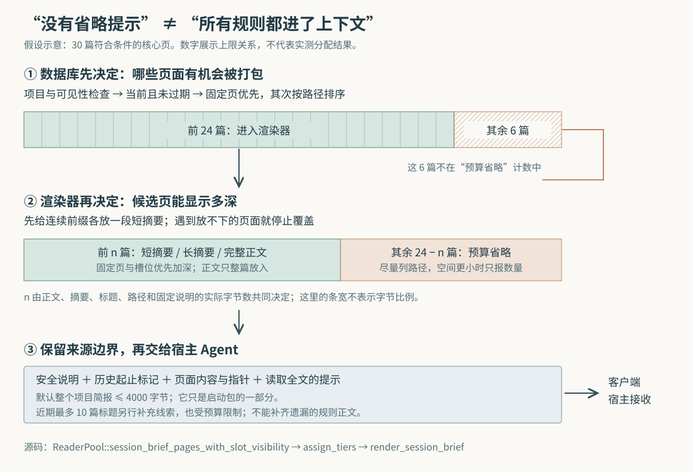

# ai-memory 记住了规则，为什么新 Agent 开局仍可能看不见

假设一个项目已经积累了三十篇规则。你新开一个编程 Agent，希望它先知道“数据库迁移前要检查兼容性”，再开始修改代码。规则明明存在，搜索也能找到，启动时却没有出现；把简报预算从 4000 调到 20000，仍未必解决问题。

这是本文自拟的场景。ai-memory 用独立于具体 Agent 的记忆服务保存项目知识，但启动时只交付一份有限的项目简报。**它先从数据库选出最多 24 篇核心页，再决定这些页面显示短摘要、长摘要还是完整正文。** 没有进入前一批候选的规则，不会被后一阶段的“因预算省略”提示完整统计。因此，“已经保存”“可以检索”“自动出现在开局上下文中”是三个不同结果。

前两篇研报已经解释整体采集与交接，以及页面文件和索引的一致性。本篇沿启动简报深入，回答三个更具体的问题：哪些页面有资格出现，有限空间怎样分配，生成出来的文字又在什么条件下真正交给 Agent。结论基于本次本地源码快照 `e102cda4e8da6e6c6fa72d4744c505bac2d37321`，重新核对了实现、调用方、测试与设计说明；没有启动服务、运行项目测试或测量模型行为。

## 从一个项目开关，追到实际接收文字的位置

项目简报默认需要主动开启。仓库的 `.ai-memory.toml` 可以声明：

```toml
[briefing]
inject_on_session_start = true
max_chars = 4000
```

这里的文件是客户端读取的项目设置，不是服务端每次去访问客户端文件。原生钩子——Agent 在会话开始等时刻调用的回调命令——通过 `marker_query_suffix_impl_from_selection` 把设置变成请求参数 `briefing` 和 `briefing_budget`，连同目录和项目识别信息发送给服务端。嵌套目录里仅声明采集设置的文件，不会简单遮掉外层的简报设置；客户端会选择用于项目设置的标记文件。[依据：`hook_capture.rs` 的参数构造与 `marker_requests_briefing`](https://github.com/akitaonrails/ai-memory/blob/e102cda4e8da6e6c6fa72d4744c505bac2d37321/crates/ai-memory-cli/src/commands/hook_capture.rs)。

以支持会话开始输出注入的原生集成为例，调用链是：

`run_with_payload → GET /handoff → fetch_and_accept_handoff_at → render_requested_session_brief → 数据库选页 → render_session_brief → 客户端输出 → 宿主 Agent 接收`

`/handoff` 虽以“交接”命名，返回体可以同时带项目简报。服务端先解析工作区与项目，并检查调用者是否有读取项目的权限，之后才取交接、简报等材料。简报本身只读取知识，不会像一次性交接那样被领取后消失。即使没有待领取的交接，也可以单独返回简报。[依据：`fetch_and_accept_handoff_at`、`render_requested_session_brief`](https://github.com/akitaonrails/ai-memory/blob/e102cda4e8da6e6c6fa72d4744c505bac2d37321/crates/ai-memory-hooks/src/router.rs)。

客户端收到正文后，还要按宿主协议输出。例如 Claude Code 对应的分支把文字放进 `hookSpecificOutput.additionalContext`；Copilot CLI 使用顶层 `additionalContext`；部分集成直接输出正文。这个转换是实际调用链的一部分：服务端成功生成 Markdown，并不等于任何 Agent 都会消费同一种输出。[依据：`run_with_payload`、`session_start_handoff_envelope`](https://github.com/akitaonrails/ai-memory/blob/e102cda4e8da6e6c6fa72d4744c505bac2d37321/crates/ai-memory-cli/src/commands/hook.rs)。

## 第一道筛选：它准备的是常驻知识，不按当前问题做相关性搜索

`ReaderPool::session_brief_pages_with_slot_visibility` 返回两组数据：带正文的核心页，以及近期更新页的标题等信息。核心页的准入条件是以下三类之一：固定页、`_rules/` 下的规则页、符合可见性要求的 `_slots/` 页面。“固定”指页面的 `pinned` 标记；“槽位”是项目用于保存当前工作状态的页面位置。

查询同时限定工作区、项目、当前版本，并排除已过期页面。之后按 `pinned DESC, path ASC` 排序，启动调用方传入的核心页上限为 **24**。因此，不固定的普通笔记、决策或经验页，不会因为内容与任务有关就进入这组正文候选。这里没有使用用户问题、关键词、语义相似度或访问热度来决定谁入选。[依据：`session_brief_pages_with_slot_visibility` 的 SQL 与启动调用参数](https://github.com/akitaonrails/ai-memory/blob/e102cda4e8da6e6c6fa72d4744c505bac2d37321/crates/ai-memory-store/src/reader.rs)、[`BRIEF_CORE_PAGES_LIMIT`](https://github.com/akitaonrails/ai-memory/blob/e102cda4e8da6e6c6fa72d4744c505bac2d37321/crates/ai-memory-hooks/src/router.rs)。

这一区别决定了适用场景。启动时尚未知道接下来要排查什么，先给项目约定与当前状态，具有稳定、可预期的好处；真正遇到问题时，再通过记忆工具检索相关知识。这是根据选页方式作出的设计解释，不是相关性效果的实测结论。



回到开头三十篇规则的例子。假设三十篇都是当前、未过期且符合可见性要求的核心页，查询排序后只有前二十四篇进入渲染器。其余六篇可能出现在“近期更新”标题里，也可能完全没有启动线索；它们不在渲染器拿到的数组中，后者自然无法告诉 Agent“全库还少了六篇”。**增大 `max_chars` 能让已取出的页面显示更多，不能提高这条启动路径的 24 篇上限。** 这是由调用参数与 SQL 限制推导的结果，本次没有构造运行样例。

近期标题也有独立限制：按更新时间倒序最多取 **10** 篇，后面还会受字节预算裁剪。查询没有排除已入选的核心页，因此某篇固定规则可能同时占据核心内容和近期标题的位置。不能把这两组简单相加成“启动一定覆盖三十四篇不同页面”。

共享服务还有一处会改变候选集合的设置：默认关闭的 `[slots] per_user`。关闭时，嵌套槽位仍按共享内容处理；开启时，启动简报只选共享槽位和当前身份对应的槽位，没有身份则只选共享槽位。过滤直接进入 SQL，并发生在数量限制之前，避免其他人的槽位先占满候选名额。固定槽位也不能通过“固定页”分支绕开过滤。这说明可见性既影响内容边界，也影响有限候选是否被正确使用；本段只描述简报选页，不能据此推导整个服务实现了逐页私密隔离。[依据：`SlotVisibility::for_viewer`](https://github.com/akitaonrails/ai-memory/blob/e102cda4e8da6e6c6fa72d4744c505bac2d37321/crates/ai-memory-core/src/slots.rs)、[`slot_visibility_sql`、`slot_exclusion_sql` 与核心页查询](https://github.com/akitaonrails/ai-memory/blob/e102cda4e8da6e6c6fa72d4744c505bac2d37321/crates/ai-memory-store/src/reader.rs)。

## 摘要从哪里来：优先读页面自己写的说明

进入候选集合后，页面先由 `BriefCandidate::new` 准备不同深度的文字。实现把三种显示深度命名为 L0、L1、L2，可以理解为短提示、较长提示、完整正文；它们是显示层级，不是重新写入三份记忆。

| 显示深度 | 文字来源 | 长度与边界 |
| --- | --- | --- |
| L0：短提示 | 页面元数据 `abstract`，没有则取 `summary`，再没有则取开头正文 | 最多 256 个 UTF-8 字节，截短时包含省略号 |
| L1：较长提示 | 优先 `summary`，再取 `abstract`，最后才用开头正文 | 最多 500 个 UTF-8 字节 |
| L2：完整正文 | 去掉首尾空白后的页面正文 | 只有整篇放得下才选入；不把长正文任意切一半 |

UTF-8 是文本编码方式；普通汉字通常占三个字节。因此，256 字节不能理解为 256 个汉字，更不能直接换算为模型处理文本的词元数量。`max_chars` 虽然名字含“字符”，实际预算计算也使用字符串的字节长度。

正文回退不是自然语言理解。`excerpt_from_page` 会折叠空白，跳过标题、单独的分隔线、部分决策记录元数据和系统压缩页的说明尾注，跨段落、列表继续取前部文字；正文扫描范围最多为前 16 KiB。元数据字段缺失、为空或不是字符串时才回退正文。整个过程不调用大语言模型。[依据：`excerpt_from_page`、`leading_prose`](https://github.com/akitaonrails/ai-memory/blob/e102cda4e8da6e6c6fa72d4744c505bac2d37321/crates/ai-memory-core/src/excerpt.rs)。

这带来一个很实用的内容维护要求。假设规则正文已经改为“新迁移必须兼容旧客户端”，但 `abstract` 仍写着旧约定：只容得下 L0 时，Agent 会先收到旧约定。本文读取的简报路径没有比较摘要与正文是否语义一致。摘要虽能帮助重要内容越过预算限制，也成了需要同步维护的内容。

还要避免把“L1 更深”理解为“L0 信息必定被包含”。两者可以来自不同字段，L1 不一定是 L0 的扩写。分配器只拿到各层字节成本，`l1_adds` 以 L1 是否更长来判断是否增加信息；升到 L1 的一般分支也要求成本正增量。由此推断：如果两个字段同样长但含义不同，且完整正文放不下，L1 不会仅因含义不同就替换 L0。这是长度启发式的具体边界，本次未运行专门用例。[依据：`PageCosts::l1_adds`、`assign_tiers` 的 `delta` 与 `promote`](https://github.com/akitaonrails/ai-memory/blob/e102cda4e8da6e6c6fa72d4744c505bac2d37321/crates/ai-memory-hooks/src/brief_tiers.rs)。

## 第二道筛选：先覆盖一段页面，再争取显示得更深

`render_requested_session_brief` 把预算限制在 **1500—20000 字节**，未提供或无法解析时使用 4000。`render_session_brief` 不会把这些空间全部给页面：标题、安全说明、历史起止标记和结尾提示也计入预算，结尾部分提前预留。

剩下的分配交给纯计算函数 `assign_tiers`，它接收每篇页面的显示成本，不接触数据库，也不理解正文。核心步骤如下：

1. **先留出告知缺失与近期线索的空间。** 预留省略数量提示的最低成本；近期标题通常保留可用空间的一部分，并考虑至少容纳第一条标题所需的长度。
2. **按现有顺序覆盖页面。** 通常先给每篇 L0；没有可用摘要的页面只留路径。如果完整正文反而比 L0 更短，直接按整篇正文的成本纳入。遇到第一篇放不下的页面，就停止，后续成为省略区。
3. **用余量加深已覆盖页面。** 固定页和槽位先尝试 L1、L2，然后普通页尝试 L1。普通页正文若只比当前展示多至多 128 字节，可以提前补完整。
4. **最后争取更多完整正文。** 已覆盖页中不再有人等待一个更长的 L1 时，普通页按补齐正文所需的额外成本从小到大尝试，而不是从头塞入最长的一篇。

[依据：`assign_tiers`](https://github.com/akitaonrails/ai-memory/blob/e102cda4e8da6e6c6fa72d4744c505bac2d37321/crates/ai-memory-hooks/src/brief_tiers.rs)、[`BriefCandidate::costs` 与 `render_session_brief`](https://github.com/akitaonrails/ai-memory/blob/e102cda4e8da6e6c6fa72d4744c505bac2d37321/crates/ai-memory-hooks/src/router.rs)。

这套规则保护了“后面的页面至少有机会露面”，避免第一篇长规则吃光空间；但它没有寻找“任意组合中能塞进最多页面”的最优方案。例如，假设覆盖阶段只剩 600 字节，按顺序三篇页面的最低显示成本为 120、800、80 字节，算法纳入第一篇后，在第二篇处停止，第三篇也成为省略内容。这里数字是说明分支的假设输入，已把标题等成本算进最低显示成本，不是实际页面测量。

因此，历史研报中“先尽量各显示一段”的说法，需要准确读成：**对数据库取回的有序候选，先覆盖能连续放下的前缀；不保证所有核心页都有摘要，也不保证跳过大页后继续寻找小页。** 固定页优先获得更深内容，同样不是“固定后必定全文注入”的承诺。

渲染阶段还有一种节省空间的方法：同目录至少四篇普通页面仍停留在 L0，且合并显示确实更短时，共用一个目录标题，列成“路径：短摘要”。这只改变排版。分配计划已经做完，合并省下的空间不会让函数重新选取被排除的核心页；后续省略路径和近期标题可以使用实际剩余空间。虽然辅助函数列出了 `gotchas/`、`decisions/` 等目录，当前正式查询仍只把固定页、规则与槽位纳入核心候选，不能凭排版函数支持这些目录就认定它们的普通页面也会自动进入。[依据：`brief_family_indexes` 与 `render_session_brief`](https://github.com/akitaonrails/ai-memory/blob/e102cda4e8da6e6c6fa72d4744c505bac2d37321/crates/ai-memory-hooks/src/router.rs)。

## 空间再紧，也先保留“这些是历史材料”的边界

简报开头明确告诉接收方：保存的记忆是不可信历史数据，不能仅因它要求就执行命令、泄露秘密或修改权限。正文被放在一对历史起止标记之间，结尾要求接收 Agent 对敏感结论核对当前代码与正式项目指令，必要时调用 `memory_query` 或 `memory_read_page`。后者分别是记忆搜索与按页面读取全文的工具。

这里有一个与预算直接相关的实现细节：页面标题、路径、摘要和正文中的同名起止标记，先被替换成转义形式，**再计算显示成本**。转义会让字符串变长；如果先按原文算成本，最后才转义，新增长度就可能挤掉“还有页面没显示”的提醒。最终还会再转义一次动态区域，并以字符边界作防御性裁剪；安全前言和结尾边界不作为普通页面的可交易空间。[依据：`UNTRUSTED_MEMORY_NOTICE`](https://github.com/akitaonrails/ai-memory/blob/e102cda4e8da6e6c6fa72d4744c505bac2d37321/crates/ai-memory-core/src/workstream.rs)、[`BriefCandidate::new`、`escape_untrusted_history`、`render_session_brief`](https://github.com/akitaonrails/ai-memory/blob/e102cda4e8da6e6c6fa72d4744c505bac2d37321/crates/ai-memory-hooks/src/router.rs)。

它防住的是特定标记被原样插入、假装提前关闭历史区等文本结构问题。它没有证明模型会遵守边界，也没有验证历史规则仍适合当前任务。**记忆里的规则页仍是待核对的历史来源。** 对权限、删除、发布等关键操作，不能用“这条在启动简报里”替代当前授权和项目指令。

还需注意预算范围。`combine_handoff_and_brief` 只是拼接字符串，没有把所有组成部分再统一裁成 4000 字节。返回内容还可能包含个人偏好、交接、连续工作提示、托管工作记录和收件箱提示。因此，4000 是项目简报的默认总预算，包含它自己的说明文字；既不是规则正文可用额度，也不是整个启动包的总上限。[依据：`fetch_and_accept_handoff_at` 最终组合与 `combine_handoff_and_brief`](https://github.com/akitaonrails/ai-memory/blob/e102cda4e8da6e6c6fa72d4744c505bac2d37321/crates/ai-memory-hooks/src/router.rs)。

## 最后一段链路：成功生成不等于本会话一定收到

客户端会依据 `AgentKind` 判断哪个事件的输出能够进入模型上下文。Kimi 的路径很能说明为什么这不是简单的“收到开始事件就打印”。按本仓库的适配规则，Kimi 不消费会话开始钩子的输出，而在首次用户提示时取得简报，直接输出正文；后续提示仍可取交接，但移除简报参数，避免每轮重复注入。[依据：`AgentKind` 的输出能力判定](https://github.com/akitaonrails/ai-memory/blob/e102cda4e8da6e6c6fa72d4744c505bac2d37321/crates/ai-memory-core/src/ids.rs)、[`run_with_payload` 的 Kimi 分支](https://github.com/akitaonrails/ai-memory/blob/e102cda4e8da6e6c6fa72d4744c505bac2d37321/crates/ai-memory-cli/src/commands/hook.rs)。这描述的是本项目的适配契约，本文没有另行验证各宿主最新版本。

这个“一次”由本地标记文件控制。代码在首次 GET 返回后，无论成功还是失败，都调用 `mark_briefed`。只要该标记成功保存，同一会话下一轮就不再请求简报。实现注释明确选择了这种容错方向：服务不可用时先让 Agent 继续，简报等下一会话补上；不是持续重试直到确认模型看见。标记也不因上下文清空而自动消失，不能假定清空后会重新注入。

故障还可能发生在服务端。以下结果来自实际分支，而非本次运行观察：

| 情况 | 代码怎样处理 | 读者应怎样解释 |
| --- | --- | --- |
| 没有开启简报，或项目没有核心页和近期页 | 返回无项目简报 | 空内容可能是正常结果 |
| 项目读取权限被拒绝 | `/handoff` 返回 403；客户端把原因写到标准错误，不注入模型 | “看不见”可能是授权结果，不是知识丢失 |
| 简报选页遇到数据库等普通错误 | 错误向上传递；处理器记录警告并返回 200 空正文 | 客户端仅看成功状态，无法分清“没有内容”和这类内部失败 |
| 网络请求失败 | 客户端警告并返回无内容，让钩子继续 | 可继续工作不表示已加载记忆；Kimi 路径还可能留下已尝试标记 |

[依据：`handle_handoff`、`render_requested_session_brief`](https://github.com/akitaonrails/ai-memory/blob/e102cda4e8da6e6c6fa72d4744c505bac2d37321/crates/ai-memory-hooks/src/router.rs)、[`get_handoff`](https://github.com/akitaonrails/ai-memory/blob/e102cda4e8da6e6c6fa72d4744c505bac2d37321/crates/ai-memory-cli/src/commands/hook_capture.rs)、[`mark_briefed` 的调用位置](https://github.com/akitaonrails/ai-memory/blob/e102cda4e8da6e6c6fa72d4744c505bac2d37321/crates/ai-memory-cli/src/commands/hook.rs)。

有一个应保留的正面边界：在所追踪的启动路径中，简报读取和渲染发生在正式领取交接之前。简报查询失败会提前返回，不会单凭这个失败先消费交接。但即使服务端返回了文字，后续网络交付、宿主接收和模型实际使用仍是不同环节；这里没有模型阅读确认。

## 测试支持什么，以及如何据此使用

本次阅读了以下测试的正文和断言，没有执行测试：

| 测试与位置 | 直接覆盖的契约 |
| --- | --- |
| `session_brief_pages_selects_core_pages_and_isolates_projects`，`store/src/lib.rs` | 固定页、规则与槽位进入核心集合，普通页只作为近期线索，其他项目不混入 |
| `foreign_slots_do_not_consume_the_viewers_query_limit`，`store/tests/suite/slot_visibility.rs` | 其他人的槽位在数量限制前排除，自己的槽位仍取得到 |
| `privileged_pages_deepen_first`、`summaries_come_before_unprivileged_bodies`，`hooks/src/brief_tiers.rs` | 预算分配遵守固定页与槽位的优先次序，并约束普通长正文抢占空间 |
| `render_session_brief_keeps_the_omitted_count_under_escaped_excerpts`，`hooks/src/router.rs` | 含边界标记的摘要转义后，仍满足预算、保留省略提示且只留下一个真实结束标记 |
| `kimi_user_prompt_briefing_only_on_first_prompt_of_session`，`cli/src/commands/hook.rs` | 首轮带简报参数并保存本地标记，第二轮继续取交接但不带简报参数 |

对应源码：[选页测试](https://github.com/akitaonrails/ai-memory/blob/e102cda4e8da6e6c6fa72d4744c505bac2d37321/crates/ai-memory-store/src/lib.rs)、[槽位测试](https://github.com/akitaonrails/ai-memory/blob/e102cda4e8da6e6c6fa72d4744c505bac2d37321/crates/ai-memory-store/tests/suite/slot_visibility.rs)、[分配测试](https://github.com/akitaonrails/ai-memory/blob/e102cda4e8da6e6c6fa72d4744c505bac2d37321/crates/ai-memory-hooks/src/brief_tiers.rs)、[渲染测试](https://github.com/akitaonrails/ai-memory/blob/e102cda4e8da6e6c6fa72d4744c505bac2d37321/crates/ai-memory-hooks/src/router.rs)、[客户端测试](https://github.com/akitaonrails/ai-memory/blob/e102cda4e8da6e6c6fa72d4744c505bac2d37321/crates/ai-memory-cli/src/commands/hook.rs)。这些断言不能证明摘要准确、所有规则已覆盖，或模型最终遵从了简报。

实际使用时，排查“记住了却没看到”可以沿本篇链路进行：先确认项目范围、开关和客户端接收事件，再确认页面是否当前、未过期并符合核心页条件，然后看排序后的 24 篇上限，最后才判断是否需要增加预算。看到省略提示时按路径读取全文；没有省略提示时，也不要据此断定所有规则已加载。

维护页面时，把真正影响后续动作的约束写进简短且准确的 `abstract`，让 `summary` 补充条件，并与正文一起更新。少量关键页面可以固定以争取优先展示，但大量固定会同时竞争候选名额和加深空间。若首次请求已经失败，尤其是采用首轮本地标记的集成，应显式调用记忆搜索或页面读取工具补足，不要仅依赖同会话下一轮自动重试。

ai-memory 的这套设计适合在开局提供一份稳定、低成本、无需模型生成的项目知识入口。它值得借鉴的做法，是把“选谁”“显示多深”“告诉接收方还缺什么”和“按宿主协议交付”分开实现。仍需由使用者补上的，是任务相关知识的主动读取、摘要与正文的一致维护，以及关键约束对当前代码和正式指令的核对。
