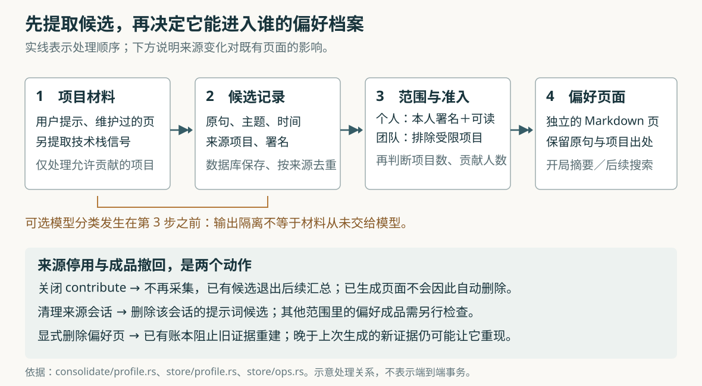

# ai-memory 怎样把项目要求变成跨项目偏好：准入、隔离与撤回边界

假设你在两个项目中都告诉编程 Agent：“安装依赖时一直用 pnpm。”第三个项目刚建立，Agent 就能沿用这个习惯，省去一次解释。但如果前两个项目只是客户要求如此，或者你后来改了主意，这份方便也可能变成每个新项目都要纠正的默认值。

这是本文自拟的场景。ai-memory 的跨项目偏好功能会从会话与项目页面中收集候选，把达到条件的内容写成独立的 `profile/` 页面，再送到其他项目的启动上下文和搜索结果中。**它用来源筛选、跨项目证据和用户范围限制传播，但不会持续保证“现有偏好仍有足够来源支持”。** 来源停用、候选删除、偏好成品撤回，是不同动作。

前三篇已经研究总体采集与交接、页面存储一致性、启动简报。本篇只追踪“项目里的话怎样获得跨项目影响力”，并核对改口、身份隔离和撤回的边界。依据是本次本地源码快照 `e102cda4e8da6e6c6fa72d4744c505bac2d37321`；阅读了实现、调用方、测试和设计文档，没有启动服务、运行项目测试或调用模型。下文的边界推导均以这些分支为依据，不作为已复现的故障报告。

## 它保存的是可以沿用的默认值

项目原有的知识页回答“这个仓库怎样工作”；跨项目偏好回答“这个人通常怎样工作”。实现仍借用已有的 Markdown 页面和数据库索引，没有为偏好另建一种独立文档系统。区别在于页面放在哪个范围，以及哪些项目会接收它。

`ProfileSettings::effective_share` 决定实际模式：

| 服务设置与身份条件 | 默认行为与保存位置 |
| --- | --- |
| 不区分多个操作者，采用默认配置 | 自动开启；保存在 `default/_global` 项目的 `profile/` 下，各工作区共用 |
| 已有数据库用户，或使用可信代理身份 | 默认关闭；显式开启后，默认每人一份，保存在 `default/_profile.<用户标识>` |
| 显式选择 `share = "workspace"` | 每个工作区使用自己的 `_profile` 项目 |
| 多用户服务显式选择 `global` 或 `workspace` | 成为团队默认值，供相应范围内的操作者共同接收 |

所以，把工作与私人项目放进不同工作区，并不会在默认单用户模式下分开偏好。要在这一功能上分开，需要选择工作区模式，或让某个项目退出贡献、接收。

在 HTTP 服务的装配中，`run_profile_worker` 负责后台生成：启动后先等待 120 秒，之后会话结束通知会触发一次等待 30 秒的处理；没有通知时按小时运行。每轮重新判断服务是否区分操作者，所以添加数据库用户后，默认自动模式可以停止生成，无需重启。这里的时间是调度设置，不是内容多久必定到达下一会话的保证。[依据：`ProfileSettings::effective_share`](https://github.com/akitaonrails/ai-memory/blob/e102cda4e8da6e6c6fa72d4744c505bac2d37321/crates/ai-memory-core/src/profile.rs)、[`run_profile_worker` 及服务装配](https://github.com/akitaonrails/ai-memory/blob/e102cda4e8da6e6c6fa72d4744c505bac2d37321/crates/ai-memory-cli/src/commands/serve.rs)。

## 从项目材料到偏好页，中间有一份候选记录

实际调用链可以压缩为：

`会话结束通知／定时唤醒 → run_profile_pass → harvest_project → 保存候选和读取进度 → convergence_targets → converge_target → converge → Wiki::write_page`

前半段提取材料，后半段决定材料能进入哪份档案、是否值得生成页面。这个分界既影响可靠性，也影响隐私。



`profile_harvest_projects` 选择仍允许贡献的项目，排除保存偏好自身的保留范围，以及没有明确工作目录的混合归集项目，避免偏好反过来“证明”自己。每个项目有两项读取进度，分别记录读到哪一时刻的观察与页面；候选和新进度在同一个数据库事务中提交。事务意味着这组数据库修改共同成功或撤销，避免只推进进度却没保存候选。

候选有三种来源，限制并不相同：

| 来源 | 实际读取与筛选 |
| --- | --- |
| 用户提示 | 只查询 `UserPrompt` 类型的观察正文，再筛掉已知的宿主注入指令、任务通知、ai-memory 自己的路由与历史区块；不是遍历全部工具输出 |
| 项目页面 | 读取 `_rules/`、`decisions/`、`gotchas/`、`procedures/` 下当前且未过期的页，优先取 `summary`，再取 `abstract`、正文首行可用文字或标题 |
| 技术栈信号 | 从近期观察标题里的文件名、扩展名等推断语言，例如 `Cargo.toml` 所指向的 Rust；它说明项目接触过什么技术，不说明用户明确偏爱什么 |

用户提示还要表现得像长期要求：无需模型的路径检查英文、葡萄牙文中的“总是”“不要”“更偏好”等词组，并要求动作或比较结构，排除问句、代码块、过长句子和明显像 Agent 评审输出的句子。含 Markdown 加粗标记或 `file.ext:line` 文件定位的句子也会被排除。这能减少把派给工作 Agent 的任务说明当作个人习惯，但真人用这些格式表达偏好，也可能被漏掉。

**当前自动提示提取有明确语言边界。** `PREFERENCE_MARKERS` 没有中文词组；即使配置了大语言模型，也先经过同一份词组表的宽松入口。由此可推导，纯中文提示“我所有项目都使用 pnpm”不会仅因模型懂中文就自动进入分类。这不限制显式写入偏好页，也不代表中文项目页面一概不能贡献；两者走不同入口。

页面入口尤其需要准确理解。“维护过的页面”主要由目录和特定元数据判断，不是系统证明每句话都经人工审核。代码会跳过能追溯为后台自动改进程序自动批准的提案页；人工批准的页仍可贡献，提案标识查不到记录的旧页或导入页也继续被视为可用页面。因此，目录选择本身就是一种信任假设。[依据：`profile_harvest_projects`、`profile_prompts_since`、`profile_pages_since`](https://github.com/akitaonrails/ai-memory/blob/e102cda4e8da6e6c6fa72d4744c505bac2d37321/crates/ai-memory-store/src/profile.rs)、[`user_written`、`detect_preferences`、`harvest_project`](https://github.com/akitaonrails/ai-memory/blob/e102cda4e8da6e6c6fa72d4744c505bac2d37321/crates/ai-memory-consolidate/src/profile.rs)。

## 重复出现只是证据，不能直接证明是通用习惯

候选进入 `converge` 后，系统先按主题分组。无需模型的实现会去掉“总是”“使用”等常见词，保留工具名和具体对象，再比较两组词的重合程度。使用的是 Jaccard 比例，即“共同词数除以合并后的不同词数”，阈值为 0.5。候选只要与某组中的一个成员足够相似，就可以加入该组，不要求组内每两句话都相似。

这种做法能把“使用 pnpm”和“改用 bun，替代 pnpm”归在一个话题下，便于识别改口；它也可能把相似词汇下不同条件的要求归到一起。这里没有证明两个句子在语义上相同的规则引擎。

对于普通陈述组，满足以下条件才有生成资格：

- 用户明确说它跨项目适用，例如 `in every project`；或者独立项目数达到 `min_projects`，默认是两个。单独一个 `always` 不免除项目数要求。
- 多用户的团队档案还要求至少两个不同署名的贡献者。个人档案不需要第二个人支持。
- 同一原句在一小时内被分发到几个项目，按一次来源出现处理，减少主 Agent 把同一任务说明派给多个工作 Agent 后产生的虚假“跨项目习惯”。

最后一项比较的是经过大小写、标点等规范化的原句和时间；它并不知道消息实际是不是转发。真人短时间内在两个项目重复同一句要求，也可能暂时只算一次；改写后的相似任务说明也不能保证被同样折叠。技术栈信号另走按语言统计项目数的分支，不套用普通陈述的全部人数与原句规则。

达到条件后，组内**时间最新的候选表态**决定页面陈述，并保留最近最多五项证据，包括原句、项目、日期和来源引用。页面上的 `confidence` 是根据项目数量、是否明确通用、候选分值等计算的启发式数值，不是经校准的正确概率，也没有在这里充当一个额外准入阈值。

团队的“两个人”还不能理解成“最新决定经过两个人同意”。贡献人数统计整个主题组，最新表态则单独胜出。假设 Alice、Bob 早先都支持 pnpm，随后 Alice 在另一个会话中说“永远不要用 pnpm”，只要仍匹配同组、通过其他条件，旧的两人证据可以继续满足人数门槛，新的单人表态成为胜出陈述。这是从分组、人数统计和最新选择的组合推导出的边界，本文没有运行该场景；这套机制阻止单人凭空建立团队新主题，却不是逐次修改的集体审批。[依据：`group_by_topic_counted`、`converge`、`independent_projects`、`confidence_of`](https://github.com/akitaonrails/ai-memory/blob/e102cda4e8da6e6c6fa72d4744c505bac2d37321/crates/ai-memory-consolidate/src/profile.rs)。

## “最新决定生效”还受候选去重约束

这里有一处需要从数据库反查的限制。候选的唯一键是：

`工作区＋项目＋来源种类＋来源引用＋主题键`

对用户提示，来源引用是 `session:<会话标识>`，没有包含每条观察自己的标识或时间。保存时使用 `INSERT OR IGNORE`，遇到相同唯一键就保留已有记录，不更新陈述和时间。

考虑一个限定在无需模型路径下的假设：同一个会话先后捕获两条提示，时间不同：

| 顺序 | 用户表态 | 去掉常见词后的主题键 |
| --- | --- | --- |
| 先说 | `Always use pnpm in every project.` | `pnpm` |
| 后说 | `Never use pnpm in every project.` | `pnpm` |

两条提示都能通过偏好检测，但 `always`、`never` 都会从主题键中去掉。项目、会话来源与主题完全相同，因此后一条会撞上唯一键。查询按时间从旧到新读取；无论两条在同一轮还是先后两轮被提取，较新的候选都可能被忽略，读取进度却继续前进。

**因此，这条路径承诺的是“已保存候选中最新者胜出”，不能扩大为“用户在会话中最后说的话一定胜出”。** 同一项目页面持续编辑、路径和主题不变时，也受到相同形式的去重约束。结论来自 `candidate_from`、来源引用构造、读取顺序和唯一键的静态核对，尚未做端到端复现。

已有的“最新表态替换旧版”测试不会否定这个边界：测试的 `prompt` 辅助函数每次新建一个会话，改口样例也来自新项目，来源引用已经不同。它证明跨来源候选可以替换页面，没有覆盖同会话同主题的更新。

这体现了一个实现取舍：按来源去重让重读历史不重复制造证据，却也可能把同一来源里的真实修正当作重复。对于必须立即纠正的偏好，显式编辑或写入目标偏好页，比期待再次自动提取更可控。[依据：候选表唯一键](https://github.com/akitaonrails/ai-memory/blob/e102cda4e8da6e6c6fa72d4744c505bac2d37321/crates/ai-memory-store/migrations/V75__profile_candidates.sql)、[`record_profile_harvest`](https://github.com/akitaonrails/ai-memory/blob/e102cda4e8da6e6c6fa72d4744c505bac2d37321/crates/ai-memory-store/src/profile.rs)、[测试辅助函数与改口测试](https://github.com/akitaonrails/ai-memory/blob/e102cda4e8da6e6c6fa72d4744c505bac2d37321/crates/ai-memory-consolidate/tests/suite/profile_harvest.rs)。

## 隔离发生在哪一步，决定它能保护什么

`convergence_targets` 为不同档案选择候选。个人模式只接受贡献者标识与当前数据库用户相符的记录，还重新检查此人现在能否读取来源项目。团队模式在服务区分操作者时，排除来源项目当前为 `restricted`，即限制访问的记录。工作区模式再按来源工作区拆组。

身份来自持久记录：提示候选继承会话的 `actor_user`，页面候选继承作者，不能只凭当前访问者“能读项目”就把项目中所有人的话算成他的偏好。技术栈候选没有个人署名，因而不会通过个人模式的署名筛选。

个人档案由独立的限制访问项目承载；读写范围解析接入已有项目授权，数据库用户显式命名别人的偏好项目也会在创建前被拒绝。它仍处于同一个服务、数据库和 Wiki 存储中，应理解为应用内访问控制；不是连服务管理员和存储维护者也无法读取的加密保险箱。[依据：`convergence_targets`](https://github.com/akitaonrails/ai-memory/blob/e102cda4e8da6e6c6fa72d4744c505bac2d37321/crates/ai-memory-consolidate/src/profile.rs)、[`lookup_profile_scope`、`create_profile_scope`、`refuse_foreign_profile_name`](https://github.com/akitaonrails/ai-memory/blob/e102cda4e8da6e6c6fa72d4744c505bac2d37321/crates/ai-memory-store/src/scope.rs)。

更容易误读的是模型边界。`run_profile_pass` 先对所有允许贡献的项目执行 `harvest_project`，然后才选择目标范围。若配置了模型提供者，并保留默认的 `[profile] llm = true`，偏好形态的提示句会在提取阶段交给 `classify_batch`。于是，**“受限项目不能进入团队偏好”并不等于“受限项目的候选句不会交给配置的模型提供者”。** 后一步的输出过滤没有前移为模型输入过滤。

分类前会调用 `Sanitizer::scrub` 脱敏；它清除控制字符，并按内置或自定义模式替换密钥等匹配内容。普通客户名、内部流程和业务事实不因具有保密意义就必定匹配。后续模型合并还会接收证据里的项目名称、日期和脱敏原句。模型提供者可能在本机，也可能在远程，实际数据去向取决于服务配置，不能仅凭偏好档案的访问范围判断。

模型失败时会退回无需模型的检测或最新陈述，分类和合并每轮也都有调用预算。候选照常保存、读取进度照常推进，所以这是“本轮采用可用的规则结果”，并非把失败材料全部留待下轮模型重试；成功的结构化输出同样不证明分类准确。若不希望偏好处理调用模型，应设 `[profile] llm = false`；若某项目根本不应成为跨项目材料，应在采集偏好之前关闭其贡献。[依据：`run_profile_pass`、`harvest_project`、`classify_batch`、`merge_entry`](https://github.com/akitaonrails/ai-memory/blob/e102cda4e8da6e6c6fa72d4744c505bac2d37321/crates/ai-memory-consolidate/src/profile.rs)、[`Sanitizer::scrub`](https://github.com/akitaonrails/ai-memory/blob/e102cda4e8da6e6c6fa72d4744c505bac2d37321/crates/ai-memory-core/src/sanitize.rs)。

## 停止贡献、删除来源与撤回偏好，是三种不同操作

项目标记文件可以写：

```toml
[profile]
contribute = false
consume = false
```

`contribute` 控制项目能否为偏好提供材料；`consume` 控制项目是否接收启动偏好摘要和普通单项目查询中的偏好补充。客户端把设置随启动取交接请求发送，服务端将其保存为项目状态。它不是服务端实时读取本地文件，也不是停止原始会话采集的设置。

服务端持久改变这些项目级设置前检查写权限。只有读取权限的人可以缩小自己这一请求的接收范围，不能替全项目重新开启设置。另一个运维细节是：存在标记文件时，客户端对缺失键发送启用值；完全没有标记文件时不发送，服务端沿用已存状态。所以删掉整份标记文件，与只删其中一个关闭键，不是同一种重置方式。[依据：客户端设置转发](https://github.com/akitaonrails/ai-memory/blob/e102cda4e8da6e6c6fa72d4744c505bac2d37321/crates/ai-memory-cli/src/commands/hook_capture.rs)、[`persist_profile_flags` 及其写权限调用方](https://github.com/akitaonrails/ai-memory/blob/e102cda4e8da6e6c6fa72d4744c505bac2d37321/crates/ai-memory-hooks/src/router.rs)。

设置生效后的动作需要分开看：

| 操作 | 当前代码会做什么 | 不会自动完成什么 |
| --- | --- | --- |
| 关闭来源项目贡献 | 不再提取该项目；读取已有候选时也排除它 | 删除候选表里的旧内容，或撤销已经生成的偏好页 |
| 收紧来源项目权限 | 后续团队目标排除它；个人目标重新检查能否读取 | 追溯清除其他范围中已经生成的偏好与原句 |
| 清理来源会话 | `purge_session` 删除该会话的提示候选，连同同一会话记到其他项目的提示候选 | 自动删除另一个偏好范围里的成品页 |
| `profile rebuild` | 清空读取进度，重新读允许贡献的项目；重复键仍忽略 | 清空旧候选、重置全部旧分类，或移除失去准入资格的旧页 |
| 显式删除偏好页 | 删除该页；生成账本让旧证据通常不能立即把它再建回来 | 永久禁止这个主题，或抹掉 Git、备份和已交付上下文里的内容 |

其根本原因是 `converge` 生成写入计划、等待列表和跳过列表，没有“来源不再够数就删除旧页”的计划。偏好一旦写成独立页面，启动摘要读取的是这些页面，不会每次回到来源重新证明它仍符合条件。会话清理确实清除了提示候选，不能说实现完全忽略衍生材料；但清理候选仍不等于清理成品。

显式删除后的防重建机制也有精确边界。`profile_entry_ledger` 是一张记录生成路径、主题和上次写入时间的账本；页面消失而账本仍在时，旧证据不会立即恢复它。比较基准是**上次生成写入时间**，不是删除时间，更晚的新证据仍可使条目回来。

手工接管则由生成标记和正文指纹判断。自动生成的页面带 `generated_by` 和正文 SHA-256 指纹，即根据正文计算的摘要值；正文变化后，程序不再自动覆盖匹配到的页面。这个保护检查正文，不能扩大成“修改任意元数据都会永久停止自动更新”。[依据：`converge`、`ExistingEntry::from_page`、`place`](https://github.com/akitaonrails/ai-memory/blob/e102cda4e8da6e6c6fa72d4744c505bac2d37321/crates/ai-memory-consolidate/src/profile.rs)、[`clear_profile_harvest_marks`、`profile_candidates` 与账本操作](https://github.com/akitaonrails/ai-memory/blob/e102cda4e8da6e6c6fa72d4744c505bac2d37321/crates/ai-memory-store/src/profile.rs)、[`purge_session` 的候选清理](https://github.com/akitaonrails/ai-memory/blob/e102cda4e8da6e6c6fa72d4744c505bac2d37321/crates/ai-memory-store/src/ops.rs)。

## 进入新项目后，它仍有适用条件

启动接收端 `render_requested_profile_digest` 选择相应档案，把每条偏好压成一行。已声明由别处执行的条目不再注入；带 `applies_to` 技术栈标签的条目，只在项目活动显示匹配语言时出现。没有识别到技术栈的项目反而接收所有条目，避免新项目没有活动就什么也拿不到。因此，技术栈过滤有“未知时放行”的条件，不是严格环境检测。

默认摘要预算为 3000 个 UTF-8 字节；数据库中尚无当前页面的项目采用 6000 字节预算。页面按类别、路径稳定排序，摘要不打印变化中的时间，减少没有实质变化时的上下文抖动。范围解析或摘要读取失败会记录警告并省略偏好，不阻止开局。关闭启动注入只影响该入口，普通单项目 `memory_query` 仍可把偏好搜索结果附在 `global_scope_hits` 中。

摘要文字声明：当前用户指令优先，其次是仓库规则、项目记忆，最后才是跨项目偏好；动态内容放在“不可信历史”标记内。这是交给宿主 Agent 的文字契约，本文没有验证模型一定遵守。`ai-memory profile apply` 则是另一种动作：用户显式运行命令后，把筛选出的偏好写入仓库规则文件的托管区块。写成规则文件以后，影响力与临时摘要不同；来源停用不会自动撤掉这个本地副本。[依据：`render_requested_profile_digest`](https://github.com/akitaonrails/ai-memory/blob/e102cda4e8da6e6c6fa72d4744c505bac2d37321/crates/ai-memory-hooks/src/router.rs)、[`render_digest`、`select_entries`](https://github.com/akitaonrails/ai-memory/blob/e102cda4e8da6e6c6fa72d4744c505bac2d37321/crates/ai-memory-core/src/profile.rs)、[`memory_query` 的偏好补充](https://github.com/akitaonrails/ai-memory/blob/e102cda4e8da6e6c6fa72d4744c505bac2d37321/crates/ai-memory-mcp/src/server.rs)、[`profile apply` 命令](https://github.com/akitaonrails/ai-memory/blob/e102cda4e8da6e6c6fa72d4744c505bac2d37321/crates/ai-memory-cli/src/commands/profile.rs)。

## 测试覆盖的承诺，和实际使用的选择

本次阅读了测试正文与断言，没有执行。与本文直接相关的证据包括：

| 已读测试 | 断言支持的范围 |
| --- | --- |
| `a_fanned_out_brief_counts_once_and_a_repeated_habit_twice` | 相同任务说明相隔一分钟进入两项目不够准入，隔几天重复则可以 |
| `a_private_profile_never_harvests_another_operator` | Alice、Bob 各自的页面不含对方偏好 |
| `a_team_profile_never_harvests_a_restricted_project` | 团队最终页面不含受限项目内容；它没有断言候选未保存或模型未接触 |
| `a_team_profile_needs_more_than_one_operator` | 单人不能建立普通团队陈述，两人提供证据后可以；没有验证每次改口都需两人支持 |
| `a_provider_failure_falls_back_to_the_zero_llm_path` | 模拟提供者失败时仍能生成规则检测结果，不能证明真实模型判断准确 |
| `a_hand_edited_entry_is_never_clobbered`、`a_forgotten_entry_is_not_recreated_until_said_again` | 正文人工修改受到保护；删除后旧证据不重建，更晚表态可以重建 |
| `purge_session_deletes_the_profile_candidates_harvested_from_it` | 清理会话会删除其提示候选，包括落在其他项目的候选，保留无关对照记录 |

前一项在 [偏好算法单元测试](https://github.com/akitaonrails/ai-memory/blob/e102cda4e8da6e6c6fa72d4744c505bac2d37321/crates/ai-memory-consolidate/src/profile.rs)，中间各项在 [偏好生成集成测试](https://github.com/akitaonrails/ai-memory/blob/e102cda4e8da6e6c6fa72d4744c505bac2d37321/crates/ai-memory-consolidate/tests/suite/profile_harvest.rs)，最后一项在 [数据库操作测试](https://github.com/akitaonrails/ai-memory/blob/e102cda4e8da6e6c6fa72d4744c505bac2d37321/crates/ai-memory-store/src/ops.rs)。

这套机制适合保存一个人在多个项目中反复表达、也愿意持续维护的工作习惯。使用时，客户专属要求应在项目进入处理前关闭贡献；工作与私人偏好需要分开时，明确选择范围。中文偏好或需要立即生效的修正，可以显式通过 `memory_write_page` 的 `scope: "profile"` 写入，保留简短陈述和适用条件，而不依赖自动词组检测。

清理时，先用 `profile review` 查成品和证据，再分别处理来源候选、偏好页、已经应用到规则文件的副本；多用户服务的这些管理命令需要管理员身份，普通用户可通过获授权的记忆工具管理自己的偏好页。不要把关闭贡献或执行 `rebuild` 当作追溯撤回。

从设计上最值得借鉴的是：先保存带出处的候选，再单独决定传播范围和准入条件，并允许人接管生成结果。它同时留下一个清晰的工程问题：**当某条内容已经从项目材料变成独立默认值，系统还需要另外定义怎样接受修正、怎样撤回成品，以及撤回能覆盖哪些副本。** ai-memory 当前实现对这些动作分别提供了部分机制；理解它们的前提，才能让跨项目记忆减少重复解释，而不是放大一次局部误判。
