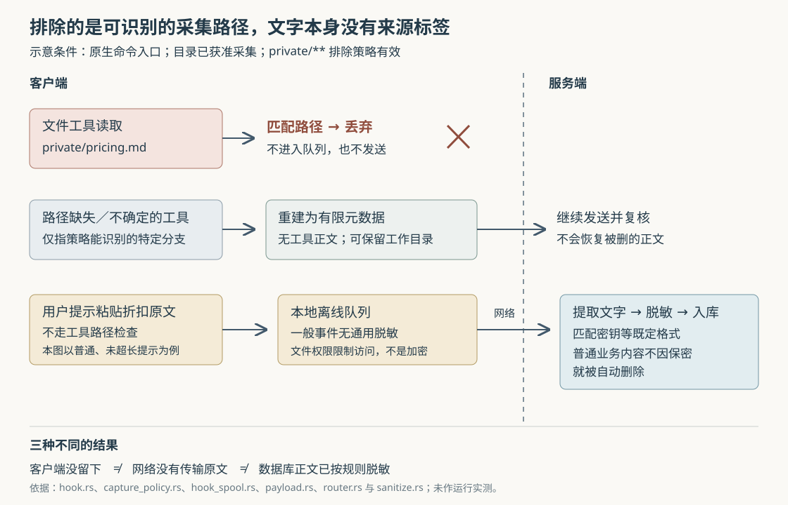

# ai-memory 怎样阻止私密文件进入记忆：路径排除、离线队列与脱敏的真实边界

假设项目里有一份 `private/pricing.md`，写着尚未公开的客户折扣。你希望编程 Agent 可以读取它完成任务，但 ai-memory 不要把它保存下来。于是，你在项目的 `.ai-memory.toml` 中加入：

```toml
[capture]
ignore_paths = ["private/**"]
```

对于能够识别路径的文件工具，这条配置会让 ai-memory 在客户端直接丢弃对应事件，连离线队列也不写。但如果你把折扣原文粘进用户提示，或者终端命令间接读出了同一内容，结果可能不同。**它能阻止一部分可追溯到路径的采集，不能持续追踪“这段文字最初来自哪份文件”。** 客户名、折扣和业务计划，也不会仅因具有保密意义就被密钥脱敏规则识别。

以上是自拟场景。前四篇已经研究总体链路、页面一致性、启动简报和跨项目偏好，本篇只追踪内容进入记忆之前的几道关口：谁决定不采集，哪些内容先落在客户端，服务端又能复核什么。依据是执行器提供的源码快照 `22efa102193e4c179dbb88887022bcb853d75239`；本次只读实现、调用方、测试和文档，没有启动服务、运行项目测试或发送真实会话。文中的边界场景属于源码推导，不是已经复现的泄漏事件。

先沿原生 `ai-memory hook` 命令看一遍实际过程。这里的钩子，是编程工具在用户提问、工具调用、会话结束等时刻执行的回调命令。它收到 JSON 格式的事件，即按字段组织的数据，先按事件类型处理助手消息和长度，再确定工作目录、查找项目配置、检查采集资格。工具事件还要经过路径策略。通过之后，事件才会被写入本地 `hook-spool` 离线队列，等待发送到服务端。服务端解析事件、检查采集协议、提取要保存的文字，最后脱敏并写入数据库。[依据：`run_with_payload_in_home`](https://github.com/akitaonrails/ai-memory/blob/22efa102193e4c179dbb88887022bcb853d75239/crates/ai-memory-cli/src/commands/hook.rs)、[`handle_hook` 与批量处理入口](https://github.com/akitaonrails/ai-memory/blob/22efa102193e4c179dbb88887022bcb853d75239/crates/ai-memory-hooks/src/router.rs)。



**最早的选择是“这个目录是否允许采集”，不是“这条内容有没有密钥”。** 默认 `denylist` 模式，即排除名单模式，允许没有标记文件的项目采集；标记文件只进一步缩小范围。安装时选择 `--capture-mode allowlist`，即允许名单模式，则只有查找到 `.ai-memory.toml` 的目录才获准采集。

允许名单的关键实现是 `repository_admits_capture`。原生调用方在写队列前检查它，而且不限定事件种类：未获准的目录连用户提示、开始、结束和停止事件都不写。这比把所有文件路径设为排除更全面，因为后者并不检查用户提示。标记文件本身就是加入采集的信号，不需要额外的“启用”键；已有标记也可能只是为了配置项目归属或启动简报。[依据：`repository_admits_capture`](https://github.com/akitaonrails/ai-memory/blob/22efa102193e4c179dbb88887022bcb853d75239/crates/ai-memory-hooks/src/capture_policy.rs)、[`run_with_payload_in_home` 的全事件关口](https://github.com/akitaonrails/ai-memory/blob/22efa102193e4c179dbb88887022bcb853d75239/crates/ai-memory-cli/src/commands/hook.rs)。

“查找到”还涉及查找边界。在用户主目录内，`find_marker` 向上查到主目录；主目录之外通常停在最近的 Git 仓库根目录，无仓库时只检查当前目录。因此，“仓库根目录没有文件”不总等于“没有获准采集”：祖先目录的标记也可能被找到。另一方面，路径排除读取最近一份标记，不自动合并所有祖先的 `[capture]`。一个只声明项目归属、没有声明排除路径的嵌套标记，其本地采集策略就是未启用状态。项目设置另有可跳过纯采集标记的查找函数，不能把两套继承方式混为一谈。[依据：`find_marker`、`find_marker_matching`、`find_settings_marker`](https://github.com/akitaonrails/ai-memory/blob/22efa102193e4c179dbb88887022bcb853d75239/crates/ai-memory-cli/src/marker.rs)、[`capture_policy` 与 `marker_capture_policy`](https://github.com/akitaonrails/ai-memory/blob/22efa102193e4c179dbb88887022bcb853d75239/crates/ai-memory-cli/src/commands/hook_capture.rs)。

模式文件还有一个值得知道的故障选择：原生客户端读取安装数据目录中的 `capture-mode`，只有明确读到 `allowlist` 才采用允许名单；文件不存在、不可读或内容无法识别时，回到默认排除名单。源码注释把持续采集、避免静默停用作为这一分支的考虑。它与“路径配置无效时减少内容保留”采取了不同方向，所以不能概括成“配置一出错就停止采集”。安装器用原子替换写模式文件，降低写到一半的风险，但没有改变读取失败的回退规则。[依据：`persisted_capture_mode`](https://github.com/akitaonrails/ai-memory/blob/22efa102193e4c179dbb88887022bcb853d75239/crates/ai-memory-cli/src/commands/hook.rs)、[`persist_capture_mode`](https://github.com/akitaonrails/ai-memory/blob/22efa102193e4c179dbb88887022bcb853d75239/crates/ai-memory-cli/src/commands/install_hooks.rs)。

获准采集后，文件排除才开始决定工具事件的去留。`CapturePolicy::inspect` 不靠扫描整包 JSON 猜测所有路径，而是按 Agent 和工具的已知字段提取候选。例如，受支持的文件工具有明确路径字段，补丁工具从文件头提取路径，终端工具则分析命令文字。结果有三种：`Drop` 丢弃整个事件；`MetadataOnly` 只留元数据，即描述会话与调用、而非工具正文的信息；`Keep` 保留事件继续处理。

下面都假设目录已经获准采集、`private/**` 策略有效，且事件采用相应工具的受支持格式。结果说明的是采集策略，不代表本次实测：

| 输入 | 客户端动作 | 实际意义 |
| --- | --- | --- |
| 文件工具明确读取 `private/pricing.md` | 丢弃 | 整条事件不写队列，不只删除其中一段正文 |
| 文件工具同时操作几份文件，其中一份匹配排除路径 | 丢弃 | 不尝试从混合事件中保留“安全部分” |
| 文件工具缺少可用路径 | 仅留元数据 | 不把无法判断来源的参数和输出原样留下 |
| 已识别的搜索、列目录工具 | 丢弃 | 有效排除策略下保守舍弃这一类事件，即使查询本来只涉及普通目录 |
| 终端执行 `cat private/pricing.md` | 丢弃 | 命令中的路径可以直接匹配 |
| 终端执行无法静态判清的内联解释器代码 | 仅留元数据 | 例如已识别的 `python3 -c`，运行时才构造的路径不能靠文字证明安全 |
| 用户提示直接引用折扣原文 | 不执行工具路径检查 | 后续仍会提取提示正文并做脱敏 |

[依据：`CapturePolicy::inspect`、`extract` 与路径匹配实现](https://github.com/akitaonrails/ai-memory/blob/22efa102193e4c179dbb88887022bcb853d75239/crates/ai-memory-hooks/src/capture_policy.rs)、[`run_with_payload_in_home` 只为工具事件调用 `inspect`](https://github.com/akitaonrails/ai-memory/blob/22efa102193e4c179dbb88887022bcb853d75239/crates/ai-memory-cli/src/commands/hook.rs)。

“仅留元数据”不是在原包上删掉几个熟悉字段。客户端用 `metadata_only_body` 从头构造对象，不带原参数、输出、错误、自由标题或嵌套正文。不过它仍可带会话标识、工作目录 `cwd`、受限格式的调用标识及工具类别。“没有被操作文件的路径与正文”，不能扩大成“没有任何目录信息”。这种重建方式减少了新字段被遗漏删除的风险，也牺牲了错误细节与操作内容；后续只知道发生过一类调用。

配置本身同样受严格校验：`[capture]` 只接受 `ignore_paths`，模式数量、长度和匹配工作量都有上限。无法正确解析或编译时，策略整体无效，不部分采用剩下的模式。在路由仍可解析的前提下，已识别的文件、搜索和终端等事件通常降为仅留元数据；其他事件不因此全部停止。若连路由配置也不可解析，原生入口还有更早的全事件拒绝分支。[依据：`read_capture_config_verbose`](https://github.com/akitaonrails/ai-memory/blob/22efa102193e4c179dbb88887022bcb853d75239/crates/ai-memory-cli/src/commands/hook_capture.rs)、[`CapturePolicy::resolve`、`inspect`、`metadata_only_body`](https://github.com/akitaonrails/ai-memory/blob/22efa102193e4c179dbb88887022bcb853d75239/crates/ai-memory-hooks/src/capture_policy.rs)、[`routing_valid`](https://github.com/akitaonrails/ai-memory/blob/22efa102193e4c179dbb88887022bcb853d75239/crates/ai-memory-cli/src/commands/hook.rs)。

这些模式也不完全等同于 Git 忽略规则。相对模式以标记文件目录为根，候选相对路径按事件工作目录解释；`**/.env` 不覆盖标记目录自身的 `.env`，需要把两种形式都列出。保护是否成立取决于实际解析出的路径，而不只是配置看起来像常见写法。[依据：匹配实现及规范化测试](https://github.com/akitaonrails/ai-memory/blob/22efa102193e4c179dbb88887022bcb853d75239/crates/ai-memory-hooks/src/capture_policy.rs)、[项目文档的模式语义说明](https://github.com/akitaonrails/ai-memory/blob/22efa102193e4c179dbb88887022bcb853d75239/docs/marker-file.md#capture-exclusions)。

终端命令是最需要保留不确定性的地方。`match_command` 只分析命令的文字结构，不执行命令，不展开变量的实际值，也不追踪命令内部的目录切换。它能识别不少引号、转义、通配符和解释器调用，却无法据此知道进程最终读了哪些文件。文件候选的规范化也不解析符号链接，即指向另一位置的文件系统别名。

因此，终端运行 `rg 折扣 .`，可能从私密子目录搜出正文，但命令没有直接写出被排除的文件路径；运行 `python3 report.py` 时，过滤器也不会打开脚本分析它随后读取的文件。这两条路径仍可能保留输出。与之相比，专门识别出的搜索工具会被整类丢弃。**同样在搜索，走专用工具还是走终端，隐私和记忆完整性的取舍并不相同。** 这不是对 Agent 读文件行为的限制，而是对 ai-memory 能识别多少采集来源的限制。[依据：`match_command`、`runs_inline_code` 及 `inspect`](https://github.com/akitaonrails/ai-memory/blob/22efa102193e4c179dbb88887022bcb853d75239/crates/ai-memory-hooks/src/capture_policy.rs)、[文档列明的剩余边界](https://github.com/akitaonrails/ai-memory/blob/22efa102193e4c179dbb88887022bcb853d75239/docs/marker-file.md#capture-exclusion-residuals)。

实现也没有完全忽略间接路径。读取前一次终端输出的工具，在有效或无效排除策略下都会仅留元数据；一些已知的宿主输出暂存文件也受到同类处理，避免先丢掉原调用、再把它的输出读回来。跨目录工具调用还会检查能找到的其他标记，并通过 `CaptureDecision::stricter` 选择更严格结果。但这些补偿仍依赖已知工具、可识别位置和有界查找，不能转化为任意内容的来源追踪。[依据：输出读取工具与暂存路径处理](https://github.com/akitaonrails/ai-memory/blob/22efa102193e4c179dbb88887022bcb853d75239/crates/ai-memory-hooks/src/capture_policy.rs)、[`foreign_capture_decision` 及其调用方](https://github.com/akitaonrails/ai-memory/blob/22efa102193e4c179dbb88887022bcb853d75239/crates/ai-memory-cli/src/commands/hook.rs)。

接下来是历史研报提过、但需要进一步拆开的离线队列。`entry_for` 接收 URL、事件正文和认证方式，直接构造 `SpoolEntry`；`enqueue_with_config` 将它序列化为文件。它们没有对一般正文执行通用脱敏。静态认证模式还会把 Bearer 令牌，即请求服务端时出示的凭证，存进条目；使用 OpenID Connect（OIDC，一种身份认证协议）登录时则记录认证模式，发送时再取得令牌。Unix 上队列目录采用 `0700`、新文件采用 `0600` 权限，限制其他用户访问，但这不是加密。[依据：`SpoolEntry`、`entry_for`、`enqueue_with_config`、`write_private`](https://github.com/akitaonrails/ai-memory/blob/22efa102193e4c179dbb88887022bcb853d75239/crates/ai-memory-cli/src/commands/hook_spool.rs)。

因此，获准保留的一般事件应按“可能含原始敏感内容的本地副本”理解。不过，“队列全部未经脱敏”也不准确。当前原生客户端至少有两条特殊路径：助手最终消息默认移除，显式开启捕获时先用内置规则脱敏、再截短；过长的用户提示、通知和压缩摘要，也先用内置规则脱敏，再按各自上限截短。没有超长的一般提示不会仅为了入队而走这一通用脱敏步骤。[依据：`transform_for_client` 与 `strip_assistant_message_raw`](https://github.com/akitaonrails/ai-memory/blob/22efa102193e4c179dbb88887022bcb853d75239/crates/ai-memory-hooks/src/assistant_capture.rs)、[`cap_lifecycle_body_for_client`、`cap_object_fields`](https://github.com/akitaonrails/ai-memory/blob/22efa102193e4c179dbb88887022bcb853d75239/crates/ai-memory-hooks/src/payload.rs)。这补充了首篇对队列风险的概述：必须按事件及长度判断，不能一律视为已脱敏或未脱敏。

队列解决的是钩子快速返回、服务暂时不可达时稍后补发的问题。其隐私代价是内容先在客户端落盘；若服务端在远程，内容还要先经过网络，之后才接受服务端配置的脱敏。传输保护和队列文件访问权限，分别控制这两段暴露面，不能由“数据库里已经脱敏”替代判断。

修改排除配置也不是撤回旧队列的命令。读取待发送条目的 `load_live_entry` 检查格式、年龄，并防御性移除旧版助手原文字段；所追踪的发送循环没有重新读取项目 `ignore_paths` 或重新判断允许名单。因此，已经入队的旧事件可能在配置收紧后继续发送。这是依据队列读取与发送路径作出的静态判断，不表示所有恢复、清理命令都不处理队列。[依据：`load_live_entry`、`strip_assistant_from_entry`、`drain_with_live_token`](https://github.com/akitaonrails/ai-memory/blob/22efa102193e4c179dbb88887022bcb853d75239/crates/ai-memory-cli/src/commands/hook_spool.rs)。

事件到达服务端时，客户端会用 `_ai_memory_capture` 携带处理结果、策略状态、工具类别和提取状态。`inspect_capture_envelope` 在请求进入处理队列或写库之前检查它：明确丢弃的事件被确认处理，以免客户端不停重试；仅留元数据的事件必须符合受限结构，然后再次重建；矛盾或不合法的声明根据分支降级或丢弃。服务端重建时也会清掉此前从原包提取出的标题和正文，避免“包已经裁剪，旧正文却仍被保存”。[依据：`inspect_capture_envelope`、`metadata_only_protocol_envelope`、`metadata_envelope`](https://github.com/akitaonrails/ai-memory/blob/22efa102193e4c179dbb88887022bcb853d75239/crates/ai-memory-hooks/src/router.rs)。

但服务端不接收客户端的私有排除模式。它用一个不会匹配真实路径的占位模式重新检查工具格式，能发现“声称没有路径，实际却是文件工具”等不一致，不能独立证明“这个真实路径不在客户端排除名单里”。没有 `_ai_memory_capture` 的旧式事件直接继续处理，也说明这不是服务器统一强制的路径政策。仓库保留的 Claude Code Shell 钩子直接把原 JSON 交给发送函数，并不经过上述原生命令；项目文档也明确列出原始脚本回退不受允许名单关口控制。部署时必须核对真正注册的入口。[依据：`capture_inspector`、`protocol_matches_inspection`](https://github.com/akitaonrails/ai-memory/blob/22efa102193e4c179dbb88887022bcb853d75239/crates/ai-memory-hooks/src/router.rs)、[Shell 钩子实现](https://github.com/akitaonrails/ai-memory/blob/22efa102193e4c179dbb88887022bcb853d75239/hooks/claude-code/pre-tool-use.sh)、[允许名单适用范围](https://github.com/akitaonrails/ai-memory/blob/22efa102193e4c179dbb88887022bcb853d75239/docs/marker-file.md#allowlist-mode-the-marker-as-an-opt-in)。本文没有逐一审计所有生成式集成，不能把原生路径的每个细节推广到全部宿主。

**服务端真正保存的观察记录，也不是收到的整包 JSON。** `HookEnvelope::from_query_and_body` 按宿主和事件提取标题、正文。对采用受限工具格式的 Agent，工具调用前主要保存工具类别和调用标识；调用后，已知类别可再附带工具输出。未知工具通常只留下有限信息，部分旧兼容路径另有回退。因此，客户端策略的 `Keep` 只表示继续流转，不能直接推成“所有输入参数最终都会入库”；反过来，服务端不保存某字段，也不表示该字段此前没有进入队列或网络。[依据：`closed_tool_agent`、`safe_tool_body`、旧工具回退分支](https://github.com/akitaonrails/ai-memory/blob/22efa102193e4c179dbb88887022bcb853d75239/crates/ai-memory-hooks/src/payload.rs)。

入库前，`durable_body` 对提取到的完整正文执行服务端脱敏，再限制长度；`Sanitized::new` 进一步处理观察记录的标题与正文。数据库写入接口要求传入 `Sanitized<NewObservation>`，即“经过指定处理的观察记录”包装类型，普通 `NewObservation` 不能直接传给这些接口。这个类型约束能减少开发者忘记调用脱敏器的机会，但只证明执行了处理，不证明正文已经没有秘密，也不意味着会话目录等所有字段都被同样处理。[依据：`durable_body` 与 `process_authorized`](https://github.com/akitaonrails/ai-memory/blob/22efa102193e4c179dbb88887022bcb853d75239/crates/ai-memory-hooks/src/router.rs)、[`Sanitized::new`](https://github.com/akitaonrails/ai-memory/blob/22efa102193e4c179dbb88887022bcb853d75239/crates/ai-memory-core/src/sanitize.rs)、[`admit_hook_session_event` 的参数类型](https://github.com/akitaonrails/ai-memory/blob/22efa102193e4c179dbb88887022bcb853d75239/crates/ai-memory-store/src/writer.rs)。

脱敏器先移除终端控制序列等字符，再按内置及自定义正则表达式匹配，把命中内容换成 `[REDACTED:类别]`。正则表达式是在文字中寻找特定形式的规则，例如密钥前缀、认证头或凭证赋值。没有这些结构的随机字符串和普通业务内容，不会因“看起来敏感”就自动删除。`extra_patterns` 可以补规则；`allowlist` 则按每次命中的文字判断，只要命中片段包含一个允许的子串，就保留整个匹配片段，需要谨慎设定范围。[依据：`Sanitizer::new` 与 `scrub`](https://github.com/akitaonrails/ai-memory/blob/22efa102193e4c179dbb88887022bcb853d75239/crates/ai-memory-core/src/sanitize.rs)。

先脱敏再截短是有原因的：假设规则要求识别完整的长密钥，先截掉后半段可能让剩下的前缀不再满足规则。当前服务端针对标题和正文都采取正确顺序，但这里仍有一个跨客户端、服务端的适用条件。原生客户端对过长提示只知道内置规则，不知道服务端的自定义规则；服务端收到的已经可能是一段截短文字。

举一个进一步的假设：服务端配置了 `CLIENTREF-[A-Z]{40}`，用于清除公司自己的敏感编号。完整编号跨在客户端提示正文的 16 KiB 截止位置上，又不匹配任何内置规则。客户端可能先留下编号前缀；服务端收到后，前缀已经不足四十个字母，完整规则便无法匹配。**“服务端先脱敏再截短”的局部保证，不能扩大为“自定义规则一定看见客户端最初的完整输入”。** 这是两处实现组合后的推导，尚未进行原生命令到数据库的端到端复现。[依据：客户端 `cap_object_fields`](https://github.com/akitaonrails/ai-memory/blob/22efa102193e4c179dbb88887022bcb853d75239/crates/ai-memory-hooks/src/payload.rs)、[服务端 `durable_body`](https://github.com/akitaonrails/ai-memory/blob/22efa102193e4c179dbb88887022bcb853d75239/crates/ai-memory-hooks/src/router.rs)。

已有测试帮助界定哪些承诺已经被写成可检查的契约。本次阅读了以下测试正文与断言，没有执行：

| 测试 | 它直接检查什么 |
| --- | --- |
| `capture_drop_prevents_spool_and_drainer`，客户端 `hook.rs` | 匹配排除路径后，队列为空，也不启动发送进程 |
| `invalid_capture_marker_spools_only_metadata`，客户端 `hook.rs` | 不支持的采集键触发裁剪，路径、参数、输出、错误和嵌套正文的测试标记均未进入队列 |
| `excluded_content_cannot_reach_the_spool_through_unevaluated_tool_shapes`，客户端 `hook.rs` | 对特定搜索、输出读取和不确定命令格式，分别验证丢弃、仅留元数据和保留分支 |
| `capture_protocol_native_metadata_shape_is_rebuilt_without_body`，服务端 `router.rs` | 有限元数据被重建；会话、工作目录和调用标识仍保留，正文只含安全摘要 |
| `client_body_cap_scrubs_before_truncating`，`payload.rs` | 客户端截短前能清除跨越截止位置的内置规则密钥；测试使用 AWS 密钥格式 |
| `issue_1114_user_prompt_body_is_sanitized_before_the_16kib_cap`，服务端 `router.rs` | 完整提示到达服务端后，自定义规则先处理密钥，再限制正文长度 |

前面三项见[客户端钩子测试](https://github.com/akitaonrails/ai-memory/blob/22efa102193e4c179dbb88887022bcb853d75239/crates/ai-memory-cli/src/commands/hook.rs)，客户端截短测试见 [`payload.rs`](https://github.com/akitaonrails/ai-memory/blob/22efa102193e4c179dbb88887022bcb853d75239/crates/ai-memory-hooks/src/payload.rs)，其余两项见[服务端测试](https://github.com/akitaonrails/ai-memory/blob/22efa102193e4c179dbb88887022bcb853d75239/crates/ai-memory-hooks/src/router.rs)。最后一项直接构造服务端事件，没有经过原生客户端的提前截短，因此不能用它否定上面的跨阶段推导。测试证明某条输入路径的预期，仍需先看它从哪一层开始。

回到私密折扣文件的例子，使用策略应与真正想阻止的事情对应。如果整个项目都不应被自动采集，可在受支持的客户端入口使用允许名单，并确认查找范围内没有使它加入采集的标记；这会同时失去该入口的自动记忆与启动交接能力。若只是少数文件不宜形成重复记忆，路径排除适合减少明确文件读取和部分终端活动，但还要接受专用搜索被保守丢弃，以及提示引用、别名和间接脚本仍有边界。

若只想停止 Claude Code 的用户提示捕获，安装入口另提供 `--no-capture-prompts`，由 `install_claude_prompt_capture` 决定不安装相应提示钩子。这是宿主特定的采集选择，不能据此推导工具输出或助手引用也会同时消失。[依据：安装选择及 Claude 配置调用方](https://github.com/akitaonrails/ai-memory/blob/22efa102193e4c179dbb88887022bcb853d75239/crates/ai-memory-cli/src/commands/install_hooks.rs)。

如果要求是“内容不得到达远程记忆服务器”，仅配置服务端自定义脱敏规则来得太晚；还需要从客户端采集资格、实际钩子入口和本地队列判断。若是在事件已经入队或入库后收紧规则，则需要另外检查旧队列和已有材料，不能把配置修改当成追溯删除。本篇没有继续审计所有页面衍生、备份和清理路径，也不据此宣称内容能够被全链路抹除。

这套实现值得借鉴的是把不同承诺放在不同位置：尽早丢弃可明确归属的事件，用重建对象限制不确定事件，用服务端校验约束协议形状，再用类型要求落实入库处理。它付出的代价也具体可见：保守丢弃会损失记忆细节，兼容旧入口会保留较弱路径，离线可靠性会留下客户端副本，规则脱敏则始终受输入结构与规则覆盖范围限制。理解这些条件，才能准确判断一次“不采集”究竟在哪一步成立。
