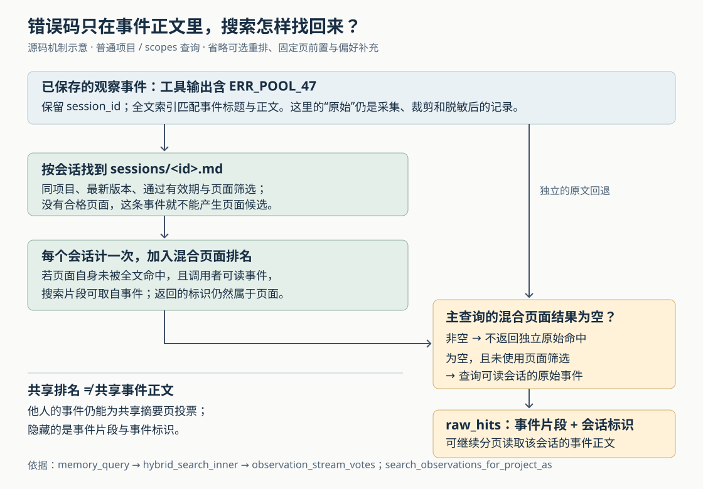

# ai-memory 怎样找回摘要漏掉的细节：原始事件投票、搜索回退与可见边界

假设你曾让编程 Agent 排查连接池故障。工具输出里出现过 `ERR_POOL_47`，但会话摘要只留下“检查连接池配置”。几天后，你搜索这个错误码，结果确实出现了那篇摘要，搜索片段里甚至带着错误码；打开页面，正文却找不到它。这不一定是索引过期，而可能是 ai-memory 有意采用的检索方式：**原始事件负责找到会话，搜索结果仍然指向会话页面，片段则可以借用事件正文。**

这是本文自拟场景。ai-memory 为不同编程 Agent 保存可共享的项目记忆，本篇只研究“摘要没有收录的细节怎样重新找到”，不重复总体采集、启动简报、页面一致性、偏好传播和采集隐私的既有研报。依据是本次本地源码快照 `22efa102193e4c179dbb88887022bcb853d75239`，重新阅读了调用入口、存储查询、清理实现、测试与架构文档。没有启动服务、调用模型或运行项目测试；下面的边界场景属于源码推导。

理解这条链路，有两个区别最关键：**让某篇页面进入结果，不等于把匹配的原始记录全部交出来；没有页面结果，也不总意味着系统会继续搜原始记录。** 这影响排障时如何读搜索结果，也影响团队环境中怎样理解“原始会话只对本人可见”。

先看为什么细节会留在页面之外。一次“观察事件”是钩子保存的用户提问、工具活动或会话边界记录。这里的“原始”只是相对于整理后的页面而言，已经受过采集、长度和脱敏规则限制，并非宿主工具完整会话的无损副本。默认的确定性摘要也不会复制每条事件正文：`synth::render_raw_observation` 写入的是事件种类、时间和标题；大会话的事件列表还会省略中间部分。因此，即使页面里有“原始观察列表”，也不能据此认为所有工具输出都进入了页面全文索引。[依据：`synthesize_session_page`、`render_raw_observations`、`render_raw_observation`](https://github.com/akitaonrails/ai-memory/blob/22efa102193e4c179dbb88887022bcb853d75239/crates/ai-memory-hooks/src/synth.rs)。

服务端为这两类内容分别建索引。页面索引用于找知识页，`observations_fts` 则为观察事件的标题和正文建立全文索引。FTS 是“全文搜索”的缩写，这里使用 SQLite 内置的 FTS5。观察行新增、修改或删除时，数据库触发器同步更新这份索引；中文等文本还有辅助索引，观察写入路径会同步写入它。也就是说，摘要漏掉正文，不代表正文从数据库检索入口消失。[依据：观察全文索引及触发器](https://github.com/akitaonrails/ai-memory/blob/22efa102193e4c179dbb88887022bcb853d75239/crates/ai-memory-store/migrations/V12__fts_remove_diacritics.sql)、[`insert_observation_row`、`index_observation_cjk`](https://github.com/akitaonrails/ai-memory/blob/22efa102193e4c179dbb88887022bcb853d75239/crates/ai-memory-store/src/ops.rs)。



Agent 调用 `memory_query` 后，普通单项目查询与显式多项目查询会进入同一个混合检索入口。MCP，即“模型上下文协议”，在这里把它暴露为 Agent 可以调用的工具。单项目调用先解析项目并检查读取权限；多项目的 `scopes` 参数也先解析并授权各个范围，再把确定的项目标识交给存储层。真实连接是：

`memory_query → search_project / search_scopes → ReaderPool::hybrid_search_scopes → hybrid_search_inner → observation_stream_votes`

`hybrid_search_inner` 组合页面全文、实体、链接邻居和可选向量等候选；本篇关心的 `observation_stream_votes` 额外用事件正文寻找会话页面。配置项 `[retrieval] observation_stream` 默认开启，服务启动时由 `serve` 把设置交给读取连接池，所以这条路径不需要配置大语言模型。[依据：MCP 查询与范围解析](https://github.com/akitaonrails/ai-memory/blob/22efa102193e4c179dbb88887022bcb853d75239/crates/ai-memory-mcp/src/server.rs)、[`RetrievalTuning::default`](https://github.com/akitaonrails/ai-memory/blob/22efa102193e4c179dbb88887022bcb853d75239/crates/ai-memory-store/src/retrieval_tuning.rs)、[`serve` 的检索配置装配](https://github.com/akitaonrails/ai-memory/blob/22efa102193e4c179dbb88887022bcb853d75239/crates/ai-memory-cli/src/commands/serve.rs)。

事件怎样帮助页面进入结果？实现先匹配当前项目的观察事件，再根据事件的 `session_id`，也就是所属会话标识，构造固定路径 `sessions/<会话标识>.md`。只有同一工作区、同一项目里该路径的最新页面，且通过有效期和页面筛选，才有资格接收这次匹配带来的排名分数。观察与页面的映射在同一个数据库读取事务里完成，避免这两步看到不同的数据库快照。

这里没有要求页面正文也出现错误码，也没有把事件自动关联给所有“主题相似”的页面。它依赖的是会话标识与固定路径的对应关系。这让实现保持简单、无需模型判断关联，但也限定了作用范围：尚未生成页面的会话不能因此产生页面结果；把摘要另存到其他路径，也不会自动把这条检索通路迁过去。页面后来被改写时，事件匹配帮助找到的是该固定路径的最新版本，而不是当时的旧版本。[依据：`observation_stream_votes` 中的 `candidate_path`、页面资格检查与版本映射](https://github.com/akitaonrails/ai-memory/blob/22efa102193e4c179dbb88887022bcb853d75239/crates/ai-memory-store/src/reader.rs)。

找到候选后，同一个会话不管有多少条事件命中，在这一路里都只计一次。以普通全文索引分支为例，事件先按匹配排名读取，会话按首次出现的顺序进入候选；后续命中只补充少量事件标识，供解释结果使用，每页最多保留三个。这样，一个会话反复提到同样的错误，不会直接获得几十份相加的分数。

各路候选用“倒数排名融合”合并，源码缩写为 RRF：某页面在一路里排第 `r`，这一路就贡献 `1 / (60 + r)`，再汇总其他路的贡献。它把不同检索器的排名变成可相加的数值，不把全文匹配分数当作向量相似度。随后页面种类、层级和固定标记等再施加有界调整。因此，事件命中提供的是一个排名依据，不保证页面最终排在第一，也不表示页面结论获得了事实验证。

融合里还有一个值得注意的去重：**某个会话页已经收到事件投票时，该页的页面全文贡献设为零，但仍保留其全文排名和片段。** 源码解释的原因是，摘要标题或事件标题可能只共享宽泛主题；如果页面全文和完整事件正文各算一票，主题词很多的会话可能压过真正包含答案的会话。这个处理针对收到事件投票的页面，维护过的普通知识页仍保留自己的全文贡献。事件新增的页面候选也不会再用来启动链接邻居扩展，避免这条补充路径继续扩大关联范围。[依据：`hybrid_search_inner` 的 `observation_voted`、RRF 合并与图检索执行顺序](https://github.com/akitaonrails/ai-memory/blob/22efa102193e4c179dbb88887022bcb853d75239/crates/ai-memory-store/src/reader.rs)。

“同一会话只计一次”仍有一个数量边界。实现先读取有限数量的事件行，再按会话归并。以本文错误码的普通全文查询为例，在没有模型重排、请求 `limit=1` 时，内部页面候选窗口至少为 20，事件窗口为其四倍，即 80 行；事件窗口还有 1000 行上限。这个限制控制查询工作量，却不能保证给每个会话分到一个名额。**从代码顺序可推导：如果某个长会话占满前 80 条匹配事件，另一个会话即使也含有答案，仍可能进不了这一轮候选。** 这是去重之前的截断效应，本文没有做压力实验。

页面筛选则放在事件截断之前：例如只要带 `wanted` 标签的页面，指向其他标签页面的事件就不会先占窗口。测试 `page_filtering_precedes_the_observation_candidate_cut` 特意制造 80 条更强的排除项，再放入一条合格项，断言后者仍能进入结果。这解决的是“不合格页面挤占窗口”，与“合格长会话内部重复匹配占窗口”是不同问题。[依据：候选窗口常量、`authority_candidate_limit` 与事件查询](https://github.com/akitaonrails/ai-memory/blob/22efa102193e4c179dbb88887022bcb853d75239/crates/ai-memory-store/src/reader.rs)、[观察检索测试](https://github.com/akitaonrails/ai-memory/blob/22efa102193e4c179dbb88887022bcb853d75239/crates/ai-memory-store/tests/suite/retrieval_observation_stream.rs)。

回到开头“片段有错误码、页面却没有”的现象。搜索结果的 `id`、`path` 和标题仍描述页面；只有当页面自身没有被全文命中、且调用者有权读对应事件时，`snippet` 才用事件片段来解释为什么找到这页。若页面自身已被全文命中，就继续使用页面片段，即使它同时收到了事件投票。开 `explain=true` 后，可以看到 `observation_rank`、`observation_ids` 以及 `rrf.observation`，分别表示这一路的排名、允许展示的事件标识和分数贡献。

这意味着搜索片段是一段定位线索，并不总是目标 Markdown 正文的摘录。希望核对具体错误、命令参数或用户原话时，只调用 `memory_read_page` 可能不够，还要读取对应会话的观察事件。把这两步分开，是该项目保持“页面作为主要检索结果”同时补回会话细节的方式。[依据：`hybrid_search_inner` 的片段选择与描述补全](https://github.com/akitaonrails/ai-memory/blob/22efa102193e4c179dbb88887022bcb853d75239/crates/ai-memory-store/src/reader.rs)、[通过真实 MCP 工具调用检查片段与解释字段的测试](https://github.com/akitaonrails/ai-memory/blob/22efa102193e4c179dbb88887022bcb853d75239/crates/ai-memory-mcp/tests/suite/query_observation_stream.rs)。

如果根本没有合格的会话页面，系统还有另一条路：独立返回事件命中，字段叫 `raw_hits`。但它是**主查询混合页面结果为空时的回退**，而不是每次查询都与页面一起搜索、一起返回的完整事件结果集。`memory_query` 在主查询完成并经过可选重排之后检查 `hits`：非空就直接给 `raw_hits` 留空；为空，且没有页面元数据筛选，才调用 `search_observations_for_project_as`。单项目与显式 `scopes` 都支持；多个项目先分别找事件，再合并排名并截断。

这会产生一个容易误判的场景。假设未完成会话的事件含有 `ERR_POOL_47`，尚无摘要，而另有一篇普通页面提到 `pool`。查询 `ERR_POOL_47 pool` 时，默认自然语言全文预处理会把多个词用 `OR` 连接，也就是任一词匹配即可。只要普通页面进入主查询结果，原始事件回退就不再执行，尽管那篇页面未必包含错误码或回答了问题。**“找到页面”在代码里是非空判断，不是对答案是否充分的判断。** 用独特错误码缩小查询可能改变结果，但同样不能保证总能触发回退。[依据：`memory_query` 的 `raw_hits` 分支](https://github.com/akitaonrails/ai-memory/blob/22efa102193e4c179dbb88887022bcb853d75239/crates/ai-memory-mcp/src/server.rs)、[`prepare_fts5_query`](https://github.com/akitaonrails/ai-memory/blob/22efa102193e4c179dbb88887022bcb853d75239/crates/ai-memory-store/src/fts_query.rs)。

几个条件也会改变这条路径，不能把所有“搜索”当成同一能力：

| 查询条件 | 对事件检索的影响 |
| --- | --- |
| 普通单项目或显式 `scopes`，没有页面筛选 | 可用事件投票；主查询页面为空时，可回退到可读事件 |
| 使用 `kind`、`tier`、`path_prefix` 或 `tag` 页面筛选 | 事件仍可为合格页面投票；独立原始事件回退关闭，因为事件没有这些页面元数据 |
| `global=true` 跨全部项目查询 | 走页面全文搜索，不走事件投票，也不返回原始事件回退 |
| `as_of` 指定历史时间点 | 走历史页面与实体查询，不走事件投票或原始事件回退 |
| 默认有效期检查排除了会话页 | 该页不能接收事件投票；若主查询为空，仍可能回退到尚存的可读事件。页面过期不等于事件同时过期 |

这里的“主查询”指所选项目的混合页面结果。跨项目偏好另放在 `global_scope_hits`，其补充发生在原始事件回退判断之后；不能只按最终响应里有没有任何页面来倒推是否执行了回退。`pin_first` 前置固定页也在这个判断之后处理。表中的默认路径没有开启这些额外展示选项。[依据：`memory_query` 的各模式入口、补充结果与固定页处理顺序](https://github.com/akitaonrails/ai-memory/blob/22efa102193e4c179dbb88887022bcb853d75239/crates/ai-memory-mcp/src/server.rs)。

失败也要与“没有命中”区分。事件投票或回退查询遇到数据库、连接池等错误时，当前调用链会向上返回工具内部错误，不会把错误自动当作零命中、再悄悄换另一条路径。全文预处理对部分语法问题另有保护：无法解析的表达式可退成带引号的词组集合，过长输入则只保留开头至多 4 KiB；这属于查询文本处理，并不是完整文档都已检索过的承诺。[依据：`memory_query`、存储查询中的错误传播](https://github.com/akitaonrails/ai-memory/blob/22efa102193e4c179dbb88887022bcb853d75239/crates/ai-memory-mcp/src/server.rs)、[`prepare_fts5_query`、`bounded_query_text`](https://github.com/akitaonrails/ai-memory/blob/22efa102193e4c179dbb88887022bcb853d75239/crates/ai-memory-store/src/fts_query.rs)。

团队环境下，还需要把“能影响排名”与“能读正文”分开。项目读取授权决定调用者能否进入这个项目；进入以后，共享会话页可以被搜索。`observation_stream_votes` 搜索事件并生成页面候选时，并不先按事件所有者去掉他人的会话，而是在获得候选后调用 `sessions_hidden_from`，判断哪些会话的事件不能展示。

对不能读取的会话，代码去掉事件片段与事件标识，但保留它给共享页面的排名贡献，结果改用页面自己的描述。可读规则由 `OwnerFilter` 定义：有身份者可读自己的记录及未归属记录，无身份者只能读未归属记录；找不到会话行、无法确认所有者的事件片段也会被隐藏。独立 `raw_hits` 更严格，所有者条件直接进入事件查询，在返回数量截断前排除不可读会话。[依据：`OwnerFilter`](https://github.com/akitaonrails/ai-memory/blob/22efa102193e4c179dbb88887022bcb853d75239/crates/ai-memory-core/src/actor.rs)、[`sessions_hidden_from`、`observation_stream_votes`、`search_observations_for_project_as`](https://github.com/akitaonrails/ai-memory/blob/22efa102193e4c179dbb88887022bcb853d75239/crates/ai-memory-store/src/reader.rs)。

测试把这个边界写得很明确：Alice 的原始事件包含独特词，摘要不包含；Bob 搜索该词，仍能找到 Alice 的共享摘要页，并看到事件流排名，但看不到事件片段及事件标识。Alice 自己查询则能获得这些信息。这个实现让团队页面能借助所有人的工作记录被找到，同时限制原文展示。**由此可推断，它不提供“他人私有事件完全不影响可见查询结果”的隔离**：特定词与某个共享会话页的关联仍可能被推断。本文没有做攻击实验，也不能据此声称可以恢复任意私有原文；实际边界是共享项目内的排名关联，另受项目授权约束。[依据：`memory_query_shows_observation_text_only_to_its_sessions_owner` 的构造和断言](https://github.com/akitaonrails/ai-memory/blob/22efa102193e4c179dbb88887022bcb853d75239/crates/ai-memory-mcp/src/server.rs)。

这条找回细节的通路还依赖原始事件继续存在。`[decay] observation_retention_days` 默认是 0，即不启用按年龄清理；显式设为正数后，维护流程可以分批删除达到年龄条件、且已有存活摘要页承接的事件。清理还会避开有待处理或正在执行整理任务的会话，以及结束后又收到新工作、尚未覆盖这一轮变化的会话。

清理按结构状态判断是否可删，不逐条比较“这段错误信息是否真的被摘要保留”。删除事件时全文索引同步失去相应条目。因此，从源码可推导：摘要仍在，但仅存在于已删除事件正文里的错误码，会同时失去事件投票和原始事件回退这两条通路。保留一篇摘要不等于保留了全部可检索细节。反过来，摘要若已被同一轮维护淘汰或删除，清理会保留其原始事件，避免在这一流程中同时丢掉最后一份记录。这里讨论的是数据库事件的可检索性，不代表其他日志或备份也被抹除。[依据：清理默认配置](https://github.com/akitaonrails/ai-memory/blob/22efa102193e4c179dbb88887022bcb853d75239/crates/ai-memory-cli/src/config.rs)、[`prune_consolidated_observations` 与活动会话保护条件](https://github.com/akitaonrails/ai-memory/blob/22efa102193e4c179dbb88887022bcb853d75239/crates/ai-memory-store/src/ops.rs)、[`sweep` 中页面维护之后的事件清理](https://github.com/akitaonrails/ai-memory/blob/22efa102193e4c179dbb88887022bcb853d75239/crates/ai-memory-consolidate/src/sweep.rs)。

本次读取的测试为这些判断提供了几组互补依据；它们是仓库已有断言，不是本文实测通过的结果。

| 测试位置 | 直接检查的行为 |
| --- | --- |
| `store/tests/suite/retrieval_observation_stream.rs` | 仅在事件里的词能带出所属会话页；同会话多条命中只计一次；页面筛选先于候选截断；最新版本接收投票；页面全文命中时保留页面片段；收到事件投票的页面不再叠加全文贡献 |
| `mcp/tests/suite/query_observation_stream.rs` | 通过实际工具协议取得页面、事件片段和解释字段；默认启用事件流；无页面的活跃会话可进入原始事件回退 |
| `mcp/src/server.rs` 中的查询测试 | 多项目集合中，只要一个项目有页面命中，就抑制整个集合的原始事件回退；他人的事件仍可帮助共享页排名，但片段与事件标识不返回 |
| `consolidate/tests/suite/observation_retention.rs` | 默认不清理事件；符合条件的旧事件被清理后，全文索引不再匹配其正文，并检查索引记录数跟随删除 |

这些测试分别覆盖了排名、工具返回、所有权和索引删除，尚不足以证明所有并发组合都已覆盖，也不能给出真实项目的召回率或延迟。本文尤其没有把候选窗口挤占、关联推断等源码推导写成已复现故障。[测试依据：存储检索](https://github.com/akitaonrails/ai-memory/blob/22efa102193e4c179dbb88887022bcb853d75239/crates/ai-memory-store/tests/suite/retrieval_observation_stream.rs)、[工具协议](https://github.com/akitaonrails/ai-memory/blob/22efa102193e4c179dbb88887022bcb853d75239/crates/ai-memory-mcp/tests/suite/query_observation_stream.rs)、[事件保留期](https://github.com/akitaonrails/ai-memory/blob/22efa102193e4c179dbb88887022bcb853d75239/crates/ai-memory-consolidate/tests/suite/observation_retention.rs)。

实际排障时，可以先明确项目并查询独特错误码，要求解释结果。例如，传给 `memory_query` 的参数可以是下面这样，项目名按实际环境替换：

```json
{
  "workspace": "default",
  "project": "billing",
  "query": "ERR_POOL_47",
  "explain": true,
  "limit": 5
}
```

若返回会话页面，检查它是否有事件排名贡献，以及片段是否来自事件。要核对发生过程，再调用 `memory_read_session_observations`，指定同一工作区、项目和会话标识；它支持 `query` 缩小事件范围，也支持按捕获顺序分页，默认每页 50 条、最多 200 条。每条正文默认上限为 4000 字符，超过会有截断标记，因此一次读完一页仍不等于读完完整会话。该入口会再次按项目和所有者检查会话，知道会话标识不能绕过权限。[依据：`memory_read_session_observations`](https://github.com/akitaonrails/ai-memory/blob/22efa102193e4c179dbb88887022bcb853d75239/crates/ai-memory-mcp/src/server.rs)。

如果页面命中了却没有答案，应优先核对事件，而不是仅凭空的 `raw_hits` 判断“原文不存在”。如果必须回看尚未生成摘要的工作，应使用已知会话标识读取事件，不把页面零命中回退当成完整会话搜索的替代。启用原始事件保留期之前，则应先确定哪些细节必须提升成长期页面内容：摘要是否存在只是清理资格的一部分，不是细节已经完整迁移的证明。

从设计上看，ai-memory 用一份额外全文索引和稳定会话路径，在无需模型的条件下补偿摘要的信息损失；它继续让页面承担共享知识与后续阅读的主要入口。代价也来自这个选择：事件通过页面资格进入排名，候选窗口约束能找到多少会话，回退由页面是否为空触发，而所有者规则限制原文展示但保留共享排名关联。把“定位会话”“读取证据”“确认结论仍然适用”分成三个动作，才能正确使用这套检索机制。
