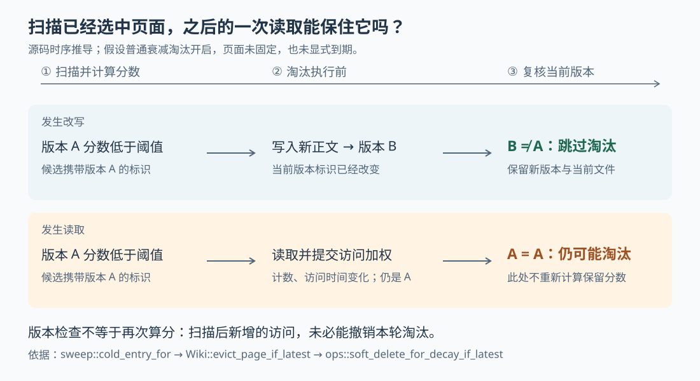

# ai-memory 的旧记忆为什么还在：访问加权、过时反馈与淘汰时序

假设一次排障留下了“把接口超时改成 30 秒”的会话页。半年后，配置早已调整，这篇旧记录却仍经常出现在搜索结果里。Agent 每次排查都能看见它，于是它持续获得“还在使用”的加分；即便有人标记“内容过时”，它也未必很快被清走。

这是本文自拟场景。ai-memory 为编程 Agent 保存跨会话、跨工具的项目记忆，本篇研究的是：**系统怎样用读取行为决定旧页面是否继续保留，以及这种决定为什么不能代替内容纠错。** 当前实现中，搜索命中和部分浏览操作会增加保留分数，过时反馈只降低其中的时间项；显式到期则走独立清理路径，不受访问热度保护。

六篇历史研报已覆盖总体链路、页面一致性、启动简报、跨项目偏好、采集隐私和原始事件检索。本文依据本次本地源码快照 `1bd866375b01031d63db54862a133376598d3701`，重新核对访问入口、数据库写入、后台清理、测试及设计文档。本次只读源码，没有启动服务、运行项目测试或调用模型。下文数值是按源码公式计算的示例；并发场景是调用顺序推导，并非故障复现。

先把例子里的因果串起来。Agent 调用 `memory_query` 搜索项目，服务端完成候选合并和可选重排后，把最终页面标识交给 `spawn_access_bump`。后者筛掉短时间内重复出现的页面，在后台向数据库写入者提交更新。之后，定期清理读取页面年龄、访问次数和最后访问时间，计算一个“保留分数”；低于阈值且符合淘汰条件的页面才会被移出当前知识集。MCP，即“模型上下文协议”，在这里把这些查询和读取功能暴露成 Agent 可以调用的工具。[依据：`memory_query`、`spawn_access_bump`](https://github.com/akitaonrails/ai-memory/blob/1bd866375b01031d63db54862a133376598d3701/crates/ai-memory-mcp/src/server.rs)、[`cold_entry_for`](https://github.com/akitaonrails/ai-memory/blob/1bd866375b01031d63db54862a133376598d3701/crates/ai-memory-consolidate/src/sweep.rs)。

这条链路里没有检查“模型有没有认真读完”“这条建议后来是否有效”。**系统记录的是页面被某个受支持入口带到结果中，而不是页面被证实正确。** 因此，开头的旧超时建议确实可能因反复被检索而延长寿命；但不能据此断言它一定排得更高，本文追踪的加分用于保留判断，不是对完整检索排名机制的结论。

哪些操作会留下这类使用记录，需要按入口区分：

| 当前源码中的操作 | 访问加权范围 |
| --- | --- |
| 普通项目或显式多个项目范围的 `memory_query` | 重排、截断后的主页面结果；另有全局偏好等补充结果的加权调用 |
| 项目内的 `memory_recent`，即最近更新页面列表 | 返回的页面，即使随后没有打开正文 |
| 成功的 `memory_read_page` | 当前页面；若启用 `include_related`，也包括沿链接带出的关联页面 |
| `memory_explore`，即项目知识概览 | 概览快照中返回的各类页面；不要求配置模型 |
| `memory_query` 的 `global=true` 跨全部项目分支、`as_of` 历史时点分支 | 直接返回结果，未经过访问加权调用 |
| 因项目默认设置而扩展成全局的 `memory_recent` | 直接返回，未经过项目内分支的访问加权调用 |
| 读取会话原始观察事件、启动钩子自动生成简报 | 在本次追踪的实现中，没有连接到这条页面访问加权路径 |

直接读取页面发生错误时不会加权；读取成功但正文来自数据库回退时则仍可加权。上表也说明，“看过记忆”并非一个覆盖所有读取方式的统一事件。[依据：`memory_query`、`memory_recent`、`memory_read_page`、`memory_explore` 及全部 `spawn_access_bump` 调用点](https://github.com/akitaonrails/ai-memory/blob/1bd866375b01031d63db54862a133376598d3701/crates/ai-memory-mcp/src/server.rs)、[启动简报装配路径](https://github.com/akitaonrails/ai-memory/blob/1bd866375b01031d63db54862a133376598d3701/crates/ai-memory-hooks/src/router.rs)。

访问次数也不是请求数的精确累计。`select_bumpable` 用“页面版本标识＋操作者身份”作为键，在同一个服务对象共享的内存表里实行 60 秒冷却：同一操作者一分钟内反复搜到同一版本，通常只产生一次更新；另一位操作者不被这次冷却挡住。没有身份的请求使用独立的匿名键。重复出现不会延后冷却起点，否则持续热门的页面可能永远等不到下一次加权。

冷却表是内存状态，服务重启会重建；它不是数据库里跨所有进程的精确限额。代码也先记下冷却，再启动后台写入。写入失败只记警告，不让读取请求失败，且没有在这里持久保存重试任务。因此，读取成功不保证访问记录已经提交，失败后本窗口内的后续读取也可能被冷却挡住。这种取舍减少了读取时的等待和重复写入，代价是把访问统计当作允许漏记的保留信号。[依据：`AccessBumpSeen`、`select_bumpable`、`spawn_access_bump`](https://github.com/akitaonrails/ai-memory/blob/1bd866375b01031d63db54862a133376598d3701/crates/ai-memory-mcp/src/server.rs)。

真正落库时，`WriterHandle::bump_access_for_actor` 将工作交给统一数据库写入任务，最终调用 `bump_access_for_pages_for_actor`。同一事务更新两个字段：`access_count` 加一，`last_accessed_at` 改为当前时间；若有合法身份，再向 `page_access` 写入“这个操作者使用过这个页面版本”的记录。共享计数与身份记录一起提交，避免只成功一半。页面已被删除或已不是当前版本时，该标识被跳过，不让一个失效页面拖垮整批更新。更新不会改变正文的 `updated_at`，也不会触发页面全文索引重建；全文索引触发器只监听标题、正文和路径检索字段。[依据：数据库访问更新实现](https://github.com/akitaonrails/ai-memory/blob/1bd866375b01031d63db54862a133376598d3701/crates/ai-memory-store/src/ops.rs)、[`WriterHandle`](https://github.com/akitaonrails/ai-memory/blob/1bd866375b01031d63db54862a133376598d3701/crates/ai-memory-store/src/writer.rs)、[全文索引触发器](https://github.com/akitaonrails/ai-memory/blob/1bd866375b01031d63db54862a133376598d3701/crates/ai-memory-store/migrations/V17__pages_fts_index_path.sql)。

到了清理时，默认保留公式可以写成：

```text
保留分数 = S × exp(-0.02 × 页面年龄)
         + 0.6 × ln(1 + 已记录访问次数) × exp(-0.04 × 距最后访问天数)
```

年龄从页面当前版本的 `updated_at` 算起，单位是天；从未访问时，第二项为零。`exp` 表示指数函数，天数增加会让对应项逐渐变小；`ln` 是自然对数，表示访问次数越多仍能加分，但每增加一次的收益逐渐减少。`S` 对应代码里的 `salience`，是反馈可以调整的保留权重，默认值为 1。它不是“这句话为真的概率”。默认低分阈值是 0.20，只有严格低于它才算冷页面。[依据：`DecayParams::default`、`retention_score_with_breadth`](https://github.com/akitaonrails/ai-memory/blob/1bd866375b01031d63db54862a133376598d3701/crates/ai-memory-store/src/decay.rs)。

以一个 200 天未更新的页面为例，关闭额外的多人加权，得到：

| 当前状态 | 按默认公式计算的分数，约值 | 单看分数是否低于 0.20 |
| --- | ---: | --- |
| 没有访问记录，`S=1` | 0.0183 | 是 |
| 刚记录一次访问，`S=1` | 0.4342 | 否 |
| 刚记录一次访问，同时收到过时反馈，`S=0.25` | 0.4205 | 否 |
| 同上，但最后访问已过去 30 天，期间无新增访问 | 0.1298 | 是 |

这些是公式演算，不是项目实测。它揭示了一个比“常用内容保留更久”更具体的边界：**默认参数下，仅一次刚刚提交的访问，其访问项就约为 0.416，已经高于淘汰阈值。** 降低时间项不能把它抵消。只要持续出现新的使用记录，页面就可能长期保持在阈值之上；停止使用后，访问项仍会随时间衰减。对数只压低增长速度，没有给访问项设置一个独立的固定加分上限。

多人共同使用还有一层可选增强。配置 `[decay] breadth_weight` 大于零时，访问项再乘以 `1 + breadth_weight × ln(max(人数, 1))`。人数来自 `page_access` 中该版本的不同身份数，并不要求每人最近都活跃；近期程度仍由共享的最后访问时间表示。默认权重为零，所以默认部署虽然记录了身份，也不会额外奖励“更多不同的人读过”。匿名读取可以增加共享次数，却不会凭空增加可识别人数。这些身份记录是保留信号，不是页面访问权限。[依据：人数汇总查询](https://github.com/akitaonrails/ai-memory/blob/1bd866375b01031d63db54862a133376598d3701/crates/ai-memory-store/src/reader.rs)、[按身份记录访问的数据表](https://github.com/akitaonrails/ai-memory/blob/1bd866375b01031d63db54862a133376598d3701/crates/ai-memory-store/migrations/V43__page_access_by_actor.sql)、[默认配置](https://github.com/akitaonrails/ai-memory/blob/1bd866375b01031d63db54862a133376598d3701/crates/ai-memory-cli/src/config.rs)。

那为什么不直接给旧超时建议标记“过时”？这仍然有用，只是动作含义不同。`memory_feedback` 把 `stale`（过时）或 `wrong`（错误）反馈附着到事务执行时的当前页面版本，把 `S` 直接降到 0.25，并让后续 `memory_lint` 检查报告列出需要复核的页面。它没有删除页面、清零访问次数或修改最后访问时间。因此，反馈会降低自动保留倾向，但不能保证近期热门的错误内容因此被淘汰。上表第三行就是这种情况。[依据：`memory_feedback`](https://github.com/akitaonrails/ai-memory/blob/1bd866375b01031d63db54862a133376598d3701/crates/ai-memory-mcp/src/server.rs)、[`salience_after_feedback`](https://github.com/akitaonrails/ai-memory/blob/1bd866375b01031d63db54862a133376598d3701/crates/ai-memory-store/src/decay.rs)、[`open_feedback_findings`](https://github.com/akitaonrails/ai-memory/blob/1bd866375b01031d63db54862a133376598d3701/crates/ai-memory-store/src/reader.rs)。

这也解释了为什么纠错最好落到页面正文。常规写入真正改变正文或相关元数据时，`upsert_page_in_tx` 创建新版本，并把旧版连到历史链上。新行使用默认访问次数，不复制旧版访问人数或反馈权重，年龄也从这次更新重新计算；内容完全相同的写入则直接复用原版本，不会凭“再保存一次”刷新年龄。这让错误旧版的使用历史不自动成为新版的信用，也意味着仅作小幅修改，积累的使用记录也不会自动继承。后一点是实现效果，本文没有找到说明其全部产品动机的依据。[依据：`upsert_page_in_tx` 的内容相同短路与新版本插入](https://github.com/akitaonrails/ai-memory/blob/1bd866375b01031d63db54862a133376598d3701/crates/ai-memory-store/src/ops.rs)、[访问列默认值](https://github.com/akitaonrails/ai-memory/blob/1bd866375b01031d63db54862a133376598d3701/crates/ai-memory-store/migrations/V03__decay.sql)。

不过，低分仍不等于“下一次一定删”。服务配置默认开启维护，清理间隔为 86400 秒，也就是一天；`serve` 的维护装配把配置交给 `run_scheduled_sweep_tick`，后者逐项目调用 `run_sweep_with_ledgers`。成功运行的调度时间会持久保存，所以这不是每次重启都从零开始等一天的简单循环。实际淘汰要等清理任务执行，也可能因文件操作或外部准入检查失败而延后。[依据：`MaintenanceSettings::default`](https://github.com/akitaonrails/ai-memory/blob/1bd866375b01031d63db54862a133376598d3701/crates/ai-memory-cli/src/config.rs)、[维护任务注册与 `run_scheduled_sweep_tick`](https://github.com/akitaonrails/ai-memory/blob/1bd866375b01031d63db54862a133376598d3701/crates/ai-memory-cli/src/commands/serve.rs)。

清理先读出当前页面，再判断它走哪条路径。普通年龄淘汰只适用于未固定的 `Episodic` 页面，即记录具体会话或事件经过的记忆层级；工作、语义和流程层级不进入这条淘汰判断。因此，给其他层级配置更短半衰期，虽然会改变公式计算结果，也不会单凭这一设置让本清理路径开始淘汰它们。半衰期指某一时间项降到原来一半所需的天数，是衰减速度，不是强制删除期限。

默认情况下，符合条件的冷事件页会被移除 Markdown 文件，并把当前数据库版本标为“墓碑”：正文暂留，但不再是普通检索使用的最新页。默认经过 180 天宽限期后，清理可永久移除该墓碑及其祖先版本链。若开启 `compact_cold_episodic`，则改为抽取摘要和保留词条形成短版；在该开关保持开启时，已经压缩过的页面不会继续被这条普通衰减路径反复压缩或淘汰。近似页面合并也有独立开关。两者默认关闭，不能把所有冷页都想成会自动得到一份永久短摘要。[依据：`is_decayable`、冷页分流与清理各阶段](https://github.com/akitaonrails/ai-memory/blob/1bd866375b01031d63db54862a133376598d3701/crates/ai-memory-consolidate/src/sweep.rs)、[`hard_delete_decayed_page_chain`](https://github.com/akitaonrails/ai-memory/blob/1bd866375b01031d63db54862a133376598d3701/crates/ai-memory-store/src/ops.rs)。

淘汰还存在一个容易被“刚读过就安全”掩盖的时间窗口。清理在 `cold_entry_for` 中用当时读出的状态算分，随后才逐页调用 `Wiki::evict_page_if_latest`。这个函数取得文件修改锁，复核页面版本；数据库更新时又检查一次预期版本。若期间页面被改写成新版本，旧候选会被跳过。这保护的是扫描后已经改过内容的页面。

但访问更新不改变版本标识。**从调用顺序可推导：扫描认定版本 A 低分之后，即使一次读取已成功增加 A 的访问次数，淘汰时版本仍然是 A，条件更新依然可能成功。** 删除分支没有重新读取访问时间，也没有重算保留分数。若后台访问更新来得更晚、A 已被标为非当前版本，该更新则直接跳过。图中对比的是两种源码允许的执行顺序，不表示每次同时读写都会触发问题。



这条边界来自 `Wiki::evict_page_if_latest → remove_page_locked → soft_delete_for_decay_if_latest`：文件先移到临时隔离位置，数据库条件更新失败或报错时尝试把文件放回；更新成功才完成移除。页面操作失败会留在报告的未完成状态并记日志，后续清理可以再尝试。补偿与版本检查减少了误删新内容的机会，却没有把“访问加权已提交”变成“本轮不准淘汰”的承诺。[依据：Wiki 条件淘汰与移除实现](https://github.com/akitaonrails/ai-memory/blob/1bd866375b01031d63db54862a133376598d3701/crates/ai-memory-wiki/src/wiki.rs)、[数据库条件墓碑更新](https://github.com/akitaonrails/ai-memory/blob/1bd866375b01031d63db54862a133376598d3701/crates/ai-memory-store/src/ops.rs)。

如果业务要求“到某天就不应继续使用”，应看另一条机制：页面元数据 `expires_at`，即显式到期时间，通常称为 TTL（存活期限）。扫描先把已到期页面分出，不论它是否固定、属于哪个层级或有多少访问记录。普通检索默认也会过滤已到期页，不必等待物理清理完成；但这不代表所有读取入口都禁止访问，直接按路径读取仍可返回正文并标注 `expired`，查询也有显式包含到期页的选项。

实际到期删除通过 `delete_page_if_latest` 复核版本，再删除当前路径的文件和数据库各版本，走的不是默认 180 天墓碑宽限路径。即使在物理删除前重新读取了它，访问热度也不会撤销到期决定。操作失败仍可能推迟物理删除；数据库和当前文件清除，也不等于 Git 历史或外部备份已擦除。因此，TTL 适合表达知识的使用期限，不能直接当作隐私擦除证明。[依据：到期优先分流](https://github.com/akitaonrails/ai-memory/blob/1bd866375b01031d63db54862a133376598d3701/crates/ai-memory-consolidate/src/sweep.rs)、[`not_expired`](https://github.com/akitaonrails/ai-memory/blob/1bd866375b01031d63db54862a133376598d3701/crates/ai-memory-store/src/reader.rs)、[`memory_read_page` 到期标注](https://github.com/akitaonrails/ai-memory/blob/1bd866375b01031d63db54862a133376598d3701/crates/ai-memory-mcp/src/server.rs)、[`delete_page_inner`](https://github.com/akitaonrails/ai-memory/blob/1bd866375b01031d63db54862a133376598d3701/crates/ai-memory-store/src/ops.rs)。

测试能支持上述机制的哪些部分，也需要分开看。本文阅读了以下测试断言，未执行它们：

| 已读测试 | 它检查的边界 |
| --- | --- |
| `mcp/tests/suite/access_reinforcement.rs` | 通过真实 MCP 路由调用直接读取、关联读取和概览，等待后台计数提交；重复读取受冷却限制 |
| `server.rs` 中的冷却单元测试 | 模拟时间推进后允许再次计数；不同操作者和匿名键互不吞掉访问 |
| `aging_lifecycle.rs::s1_access_reinforcement_saves_a_cold_page` | 回拨页面时间后，未访问对照页被淘汰，直接经写入接口加权的页面保留；此测试没有经过 MCP 冷却 |
| `access_breadth_sweep.rs` | 总次数相同时，默认多人权重不改变分数；显式开启后，多人使用可以改变淘汰候选 |
| `lifecycle.rs::ttl_expiry_lifecycle_end_to_end` | 到期页默认检索不可见、固定页也能被到期删除；旧版本候选不能删掉已刷新的页面 |

这些测试分别覆盖了读取到计数、计数到保留判断、到期与版本保护；它们不能合起来证明模型实际利用了页面，也未证明扫描后读取能够阻止淘汰。本次没有定位到专门交错执行“选中低分页—提交访问—执行淘汰”的测试，该竞态结论保持为源码推导。[依据：读取加权测试](https://github.com/akitaonrails/ai-memory/blob/1bd866375b01031d63db54862a133376598d3701/crates/ai-memory-mcp/tests/suite/access_reinforcement.rs)、[生命周期测试](https://github.com/akitaonrails/ai-memory/blob/1bd866375b01031d63db54862a133376598d3701/crates/ai-memory-consolidate/tests/suite/aging_lifecycle.rs)、[多人权重测试](https://github.com/akitaonrails/ai-memory/blob/1bd866375b01031d63db54862a133376598d3701/crates/ai-memory-consolidate/tests/suite/access_breadth_sweep.rs)、[到期测试](https://github.com/akitaonrails/ai-memory/blob/1bd866375b01031d63db54862a133376598d3701/crates/ai-memory-consolidate/tests/suite/lifecycle.rs)。

回到旧超时建议，实际处理应跟目标对应。需要纠正建议，就更新页面正文并保留适用条件，过时反馈用于留下待复核信号；需要暂时保住重要事件页，就使用固定标记，不依赖反复查询赶在清理前加分；明确只在某个期限内有效，就设置 `expires_at`，同时接受它会绕过普通衰减宽限期。调整全站参数前，可用 `ai-memory forget-sweep --dry-run --workspace <工作区> --project <项目>` 查看候选与分数；试算只反映执行时的状态，不会预知下一次访问和修改。这个命令是向运行服务发起请求，本文没有执行。[依据：试算命令参数与请求实现](https://github.com/akitaonrails/ai-memory/blob/1bd866375b01031d63db54862a133376598d3701/crates/ai-memory-cli/src/commands/forget_sweep.rs)。

这套实现把“仍被使用”作为延长保存的理由，适合让常查的排障资料抵抗纯年龄淘汰，同时用冷却、后台写入和摘要式统计控制记录成本。需要人工或 Agent 负责的仍是另一件事：核对旧结论是否适用于今天。访问记录能说明系统再次把它带到了眼前；修订正文、反馈复核和明确期限，才分别承载纠错、审查与到期的意图。
