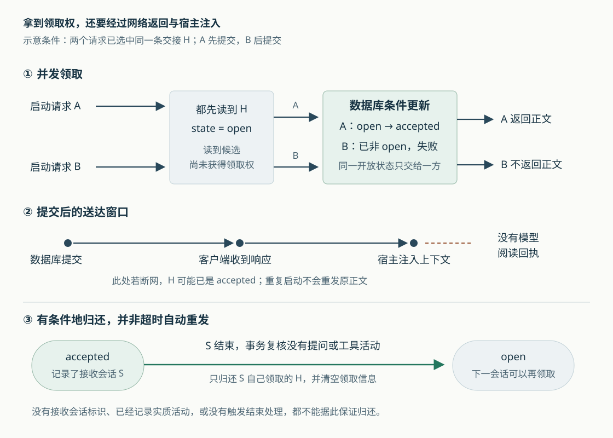

# ai-memory 的交接会被谁拿走：并发领取、空会话归还与送达边界

假设你用 Claude Code 排查登录故障，留下“继续检查会话失效”的交接。随后，同一项目里先启动了一个只做环境检查的 Codex，会话很快退出；真正继续排障的 Agent 晚一点才启动。交接会不会被前一个空会话拿走？如果两个 Agent 同时启动，或者领取成功后网络断开，又会怎样？

这是本文自拟场景。ai-memory 为不同编程 Agent 保存共享知识，也单独保存跨会话的交接记录。**它能让竞争同一条开放交接的请求只有一方领取成功，并能归还被空会话领取的交接；但它不会根据任务含义识别“真正的接班人”，也没有模型阅读确认。** 领取、送达、接着完成任务，是三件不同的事。

七篇既有研报已经介绍总体链路、页面一致性、启动简报、跨项目偏好、采集隐私、原始事件检索和记忆淘汰。本篇沿交接状态继续深入，重点核对候选选择、并发领取、接收会话绑定和归还条件，不重复整体架构。依据为本次本地源码快照 `1bd866375b01031d63db54862a133376598d3701`；阅读了实现、调用方、测试断言和设计文档，没有启动服务、运行项目测试或验证宿主模型行为。以下故障情形属于源码推导，不是本次复现结果。

## 它先确定谁有资格领取，再选一条交接

交接不是一句没有归属的摘要。`Handoff` 保存项目范围、来源会话、来源 Agent、工作目录、个人归属，以及摘要、未决问题、下一步和涉及文件；生命周期字段记录它是否开放、谁在何时领取。`open` 表示可领取，`accepted` 表示已领取，`expired` 表示退出待领取集合。[依据：交接数据结构](https://github.com/akitaonrails/ai-memory/blob/1bd866375b01031d63db54862a133376598d3701/crates/ai-memory-core/src/handoff.rs)。

原生启动钩子——编程工具在会话开始时执行的回调——请求 `GET /handoff`。服务端的 `fetch_and_accept_handoff_at` 先解析并授权工作区和项目，再由 `startup_handoff` 找候选。这里不是按“登录故障”做相关性搜索，而是按以下条件选择：

| 条件 | 实际规则及影响 |
| --- | --- |
| 所属项目 | 限定已经解析、获得读取授权的工作区和项目；不是服务器全局找最新一条 |
| 所属操作者 | 有身份时可见自己的记录和未署个人归属的共享记录；没有身份时只看共享记录 |
| 手工还是自动创建 | `memory_handoff_begin` 创建的手工交接没有来源会话，目录上属于整个项目；自动交接才按目录筛选 |
| 自动交接的目录 | 保存目录是接收目录本身或其上级时可以匹配；例如 `/repo/api` 可交给 `/repo/api/src`，不能交给 `/repo/web`；未保存目录时按项目范围处理 |
| 候选优先级 | 手工交接优先于自动交接；同类先取更新的，自动交接只有时间相同时才用更具体的目录打破平局，最后用标识稳定排序 |

所有者条件直接进入数据库查询，其他人的正文不会先加载再丢弃；手工交接绕过的是目录筛选，不能绕过个人归属。目录匹配按路径分段边界处理，不把 `/repo/api-other` 当作 `/repo/api` 的子目录。[依据：`open_handoff_for`、`handoff_owner_sql`、`is_handoff_candidate`、`handoff_selection_key`、`cwd_within`](https://github.com/akitaonrails/ai-memory/blob/1bd866375b01031d63db54862a133376598d3701/crates/ai-memory-store/src/reader.rs)。

因此，同一操作者在同一项目启动一个无关任务，它仍可能符合领取条件。换成另一种 Agent 也不会自动避开：虽然数据结构有 `to_agent` 目标提示，当前候选选择没有把它作为投递条件；手工创建入口也没有借它指定接收者。这里的“跨 Agent”意味着不同工具能够接棒，并不意味着系统会把交接定向发给某种工具，更没有按自然语言任务匹配后继会话。

部署是否区分个人也很重要。手工创建路径通过 `owner_stamp` 决定归属：不区分操作者的部署，以及显式指定 `shared: true` 的交接，会留下共享记录。共享只表示多人有资格竞争领取，**不表示每个人都会得到一份**。[依据：`memory_handoff_begin` 与 `memory_handoff_accept`](https://github.com/akitaonrails/ai-memory/blob/1bd866375b01031d63db54862a133376598d3701/crates/ai-memory-mcp/src/server.rs)。

## 尚未结束的会话，为什么也可能有交接

不能把自动交接简单理解为“前一个 Agent 已退出”。OpenCode 等集成可以在一轮工作结束时发布检查点，也就是保留“目前做到哪里”的中间状态，而不结束整个会话。`checkpoint_session_handoff` 会更新该会话已有的开放交接，保持同一标识并刷新正文和时间；如果原交接已被领取，则不会把那条已领取记录直接改回开放。

这解决了宿主进程长驻、终端退出却不一定产生会话结束事件的问题，但也产生新的风险：同目录的另一个 Agent 可能拿走仍在工作的会话的交接。自动启动领取为此设置了十分钟的安静期：**来源会话仍开放，而且最近十分钟内采集过任何观察事件时，它的交接暂不进入启动候选。** 观察事件就是钩子记录的一次提问、工具活动或生命周期通知，不要求一定是用户提问。[依据：`checkpoint_session_handoff`](https://github.com/akitaonrails/ai-memory/blob/1bd866375b01031d63db54862a133376598d3701/crates/ai-memory-store/src/ops.rs)、[`LIVE_BATON_QUIET_PERIOD` 与启动查询](https://github.com/akitaonrails/ai-memory/blob/1bd866375b01031d63db54862a133376598d3701/crates/ai-memory-hooks/src/router.rs)。

安静期不是进程存活检测。由条件可以推导：一个真实运行但长时间没有采集事件的会话，仍可能被视为安静；一个已经关闭终端但会话未结束的来源，也要等到超过这段时间才重新具备自动投递资格。它用可获得的事件近似判断是否还在工作，没有确认终端或模型的实际状态。

这项保护还做了第二遍：读候选与写入领取状态之间，来源可能继续工作，所以 `accept_handoff_in_transaction` 在写入事务内再次检查最近事件。事务是把一组数据库动作一起提交或一起撤销的边界；第二次检查避免“读取时安静，提交时已经活跃”仍照常领取。测试 `startup_claim_rechecks_the_source_and_sweeps_only_quiet_open_batons` 直接构造了写入时来源已活跃的情况，断言它保持开放；随后领取安静来源的交接，只淘汰更旧、同样安静的候选，保留活跃来源。[依据：多会话测试正文](https://github.com/akitaonrails/ai-memory/blob/1bd866375b01031d63db54862a133376598d3701/crates/ai-memory-store/tests/suite/multi_session.rs)。

这也解释了交接为何不是逐条消费的任务队列。创建新自动交接时，会清理同所有者、同目录的旧自动交接，但保留其他仍开放会话的交接；领取自动交接时，又会按接收目录和优先级淘汰被它取代的旧自动交接。手工记录、其他所有者和不匹配目录受到不同保护。目标是保留合适的延续状态，而不是保证每条历史交接将来都执行一次。[依据：`expire_same_cwd_auto_handoffs`、`expire_superseded_auto_handoffs`](https://github.com/akitaonrails/ai-memory/blob/1bd866375b01031d63db54862a133376598d3701/crates/ai-memory-store/src/ops.rs)。

## 两个请求读到同一条记录，为什么只有一个得到正文

启动链路可以缩成：

`客户端启动钩子 → GET /handoff → 授权并选择候选 → 准备启动材料 → 统一写入者领取 → 返回正文 → 客户端按宿主协议输出`

选中候选时还没有获得领取权。两个请求都可能读到同一条 `open` 记录；真正决定结果的是数据库中的条件更新。`accept_handoff_in_transaction` 只更新同时满足交接标识、工作区、项目、允许的所有者以及 `state = 'open'` 的行，把它改成 `accepted` 并保存接收信息。实际更新行数为零，就表示本次没有领取。

这种“状态仍符合预期才修改”的做法称为比较并交换，常写作 CAS。服务端还把数据库写入交给统一写入者执行。即使多个读取请求先看到相同旧状态，后执行的领取也会发现记录已经不再开放。`fetch_and_accept_handoff_at` 只有看到 `handoff_accepted = true` 才把交接正文放进最终响应；显式工具入口也检查同样的布尔结果。因此，不能只看条件更新，还必须核对调用方没有把预先读出的正文直接返回。[依据：`accept_handoff_in_transaction`](https://github.com/akitaonrails/ai-memory/blob/1bd866375b01031d63db54862a133376598d3701/crates/ai-memory-store/src/ops.rs)、[`accept_startup_context` 及写入命令处理](https://github.com/akitaonrails/ai-memory/blob/1bd866375b01031d63db54862a133376598d3701/crates/ai-memory-store/src/writer.rs)、[启动响应装配](https://github.com/akitaonrails/ai-memory/blob/1bd866375b01031d63db54862a133376598d3701/crates/ai-memory-hooks/src/router.rs)。



如果请求携带原生会话标识，启动路径还会在领取事务中准备接收会话，并检查它属于当前项目和 Agent。**已经领取过交接的同一接收会话，再次启动请求不会继续消费第二条。** 对通常不复用结束会话标识的 Agent，已结束会话也不能重新领取；Grok 有明确的标识复用例外。没有会话标识时，无法应用这层按接收会话的限制。

还有一个容易被“原子领取”掩盖的区别：由 `ai-memory run` 启动并管理生命周期的运行，称为托管运行，可以同时领取工作记录上下文和交接。当前事务先尝试领取托管上下文；如果它已被领取，就不继续消费交接。测试 `startup_context_claim_is_atomic_and_single_use` 断言第二条交接仍开放。这不能泛化为“两个结果必须同时成功”：实现允许托管上下文成功、交接竞争失败时，只返回前者。[依据：写入事务及上述测试](https://github.com/akitaonrails/ai-memory/blob/1bd866375b01031d63db54862a133376598d3701/crates/ai-memory-store/src/lib.rs)、[`WriteCmd::AcceptStartupContext` 的处理分支](https://github.com/akitaonrails/ai-memory/blob/1bd866375b01031d63db54862a133376598d3701/crates/ai-memory-store/src/writer.rs)。

## 空会话怎样把交接还回来

回到开头那个很快退出的 Codex。它是否归还交接，不取决于会话持续了几秒，而取决于数据库中有没有记录以下任意一种活动：用户提问、工具调用前事件、工具调用后事件。对应种类为 `user-prompt`、`pre-tool-use`、`post-tool-use`。开始、结束、停止通知等其他事件单独存在时，都不足以被判为实质活动。

这是一项正向判定：有明确工作事件才算工作过。生产路径共用 `SUBSTANTIVE_OBSERVATION_KIND_SQL`，避免读取方认为是空会话，写入方却采用另一套规则。[依据：共享判定式与查询](https://github.com/akitaonrails/ai-memory/blob/1bd866375b01031d63db54862a133376598d3701/crates/ai-memory-store/src/reader.rs)。

收到真正的会话结束事件后，`process` 先查询是否有实质活动。没有时，调用 `end_admitted_lifecycle_only_session`，在同一事务里：

1. 复核已准入会话的有效性，并重新查询实质活动，避免提问或工具事件刚刚写入。
2. 若仍为空，把接收会话标记为结束。
3. 只寻找 `accepted_by_session` 等于这个接收会话的已领取交接，将其重新置为 `open`，清空领取者、领取时间、接收会话和接收操作者。
4. 写下 `release_lifecycle_only_handoff` 审计记录，一起提交。

如果第二次检查发现已经有工作事件，写入者返回 `Substantive`，不结束、不归还；调用方转入正常会话结束路径。空会话本身不再生成摘要页、新交接或模型整理任务，避免空记录覆盖真正的待办。[依据：`process` 的会话结束分支](https://github.com/akitaonrails/ai-memory/blob/1bd866375b01031d63db54862a133376598d3701/crates/ai-memory-hooks/src/router.rs)、[`end_admitted_lifecycle_only_session`、`end_lifecycle_only_session_in_tx`](https://github.com/akitaonrails/ai-memory/blob/1bd866375b01031d63db54862a133376598d3701/crates/ai-memory-store/src/ops.rs)。

测试 `lifecycle_only_receiver_returns_its_startup_handoff` 串起了真实处理入口：领取带特定正文的交接，发送同一会话的开始与结束事件，检查记录重新开放，再让下一个会话取到原正文。另一个存储测试检查同一接收会话不能先领取第二条，归还并结束后也不能用迟到的启动请求重新领取。`lifecycle_only_end_compare_and_set_yields_to_substantive_observation` 则写入工具调用前事件，断言交接仍是已领取状态。[依据：启动与归还集成测试](https://github.com/akitaonrails/ai-memory/blob/1bd866375b01031d63db54862a133376598d3701/crates/ai-memory-hooks/src/router.rs)、[存储层测试](https://github.com/akitaonrails/ai-memory/blob/1bd866375b01031d63db54862a133376598d3701/crates/ai-memory-store/src/ops.rs)。本次只阅读断言，没有执行这些测试。

有两条限制会直接改变开头例子的答案。第一，环境检查如果产生了工具事件，就已经属于实质活动，即使它与排障毫无关系，也不会按空会话归还。第二，“没有记录工作”不等于“真实没有工作”：采集关闭、事件遗漏或过滤都可能让数据库缺少活动证据。这里判断的是已采集记录，不是任务价值或模型是否使用过交接。

另外，轮次检查点不会走这条归还路径。OpenCode 或 Antigravity 的一次 `stop` 可以只代表本轮结束；即使没有采集到实质活动，代码也不会因此结束整个会话、把其开局交接重新放出。这避免仍在继续的会话与下一会话同时沿用同一交接。

## 网络失败后的状态，不能由“没有看到正文”反推

服务端刻意把领取放在启动材料的主要读取与渲染之后，减少“交接先被消费，后续材料生成失败”的窗口。可拒绝操作的外部回调还受 750 毫秒的等待上限约束；拒绝、不可达或超时会放弃本次自动领取，保留交接，继续提供其余可用启动内容。只观察操作的回调则在提交后通知。

但这个上限只约束自动领取前的准入等待，不是整个请求的送达保证。数据库提交之后，还要把响应发到客户端，再由客户端输出宿主能理解的结构。例如通常的启动分支把正文放进 `hookSpecificOutput.additionalContext`。客户端 `get_handoff` 遇到请求失败会警告并返回无内容；这条链路没有模型收到并读完之后再确认的步骤。[依据：服务端准入、领取和响应顺序](https://github.com/akitaonrails/ai-memory/blob/1bd866375b01031d63db54862a133376598d3701/crates/ai-memory-hooks/src/router.rs)、[客户端获取](https://github.com/akitaonrails/ai-memory/blob/1bd866375b01031d63db54862a133376598d3701/crates/ai-memory-cli/src/commands/hook_capture.rs)、[宿主输出封装](https://github.com/akitaonrails/ai-memory/blob/1bd866375b01031d63db54862a133376598d3701/crates/ai-memory-cli/src/commands/hook.rs)。

| 情形 | 源码支持的结果 |
| --- | --- |
| 两个请求竞争同一条交接 | 只有实际更新成功的一方返回正文；落败方不会因读过候选而得到正文 |
| 自动领取的准入回调拒绝或超时 | 交接保持开放，不交付该交接正文 |
| 提交后响应丢失 | 交接可能已经是 `accepted`；重试不会自动重发同一条正文 |
| 接收会话正常结束，且只有生命周期事件 | 有接收会话绑定时，可以按上述事务归还 |
| 接收会话已记录一次提问或工具活动 | 不满足空会话归还条件，哪怕交接正文实际上没有到达 |
| 接收端崩溃，结束事件没有送到 | 不能仅靠“等一会儿”保证归还，需要其他结束处理途径 |

最后一项并非完全没有补救。服务端有可选的空闲会话结束任务：`[sessions] idle_end_after_hours` 大于零且维护任务开启时，周期扫描长时间没有活动的会话，空会话最终调用同一归还函数；绑定活跃托管运行的会话会被排除。**该设置默认是零，即关闭。** 它不是领取后的固定超时租约，也不是按“正文未被确认”重发；对有实质活动的会话，空闲结束不会借此归还原交接。[依据：配置默认值](https://github.com/akitaonrails/ai-memory/blob/1bd866375b01031d63db54862a133376598d3701/crates/ai-memory-cli/src/config.rs)、[维护任务装配](https://github.com/akitaonrails/ai-memory/blob/1bd866375b01031d63db54862a133376598d3701/crates/ai-memory-cli/src/commands/serve.rs)、[`run_idle_end_tick`](https://github.com/akitaonrails/ai-memory/blob/1bd866375b01031d63db54862a133376598d3701/crates/ai-memory-hooks/src/idle_end.rs)。

由此，历史研报里的“只能领取一次”应加上准确限定：**同一条记录处于开放状态时，只有一个竞争者能把它改为已领取；满足空会话归还条件后，同一条记录可以重新开放、再次领取。** 它保证竞争领取的排他性，并未承诺一条交接终身只展示一次，更没有承诺相关任务恰好执行一次。

## 显式领取和状态提示，也有各自的边界

Agent 还可以通过 MCP 工具领取交接。MCP 即模型上下文协议，在这里让编程工具调用记忆服务。`memory_handoff_list` 只列出开放交接，`memory_handoff_accept` 才改变状态。

显式领取与启动领取有两处关键不同。它调用 `latest_open_handoff` 或按标识查找，不套用启动时的十分钟安静期；提交的 `HandoffAcceptance` 则使用 `accepting_session: None`。因此，显式工具不会获得自动启动路径的接收会话绑定，也不能据此应用“一会话不再领第二条”及其空会话归还。身份和项目边界仍由查询与条件更新保护；`any_owner` 跨所有者恢复需要管理能力。[依据：`memory_handoff_accept`](https://github.com/akitaonrails/ai-memory/blob/1bd866375b01031d63db54862a133376598d3701/crates/ai-memory-mcp/src/server.rs)。

该工具没有领到正文时，会区分 `none_pending` 和 `consumed_by_hook`。后者并不是看到项目里有已领取记录就猜测，而是要求调用者转发会话标识，并查到当前项目、允许所有者范围内，正由这个仍开放会话持有的交接；指定了交接标识时，还必须是同一条。

这减少了把别人的领取误报为“已经在你的上下文里”。但从实现看，它仍只证明数据库记载了领取关系，不能证明上一步网络和宿主注入成功。文档把它解释为“交接已在会话上下文中”，适合正常交付路径；排查故障时，应把它看成“先检查本会话开局内容”的线索，而不是送达回执。测试 `consumed_by_hook_is_reported_only_to_the_session_that_claimed_it` 覆盖身份、会话标识与状态对应关系，也断言同一调用者仍可显式领取后来新建的交接。[依据：`unclaimed_handoff` 与查询实现](https://github.com/akitaonrails/ai-memory/blob/1bd866375b01031d63db54862a133376598d3701/crates/ai-memory-mcp/src/server.rs)、[身份测试](https://github.com/akitaonrails/ai-memory/blob/1bd866375b01031d63db54862a133376598d3701/crates/ai-memory-mcp/tests/suite/handoff_identity.rs)。

## 并行工作时，把“自动拿走”改成“先提示”

如果一个项目通常由同一个人顺序工作，默认自动领取省去了一次工具调用；十分钟安静期、事务复核和空会话归还补上了一部分误取场景。如果同一人经常并行开不同任务，系统缺少任务意图这一维度，个人归属和目录规则便不足以选出正确接班人。空会话归还也救不了已经运行过工具的无关任务。

这种情况下，当前实现提供的直接选择是在服务端 `config.toml` 设置：

```toml
[handoff]
claim_on_session_start = false
```

启动时就只提示交接标识、来源 Agent 和时间，不领取、不注入摘要或下一步；需要继续时，再让 Agent 先列出交接、检查内容，按确切的 `handoff_id` 显式领取。只提示固定元数据还有一层内容边界：保存的摘要可能含有诱导性文字，未决定接棒的会话不会仅因启动就收到这段正文。这个开关是服务端全局设置，需要重启加载，不是项目标记文件里的局部开关；项目简报和托管上下文仍走各自路径。[依据：`render_handoff_notice` 与开关分支](https://github.com/akitaonrails/ai-memory/blob/1bd866375b01031d63db54862a133376598d3701/crates/ai-memory-hooks/src/router.rs)、[当前使用说明](https://github.com/akitaonrails/ai-memory/blob/1bd866375b01031d63db54862a133376598d3701/docs/usage.md)。

使用确切标识，是为了避免提示生成后又来了另一条交接，领取时误拿“最新一条”。它固定的是记录身份，不是正文版本：前述检查点可以在保持标识时刷新开放记录。列表也是一次读取结果，不是对该内容的锁定。

设计文档明确记录了为何选择提示模式，以及没有继续推进按目标 Agent 投递等方案；其中关于旧版本行为的描述仍应按历史材料理解，不能覆盖当前实现中的空会话归还和领取后才返回正文等分支。[依据：交接提示模式设计记录](https://github.com/akitaonrails/ai-memory/blob/1bd866375b01031d63db54862a133376598d3701/docs/design-handoff-offer-not-claim.md)。

对于故障恢复，应先核对项目、身份、交接状态和接收会话，再判断是尚未领取、已由本会话领取，还是正文交付出了问题。若要把类似机制用于必须完成的后台任务，还需要另行设计送达确认、失败重发和重复执行保护；不能直接把这里的交接状态当作任务完成记录。这是由当前协议边界得出的工程建议，不是本次源码已经实现的能力。
