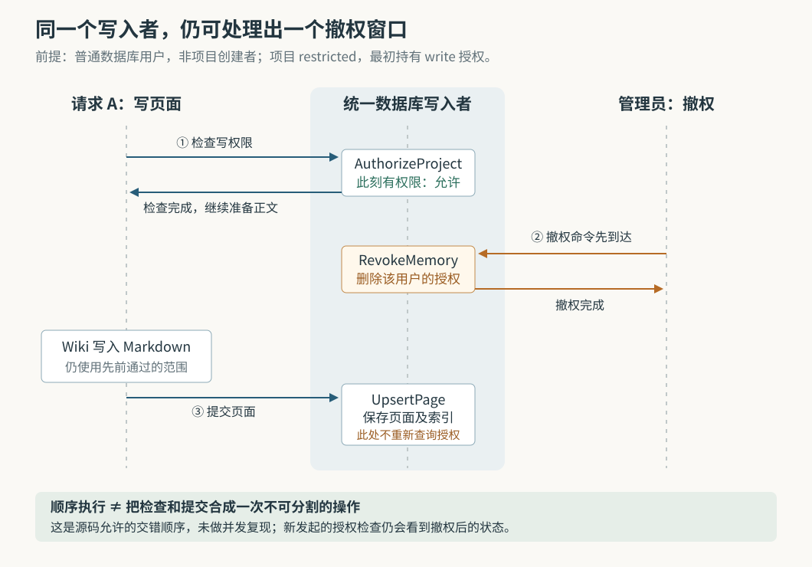

# ai-memory 的只读权限管到哪一步：项目隔离、采集丢弃与撤权窗口

假设 Alice 把客户项目的排障经验保存在 ai-memory，同事 Bob 需要查阅这些经验，但不应改写知识或把自己的工具活动混进去。管理员给 Bob 添加了 `read` 授权。这样就足够了吗？如果 Bob 正在写一篇页面，管理员此时撤掉权限，这次写入会停下来吗？

这是本文自拟场景。ai-memory 为不同编程 Agent 保存共享项目记忆。当前实现给出的答案有几个条件：**普通项目必须先设为 `restricted`，即限制访问，`read` 授权才形成读写区分；它限制正常入口的内容写入和事件采集，却不表示服务状态完全不变，也不保证取消已经通过检查的页面写入。** 理解这些条件，才能把“同一个团队共享记忆”配置成符合预期的访问范围。

此前八篇研报已分别研究总体链路、页面一致性、启动简报、跨项目偏好、采集隐私、事件检索、淘汰和交接。本篇研究尚未展开的项目授权机制，依据执行器提供的源码快照 `5b9ea5fcdd6e8e55e630ba62ae616b7ba4916b15`，重新追踪认证、项目解析、查询、采集、页面落盘与撤权，并交叉阅读测试和部署说明。本次只读源码，没有启动服务、运行项目测试或复现并发故障；下文的交错时序属于源码推导。

**先让 Bob 以自己的身份进入，再决定他能进入哪个项目。**

客户端请求首先经过 `auth.rs` 的认证处理。这里的 Bearer 令牌是随请求出示的一段凭证。命中服务器配置的根令牌时，请求获得 `AuthLevel::Root`，表示管理员权限；命中数据库中的有效个人凭证时，请求获得具体用户标识和 `AuthLevel::User`，同时附带 `AuthorizedViewer`。后者的职责是告诉后续模块：“这次请求应按哪个数据库用户的项目授权执行。”

这与记录作者是两回事。`ActorContext` 提供操作者身份，页面的 `author_id` 记录谁写了内容；`AuthorizedViewer` 才把请求接入项目访问检查。原生数据库用户凭证即使属于一个角色为 root 的人，也仍在这个机器认证分支中获得 `AuthLevel::User`，不能据此替代配置中的根令牌。根令牌则不附带项目检查标记。因此，把同一个根令牌分给 Alice 和 Bob，再给安装命令加上不同姓名，不会产生两份受项目授权约束的机器身份。[依据：`authenticate_token` 所在的认证实现](https://github.com/akitaonrails/ai-memory/blob/5b9ea5fcdd6e8e55e630ba62ae616b7ba4916b15/crates/ai-memory-mcp/src/auth.rs)、[`AuthorizedViewer` 的定义](https://github.com/akitaonrails/ai-memory/blob/5b9ea5fcdd6e8e55e630ba62ae616b7ba4916b15/crates/ai-memory-core/src/actor.rs)。

请求进入 MCP 工具后——MCP 即“模型上下文协议”，这里用来向 Agent 提供读写记忆的工具——`viewer_from_parts` 取出这个检查标记，`scope_resolver_as` 把它交给 `ScopeResolver`。这个解析器既确定工作区、项目，也在返回项目标识前检查所需权限。省略项目名称时，仍会检查实际选中的当前项目或默认项目，并不会因为没有显式名称就免检。[依据：`scope_resolver_as`、`viewer_from_parts`](https://github.com/akitaonrails/ai-memory/blob/5b9ea5fcdd6e8e55e630ba62ae616b7ba4916b15/crates/ai-memory-mcp/src/server.rs)、[`ScopeResolver::resolve_write_args` 与 `authorize_scope`](https://github.com/akitaonrails/ai-memory/blob/5b9ea5fcdd6e8e55e630ba62ae616b7ba4916b15/crates/ai-memory-store/src/scope.rs)。

**给 `open` 项目添加只读授权，不会降低原有权限。**

项目表保存 `access_mode`，即访问模式；`project_grants` 表保存哪个用户在项目中获得 `read` 或 `write` 授权。`ProjectAuthz::authorize` 根据两者作决定。对已经通过认证、进入原生数据库用户分支的 Bob，普通项目的规则如下：

| 项目与身份条件 | 可以读取 | 可以进行需要写权限的操作 |
| --- | --- | --- |
| 项目为 `open`，无论有没有授权记录 | 是 | 是 |
| 项目为 `restricted`，Bob 没有授权，也不是创建者 | 否 | 否 |
| 项目为 `restricted`，Bob 持有 `read` | 是 | 否 |
| 项目为 `restricted`，Bob 持有 `write` | 是 | 是 |
| 项目为 `restricted`，Bob 是记录中的项目创建者 | 是 | 是，不依赖授权记录 |

根管理员保留项目访问权。没有区分操作者的单用户部署也不执行这套项目限制。这里的 `open` 是项目检查放行，不代表外部请求可以绕过服务器认证。[依据：`ProjectAuthz::authorize`](https://github.com/akitaonrails/ai-memory/blob/5b9ea5fcdd6e8e55e630ba62ae616b7ba4916b15/crates/ai-memory-store/src/project_authz.rs)。

因此，开头场景要求 Bob 不是项目创建者，并且管理员对已有项目完成类似以下操作：

```sh
ai-memory project access --workspace acme --project checkout-api --mode restricted
ai-memory user grant --user bob --workspace acme --project checkout-api --level read
```

这些管理动作由根管理员执行。默认已有项目和普通新项目都是 `open`；`[auth] new_projects_restricted = true` 只改变此后创建项目的初始模式。新项目还会记录 `created_by`，即创建者，因此不能通过“删掉创建者的授权记录”撤掉其内置访问权。源码里的 `revoke` 只删除 `project_grants` 中的记录，不改项目创建者。这是让创建者能够读回自己刚建立的记忆的便利，也意味着创建者地位与普通团队授权必须分开理解。[依据：项目创建与 `initial_access_mode`](https://github.com/akitaonrails/ai-memory/blob/5b9ea5fcdd6e8e55e630ba62ae616b7ba4916b15/crates/ai-memory-store/src/ops.rs)、[`grants::revoke`](https://github.com/akitaonrails/ai-memory/blob/5b9ea5fcdd6e8e55e630ba62ae616b7ba4916b15/crates/ai-memory-store/src/grants.rs)、[用户与项目管理说明](https://github.com/akitaonrails/ai-memory/blob/5b9ea5fcdd6e8e55e630ba62ae616b7ba4916b15/docs/users.md)。

**允许 Bob 进入项目，意味着让他读取项目共享页面。**

授权没有继续按页面作者划分阅读范围。Alice 写的页面进入这个项目后，具有读取权限的 Bob 可以读；`pages.author_id` 用来署名，不能当作“仅作者可见”的标签。原始会话和个人交接另有所有者检查，例如 `memory_read_session_observations` 先检查项目读取权限，再构造 `OwnerFilter`，按操作者筛选原始会话。上一篇事件检索研报已经解释的“共享页面与私人原文不同”，在当前代码中仍成立。[依据：项目授权模块的共享约束](https://github.com/akitaonrails/ai-memory/blob/5b9ea5fcdd6e8e55e630ba62ae616b7ba4916b15/crates/ai-memory-store/src/project_authz.rs)、[`memory_read_session_observations`](https://github.com/akitaonrails/ai-memory/blob/5b9ea5fcdd6e8e55e630ba62ae616b7ba4916b15/crates/ai-memory-mcp/src/server.rs)。

跨项目搜索不能只靠当前项目的入口检查。`readable_repository_filter` 为查询加入数据库筛选条件：留下开放项目、调用者创建的项目、有匹配授权的项目，以及按设计共享的全局范围。筛选发生在 `LIMIT` 限制结果条数之前。否则，前十条命中若有九条属于不可访问项目，事后删除九条就会让 Bob 只拿到一条，即使后面还有足够的可见内容。

对应测试特意构造了 60 篇更容易排在前面的隐藏页面和 12 篇可见页面，断言受限制的用户仍能取得 10 篇可见结果；另一个测试在撤权后再次搜索，断言该项目消失。这些是测试源码表达的契约，本次没有执行。显式指定无权访问的项目则返回授权错误，说明“没有权限”，不伪装成“项目没有记忆”；MCP 和 HTTP 接口的具体错误形式也不必相同。[依据：`readable_repository_filter`、`readable_repository_sql`](https://github.com/akitaonrails/ai-memory/blob/5b9ea5fcdd6e8e55e630ba62ae616b7ba4916b15/crates/ai-memory-store/src/reader.rs)、[`the_limit_counts_only_what_the_viewer_may_see`、`search_finds_only_what_the_viewer_may_read`](https://github.com/akitaonrails/ai-memory/blob/5b9ea5fcdd6e8e55e630ba62ae616b7ba4916b15/crates/ai-memory-store/src/grants.rs)。

全局偏好还要单独处理：`default/_global` 和工作区的 `_profile` 会影响其他项目的读取，所以虽然保持开放读取，写入仍要求根管理员或明确的 `write` 授权，创建者也不能凭创建者身份写入。换言之，“开放项目允许写入”的普通规则，不能套到这些共享偏好范围上。个人偏好项目 `_profile.<用户标识>` 则采用限制访问模式。[依据：共享范围写入分支](https://github.com/akitaonrails/ai-memory/blob/5b9ea5fcdd6e8e55e630ba62ae616b7ba4916b15/crates/ai-memory-store/src/project_authz.rs)、[`initial_access_mode`](https://github.com/akitaonrails/ai-memory/blob/5b9ea5fcdd6e8e55e630ba62ae616b7ba4916b15/crates/ai-memory-store/src/ops.rs)。

**Bob 的 Agent 能查经验，但自己的工作过程可能不会被记下来。**

一次工具调用经过生命周期钩子——编程工具在特定时刻执行的回调——提交给 `POST /hook`。服务端先做基本采集检查与容量控制，随后启动后台任务，并立即返回 HTTP 202，意思是已接收排队。真正处理时，`process_authorized` 才根据目录、显式设置和已有会话归属确定项目，然后以 `ProjectAccess::Write` 检查采集权限。

这一步使用只读数据库连接池查询授权，没有为每个事件再排一次统一写入者的检查命令。源码注释明确把减少写入者争用列为理由。若 Bob 只有 `read`，处理函数返回 `CaptureNotAuthorized`，外层将结果归类为 `DroppedUnauthorized`，增加 `dropped_unauthorized` 计数，不保存观察事件。因为 202 已经发出，这次拒绝不会再变成客户端看到的 403。[依据：`handle_hook`、`process_authorized`、`process_envelope`](https://github.com/akitaonrails/ai-memory/blob/5b9ea5fcdd6e8e55e630ba62ae616b7ba4916b15/crates/ai-memory-hooks/src/router.rs)。

离线队列批量补发也遵循同一取舍。`POST /hook/batch` 把无权写入的条目标记为 `dropped_unauthorized`，同时算入已确认处理的条目，告诉客户端可以从队列移除。测试 `an_unauthorized_batch_item_is_consumed_rather_than_retried` 同时断言三件事：确认数量为 1，结果标明无权采集，数据库中没有该事件。这样不会让一条永远不能成功的事件堵住后面的补发；代价是管理员后来补上写权限，也不会让已经丢弃的条目自动重现。

所以排查“Agent 明明工作了，为什么没有新记忆”时，需要同时看项目模式、个人凭证实际身份和丢弃计数。客户端请求成功，只能证明交付达到了对应接口的确认条件。[依据：批量处理与上述测试](https://github.com/akitaonrails/ai-memory/blob/5b9ea5fcdd6e8e55e630ba62ae616b7ba4916b15/crates/ai-memory-hooks/src/router.rs)。

**这里的 `read` 也不承诺所有状态保持原样。**

例如启动入口 `GET /handoff` 在 `fetch_and_accept_handoff_at` 中检查的是项目读取权限。之后，如果开启启动自动领取，并找到符合所有者、目录和生命周期条件的交接，它可以调用 `accept_startup_context` 领取交接、绑定接收会话。Bob 不能借此领取任意其他人的私有交接，但只读项目授权本身并不禁止这次状态变化。与之相比，跨项目消息的发送、弹出和取消都明确要求写权限，因为它们会修改项目的消息队列；相应工具测试验证了只读授权被拒绝。[依据：启动交接入口与领取调用](https://github.com/akitaonrails/ai-memory/blob/5b9ea5fcdd6e8e55e630ba62ae616b7ba4916b15/crates/ai-memory-hooks/src/router.rs)、[`a_restricted_projects_queues_need_write`](https://github.com/akitaonrails/ai-memory/blob/5b9ea5fcdd6e8e55e630ba62ae616b7ba4916b15/crates/ai-memory-mcp/src/server.rs)。

因此，更准确的理解是：`read`、`write` 是各入口选择的项目能力要求。不能只看接口是不是 GET、工具名字是否带“读取”，就认定它不会改变服务状态。

**撤权会改变后续检查，却未把普通页面的检查与提交锁成一步。**

回到 Bob 原本持有 `write`、管理员准备撤权的情况。普通 `memory_write_page` 先解析并授权目标项目，再构造 `WritePageRequest`，调用 `Wiki::write_page`。后者还要脱敏、执行可选的写入前回调、取得页面锁、替换 Markdown 文件，最后通过 `upsert_page` 提交页面与索引。

`scope.rs` 的 `decide_scope` 会把有写入者可用的写权限检查交给统一数据库写入者。它的注释认为，这能避免授权变动与写入竞争。但沿真正调用链检查，`AuthorizeProject` 是一个独立队列命令，返回检查结果后就结束；最终的 `UpsertPage` 是另一个命令。管理员撤权的 `RevokeMemory` 又是一个独立命令。`NewPage` 带作者标识，却没有要求这次入库重新检查项目授权；`ops::upsert_page` 的事务处理页面更新，也没有再次查询授权表。[依据：`decide_scope`](https://github.com/akitaonrails/ai-memory/blob/5b9ea5fcdd6e8e55e630ba62ae616b7ba4916b15/crates/ai-memory-store/src/scope.rs)、[`WriteCmd` 的授权、撤权与页面更新分支](https://github.com/akitaonrails/ai-memory/blob/5b9ea5fcdd6e8e55e630ba62ae616b7ba4916b15/crates/ai-memory-store/src/writer.rs)、[`Wiki::write_page_inner`](https://github.com/akitaonrails/ai-memory/blob/5b9ea5fcdd6e8e55e630ba62ae616b7ba4916b15/crates/ai-memory-wiki/src/wiki.rs)、[`ops::upsert_page`](https://github.com/akitaonrails/ai-memory/blob/5b9ea5fcdd6e8e55e630ba62ae616b7ba4916b15/crates/ai-memory-store/src/ops.rs)。



由此可推导一种允许的顺序：Bob 通过检查，管理员撤权完成，Bob 的原请求随后落盘并入库。页面锁保护同一路径的文件与数据库协作，没有与授权表变更共用一把贯穿操作的锁；可选的外部回调也不能被当作默认存在的二次授权。**统一写入者能保证单个命令依次执行，不能自动保证多个命令之间不插入其他操作。** 因而，源码不支持把这条普通页面路径描述成“撤权完成后，所有尚未提交的写入都必然失败”。

这与撤权测试不矛盾。`revoking_is_honest_and_audited` 验证删除授权、重复撤权不重复记审计，以及撤权后的新检查拒绝用户；它没有构造上图中已通过检查的在途页面写入。本次也未验证窗口在实际调度下出现的频率，不能把允许发生的顺序写成必然发生的事故。[依据：撤权实现与测试](https://github.com/akitaonrails/ai-memory/blob/5b9ea5fcdd6e8e55e630ba62ae616b7ba4916b15/crates/ai-memory-store/src/grants.rs)。

**异常时，部分项目检查优先选择继续服务。**

普通授权解析还有一个需要保留的条件：`AccessMode::from_db` 把不认识的值解释为 `open`；`read_project_row` 在读取项目授权字段失败时记录警告，退回开放模式；读取受限项目的授权表失败时，也可能按开放模式判定。这是实现明确选择的兼容策略，注释给出的目标是避免解析或旧模式差异把使用者锁在数据之外。正常数据库约束会拒绝非法模式；这里讨论的是解析异常的处理方向。

它并非“任何数据库错误都放行”：前面的个人凭证查询失败仍拒绝认证，后面的内容查询也可能继续报错；已识别的全局共享范围在授权表读取失败时会拒绝普通用户写入。此外，部分受管理运行的状态变更使用 `resolve_project_authz_strict`，在项目、用户或授权无法可靠解析时返回错误，不走普通解析的开放降级。不能把一种处理方式概括成全服务统一保证。[依据：`read_project_row`、`resolve`、`resolve_project_authz_strict`](https://github.com/akitaonrails/ai-memory/blob/5b9ea5fcdd6e8e55e630ba62ae616b7ba4916b15/crates/ai-memory-store/src/project_authz.rs)、[`authorize_run_mutation`](https://github.com/akitaonrails/ai-memory/blob/5b9ea5fcdd6e8e55e630ba62ae616b7ba4916b15/crates/ai-memory-store/src/workstream.rs)。

身份入口也限制了这套结论的适用范围。本文的项目授权主链针对原生数据库用户。机器认证中的可信代理分支可以提供操作者身份和 `AuthLevel::User`，却没有同时附带数据库用户的 `AuthorizedViewer`；后续解析器看到缺失标记，会沿不执行项目授权表检查的路径运行。代理能区分操作者，并不自动等于代理身份已经获得数据库项目授权约束。实际部署若由网关映射成原生个人凭证，或另外实施访问规则，需要按那条具体连接重新核对，不能从用户名存在就推断隔离成立。[依据：认证中的可信代理分支](https://github.com/akitaonrails/ai-memory/blob/5b9ea5fcdd6e8e55e630ba62ae616b7ba4916b15/crates/ai-memory-mcp/src/auth.rs)、[`scope_resolver_as` 与 `viewer_from_parts`](https://github.com/akitaonrails/ai-memory/blob/5b9ea5fcdd6e8e55e630ba62ae616b7ba4916b15/crates/ai-memory-mcp/src/server.rs)。

对开头的团队，实际可行的做法是：给 Bob 使用可识别到本人的原生凭证，确认项目已经受限，确认他不是项目创建者，再授予读取权限；同时接受他的自动事件会被丢弃，而启动交接仍可能按自身规则领取。敏感页面应按项目拆分，单纯换一个工作区名称或给页面换作者，都不会建立个人私密边界。

从实现设计看，这套方案把项目入口检查、跨项目查询过滤和个人会话所有者规则分开，既保留团队共享页面，也避免把逐页作者过滤塞进所有查询。但如果目标要求数据库异常时一律拒绝访问，或要求撤权成为阻止所有在途提交的硬边界，当前普通页面链路还不能提供这样的保证。若继续演进，关键不是再增加一个入口检查，而是让最终提交携带可核验的调用者与权限条件，在提交事务内重新判定，并协调文件替换的失败补偿。这是根据当前调用链提出的实现方向，不是项目已有能力。
