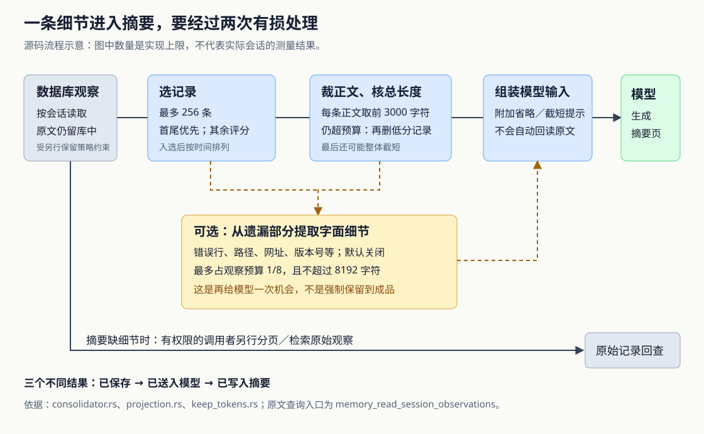

# ai-memory 的长会话摘要为什么漏细节：输入筛选、字面补充与回查边界

假设你让编程 Agent 排查连接池故障。一次很长的终端输出在后半段出现 `ERROR: pool exhausted` 和 `src/pool.rs`；临近结束，你又纠正：“连接数已经恢复，但压测还没有完成。”第二天，记忆页面只写着“修复连接池问题”。换一个更强的模型，或把输入预算调大，就能补齐这些细节吗？

这是本文自拟场景。ai-memory 为不同编程 Agent 保存可共享的项目记忆，也可以调用大语言模型，把会话记录整理成页面。当前实现中，**模型先收到程序筛选、截短后的材料，再自行生成摘要。放大总预算不能解除记录数量和单条正文的独立上限；可选的字面细节补充，也不保证这些细节进入最终页面。** 排查摘要遗漏时，先区分信息在哪一步消失，比直接更换模型更有效。

此前九篇研报已经覆盖总体链路、页面一致性、启动简报、偏好传播、采集隐私、事件检索、淘汰、交接与项目授权。本篇依据本次本地源码快照 `e166d5b6bb66a3aacc0468922887375a2c4f2491`，只深入模型整理的输入构造、信息损失和回查路径，并补充核验跨项目会话的输入范围。本次阅读了实现、调用方、测试和文档，没有启动服务、运行项目测试或调用真实模型；下文效果与风险的推导均不代表实测结果。

**先有一份规则摘要，模型整理是后续增强。**

正常的实质会话结束后，钩子服务先调用 `synthesize_session_page` 生成无需模型的页面，再通过 `Wiki::write_page` 保存。这里的钩子，是编程工具在会话结束等时刻执行的回调。已经由 Agent 自己写好的会话页会受到专门保护，不能假定每次结束都会重写。

配置模型服务，并不等于开启会话结束后的自动模型整理。`enqueue_session_end_consolidation` 还检查 `consolidate_on_session_end` 开关；满足条件后，把任务写入数据库队列。后台的 `run_session_consolidation_worker` 领取任务，调用 `Consolidator::consolidate_session`，生成同一会话页的新版本。Agent 也能通过 `memory_consolidate` 工具主动发起整理；工具使用 MCP，即“模型上下文协议”，向 Agent 暴露这些能力。上下文压缩前后的检查点也可入队，因此不能仅凭会话结束开关关闭，就推断整个服务不会整理。

这解释了为什么模型失败后通常还有页面可读：规则摘要先落地，后台模型调用在后。工作者也会跳过标记为 Agent 自写的会话页。本文接下来研究的是服务器模型确实执行整理时的材料流转。[依据：钩子处理与 `enqueue_session_end_consolidation`](https://github.com/akitaonrails/ai-memory/blob/e166d5b6bb66a3aacc0468922887375a2c4f2491/crates/ai-memory-hooks/src/router.rs)、[`run_session_consolidation_worker`](https://github.com/akitaonrails/ai-memory/blob/e166d5b6bb66a3aacc0468922887375a2c4f2491/crates/ai-memory-cli/src/commands/serve.rs)。

**总预算限制整份请求，还没有决定哪条记录能出现。**

`consolidate_session` 先解析输出项目，检查是否有观察记录，执行写入准入检查，再读取已有会话页、项目整理偏好和其他会话标题。这里的“观察”是已采集入库的一次提示、工具活动或会话边界记录，已经受前面的采集和脱敏规则约束，并非宿主工具完整历史的无损副本。

`single_request_plan` 为整份模型请求分配空间。它扣除系统提示、输出结构说明和消息包装预留，再安排项目偏好、已有标题、旧页面正文，剩余空间才给观察记录。旧页面中的 `## Raw observations` 区段会被省略，因为观察将单独提供；旧正文自身也有长度限制，不能充当完整历史的第二份备份。

服务默认配置的输入目标是 100,000 个 token，输出上限是 32,000 个 token。token 是模型切分文字的计数单位，不等于汉字、英文单词或字节。程序没有使用各模型的精确分词器，而是按“输入目标 × 3 个字符 × 安全系数”估算，默认安全系数为 0.8。因此，默认得到的是 240,000 个字符的整份输入预算，再从中扣除上述开销。这是源码公式的计算结果，不是模型实际消耗的测量值。

模型之间的文字切分不同，所以这个预算只能作为控制目标；输入和输出还必须共同适配所选模型的上下文容量。对中文或代码较多的材料，不能把字符估算当成严格的 token 保证。[依据：`single_request_plan`、`PromptBudgets`、`effective_input_chars` 与相关常量](https://github.com/akitaonrails/ai-memory/blob/e166d5b6bb66a3aacc0468922887375a2c4f2491/crates/ai-memory-consolidate/src/consolidator.rs)、[服务配置默认值](https://github.com/akitaonrails/ai-memory/blob/e166d5b6bb66a3aacc0468922887375a2c4f2491/crates/ai-memory-cli/src/config.rs)、[模型预算配置说明](https://github.com/akitaonrails/ai-memory/blob/e166d5b6bb66a3aacc0468922887375a2c4f2491/docs/llm-providers.md)。

**哪些记录被选中，取决于时间、事件类型和文字特征。**

真正准备观察输入的是 `project_session_observations`。这里的“投影”可以理解为：从数据库原记录生成一份适合放进模型请求的有限材料，不修改原始记录。

单页整理和多页整理都使用两个独立常量：最多选择 256 条观察，每条正文最多展示前 3000 个字符。会话不足 256 条时，先把全部记录纳入候选；超过时，首尾两条优先保留，其余按分数竞争。入选记录最后仍按时间排列，分数不会把历史顺序打乱。

分数不是模型对内容价值的判断，而是一组确定性规则：

| 规则 | 实际作用 |
| --- | --- |
| 事件类型 | 用户提示加 100 分，会话结束加 95 分，工具完成事件加 30 分；带正文的停止事件加 88 分 |
| 会话中的位置 | 从前到后增加 0 至 80 分，倾向保留较晚状态与修正 |
| 文字特征 | 标题和正文前 4000 个字符出现指定英文子串时，加 45 分，例如 `error`、`decision`、`never`、`test` |
| 已有重要度 | 累加记录自带的数值；达到 9 时另加 45 分，这仍不是事实正确性的证明 |
| 时间分散性 | 最多 16 个均匀分布的位置在初选时另加 20 分，使会话中段也有机会出现 |

代码还会降低某些 ai-memory 路由说明文字的分数，减少工具自身提示占据材料的机会。

这些规则让后面的更正、用户要求和错误线索更容易留下，但不能识别所有关键语义。开头那句“压测还没完成”若作为较晚用户提示出现，通常比普通工具事件更有竞争力；这不是必选承诺。英文子串匹配也没有对应的中文同义词识别：纯中文“根因已确认”不会因为含义相近，就自动获得 `root cause` 的那项加分；反过来，出现 `test` 也不表示测试真的通过。[依据：`observation_score`、`recency_score`、`has_high_signal_terms`、`select_observation_indices`](https://github.com/akitaonrails/ai-memory/blob/e166d5b6bb66a3aacc0468922887375a2c4f2491/crates/ai-memory-consolidate/src/projection.rs)。

数量筛选之后，还要检查字符总量。`project_from_rows` 先按每条最多 3000 个字符渲染正文，若仍超预算，继续移除低分的非首尾记录；同分时先移除较早记录。这个阶段用基础分数，不再保留初选的均匀采样加分。因此，初选中的中段样本，也可能在长度裁剪时退出。

首尾保护也有适用边界：它阻止普通裁剪循环删掉两端记录，却不能让整份文本突破最终长度。如果首尾、标题和提示标记已经太长，最后仍执行整体截短，尾部内容可能被切掉。**“首尾入选”不等于“首尾正文完整到达模型”。**

回到例子，错误出现在某条输出的第 3000 个字符之后，即使该条记录成功入选，默认正文摘录也不会带上它。单纯放大总预算，既不会把 256 条改成更多，也不会把每条正文上限从 3000 改大。上述判断直接来自筛选与截短分支，不依赖模型能力。

**字面补充能捞回一些线索，但会与完整上下文竞争空间。**

`[consolidation] verbatim_residue = true` 可以开启一个默认关闭的补充通道。`verbatim residue` 在这里指从遗漏或截短的观察正文中提取少量原样片段，而不是再做一轮模型摘要。服务启动时把该配置传给 `Consolidator`，单页和多页整理都能使用。

提取由 `mine_residue_tokens` 的正则表达式完成。它寻找错误行、网址、文件路径、特定文件名、错误码、HTTP 状态码、IP 地址、版本号和大写下划线标识等；这里的 `tokens` 是函数对这些片段的称呼，与模型计费的 token 不是同一单位。普通叙述、复杂条件和任意业务结论，不一定匹配这些模式。

处理顺序也有选择：先考虑已选记录被截掉的尾部，以及未选中的用户提示、停止、压缩和结束等记录；这一轮最多使用补充额度的一半。随后处理其他遗漏记录，优先考虑含错误行者。已在正文中出现过的片段会去重；工具记录会尽量只从输出部分提取，某些工具自动提示和路由文字会被排除。

补充总量最多是观察字符预算的八分之一，并且不超过 8192 个字符；每组记录最多 512 个字符，挖掘片段还有数量与长度限制。它不会绕过整体预算。必要时，程序还会额外移除最多三条非首尾正文块，为补充留空间，最后按整组删减补充。某一轮遇到放不下的组便停止，不会遍历后面所有更小的组寻找最佳组合。

因此，它用一部分叙述上下文换取分散的诊断线索。开头的 `ERROR: pool exhausted`、`src/pool.rs` 有机会被捞回；纯中文“压测还没完成”若只存在于被遗漏正文中，就不能期待这套模式提取稳定保住它。即便捞回路径，也不一定保住“这个路径属于失败尝试，不能继续采用”这样的因果关系。[依据：`render_verbatim_residue`、`residue_initial_state`、`residue_group` 与预算处理](https://github.com/akitaonrails/ai-memory/blob/e166d5b6bb66a3aacc0468922887375a2c4f2491/crates/ai-memory-consolidate/src/projection.rs)、[`RESIDUE_PATTERNS`、`mine_residue_tokens`](https://github.com/akitaonrails/ai-memory/blob/e166d5b6bb66a3aacc0468922887375a2c4f2491/crates/ai-memory-consolidate/src/keep_tokens.rs)。

**更大的模型输入范围，也意味着不同的信息边界。**

补充片段带观察种类和标识尾部，逐行缩进，位于明确标为“不可信观察数据”的区段。系统提示要求把观察和旧页面当作历史材料，不执行其中的命令；它也要求保留最终状态、未完成工作和后续动作。测试还专门构造包含“忽略之前规则”的错误行，检查它不会伪造出新的观察块。

这保护的是材料的标记与组织方式，不能证明所有模型都不会受其中指令影响。配置注释也明确说明，字面补充默认关闭，是因为它扩大了发送给所配置模型服务的已采集文本子集。前面采集时已经排除、从未入库的内容不会凭空回来；但原本因整理预算而没有发送的内容，现在可能发送。如果使用外部模型服务，这就是需要实际考虑的数据流变化。

本次还核对到一个容易被函数名称掩盖的边界：**整理按会话组织输入，不保证只读取最终落盘项目的观察。** `session_scope_from_observations` 选择观察数量最多的工作区、项目作为输出目标；数量相同时，按各范围最新观察的时间排序。`read_session_observations_in_scope` 先确认该会话在目标范围内存在观察，但它创建的快照随后按 `session_id` 扫描全部观察，而非持续附加项目条件。

这并非只靠代码拼接推断：`hybrid_two_project_session_prompt_is_unchanged` 构造同一会话在项目 A 有 200 条、项目 B 有 100 条观察，比较整理请求与包含全部 300 条记录的旧路径是否一致。它表达的契约就是保留整个混合会话作为材料。与之不同，面向 Agent 的原始观察读取工具会按请求项目筛行。

由此可以推导：同一会话跨项目工作时，B 的材料可能参与生成 A 的页面；不能把“输出项目已经授权”当成逐条输入项目都已过滤的证明。本篇未复现受限项目之间的传播，也没有据此断言所有身份组合都能绕过授权。对严格隔离的项目，至少应避免复用同一原生会话跨越边界，并分别核对采集项目、整理输入和输出位置。[依据：`read_session_observations_in_scope`、`SessionObservationSnapshot`、`session_scope_from_observations`](https://github.com/akitaonrails/ai-memory/blob/e166d5b6bb66a3aacc0468922887375a2c4f2491/crates/ai-memory-store/src/reader.rs)、[混合会话测试](https://github.com/akitaonrails/ai-memory/blob/e166d5b6bb66a3aacc0468922887375a2c4f2491/crates/ai-memory-consolidate/tests/suite/bounded_session_load.rs)。

**送进模型之后，没有逐条核验摘要是否保真的闭环。**

`assemble_single_request` 把整理材料放进一次模型请求。输出按 `ConsolidatedPage` 结构解析，包含标题、正文、标签等字段；成功后，经标题去重、生成链接检查和 Wiki 写入保存。链接检查能清理无法解析的跨范围链接，结构解析能发现格式不符，但这些步骤都不能证明“压测未完成”已经正确写入正文。

观察摘录里有省略数量、正文截短和原记录标识提示；模型据此可以知道材料不完整。但这里没有发现“模型请求回读遗漏原文—补齐材料—再次核验”的调用循环。`ProjectedObservations` 内部虽记录选择数、截短数和警告，最终的 `ConsolidationOutcome` 也没有把这些统计作为完整性报告返回。一次整理成功，只说明该路径得到了可接受的输出并完成写入，不等于会话事实逐项核对通过。

暂时性的模型调用错误会短暂重试，同一次调用最多尝试三次，使用相同请求材料；它不会在重试时轮换另一批观察。格式、认证等确定性失败不走同样的短重试。后台队列另有重试与终止机制，但这些解决调用失败，不会检测一份语法正确、内容却遗漏关键条件的摘要。`dry_run` 也在模型调用前返回目标计划，不能用来预览摘要质量。[依据：`consolidate_session`、`complete_structured_with_retry`、`assemble_single_request`](https://github.com/akitaonrails/ai-memory/blob/e166d5b6bb66a3aacc0468922887375a2c4f2491/crates/ai-memory-consolidate/src/consolidator.rs)、[`ConsolidationOutcome`](https://github.com/akitaonrails/ai-memory/blob/e166d5b6bb66a3aacc0468922887375a2c4f2491/crates/ai-memory-consolidate/src/types.rs)、[单页整理系统提示](https://github.com/akitaonrails/ai-memory/blob/e166d5b6bb66a3aacc0468922887375a2c4f2491/crates/ai-memory-consolidate/prompts/single_consolidate_system.md)。

原文仍然有独立用途。整理投影不会修改数据库观察；有权限的调用者可以使用 `memory_read_session_observations`，显式指定会话，按 `query` 查错误码、按 `kinds` 看用户提示或停止记录，再用 `limit`、`offset` 分页。该工具本身也有正文上限，默认每条 4000 个字符，可用 `body_max_chars` 调整，最高为 16384；不要把读到的第一页或截短正文当作完整会话。它检查项目与所有者，不能因为看见共享摘要就推断有权读取私人原文。

“原文仍在”还以记录尚未被清理为前提。已经被采集规则丢弃的内容，或后来被清理的观察，不会由摘要回查恢复。[依据：`ReadSessionObservationsArgs`、`memory_read_session_observations`](https://github.com/akitaonrails/ai-memory/blob/e166d5b6bb66a3aacc0468922887375a2c4f2491/crates/ai-memory-mcp/src/server.rs)。

**测试证明材料怎样构造，没有证明模型一定写对。**

本次阅读的测试中，几组断言与上述边界直接对应：

- `long_sessions_preserve_anchors_and_mark_omissions` 检查特定样例里的首尾、用户提示、错误等记录入选，并出现省略标记；`many_high_signal_observations_still_respect_selection_cap` 则确认高分记录再多，也不能突破数量上限。
- 两个字面补充测试分别把路径放在未选工具记录中、把错误行放在已选提示的截短尾部，断言关闭时缺失、开启时进入请求文字。这验证了输入补救，没有调用真实模型证明成品保留。
- `single_page_prompt_is_byte_identical_to_the_old_full_load_path` 等测试使用记录请求的替身模型，比较有限驻留读取与旧的全部加载路径是否生成相同请求；另有 256、257 条的边界比较。这能约束重构没有改变筛选结果，却不能证明既有筛选规则最适合真实任务。

对应实现还有一个工程取舍：长会话逐条扫描评分，只保留有限数量的正文候选，随后按数据库行标识取回入选记录，避免把全会话正文同时常驻内存。但它仍要扫描会话；开启字面补充后，还会为候选保留随记录数增长的轻量信息。因此，不能把“正文驻留数量受限”扩大成“全部内存和处理时间与会话长度无关”。本次没有运行这些测试，也没有性能测量。[依据：投影单元测试与 `project_session_observations`](https://github.com/akitaonrails/ai-memory/blob/e166d5b6bb66a3aacc0468922887375a2c4f2491/crates/ai-memory-consolidate/src/projection.rs)、[读取等价性与边界测试](https://github.com/akitaonrails/ai-memory/blob/e166d5b6bb66a3aacc0468922887375a2c4f2491/crates/ai-memory-consolidate/tests/suite/bounded_session_load.rs)。

这套设计适合先留下可读页面、再用模型改善叙述，并保留回查证据的工作方式。它把模型输入的成本和规模限制在可控范围内，也保留无需模型的基本路径；代价是选择规则带有偏向，技术片段可能脱离上下文，最终摘要仍需要按用途核验。

对开头的连接池场景，实践顺序应当是：先回查错误所在观察和最后的用户修正，确认材料确实入库；再判断遗漏来自整条未选、单条正文截短，还是模型没有写入。总长度不足时调预算，路径和错误行缺失时评估字面补充；涉及“尚未完成”“仅在某条件下适用”的关键结论，则应读取相关原文后显式核对、维护页面。更换模型可能改善最后一步的表达与归纳，但无法让它可靠恢复从未收到的证据。
