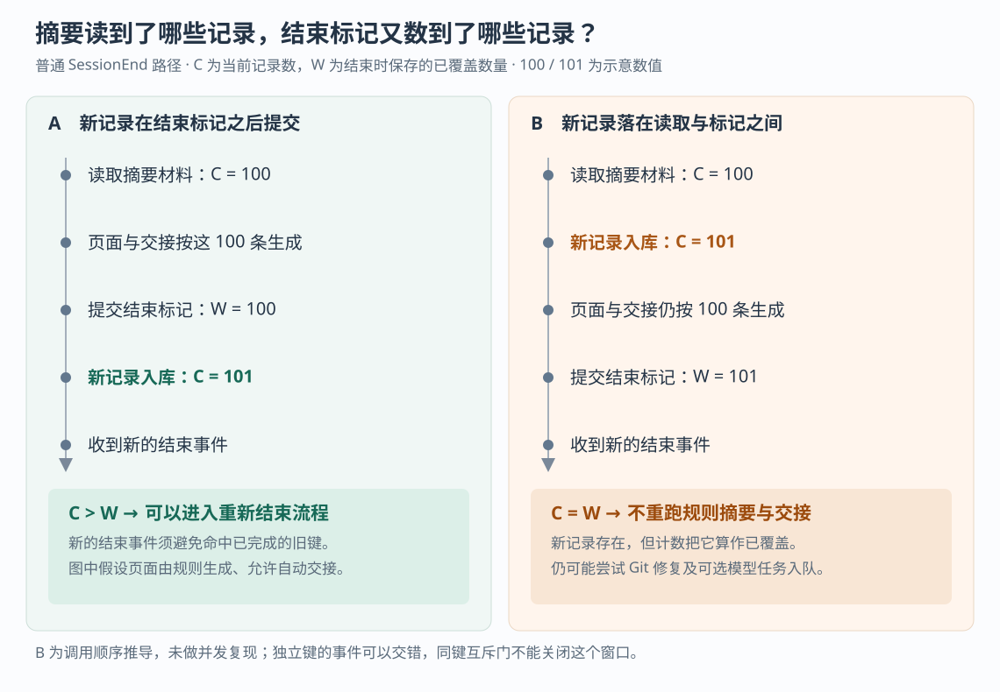

# ai-memory 的会话结束算完成了吗：迟到事件、重放修复与摘要覆盖窗口

假设编程 Agent 排查了一次接口故障。会话临近结束，你补充：“配置已经改好，但压测还没完成。”这条纠正因为补发稍晚才到服务器。数据库中能找到它，会话页和下一棒收到的交接却仍然停留在旧状态。再执行一次“结束会话”，能让它们补齐吗？

这是本文自拟场景。ai-memory 为不同编程 Agent 保存共享的项目记忆，并把会话整理成页面、生成后续工作的交接。当前实现允许已结束的会话继续收到事件，再用记录数量判断是否需要重新整理。**迟到记录在结束标记之后提交，新的结束事件通常能触发重建；如果它落在“读取摘要材料”与“保存结束标记”之间，则可能已经被计入已覆盖数量，却没有进入这次页面与交接的生成材料。** 这一区别解释了为什么“记录已入库”“结束请求已确认”“摘要覆盖了这些记录”不能互相替代。

十篇既有研报已经覆盖总体链路、文件与索引、启动上下文、偏好、隐私、检索、淘汰、交接、授权和模型输入。本篇从补发后的状态衔接深入，重点核对会话结束的恢复与并发边界，依据执行器提供的源码快照 `69558d733f781684f573941a8ff5a34c2cb59d68`。本次只读源码、测试和设计文档，没有启动项目、运行项目测试或复现并发故障。下文的交错时序是源码推导；为隔离问题，核心例子假设页面由程序规则生成、未开启可选模型整理，且普通自动交接未被关闭或拒绝。

**“结束”保存的是一次处理进度，不会把会话封成只读。**

原生 `ai-memory hook` 命令收到事件后，通常先把它写进本机 `hook-spool` 待发送文件队列，再由发送进程补发。每个普通队列条目在创建时获得一个 `ingest_key`，也就是供服务端识别重复投递的键；同一文件重发时保持该键。批量入口 `POST /hook/batch` 按数组顺序处理事件，但整个批次不是一个共同成功或回滚的数据库事务，不同请求之间也没有全局顺序。直接 `POST /hook` 则先返回 `202 queued`，再由进程内后台任务处理，收到响应时尚不能证明已经落盘。[依据：客户端 `run_with_payload_in_home`](https://github.com/akitaonrails/ai-memory/blob/69558d733f781684f573941a8ff5a34c2cb59d68/crates/ai-memory-cli/src/commands/hook.rs)、[服务端 `admit_hook`、`handle_hook_batch`](https://github.com/akitaonrails/ai-memory/blob/69558d733f781684f573941a8ff5a34c2cb59d68/crates/ai-memory-hooks/src/router.rs)。

真正决定事件怎样进入会话的是存储层的 `admit_hook_session_event`。它在同一数据库事务里核验会话的 Agent 与所有者、处理投递键、插入观察记录。这里的观察记录，是采集到的一次提示、工具活动或生命周期事件，不代表经过验证的知识。普通提示或工具事件不会仅因会话的 `ended_at` 已有值而被拒绝；Agent 可以沿用同一会话标识继续工作，补发的旧事件也可以进入。

因此，会话行另外保存 `ended_observation_count`：上次结束时，数据库里已经有多少条属于该会话的观察。下文把它称为“已覆盖数量”。这个名字描述代码怎样使用它，并不保证每条正文真的写进了摘要。

下一次结束事件到来时，准入事务先比较当前数量与这个值：

| 当前会话状态 | 结束事件的处理方向 |
| --- | --- |
| 尚未结束 | 进入正常结束流程 |
| 已结束，当前数量大于已覆盖数量 | 允许进入重新结束流程，存储层称为 `ReEnd` |
| 已结束，当前数量没有增加 | 返回 `AlreadyEnded`，不再插入这次结束观察，也不重跑规则摘要与自动交接 |
| 会话不存在，或结束事件范围无效 | 忽略该结束事件，不靠它凭空创建会话 |

比较发生在插入本次结束观察之前，所以不会因为“又来了一条结束”本身就永远触发重建。使用数量也避开了客户端时钟与服务器时钟不一致的问题；源码对相关读取接口明确说明了这一理由。但数量只是粗粒度进度，不能证明页面内容与当前记录对应。[依据：`ops::admit_hook_session_event`、`end_session_row`](https://github.com/akitaonrails/ai-memory/blob/69558d733f781684f573941a8ff5a34c2cb59d68/crates/ai-memory-store/src/ops.rs)、[`ReaderPool::session_end_disposition` 的设计说明](https://github.com/akitaonrails/ai-memory/blob/69558d733f781684f573941a8ff5a34c2cb59d68/crates/ai-memory-store/src/reader.rs)。

**同一个结束请求重发，修复的是中断；继续工作后的新结束，处理的是新一轮材料。**

先看正常结束的实际调用链。`process_authorized` 完成事件准入后，调用 `SessionDigest::load` 读取用于生成页面和交接的材料。`SessionDigest` 是一份有限大小的会话概况；读取在同一个数据库只读事务内完成，各个查询看到一致的记录集合，但它不是整个会话正文的无损复制。

之后，服务端依次执行：

1. 根据这份概况生成规则摘要，通过 `Wiki::write_page` 保存会话页；若识别到 Agent 自己写好的页面，则保留该页。
2. 根据同一份概况准备自动交接，并执行允许或拒绝交接的检查。
3. 调用 `end_admitted_session_with_handoff`，在一个数据库事务中保存结束时间、会话页标识、已覆盖数量和交接；不创建交接时走对应的无交接分支。
4. 尝试提交 Wiki 的 Git 快照，按配置将模型整理任务持久入队，最后把投递键标记为完成。

这条链路保护了一个具体边界：结束标记和自动交接不会只提交一半。但页面写入在这个数据库事务之前，Git 与模型任务又在之后，不属于同一个整体事务；Git 提交失败还会记录警告并继续。模型任务入队成功也不代表模型已经完成改写。[依据：`process_authorized` 的会话结束分支](https://github.com/akitaonrails/ai-memory/blob/69558d733f781684f573941a8ff5a34c2cb59d68/crates/ai-memory-hooks/src/router.rs)、[`SessionDigest::load` 与 `load_with_stats`](https://github.com/akitaonrails/ai-memory/blob/69558d733f781684f573941a8ff5a34c2cb59d68/crates/ai-memory-hooks/src/synth.rs)、[`read_session_observations`](https://github.com/akitaonrails/ai-memory/blob/69558d733f781684f573941a8ff5a34c2cb59d68/crates/ai-memory-store/src/reader.rs)。

投递键因此有“已经插入观察，但后续尚未完成”和“已经完成”两种状态。首次插入观察与认领键共同提交，避免只占键、不留记录；中断后的重复投递可以得到 `ResumePending`，继续后续处理而不再插入同一条观察。一般事件命中已完成键则得到 `AlreadyComplete`，处理器直接报告重放。普通键在当前实现中有三十天的保留窗口，这不是永久去重承诺。[依据：`admit_hook_session_event`、`complete_observation_ingest_if_claimed`](https://github.com/akitaonrails/ai-memory/blob/69558d733f781684f573941a8ff5a34c2cb59d68/crates/ai-memory-store/src/ops.rs)。

结束事件还有专门的中断修复：如果页面、结束标记和交接已经提交，随后进程中断，重发会先遇到 `AlreadyEnded`。处理器这时尝试补 Git 提交、为有实质活动的会话补模型整理任务，并完成已经认领的键；它不会重新生成规则摘要或再建一条交接。故而“已结束”不等于所有后续动作都曾完成，这个分支正是为了补上后半段。

未完成键的恢复也允许部分动作再次发生。例如，处理器在后续完成前追加项目事件日志；若追加后中断，恢复可以再次追加。这种恢复选择保留继续处理的机会，不能扩大成每个文件副作用都只执行一次。

这里也有另一面：已经完成的旧结束键，不能当成“重新整理现在全部内容”的命令。即使后来数量增加，使准入允许重新结束，旧键仍可能被识别为已完成而跳过。真正继续工作后的结束应是一个新事件；网络重试则必须保持旧键，两者不能混用。

**最容易漏看的窗口，在概况读取之后、结束数量落库之前。**

假设第一次结束事件已经入库，读取概况时会话共有 100 条观察。下面两种时序只差一条迟到记录的提交位置；数字是便于说明的假设值，不是测量结果。

左侧符合直觉：服务端按 100 条材料写完页面与交接，保存已覆盖数量 100；随后那句“压测还没完成”入库，当前数量变为 101。新的结束事件发现 101 大于 100，就有机会重新读取材料、更新规则摘要与交接。这里仍受 Agent 自写页面保护、交接开关和准入检查影响，不能保证每次都覆盖既有成品。

右侧则出现覆盖判断缺口：

- 结束处理器读完 100 条材料对应的概况。
- 另一请求把纠正提示提交到同一会话，当前数量变为 101。
- 结束处理器按先前概况写页面、准备交接。
- `end_session_row` 在提交时重新执行 `COUNT(*)`，把 101 保存为已覆盖数量。

新记录在数据库里真实存在，但本轮页面和交接都没有机会读取它。此后若没有其他新记录，再来一个全新的结束事件，比较结果也是“101 没有大于 101”。处理器走 `AlreadyEnded`，不会重跑这两份规则生成结果。把这个判断叫作“摘要已覆盖 101 条”会超出代码实际证明的范围。

这并非数据库读事务内部读乱了：`SessionDigest` 内部的材料是一致的。缺口出在读事务已经结束，随后保存结束状态时采用了另一个时刻的数量。普通结束调用没有把概况读取时的数量传给结束事务作为前提。[依据：`process_authorized` 中 `SessionDigest::load → write_page → end_admitted_session_with_handoff` 的顺序](https://github.com/akitaonrails/ai-memory/blob/69558d733f781684f573941a8ff5a34c2cb59d68/crates/ai-memory-hooks/src/router.rs)、[`end_session_row` 提交时统计数量](https://github.com/akitaonrails/ai-memory/blob/69558d733f781684f573941a8ff5a34c2cb59d68/crates/ai-memory-store/src/ops.rs)。

服务端确实有互斥保护，但 `IngestGates` 使用的是“项目标识、投递键”组合。同一个事件重发会等待原处理器完成页面、交接与键标记；新的提示使用另一个键，不会等待同一会话的结束处理器。单个数据库写入者保证每个写命令依次执行，也不会把跨越页面写入和多次等待的整个结束过程锁成一个操作。因此，两个独立请求可以按图中右侧交错。批量入口只保证一个请求内逐项处理，也不能挡住另一请求的写入。[依据：`IngestGates::lock` 及 `process_authorized` 保持锁的范围](https://github.com/akitaonrails/ai-memory/blob/69558d733f781684f573941a8ff5a34c2cb59d68/crates/ai-memory-hooks/src/router.rs)。

这是一条有明确条件的源码推导，本次没有复现其发生频率。可选模型整理可能重新读取材料并改善页面，之后的新活动和新结束也可能触发再整理；这些都不能让本次规则摘要与交接自动获得同一份材料证明。尤其是模型改写页面，不能据此推断旧交接也已同步修正。

**另一条结束路径，已经把“材料没变”写进提交条件。**

服务端还可以替长时间没有活动的开放会话自动收尾，处理 Agent 崩溃、没有发出结束事件的情况。它由维护调度器调用 `run_idle_end_tick`；`[sessions] idle_end_after_hours` 默认是 0，即关闭，启用时还需要维护调度允许运行。这条路径不创建新的自动交接。

对需要生成规则摘要的会话，它使用 `SessionDigest::load_with_count`，在读取概况的同一个快照里取得记录数量。保存结束标记时，`idle_end_sessions_inner` 在更新语句里同时要求：会话仍开放、项目范围仍对应、当前数量仍等于刚才读取的数量、最新页面仍是本轮写好或决定保留的版本。这种“只有状态仍符合预期才修改”的动作，通常称为比较并设置，缩写为 CAS。

如果概况读取后有新记录入库，数量条件失败，结果为 `Lost`：本次不保存结束标记、不写对应审计、不创建模型整理任务，会话保持开放，留待后续扫描重新读取。模型整理入队还和结束标记放在同一数据库事务里，入队失败会一起回滚。页面则已经在前面写过，CAS 失败不会把它一并抹掉；它仍可能作为普通页面版本存在。因此，这条路径保护的是结束状态与候选材料的对应关系，同样没有把文件和数据库变成一个共同事务。[依据：`idle_end::summary_page_decision`](https://github.com/akitaonrails/ai-memory/blob/69558d733f781684f573941a8ff5a34c2cb59d68/crates/ai-memory-hooks/src/idle_end.rs)、[`SessionDigest::load_with_count`](https://github.com/akitaonrails/ai-memory/blob/69558d733f781684f573941a8ff5a34c2cb59d68/crates/ai-memory-hooks/src/synth.rs)、[`idle_end_sessions_inner`](https://github.com/akitaonrails/ai-memory/blob/69558d733f781684f573941a8ff5a34c2cb59d68/crates/ai-memory-store/src/ops.rs)。

这提供了一个具体的对照：自动空闲收尾使用“摘要读取时的数量”约束提交，普通结束使用“提交时的数量”记录进度。不能因为一条路径有这个检查，就把它当作所有结束操作的共同保证。空闲扫描本身只选择 `ended_at IS NULL` 的会话，也不会定期把上述已经结束的旧摘要全部找出来修正。[依据：`ReaderPool::idle_open_sessions`](https://github.com/akitaonrails/ai-memory/blob/69558d733f781684f573941a8ff5a34c2cb59d68/crates/ai-memory-store/src/reader.rs)。

**测试能支持哪些结论，哪些仍是本次推导。**

本次阅读了以下测试的设置与断言，没有运行它们：

| 测试 | 实际覆盖的行为 |
| --- | --- |
| `keyed_session_end_replay_waits_for_the_first_delivery_tail` | 用回调暂停第一次结束；同键重发必须等待，最终只有一个结束观察、一条交接和一个页面版本 |
| `stale_session_end_redelivery_converges_interrupted_tail_effects` | 人工构造“页面和结束、交接已提交，后半段未完成”；重发补模型任务、完成键，不重复观察与交接 |
| `resumed_session_second_end_reruns_end_path` | 第一次结束后新增工具事件，第二次结束更新页面与开放交接；之后的重复结束重新变为无新增状态 |
| `idle_end_cas_rejects_a_stale_observation_count` | 摘要数量落后于当前记录时，空闲结束拒绝保存标记，会话保持开放 |
| `idle_end_pre_stamp_non_end_observation_in_window_loses_the_cas` | 在空闲结束真正提交前插入一条非结束事件，确认 CAS 失败，且没有审计与模型任务 |

前三项位于[钩子路由测试](https://github.com/akitaonrails/ai-memory/blob/69558d733f781684f573941a8ff5a34c2cb59d68/crates/ai-memory-hooks/src/router.rs)，后两项位于[空闲结束存储测试](https://github.com/akitaonrails/ai-memory/blob/69558d733f781684f573941a8ff5a34c2cb59d68/crates/ai-memory-store/tests/suite/idle_session_end.rs)。它们分别覆盖同键并发、中断恢复、结束后新增工作和空闲路径的交错保护。本次没有定位到专门在普通结束的概况读取与结束标记之间插入独立提示、再核对页面与交接的测试；图中右侧保持为调用链推导，不借用空闲路径的测试冒充复现。

**排障时，先确认缺的是记录，还是让成品重新生成的条件。**

如果纠正提示仍在本机队列里，应先检查投递；`ai-memory status` 会读取本机队列状态，即使服务器不可达也尽量报告积压。批量确认里的 `dropped_*` 表示服务端决定丢弃，不代表记录保存成功；`ignored_end` 也可能是一次没有生成新观察的结束。队列清空与返回成功都不足以证明摘要内容完整。[依据：`status::run`、`report_offline_spool`](https://github.com/akitaonrails/ai-memory/blob/69558d733f781684f573941a8ff5a34c2cb59d68/crates/ai-memory-cli/src/commands/status.rs)、[`HookProcessingOutcome` 与批量处理分支](https://github.com/akitaonrails/ai-memory/blob/69558d733f781684f573941a8ff5a34c2cb59d68/crates/ai-memory-hooks/src/router.rs)。

如果记录确实在上次结束后新增，可以在所有待补事件交付后，为准确的会话重新收尾。例如，当前命令行工具支持 `finalize-session --agent <工具名> --workspace <工作区> --project <项目> --session-id <会话标识> --reopen`。`--reopen` 只让查询包含已经结束的指定会话，并没有先把结束时间清空，也不是强制重写开关；随后仍通过批量入口发送一个合成结束事件，接受同样的数量判断。若已覆盖数量已经把迟到记录算进去，单独重试这个命令不会迫使规则摘要重建。涉及重要纠正时，应回查原记录，再明确修订页面及需要交给下一棒的内容。[依据：`FinalizeSessionArgs`](https://github.com/akitaonrails/ai-memory/blob/69558d733f781684f573941a8ff5a34c2cb59d68/crates/ai-memory-cli/src/cli.rs)、[`finalize`、`fetch_open_sessions`、`post_session_end_batch`](https://github.com/akitaonrails/ai-memory/blob/69558d733f781684f573941a8ff5a34c2cb59d68/crates/ai-memory-cli/src/commands/finalize_session.rs)。

对自行接入的事件生产者，项目文档提出的顺序很实用：先送完同一会话的较早事件，再送终止事件；需要顺序时，在生产端串行投递同一会话，不同会话可以并行。网络重试保留原事件与原键，新的生命周期动作分配新的身份。这样可以减少结束先于材料的情况；多个独立生产者仍需要共同约定谁负责收尾。[依据：外部生命周期协议的顺序与恢复约定](https://github.com/akitaonrails/ai-memory/blob/69558d733f781684f573941a8ff5a34c2cb59d68/docs/external-lifecycle.md)。

从设计上看，ai-memory 把重复投递、结束进度和后续修复分别建模，保留了工具退出后补记忆、同会话继续工作的弹性。它也展示了一个可迁移的工程原则：**若一个标记声称某批材料已经处理，提交时就应核验它对应的确是那批材料。** 普通结束若要收紧本篇窗口，可以考虑沿用空闲收尾的做法，把概况数量和页面版本作为结束提交条件，条件变化就重新读取，同时协调自动交接与失败恢复。这是依据当前实现提出的演进方向，不是项目已经为普通结束提供的保证。
