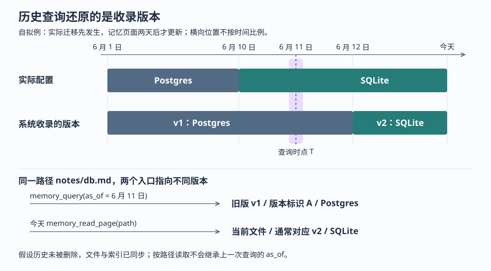

# ai-memory 能还原当时的认知吗：历史版本、检索时点与读页边界

假设项目在 6 月 10 日把数据库从 Postgres 迁到 SQLite，但直到 6 月 12 日，编程 Agent 才更新记忆页面。月底复盘事故时，你问：“6 月 11 日，我们知道项目使用什么数据库？”ai-memory 的历史查询可能返回旧版的 Postgres 说明；如果随后让 Agent 按结果中的路径打开页面，它却可能读到今天的 SQLite 说明。

这是本文自拟场景。ai-memory 为不同编程 Agent 保存共享的项目记忆，既保留页面版本，也提供指定时间的检索。**它可以找出某个过去时点被系统视为当前的页面版本，但不负责判定事实在现实中何时成立，也不保证后续按路径读页仍停留在那个版本。** 把这两层区别讲清楚，才能用历史记忆做复盘，而不会把搜索结果误当作完整的历史快照。

此前十一篇研报已研究总体链路、页面一致性、启动上下文、偏好、隐私、事件搜索、淘汰、交接、授权、模型输入和会话结束。本篇依据执行器提供的源码快照 `0e5488073d7073caa3181bbaf184102b215dcf66`，深入历史版本的生成、查询和消费。本次只读实现、调用方、测试与设计文档，没有启动服务、运行项目测试或复现故障；文中的日期和边界场景是源码推导。

**先明确“当时”指的是哪一个时间。**

普通 `memory_query` 主要面向当前知识；传入 `as_of` 后，它改为查找指定时点的历史版本。`as_of` 接收带时区的时间字符串，例如 `2026-06-11T00:00:00Z`。该工具通过 MCP——模型上下文协议，即 Agent 调用外部工具的接口——提供给编程 Agent。

数据库为页面版本保存 `valid_from` 和 `valid_to`，分别表示系统将这一版视为当前内容的起止时间。尽管字段名含有“有效”，这里记录的是**收录时间**，不是“这条说法在现实中为真的时间”。`ops::upsert_page` 取服务器当前时间，交给事务内的版本写入函数；它不会从正文中的“6 月 10 日已经迁移”反推出版本应在那天生效。因此，例子中的 6 月 11 日仍落在旧版的收录区间内。

还要再收窄一点：这条时间线针对页面版本。工具事件可能早已进入原始会话记录，页面却尚未整理更新；历史查询也不会据此重新推演“当时已经采集到、但还没写进页面”的知识。设计文档明确把现实中的事实生效时间留作后续方向，原因包括不愿依赖模型替事实定日期，以及默认不调用模型的路径无法自动填充它。[依据：`ops::upsert_page`、`upsert_page_in_tx`](https://github.com/akitaonrails/ai-memory/blob/0e5488073d7073caa3181bbaf184102b215dcf66/crates/ai-memory-store/src/ops.rs)、[时间语义与范围说明](https://github.com/akitaonrails/ai-memory/blob/0e5488073d7073caa3181bbaf184102b215dcf66/docs/temporal.md)。



**一次改页，同时关闭两份时间窗口。**

沿普通页面写入进入存储层，核心函数是 `upsert_page_in_tx`。它先查同一工作区、项目、路径的当前版本。如果正文及所比较的元数据没有变化，就沿用原来的版本标识；重复确认并不必然产生新版本。真正发生变化时，它在同一个数据库事务中完成以下动作：

1. 将旧页面的 `is_latest` 改为假，并把 `valid_to` 设为此次写入时间。
2. 关闭旧版的实体关联窗口，将关联行的 `superseded_at` 设为同一时间。
3. 插入新版本，设置 `valid_from`，并用 `supersedes` 指向被替换的旧版，再建立新版本的实体关联等索引。

这里的“实体”是页面谈论的名称，例如 `postgres`；关联表记录哪个版本携带这个名称。页面层有一份时间窗口，实体关联层也有一份，因为两路检索分别需要按时间筛选。关联来自页面开头的结构化元数据，包括 `entities` 和 `tags`；标签也可以产生实体，无须先调用模型。

两个窗口都使用“包含起点、不包含终点”的条件。旧版在新版本写入的时刻退出，新版在同一时刻进入：

```text
页面版本：valid_from <= T，并且 valid_to 为空或 valid_to > T
实体关联：valid_from <= T，并且 superseded_at 为空或 superseded_at > T
```

数据库事务保证这些变更共同提交或回滚。不过，这只是数据库内部的保证，不把磁盘文件和数据库变成共同提交的一次操作；此前关于文件与索引一致性的边界仍然适用。对历史查询而言，重要的是：**数据库不只保存“最新的一篇”，而是保存可分别检索的版本行。** [依据：版本写入与 `attach_entities_in_tx`](https://github.com/akitaonrails/ai-memory/blob/0e5488073d7073caa3181bbaf184102b215dcf66/crates/ai-memory-store/src/ops.rs)、[页面实体解析 `parse_entities`](https://github.com/akitaonrails/ai-memory/blob/0e5488073d7073caa3181bbaf184102b215dcf66/crates/ai-memory-wiki/src/wiki.rs)。

这也解释了一个设计取舍。程序原本可以在查询时沿版本链计算起止时间，现在则把窗口直接存成列并建立索引，简化读取时的筛选。代价是，每条让页面退出当前知识集的写入路径，都必须记得关闭两层窗口；漏关一层，就可能让已经退出的版本继续被历史查询选中。设计文档明确讨论了这种维护成本。[依据：页面时间窗口设计的存储方案比较](https://github.com/akitaonrails/ai-memory/blob/0e5488073d7073caa3181bbaf184102b215dcf66/docs/design-page-ingestion-windows.md)。

**历史查询不是只找名称，也不是把普通搜索全部倒回过去。**

真实调用链是：`memory_query` 检查参数、解析时间、解析并授权项目，随后调用 `search_pages_for_project_at_filtered`。该函数依次取得实体候选和全文候选，再把它们合并成结果。

实体一路查询在 T 时刻仍开放的关联窗口。例如旧版携带 `postgres`，就可以通过这个名称找到旧版。实现采用名称、前缀和部分分隔词前缀匹配，并非任意语义理解；同一实体关联的页面越多，单次匹配的权重越小。

全文一路使用 SQLite 内置的 FTS5，即全文搜索组件，在标题、正文和路径搜索文本中寻找字词匹配，再通过页面窗口筛掉不属于 T 的版本。它不要求页面带实体元数据。因此，一篇没有标签的旧说明，也能因正文中的 `sqlite` 被找到。但这仍是字词检索，不能把文档中“支持换个问法”的举例理解成任意同义改写都能命中。

两路结果按版本标识合并，使用倒数排名融合（RRF）：每路按候选名次给分，名次越靠前贡献越大，两路同时支持同一版本时贡献相加；随后应用有界的页面来源权重调整。`explain=true` 可以查看两路名次和贡献，帮助区分“名称关联找到了它”与“正文匹配找到了它”。[依据：`search_pages_for_project_at_filtered`、`search_page_candidates_for_project_at`、`entity_hits_filtered`](https://github.com/akitaonrails/ai-memory/blob/0e5488073d7073caa3181bbaf184102b215dcf66/crates/ai-memory-store/src/reader.rs)。

这条分支有意不使用向量检索、图邻居和原始事件回退。向量是把文本转换为数字表示以比较相近内容；当前这类检索产物及图邻居路径没有完整的历史版本范围，直接混入会把今天的关联带进过去。入口也在普通搜索的模型重排和访问加权之前返回；请求 `answer=true` 不会让模型撰写历史答案，而是得到“不支持该模式”的说明及正常命中结果。数据库查询失败会向调用者返回错误，没有悄悄降级为当前搜索。[依据：`memory_query` 的历史分支及提前返回位置](https://github.com/akitaonrails/ai-memory/blob/0e5488073d7073caa3181bbaf184102b215dcf66/crates/ai-memory-mcp/src/server.rs)。

**查的是旧内容，排序仍然发生在今天。**

全文索引并没有为每个时点保存一份副本。页面新增、更新和删除时，数据库触发器维护同一份索引，旧版本也在其中；历史查询改变的是连接页面表时的时间条件。

这使旧版本可以参与全文搜索，却留下一个容易忽略的边界：全文相关性采用当前索引的 BM25 排序。BM25 是根据字词出现情况给文档评分的一种算法，其统计范围包含后来加入的版本和其他项目的索引文本。于是，即使查询词与 T 完全不变，后来写入的内容仍可能改变排序，进而改变数量受限的结果集合。文档明确承认这一点。

因此，`as_of` 回答的是“从仍保留的版本中，按今天的检索规则寻找当时的内容”，不能复现“那天运行搜索会得到的完整顺序”。如果复盘需要固定证据，应保存查询时点、项目范围、命中的版本标识和实际核对的文本，不能只保存第一名的页面路径。[依据：全文索引及触发器](https://github.com/akitaonrails/ai-memory/blob/0e5488073d7073caa3181bbaf184102b215dcf66/crates/ai-memory-store/migrations/V17__pages_fts_index_path.sql)、[历史全文候选查询](https://github.com/akitaonrails/ai-memory/blob/0e5488073d7073caa3181bbaf184102b215dcf66/crates/ai-memory-store/src/reader.rs)、[历史排序限制说明](https://github.com/akitaonrails/ai-memory/blob/0e5488073d7073caa3181bbaf184102b215dcf66/docs/temporal.md)。

**到期时间并没有在两路检索中统一解释。**

页面还可以有 `expires_at`，即预设的到期时间，通常称为 TTL——存活期限。它与“被新版替换”是两套条件。当前历史查询存在明确的不对称：

| 检索路径 | 页面窗口包含 T，但页面在 T 前已经到期时 |
| --- | --- |
| 历史全文候选 | 用 T 检查到期时间，排除该版本 |
| 历史实体候选 | 不检查到期时间，仍可能选中该版本 |

例如一篇带 `postgres` 实体的临时说明在 6 月 5 日到期，查询 6 月 6 日；假设页面尚未被清理、窗口仍开放，实体一路仍能返回它，全文一路则不会。删除实体元数据的另一篇相同正文，不一定得到相同结果。

这是源码和文档都承认的现行规则，不能把它概括成“所有过期页面在历史时点都不可见”。此外，虽然普通查询支持 `include_expired`，历史分支并没有把这个参数传入自己的检索函数，不能依靠它统一上述行为。这个例子的命中结果是根据两个查询条件推导的，本次未运行对应实验。[依据：`entity_hits_filtered` 的历史窗口分支、`search_page_candidates_for_project_at` 的到期条件](https://github.com/akitaonrails/ai-memory/blob/0e5488073d7073caa3181bbaf184102b215dcf66/crates/ai-memory-store/src/reader.rs)、[历史分支参数传递](https://github.com/akitaonrails/ai-memory/blob/0e5488073d7073caa3181bbaf184102b215dcf66/crates/ai-memory-mcp/src/server.rs)。

**搜索命中旧版以后，不能只拿路径继续读。**

历史搜索的 `PageHit` 携带具体版本的 `id`，但只给标题、片段等信息，并不返回完整正文。`memory_read_page` 的参数则是路径或查询词，加上项目范围；它没有接收历史版本标识或 `as_of` 的参数。

按路径读取时，该工具优先读今天磁盘上的 Markdown 文件，文件缺失才回退到数据库的当前页面正文。把历史命中的 `notes/db.md` 原样交给它，不会继承上一条调用的时间条件。所以，开头“先找到 Postgres 旧版，再打开 SQLite 新版”的现象，可以由入口语义直接解释，无须先假设索引损坏。历史分支构造结果时也没有把旧版标成 `superseded: true`，不能依赖这个可省略字段判断它是不是今天的版本；应保留此次调用的 `as_of` 和命中 `id`。[依据：`PageHit` 与历史结果构造](https://github.com/akitaonrails/ai-memory/blob/0e5488073d7073caa3181bbaf184102b215dcf66/crates/ai-memory-store/src/reader.rs)、[`ReadPageArgs`、`memory_read_page`](https://github.com/akitaonrails/ai-memory/blob/0e5488073d7073caa3181bbaf184102b215dcf66/crates/ai-memory-mcp/src/server.rs)。

项目确实提供了按版本核对的另一条路径。Web 历史页 `/w/{workspace}/{project}/h/{path}` 及对应的历史接口接受 `from`、`to` 版本标识，通过 `page_version_body` 读取指定版本并生成差异。它会同时约束工作区、项目、路径和版本，拿别处的版本标识不能跨范围读内容。这个入口适合核对两版变化，但输出是版本列表和差异，不应当作一个不受限制的旧版全文读取工具。

历史页还有自己的当前可见性条件：版本自身现在已到期时会被隐藏；若该路径的当前版本已到期，整个路径的历史也会被隐藏。因此，T 时刻的搜索可能找到一个版本，今天的历史页却拒绝展示它。这里分别执行“过去候选筛选”和“当前历史阅读策略”，并不组成统一的历史快照接口。管理员工具 `memory_restore_page` 又是另一种动作：它从 Git 检查点恢复内容，并写成新的当前版本，带有真实修改，不适合只为查看旧内容而调用。[依据：历史页 `load`](https://github.com/akitaonrails/ai-memory/blob/0e5488073d7073caa3181bbaf184102b215dcf66/crates/ai-memory-web/src/routes/history.rs)、[`history_visible`、`page_version_body`](https://github.com/akitaonrails/ai-memory/blob/0e5488073d7073caa3181bbaf184102b215dcf66/crates/ai-memory-store/src/reader.rs)、[`memory_restore_page`](https://github.com/akitaonrails/ai-memory/blob/0e5488073d7073caa3181bbaf184102b215dcf66/crates/ai-memory-mcp/src/server.rs)。

**历史能查多远，还取决于今天剩下什么。**

普通版本替换保留旧行；软淘汰则让版本退出当前知识集，关闭页面与实体两个窗口，但暂时保留行。于是，淘汰前的 T 仍可能命中，淘汰后的 T 不应命中。若后来重新写入这个路径，存储层可以连接原有版本链，却保留原淘汰时刻作为旧版终点，不会把中间缺失期补成连续存在。

硬删除不同。`delete_page_inner` 按路径删除所有页面版本；符合条件的长期淘汰清理也能递归删除旧链。行和相关索引一旦消失，指定更早的 T 也不能让它回来。Git 中是否仍有检查点，属于另一份历史的保留与恢复问题，`as_of` 不会自动去 Git 中查找。因此，历史查询适合复盘仍被服务保留的内容，不能单独承担不可删除的审计档案职责。[依据：`soft_delete_for_decay_if_latest`、墓碑恢复逻辑、`delete_page_inner`、`hard_delete_decayed_page_chain`](https://github.com/akitaonrails/ai-memory/blob/0e5488073d7073caa3181bbaf184102b215dcf66/crates/ai-memory-store/src/ops.rs)。

旧库升级也不是重新观察了一遍过去。`Store::open` 在接受请求前补齐时间窗口：普通替换用后继版本的创建时间关闭；无后继的退出记录优先用淘汰标记，再用实体关联关闭时间，最后才用 `updated_at` 近似。补齐按批次提交，以 `valid_from` 仍为空的行为继续处理依据，中断后可以续做。但可恢复执行不等于可以恢复缺失事实，最后一类历史终点本来就是近似值。

实体补齐还有一个更窄的范围：只处理没有任何实体关联的当前页面，已被替换的旧版不会因此补齐全部标签关联。旧版仍可能走全文一路，但不能假定升级以后所有历史实体检索都完整了。[依据：`Store::open`](https://github.com/akitaonrails/ai-memory/blob/0e5488073d7073caa3181bbaf184102b215dcf66/crates/ai-memory-store/src/lib.rs)、[`backfill_page_windows_in_batches`、`backfill_entity_index`](https://github.com/akitaonrails/ai-memory/blob/0e5488073d7073caa3181bbaf184102b215dcf66/crates/ai-memory-store/src/ops.rs)。

**怎样据此做一次可靠的复盘。**

先把问题限定为“某项目在 T 时刻保存了哪一版说法”，明确工作区、项目和带时区的时间，再调用历史查询；`as_of` 不能与 `global=true` 或多项目 `scopes` 混用，仓库的默认全局检索设置也不会把它扩大成跨项目查询。权限按本次请求检查，回到过去的内容并不会回到过去的授权。

找到候选后保留版本标识，用版本历史核对变化，避免把普通路径读取的今天正文当成旧证据。如果没有结果，应分别检查字词是否匹配、旧版有无实体关联、到期和清理规则，而不是直接断言“当时没人知道”。若问题是“迁移实际何时生效”，仍需核对部署记录等外部事实；页面收录时间只能证明系统曾在某时保有这版文字。

本次读到的测试支持上述机制中的几项具体承诺：`as_of_fuses_entity_and_fts_at_t` 核对三次版本切换，并确认无实体的中间版本能由全文一路找到；`decay_close_keeps_as_of_from_resurrecting` 核对关闭窗口后的排除，还通过重新打开窗口作反向对照；`purge_destroys_page_windows` 核对删除后连过去时点也无结果。Web 测试 `history_hides_expired_versions_and_expired_pages` 则断言过期版本及过期当前页的历史不能被展示。补齐测试覆盖了规则等价、部分完成后续做和重复执行无变更。这些都是已阅读的测试断言，不是本次运行通过的验证结果。[依据：存储层历史查询测试](https://github.com/akitaonrails/ai-memory/blob/0e5488073d7073caa3181bbaf184102b215dcf66/crates/ai-memory-store/src/lib.rs)、[历史页测试](https://github.com/akitaonrails/ai-memory/blob/0e5488073d7073caa3181bbaf184102b215dcf66/crates/ai-memory-web/tests/suite/history_replay.rs)、[窗口补齐测试](https://github.com/akitaonrails/ai-memory/blob/0e5488073d7073caa3181bbaf184102b215dcf66/crates/ai-memory-store/src/ops.rs)。

配图已检查 SVG 结构与文件引用；当前环境的预览工具不可用，未完成实际渲染核验。
