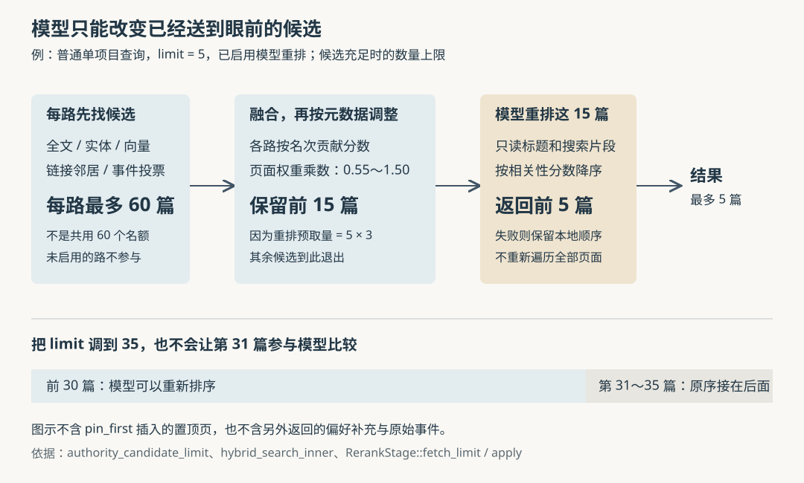

# ai-memory 为什么把这篇记忆排在前面：候选窗口、页面权重与模型重排的边界

假设项目里留下了十篇数据库排障会话，后来又整理出一篇正式规则：“迁移前先确认兼容性。”你搜索迁移注意事项，旧会话因为反复出现关键词占据前排。给规则加上“权威来源”标签，或者开启模型重排，就一定能让它出现吗？如果搜索改成跨全部项目，结果为什么又不同？

这是本文自拟场景。ai-memory 为编程 Agent 保存可以跨会话、跨工具使用的项目记忆。本次研究表明，**搜索先决定哪些页面进入有限的候选集合，再合并各路排名、按页面元数据调整顺序，最后才可能请模型重排一小段结果。标签不能让没有进入候选集合的页面凭空出现，模型也不会重新阅读整个知识库。** 更容易忽略的是：模型成功重排时，前段结果直接按模型相关性排序，页面原有权重并非最终顺序的硬约束。

此前十二篇研报已覆盖采集、存储一致性、启动上下文、偏好、隐私、事件检索、淘汰、交接、授权、摘要和历史查询。本篇继续追问当前页面如何竞争搜索位置，不重复原始事件回查机制。依据是执行器提供的源码快照 `f32a9c5334185d0f35702d3ea50d094f83d0da82`。本次只读实现、调用方、测试和文档，没有启动服务、运行项目测试或调用真实模型；数值示例由代码公式计算，不是效果测量。

**先限定入口：扩大搜索范围，也可能换掉检索方法。**

Agent 通过 MCP——模型上下文协议，即调用外部工具的接口——使用 `memory_query`。普通单项目查询和显式列出多个项目的 `scopes` 查询，经过下列真实调用链：

`memory_query → embed_query → search_project / search_scopes → hybrid_search_scopes_outcome → hybrid_search_inner → RerankStage::apply`

其中，`embed_query` 只在配置了向量模型时执行：它把查询文本变成数字表示，用于比较文本含义是否接近；`hybrid_search_inner` 在每个项目内收集和融合候选；`RerankStage` 是可选的模型重排阶段。入口先把返回数量限制在 1～100，再根据是否开启重排决定预取多少结果。[依据：查询入口与搜索适配函数](https://github.com/akitaonrails/ai-memory/blob/f32a9c5334185d0f35702d3ea50d094f83d0da82/crates/ai-memory-mcp/src/server.rs)

但 `global=true` 并不是把上述链路对每个项目执行一遍。它提前调用 `search_pages_with_meta`，搜索有权读取的项目页面，走全文搜索与页面权重调整，不进入普通项目的向量、实体、链接邻居融合，也不调用这一步模型重排。`as_of` 历史查询则另走按时间筛选的实体与全文路径。于是，同一句话在显式多个项目和全局模式下，可能获得不同的候选及顺序；这不必然是索引不同步。[依据：`memory_query` 的提前返回分支、`search_pages_with_meta`](https://github.com/akitaonrails/ai-memory/blob/f32a9c5334185d0f35702d3ea50d094f83d0da82/crates/ai-memory-store/src/reader.rs)

**找候选时，系统分别回答几种不同的问题。**

普通项目查询并不是先得出一个“综合相关度”，而是先形成几张名单：

| 候选来源 | 实际寻找什么 | 需要理解的边界 |
| --- | --- | --- |
| 页面全文 | 页面文本中的查询字词，使用 SQLite 内置的 FTS5 全文搜索组件，并有中日韩文本辅助路径 | 字词匹配不等于任意同义理解 |
| 实体关联 | 页面关联的技术名称等实体，支持名称、名称前缀及分隔词前缀匹配 | 关联来自已建立的元数据索引，不是查询时让模型理解全文 |
| 可选正文向量 | 数字表示与查询更相近的页面 | 必须有匹配服务、模型身份和维数的向量；这条路径没有相似度最低门槛 |
| 链接邻居 | 已命中页面直接链接到、或直接链接回它的页面 | 只扩展一跳，不是沿知识图无限遍历 |
| 观察事件投票 | 事件正文命中的会话所对应的最新会话页 | 让会话页进入候选；不是把全部事件正文复制进页面 |

这些名单通常默认只保留当前、未过期且满足页面筛选条件的版本。查询携带 `kind`、`tier`、`path_prefix` 或 `tag` 时，限制会进入各路候选查询，而非先拿最终前几名再删掉不合格页面。可选的摘要向量名单还需要单独开启；观察事件投票默认开启。[依据：`hybrid_search_inner`、`entity_hits_filtered`、`top_embedding_hits_in_table` 及各候选查询](https://github.com/akitaonrails/ai-memory/blob/f32a9c5334185d0f35702d3ea50d094f83d0da82/crates/ai-memory-store/src/reader.rs)、[检索设置默认值](https://github.com/akitaonrails/ai-memory/blob/f32a9c5334185d0f35702d3ea50d094f83d0da82/crates/ai-memory-store/src/retrieval_tuning.rs)

实体名单会降低常见名称的单次贡献：一个实体关联的当前有效页面越多，分配给每篇的权重越小；页面按匹配权重之和等条件排序。链接名单则先把全文、正文向量、摘要向量和实体候选去重作为起点，按起点顺序查看出链、入链，再按更新时间和路径等排列邻居；起点自身不进入邻居结果，观察投票也不再启动这次扩展。因此，链接命中说明“它与已命中的页面有直接连接”，不能解释成“系统又独立确认了它回答问题”。[依据：`entity_hits_filtered`、`graph_neighbors_for_project_explained` 与起点构造](https://github.com/akitaonrails/ai-memory/blob/f32a9c5334185d0f35702d3ea50d094f83d0da82/crates/ai-memory-store/src/reader.rs)

这里也能看出成本边界。当前向量路径会读出限定项目、模型身份与页面条件下的合格向量，逐个计算分数，再保留较好的候选，并未调用外部近似最近邻索引。这个实现减少了部署组件；随着合格向量数量增多，单次计算要处理的向量也会增多。后半句是实现结构推导，本次没有测量规模、延迟或吞吐量。

**合并时比较名次，随后才偏向维护过的页面。**

全文分数、实体权重和向量相似度含义不同，不能直接相加。代码采用 RRF，即倒数排名融合：某页在一路排第 `r` 名，就获得 `1 / (60 + r)` 的贡献；同一页面版本的贡献相加。原始分数主要决定各路内部次序，并不原样加入最终总分。会话页若已经获得事件投票，其页面全文名次仍可出现在解释里，但全文贡献记为零，避免相近内容重复加分。[依据：`hybrid_search_inner` 的各路融合循环](https://github.com/akitaonrails/ai-memory/blob/f32a9c5334185d0f35702d3ea50d094f83d0da82/crates/ai-memory-store/src/reader.rs)

随后，`PageAuthority` 根据页面种类、记忆层级、置顶标记、路径和显式标签，计算 0.55～1.50 之间的乘数。这里的“权重”表示程序偏向哪种来源，不是对事实正确率的测量。例如，规则或决策种类加 0.15，语义层或过程层加 0.10，置顶再加 0.08；普通会话种类减 0.15，事件层再减 0.08。`canonical`、`source-of-truth` 标签会加分，`do-not-answer-from` 等标签会压低基础权重。[依据：`PageAuthority::from_stored`](https://github.com/akitaonrails/ai-memory/blob/f32a9c5334185d0f35702d3ea50d094f83d0da82/crates/ai-memory-store/src/reader.rs)

用一个隔离了其他来源的假设来算：A 是全文第 1 名的普通事件层会话，B 是第 5 名的语义层规则，两者都没有其他标签或候选来源。那么：

- A：`1/61 × 0.77 ≈ 0.01262`。
- B：`1/65 × 1.25 ≈ 0.01923`。

B 会排在 A 前面。实现把这个正贡献取负作为 `rank`，数值越小越好。因此，排查接口返回时，不能把负数简单理解为低相关性，也不能把页面权重当成只处理同分的微调。

限制同样明确：这些标签只调整已进入候选的页面，不会产生新的匹配；`do-not-answer-from` 也是降权标签，不是禁止返回的访问控制。可选的会话回忆识别会对“上次”“昨天”等措辞补回会话惩罚并加分，但默认关闭；证据置信度影响权重的选项也默认关闭。开启 `explain` 看见证据数量或置信度，不代表它们已参与排序。[依据：`PageAuthority::factor_for`、权重应用循环及 `RetrievalTuning::default`](https://github.com/akitaonrails/ai-memory/blob/f32a9c5334185d0f35702d3ea50d094f83d0da82/crates/ai-memory-store/src/retrieval_tuning.rs)

**真正限制模型补救能力的是两次截断。**

设调用者要返回 `L` 篇。未配置重排时，普通项目融合阶段要保留的数量就是 `L`；配置后，重排阶段要求先拿到：

`F = max(L, min(3 × L, 30))`

在融合之前，各路自己的候选窗口又按 `F` 扩大，使用 `authority_candidate_limit(F)`：四倍预取、至少 20 篇，同时不超过 `F + 300`。这是让页面权重有机会提升稍后候选的缓冲，不是保证所有相关页面都被纳入。

以 `L = 5` 为例，未开启重排时各路最多取 20 篇，融合和权重调整后保留 5 篇；开启后，`F = 15`，各路最多取 60 篇，先融合成前 15 篇，再交模型决定其中的前 5 篇。没进各路窗口的页面，以及融合后排在第 15 名之后的页面，模型都看不到。[依据：`authority_candidate_limit`、`hybrid_search_inner`](https://github.com/akitaonrails/ai-memory/blob/f32a9c5334185d0f35702d3ea50d094f83d0da82/crates/ai-memory-store/src/reader.rs)、[`RerankStage::fetch_limit`](https://github.com/akitaonrails/ai-memory/blob/f32a9c5334185d0f35702d3ea50d094f83d0da82/crates/ai-memory-llm/src/reranker.rs)

多个显式项目也不等于逐项目都请一次模型。`hybrid_search_scopes_outcome` 依次做项目内检索，按页面标识去重，保留较好的排名，再排序、截到 `F`；MCP 入口随后只调用一次重排。因此，更多项目竞争的是同一个最终模型窗口。重复传同一范围不会让页面因重复出现而累加分数。[依据：多范围合并实现](https://github.com/akitaonrails/ai-memory/blob/f32a9c5334185d0f35702d3ea50d094f83d0da82/crates/ai-memory-store/src/reader.rs)

还有一个更强的上限：`RerankStage::apply` 最多让模型比较列表前 30 篇。若 `L = 35`，它只重新排列前 30 篇，第 31～35 篇按原序接在后面；第 31 篇即使更相关，也不能在这次模型调用中升到第 1。调大返回数量有助于人工或 Agent 继续查看较后结果，却不能视为解除重排限制。

**模型判断的是片段，而且成功后可以覆盖原有偏好。**

`rerank_page_hits` 传给模型的是页面版本标识、标题和清除高亮标记后的搜索片段，没有再打开完整页面。具体的 `LlmReranker` 在请求里使用候选序号代替内部标识，将查询、标题和片段编码为 JSON，并分别限制为 1000、200、600 字节；字节不等于中文字数。这还叠加在前序片段选择之上：全文候选通常给匹配附近的片段，其他来源可以给页面 `summary` 或正文前缀整理出的描述。[依据：MCP 的 `rerank_page_hits`](https://github.com/akitaonrails/ai-memory/blob/f32a9c5334185d0f35702d3ea50d094f83d0da82/crates/ai-memory-mcp/src/server.rs)、[`LlmReranker::rerank`](https://github.com/akitaonrails/ai-memory/blob/f32a9c5334185d0f35702d3ea50d094f83d0da82/crates/ai-memory-llm/src/reranker.rs)、[页面描述构造](https://github.com/akitaonrails/ai-memory/blob/f32a9c5334185d0f35702d3ea50d094f83d0da82/crates/ai-memory-store/src/reader.rs)

所以，模型更强也不能保证发现位于正文末尾、从未进入片段的关键限制。对长期规则补充清晰准确的摘要，可能比一味换模型更有帮助；这是基于材料路径的实践推断，本次没有做效果对照。

返回分数后，`apply` 直接按模型给出的 0～1 相关性分数降序排列前段候选，同分才保留原序。它没有将模型分数与原有页面权重再次相乘，也没有因某页带降权标签就禁止提升该页。页面权重已经影响了哪些页能进入模型窗口，但不能约束窗口内的最终名次。若标签必须表达“绝不可据此回答”，单靠当前降权机制不足以实现这一要求。

这也影响结果解释：`PageHit.rank` 仍保留模型处理前的本地排名分数，`score_details.rerank_score` 另记模型分数。因此，成功重排后的数组未必按 `rank` 递增。下游若再次按 `rank` 排序，会覆盖模型决定的顺序。[依据：`RerankStage::apply` 的排序和记录回调](https://github.com/akitaonrails/ai-memory/blob/f32a9c5334185d0f35702d3ea50d094f83d0da82/crates/ai-memory-llm/src/reranker.rs)

普通单项目查询还有独立的 `pin_first=true` 选项：它在重排之后，把有界的置顶页列表放到最前，去重后再截断，而不是只给匹配页面加 0.08。它不要求这些置顶页先匹配查询；默认关闭，显式多范围查询不走这条分支。因此，“置顶标记影响权重”和“请求强制先返回置顶页”必须分开理解。单项目另外返回的偏好补充结果也没有混进上述一次模型重排。[依据：`memory_query` 的偏好补充与置顶合并分支](https://github.com/akitaonrails/ai-memory/blob/f32a9c5334185d0f35702d3ea50d094f83d0da82/crates/ai-memory-mcp/src/server.rs)

**失败时继续回答，但并非所有失败都被吞掉。**

默认不启用模型重排。服务装配只有显式选择 `AI_MEMORY_RERANKER=llm` 才挂入重排器；选择它却没有配置模型服务，会在装配时报告错误，而不是看似开启、实际静默忽略。网页项目搜索拿到同一个向量服务和共享的重排阶段，调用相同的融合与重排实现。[依据：`configure_consolidator` 及网页状态装配](https://github.com/akitaonrails/ai-memory/blob/f32a9c5334185d0f35702d3ea50d094f83d0da82/crates/ai-memory-cli/src/commands/serve.rs)、[网页 `recall::search_scopes`](https://github.com/akitaonrails/ai-memory/blob/f32a9c5334185d0f35702d3ea50d094f83d0da82/crates/ai-memory-web/src/recall.rs)

运行时的处理有不同层次：

| 失败位置 | 结果 |
| --- | --- |
| 查询向量生成失败或容量繁忙 | 不使用查询向量，继续其他检索来源 |
| 候选数据库查询出错 | 错误向上传播；不会一律伪装成没有匹配 |
| 模型重排繁忙 | 共享阶段最多允许 4 个并发调用，满额时立即保留本地顺序，不排队等待 |
| 重排服务报错、超出 20 秒预算，或最终分数集缺项、非法 | 保留已算好的融合与权重顺序，截到请求数量 |
| 候选不足两篇 | 跳过模型比较 |

这里的 20 秒是重排调用本身的预算，不是包含向量生成和数据库检索的整次查询时限。保留本地顺序也只是保留本次预取后的顺序，不能据此保证与“完全没开启重排”的另一请求逐项相同，因为开启重排已经扩大过候选窗口。[依据：`embed_search_query`](https://github.com/akitaonrails/ai-memory/blob/f32a9c5334185d0f35702d3ea50d094f83d0da82/crates/ai-memory-llm/src/embedding.rs)、[`RerankStage::apply`](https://github.com/akitaonrails/ai-memory/blob/f32a9c5334185d0f35702d3ea50d094f83d0da82/crates/ai-memory-llm/src/reranker.rs)

候选序号和分数校验能限制模型改动哪些已有结果；JSON 编码与提示中的“不执行内容内指令”也提供了一层防护。但这些措施不能证明模型一定忽略恶意文本，更不能证明评分正确。开启重排还意味着查询、标题和有界片段会发给配置的模型服务，是否跨出本机取决于该服务部署在哪里。这是独立于默认本地检索的内容流向，不能因“没有发送完整页面”就忽略。

本次阅读的测试对上述边界给出了具体断言。`reranker_reorders_one_bounded_prefix_without_shrinking_large_limits` 检查前 30 篇翻转、后段保持原序且只调用一次；错误与超时测试检查回到原序，饱和测试检查不调用服务；`multi_scope_query_invokes_the_reranker_once_after_fusion` 检查多项目只重排一次。网页一致性测试分别比较有无向量时 MCP、网页和接口的顺序，还故意去掉网页向量服务、换成全文路径，确认比较能发现差异。它们支持边界与连接关系，不能替代真实模型的检索质量评估；本次没有运行这些测试。[依据：MCP 重排测试](https://github.com/akitaonrails/ai-memory/blob/f32a9c5334185d0f35702d3ea50d094f83d0da82/crates/ai-memory-mcp/src/server.rs)、[网页检索一致性测试](https://github.com/akitaonrails/ai-memory/blob/f32a9c5334185d0f35702d3ea50d094f83d0da82/crates/ai-memory-mcp/tests/suite/web_search_parity.rs)

回到开头的迁移规则，排查时应先固定同一项目范围和查询方式，再开启 `explain=true`，查看各路名次、贡献、页面权重以及是否有 `rerank_score`。规则完全没出现，就检查候选资格、字词或实体匹配、向量是否存在及候选窗口；规则已出现但排得低，再区分本地权重和模型评分；片段没带出关键条件，就打开正文核对，不能让重排名次代替阅读。把常用经验维护成规则、写好摘要和明确来源标签，适合改善长期知识的可发现性；需要追查“当时做过什么”时，则应保留会话证据的角色，避免把所有历史记录都包装成永久规则。

交付检查：正文引用的本地配图存在，SVG 可按 XML 解析；受当前环境预览工具不可用的限制，未完成配图的实际渲染检查。
