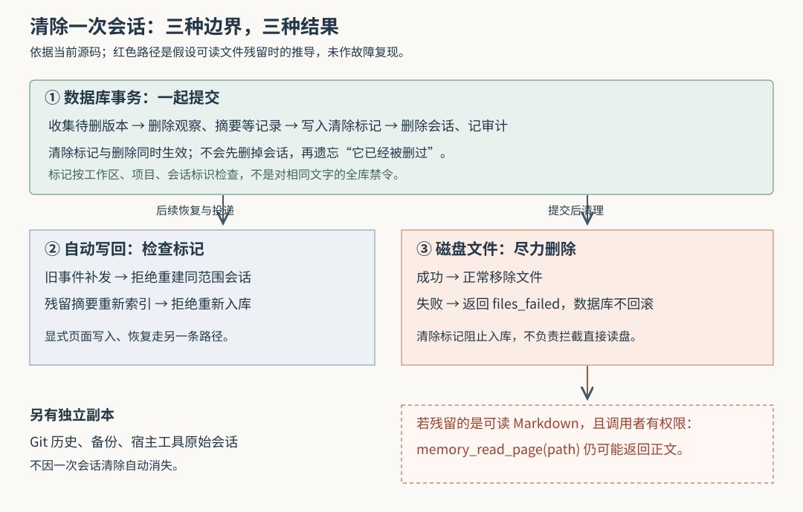

# ai-memory 删掉会话后还留下什么：派生内容、重放阻断与文件残留

假设你让编程 Agent 排查客户故障，把一段不应长期保留的业务说明写进了提示。后来，会话生成了摘要，其中一句又被整理进团队规则。你决定删掉这次会话：摘要、规则、跨项目偏好和本机尚未发出的事件，会一起消失吗？如果删除时文件清理失败，下一次搜索或按路径读页又会看到什么？

这是本文自拟场景。ai-memory 为不同编程 Agent 保存共享项目记忆。当前实现会删除能够按会话标识定位的一组记录，并留下“已经清除”的标记，防止迟到事件和自动索引把它们重新收录。**它没有追踪同一段文字后来传播到了哪里；数据库删除成功，也不等于磁盘文件、Git 历史和所有读取入口都已清空。** 理解这些区别，才能判断一次清除究竟完成了什么。

此前十三篇研报已覆盖采集、页面一致性、启动上下文、偏好、检索、淘汰、交接、授权、摘要和历史查询。本篇沿“撤回一段已经进入系统的会话”深入，依据本次源码快照 `cf6df040faa97b82f11b455583bd3ae799c69199`，重新核对入口、数据库操作、文件处理、恢复路径和测试。本次只读源码与文档，没有启动服务、运行项目测试或复现故障；下文明确标出的异常时序属于源码推导。

**先确定谁有权删除，再确定删的是哪个范围。**

命令行的 `purge-session` 把工作区、项目、完整会话标识和确认选项提交给 `POST /admin/purge-session`。管理路由通过 `Capability::Admin` 检查管理能力；它还会根据服务是否区分多个操作者决定授权条件，不能把普通用户的页面写权限当成这条入口的管理权限。

另一条入口面向浏览器中的本人会话管理，需要服务显式开启 `--enable-session-management`。它使用网页登录状态，拒绝机器凭证；修改请求还要通过防止跨站伪造请求的 CSRF 校验，即验证浏览器提交的校验值。普通用户可以查看自己的会话和没有个人归属的旧会话，但只能删除准确归属于自己的会话，并且仍须拥有该项目的当前写权限。共享会话和涉及跨项目连带影响的清除，要交给管理员。

这里有比入口检查更重要的一步：本人清除最终进入 `purge_session_with_owner`，在实际删除的同一个数据库事务中，再检查项目写权限和会话所有者。外层检查用于尽早拒绝，事务内检查才约束实际提交时的状态。它与此前研报讨论的普通页面写入不是同一条授权链，不能把普通写页的撤权窗口直接套过来。[依据：命令行入口](https://github.com/akitaonrails/ai-memory/blob/cf6df040faa97b82f11b455583bd3ae799c69199/crates/ai-memory-cli/src/commands/purge_session.rs)、[管理授权与清除处理](https://github.com/akitaonrails/ai-memory/blob/cf6df040faa97b82f11b455583bd3ae799c69199/crates/ai-memory-mcp/src/admin.rs)、[本人会话管理](https://github.com/akitaonrails/ai-memory/blob/cf6df040faa97b82f11b455583bd3ae799c69199/crates/ai-memory-mcp/src/session_management.rs)

无论从哪条入口进入，存储层都先确认会话属于指定工作区和项目。传入其他项目的会话标识会得到“未找到”，不会仅凭知道标识就删除它。不过，**限定入口范围不等于所有数据库连带效果都局限在这个项目**，后面还需检查关联关系。

**“属于这次会话”靠记录关联判断，不靠正文含义判断。**

真实的主链是：

`清除请求 → Wiki::purge_session / purge_owned_session → WriterHandle → ops::purge_session_with_owner → 数据库提交 → 页面文件清理`

`Wiki` 负责协调页面文件和数据库；`WriterHandle` 把操作交给统一数据库写入者；最后的存储函数在事务内先收集目标，再执行删除。这个顺序有实际必要：先删会话会使若干关联字段自动变空，随后便难以找到它原来生成的内容。

页面尤其不能只看路径。待删集合包括会话的 `summary_page_id` 指向的摘要版本，以及位于 `sessions/<会话标识>.md`、且页头元数据中的 `session_id` 等于该会话的版本。页头元数据是正文前的一组结构化属性，用来表示来源等信息。删除按页面标识执行，同时限定项目范围；同一路径的其他版本和其他项目的页面不会仅因同名而一起删除。

这条规则产生了几种不同结果：

| 内容 | 清除时的实际处理 |
| --- | --- |
| 已关联的摘要，以及同一会话页上带该会话来源的旧版本 | 删除；返回的 `pages_deleted` 统计版本行数，不是文件数 |
| 同一路径后来写入、没有该会话来源标记的当前手工版本 | 保留，磁盘文件也保留 |
| 同一路径更早的手工版本，后来已被摘要替换 | 可留作非当前历史；不会自动晋升为当前版本，文件仍可能被移除 |
| 另写到 `concepts/`、`_rules/` 等位置的维护知识 | 不因正文来自这次会话而自动删除 |
| 该会话在当前范围创建的交接 | 删除 |
| 该会话只是领取、并非创建的交接 | 保留内容，仅失去接收会话关联 |

“手工版本”在这里是实现中的归属区别，不是系统识别出有人亲手编辑过。若改了正文却仍保留 `session_id`，该版本仍可能属于待删集合。反过来，一段业务说明若复制到另一个知识页，系统也不会因为文字相同就沿途追删。

偏好也有类似边界。事务会删除 `profile_candidates` 中由该会话提示采集的候选证据，包括来自其他项目、以 `session:<标识>` 关联的候选；这是为了避免尚未整理的原句后来再次变成偏好。但这条删除路径没有撤回已经生成的 `profile/` 成品页，也没有遍历所有知识来源关系。因此，删掉候选证据和撤回已传播的偏好仍是两件事。[依据：`purge_session_with_owner` 的目标收集、删除顺序与偏好候选清理](https://github.com/akitaonrails/ai-memory/blob/cf6df040faa97b82f11b455583bd3ae799c69199/crates/ai-memory-store/src/ops.rs)

这种设计保护了已经独立维护的团队知识；代价是它更适合“移除这次会话及其直接记录”，不能承诺“找出并消除这次谈话的一切影响”。后者是依据实现得出的边界判断，不是项目提供的内容传播追踪能力。

**预览会把跨项目影响算出来，但不会替未来的提交预约结果。**

观察事件有自己的项目字段，又通过 `session_id` 关联会话。如果一次会话在另一个项目留下了事件，删除会话时，数据库的外键规则仍会连带删除这些事件。外键是数据库保存记录之间关联的约束；这里的 `ON DELETE CASCADE` 表示上游会话删除时，下游事件随之删除，不再检查事件自己的项目字段。

交接采用另一种规则：其他项目里引用该会话的交接保留正文，只把来源或接收会话字段设为空。预览分别用 `collateral_observations_deleted` 和 `collateral_handoffs_denulled` 报告这两类影响。本人清除路径一旦发现这些计数非零就拒绝，要求管理员处理；管理员路径则允许执行并报告影响。

`dry_run=true` 的预览使用与实际清除相同的目标收集和计数逻辑，随后回滚只读事务，不执行删除，不写清除标记或审计，也不触发准入回调、Git 检查点和文件清理。即使同时传入 `confirm=true`，仍优先预览。

但预览不持有直到下次请求的锁，也不执行可能拒绝正式清除的外部准入回调。因而，预览成功只表示“按此刻的记录，会影响这些目标”，不保证稍后数量相同或正式操作一定获准。[依据：存储层计数与本人清除限制](https://github.com/akitaonrails/ai-memory/blob/cf6df040faa97b82f11b455583bd3ae799c69199/crates/ai-memory-store/src/ops.rs)、[`purge_session_preview`](https://github.com/akitaonrails/ai-memory/blob/cf6df040faa97b82f11b455583bd3ae799c69199/crates/ai-memory-mcp/src/admin.rs)

**删除还要记住“不要再收录”，否则旧事件可以把会话送回来。**

客户端可能仍存着未发送的旧事件。如果服务端只删当前记录，下一次补发就可能再次创建会话。ai-memory 因此在删除事务里写入 `purged_sessions`。这种删除后保留的阻断记录常称为“墓碑”；这里保存会话、工作区、项目标识和清除时间，不保存原会话正文。写墓碑、删会话和记审计一起提交，避免出现内容已经删除却没有阻断记录的中间状态。

后续创建会话的 `begin_session_row`，以及钩子事件的 `admit_hook_session_event`，都会检查这份记录。命中时返回 `SessionPurged`。钩子是编程工具在特定时刻执行的回调；批量处理入口将该错误转换为 `DroppedInvalid`，把这一项纳入已处理确认，而不是要求客户端无休止重试。这里的“已处理”表示决定丢弃，不能理解成重新保存成功。

保护也延伸到了磁盘重新索引。`upsert_page_from_disk` 在写入事务里检查清除标记，阻止残留的会话摘要重新入库。它还区分已被保留的当前手工版本，避免把同一路径上的合法后续维护一并冻结。检查放在实际写入事务内，意味着目录扫描开始时尚未删除，也不能凭那份旧扫描结果绕过后来的清除。

但墓碑按工作区、项目、会话标识检查，并非对该标识或相同正文的全库封禁；测试明确允许相同会话标识在另一个项目重新接收事件。显式写页和恢复也使用普通 `upsert_page`，没有套用磁盘自动索引的这一道检查。**它阻断特定自动恢复路径，不能替代所有写入入口的禁止名单。** [依据：存储层 `session_is_purged`、`begin_session_row`、`upsert_page_from_disk`](https://github.com/akitaonrails/ai-memory/blob/cf6df040faa97b82f11b455583bd3ae799c69199/crates/ai-memory-store/src/ops.rs)、[钩子对 `SessionPurged` 的处理](https://github.com/akitaonrails/ai-memory/blob/cf6df040faa97b82f11b455583bd3ae799c69199/crates/ai-memory-hooks/src/router.rs)

**文件清理失败时，数据库不会回滚；直接读页尤其需要单独判断。**

正式清除先经过可能拒绝操作的准入回调，再尝试保存删除前的 Git 检查点。进入 `Wiki` 后，排他的 `mutation_lock` 贯穿数据库操作和文件清理，协调使用同一锁的写页、索引和项目移动，避免它们插入这段过程。它不能阻止服务进程突然退出，也不能把数据库与文件系统变成同一个事务。

数据库提交后，`Wiki` 按 `removed_paths` 删除页面文件。某个文件删不掉，会加入 `files_failed`，记录警告，并继续处理其他路径；数据库不会因此恢复。管理接口仍可返回成功响应，同时报告部分失败，后续通知也会携带 `partial_failure=true`。删除后的 Git 检查点失败同样只记录警告。因此，响应状态码不足以代表所有落点都已清完。[依据：`Wiki::purge_session_with_owner` 与文件清理循环](https://github.com/akitaonrails/ai-memory/blob/cf6df040faa97b82f11b455583bd3ae799c69199/crates/ai-memory-wiki/src/wiki.rs)、[`handle_purge_session`](https://github.com/akitaonrails/ai-memory/blob/cf6df040faa97b82f11b455583bd3ae799c69199/crates/ai-memory-mcp/src/admin.rs)

还需收窄文档中“API 不可达”的概括。`memory_read_page` 是通过 MCP——模型上下文协议，即 Agent 调用外部工具的接口——暴露的读页功能。调用者给出路径时，它先检查项目读取权限，随后优先调用 `Wiki::read_page` 读磁盘。数据库中查不到当前页面标识，并不会阻止这次磁盘读取；这条读页路径也没有检查会话墓碑。

所以，可以从当前调用链推导：**若数据库清除已提交，但合法目录下仍残留或重新出现可读、可解析的 Markdown，拥有项目读取权限的调用者仍可能按已知路径取得正文。** 此时搜索可以已经找不到它，自动重新索引也可以正确拒绝它。这三个结果并不矛盾。

这不是本次复现的泄漏。现有清理失败测试用“把文件替换为目录”的方法稳定触发删除失败；该目录本身并不是可读页面。另一个测试再把原文件放回，验证重新索引会跳过，却没有测试 MCP 直接读取残留文件。因此，测试支持部分失败报告与防重新入库，不能据此声称已经证明所有读页入口都拒绝残留内容。[依据：`memory_read_page`](https://github.com/akitaonrails/ai-memory/blob/cf6df040faa97b82f11b455583bd3ae799c69199/crates/ai-memory-mcp/src/server.rs)、[`read_page` 与 `owned_session_purge_cleanup_failure_is_reported_and_tombstoned`](https://github.com/akitaonrails/ai-memory/blob/cf6df040faa97b82f11b455583bd3ae799c69199/crates/ai-memory-wiki/src/wiki.rs)、[管理接口清理失败测试](https://github.com/akitaonrails/ai-memory/blob/cf6df040faa97b82f11b455583bd3ae799c69199/crates/ai-memory-mcp/tests/suite/admin_purge.rs)

**`--compact` 处理数据库残留字节，不处理已经传播出去的副本。**

默认清除是逻辑删除：记录不能再由正常数据库查询取得，但原文字节可能仍留在数据库空闲页和全文索引内部。`--compact` 在删除事务提交后，重建全部列出的 FTS5 索引，再执行 `VACUUM` 重写数据库。FTS5 是 SQLite 内置的全文搜索组件；重建索引用于清理普通删除后仍可能留在索引段中的词项，仅重写数据库文件不足以替代这一步。

接着，程序尽力截断 WAL，即 SQLite 用于记录写入的预写日志。若旧读取快照阻碍截断，程序记录警告，不能把 `compacted=true` 理解成所有相关文件已经没有残留。Git 历史、删除前备份、宿主工具自己的原始会话，以及其他页面中的复制内容，也不在这项处理范围内。

这里另有一个容易误判的失败顺序：`reclaim_freed_pages` 在删除提交后执行，而且错误会向上传播；`Wiki` 要等它成功返回才进入文件清理循环。因此，若索引重建或 `VACUUM` 报错，调用者可能收到错误，而会话记录和墓碑已经提交，页面文件却尚未清理。这是源码顺序推导，本次没有构造磁盘不足等故障。排障时不能仅凭“命令报错”判断删除从未发生。[依据：`purge_session_with_owner`、`reclaim_freed_pages` 与 `Compaction` 定义](https://github.com/akitaonrails/ai-memory/blob/cf6df040faa97b82f11b455583bd3ae799c69199/crates/ai-memory-store/src/ops.rs)

本次阅读的测试提供了几组直接证据：存储测试分别断言旧摘要版本删除、后续手工版本保留、跨项目连带计数与实际结果一致，以及迟到事件不能重建同范围会话；默认清除与回收测试分别检查样例字符串仍在、已不在数据库文件；本人管理测试检查他人会话、共享会话和缺失 CSRF 校验的请求被拒绝，并确认维护知识页不随会话删除。这些断言支持具体机制，不构成全面擦除证明，也不是本次运行通过的结果。[依据：存储层测试](https://github.com/akitaonrails/ai-memory/blob/cf6df040faa97b82f11b455583bd3ae799c69199/crates/ai-memory-store/src/ops.rs)、[本人会话管理测试](https://github.com/akitaonrails/ai-memory/blob/cf6df040faa97b82f11b455583bd3ae799c69199/crates/ai-memory-mcp/tests/suite/session_management.rs)

回到开头的业务说明，实践中应先明确目标：只是停止把这次会话当作可检索记忆，还是还要撤回维护知识、偏好和其他副本。前者可以从准确范围的清除预览开始，关注连带计数和待删路径；正式执行后核对 `files_failed`，出现错误时分别确认数据库、墓碑与文件状态。后者还需要检查规则页、偏好成品、Git、备份和宿主记录，不能用会话删除数量代替这些检查。

这套实现可迁移的设计思想，是把删除做成一项需要持续执行的决定：不仅移除现状，还让自动重放和恢复服从删除记录。当前边界同样具体：恢复入口已识别墓碑，按路径读取仍以磁盘为先。若要进一步保证清除后的残留文件无法通过工具读到，可以考虑让读取入口识别墓碑及被保留的手工版本；这是本文依据源码提出的改进方向，尚不是现有保证。

配图已检查 XML 结构，并完成实际渲染与人工查看；源码和输入材料保持原样。
