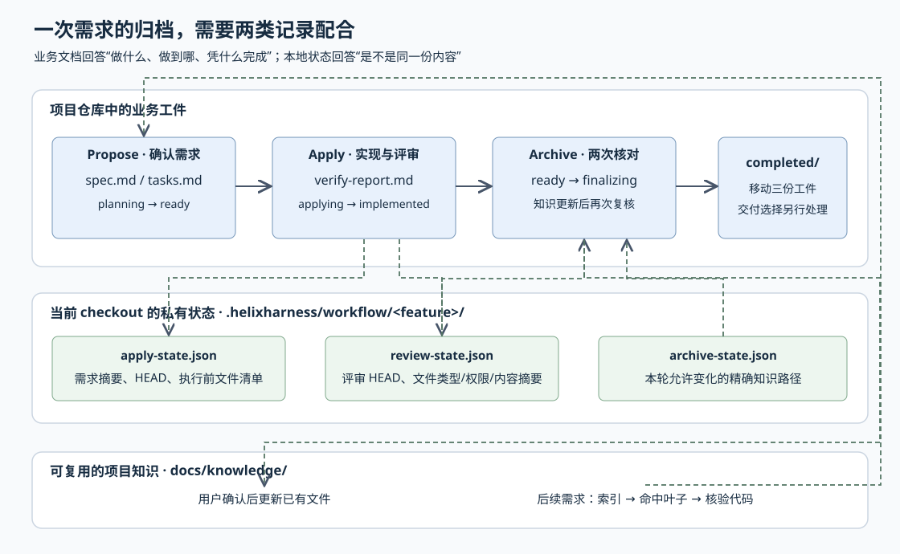

# HelixHarness 怎样把一项需求变成可核对、可续跑、可复用的归档

给任务列表增加“只看未完成任务”的选项，看起来只需改一个函数。但交给编码代理后，还需要回答：默认调用是否兼容？空列表遇到非法参数是否报错？测试通过后又改了一行代码，旧评审还能不能用？工作区原来就有用户的笔记，能否把它一起提交？

仓库自带的 `task-filter` 示例正好提出了前三类行为要求：增加 `all/open/done` 筛选，保持顺序、不修改输入，非法状态即使遇到空列表也抛出 `ValueError`。独立验收脚本会导入结果代码，逐项检查这些行为。这是仓库提供的演示需求，不是本文实测成功的案例。下文增加的“用户笔记”和“评审后改代码”均为自拟情境。[示例需求][例子]、[独立验收实现][验收]

HelixHarness 对这类问题的处理是：先把行为和边界写成需求规格，再记录可续跑任务；实现后保存测试与两路评审证据，归档前重新核对文档和代码内容。稳定知识另经用户确认，写回后续需求能够读取的项目文档。**它把“代理判断做得对不对”和“脚本核对前后是不是同一份内容”分成了两种责任。** 本文沿这条单仓执行链展开，而不是逐目录介绍仓库。

## 研究范围与证据边界

研究对象为 `didi/helixharness`，固定 Commit 为 `44ffc536f73d8af525b4795ad10384c516898576`。本地 HEAD 一致，工作树无改动；580 个受 Git 跟踪的文件均存在，未发现子模块条目或 Git LFS（大文件存储）指针。输入元数据声明未抓取子模块和 LFS，但本次未发现因此缺失的主题依赖。

已阅读工作流设计、命令入口、单仓工作流、相关 Python 实现、模板及测试。下文将文字协议明确称为“协议要求”，将可执行函数行为称为“实现”，将没有直接动机说明的解释标为“推断”。未安装依赖、执行仓库脚本、运行测试或启动真实宿主，因此不声称闭环实测通过。Codex、Claude Code 和可选平台的实际运行效果不在此次验证范围。

## 入口接到请求后，谁决定下一步

项目有两个不同用途的部分：`helixharness/` 是在编码宿主中使用的插件；平台另用于观察和比较框架版本。工作流设计明确要求插件只依赖当前安装源与当前项目，平台服务不是研发命令前提。平台评测文档描述冻结基准版本、候选版本、场景和策略的比较方式；本文只据此定位平台，不声称已核验其执行器、评分或恢复实现。[插件架构设计][架构]、[平台评测设计，非本篇实现结论][平台设计]

以 `/helix:propose task-filter ./requirements/task-filter.md --loop` 为例，调用链有三层：

1. **宿主入口找到公共命令。** Codex 的薄 Skill 入口要求调用 `codex_entry_load.py`，最终消费唯一的 `commands/propose.md`。加载器核对 Codex 身份和接口版本，沿命令映射定位正文，并拒绝命令未声明的适配资源。Claude Code 使用原生命令的差异在架构文档中明确说明。[Codex 入口][宿主入口]、[加载器实现][入口加载]、[宿主边界设计][架构]
2. **路由脚本决定读取哪份工作流。** `resolve_workflow_target()` 依据 `helixharness.workspace.yaml` 标记和已声明范围选择单仓或多仓正文；两者冲突直接报错，不从需求措辞猜范围。`route()` 返回结构化结果，包括动作、阶段、路径和参数，而不是直接实现功能。[范围解析实现][范围]、[路由实现][路由]
3. **代理执行所选文字协议。** 公共命令要求只消费路由结果：加载指定正文、建议其他命令、请求选择需求，或者停止。`--loop` 的阶段循环写在命令协议里：每阶段成功后重新路由；它不是 Python 中包住整个开发过程的执行循环。[公共命令与循环协议][循环]

单仓 Spec 的 `planning` 指向需求阶段，`ready/applying` 指向实现阶段；`implemented/completed` 还要检查归档证据，才能决定是否进入归档。没有指定名称而 active 中有多个候选时返回 `select_feature`。一个细节是：评审后内容漂移可以把普通归档或循环入口送到“等待归档选择”，显式 Apply 仍走严格实现路径，所以“路由到 Archive”不能解读为“已允许归档”。[阶段与异常分支][路由]、[相关测试断言][内容测试]

图中实线表示工作流的执行方向，虚线表示脚本核对或后续加载。三份业务工件与私有状态的路径分别来自 Apply、归档和上下文加载协议；图不表示平台参与每一步。[报告协议][报告]、[归档协议][归档收尾]、[加载协议][加载]

## 项目知识、工程约束和本次需求分别放在哪里

这里的 Harness 指项目要求代理遵守的工程约束；Knowledge 指可复用的项目事实。二者都通过索引按需读取，但权威性不同：Apply 明确说 Harness 是规范，Knowledge 则必须与当前代码、配置和测试核对。[Apply 上下文规则][约束]

| 内容 | 主要回答的问题 | 在链路中的作用 |
|---|---|---|
| `docs/harness/` | 修改必须遵守什么规则？ | Propose 与 Apply 按相关领域加载约束 |
| `docs/knowledge/` | 项目现在怎样工作？ | 提供事实线索，归档时允许确认后的稳定知识更新 |
| `docs/specs/active/<feature>/` | 这次改什么、做到哪里、凭什么说完成？ | 存放 `spec.md`、`tasks.md`、`verify-report.md` |
| `docs/hooks/` 及宿主 hooks 配置 | 哪些事件触发检查，评审还需看什么？ | 检查清单直接读取；宿主事件可触发检查脚本 |

加载协议要求先读 Harness/Knowledge 各自唯一的根索引，再按“加载时机”选择叶子文件；Apply 每个任务开始前重新判断，Archive 只加载 Knowledge。Specs 和 Hooks 不经过这套索引。所谓会话缓存是协议要求代理比较修改时间后复用已读内容；本篇没有据此认定存在自动语义检索或向量数据库。[完整加载规则][加载]

Hooks 也不是万能门禁。以 Codex 配置为例，`Write|Edit|MultiEdit` 工具事件触发两个 linter 脚本；`load_project_hooks()` 校验配置版本、归属、设置文件和合并参数，但这些事实不能证明任意 shell 写文件都会被拦截，也不能证明每条业务规则已被自动检查。归档仍有自己的校验入口。[事件配置][钩子]、[配置校验实现][钩子校验]

## 从确认需求到可续跑任务：哪些内容交给人，哪些交给脚本

Propose 协议先要求代理调查仓库能回答的事实，再把确实需要用户决定的问题按依赖关系分轮提出。没有待决分支后，还要确认一次共享理解，之后才写正式 Spec/Tasks。对于示例需求，非法状态如何处理已经由需求给定，代理应核验并复用，不能伪造一次用户选择。[需求收敛协议][需求确认]

Spec 记录问题、行为、边界、实现决定和测试入口。首次出现的 **AC** 是验收条件，使用 `AC-01` 等稳定编号；测试 **seam** 指通过哪个公共接口观察行为。协议要求测试入口已确认，Spec 才能进入 ready。Tasks 则从已确认需求自动派生端到端行为切片，不再复制设计正文，也不为普通拆分再请求批准。[工件与拆分协议][需求任务]

脚本承担更窄的责任。`validate_task_graph()` 先用 ID 建立任务表，拒绝重复 ID、自依赖、未知依赖，以及越过未完成依赖的执行或完成状态；再用深度优先遍历检测环。已有执行中任务时返回其列表及第一个建议任务，否则找依赖均完成的第一个 pending 任务。全部完成返回 `next_task: null`；还有未完成任务却无可执行项则报错。它允许多个 `in_progress`，没有据此自动并行执行任务。[任务图与阶段校验实现][任务图]

这是一项明确取舍：可选 AC 映射和任务措辞不交给脚本作语义裁判，ID、依赖和状态则可重复检查。**推断：**这样能允许不同项目使用自然的文档表达，但任务是否真的覆盖需求，必须由后续评审负责，不能由“校验通过”推出。[拆分规则][需求任务]、[结构校验实现][任务图]

## 实现开始时先记住工作区，评审时才能划清范围

假设用户已有未提交的 `notes.txt`，代理这次只修改 `tasks.py`。直接提交全局 Git 改动会夹带笔记；要求每次先清空工作区又会打断用户。

`bind-apply` 对此先调用任务校验，确认 Spec/Tasks 均 ready，再保存本次需求的 Spec 收据、当前 HEAD 和执行前文件清单。收据使用 SHA-256，即由内容计算的固定长度摘要；这里用于检测变化，不是第三方签名。已有匹配状态会复用，不重新设定基线。[绑定实现][基线]

清单中的每项为 `{kind, mode, path, sha256}`：文件类型、权限、路径和内容摘要。实现读取相对 HEAD 的差异及未忽略的未跟踪文件；删除记录为 missing，符号链接记录链接目标，目录型或嵌套仓库条目被拒绝。当前需求的三份工件、私有状态、统计目录和视觉验收产物被排除，避免流程自己写出的文件不断改变代码范围。[清单构造与排除规则][文件清单]

`_review_scope_details()` 将当前条目与执行前清单按路径比较：

- 原有 `notes.txt` 内容未变：加入 `excluded_preexisting_paths`，不把其内容交给本次评审。
- 新改动路径：加入待评审清单。
- 同一路径在 Apply 前已脏、Apply 后又改变：返回精确的 `DECISION_NEEDED`，因为文件级摘要无法证明两部分改动的边界。

命令行 `review-scope` 调用 `seal_review_scope()`，把评审 HEAD 与条目清单计算摘要后写入本地 `review-state.json`。[比较与封存实现][范围封存]

私有状态位于 `.helixharness/workflow/<feature>/`。因此恢复能力有条件：同一 checkout 换会话或兼容宿主，可以继续使用保存的事实；只复制三份文档到新 clone，无法恢复执行前的用户改动边界。协议明确禁止把新工作区猜成空基线。它也没有保存可还原用户文件的内容副本。[跨会话续跑边界][续跑]、[摘要清单实现][文件清单]

## 测试和双轴评审之后，归档重新核对什么

Apply 协议要求按测试驱动开发推进，即先取得失败测试，再实现使它通过；最后运行完整或可识别的最广测试。确认属于本次回归的失败不能进入评审；疑似既有失败也要保留证据，等待用户确认豁免，并通过覆盖本次范围的验证。[实现与最终测试协议][约束]

评审分成两个独立轴：Standards 检查是否遵守项目规范，Spec 检查是否正确兑现本次需求。协议要求两个上下文隔离的只读子代理并行使用同一份冻结材料，包含比较起点、提交差异、工作区增量、Spec 和规范来源。修复 Must Fix 后要重新验证并完整复审；Advisory 是非阻断建议，不使 APPROVE 自动失效。这里描述的是被研究插件的执行要求，本次研究没有启动这些子代理。[评审输入][评审]、[双轴与修复协议][双轴]

两轴通过后，Apply 才一次性生成 `verify-report.md`，保存真实命令结果、任务覆盖、评审报告，以及 Spec/Tasks 和代码范围的摘要。Spec 的收据去掉顶层 `status` 后规范化计算，所以正常阶段推进不会被误判为需求变更；Tasks 收据则覆盖规范化换行后的全文。[报告生成协议][报告]、[收据算法][摘要]

`archive_preflight()` 不重新运行测试，而是调用任务校验，然后检查：

1. 三份工件身份一致，任务状态完整，报告正文非空。
2. 报告绑定当前 Spec/Tasks 摘要，评审模式正确，两轴都是 APPROVE，修复轮数为非负整数。
3. 阶段组合合法：Spec implemented 加 archive pending 为 `ready`；Spec completed 加 archive completed 为 `finalizing`。
4. 通过 `_verify_review_scope()` 重算当前内容，与已封存清单比较。

这些是可执行代码直接检查的事实。它不理解报告正文是否真能证明 AC，也不验证“APPROVE”是否确由两个真实评审者产生；测试中甚至明确允许自由格式正文。因此门禁保护的是证据一致性，语义真实性仍依赖代理执行和人工审查。[归档门禁实现][归档门禁]、[正文边界测试][任务测试]

内容复核使用报告保存的评审 HEAD，而不是强制当前 HEAD 与之相等。这样，同样内容被暂存、提交后仍能通过；多出新文件或改了内容则报漂移。需纳入已提交历史时，评审协议另提供完整比较起点；`archive-code-scope` 会把该起点到评审 HEAD 的提交路径与封存增量结合，不能把单独的工作区摘要理解成完整提交历史的摘要。[内容复核][范围复核]、[交付范围实现][交付范围]

还有一个重要例外：归档允许用户明确接受“内容已变化，直接归档，不重新评审”。`accept-review-drift` 要求确认标志，检查 Git 操作状态，并两次核对当前快照摘要；保存独立接受记录，保留原 Review，不把新内容伪装为已复审。它不豁免任务未完成或合同收据失配，Apply 也不接受这条放宽路径。[接受记录实现][接受变化]、[Apply 证据限制][报告]

## 归档怎样留下知识，又避免最后一刻夹带代码

归档先只读准备稳定知识的精确修改建议，用户拒绝也能继续。确认后，`authorize-knowledge` 要求路径位于 `docs/knowledge/`、无重复或目录穿越，祖先目录安全，目标为**已存在的普通非链接文件**；随后重新做 ready 门禁，再把允许变化的路径写入 `archive-state.json`。[路径约束][知识路径]、[授权实现][授权知识]

因此本版本这条归档路径支持更新已有知识文件，不支持直接授权一个尚不存在的新文件。授权记录限定的是文件路径，并没有保存用户确认的候选补丁摘要；脚本能检查“有没有改到名单外”，不能证明名单内每个字都与用户看过的建议相同。代理仍须遵守精确建议，知识内容仍须由代码事实支撑。[授权实现][授权知识]、[知识候选协议][归档收尾]

随后协议要求把 Spec 和报告的归档状态置为 completed，调用 `finalize-preflight`。复核只豁免明确授权的知识路径，其余代码变化继续阻断。通过后才原子移动 active 目录到 completed，再确认目标可读、原目录消失；移动是最后一次业务工件写入。`finalizing` 用来恢复“状态已写完但尚未移动”的中断，不重新发起知识修改。[内容豁免实现][范围复核]、[收尾与恢复协议][归档收尾]

下一项相关需求按索引加载这些知识，复用的是项目里的可审阅文档，且仍需核对当前代码。本文没有发现这条链路需要把历史对话全文自动注入下一会话的依据。[按需加载协议][加载]

业务归档、代码提交、推送和统计是不同状态。归档协议限制提交精确路径，禁止全量暂存；最后按已有授权或用户选择处理交付。统计失败只告警，不回滚业务归档。共享生命周期实现也把异步统计修复与会话启动分开，捕获其异常；会话结束本身不能充当需求完成证据。[交付协议][交付]、[生命周期实现][生命周期]、[完成证据设计][架构]

## 测试说明了什么，仍有哪些边界

以下均为静态阅读到的测试断言，**本次未运行，不能表述为测试通过**。

| 测试范围 | 具体预期 | 证据 |
|---|---|---|
| 工作区归属 | 原有 staged、unstaged、untracked 内容不变时排除；重叠修改阻断；缺私有基线不能继续 | [1033–1125 行][脏文件测试] |
| 任务与报告 | 环、未知依赖、越过依赖被拒绝；正文布局自由但不能为空；需求变化和非通过评审阻断 | [1193–1270 行][任务测试] |
| 评审后变化 | 新增或修改内容被拒绝；原样提交允许；Archive 可进入选择，显式 Apply 保持严格 | [1308–1378 行][内容测试] |
| 收尾知识更新 | 仅授权知识变化可以通过；过早 finalizing 校验或同时新增代码会失败 | [1727–1775 行][知识测试] |
| 安全与授权顺序 | 不存在文件、链接目标被拒绝；先改知识再授权失败，且不自动清理用户修改 | [1863–1928 行][安全测试] |

并发方面，私有状态采用同目录临时文件、写入并刷新到磁盘、再原子替换，避免半份 JSON 被读到；修订流程另有带超时的文件锁。但本篇读取的绑定、封存、知识授权与最终校验并未组成覆盖整个开发周期的全局事务。**推断：**阶段复核能够发现许多并发漂移，却不能据此保证校验到目录移动之间完全没有其他进程写入。原子写也不能证明跨多个文件更新具有事务性。[原子写实现][原子写]、[修订锁实现][修订锁]、[最终移动协议][归档收尾]

这套方案适合在同一工作区持续开发、愿意维护项目约束和知识索引、宿主能够提供独立评审的团队。可迁移的思想是：用少量文档保存需求与进度，用本地内容快照处理工作区归属，用阶段复核约束完成声明；人工放宽某项条件时另存记录，而不是把旧证据改写成新的成功。它的适用边界同样明确：摘要解决内容一致性，不能替代真实测试、语义评审、精确授权或真实客户端验收。

[例子]: https://github.com/didi/helixharness/blob/44ffc536f73d8af525b4795ad10384c516898576/examples/starter/requirements/task-filter.md#L3-L16
[验收]: https://github.com/didi/helixharness/blob/44ffc536f73d8af525b4795ad10384c516898576/examples/verify_feature.py#L13-L49
[架构]: https://github.com/didi/helixharness/blob/44ffc536f73d8af525b4795ad10384c516898576/docs/workflow-architecture.md#L3-L39
[宿主入口]: https://github.com/didi/helixharness/blob/44ffc536f73d8af525b4795ad10384c516898576/helixharness/hosts/codex/skills/propose/SKILL.md#L8-L14
[入口加载]: https://github.com/didi/helixharness/blob/44ffc536f73d8af525b4795ad10384c516898576/helixharness/scripts/codex_entry_load.py#L121-L168
[范围]: https://github.com/didi/helixharness/blob/44ffc536f73d8af525b4795ad10384c516898576/helixharness/scripts/workflow_target.py#L14-L42
[路由]: https://github.com/didi/helixharness/blob/44ffc536f73d8af525b4795ad10384c516898576/helixharness/scripts/workflow_router.py#L183-L263
[循环]: https://github.com/didi/helixharness/blob/44ffc536f73d8af525b4795ad10384c516898576/helixharness/commands/propose.md#L31-L66
[加载]: https://github.com/didi/helixharness/blob/44ffc536f73d8af525b4795ad10384c516898576/helixharness/reference/loading-protocol.md#L9-L61
[约束]: https://github.com/didi/helixharness/blob/44ffc536f73d8af525b4795ad10384c516898576/helixharness/workflows/single/apply.md#L84-L104
[钩子]: https://github.com/didi/helixharness/blob/44ffc536f73d8af525b4795ad10384c516898576/helixharness/hosts/codex/project-hooks.json#L1-L26
[钩子校验]: https://github.com/didi/helixharness/blob/44ffc536f73d8af525b4795ad10384c516898576/helixharness/scripts/host_runtime/project_hooks.py#L40-L95
[需求确认]: https://github.com/didi/helixharness/blob/44ffc536f73d8af525b4795ad10384c516898576/helixharness/workflows/single/propose.md#L137-L185
[需求任务]: https://github.com/didi/helixharness/blob/44ffc536f73d8af525b4795ad10384c516898576/helixharness/workflows/single/propose.md#L200-L272
[任务图]: https://github.com/didi/helixharness/blob/44ffc536f73d8af525b4795ad10384c516898576/helixharness/scripts/workflow.py#L1260-L1375
[摘要]: https://github.com/didi/helixharness/blob/44ffc536f73d8af525b4795ad10384c516898576/helixharness/scripts/workflow.py#L117-L180
[基线]: https://github.com/didi/helixharness/blob/44ffc536f73d8af525b4795ad10384c516898576/helixharness/scripts/workflow.py#L1025-L1067
[文件清单]: https://github.com/didi/helixharness/blob/44ffc536f73d8af525b4795ad10384c516898576/helixharness/scripts/workflow.py#L221-L295
[范围封存]: https://github.com/didi/helixharness/blob/44ffc536f73d8af525b4795ad10384c516898576/helixharness/scripts/workflow.py#L935-L1022
[续跑]: https://github.com/didi/helixharness/blob/44ffc536f73d8af525b4795ad10384c516898576/helixharness/workflows/single/apply.md#L56-L86
[评审]: https://github.com/didi/helixharness/blob/44ffc536f73d8af525b4795ad10384c516898576/helixharness/skills/code-review/SKILL.md#L18-L56
[双轴]: https://github.com/didi/helixharness/blob/44ffc536f73d8af525b4795ad10384c516898576/helixharness/skills/code-review/SKILL.md#L98-L147
[报告]: https://github.com/didi/helixharness/blob/44ffc536f73d8af525b4795ad10384c516898576/helixharness/workflows/single/apply.md#L137-L179
[归档门禁]: https://github.com/didi/helixharness/blob/44ffc536f73d8af525b4795ad10384c516898576/helixharness/scripts/workflow.py#L1530-L1598
[范围复核]: https://github.com/didi/helixharness/blob/44ffc536f73d8af525b4795ad10384c516898576/helixharness/scripts/workflow.py#L1483-L1527
[接受变化]: https://github.com/didi/helixharness/blob/44ffc536f73d8af525b4795ad10384c516898576/helixharness/scripts/workflow.py#L1614-L1658
[交付范围]: https://github.com/didi/helixharness/blob/44ffc536f73d8af525b4795ad10384c516898576/helixharness/scripts/workflow.py#L1697-L1796
[知识路径]: https://github.com/didi/helixharness/blob/44ffc536f73d8af525b4795ad10384c516898576/helixharness/scripts/workflow.py#L1378-L1441
[授权知识]: https://github.com/didi/helixharness/blob/44ffc536f73d8af525b4795ad10384c516898576/helixharness/scripts/workflow.py#L1806-L1835
[归档收尾]: https://github.com/didi/helixharness/blob/44ffc536f73d8af525b4795ad10384c516898576/helixharness/workflows/single/archive.md#L132-L171
[交付]: https://github.com/didi/helixharness/blob/44ffc536f73d8af525b4795ad10384c516898576/helixharness/workflows/single/archive.md#L175-L233
[原子写]: https://github.com/didi/helixharness/blob/44ffc536f73d8af525b4795ad10384c516898576/helixharness/scripts/atomic_files.py#L15-L46
[修订锁]: https://github.com/didi/helixharness/blob/44ffc536f73d8af525b4795ad10384c516898576/helixharness/scripts/workflow.py#L433-L468
[生命周期]: https://github.com/didi/helixharness/blob/44ffc536f73d8af525b4795ad10384c516898576/helixharness/scripts/lifecycle_service.py#L14-L95
[脏文件测试]: https://github.com/didi/helixharness/blob/44ffc536f73d8af525b4795ad10384c516898576/helixharness/scripts/tests/test_workflow.py#L1033-L1125
[任务测试]: https://github.com/didi/helixharness/blob/44ffc536f73d8af525b4795ad10384c516898576/helixharness/scripts/tests/test_workflow.py#L1193-L1270
[内容测试]: https://github.com/didi/helixharness/blob/44ffc536f73d8af525b4795ad10384c516898576/helixharness/scripts/tests/test_workflow.py#L1308-L1378
[知识测试]: https://github.com/didi/helixharness/blob/44ffc536f73d8af525b4795ad10384c516898576/helixharness/scripts/tests/test_workflow.py#L1727-L1775
[安全测试]: https://github.com/didi/helixharness/blob/44ffc536f73d8af525b4795ad10384c516898576/helixharness/scripts/tests/test_workflow.py#L1863-L1928
[平台设计]: https://github.com/didi/helixharness/blob/44ffc536f73d8af525b4795ad10384c516898576/helixharness-platform/bench/docs/concepts.md#L17-L42
