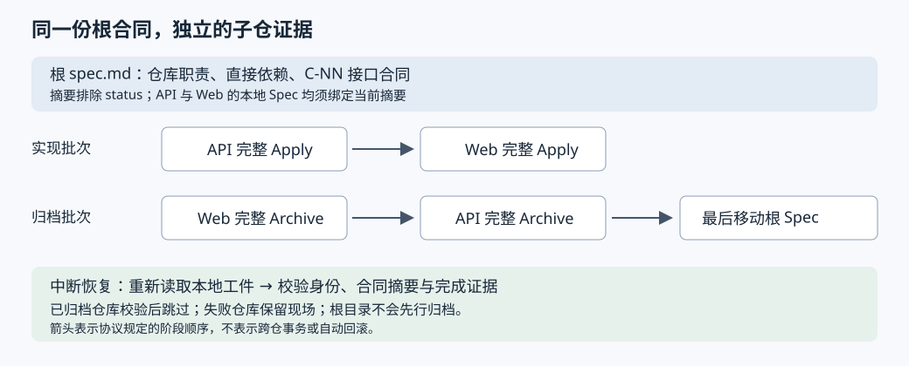

# HelixHarness 怎样让跨仓任务按顺序执行，并在中断后核对进度

假设要给任务列表增加筛选功能：`api` 仓库提供筛选接口，`web` 仓库接入它。后端已经完成，前端执行失败；换一个会话继续时，代理需要知道后端是否应当重做。如果此时又把接口中的“非法状态返回空列表”改成“返回参数错误”，后端原来的完成记录还能不能算数？这是本文自拟场景，不是仓库中的实测案例。

HelixHarness 的做法是：根目录保存一份跨仓需求规格 `spec.md`，各仓库保留自己的任务、实现和评审证据；执行前核对子仓绑定的是不是当前根合同，按依赖分批推进，归档时反向执行，最后才移动根规格。**跨会话恢复依靠重新检查文件事实，实际任务派发和失败隔离则仍有一部分由代理按协议执行。** 两者不能混为“脚本已经自动保证”。[执行计划实现][plan]、[派发及完成协议][dispatch]

## 研究范围与证据边界

研究对象是 `didi/helixharness`，固定 Commit 为 `44ffc536f73d8af525b4795ad10384c516898576`。本地 HEAD 一致，工作树无改动；580 个受 Git 跟踪的文件均存在，未发现子模块条目或 Git LFS 大文件指针。输入声明未抓取子模块及 LFS，本主题未发现因此缺失的源码依赖。

先阅读仓库结构、工作流架构和平台说明，再沿公共命令、路由、Workspace 多仓正文、`workspace.py`、单仓修订与归档函数及相关测试展开。本文接续首篇的单仓交付研究，集中讨论跨仓依赖、合同变更和恢复，不重新概述完整研发链路。未执行仓库脚本、测试或真实宿主任务；下文的测试结论均指静态阅读到的断言，不能视为运行通过。文档中的动作称为“协议要求”，Python 函数中的检查称为“实现”。[架构说明][architecture]

## 先确定谁负责哪一份事实

公共 `/helix:apply` 命令先调用 Router，即决定执行哪份工作流正文的路由器。命令要求消费其结构化结果，遇到阻断便停止，不能自行猜测另一条路线。`resolve_workflow_target()` 检查当前根目录的 `helixharness.workspace.yaml` 标记：Workspace 范围必须有标记，Single 单仓范围与该标记同时出现则冲突。因此子仓不会仅因“位于多仓工作区下面”就继承根工作流；被派发后还必须准确路由到 Single 正文。[公共入口][entry]、[范围解析实现][target]

根规格负责写清“哪些仓库参与、谁依赖谁、接口由谁提供、谁消费”；每个子仓则执行完整的单仓流程。协调代理不能替子仓编写一份简化任务表，也不能把不同仓库的 Git HEAD——各仓当前提交标识——合并成虚构的统一评审基线。根目录甚至不要求是 Git 仓库。[单仓职责边界][apply]、[根目录设计][propose]

这不仅是文档习惯。`validate_workspace_overview()` 枚举根 feature 目录，要求其中**只有 `spec.md`**；多出 `tasks.md`、验证报告或运行状态文件都会报错。它随后验证范围、阶段状态、设计章节、架构图与时序图的代码块标记，并读取仓库责任表。检查图的存在不等于理解图是否正确；检查章节标题也不等于证明设计充分。[根规格校验实现][overview]

这一选择减少了另一份总任务表与子仓状态相互矛盾的机会，这是根据结构作出的推断。代价也很明确：读取根规格本身不能知道所有运行进度，恢复时必须访问各子仓证据。

## 从根规格生成可核对的任务

### 仓库名称先映射到明确路径

`load_registry()` 读取登记表中的 `repos.<key>.path`，返回“仓库键 → 已解析目录”的字典。它自行解析受限格式，没有引入通用 YAML 解析依赖。空路径、重复键、重复目标目录、目标不存在、目标就是 Workspace 根，以及路径中经过符号链接，都会遭到拒绝；绝对路径和相对根目录的路径均可使用。[登记表实现][registry]

因此，规格里的 `api` 不是任意可拼接的文件路径，必须先命中登记表。不过，这个函数确认的是目录身份，未在这里验证该目录一定是 Git 仓库；它也没有检查两个不同路径是否互为父子目录。不能把这些检查扩大解释成完整的文件系统隔离。

责任表为每个参与仓库生成一条记录，包含 `repo`、`path`、`mode`、`depends_on`、`contract_refs` 和职责。其中 `mode` 只能为 `write` 或 `read`，分别允许实现业务变更或只做兼容验证；`C-NN` 是规格中跨仓接口合同的编号，表中的引用必须存在，并且每仓必须有交接小节。实现验证的是这些结构关系，没有自动核验接口描述与真实实现是否一致，也不要求登记表中的所有仓库都必须参加本需求。[责任表解析][matrix]

### 依赖决定批次，批次不等于已经完成

`_validate_repo_dag()` 拒绝自依赖、未知依赖和环。这里的 DAG 指有向无环图：箭头表示前置关系，不能形成互相等待的闭环。`_execution_batches()` 随后反复取出“所有依赖都已排入前面批次”的仓库，同批保留责任表顺序。[依赖与分批算法][dag]

在自拟场景中，`web Depends On api` 会得到 `[[api], [web]]`。注意，算法内部的 `completed` 集合只是“已放进前序批次”的名字集合，没有查看运行结果。真正等待 API 成功再启动 Web，是协调代理消费计划时必须执行的协议。若增加一个无依赖的 `worker`，它可与 API 同批，但本次没有测量实际并行速度。[批次算法][batches]、[执行与失败协议][dispatch]

每仓任务称为 `RepoJob`，即描述一次子仓执行的结构化记录。其关键字段把四类问题放到同一份输入中：[任务生成实现][jobs]

| 问题 | 字段及作用 |
|---|---|
| 到哪里执行 | `cwd`、`ownership_root` 固定子仓目录 |
| 执行哪份规则 | `prompt_source` 指向公共命令；`arguments` 保存参数；`expected_workflow` 指定 Single 正文 |
| 能接触哪些文件 | `read_scope`、`write_scope`、`forbidden_scope` 与业务 `mode` |
| 怎样证明做完 | `expected_artifacts`、`expected_result`、`completion_check` |

`command` 中的 `/helix:apply …` 是可读表示，不是交给 shell 的可执行命令。派发协议要求子任务读取公共命令，绑定参数，再检查 Router 返回的 action、范围和正文路径；不一致就返回 `workspace_child_route_mismatch`，不能换一份正文继续做。[子任务消费协议][dispatch]

权限也不是简单的“只准看自己”。Propose 设计阶段只读取本仓、插件及根合同；Apply 实现与 Archive 归档阶段额外加入根合同声明的**直接依赖仓库**，不自动开放传递依赖或反向依赖。依赖仓库可以同时出现在读取范围与禁止范围中，协议解释为允许读、禁止改。`read` 模式任务的 `write_scope` 仍包含本仓目录，因为还需要写本地任务和验证工件；禁止修改业务代码须结合 `mode` 与工作流理解。这些列表本身不是操作系统权限设置。[范围生成][jobs]、[范围断言][scope-tests]

图以自拟的 API/Web 场景说明已读取的批次与恢复规则；不表示系统提供跨仓事务。

## 根合同改变后，为什么旧成果会被挡住

### 摘要绑定的是整份合同，不是状态文字

Propose 任务携带根规格路径和 `workspace_contract_sha256`。SHA-256 是把内容映射成固定长度摘要的算法；这里的摘要用于核对内容身份，并不证明内容正确。子仓规格必须声明 `execution_scope: single`、对应 `workspace_repo` 和根合同摘要。Apply 与 Archive 计划调用 `_validate_repo_identity()`，三项不匹配便阻断。[摘要随任务传递][plan]、[身份校验][identity]

摘要由 `spec_receipt()` 计算：解析文档开头的元数据，移除 `status`，其余字段按键排序序列化，再拼接正文计算摘要。所以根状态从 `ready` 变成 `applying`，不会让所有子仓失效；接口错误语义、责任表或正文中的换行变化，却会改变摘要。[摘要实现][receipt]

据此可推断，这是一种偏保守的变更检测：代码没有按 `C-01` 等合同编号分别计算摘要。即使只改与 API 有关的一段，所有绑定旧根摘要的参与仓库都会变旧，不能声称实现会自动精准识别“仅受影响仓库”。它省去了逐段依赖分析，但可能增加重新确认的范围。

### 修订保留已做工作，并让旧评审失效

发现旧摘要后，不是直接覆盖子仓字段继续执行。`workspace_revision_context()` 只接受明确指向根 active 规格的来源路径，校验登记表确实拥有当前子仓，拒绝重开已归档子仓，再根据 feature、仓库键和当前根摘要生成稳定的 `repair_key`。同一子仓已有不同修订正在进行时也会阻断。Router 据此进入 Single Propose 的受控修订分支。[修订识别][revision]、[修订路由][revision-route]

`begin_repo_revision()` 再核对调用者带来的根摘要，取得子仓规格及任务摘要，调用 `begin_repair()`。后者在本仓修订锁内重新读取事实，并核对预期摘要；同一个修订身份可返回续跑结果，而不是反复新建修订。锁使用 Windows 文件锁或 Unix `flock`，超时后报错，但这是本地修订操作的锁，不能替代整个跨仓派发的所有权控制。[修订入口][revision]、[锁实现][lock]、[开始修订实现][begin-repair]

修订工件校验要求保留旧任务的描述、依赖和状态；新增任务必须使用更大的编号、属于当前修订且处于 pending。`rebind_repair()` 即重新绑定修订的函数，在校验后把状态恢复为 `ready` 或 `applying`，只更新 Apply 状态中的规格摘要，不重置最初实现基线；已有评审状态则移动到带修订编号的失效文件，要求后续重新形成评审证据。[历史保护][repair-check]、[重新绑定实现][rebind]

这解决的是“保留已经完成的 T-01，同时追加验证新错误语义的 T-02”，而不是“把所有任务重置成未开始”。不过这里的逐文件原子写入并不构成规格、任务、Apply 状态与评审状态之间的单次事务；本次未验证在每一个写入间隙强制中断后的恢复表现。

## 子代理说完成以后，父级还要检查什么

派发协议要求三项同时成立：宿主报告子任务成功结束、Router 身份匹配、父级独立运行 `completion_check` 通过。首次 Propose 检查任务，受控修订用 Apply 阶段的任务校验；Apply 后执行 `archive-preflight`，即归档前检查；Archive 后执行 completed 范围的检查。[完成协议][dispatch]、[检查项生成][plan]

以 Apply 为例，`archive_preflight()` 不只看一个 completed 字符串。它核对任务完成状态、验证报告非空、规格和任务摘要、规范与需求两路评审批准标记、阶段记录，以及评审范围是否仍然匹配。它核对的是保存的证据是否一致，不能仅凭这些字段证明真实宿主曾经启动过两个独立评审者。[单仓归档前检查][single-preflight]

父级随后还须检查跨仓合同双方的验证证据、端到端场景、失败路径和回滚。这部分写在 Workspace Apply 正文里，`workspace.py` 并未自动执行一套跨仓集成测试。根规格只有在聚合验收后才推进为 `implemented`。[聚合验收要求][apply]

失败时，协议要求保留已完成仓库、阻断依赖后继，不自动回滚或重跑无关成果。只有宿主明确不支持子任务，才允许串行内联执行同一公共命令；容量暂满、执行失败、状态未知都不能冒充“不支持”。这避免旧子任务仍在写仓库时，父级又启动第二个实现者；但“同仓最多一个 owner”在此是派发协议，不是计划函数发放的全局租约。[失败及降级协议][dispatch]

## 归档恢复能查文件，但不能包办全部运行语义

Archive 将依赖批次反转：先 Web 后 API。文档给出的理由是避免消费者尚需校验依赖时，上游已先归档。计划对每仓检查两种情况：只有 active 目录则检查待归档证据；只有 completed 目录则检查已归档证据；两处同时存在或两处都不满足条件则报位置歧义。已归档仓库也必须绑定当前根摘要。[逆序与位置检查][plan]、[归档设计依据][archive]

协调代理对已归档仓库校验后跳过；所有子仓完成，并且本轮任务没有待回答的最终交付选择后，才能更新根状态、严格复查并移动根目录。移动后，`workspace_completed_preflight()` 再要求根 active 已不存在，并逐仓验证 completed 证据。因此系统允许“Web 已归档、API 还没归档”的中间态，无须为了追求同时成功而撤销 Web。[根归档协议][archive]、[最终检查实现][completed]

但不能把 `workspace-plan` 当作可直接交给通用调度器的“剩余任务队列”。从实现看，Apply 对每仓校验后仍生成 job；Archive 识别 completed 后也仍生成 job。它没有在这两个分支统一删去已完成项，跳过行为由协调流程承担。若不检查阶段便机械重派，一个已实现子仓的 Router 可能建议进入 Archive，而不是返回预期的 Apply 正文，继而触发路由不匹配。[计划循环][plan]、[阶段建议路由][stage-route]

同样，completed 文件检查不会检查“本轮子代理是否还有未回答的交付问题”；这是归档正文额外要求父级维护的运行语义。文件事实足以支持部分恢复，并不等于完整保存了所有宿主会话状态。上述两点是静态源码分析所得的边界，尚未用真实宿主中断实验核验。

## 测试支持到哪一层

本次读取到的测试既检查结构化结果，也包含对协议文本的字符串断言，应分别理解：

| 阅读到的测试 | 断言支持的范围 |
|---|---|
| 两仓 Apply 与 Archive 计划 | 实现顺序为 API→Web，归档批次反向；未启动真实子代理。[Apply 批次测试][batch-tests]、[Archive 批次测试][archive-batch-tests] |
| 旧根合同摘要 | Apply 计划拒绝陈旧绑定；已归档子仓也不能用旧摘要混过恢复检查。[陈旧绑定测试][stale-tests]、[归档恢复测试][archive-test] |
| 直接依赖读取范围 | Web 可读 API，API 不可反向读 Web；写范围仍限定本仓。[范围测试][scope-tests] |
| 合同修订后重新绑定 | 初始 Apply 基线保留、旧评审失效、下一任务为新增 T-02；已绑定仓库不再进入 Propose jobs。[修订测试][repair-tests] |
| 派发合同字段与协议词句 | job 包含范围、预期正文和校验项，正文引用派发协议；字符串存在不证明宿主遵守协议。[派发测试][dispatch-tests] |

这些测试没有在本次研究中运行，也不能证明任意故障时点、并发写入或真实端到端调用均已覆盖。尤其不能由“计划输出两批”推导“第一批失败后宿主必定没有启动第二批”。

## 可以迁移的设计与适用条件

这套方案适合各仓库能够独立保留 Git 基线和验证证据、跨仓关系可以提前写成明确合同的协作任务。它提供了三种可复用做法：将可变阶段状态排除在合同摘要外；让调度输入同时携带执行边界和完成检查；保留局部成功，用重新验证推动恢复。[摘要][receipt]、[任务记录][jobs]、[恢复检查][completed]

与再维护一份根任务状态表相比，单份根合同减少了状态复制，却要求恢复时各仓库都可访问。与整批失败就回滚相比，保留局部成功更尊重各仓独立事实，却不能提供跨仓同时提交、同时发布的事务保证。与直接把计划里的命令逐条执行相比，父级多做的身份和完成校验能挡住错路由与陈旧证据，但依然需要可靠执行协议的协调代理。这些是依据当前实现推导的工程取舍，不是性能或可靠性测量结论。

[architecture]: https://github.com/didi/helixharness/blob/44ffc536f73d8af525b4795ad10384c516898576/docs/workflow-architecture.md#L1-L41
[entry]: https://github.com/didi/helixharness/blob/44ffc536f73d8af525b4795ad10384c516898576/helixharness/commands/apply.md#L17-L35
[target]: https://github.com/didi/helixharness/blob/44ffc536f73d8af525b4795ad10384c516898576/helixharness/scripts/workflow_target.py#L14-L42
[propose]: https://github.com/didi/helixharness/blob/44ffc536f73d8af525b4795ad10384c516898576/helixharness/workflows/workspace/propose.md#L11-L64
[apply]: https://github.com/didi/helixharness/blob/44ffc536f73d8af525b4795ad10384c516898576/helixharness/workflows/workspace/apply.md#L20-L64
[archive]: https://github.com/didi/helixharness/blob/44ffc536f73d8af525b4795ad10384c516898576/helixharness/workflows/workspace/archive.md#L13-L59
[registry]: https://github.com/didi/helixharness/blob/44ffc536f73d8af525b4795ad10384c516898576/helixharness/scripts/workspace.py#L77-L175
[overview]: https://github.com/didi/helixharness/blob/44ffc536f73d8af525b4795ad10384c516898576/helixharness/scripts/workspace.py#L234-L304
[matrix]: https://github.com/didi/helixharness/blob/44ffc536f73d8af525b4795ad10384c516898576/helixharness/scripts/workspace.py#L306-L378
[dag]: https://github.com/didi/helixharness/blob/44ffc536f73d8af525b4795ad10384c516898576/helixharness/scripts/workspace.py#L201-L231
[batches]: https://github.com/didi/helixharness/blob/44ffc536f73d8af525b4795ad10384c516898576/helixharness/scripts/workspace.py#L381-L402
[identity]: https://github.com/didi/helixharness/blob/44ffc536f73d8af525b4795ad10384c516898576/helixharness/scripts/workspace.py#L414-L443
[revision]: https://github.com/didi/helixharness/blob/44ffc536f73d8af525b4795ad10384c516898576/helixharness/scripts/workspace.py#L446-L539
[plan]: https://github.com/didi/helixharness/blob/44ffc536f73d8af525b4795ad10384c516898576/helixharness/scripts/workspace.py#L542-L756
[jobs]: https://github.com/didi/helixharness/blob/44ffc536f73d8af525b4795ad10384c516898576/helixharness/scripts/workspace.py#L646-L721
[completed]: https://github.com/didi/helixharness/blob/44ffc536f73d8af525b4795ad10384c516898576/helixharness/scripts/workspace.py#L759-L827
[receipt]: https://github.com/didi/helixharness/blob/44ffc536f73d8af525b4795ad10384c516898576/helixharness/scripts/workflow.py#L166-L180
[lock]: https://github.com/didi/helixharness/blob/44ffc536f73d8af525b4795ad10384c516898576/helixharness/scripts/workflow.py#L433-L468
[begin-repair]: https://github.com/didi/helixharness/blob/44ffc536f73d8af525b4795ad10384c516898576/helixharness/scripts/workflow.py#L638-L751
[repair-check]: https://github.com/didi/helixharness/blob/44ffc536f73d8af525b4795ad10384c516898576/helixharness/scripts/workflow.py#L760-L832
[rebind]: https://github.com/didi/helixharness/blob/44ffc536f73d8af525b4795ad10384c516898576/helixharness/scripts/workflow.py#L835-L909
[single-preflight]: https://github.com/didi/helixharness/blob/44ffc536f73d8af525b4795ad10384c516898576/helixharness/scripts/workflow.py#L1530-L1598
[revision-route]: https://github.com/didi/helixharness/blob/44ffc536f73d8af525b4795ad10384c516898576/helixharness/scripts/workflow_router.py#L203-L221
[stage-route]: https://github.com/didi/helixharness/blob/44ffc536f73d8af525b4795ad10384c516898576/helixharness/scripts/workflow_router.py#L239-L261
[dispatch]: https://github.com/didi/helixharness/blob/44ffc536f73d8af525b4795ad10384c516898576/helixharness/reference/workspace-repo-dispatch.md#L32-L112
[dispatch-tests]: https://github.com/didi/helixharness/blob/44ffc536f73d8af525b4795ad10384c516898576/helixharness/scripts/tests/test_workspace.py#L619-L688
[scope-tests]: https://github.com/didi/helixharness/blob/44ffc536f73d8af525b4795ad10384c516898576/helixharness/scripts/tests/test_workspace.py#L754-L787
[batch-tests]: https://github.com/didi/helixharness/blob/44ffc536f73d8af525b4795ad10384c516898576/helixharness/scripts/tests/test_workspace.py#L789-L827
[stale-tests]: https://github.com/didi/helixharness/blob/44ffc536f73d8af525b4795ad10384c516898576/helixharness/scripts/tests/test_workspace.py#L829-L847
[archive-test]: https://github.com/didi/helixharness/blob/44ffc536f73d8af525b4795ad10384c516898576/helixharness/scripts/tests/test_workspace.py#L960-L970
[repair-tests]: https://github.com/didi/helixharness/blob/44ffc536f73d8af525b4795ad10384c516898576/helixharness/scripts/tests/test_workspace.py#L309-L345
[archive-batch-tests]: https://github.com/didi/helixharness/blob/44ffc536f73d8af525b4795ad10384c516898576/helixharness/scripts/tests/test_workspace.py#L849-L866
