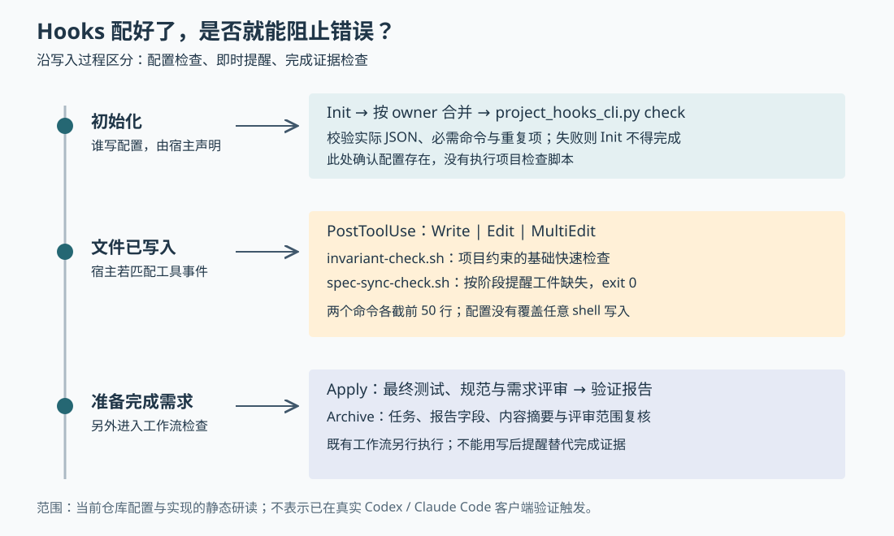

# HelixHarness 的 Hooks 能拦住什么：从写后提醒到完成门禁

假设代理已经写好一个筛选功能，并把需求标记为“已实现”，却没有留下验证报告。项目中的 Hook——宿主在指定事件发生时调用的处理程序——会不会把刚才的写入撤销？如果代理用终端命令修改文件，检查还会触发吗？这是本文自拟场景，用于追问 Hooks 的实际边界，不是仓库中的实测案例。

当前 HelixHarness 的答案分为三层：初始化时，配置缺失会阻止 Init 宣告完成；匹配写入事件后，快速脚本主要输出提醒；准备完成需求时，再由 Apply 和 Archive 工作流检查测试、评审与工件证据。**配置齐全、检查运行过、需求可以完成，是三件不同的事。** 理解这一区别，才能判断哪些规则可以依靠自动检查，哪些仍需要代理执行协议和人工核对。

本文接续已有的单仓交付与跨仓恢复研究，只追踪 Hooks 的配置、触发、消费和失败边界。研究基于本地 `input/repository/`，HEAD 为 `44ffc536f73d8af525b4795ad10384c516898576`，研读开始时工作树无改动。已静态阅读相关配置、Python 实现、Shell 模板、工作流和测试；没有执行项目脚本、运行项目测试或启动真实 Codex / Claude Code 客户端。下文将文档规定称为“协议要求”，函数中的行为称为“实现”，测试仅用于说明已有断言。

## 文件写完以后，实际接上了哪条检查链

两个宿主各有一份 `project-hooks.json`，都声明在 `PostToolUse`，即工具执行之后，匹配 `Write|Edit|MultiEdit`，调用以下两个命令：

```sh
bash docs/harness/linters/invariant-check.sh 2>&1 | head -50
bash docs/harness/linters/spec-sync-check.sh 2>&1 | head -50
```

第一份脚本检查项目约束，第二份提醒需求工件是否缺失。命令将错误输出合并进普通输出，并各取前 50 行。两者的设置目标不同：Codex 写入 `.codex/hooks.json`，Claude Code 写入 `.claude/settings.json`。[Codex 项目配置][codex-project]、[Claude Code 项目配置][claude-project]

这首先确定了时间边界：这是写后检查，文件已经发生变化；本次读取的配置与检查脚本没有撤销写入的逻辑。其次确定了事件边界：配置列出的是这三种工具名称，没有列入通用 Shell 工具。不能由此保证终端命令、外部编辑器或宿主采用其他名称的文件工具也会触发。真实客户端怎样匹配这些事件，本次没有运行验证；宿主清单把能力声明为 `native`，也不能代替触发实验。



图中的后两层不是同一个脚本的先后步骤：写后提醒依赖宿主事件，完成检查由工作流另行发起。配置检查则更早发生在初始化期间。

## 为什么“检查脚本报告问题”仍可能返回成功

### 工件同步脚本只提醒，不判定需求是否完成

`spec-sync-check.sh.tpl` 是实际生成脚本的统一模板。服务和前端初始化正文都要求读取它并原样写入，而不是重新编写一个近似版本。脚本先从自身位置向上定位项目根，再遍历 `docs/specs/active/` 下的需求目录。[模板实现][sync]、[服务初始化正文][service-bootstrap]

对每个活跃需求，它执行很有限的检查：

- 缺少 `spec.md` 时输出警告。
- 如果项目根存在 Workspace 标记，即多仓工作区标记，就跳过后面的单仓工件检查。
- 单仓检查 `tasks.md` 是否存在。
- 从规格开头的元数据读取 `status`；仅在 `implemented` 或 `completed` 时，检查 `verify-report.md` 是否存在且非空。

因此，开头场景中的“已实现但缺报告”会得到警告，然后脚本仍以 `exit 0` 结束。`ready` 阶段还未生成报告则不警告，避免把尚未到期的证据当成错误。Workspace 根只保留总规格，子仓各自检查自己的工件，因此根目录不要求三份文件齐全。这些分支同时能在 `test_spec_sync_linter.py` 的断言中找到。[模板与阶段分支][sync]、[模板测试][sync-tests]

它也没有比较代码与需求的语义，没有核对任务状态、报告中的评审结论或内容摘要，更没有检查接口实现是否满足验收条件。即使文件非空，其内容仍可能不完整。服务初始化正文说它提醒代码与工件、问题记录之间“可能存在脱节”，应理解为用途描述；模板实际执行的只是上述存在性和阶段检查。

从自身位置定位项目根解决了脚本内部的路径问题，却没有解决所有调用问题：Hook 命令本身仍使用 `docs/harness/linters/...` 相对路径。在项目子目录触发时，宿主是否把命令工作目录设为项目根，仍需真实客户端验证。测试证明的预期更窄：**用明确脚本路径从其他目录启动后，模板能找到正确项目。**[跨目录测试][sync-tests]

### 约束检查也不等于完整的业务验证

`invariant-check.sh` 不是一份对所有项目都相同的可执行程序。服务初始化正文要求按技术栈生成基础检查；前端初始化正文提供了具体 Shell 示例：查找部分不符合建议命名方式的组件路径，以及统计 `: any` 字样，超过阈值时提醒。这是快速文本检查，不是理解全部类型和组件依赖的分析器。[前端脚本生成正文][frontend-bootstrap]

前端示例会累加警告数量、打印提示，但没有在发现问题时设置非零退出状态。因此不能把“生成了 invariant 检查”扩大解释成“所有长期业务规则都有机器门禁”。而且生成规则本身也有限制：`harness-generation-protocol.md` 要求规则具有仓库规约、用户确认或适用模板等规范性来源；扫描到当前函数恰好返回某个值，只能先记为项目知识，不能自动变成永久禁止修改的规则。[约束来源协议][generation]

这一区分防止把旧代码中的偶然做法固化为强制要求。代价是自动化覆盖取决于项目究竟生成了什么脚本，不能仅凭文件名推断检查能力。

还有一层容易忽略的失败语义：这两个 Hook 命令都是管道，末端为 `head -50`，命令文本没有显式启用 `pipefail`，即让管道反映前部命令失败的 Shell 选项。按通常未启用该选项的 Shell 语义，即使前面的脚本失败，管道仍可能以 `head` 的成功状态结束。**这是根据命令写法推导的风险，不是本次宿主实测结果**；实际外层 Shell 选项和宿主怎样处理退出码仍未确认。可以直接确认的是，配置没有建立可靠传递脚本失败状态的显式约定，而且后续输出可能被截掉。[实际命令][codex-project]

## 初始化为什么仍把 Hooks 称为“硬门禁”

前端初始化正文强调“hooks 和 linters 是硬门禁”，而脚本又只输出提醒，看似矛盾。结合公共 Init 的调用方可知，前者要求的是**初始化必须真实生成并检查这些产物**，不意味着每次写入遇到警告都必须被阻止。

公共 `commands/init.md` 先绑定当前宿主资源，再执行扫描与初始化生成。项目 Hook 由谁写入，根据 `owner` 字段决定：

| 宿主 | `owner` | 协议要求的写入者 | 最终检查者 |
|---|---|---|---|
| Codex | `parent` | 顶层流程在初始化子任务返回后执行 `merge` | 顶层流程执行 `check` |
| Claude Code | `bootstrap` | 初始化子任务按宿主允许的配置写入方式合并 | 顶层流程执行同一个 `check` |

父级不能把“子任务请求父级合并”当成配置已经落盘；也不能绕过 Claude Code 的宿主配置权限自行写入。缺失、冲突或检查失败时，协议要求返回 `BLOCKED: project_hooks_incomplete`，保留其他已生成工件，不能宣称 Init 完成。[公共 Init 完成门禁][init]

可执行部分是 `project_hooks_cli.py`。它先由宿主登记器取到当前清单，调用 `load_project_hooks()` 检查配置合同：版本、字段集合、所有者、合并策略，以及设置文件是否与当前宿主的 `project_config` 一致；目标路径必须是安全的项目相对路径。这里的 `Host Kit` 指某个宿主专用的配置与适配资源集合，作用是把差异留在宿主目录，而不是让公共 Init 到处判断产品名称。[合同读取实现][contract]

随后 `project_hooks()` 读取实际设置文件，计算“补齐并去重后应该得到的配置”。`check` 不写文件：目标缺失，或实际内容与合并结果不同，就抛出错误；命令行入口将错误输出为 `blocked` 并返回 1。**它检查 JSON 中的配置，不会启动两个项目检查脚本，也不会确认脚本路径存在、脚本成功运行或宿主已重新加载配置。**[配置检查实现][merge]

所以这条真实调用链是：宿主声明写入责任 → 代理按 Init 协议安排合并 → Python 校验实际文件 → 代理依据返回值决定能否结束 Init。最后一步仍是工作流协议，不应描述为 Python 自动控制了整个初始化过程。

## 重复初始化怎样保留用户设置，失败时又保留什么

`merge_payload()` 先深拷贝用户配置，验证已有事件结构，再按事件名及 `matcher` 查找对应组。对于必须存在的处理程序，它以 `type` 和 `command` 判断身份：已有一份就保留，额外的同项删除；缺失则补入。用户其他字段、其他事件和无关命令保留。[合并算法][merge]

这一算法有两个值得注意的边界。第一，保留的同名处理程序可以带用户设置的 `timeout` 等额外选项，不要求这些选项与插件载荷逐项相等。测试特意修改超时后再次合并，预期原值保持。第二，合同中的 `dedupe_key` 虽然必须存在，合并函数并没有把这段字符串解释成通用路径表达式；实际去重规则直接写在 `merge_payload()` 中。理解扩展能力时，应以这段算法为准。[用户选项测试][merge-tests]、[合同字段实现][contract]

已有配置不是合法 JSON，或事件、组、处理程序结构不合法时，程序报错而不覆盖原文；测试也覆盖“必需 Hook 齐全，但用户另一个事件损坏”的情况。它不会为了让自身检查通过而删除坏掉的用户设置。[错误配置测试][merge-tests]

写入则使用目标目录中的临时文件，完成后通过 `os.replace()` 替换目标，并保留原文件权限位。这避免直接覆盖过程中留下半份 JSON。目标是符号链接或解析后逃出仓库时会被拒绝。但本函数没有读改写锁，原子替换也不等于并发合并：若另一个进程在读取后、替换前修改设置，仍存在覆盖其更新的可能。这是由实现推导的并发边界，本次没有进行竞争写入实验。[路径与写入实现][merge]

## 会话 Hook 解决的是宿主身份，不是需求完成

除了项目里的写后检查，插件还有另一条生命周期链，不能混在一起。

两份原生插件清单分别显式指向 `hosts/codex/hooks.json` 和 `hosts/claude-code/hooks.json`。Codex 入口只接受 `SessionStart`、`SessionEnd`；Claude Code 还处理目录变化，以及特定命令激活事件。两个 `hook_entry.py` 都按自身安装位置找到资源，再固定选择自己的宿主身份，不用传入的 `platform` 字段决定自己是谁。[Codex 插件入口][codex-entry]、[Claude Code 插件入口][claude-entry]、[分发绑定测试][plugin-tests]

共享 `lifecycle_service.py` 的 `startup_context()` 注入当前安装根、规范宿主 ID 和清单路径，要求后续命令、子任务使用同一来源。Claude Code 适配层还会在宿主提供环境文件时追加会话变量。这里注入的是资源身份与定位信息，并不是把全部 Knowledge 和 Harness 文档塞进上下文；后者仍按加载协议的索引和当前任务读取。[生命周期实现][lifecycle]、[按需加载协议][loading]

会话启动还可异步修复已有遥测账本，遥测即可选的使用统计；结束时根据授权状态清理私有统计状态。相关异常被共享层捕获，目的是不让可选统计阻断研发工作。入口面对部分文件或 JSON 错误也会直接返回成功。因此“会话 Hook 退出 0”不能证明所有工作已经执行，更不能证明需求实现完成。[异常处理][lifecycle]、[宿主入口][codex-entry]

两个全局生命周期配置都没有把 Stop 或 Failure 注册为业务完成门禁。业务阶段要求显式记录开始与结束；会话结束不等于需求结束。Claude Code 的视觉还原技能另有仅激活期间生效的专用守卫，本篇没有深入其实现，不能由此推断项目完全没有任何 Stop 检查。[宿主生命周期说明][claude-life]

## 真正准备交付时，提醒怎样变成证据要求

回到开头的缺报告场景。写后脚本会提醒，但后续归档的 `archive_preflight()` 会实际读取 `verify-report.md`，要求正文非空，核对规格和任务的内容摘要、两路评审批准字段、阶段状态以及封存的评审范围。报告缺失或这些事实不一致时，不能靠早先脚本返回成功通过检查。[归档前检查实现][archive]

在此前，Apply 协议要求运行最终测试，并在评审前直接读取 `docs/hooks/cr-checklist.md`，若该文件存在，就将它纳入规范评审来源。它不走 Knowledge/Harness 索引。也就是说，Hooks 目录里的评审清单是代理阅读的检查依据，并非宿主自动执行的程序；`post-action.md` 中的自检提醒同样不能视为可执行 Hook。[Apply 消费点][apply]、[评审来源][review]

这解释了为什么需要几种不同手段：写后脚本提供早期反馈；测试验证具体行为；规范与需求评审理解改动含义；归档函数核对保存的证据是否仍然对应当前内容。归档函数本身不重新运行测试，也不能证明报告中的“批准”确实来自真实独立评审者。它们相互补足，但没有哪一个能独自包办完成判断。

## 对使用者和维护者意味着什么

已有测试能支持几项明确的实现预期：重复合并保留用户设置并不重复追加必需命令；损坏设置不被覆盖；工件提醒区分规划与实现阶段；插件入口在混杂环境变量下仍绑定自己的宿主。它们没有在本次研究中运行，也没有代替真实客户端验证工具事件、命令工作目录、输出展示和失败处理。

这套设计适合希望把检查放在代理日常操作附近，同时把完整完成证据留在工作流中的团队。根据当前实现，落地时应分别验收三件事：配置能否正确合并；真实宿主的实际文件工具能否触发检查；缺失证据时完成流程能否停止。只验收第一项，会漏掉后两项。

对于确实需要阻断的检查，维护者应明确设计触发事件、失败状态传递和宿主处理方式，再用真实客户端验证；不能只把“警告”文字改成“错误”。保留前 50 行能够控制即时输出量，但需要完整诊断时应另有明确入口。跨目录调用也应核实命令怎样找到脚本，而不是只核实脚本内部怎样找到项目。

最后，知识、约束和检查各有职责：扫描结果描述当前行为，确认后的规约规定应遵守什么，脚本只能检查已经编码的那一部分，测试与评审负责更深的行为正确性。当前 HelixHarness 的可迁移经验在于把这些责任显式分开；它的边界也在这里：**有 Hooks 配置，并不等于所有文件写入都受控，更不等于完成声明已经得到证明。**

[codex-project]: https://github.com/didi/helixharness/blob/44ffc536f73d8af525b4795ad10384c516898576/helixharness/hosts/codex/project-hooks.json
[claude-project]: https://github.com/didi/helixharness/blob/44ffc536f73d8af525b4795ad10384c516898576/helixharness/hosts/claude-code/project-hooks.json
[sync]: https://github.com/didi/helixharness/blob/44ffc536f73d8af525b4795ad10384c516898576/helixharness/templates/harness/spec-sync-check.sh.tpl
[sync-tests]: https://github.com/didi/helixharness/blob/44ffc536f73d8af525b4795ad10384c516898576/helixharness/scripts/tests/test_spec_sync_linter.py
[service-bootstrap]: https://github.com/didi/helixharness/blob/44ffc536f73d8af525b4795ad10384c516898576/helixharness/agents/init-service-bootstrap.md
[frontend-bootstrap]: https://github.com/didi/helixharness/blob/44ffc536f73d8af525b4795ad10384c516898576/helixharness/agents/init-frontend-bootstrap.md
[generation]: https://github.com/didi/helixharness/blob/44ffc536f73d8af525b4795ad10384c516898576/helixharness/reference/harness-generation-protocol.md
[init]: https://github.com/didi/helixharness/blob/44ffc536f73d8af525b4795ad10384c516898576/helixharness/commands/init.md
[contract]: https://github.com/didi/helixharness/blob/44ffc536f73d8af525b4795ad10384c516898576/helixharness/scripts/host_runtime/project_hooks.py
[merge]: https://github.com/didi/helixharness/blob/44ffc536f73d8af525b4795ad10384c516898576/helixharness/scripts/project_hooks_cli.py
[merge-tests]: https://github.com/didi/helixharness/blob/44ffc536f73d8af525b4795ad10384c516898576/helixharness/scripts/tests/test_project_hooks.py
[codex-entry]: https://github.com/didi/helixharness/blob/44ffc536f73d8af525b4795ad10384c516898576/helixharness/hosts/codex/hook_entry.py
[claude-entry]: https://github.com/didi/helixharness/blob/44ffc536f73d8af525b4795ad10384c516898576/helixharness/hosts/claude-code/hook_entry.py
[plugin-tests]: https://github.com/didi/helixharness/blob/44ffc536f73d8af525b4795ad10384c516898576/helixharness/scripts/tests/test_plugin_hooks.py
[lifecycle]: https://github.com/didi/helixharness/blob/44ffc536f73d8af525b4795ad10384c516898576/helixharness/scripts/lifecycle_service.py
[loading]: https://github.com/didi/helixharness/blob/44ffc536f73d8af525b4795ad10384c516898576/helixharness/reference/loading-protocol.md
[claude-life]: https://github.com/didi/helixharness/blob/44ffc536f73d8af525b4795ad10384c516898576/helixharness/hosts/claude-code/lifecycle.md
[archive]: https://github.com/didi/helixharness/blob/44ffc536f73d8af525b4795ad10384c516898576/helixharness/scripts/workflow.py
[apply]: https://github.com/didi/helixharness/blob/44ffc536f73d8af525b4795ad10384c516898576/helixharness/workflows/single/apply.md
[review]: https://github.com/didi/helixharness/blob/44ffc536f73d8af525b4795ad10384c516898576/helixharness/skills/code-review/SKILL.md
