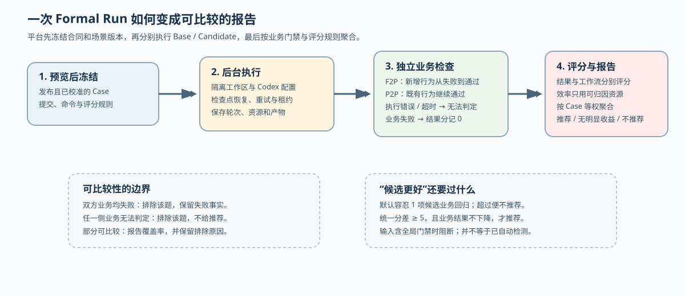

# HelixHarness 平台怎样比较两个框架版本，并防止“完成”冒充“更好”

假设维护者想比较 HelixHarness 的两个版本：基准版使用团队配置的基准引用，候选版改了工作流。选同一个 `task-filter` 场景后，候选版确实让筛选功能通过测试，但它的归档证据缺失；另一个场景中候选版还让既有行为回归。平台最后会不会只看总分，给候选版一个“推荐”？

源码给出的答案是一个有条件的比较过程：先把 Case（评测场景）、两边的精确 Git 提交、执行命令、运行策略和评分规则冻结成 Run（固定比较条件的一次评测活动）；再由 Worker（后台执行进程）在隔离工作区执行；确定性业务检查先决定“通过、失败还是无法判定”；只有可比较的 Case 才进入评分，最后再应用回归容忍度和分差阈值。**完成一次运行、得到一个分数、推荐采用候选版，是三种不同状态。** 文中假设比较用于讲解，并非本次真实运行案例。这条边界适合评估会变化的编码框架，也避免把模型输出的完成标记当作业务结果。

本文聚焦仓库中的 `helixharness-platform/bench`，接续历史研报对插件工作流、跨仓恢复和 Hooks 的研究。依据为本地源码固定提交 `44ffc536f73d8af525b4795ad10384c516898576`；我静态阅读了评测概念文档、场景发布与校准、Run 服务、Codex 执行器、Judge 请求和评分实现及相关测试，没有安装依赖或运行平台测试。下文把源码直接行为称为“实现”，文档意图称为“协议”，没有运行验证的部分会明确说明。

## 先冻结比较对象，再开始执行

平台比较的不是“今天工作区里能读到的两个目录”。`ScenarioRunService.preview()` 会检查 Case 是否已发布；正式评测还要求它是 `REPOSITORY_CASE` 且已完成确定性校准。预览结果包含每个 Case 的 `source_hash`、运行类型、执行适配器、合同摘要和阻断原因。用户确认时，`create()` 会重新生成预览并比较 `expected_preview_hash`；摘要变化就返回“preview changed”，要求重新确认。通过后，数据库保存合同 JSON、预览摘要，并为每个 Case 建立 Base（基准侧）与 Candidate（候选侧）两个 Job（执行作业）（源码：[scenario_runtime.py](https://github.com/didi/helixharness/blob/44ffc536f73d8af525b4795ad10384c516898576/helixharness-platform/bench/scenario_runtime.py#L329-L428)）。

评测合同由 `freeze_evaluation_contract()` 生成。它不只保存版本名，而是保存两边的 Strategy（策略：实际执行命令、阶段、工件合同、宿主适配器）和完整 `ScoringProfile`（评分配置），再对规范化 JSON 计算 `contract_hash`（源码：[evaluation_contracts.py](https://github.com/didi/helixharness/blob/44ffc536f73d8af525b4795ad10384c516898576/helixharness-platform/bench/evaluation_contracts.py#L143-L166)）。正式运行的 `GitScenarioStrategyValidator` 还要求 Base 等于配置的最新基准提交、两侧提交是完整哈希、适配器版本受支持，并逐个核对策略引用的插件文档哈希；因此执行期使用的版本不会随候选分支移动（源码：[scenario_runtime.py](https://github.com/didi/helixharness/blob/44ffc536f73d8af525b4795ad10384c516898576/helixharness-platform/bench/scenario_runtime.py#L194-L250)）。

这解决了一个具体问题：如果评测排队十分钟后 `master` 前进了一次，基准侧仍然按预览时冻结的提交执行。它也带来实际约束：正式评测依赖可访问的 Git 仓库、精确提交和当前支持的策略文档；平台 README 明确说 Mock 适配器只用于开发验证，不能代表真实模型能力。

## Case 进入正式评测前，要证明“题目本身有效”

发布 Case 时，`load_scenario_source()` 把 `case.json`、需求、澄清规则、Gold（业务标准）和声明的工作区文件打成带可见性与内容摘要的 Snapshot（文件快照）。`ScenarioStore.publish()` 保存当前版本；同一个 Case 的内容变化会产生新的 `source_hash`。正式评测只接受已校准版本。

校准并不是检查文件存在。`ScenarioCalibrationService.calibrate()` 对每个参与仓库计算 `base_commit..solution_commit` 的二进制补丁哈希，核对 Gold 的来源证据，然后在临时目录分别导出 Base 和 Solution。它会执行声明的 F2P（Fail to Pass，新增行为在基准失败、方案通过）和 P2P（Pass to Pass，既有行为两边都通过）命令；测试文件改动会被还原到 Base 版本，避免“顺手改测试”把题目变简单。补丁、来源或行为核对不满足要求，正常返回时 Case 标为 `FAILED`，不会进入正式 Run（源码：[scenario_calibration.py](https://github.com/didi/helixharness/blob/44ffc536f73d8af525b4795ad10384c516898576/helixharness-platform/bench/scenario_calibration.py#L61-L242)）。

因此，平台先尝试验证题目的前后行为，再比较框架。但校准也有实现边界：`_run_test()` 把返回码为 0 以外的结果统一记为 `FAIL`，包括没有返回码的超时；与后述正式业务验证将其记为“无法判定”不同。静态推断，如果基准因超时失败而方案通过，F2P 的表面条件仍可能满足。故 `CALIBRATED` 应理解为当前校准规则通过，不能独立证明基准失败必然来自待修复的业务缺陷，更不能证明候选框架已完成。

## Worker 如何把一次运行变成两份可审计证据

`ScenarioWorker.run_once()` 先领取一个带租约的 Job（租约是有期限的执行归属凭证）；没有可领取任务时，只有当同一 Run 的所有 Job 都是 `COMPLETED` 才调用 `finalize()`。执行期间 `_ScenarioJobLeaseKeeper` 续租，避免长时间 Codex 调用被其他 Worker 误领。瞬时基础设施异常最多重试两次，容量不足会暂停等待操作员恢复；普通异常则标记失败。终态工作区随后由清理扫描异步删除，清理失败记录日志，不改写已保存结果（源码：[scenario_runtime.py](https://github.com/didi/helixharness/blob/44ffc536f73d8af525b4795ad10384c516898576/helixharness-platform/bench/scenario_runtime.py#L1076-L1175)）。

Codex 适配器每次尝试建立独立的 `workspace`、`codex-home` 和插件快照，只安装合同指定的插件树。若是重试，它从最新成功的阶段检查点恢复剩余步骤；检查点保存可供恢复的工作区与执行进度。平台不会凭一条“完成”文本跳过工件检查。工作流执行后，适配器依次验证初始化输出、复制出验证工作区、合并冻结的隐藏测试，再运行 Gold 的执行测试。测试结果只有三种业务含义：全部通过是 `PASS`，有明确失败是 `FAIL`，超时或执行错误是 `INCONCLUSIVE`（源码：[scenario_codex.py](https://github.com/didi/helixharness/blob/44ffc536f73d8af525b4795ad10384c516898576/helixharness-platform/bench/scenario_codex.py#L1120-L1255)）。

这里的取舍很明确：业务验证在独立副本中进行，隐藏测试补丁没有被这条文件准备路径写入代理工作区；但隔离和重试也增加了磁盘、时间和证据管理成本。源码保存 `attempt_record`、轮次证据、资源和工件哈希，便于在模型失败、恢复或清理之后重建报告。

## 两个 Judge 评价不同东西

当业务验证为 `PASS` 时，`build_outcome_judge_request()` 才构造 Outcome Judge（结果评审）请求。它把冻结 Requirement（需求条目）、业务验证、生产代码和必要的测试证据放在有范围限制的输入中；要求每条 Requirement和业务验证都有引用。测试代码只有在 Requirement 明确要求交付测试时才计入“实现质量”，否则测试只能支持需求满足度。Judge 输出若引用了不在允许范围的证据，`validate_scenario_judgment()` 直接拒绝；执行器按 `judge_max_retries` 做有限重试并记录诊断，缺省值为一次；连接失败重试耗尽与引用不合法耗尽还走不同的异常分支（源码：[scenario_judging.py](https://github.com/didi/helixharness/blob/44ffc536f73d8af525b4795ad10384c516898576/helixharness-platform/bench/scenario_judging.py#L112-L376)）。

Workflow Judge（工作流评审）只看阶段工件，评价目标拆解、决策计划、实现追溯、验证与完成说明四个轴，各占 25%。它不能引用代码或业务测试给工作流加分。设计上，这让“文档写得像完成”和“代码实际完成”接受不同的评价。结果评审仍可用阶段产物理解意图，但请求明确禁止仅凭文档质量提高业务结果分；这些规则约束模型判断，无法保证每次语义判断都正确。

适用边界是：Judge 是语义评审器，不是业务执行器。源码只允许业务检查通过后调用结果 Judge；工作流 Judge 在有工件时仍可独立运行；Judge 无法把缺失的测试结果补成 PASS，也不能证明未覆盖的边界行为。

## 评分如何处理失败、未知和效率

默认 `UNIFIED_SCORING_PROFILE` 将 Outcome、Workflow、Efficiency 分别设为 60%、20%、20%；Outcome 内部由需求满足度 90% 和实现质量 10% 组成。效率只使用两侧都到达可比较业务终态、没有 Case 硬门禁、且都有资源记录的 Case。`resource_accounting.py` 将参与比较的逻辑执行轨迹，与全部已观测尝试分开记录：前者统计 Agent 的 token（模型处理文本的计量单位）、活动轮次秒数，以及输入类型含 `FINDING` 的返工动作；后者保存实际尝试成本和两者差额。因此效率分不是总耗时或账单成本的直接比较，仍需另看 `actual` 成本与记账完整性（源码：[scoring.py](https://github.com/didi/helixharness/blob/44ffc536f73d8af525b4795ad10384c516898576/helixharness-platform/bench/scoring.py#L492-L570)、[resource_accounting.py](https://github.com/didi/helixharness/blob/44ffc536f73d8af525b4795ad10384c516898576/helixharness-platform/bench/resource_accounting.py#L8-L89)）。

`aggregate_run()` 对每个选中的 Case 做等权聚合，并分开处理三类情况：

- **双方都失败**：记为 `SHARED_BUSINESS_FAILURE`，保留双方结果但不纳入可比较聚合；这让比较聚焦于双方能区分出业务结果的场景；双方失败本身不能证明题目不可解。
- **一侧无法判定**：如验证超时或缺少必要结果，记为 `BUSINESS_VERIFICATION_INCONCLUSIVE`，不补零也不生成推荐。
- **候选失败而基准通过**：候选 Outcome 变为 0，增加 `candidate_business_regression_case_count`；当前规则允许最多一项这样的回归，超过一项才直接 `DO_NOT_RECOMMEND`（源码：[scoring.py](https://github.com/didi/helixharness/blob/44ffc536f73d8af525b4795ad10384c516898576/helixharness-platform/bench/scoring.py#L108-L266)）。

可比较覆盖率也会进入结果：全都可比是 `FULLY_COMPARABLE`，部分可比是 `PARTIALLY_COMPARABLE`，全不可比是 `NOT_COMPARABLE`；聚合输入带有全局硬门禁（如证据污染、虚假完成）则为 `BLOCKED`。缺失 Workflow 分数时，报告保留单侧可见结果，但统一分只使用双方共同拥有的组件并重新归一化，而不是用 0 代替缺失值。

**这里还要区分“评分器支持拦截”与“执行器会自动发现”。** `CodexScenarioExecutionAdapter._execute()` 当前返回的 `global_hard_gates` 是空列表；本篇没有找到它自动识别证据污染或虚假完成并填入这些全局标记的实现。单元测试直接构造 `EVIDENCE_CONTAMINATION` 输入来验证聚合阻断，证明的是消费逻辑，不能据此宣称真实运行具备完整的作弊检测。相反，业务失败、初始化失败、缺失必要工件等 Case 级标记确有执行路径生成。

最终 `_promotion_decision()`（决定是否建议采用候选版的函数） 先检查候选业务回归数，再检查阈值：统一分差至少 5 且 Outcome 不下降才 `RECOMMEND`；统一分差不超过 -5 或 Outcome 下降至少 5 则 `DO_NOT_RECOMMEND`；其余是 `NO_CLEAR_GAIN`。所以“候选功能通过了”最多说明一个 Case 的业务门禁通过，不能推出候选版本应被采用。当前规则也没有把所有 Case 级硬失败设成全局否决：缺失工作流证据可能只让统一分移除相关分量，候选的一项业务回归也可能被其他改善抵消。协议中的“硬门禁”不能笼统解释为“出现任何失败便绝不推荐”。

这并非仅凭代码推断。[test_scoring_v2.py](https://github.com/didi/helixharness/blob/44ffc536f73d8af525b4795ad10384c516898576/helixharness-platform/bench/tests/test_scoring_v2.py#L176-L272) 构造两道题：候选修好基准失败的第一题，却把基准通过的第二题做坏；断言仍为 `RECOMMEND`，同时保留第二题的新增失败标记。另一测试断言，双方都失败的题从均值中排除；再一测试通过修改阈值，单独验证“一项回归可容忍、两项回归否决”。这些是静态测试断言，不是本次实际模型运行的结果。

## 报告会不会被后来改规则悄悄重写

Run 完成后，`ScenarioRunService._append_calculation()` 将聚合结果作为新的 Calculation（计算记录）写入，并为报告计算哈希；原始 Job、执行结果和冻结合同保留不变。`recalculate()` 必须提供理由。默认重算继续使用原合同；显式 `use_current_scoring_profile=True` 时，代码只允许替换评分配置，且逐项确认两侧 Strategy、合同版本和新评分配置符合约束，禁止借重算机会换执行命令或版本（源码：[scenario_runtime.py](https://github.com/didi/helixharness/blob/44ffc536f73d8af525b4795ad10384c516898576/helixharness-platform/bench/scenario_runtime.py#L673-L717)、[scenario_runtime.py](https://github.com/didi/helixharness/blob/44ffc536f73d8af525b4795ad10384c516898576/helixharness-platform/bench/scenario_runtime.py#L903-L987)）。

这使“规则升级”和“重新跑模型”分开：若发现评分公式有问题，可以在同一证据上追加计算；若需求、Case 或策略改变，就应创建新的 Run。源码测试还断言升级评分配置不会新增 Job 或改变已有尝试记录，但本篇未运行这些测试，不能把静态断言说成实测通过。

## 读报告时应先看哪些事实

面对一个 `RECOMMEND`，建议按以下顺序复核：

1. 先看 Run 的 `contract_hash`、Base/Candidate 精确提交和 Case `source_hash`，确认比较对象没有漂移。
2. 再看每个 Case 的业务检查、隐藏测试注入、`INCONCLUSIVE` 原因和 `candidate_business_regression_case_count`，不要只看总分。
3. 查看 `comparable_coverage` 与 `candidate_new_hard_gates`，判断推荐是否建立在少数可比较样本上。
4. 最后分别看 Outcome、Workflow、Efficiency 三个分量和计算理由；Efficiency 缺失可能是证据不足，不等于效率为零。

这些建议来自实现中的数据边界，不是额外运行结论。平台 README 还说明自进化默认关闭、候选发布仍需人工审阅；因此这套评测机制适合比较候选方案、留下可追溯证据和发现回归，不能自动替团队决定发布，也不能替代真实生产流量验证。

## 证据边界与可迁移经验

本次没有启动 Web 服务、Codex、模型 Judge 或测试套件；文中关于流程和异常的结论均来自源码、设计文档和静态测试断言。测试文件能说明作者希望哪些条件成立，不能证明当前环境已运行通过。

可以迁移的设计有三点：把“比较对象”冻结为可哈希合同；把确定性业务检查放在开放式语义评分之前；把未知、共同失败和候选回归分别记录，而不是全部折成一个分数。代价也同样明确：每个 Case 需要维护来源提交、Gold、隐藏测试和校准结果；评测数据库必须保存尝试与诊断；评分规则变更需要追加计算并解释原因。对于没有稳定验收命令、不能冻结依赖或无法区分基础设施失败与业务失败的团队，这套比较结果应只作线索，不能当作发布门票。
