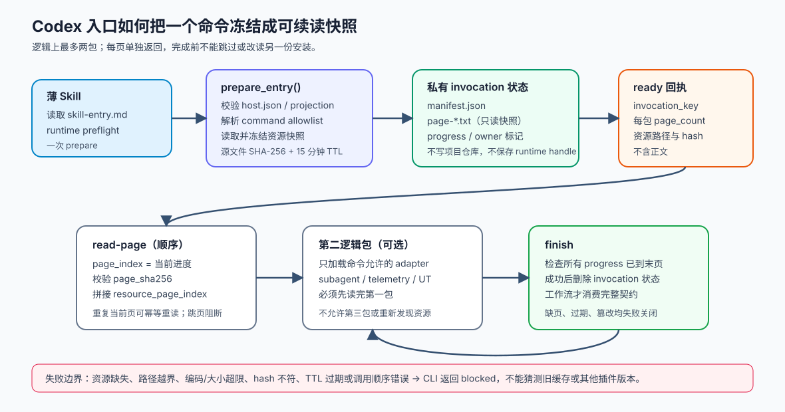

# HelixHarness 如何把 Codex 的入口上下文冻结、分页并安全交给工作流

当编码代理执行 `/helix:apply` 时，它首先要拿到哪一份命令契约？如果命令文件很长，怎样避免宿主一次输出被截断？在加载过程中插件源文件又被更新了，代理拿到的是前后混杂的内容，还是同一份快照？这些问题决定了“代理按项目规则工作”究竟靠什么保证。

本篇沿用历史研报已经提到的 Knowledge、Harness 与宿主集成，但把研究问题收窄到一条更具体的链路：**Codex 薄入口如何加载自己的插件资源，以及这套入口加载与项目仓库的 `docs/harness/`、`docs/knowledge/` 按需读取到底是什么关系。** 结论是两层机制：`codex_entry_load.py` 是可执行的插件资源加载器，负责把唯一命令入口和宿主协议冻结成有界快照；`reference/loading-protocol.md` 是工作流给代理的项目上下文读取协议，主要靠代理遵守索引、触发条件和会话内时间戳缓存。后者不是前者的自动知识库扫描器。

源码依据是本地仓库当前提交 `8b23069fb464104ce556798ec69737f7eba469b3`。我静态阅读了 Codex 薄 Skill、入口加载器的 Python 与 Shell 实现、Host Kit 清单、加载协议、子代理协议、Workspace 计划和相关测试；没有运行仓库脚本、测试或真实 Codex 客户端。因此文中的“测试覆盖”指源码中已有的测试断言，不是本次运行结果。



## 先看一个具体场景：执行 Apply 时到底加载什么

假设用户在已经安装 HelixHarness 的 Codex 会话中输入 `/helix:apply search-filter`。当前宿主看到的不是一份把所有命令、所有宿主配置和所有知识文档都塞进去的巨型提示，而是一个很薄的 Skill 入口。[Apply 薄 Skill](https://github.com/didi/helixharness/blob/8b23069fb464104ce556798ec69737f7eba469b3/helixharness/hosts/codex/skills/apply/SKILL.md) 要求先读取 `hosts/codex/skill-entry.md`，执行 runtime preflight，然后只调用一次：

```bash
python3 {plugin_root}/scripts/codex_entry_load.py \
  --plugin-root {plugin_root} \
  --command apply \
  --resource subagent_protocol \
  --resource telemetry_protocol
```

这个命令的输出只有 `ready` 状态、随机 `invocation_key`、过期时间、每个逻辑包的页数，以及每个资源的路径、字节数和源文件 SHA-256 摘要；它不返回正文。入口再按 `round` 和 `page_index` 逐页调用 `--read-page`，把同一资源的页按 `resource_page_index` 拼回去，最后单独调用 `--finish`。因此，工作流正文的真正消费者仍是代理，但代理消费的是一次冻结的、可核对的入口快照。

这里的“资源”主要是插件本身的规则：公共 `commands/apply.md`、Codex runtime、工具语义、工作流投影协议、Host Manifest，以及当前命令允许的宿主适配器。它不是业务仓库里的 `docs/knowledge/index.md`。后者要等 Apply 正文开始后，依据当前 Spec、Tasks 和 task 的技术领域再按需加载。

## 第一步：从宿主清单确定唯一入口，拒绝“差不多能用”的版本

`prepare_entry()` 先读取 `hosts/codex/host.json`，要求 `host_id` 是 `codex`、`host_api_version` 是 `1.1`，并通过 `command_projection` 找到当前命令。投影文件把 `apply` 精确绑定到两份入口正文：`hosts/codex/skills/apply/SKILL.md` 和 `commands/apply.md`。Python 实现要求这两个路径组成精确数组；多一份或少一份都会抛出 `command projection is missing or ambiguous`。这一步的作用是消除入口歧义：代理不能因为缓存里还有另一份 `commands/propose.md`，就自行拼一个命令。

然后，加载器从当前命令正文中提取 `resources.<name>` 声明，检查命令行传入的 adapter 是否属于这份 allowlist（允许清单）。例如 Apply 可以请求 `subagent_protocol` 和 `telemetry_protocol`；把 `ut` 适配器强行附加到 Apply 会被拒绝。若请求 `subagent_protocol`，第二逻辑包会同时加入公共子代理协议、Codex 子代理适配协议和共享结果编码；不请求就不读取这些文件。源码中的 `test_adapter_packet_loads_only_requested_resources_and_shared_protocol` 和 `test_unknown_adapter_is_rejected` 正是对这一边界的断言。

这体现了一个明确取舍：入口只把当前动作会用到的稳定契约带进来，减少上下文和错误组合的机会；代价是新增宿主适配器必须同时更新 Host Manifest、命令声明和薄入口，否则会在入口阶段阻断，而不是静默缺一段规则继续执行。

## 第二步：先复制快照，再分页，避免源文件在中途变成“半新半旧”

加载器不会在每次翻页时回到插件目录重新读文件。`prepare_entry()` 为本次 invocation 建立临时目录，把每个资源复制到 `source-*` 快照，再按文本切成 `page-*.txt`。Python 版本的单资源上限是 2 MiB，逻辑包上限是 8 MiB，单页 JSON 回执上限是 16 KiB；切页时用二分法寻找不超过 `MAX_PAGE_CONTENT_JSON_BYTES` 的最大文本片段，并优先在换行处切开。Shell 备用实现使用固定 4096 字节候选块，发现会切断 UTF-8 字符时逐字节缩小。

每个资源保存一个源文件摘要，每一页再保存页摘要、资源页序号和资源总页数。`read_entry_page()` 读取的不是源路径，而是快照页，先验证 `page_sha256`，再返回正文和 `source_sha256`。源码测试 `test_source_changes_leave_prepared_pages_frozen` 先 prepare，再把 `commands/apply.md` 改成另一份内容，随后重建出来的正文仍等于 prepare 时的旧内容。这是可验证的快照语义，不是“读取时碰巧还没变”的推断。

快照还带有插件根路径、命令、创建时间和过期时间。默认 TTL（生存时间）为 15 分钟；状态目录必须由 HelixHarness 的 owner 标记拥有，目录权限被收紧为 `0700`，页文件为只读。状态写入采用临时文件替换 manifest，成功完成后 `finish_entry()` 删除整个 invocation。加载状态因此是短期传输状态，不是第二份业务事实，也不会写进项目仓库。

## 第三步：顺序消费让“完整读取”成为可检查条件

`read_entry_page()` 的进度表要求页码不能跳过。重复读取当前页是幂等的：当 `page_index` 等于下一页时推进进度，重复已经读过的页只重新返回，不再次推进。读取第二逻辑包前，第一包的进度必须已经到末页；这保证通用核心协议先于可选适配器进入上下文。

`finish_entry()` 不接受“我大概读过了”的自报，只检查每个逻辑包的 progress 是否等于页数；缺页、提前 finish、页文件被改写、过期或 invocation 属于另一个 plugin root，都会失败关闭。CLI 的异常路径统一输出 `status=blocked`、`code=helixharness_host_contract_invalid` 并返回 2。Shell fallback 也保留同样的顺序、摘要和状态检查，而不是把内容直接拼成一段未经校验的输出。

仓库测试覆盖了这些边界：`test_out_of_order_page_and_early_finish_fail_closed` 检查跳页和提前结束；`test_page_reads_are_idempotent_and_finish_invalidates_state` 检查重复页和完成后状态失效；`test_tampered_page_fails_closed` 修改页内容后要求报 identity 错误；并发 prepare 测试要求 20 个 invocation key 都不同且互不删除。这些测试说明实现关注的是传输状态完整性与并发隔离，不能据此声称真实 Codex 客户端的 UI 展示或 Hook 触发已经实测。

## 这条加载链与项目 Knowledge / Harness 的职责边界

插件入口加载完 `commands/apply.md` 后，Apply 正文才开始处理业务仓库。它要求遵循 [`reference/loading-protocol.md`](https://github.com/didi/helixharness/blob/8b23069fb464104ce556798ec69737f7eba469b3/helixharness/reference/loading-protocol.md)：先确认宿主注入的项目入口，再读取 `docs/harness/index.md` 和 `docs/knowledge/index.md`；从索引的“文件/目录、定位、加载时机”三列表中按当前 Spec、Tasks 和技术领域筛选叶子；Apply 阶段还要加载所有标记为“apply 阶段始终加载”的项目约束。

这里的 Harness 是规范性约束，Knowledge 是需要用当前代码、配置、测试、DDL 或 migration 复核的现状知识。`docs/specs/**` 由工作流直接指定，`docs/hooks/**` 也由命令直接指定，它们不走索引。索引外文件不属于标准读取集，代理不能凭路径猜测读取。这种分层避免把“扫描出来的当前做法”自动升格为不可修改的规范，也避免每个任务都把整个项目知识库塞进上下文。

但必须说清实现边界：在当前源码中，`loading-protocol.md` 是规则文本，Apply/Propose 正文是按照它指导代理读文件；没有发现一个统一的 Python 函数负责解析三列表格、计算命中叶子并自动把 Knowledge 注入模型。可执行的 `codex_entry_load.py` 只负责插件 bundle 的入口资源。因而“按需加载”在项目文档层主要是工作流协议，在 Codex 插件层才有严格的快照、分页和失败码实现。

会话内去重也有两种不同语义。项目加载协议要求代理第一次读取目录后用 `find` 与 `stat` 记录目录最新修改时间；未变化时声明沿用已加载范围，变化时重读变更内容。这个快照是会话内的阅读纪律，源码没有一个公共 ledger 替代理保存完整知识正文。相反，Codex 入口 invocation 的页状态落在临时目录，有 owner、TTL 和进度检查，跨越会话也不承诺恢复。

## 子代理再传一次上下文，但它仍不是知识库

Apply 还可能派发 Codex 子代理。`reference/subagent-runtime-protocol.md` 要求父流程在派发前给出 `job_id`、依赖、明确的 `read_scope`（完整读取授权清单）、写入范围、预期产物和验证条件。Codex 专用协议进一步定义 `HELIXHARNESS_CODEX_CONTEXT_PACKET`：其中可以放 prompt/spec/tasks/verify-report 的源摘要、解析后的读取路径、必要摘录和依赖证据引用。

这份 packet 是当前任务事实的有界投影，不是第二业务事实源。子代理仍需读取运行时协议，源码、按需 Harness/Knowledge 和缺失事实只能在 `resolved_read_paths` 与公共 `read_scope` 内读取；源摘要不一致或路径变化时，packet 失效，子代理应把缺口交回父流程，由父流程在原范围内重新解析。协议明确禁止子代理自行扩大扫描范围、猜旧摘要或把 packet 缺失当作降低验收的理由。

需要区分“协议规定”和“本次能确认的执行实现”。在仓库中，context packet 的字段与失败语义有明确文档和断言文本；没有找到一个把该 packet 自动生成并验证所有读取事件的通用 Python 服务。Workspace 的 `workspace_execution_plan()` 确实会生成 RepoJob 的 `read_scope`，并把当前 repo、根 Spec 和 Apply/Archive 的直接依赖仓路径列入清单；它还按依赖拓扑生成批次，Archive 反向执行。至于实际宿主是否完整记录每次子代理读操作，仍依赖 Host Kit 与宿主能力，不能仅凭字段存在就宣称已经有全链路审计。

## 中断、更新和跨会话时，哪些东西能恢复

入口加载的 invocation 是一次性传输过程：过期或完成后状态被删除，runtime handle 也不写进业务工件。Codex 子代理协议同样规定跨会话只恢复逻辑 job 状态、输入摘要和产物路径，不恢复 runtime identity。这样做避免把某个已失效的宿主 Agent ID 当成业务进度继续使用，但也意味着中断后的会话必须重新读取并核验当前工作区事实。

真正用于跨会话恢复的是项目里的可读工件和确定性检查：Spec、Tasks、`verify-report.md`、Workspace 根合同收据，以及各仓库的 Git 状态。`project_status.py` 读取这些文件并调用 `validate_tasks()` 或 archive preflight；它把检查失败作为诊断，不会偷偷把 Apply 重跑或把失败状态改成成功。Workspace 计划还会用根合同的 SHA-256 与子仓绑定，依赖仓只在 Apply/Archive 被明确列入 read scope。换言之，短期上下文快照保证一次入口传输的一致性，长期恢复依靠文件事实和收据，二者承担不同时间尺度的责任。

## 适用边界与落地建议

这套设计适合命令契约较多、宿主输出有大小限制、又不希望子代理各自搜索安装缓存的插件系统。它把三个问题拆开处理：入口资源的版本与路径可信度由 loader 校验；一次加载过程的一致性由 snapshot、page hash、顺序和 TTL 保证；业务需求和项目知识的长期状态由 Spec、Knowledge、Harness、Tasks 和验证报告保存。

落地时应分别验收三件事：第一，命令投影是否只绑定一份 Skill 与一份公共 command；第二，prepare 后修改源文件、乱序读页、篡改页和过期状态是否都能阻断；第三，工作流是否真的依据项目索引和当前代码事实加载了需要的 Knowledge，而不是只看到“已加载”字样。只测第一项，无法证明快照和分页安全；只测 Codex loader，也无法证明业务代理理解了项目知识。

当前实现的限制同样清楚。它没有把 `docs/knowledge/index.md` 自动编译为机器可查询的上下文图，没有为所有宿主提供同一套入口分页实现，也没有在本次静态研究中验证真实 Codex 的命令发现、输出截断和 Hook 信任流程。对需要强审计的团队，应把 Host Kit 的实际读事件、packet 生成和父级 completion check 作为独立验收对象；对普通项目，则应保持索引是唯一导航根、把稳定规范和现状知识分开，并让跨会话恢复回到可读工件与确定性收据。

## 主要源码依据

- [`helixharness/hosts/codex/skill-entry.md`](https://github.com/didi/helixharness/blob/8b23069fb464104ce556798ec69737f7eba469b3/helixharness/hosts/codex/skill-entry.md)：薄入口的 preflight、一次 prepare、逐页读取与 finish 规则。
- [`helixharness/scripts/codex_entry_load.py`](https://github.com/didi/helixharness/blob/8b23069fb464104ce556798ec69737f7eba469b3/helixharness/scripts/codex_entry_load.py)：Host Manifest/投影校验、资源 allowlist、快照、分页、摘要、TTL、进度和失败码。
- `helixharness/scripts/codex_entry_load.sh`：Python 不可用时的受限 Shell 备用实现。
- `helixharness/scripts/tests/test_codex_entry_load.py`：资源选择、UTF-8 分页、源变更冻结、顺序、幂等、过期、并发和篡改边界。
- `helixharness/reference/loading-protocol.md`：项目入口、Harness/Knowledge 索引、按需触发与会话内时间戳缓存。
- `helixharness/reference/subagent-runtime-protocol.md`、`reference/codex-subagent-runtime-protocol.md`：read scope、context packet、宿主映射与跨会话恢复约束。
- `helixharness/scripts/workspace.py`：Workspace RepoJob 的依赖批次、直接依赖读取范围和合同收据绑定。

源码链接均指向本地研读版本对应的 GitHub 路径；本篇没有执行这些测试或真实宿主流程。

