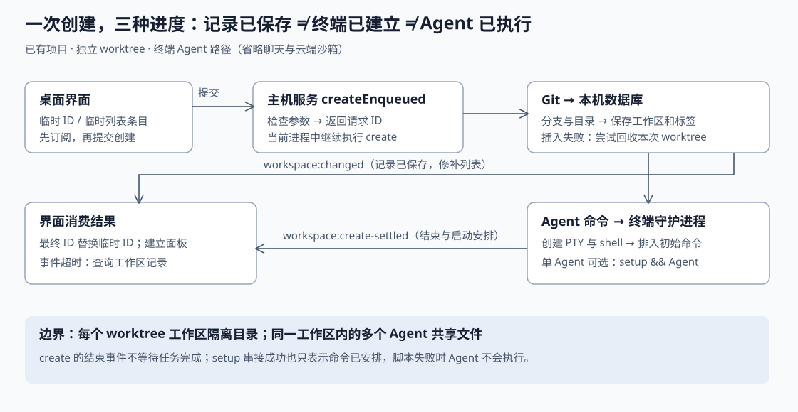

# 从一次工作区创建看 Superset：如何隔离代码、启动 Agent 并把结果送回界面

假设你正在维护一个网站：当前目录里有尚未提交的登录页修改，又想让另一个编码助手修复导出功能。**这是自拟场景，并非仓库记录的事故。**你在 Paradev（原名 Superset）里选择同一个项目，新建一个使用独立工作目录的工作区，填写修复要求并选择终端 Agent。期望结果是：助手在另一个分支和目录中工作，你继续保留当前修改；界面打开助手终端，之后可以检查它改了什么。

这条链路的关键不是“同时开几个聊天窗口”，而是把三个结果分开处理：**代码目录准备好、工作区记录保存好、助手终端准备好。**源码并没有把它们合成一个不可分割的成功状态；例如，工作区可以创建成功，而其中某个 Agent 启动失败。下面沿实际实现说明这种区分如何贯穿系统。

研究对象为 `ParadevAI/Paradev`，固定 Commit 为 `0dcd64a0a4054e57ec4ee736c47219e0d30b9a6a`，已核对 `input/repository/` 的 HEAD 一致。本篇聚焦已有项目上的主机工作区创建，深入终端 Agent 路径；云端沙箱、内置聊天执行引擎、自动任务调度和完整删除流程不在本篇核验范围。全文“事实”均指该版本的静态源码行为，“推断”另行标出；没有安装依赖、执行仓库脚本、运行测试或进行性能测量。

## 1. 先确定谁负责什么

项目的自述把产品定位为在统一工作区中运行命令行编码助手的桌面应用。源码也支持这一定位：`buildTerminalAgentLaunch` 最终生成外部程序的启动命令，`runTerminalAgent` 把它交给终端会话，而不是在这条路径中直接调用模型接口。仓库同时有聊天实现，因此不能把“终端 Agent 走外部程序”扩展成整个仓库所有功能都不调用模型。[产品定位：README 15–38 行](https://github.com/ParadevAI/Paradev/blob/0dcd64a0a4054e57ec4ee736c47219e0d30b9a6a/README.md#L15-L38)；[终端 Agent 启动：agents.ts 388–463、495–521 行](https://github.com/ParadevAI/Paradev/blob/0dcd64a0a4054e57ec4ee736c47219e0d30b9a6a/packages/host-service/src/trpc/router/agents/agents.ts#L388-L521)。

沿本篇链路，模块职责可以压缩为下表：

| 模块 | 接收什么、产出什么 |
| --- | --- |
| 桌面界面 `useWorkspaceCreates` | 接收创建参数，先显示临时工作区，再等待实际结果，建立终端面板布局。 |
| 主机服务 `host-service` | 接收经过身份检查的请求，操作 Git、保存本机数据库、启动终端并广播事件。 |
| Git 工作树 | 同一仓库下的另一份检出目录，供新分支上的修改使用。本文用 worktree 指这种 Git 工作树。 |
| 终端守护进程 `pty-daemon` | 持有伪终端（PTY，即让程序像在真实终端里一样交互的系统接口）和 shell 进程。 |
| 外部 Agent 程序 | 接收启动参数与提示词，在工作区目录内实际执行编码任务。 |

主机服务由 `createApp` 建立数据库、Git 访问对象等依赖，路由统一暴露 `workspaces`、`agents`、`terminal` 等能力。tRPC 是这里使用的类型化远程函数调用接口；受保护过程检查认证状态，工作区 `create` 还明确拒绝在云端沙箱内执行，因为那种环境预设只有一个项目和一个工作区。**主机上创建 worktree 与创建云端工作区是两条不同的路径。**[依赖组装：app.ts 142–176 行](https://github.com/ParadevAI/Paradev/blob/0dcd64a0a4054e57ec4ee736c47219e0d30b9a6a/packages/host-service/src/app.ts#L142-L176)；[能力入口：router.ts 35–68 行](https://github.com/ParadevAI/Paradev/blob/0dcd64a0a4054e57ec4ee736c47219e0d30b9a6a/packages/host-service/src/trpc/router/router.ts#L35-L68)；[认证与运行环境约束：trpc/index.ts 144–179 行](https://github.com/ParadevAI/Paradev/blob/0dcd64a0a4054e57ec4ee736c47219e0d30b9a6a/packages/host-service/src/trpc/index.ts#L144-L179)。

图中实线为本篇已追踪的调用方向；两条返回路径分别表达“工作区记录发生变化”和“本次创建流程结束”。它们对应不同事件，不能互相代替。

## 2. 一次点击先得到受理结果，稍后才得到创建结果

桌面界面的 `submit` 使用客户端预先生成的工作区 ID，先把临时条目写入界面缓存，目录字段此时还是空字符串。接着 `createViaEnqueue` 先监听这个 ID 的 `workspace:create-settled` 事件，再请求 `workspaces.createEnqueued`，避免很快完成的结果发生在监听建立之前。这里的 WebSocket 是保持连接、持续接收服务端事件的通道。[临时条目与提交：useWorkspaceCreates.ts 251–256、315–392 行](https://github.com/ParadevAI/Paradev/blob/0dcd64a0a4054e57ec4ee736c47219e0d30b9a6a/apps/desktop/src/renderer/stores/workspace-creates/useWorkspaceCreates.ts#L251-L392)；[先监听再提交：145–184 行](https://github.com/ParadevAI/Paradev/blob/0dcd64a0a4054e57ec4ee736c47219e0d30b9a6a/apps/desktop/src/renderer/stores/workspace-creates/useWorkspaceCreates.ts#L145-L184)。

服务端 `createEnqueued` 检查 ID、Agent 选项和项目目录，然后在当前进程中调用真正的 `create`，立即返回请求 ID。完成后广播 `ok:true`，失败则广播 `ok:false` 和错误信息。注释给出的设计依据是：长时间创建会占用浏览器 HTTP 连接，并可能超过中继请求的时限。**这属于实现中的异步受理机制，不等于已核验的持久任务队列**：这里看到的是未等待的 Promise 调用，没有入队任务表或崩溃后续跑逻辑。该边界意味着主机服务中途退出时，不能仅凭“请求已受理”保证流程会完成。[异步受理及其设计注释：workspaces.ts 1437–1495 行](https://github.com/ParadevAI/Paradev/blob/0dcd64a0a4054e57ec4ee736c47219e0d30b9a6a/packages/host-service/src/trpc/router/workspaces/workspaces.ts#L1437-L1495)。

同一个核心过程也能由命令行入口调用。CLI（命令行工具）会把项目、分支、Agent 和提示词传给 `workspaces.create`，直接等待完整返回，不走桌面的事件等待包装。一个容易混淆的区别是：`--local` 选择“在本机创建”；`--checkout local` 才表示“共享项目当前目录”。要隔离文件，应使用默认的 `worktree` 检出方式。[CLI 选项定义：command.ts 10–42 行](https://github.com/ParadevAI/Paradev/blob/0dcd64a0a4054e57ec4ee736c47219e0d30b9a6a/packages/cli/src/commands/workspaces/create/command.ts#L10-L42)；[CLI 调用核心过程：250–275 行](https://github.com/ParadevAI/Paradev/blob/0dcd64a0a4054e57ec4ee736c47219e0d30b9a6a/packages/cli/src/commands/workspaces/create/command.ts#L250-L275)。

## 3. 隔离的单位是工作区目录，不是每个 Agent

本机数据库把项目和工作区分开：项目保存原仓库路径与 worktree 位置设置；工作区保存自己的 ID、项目 ID、分支、目录、关联任务和归档时间。终端会话再通过 `originWorkspaceId` 关联工作区。这样的数据关系让同一项目容纳多个工作区，也让一个工作区容纳多个终端。[项目与终端表：schema.ts 15–51、86–128 行](https://github.com/ParadevAI/Paradev/blob/0dcd64a0a4054e57ec4ee736c47219e0d30b9a6a/packages/host-service/src/db/schema.ts#L15-L128)；[工作区表：231–296 行](https://github.com/ParadevAI/Paradev/blob/0dcd64a0a4054e57ec4ee736c47219e0d30b9a6a/packages/host-service/src/db/schema.ts#L231-L296)。

但“工作区”并不总意味着独立文件：

| 工作区类型 | 文件在哪里 | 适用边界 |
| --- | --- | --- |
| `worktree` | 项目仓库的独立检出目录 | 本篇场景使用它，分支与文件修改分开。 |
| `local` | 项目原检出目录 | 多个这种工作区共享文件、Git 暂存区和当前分支。 |
| `session` | 托管目录里的独立 Git 仓库 | 不关联项目，不是该项目的 worktree。 |

这些区别直接写在表结构与创建实现中。因此 README 中“一项任务一份 worktree”的产品描述，不能当作所有入口的强制不变量。多个 Agent 若被放进同一个工作区，`dispatchSugarAgents` 给它们传递的是同一个 `workspaceId`，它们仍可能修改相同文件。**推断：需要避免相互覆盖时，应把任务分到不同 worktree 工作区；单纯增加终端数量不提供这种隔离。**[三种类型的定义：schema.ts 235–265 行](https://github.com/ParadevAI/Paradev/blob/0dcd64a0a4054e57ec4ee736c47219e0d30b9a6a/packages/host-service/src/db/schema.ts#L235-L265)；[独立 session 的创建定义：create-session.ts 63–68 行](https://github.com/ParadevAI/Paradev/blob/0dcd64a0a4054e57ec4ee736c47219e0d30b9a6a/packages/host-service/src/trpc/router/workspace-creation/procedures/create-session.ts#L63-L68)；[多 Agent 共享工作区：dispatch-agents.ts 25–53 行](https://github.com/ParadevAI/Paradev/blob/0dcd64a0a4054e57ec4ee736c47219e0d30b9a6a/packages/host-service/src/trpc/router/workspace-creation/shared/dispatch-agents.ts#L25-L53)。

## 4. 先让 Git 建好目录，再登记工作区

核心 `create` 先校验 Agent 的显式模型、推理强度与启动模式选项，再读取本机项目。带 ID 的请求进入按 ID 排队的内存锁；已有兼容的工作区会直接返回，若 ID 被另一项目、不同类型或已归档记录占用，则返回冲突。这里的“幂等”指重复提交同一身份的请求不会再创建一份资源。锁是进程内的 `Map`，不能推断为跨进程互斥。[锁实现：workspaces.ts 188–209 行](https://github.com/ParadevAI/Paradev/blob/0dcd64a0a4054e57ec4ee736c47219e0d30b9a6a/packages/host-service/src/trpc/router/workspaces/workspaces.ts#L188-L209)；[校验与重试返回：663–708 行](https://github.com/ParadevAI/Paradev/blob/0dcd64a0a4054e57ec4ee736c47219e0d30b9a6a/packages/host-service/src/trpc/router/workspaces/workspaces.ts#L663-L708)。

新分支路径主要做四件事：

1. 确定分支起点，读取现有分支；未指定分支名时，结合名称或提示词、短 ID 和项目前缀生成候选，再避开已有名称。
2. 如果该分支已有工作区，返回它；如果 Git 已经在其他目录检出了该分支，则采用那个目录，而不是强建第二份。
3. 计算托管目录，执行 `git worktree add`。新分支使用 `--no-track -b`，避免把基础分支误当成新分支长期使用的上游；采用远端跟踪分支时则显式建立本地分支。
4. Git 成功后，将工作区及标签写入本机数据库事务，提交后广播 `workspace:changed`。

这些步骤分别见 [分支选择与采用：workspaces.ts 1104–1177 行](https://github.com/ParadevAI/Paradev/blob/0dcd64a0a4054e57ec4ee736c47219e0d30b9a6a/packages/host-service/src/trpc/router/workspaces/workspaces.ts#L1104-L1177)、[Git 命令构造：add-branch-worktree.ts 43–94 行](https://github.com/ParadevAI/Paradev/blob/0dcd64a0a4054e57ec4ee736c47219e0d30b9a6a/packages/host-service/src/trpc/router/workspace-creation/shared/add-branch-worktree.ts#L43-L94)、[本机事务及变更事件：local-workspace-store.ts 255–299 行](https://github.com/ParadevAI/Paradev/blob/0dcd64a0a4054e57ec4ee736c47219e0d30b9a6a/packages/host-service/src/workspaces/local-workspace-store.ts#L255-L299)。

起点的新鲜程度有明确取舍：`resolveNewBranchStartPoint` 尝试把带上游的本地基础分支转换为远端跟踪引用，并获取远端更新；获取失败只记录警告，继续使用已有引用。**事实：新建工作区不保证包含远端最新提交。推断：这用“可能基于旧版本开始工作”换取了部分网络故障下仍能创建的能力。**[起点刷新与失败降级：resolve-new-branch-start-point.ts 27–74 行](https://github.com/ParadevAI/Paradev/blob/0dcd64a0a4054e57ec4ee736c47219e0d30b9a6a/packages/host-service/src/trpc/router/workspace-creation/utils/resolve-new-branch-start-point.ts#L27-L74)。

目录默认位于 `~/.superset/worktrees`，注释明确解释这样可让编辑器和文件监听器把它视为独立目录；路径解析还阻止分支名通过路径跳转逃出项目目录。独立目录不是权限沙箱，这条终端路径仍在宿主机启动 shell。[默认位置与理由：worktree-paths.ts 14–18 行](https://github.com/ParadevAI/Paradev/blob/0dcd64a0a4054e57ec4ee736c47219e0d30b9a6a/packages/host-service/src/trpc/router/workspace-creation/shared/worktree-paths.ts#L14-L18)；[路径边界检查：152–169 行](https://github.com/ParadevAI/Paradev/blob/0dcd64a0a4054e57ec4ee736c47219e0d30b9a6a/packages/host-service/src/trpc/router/workspace-creation/shared/worktree-paths.ts#L152-L169)。

Git、文件系统和数据库不能共享同一个数据库事务，代码用补偿动作处理部分失败：登记工作区失败时，尝试移除本次创建的 worktree；清理目标事先绑定，避免后来采用其他目录时误删他人的目录。若创建竞争导致分支已被其他 worktree 使用，会重新查询 Git 并采用实际目录。补偿失败会留下警告，因此不能把它解释成严格的全有或全无事务。[登记失败的补偿：workspaces.ts 476–506 行](https://github.com/ParadevAI/Paradev/blob/0dcd64a0a4054e57ec4ee736c47219e0d30b9a6a/packages/host-service/src/trpc/router/workspaces/workspaces.ts#L476-L506)；[固定清理目标与竞争处理：1180–1247 行](https://github.com/ParadevAI/Paradev/blob/0dcd64a0a4054e57ec4ee736c47219e0d30b9a6a/packages/host-service/src/trpc/router/workspaces/workspaces.ts#L1180-L1247)。

另一个细节体现了“看实际状态”的思路：Git 的检出后钩子可能报错，但文件已成功检出。`addBranchWorktree` 会确认目标路径登记了正确分支，而且目录内的 HEAD 可解析，才把这种失败视为非致命；不是忽略所有 Git 错误。HEAD 是 Git 当前检出提交的引用。[钩子失败后的核对条件：add-branch-worktree.ts 20–41 行](https://github.com/ParadevAI/Paradev/blob/0dcd64a0a4054e57ec4ee736c47219e0d30b9a6a/packages/host-service/src/trpc/router/workspace-creation/shared/add-branch-worktree.ts#L20-L41)。

## 5. Agent 启动成功，究竟证明了什么

工作区登记后，`dispatchSugarAgents` 对启动项并发调用 `runAgentInWorkspace`，逐项捕获异常，返回 `ok:true` 或 `ok:false`。所以某个 Agent 配置消失、附件不存在或终端启动失败，不会在这个包装层把所有启动项一起判失败；已经创建的工作区也不会因此自动撤销。前置校验并非检查一切：未指定模型、推理强度和模式时，`validateAgentLaunchOptions` 直接返回，未知 Agent 仍可能在后续命令构建时才被发现。[逐项捕获失败：dispatch-agents.ts 25–53 行](https://github.com/ParadevAI/Paradev/blob/0dcd64a0a4054e57ec4ee736c47219e0d30b9a6a/packages/host-service/src/trpc/router/workspace-creation/shared/dispatch-agents.ts#L25-L53)；[前置校验的条件：agents.ts 355–380 行](https://github.com/ParadevAI/Paradev/blob/0dcd64a0a4054e57ec4ee736c47219e0d30b9a6a/packages/host-service/src/trpc/router/agents/agents.ts#L355-L380)。

普通终端启动依次完成：确认工作区未归档，解析主机 Agent 配置与附件，构造程序参数和提示词传输方式，再创建带 `initialCommand` 的终端会话。提示词可以通过命令参数或标准输入传递。`runTerminalAgent` 返回的会话 ID，只证明终端创建过程没有返回错误；它不等待 Agent 完成任务，甚至不等待初始命令真正执行完。[工作区检查与分流：agents.ts 774–817 行](https://github.com/ParadevAI/Paradev/blob/0dcd64a0a4054e57ec4ee736c47219e0d30b9a6a/packages/host-service/src/trpc/router/agents/agents.ts#L774-L817)；[提示词传输：67–109 行](https://github.com/ParadevAI/Paradev/blob/0dcd64a0a4054e57ec4ee736c47219e0d30b9a6a/packages/host-service/src/trpc/router/agents/agents.ts#L67-L109)；[命令构建及终端返回：388–521 行](https://github.com/ParadevAI/Paradev/blob/0dcd64a0a4054e57ec4ee736c47219e0d30b9a6a/packages/host-service/src/trpc/router/agents/agents.ts#L388-L521)。

默认路径会先创建 Agent 会话，再创建初始化终端；两者的脚本运行没有完成依赖。只有新工作区、恰好一个终端 Agent 且启用 `waitForSetupBeforeAgents` 时，才尝试将 Agent 命令接到初始化命令后面。初始化端将安装阶段、设置阶段以及 Agent 命令用 `&&` 连接，前面失败就不执行后面。多个 Agent、聊天入口不走这条门控；没有可运行的初始化命令或未形成串接结果时，仍回到单独启动路径。**它是限定场景下的 shell 命令串接，不是通用的任务依赖图。**[启动顺序与门控条件：workspaces.ts 1301–1384 行](https://github.com/ParadevAI/Paradev/blob/0dcd64a0a4054e57ec4ee736c47219e0d30b9a6a/packages/host-service/src/trpc/router/workspaces/workspaces.ts#L1301-L1384)；[初始化命令及串接：setup-terminal.ts 61–132 行](https://github.com/ParadevAI/Paradev/blob/0dcd64a0a4054e57ec4ee736c47219e0d30b9a6a/packages/host-service/src/trpc/router/workspace-creation/shared/setup-terminal.ts#L61-L132)。

这里还有一个容易误读的结果：串接分支在终端建好后，就返回 Agent 的 `ok:true`；如果初始化脚本随后失败，Agent 实际上不会执行。因此这个字段应理解为“启动安排已经建立”，不能当作“助手已开始工作”的确认。

终端层检查目录是否可访问，按工作区目录设置工作路径和环境，再向守护进程发出 `open`。守护进程最终调用 `node-pty` 创建 shell。主机服务重启后，如果守护进程仍持有同 ID 的活跃终端，服务会采用该会话；采用时把初始命令标记为已排入，避免重复发送。但这依赖原守护进程和终端仍存活，不意味着机器重启后进程也能保留。[目录、环境及终端创建：terminal.ts 3047–3209 行](https://github.com/ParadevAI/Paradev/blob/0dcd64a0a4054e57ec4ee736c47219e0d30b9a6a/packages/host-service/src/terminal/terminal.ts#L3047-L3209)；[守护进程实际创建 shell：Pty.ts 378–419 行](https://github.com/ParadevAI/Paradev/blob/0dcd64a0a4054e57ec4ee736c47219e0d30b9a6a/packages/pty-daemon/src/Pty/Pty.ts#L378-L419)；[采用时防止重复命令：terminal.ts 3325–3327 行](https://github.com/ParadevAI/Paradev/blob/0dcd64a0a4054e57ec4ee736c47219e0d30b9a6a/packages/host-service/src/terminal/terminal.ts#L3325-L3327)。

`initialCommand` 也不是简单写入字符串：它等待 shell 就绪信号，防止启动脚本先把输入消费掉；对过长命令尝试写入临时脚本，只向终端输入较短的执行语句。销毁会话时会检查待发送命令是否仍有效。这解释了为什么“终端有进程”与“提示词已可靠交付”必须分开讨论。[命令交付与长命令处理：terminal.ts 2523–2584 行](https://github.com/ParadevAI/Paradev/blob/0dcd64a0a4054e57ec4ee736c47219e0d30b9a6a/packages/host-service/src/terminal/terminal.ts#L2523-L2584)。

## 6. 界面为什么需要两种事件和一次补查

`workspace:changed` 在数据库插入完成后发出，负责让工作区列表看到新记录；`workspace:create-settled` 则在整个创建调用返回后发出，还带终端、Agent 启动结果以及最终工作区 ID。若请求实际复用了已有分支的工作区，最终 ID 可以与界面临时 ID 不同。界面据此建立面板布局，并删除旧的临时条目。**记录出现得早，不代表初始化或 Agent 已就绪。**[插入后广播：local-workspace-store.ts 294–299 行](https://github.com/ParadevAI/Paradev/blob/0dcd64a0a4054e57ec4ee736c47219e0d30b9a6a/packages/host-service/src/workspaces/local-workspace-store.ts#L294-L299)；[结束事件载荷：workspaces.ts 1462–1474 行](https://github.com/ParadevAI/Paradev/blob/0dcd64a0a4054e57ec4ee736c47219e0d30b9a6a/packages/host-service/src/trpc/router/workspaces/workspaces.ts#L1462-L1474)；[结果消费与 ID 替换：useWorkspaceCreates.ts 401–415 行](https://github.com/ParadevAI/Paradev/blob/0dcd64a0a4054e57ec4ee736c47219e0d30b9a6a/apps/desktop/src/renderer/stores/workspace-creates/useWorkspaceCreates.ts#L401-L415)。

事件可能丢失。桌面等待超时后不会立即断言创建失败，而是查询该工作区记录：存在就返回空的面板种子，交给后续会话采用路径补齐；不存在或主机不可达则给出不同错误。工作区列表本身也通过变更事件修补缓存，并每 30 秒重新读取作为补救。这个 30 秒是配置间隔，不是本次测出的恢复延迟。[结束事件丢失后的补查：useWorkspaceCreates.ts 197–229 行](https://github.com/ParadevAI/Paradev/blob/0dcd64a0a4054e57ec4ee736c47219e0d30b9a6a/apps/desktop/src/renderer/stores/workspace-creates/useWorkspaceCreates.ts#L197-L229)；[列表定时重读与事件消费：useHostWorkspaces.ts 174–187、259–295 行](https://github.com/ParadevAI/Paradev/blob/0dcd64a0a4054e57ec4ee736c47219e0d30b9a6a/apps/desktop/src/renderer/hooks/host-workspaces/useHostWorkspaces/useHostWorkspaces.ts#L174-L295)。

仍有边界：补查确认的是“指定 ID 的记录存在”，不是完整创建结果，也不是所有 Agent 正常运行。若服务在落库后、启动前退出，仅查到记录无法补证后续步骤完成。若创建采用了另一个最终 ID，而结束事件又丢失，按临时 ID 查询也可能找不到它。这些是从当前控制流得到的推断，本篇未做故障注入验证。

本机记录是这条路径的权威数据。设计文档明确记录了项目与工作区取消云端镜像的选择；当前登记实现也是先保存本地，再尽力上报创建事件，上报失败只记日志。这里的 `CloudWorkspace`、`toCloudShape` 是兼容返回结构，不能仅凭名字认定它来自云数据库。历史设计文档中的移动端限制等描述不应直接当作这个 Commit 所有功能的现状。[历史设计决策：local-first-projects-reference.md 8–17 行](https://github.com/ParadevAI/Paradev/blob/0dcd64a0a4054e57ec4ee736c47219e0d30b9a6a/plans/local-first-projects-reference.md#L8-L17)；[当前本地登记与尽力上报：workspaces.ts 489–525 行](https://github.com/ParadevAI/Paradev/blob/0dcd64a0a4054e57ec4ee736c47219e0d30b9a6a/packages/host-service/src/trpc/router/workspaces/workspaces.ts#L489-L525)。

## 7. 测试能支撑哪些预期，还留下什么问题

本次只阅读测试，没有运行。以下是测试明确表达的预期，不是本次验证通过的声明：

| 测试 | 核对的结果 | 证据边界 |
| --- | --- | --- |
| 工作区创建集成测试 | 分支与数据库记录匹配，worktree 目录实际存在。 | 覆盖工作区创建，不代表外部 Agent 可用。 |
| 异步受理集成测试 | 先返回 ID，再出现结束事件；复用时返回最终 ID；缺失目录提前拒绝；后续创建失败发 `ok:false`。 | 通过捕获广播方法观察事件，没有覆盖真实 WebSocket 断线。 |
| Git 钩子容错测试 | 真实 Git 中，钩子失败但检出已落地可继续；无效起点仍应失败。 | 不证明每一种 Git 或钩子环境均兼容。 |
| 初始命令测试 | 长命令内容完整落盘、临时脚本清理；暂存失败时较短命令可退回直接输入。 | 执行的是测试命令，不是一次真实模型任务。 |

对应源码：[工作区创建断言](https://github.com/ParadevAI/Paradev/blob/0dcd64a0a4054e57ec4ee736c47219e0d30b9a6a/packages/host-service/test/integration/workspace-create-delete.integration.test.ts#L36-L62)；[异步受理及其捕获方式](https://github.com/ParadevAI/Paradev/blob/0dcd64a0a4054e57ec4ee736c47219e0d30b9a6a/packages/host-service/test/integration/workspace-create-enqueued.integration.test.ts#L15-L177)；[Git 钩子测试](https://github.com/ParadevAI/Paradev/blob/0dcd64a0a4054e57ec4ee736c47219e0d30b9a6a/packages/host-service/src/trpc/router/workspaces/worktree-add-tolerance.test.ts#L59-L143)；[长命令交付测试](https://github.com/ParadevAI/Paradev/blob/0dcd64a0a4054e57ec4ee736c47219e0d30b9a6a/packages/host-service/src/terminal/terminal.initial-command.node-test.ts#L93-L168)。

阅读测试还需要检查断言是否仍命中生产路径。例如一个测试名仍写“云端创建失败也成功”，但它注入失败的是旧的 `v2Workspace.create`；当前实现已经改为 `trackCreated` 上报。这个测试能说明本地记录与目录被保留，却不足以证明“当前上报接口失败”的分支被专门触发。[旧接口的失败注入](https://github.com/ParadevAI/Paradev/blob/0dcd64a0a4054e57ec4ee736c47219e0d30b9a6a/packages/host-service/test/integration/workspace-create-delete.integration.test.ts#L362-L390)；[当前调用的接口](https://github.com/ParadevAI/Paradev/blob/0dcd64a0a4054e57ec4ee736c47219e0d30b9a6a/packages/host-service/src/trpc/router/workspaces/workspaces.ts#L509-L523)。

本次来源元数据标记子模块和 Git LFS（大文件存储）内容未拉取；检查未发现受 Git 跟踪的子模块条目，也未在可检索文件中发现 LFS 指针。主链路所需源码均可读取。外部 Agent 可执行文件、模型服务及 `node-pty` 原生依赖运行行为不在本次现场验证范围，不能据此声称验证了端到端编码成功，更不能给出并发数量或吞吐量结论。

这次链路中最值得迁移的思想有三点。第一，用“项目—工作区—终端”分层表达资源归属，把文件隔离放在明确的目录边界上。第二，把本机记录、资源准备和进程执行的结果分开，针对各自失败做补偿，而不是用一个成功标志掩盖部分完成。第三，用事件减少界面等待，同时保留从权威记录重读的路径；若要进一步保证崩溃后的可靠继续，还需要可查询、可恢复的创建任务状态——本篇读到的异步受理机制本身尚不能提供这种保证。
