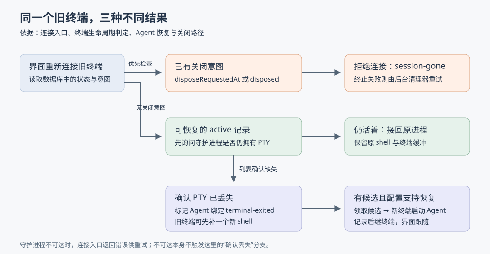

# 断线后接回谁：Superset 如何恢复 Agent，又避免重启用户已关闭的终端

假设你让 Claude Code 在一个工作区修复导出功能，过程中主机服务重启了。终端短暂断线，再连接时，你希望它继续显示原来的进程；如果进程确实丢了，则希望接着原来的对话工作。但如果你此前主动关闭了终端，它就不应该自动回来。**这是自拟场景，不是仓库记录的事故。**

这三个结果看似都叫“恢复终端”，实际需要不同动作：接回仍活着的进程、用旧会话标识启动一个新 Agent、拒绝重新打开已关闭的终端。本篇研究的核心是：**Superset 怎样把这三种情况分开，以及这些判断在哪些失败条件下仍有边界。**

研究对象为 `ParadevAI/Paradev`（原名 Superset），固定 Commit：`9e01258517a9f4b7d040b1bc005ff78189473b17`，已核对 `input/repository/` 的 HEAD 一致。沿目录、包入口及设计计划阅读后，本文聚焦桌面端第二代终端路径中的主机服务、持久化记录、断线核查、Agent 恢复和界面跟随；不重复上一篇的工作区创建流程，不展开操作系统进程树终止算法、远程中继实现及内置聊天引擎。

本文结论来自静态源码阅读；没有安装依赖、运行仓库脚本、启动服务或执行测试。输入记录注明子模块与 Git LFS 内容未拉取；本次检查没有发现 Git 子模块条目，所涉主机服务和终端守护进程目录中未发现 LFS 指针，主题所需实现可直接读取。外部 Agent 程序及其实际会话恢复效果不在本次核验范围。

## 1. 为什么不能只看终端窗口是否在线

主机服务中的 `sessions` 是内存表，保存当前服务与终端的连接关系。源码明确写出：PTY 的寿命独立于连接寿命。PTY 是“伪终端”，让命令行程序像在真实终端中一样接收输入、输出并响应尺寸变化。主机服务重启后，内存表会消失，但独立的 `pty-daemon`（终端守护进程）可能仍持有原进程。[内存表及断线处理][1]

因此，实现同时保留三类信息：

| 信息 | 回答的问题 | 不能单独证明什么 |
| --- | --- | --- |
| 内存中的 `sessions` | 本次主机服务已接管哪些终端连接 | 不在表里，不代表进程已死 |
| 数据库 `terminal_sessions` | 终端属于哪个工作区，有没有关闭意图 | `active` 不保证此刻有活进程 |
| 数据库 `terminal_agent_bindings` | 终端承载过哪个 Agent 会话，为什么结束，后来恢复到哪里 | 有会话标识，不保证外部 Agent 仍保存可读历史 |

后两张表分别保存 `disposeRequestedAt`（请求关闭的时间），以及 `agentSessionId`、`endReason`、`resumedIntoTerminalId` 等字段。终端记录被删除时，绑定记录随之删除；工作区被删除时，终端的工作区引用置空。[表结构][2]

这也解释了一个容易误读的细节：后台发现进程丢失后，**可能仍保留终端记录的 `active` 状态，只结束 Agent 绑定**。这不是在证明进程活着，而是在保留旧终端入口补建 shell 的机会。shell 是承接命令的命令行解释器；补一个 shell 与恢复 Agent 对话仍是两步。[缺失会话核对实现][3]

图示对应连接入口、关闭意图判定和恢复流程；其中“确认丢失”专指守护进程作出回应、但列表中已无该终端，不能与“暂时联系不上守护进程”混用。

## 2. 再连接时，先接原进程，确认丢失后才补建

桌面端通过 WebSocket 连接终端；WebSocket 是保持双向通信的长连接。主机侧 `resolveSessionForAttach` 先读数据库：有关闭意图就返回 `session-gone`；内存已有对应会话则复用；没有记录时，只有请求明确允许创建且带工作区标识，才进入新建路径。已退出、已关闭的记录不会因为请求带了创建标志就直接重生。[连接入口][4]

对于仍为 `active`、但内存中找不到的记录，入口先调用 `createTerminalSessionInternal`，设置 `adoptOnly: true`，意思是“只尝试接管已有终端”。底层向守护进程读取列表，找到同一终端标识且 `alive` 为真时，复用它的进程标识及尺寸；这一步没有启动第二个 shell。[接管实现][5]

后续按结果分流：

- 接管成功：返回原终端。
- 守护进程不可达或启动失败：返回错误；连接级不可达被标为可重试，不走补建分支。
- 守护进程已回答，但找不到活终端，即 `SESSION_NOT_ACTIVE`：给旧 Agent 绑定标记 `terminal-exited`，随后为旧终端标识补建 shell，并带上恢复提示。[分流与补建][4]

**事实是“先确认所有者不再持有进程，再补建”，不是“一断线就重启”。**据此可以推断，这个顺序降低了短暂通信故障导致重复进程的风险，但它并非操作系统级存活证明，判断仍依赖守护进程返回的列表。

## 3. 没有人重新打开窗口时，谁来发现丢失

连接入口只在有人连接时执行。源码还提供两条后台路径，但二者采用的证据强度并不相同。

**第一条是在守护进程连接断开时主动核查。**主机服务关闭各终端的前端连接，取消旧订阅并清空内存表，同时调用 `sweepAgentBindingsAfterDaemonLoss`。核查前记录每个绑定原来的 Agent 会话标识，默认最多探测五次，每次探测前等两秒。守护进程一旦回答，只结束它已不再持有的终端绑定；如果探测期间绑定已换成另一个会话，则跳过，避免迟来的清理结果伤到新会话。[触发入口][1]、[断线核查完整实现][6]

这里有一个必须保留的不确定性：**五次探测都没有回应时，代码也会把仍匹配原会话标识的绑定标为 `terminal-exited`。**这是有限等待后的处理策略，不能表述成已经证实进程退出；若底层进程还活着而服务长时间不可达，就存在误判空间。源码注释把它解释为旧守护进程及其 PTY 已丢失，但本次没有运行故障注入来验证这个假设。[探测和结束分支][6]

**第二条是定期核对数据库与守护进程。**主机服务监听成功后启动 `startTerminalReaper`。这里的 reaper 是后台清理器，不只是“结束进程”：它也核对进程丢失后留下的记录。[启动位置][7]

清理器默认每五分钟执行一次。对没有关闭意图的缺失终端，它要求：数据库仍为 `active`，守护进程列表与本机内存表都没有它，且创建时间超过六十秒宽限期。随后还要在连续两轮观察中看到同一标识、同一 `createdAt`。首次启动轮不观察这类缺失，端口扫描预热也不推进确认次数。[候选筛选][8]、[连续观察规则][9]、[调度与异常处理][10]

正式更新前，数据库事务再次检查状态、创建时间和内存存活情况，再结束绑定。这里的 `createdAt` 被当作“这一代终端”的识别依据：同一个终端标识已被补建，旧快照就不能继续判它丢失。事务失败会回滚；外层记录错误、重置观察，下次再核对。[事务内复查][3]

两条路径的取舍很具体：断线核查处理已接管终端的突发故障，等待较短但含超时推定；定期核对覆盖没有前端连接的记录，采用宽限期和连续观察，代价是发现更慢。五分钟和六十秒是配置中的时间常量，不是测量出的恢复耗时。

## 4. 用户要求关闭，要先留下不可自动打开的记录

设计计划 `pty-lifecycle-cleanup.md` 写过一个具体问题：关闭时终止失败，如果记录仍是普通 `active`，后台以后就没有依据继续处理。计划提出先持久化关闭意图；当前源码已能直接看到这项机制，不能把计划中的旧问题描述全部当成现状。[设计依据][11]

`disposeSessionAndWait` 在排队执行终止动作**之前**，先插入或更新 `disposeRequestedAt`。记录不存在时也会插入一条 `disposed` 记录。统一判定函数 `terminalLifecycleState` 把这个字段放在普通 `status` 前面：只要有关闭意图，逻辑状态就是 `disposed`，即使数据库 `status` 还写着 `active`。[关闭入口][12]、[状态优先级][9]

为什么需要“先写意图、再排队”？考虑这个自拟并发过程：创建终端已经开始，正在等待守护进程启动进程；此时用户关闭它。创建与关闭按终端标识排队，关闭意图却立即入库。创建在守护进程操作完成后再次读取数据库，发现关闭意图，就尝试关闭刚启动的进程并返回 `SESSION_EXITED`，不会把它作为正常新终端发布。后续排队的关闭继续执行。[按标识排队][9]、[创建后的复查][13]

这种排队只约束当前主机服务进程内的同一终端；不同终端可以并行，前一个操作失败也不会堵死后续操作。不能把它理解为跨机器的全局锁。

关闭函数最终返回 `daemonCloseSucceeded`：成功才把记录更新为 `disposed`；失败则保留关闭意图。后台清理器只要看到守护进程仍列出该终端，便会依据意图再次终止，即使工作区仍存在。守护进程中有进程、数据库却没记录的另一类孤儿，也采用两轮确认；确认后的终止失败会保留重试资格。[关闭结果][14]、[后台终止路径][10]

不过，单终端接口还有一个边界：`killSession` 等待关闭函数，却没有检查其返回的 `daemonCloseSucceeded`，仍返回 `status: "disposed"`。所以这个接口响应表达了关闭处理已执行，不能单凭它证明底层终止成功；持久化意图与后台重试仍承担补偿职责。[接口返回][15]

## 5. 为什么同样是进程结束，有的能恢复，有的不能

仅有终端状态还不够。Agent 绑定另外保存结束原因：`detached` 表示 Agent 自行报告结束，`terminal-exited` 表示承载它的终端退出，`disposed` 表示主动关闭，`resumed` 表示恢复候选已被领取。恢复查询要求同工作区、同终端、已有结束时间、原因为 `terminal-exited`，而且已捕获 Agent 会话标识。[恢复候选条件][16]

顺序在这里同样重要。`killSession` 先让绑定记录为 `disposed`，再开始终止终端。这样终止产生的退出通知不会把它重新变成恢复候选。反过来，如果它先因故障成为候选，随后用户关闭，结束原因仍允许从 `terminal-exited` 改为 `disposed`。[主动关闭顺序][15]、[结束原因更新][17]

源码还处理了通知先后不稳定的问题：某些 Agent 收到终端挂断信号时，会在真正退出前先发送自己的结束通知。若绑定先被标为 `detached`，终端死亡又在三十秒窗口内发生，实现允许将它改成 `terminal-exited`；较早的正常结束则不改。已经标为 `disposed` 或 `resumed` 的记录不会被这一规则覆盖。[三十秒规则][17]

这是时间启发式，即根据事件间隔推测原因。它避免部分“临死前告别”阻止恢复，但不能准确还原所有用户意图；例如用户正常退出 Agent 后不久又退出 shell，也可能落入同一窗口。这是从条件推导的边界，并非已复现的缺陷。

## 6. 两个窗口一起恢复，为什么通常只启动一次

桌面组件 `TerminalAgentAutoResume` 会在连接状态变化后重新查询候选；有候选且配置支持恢复时自动调用主机接口，每个候选会话在当前组件实例中只自动尝试一次，失败显示重试按钮。但多窗口、重新挂载和请求重试都可能重复发起，因此真正的防重复措施放在主机侧。[界面自动恢复][18]

`resumeTerminalAgentSession` 做两层控制：先用内存中的 `resumeInflight` 合并同一工作区和旧终端的在途调用；再以一条带完整候选条件的数据库更新，把结束原因从 `terminal-exited` 改为 `resumed`，只有领取成功者继续启动。这种“条件成立才更新并取回记录”的做法，避免两个调用先读到同一候选、再分别启动。[恢复入口][19]、[条件领取与回退][20]

领取后的动作依次是：

1. 读取 Agent 配置。配置已删除或没有恢复参数，就撤销领取，保留会话标识。
2. 若会话只停留在 `Attached`（已绑定、尚未出现后续事件），再检查 Agent 保存的会话资料。只有明确查到不存在时才新开会话；读取失败或结果未知仍尝试恢复。
3. 用保存的会话标识启动 Agent；启动抛错时撤销领取，允许重试。
4. 启动成功后记录后继终端，清理旧终端，并广播 `resumed` 事件。[恢复函数主体][19]

真正启动时，`runTerminalAgent` 生成新的终端标识，把命令作为初始命令交给终端创建；命令构造把配置的恢复参数与原 Agent 会话标识接到基础参数后。因此这里恢复的是“在新进程里让外部 Agent 找回会话”，并非把旧进程内存重新装回去。[新终端启动][21]、[恢复命令构造][22]

**这套机制不应被提升为任意崩溃下都只执行一次的保证。**领取写入与外部启动不在一个原子事务中。由执行顺序推断：领取成功后、外部启动前主机进程崩溃，可能留下已领取但未启动的记录；新终端启动后、后继映射写入前失败，也可能留下无法通过旧记录定位的新终端。当前函数明确回退的是配置不支持和启动抛错等分支，本次没有核验到覆盖这些进程崩溃窗口的完整补偿协议。[领取至启动、映射写入的顺序][19]

另一个细节是：恢复函数捕获旧终端清理抛出的异常，但没有检查清理返回对象中的失败标志。它优先保住已经启动的新会话；旧终端残留依靠关闭意图及清理器处理。因此“恢复成功”也不等于“旧终端清理已成功”。[恢复后的清理][19]

## 7. 窗口错过恢复事件，怎样找到新终端

即时事件只能通知当时在线的窗口。恢复函数还把新终端标识写入旧绑定的 `resumedIntoTerminalId`；查询函数可以沿这个后继关系追踪，最多十六跳。[后继记录与查询][23]

桌面组件接到 `resumed` 事件后，把面板数据改为新终端标识，并处理新终端已有面板的情况；它也在连接非打开状态时查询后继，补上未收到事件的迁移。如果当前请求直接返回成功，也会应用同一个跟随动作。[界面跟随和补查][18]

这项设计可复用之处是：**事件负责让在线界面及时变化，持久化后继关系负责回答“我不在线时它去了哪里”。**如果只发一次广播，另一个窗口之后打开旧面板时就缺少答案。十六跳则给查询设了上限，不能把它描述成无限追踪或完整循环检测。

## 8. 测试支持哪些判断，还留下什么

本次读取了测试内容，未运行，以下是测试表达的预期，并非本环境的通过结果：

| 已读取测试 | 关键预期 |
| --- | --- |
| `lifecycle.test.ts` | 关闭意图优先；同终端操作串行、不同终端可推进；操作失败不堵队列；连续观察要求同一代记录。[测试源码][24] |
| `daemon-loss-sweep.test.ts` | 只结束守护进程已丢失的会话；一直不可达时走结束策略；探测期间会话标识变化则跳过；没有标识不造恢复候选。[测试源码][25] |
| `reaper.test.ts` | 旧快照不能伤到已补建终端；迟到的关闭阻止候选；绑定写入失败回滚并可重试；内部重启留下的既有候选可保留。[测试源码][26] |
| `terminal-agents.test.ts` | 成功后的重复恢复不再启动；并发请求共享一次启动结果；启动失败撤销领取；不支持恢复时保留候选。[测试源码][27] |
| `terminal.create-on-attach.node-test.ts` | 待关闭但仍写着 `active` 的记录拒绝连接；创建途中到达的关闭意图最终胜出。[测试源码][28] |

从这些实现与测试可以提炼出三条有条件的工程经验。第一，把“观察到进程不在了”与“用户要求它消失”分别记录，恢复逻辑才不会把清理失败误当故障来重启。第二，异步操作结束后复查记录及其代次，能防止旧结果覆盖新进程。第三，数据库条件领取适合约束并发恢复，但跨到外部进程启动之后，还需要单独考虑崩溃补偿。

对于本篇场景，可确认的行为是：连接入口优先接管活终端；确认缺失后补建 shell，并通过保存的会话标识尝试恢复 Agent；明确关闭则先保存意图、阻止重开并保留终止重试。尚不能确认的是外部 Agent 能恢复多少执行上下文、长时间不可达时是否发生误判，以及领取和进程启动之间崩溃后的完整收敛效果。它恢复的是可追踪的工作入口和会话关联，不能据此声称任意中断都能无损续跑。

[1]: https://github.com/ParadevAI/Paradev/blob/9e01258517a9f4b7d040b1bc005ff78189473b17/packages/host-service/src/terminal/terminal.ts#L709-L776
[2]: https://github.com/ParadevAI/Paradev/blob/9e01258517a9f4b7d040b1bc005ff78189473b17/packages/host-service/src/db/schema.ts#L15-L84
[3]: https://github.com/ParadevAI/Paradev/blob/9e01258517a9f4b7d040b1bc005ff78189473b17/packages/host-service/src/terminal/reaper/reaper.ts#L168-L237
[4]: https://github.com/ParadevAI/Paradev/blob/9e01258517a9f4b7d040b1bc005ff78189473b17/packages/host-service/src/terminal/terminal.ts#L3650-L3760
[5]: https://github.com/ParadevAI/Paradev/blob/9e01258517a9f4b7d040b1bc005ff78189473b17/packages/host-service/src/terminal/terminal.ts#L3123-L3159
[6]: https://github.com/ParadevAI/Paradev/blob/9e01258517a9f4b7d040b1bc005ff78189473b17/packages/host-service/src/terminal-agents/daemon-loss-sweep.ts#L7-L101
[7]: https://github.com/ParadevAI/Paradev/blob/9e01258517a9f4b7d040b1bc005ff78189473b17/packages/host-service/src/serve.ts#L150-L160
[8]: https://github.com/ParadevAI/Paradev/blob/9e01258517a9f4b7d040b1bc005ff78189473b17/packages/host-service/src/terminal/reaper/reaper.ts#L40-L90
[9]: https://github.com/ParadevAI/Paradev/blob/9e01258517a9f4b7d040b1bc005ff78189473b17/packages/host-service/src/terminal/lifecycle/lifecycle.ts#L12-L75
[10]: https://github.com/ParadevAI/Paradev/blob/9e01258517a9f4b7d040b1bc005ff78189473b17/packages/host-service/src/terminal/reaper/reaper.ts#L300-L432
[11]: https://github.com/ParadevAI/Paradev/blob/9e01258517a9f4b7d040b1bc005ff78189473b17/plans/pty-lifecycle-cleanup.md#L84-L95
[12]: https://github.com/ParadevAI/Paradev/blob/9e01258517a9f4b7d040b1bc005ff78189473b17/packages/host-service/src/terminal/terminal.ts#L2724-L2745
[13]: https://github.com/ParadevAI/Paradev/blob/9e01258517a9f4b7d040b1bc005ff78189473b17/packages/host-service/src/terminal/terminal.ts#L3211-L3223
[14]: https://github.com/ParadevAI/Paradev/blob/9e01258517a9f4b7d040b1bc005ff78189473b17/packages/host-service/src/terminal/terminal.ts#L2747-L2832
[15]: https://github.com/ParadevAI/Paradev/blob/9e01258517a9f4b7d040b1bc005ff78189473b17/packages/host-service/src/trpc/router/terminal/terminal.ts#L305-L371
[16]: https://github.com/ParadevAI/Paradev/blob/9e01258517a9f4b7d040b1bc005ff78189473b17/packages/host-service/src/terminal-agents/persistence.ts#L146-L197
[17]: https://github.com/ParadevAI/Paradev/blob/9e01258517a9f4b7d040b1bc005ff78189473b17/packages/host-service/src/terminal-agents/persistence.ts#L68-L130
[18]: https://github.com/ParadevAI/Paradev/blob/9e01258517a9f4b7d040b1bc005ff78189473b17/apps/desktop/src/renderer/routes/_authenticated/_dashboard/v2-workspace/$workspaceId/hooks/usePaneRegistry/components/TerminalPane/components/TerminalAgentAutoResume/TerminalAgentAutoResume.tsx#L49-L171
[19]: https://github.com/ParadevAI/Paradev/blob/9e01258517a9f4b7d040b1bc005ff78189473b17/packages/host-service/src/trpc/router/terminal-agents/terminal-agents.ts#L118-L201
[20]: https://github.com/ParadevAI/Paradev/blob/9e01258517a9f4b7d040b1bc005ff78189473b17/packages/host-service/src/terminal-agents/persistence.ts#L282-L317
[21]: https://github.com/ParadevAI/Paradev/blob/9e01258517a9f4b7d040b1bc005ff78189473b17/packages/host-service/src/trpc/router/agents/agents.ts#L495-L522
[22]: https://github.com/ParadevAI/Paradev/blob/9e01258517a9f4b7d040b1bc005ff78189473b17/packages/host-service/src/trpc/router/agents/agents.ts#L63-L95
[23]: https://github.com/ParadevAI/Paradev/blob/9e01258517a9f4b7d040b1bc005ff78189473b17/packages/host-service/src/terminal-agents/persistence.ts#L224-L267
[24]: https://github.com/ParadevAI/Paradev/blob/9e01258517a9f4b7d040b1bc005ff78189473b17/packages/host-service/src/terminal/lifecycle/lifecycle.test.ts#L8-L116
[25]: https://github.com/ParadevAI/Paradev/blob/9e01258517a9f4b7d040b1bc005ff78189473b17/packages/host-service/src/terminal-agents/daemon-loss-sweep.test.ts#L44-L169
[26]: https://github.com/ParadevAI/Paradev/blob/9e01258517a9f4b7d040b1bc005ff78189473b17/packages/host-service/src/terminal/reaper/reaper.test.ts#L455-L624
[27]: https://github.com/ParadevAI/Paradev/blob/9e01258517a9f4b7d040b1bc005ff78189473b17/packages/host-service/src/trpc/router/terminal-agents/terminal-agents.test.ts#L254-L359
[28]: https://github.com/ParadevAI/Paradev/blob/9e01258517a9f4b7d040b1bc005ff78189473b17/packages/host-service/src/terminal/terminal.create-on-attach.node-test.ts#L336-L405
