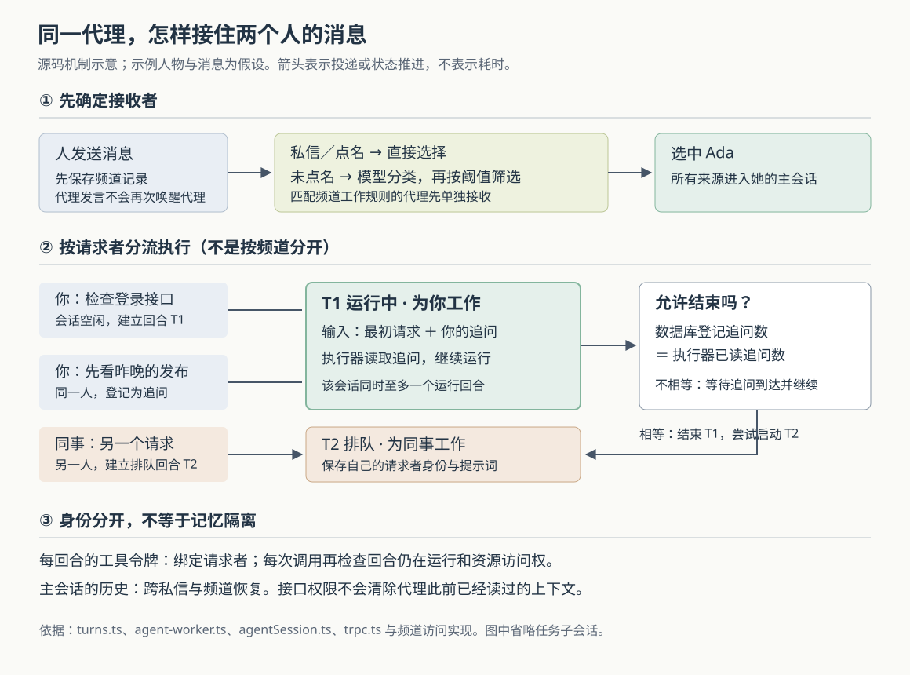

# 频道里谁来接话：Superset 如何选择代理、合并追问并隔开不同人的执行回合

假设团队频道里有两个代理：Ada 负责后端，Otto 负责运维。你发出“登录接口一直报错，能检查一下吗”，没有点名；Ada 开始处理后，你又补充“先看昨晚的发布”。与此同时，同事向 Ada 私信提出另一个请求。谁应该接第一条消息？你的追问该加入当前工作，还是另起一次？同事的请求能否沿用你的权限？**这是解释源码的假设场景，并非仓库记录的事故。**

当前实现先选出需要回应的代理，再把消息交给该代理的主会话。会话空闲时建立一个执行回合；同一人的追问可以加入正在运行的回合，另一人的请求进入队列。结束前，系统还要确认已经登记的追问都被执行器读到。**选择谁回应、决定怎样执行、允许以谁的身份访问资源，是三层不同的决定。**

本文接续十六篇历史研报，研究此前未单独展开的内置频道与 Dev 代理路径。Superset 将代码目录、终端和编码代理组织为工作区；本篇的 Dev 则是云端登记、能够参与频道和私信的代理成员，不等同于任意工作区里的终端程序。当前 README 使用 Paradev 名称，本文沿用来源名称 Superset。

依据为执行器提供的 `input/repository/`，HEAD 与输入记录一致，为 `4cc2e79253a79d3e6c6514b5c40f1f3c5db2e772`。本次只读源码、测试与设计记录，没有安装依赖、启动服务、运行代理或执行仓库测试。以下测试描述均指读到的断言。输入注明子模块和 Git LFS 内容未拉取；本次没有发现 Git 子模块条目，所涉代理、频道和执行器目录没有发现 LFS 指针。完整任务委派、云工作区配置和外部 Slack 消息入口不在本文核验范围。配图已通过 XML 格式检查；当前环境的系统预览、图像转换和浏览器渲染均不可用，未能完成实际渲染核验。

**消息先成为频道记录，然后才可能成为代理工作。**

桌面 `ChannelComposer` 在发送时生成客户端消息编号，先把待发送消息放到界面缓存，再调用云端 `channelMessage.send`。云端入口在 `root.ts` 注册，实际进入 `sendChannelMessage`：检查调用者能否访问、是否已加入频道、频道是否归档，再处理正文与有效点名对象。[界面入口][composer]、[路由注册][root]和[发送实现][message]连接了这几步。

`appendMessage` 在一个数据库事务内增加频道计数、更新回复所属话题的统计，并插入消息。这里的 `seq` 是频道内递增的消息序号，可用于排列消息；它不同于客户端发送编号 `clientId`。后者用于去重：同一作者携带相同编号重发，服务端返回已有消息；并发插入撞上唯一约束，也会重读先存下来的记录。[字段与约束见频道表定义][channels]。

但这个事务没有包含“唤醒代理”。消息写入后，还要关联附件、广播消息，最后才调用 `startTurnsForMessage`。已经存在的同编号消息会提前返回，不会再次执行这些后续步骤。因此，消息出现在频道中，只证明保存和显示链路取得进展；保存后中途失败，不能靠同编号重发自动补齐所有副作用。

还有一个防止代理相互唤醒的明确条件：只有调用者是人时，发送入口才启动代理回合。代理发出的回复可以显示在频道，却不会沿这条入口继续叫醒其他代理。这减少了“你回答我、我再回答你”的循环，代价是普通代理回复本身不承担代理之间的工作交接。

**选谁回应：明确点名优先，没有点名才请分类模型判断。**

`startTurnsForMessage` 先读取频道成员，排除已经归档或暂停的代理，然后按照下列规则分流。[主要实现见 `turns.ts`][turns]。

| 消息条件 | 当前实现怎样选择 |
|---|---|
| 代理配置了匹配该频道消息的 routine，即预先保存的工作规则 | 先附加规则指令投递给它，再从普通选择候选中移除，避免同一消息重复交付给同一代理 |
| 人与代理的私信 | 直接选中私信里的代理，不调用分类模型 |
| 普通频道中明确点名代理 | 选择被点名且可参与的代理；已有明确选择时，不再替其余候选调用分类模型 |
| 普通频道没有选中明确对象，包括话题下的回复 | 在后台调用频道分类器，决定哪些候选应该回应 |

这里的“点名”不是对任意文字做姓名搜索，而是使用消息中通过校验的代理编号。分类器则是另一路：`jevChannelRouter` 读取此前的相关消息，把当前正文、作者、频道名，以及候选代理的名字和职责说明交给 Jev——代码所用的分类模型。请求通过 Vercel 的模型网关发出；它负责判断“该不该回应”，并不在这一步修复代码。[调用装配][routing]与[分类器实现][classifier]给出了这条连接。

请求给每个候选设置“回应／不介入”的判断，同时询问消息是否要求多个不同领域的工作。规则明确偏向具体任务、职责内的事实问题或故障报告；感谢、闲聊、面向人类的意见征询等列在不介入条件中。实现只提供最近十条相关消息，每条正文最多取两千个字符，因此早先约定、长消息末尾的限定条件可能不在判断材料里。

模型返回后，代码再做确定性筛选：最高分至少达到 `0.8` 才会选择代理；通常只选最高分者。只有“多项工作”的分数至少为 `0.5`，才把得分至少 `0.7` 的其他代理一起加入。这些数值是代码中的筛选阈值，**不能解释为现实任务上已经校准的正确率**。实际效果仍取决于职责描述、正文、上下文与模型返回。

失败处理尤其容易误读。分类器最多尝试三次，网络错误和服务端错误可以重试，客户端错误不继续；各次尝试共用默认两秒的请求中止信号。失败返回 `null`，表示“没取得答案”；正常返回空数组则表示“决定无人回应”。格式不符合预期但成功返回的响应，也可能被解析为空选择。线程回复只有在“没取得答案”时，才退回到此前关注、发言或被点名过的代理；明确的空选择不会触发这条退路。顶层消息没有这组既有参与者可退回。

分类工作通过 `waitUntil` 放到请求返回后的后台继续，避免发送消息时等待模型。但它并没有在此建立一个专门持久化的分类任务队列。这个选择提高了交互及时性，也要求使用者理解：发送成功与代理被选中，仍可能隔着失败点。

**选中同一个代理，并不意味着所有人的消息同时执行。**

`ensureMainSession` 在数据库事务里锁住代理记录，首次使用时建立主会话，以后复用 `mainSessionId`。消息会被包装成带来源、位置、回复目标和时间的文本，还可附带话题起始消息与近期对话；频道的新顶层请求通常要求代理在该消息下开话题回复。包装器转义自己的边界标签，测试也检查正文不能伪造闭合标签后另开一条“其他人发出的消息”。这保护了文本结构，不能扩大成能消除所有提示词注入或误解。

真正决定并发行为的是 `submitPrompt`。它以消息编号作为 `promptId`，即一次输入的去重标识，先登记 `agent_turns`，再交给执行工作流。turn 在这里指一段连续的代理工作，下文称“回合”；steer 指运行途中加入的补充要求，下文称“追问”。数据库有两个重要约束：同一会话至多一条 `running` 回合，同一会话的主输入编号不能重复。[回合表定义][agents]与[`recordTurn`、`deliver`][turns]对应这些行为。

回到开头的例子：Ada 空闲时，你的请求建立一个 `running` 回合，同时保存 `actingUserId`，表示这轮工作为谁进行。你补充“先看昨晚的发布”，服务端发现正在运行的回合属于同一个人，就把新输入编号追加到 `steerPromptIds`，交给原回合。同事私信属于另一人，不能加入这轮工作，于是保存成 `queued` 回合，等待后续启动。

这条规则跨频道和私信生效：同一个人在不同位置提问，仍可能合并到同一回合；同一频道里的不同人，也可能被分到不同回合。它按“请求者”隔开执行身份，并不按“每个话题独占一次执行”组织。任务子会话有自己的会话编号，不能据此推断一个 Dev 的所有代码工作也只能串行完成。

队列同样有适用边界。`startNextQueued` 选择该会话最早登记的排队回合，尝试改成运行中；唯一约束解决多个启动者竞争，投递失败则改回排队状态。正常结束和后台扫描都会尝试推进队列。但登记新消息时，代码先尝试插入运行回合，没有先检查旧队列；同一人的追问又能持续延长当前回合。因此，源码支持“排队后等待启动”，不能直接承诺严格先到先服务或有界等待时间。

**执行器接到回合后，结束前还要过一道追问核对。**

这条路径使用独立的 `apps/agent-worker`，并通过 Temporal 管理会话工作流。Temporal 是记录工作流进度、安排执行和重试的服务；此处工作流编号固定为 `session/<会话编号>`。`startTurn` 和 `steerTurn` 使用“存在则更新，不存在则启动”的调用，把请求送入该会话，而非每条消息各开一个无关进程。[客户端封装][session-client]和[执行器装配][worker-main]证明了这一步。

`agentSession` 工作流维护待执行回合、当前回合和已见输入编号。相同输入再次到达时返回重复，不再重新加入；当前回合的追问放进追问列表，目标回合尚在工作流待执行列表时则附到该项。这里的已见集合最多保留五百个编号，工作流空闲十分钟会退出；持久去重还依赖前面的数据库记录，不能只靠这个集合。[工作流实现][workflow]。

执行活动 `runTurn` 真正启动外部 `pdev` 程序，通过 ACP——代理与客户端交换结构化消息的协议——发送提示并接收输出。每次尝试重建本地临时目录，从会话记录恢复代理资料，再判断哪些输入已经投递，尽量避免重试时重复发送。执行器会轮询工作流持有的新追问，把它们交给运行中的代理；输出和会话资料持续写回会话存储。默认主会话没有云工作区，设置 `PDEV_NO_WORKSPACE=1`，通过工具委派需要机器和代码的工作；本地调试配置可以注入备用主机，不能把默认分工当成所有运行方式的硬性保证。[执行活动][activities]与[凭据客户端][worker-api]。

最值得注意的竞争发生在结束时：执行器刚看到代理空闲，你的新追问已经写入数据库，却还没到工作流。若此时直接把回合改成完成，追问可能无处执行。

`agentWorker.settleTurn` 因此要求执行器提交 `steersConsumed`，即已读追问数量。数据库只在它等于 `steerPromptIds` 的数量时，才允许把运行回合改成完成、失败或中断；不相等就返回 `STEER_PENDING` 冲突。工作流收到后等待追问到达，继续运行，再尝试结束。**这是把“已登记的输入”与“执行器确实接收的输入”对账；它不证明代理已经正确理解或完成了每条要求。**[结束接口][worker-router]。

运行活动对临时模型故障采用退避重试，最大等待间隔为五分钟，没有配置尝试次数上限；某些无效请求、过长上下文等被判为不可重试。恢复时还会提示代理先检查现状再重复动作。这能保留长故障期间的工作，却也可能让同一会话中其他人的请求长期等待，不能把“仍在运行”当作持续取得进展。

**权限随回合走，历史上下文却没有按请求者分成独立会话。**

工作进程取得凭据时，云端只为仍在运行、代理未归档的回合签发令牌。令牌携带组织、代理、会话、回合及请求者编号，默认十五分钟有效，通过独立的 `x-agent-turn-token` 请求头传递。主会话的工具经 `/mcp/agent` 暴露；MCP 是模型上下文协议，用来描述并调用工具，而不是把代理变成一个登录用户。[令牌实现][token]与[MCP 入口][mcp]。

接收端 `devFromTurnToken` 不只验签和检查过期，还逐次查询回合状态、核对令牌中的身份关联，并确认代理未归档。回合结束后，旧令牌即使没有到期，也不能继续通过这项检查。由此，同事排队的新请求无需借用你的运行身份，而是等自己的回合取得相应凭据。[身份中间件][trpc]。

频道权限还会再检查一次：代理代表非所有者工作时，频道必须同时满足代理可读和请求者可读；代理所有者提出请求时，可读范围采用代理或所有者任一方可读。发帖仍要求代理本人是未归档频道的成员。这里限制的是工具此刻能从接口读取或写入什么，不能概括为“代理总是拥有请求者的全部权限”。[频道访问实现][access]。

另一面是共享记忆。主会话复用同一个会话编号和历史，执行活动恢复同一份会话资料；设计记录也明确选择让代理跨私信和频道记住上下文。**所以，按请求者分开回合并不构成对话信息隔离。**代理可能已经从此前对话知道某些内容，新的接口检查不会让模型忘掉它。这里能确认的是上下文共享和接口访问规则；本次未执行信息泄漏实验，也不能声称已证明具体泄漏结果。[设计取舍记录][plan]说明了这种连续性的动机。

**回复和恢复还有哪些保证，不能从“完成”二字推出来。**

代理通常通过 `reply` 工具，按输入里的 `reply_to` 目标发送回答。若回合正常完成、有最终文本且没有检测到 `reply` 工具调用，执行活动会兜底把文本发到最初触发消息对应的位置；失败和中断没有同样的最终回复兜底。合并了不同频道的追问时，代理需要主动选择各自目标，兜底只知道起始消息的位置。

兜底发送使用 `<回合编号>:reply` 作为稳定客户端编号，重试可以由频道消息约束去重；主动调用 `reply` 则每次生成随机编号。因而，不能从兜底的去重推导出所有回复调用都“只产生一次效果”。此外，兜底发帖在数据库结束核对之前发生；若随后发现还有追问，频道可能先看到一条回复，回合却继续工作。当前逻辑只检查是否出现过匹配的工具调用来抑制兜底，也不能把它当成成功送达的完整证明。[回复工具][tools]、[执行活动][activities]和[发送适配][worker-api]给出了这些边界。

后台修复由执行器启动时登记的每分钟调度触发，扫描并不与每条消息处于同一事务。`reconcileDevs` 对三类缺口作修复：[实现见 `reconcile.ts`][reconcile]。

- 一分钟到一小时之前的私信或明确点名消息，如果还没有对应回合或追问记录，重新交付。未点名且尚未形成回合的普通频道消息不在这条补送条件中。
- 已排队超过一分钟、会话又没有运行回合时，尝试启动队首。
- 数据库仍记为运行、且开始已超过两分钟的回合，向 Temporal 查询状态。工作流不运行，或连续工作流任务失败达到阈值时，可标为丢失；近期回合关联的消息可用新编号 `again:<原消息编号>` 重新交付。查询不到工作流内部状态但工作流仍在运行时，代码反而暂按健康处理。

这是一套带时间窗口和批量上限的修复机制，不是“任何消息都能无限补送”的保证。尤其 `describe` 调用失败也会走丢失判断，不能把所有“lost”都理解为已确定代理从未产生外部效果；重新交付不能自动撤销此前操作。新编号又意味着一次新的执行机会，业务动作自身仍需要检查现状、使用可重复调用的操作，或核对真实结果。

已读测试对这些认识提供了有限但具体的支持：分类器测试检查阈值、多个代理选择、格式异常、重试与超时；工作流测试用 Temporal 测试环境和替代活动检查重复输入、运行中及排队回合的追问、结束时追问尚未到达、取消和空闲退出；执行活动测试使用替代程序验证最终回复兜底，以及出现回复工具调用时不再兜底。[分类器测试][classifier-test]、[工作流测试][workflow-test]、[活动测试][activity-test]。令牌测试还覆盖错误密钥、篡改、过期与票据类型混用。[令牌测试][token-test]。本次没有运行它们；这些断言也不覆盖真实模型选择质量、数据库与网络的全部竞争，或用户权限变化时历史上下文的行为。

对于使用者，明确点名是比依赖职责分类更直接的交付入口；改变任务时应说明是在补充当前工作，还是需要单独处理，并分别检查频道回复、回合状态和实际工作结果。涉及保密上下文时，要理解同一 Dev 的私信与频道共享会话，而不是把它当作每个房间各自独立的代理。

对于设计类似系统的人，这条链最可迁移的做法是：先持久化输入，以请求者固定一轮执行身份，用数据库约束协调并发，再在结束时核对已经接收的追问。它也展示了必须付出的代价：分类和执行各有失败窗口，合并追问影响公平性，恢复可能重新产生副作用，共享记忆又超出了单次接口权限所能约束的范围。要提供更强保证，需要分别解决这些具体问题，不能靠一个统一的“已发送”或“已完成”状态代替。

[composer]: https://github.com/ParadevAI/Paradev/blob/4cc2e79253a79d3e6c6514b5c40f1f3c5db2e772/apps/desktop/src/renderer/routes/_authenticated/_dashboard/channels/$channelId/components/ChannelComposer/ChannelComposer.tsx
[root]: https://github.com/ParadevAI/Paradev/blob/4cc2e79253a79d3e6c6514b5c40f1f3c5db2e772/packages/trpc/src/root.ts
[message]: https://github.com/ParadevAI/Paradev/blob/4cc2e79253a79d3e6c6514b5c40f1f3c5db2e772/packages/trpc/src/router/channel/channel-message.ts
[channels]: https://github.com/ParadevAI/Paradev/blob/4cc2e79253a79d3e6c6514b5c40f1f3c5db2e772/packages/db/src/schema/channels.ts
[turns]: https://github.com/ParadevAI/Paradev/blob/4cc2e79253a79d3e6c6514b5c40f1f3c5db2e772/packages/trpc/src/router/agent/turns.ts
[routing]: https://github.com/ParadevAI/Paradev/blob/4cc2e79253a79d3e6c6514b5c40f1f3c5db2e772/packages/trpc/src/router/agent/channel-routing.ts
[classifier]: https://github.com/ParadevAI/Paradev/blob/4cc2e79253a79d3e6c6514b5c40f1f3c5db2e772/packages/trpc/src/lib/channel-router/channelRouter.ts
[agents]: https://github.com/ParadevAI/Paradev/blob/4cc2e79253a79d3e6c6514b5c40f1f3c5db2e772/packages/db/src/schema/agents.ts
[session-client]: https://github.com/ParadevAI/Paradev/blob/4cc2e79253a79d3e6c6514b5c40f1f3c5db2e772/packages/agent-harness/src/session/client.ts
[worker-main]: https://github.com/ParadevAI/Paradev/blob/4cc2e79253a79d3e6c6514b5c40f1f3c5db2e772/apps/agent-worker/src/main.ts
[workflow]: https://github.com/ParadevAI/Paradev/blob/4cc2e79253a79d3e6c6514b5c40f1f3c5db2e772/apps/agent-worker/src/workflows/agentSession/agentSession.ts
[activities]: https://github.com/ParadevAI/Paradev/blob/4cc2e79253a79d3e6c6514b5c40f1f3c5db2e772/apps/agent-worker/src/activities/createActivities/createActivities.ts
[worker-api]: https://github.com/ParadevAI/Paradev/blob/4cc2e79253a79d3e6c6514b5c40f1f3c5db2e772/apps/agent-worker/src/clients/workerApi/workerApi.ts
[worker-router]: https://github.com/ParadevAI/Paradev/blob/4cc2e79253a79d3e6c6514b5c40f1f3c5db2e772/packages/trpc/src/router/agent/agent-worker.ts
[token]: https://github.com/ParadevAI/Paradev/blob/4cc2e79253a79d3e6c6514b5c40f1f3c5db2e772/packages/trpc/src/lib/agent-turn/turn-token.ts
[mcp]: https://github.com/ParadevAI/Paradev/blob/4cc2e79253a79d3e6c6514b5c40f1f3c5db2e772/apps/api/src/app/mcp/agent/route.ts
[trpc]: https://github.com/ParadevAI/Paradev/blob/4cc2e79253a79d3e6c6514b5c40f1f3c5db2e772/packages/trpc/src/trpc.ts
[access]: https://github.com/ParadevAI/Paradev/blob/4cc2e79253a79d3e6c6514b5c40f1f3c5db2e772/packages/trpc/src/router/channel/access.ts
[plan]: https://github.com/ParadevAI/Paradev/blob/4cc2e79253a79d3e6c6514b5c40f1f3c5db2e772/plans/20261028-0930-devs-main-session-and-tasks.md
[tools]: https://github.com/ParadevAI/Paradev/blob/4cc2e79253a79d3e6c6514b5c40f1f3c5db2e772/packages/trpc/src/router/agent/dev-tools.ts
[reconcile]: https://github.com/ParadevAI/Paradev/blob/4cc2e79253a79d3e6c6514b5c40f1f3c5db2e772/packages/trpc/src/router/agent/reconcile.ts
[classifier-test]: https://github.com/ParadevAI/Paradev/blob/4cc2e79253a79d3e6c6514b5c40f1f3c5db2e772/packages/trpc/src/lib/channel-router/channelRouter.test.ts
[workflow-test]: https://github.com/ParadevAI/Paradev/blob/4cc2e79253a79d3e6c6514b5c40f1f3c5db2e772/apps/agent-worker/src/workflows/agentSession/agentSession.node-test.ts
[activity-test]: https://github.com/ParadevAI/Paradev/blob/4cc2e79253a79d3e6c6514b5c40f1f3c5db2e772/apps/agent-worker/src/activities/createActivities/createActivities.test.ts
[token-test]: https://github.com/ParadevAI/Paradev/blob/4cc2e79253a79d3e6c6514b5c40f1f3c5db2e772/packages/trpc/src/lib/agent-turn/turn-token.test.ts
