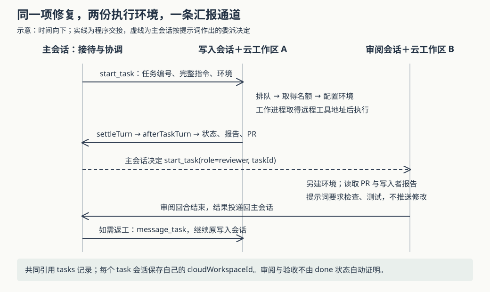

# Superset 怎样把代码工作交出去：主会话、任务队列与独立审阅的协作边界

假设你在团队频道里对 Ada 说：“修复登录超时，补上测试，再找一个会话检查改动。”修复过程中，你又问它另一项工作的进度。你希望 Ada 能回答，而不必等测试结束；也希望审阅者看的是已经提交的改动，不会直接踩进写代码者尚未整理的目录。**这是用于解释源码的假设场景，并非仓库记录的事故。**

当前实现让负责接待消息的主会话把代码工作交给任务会话，后者使用独立云工作区，结束后把结果交回主会话。主会话再决定是否启动审阅、要求返工或向人汇报。**程序负责登记、启动和结果回流；怎样分工、是否继续审阅，则有相当一部分依赖代理遵循提示词。** 理解这条分界，才能判断“任务已运行”“会话已完成”和“修复已经验收”各自说明了什么。

本篇接续十七篇已有研报，包含上一份尚待归档的频道路由研究，深入其未展开的代码任务委派。Superset 将代码目录、终端和编码代理组织为工作区；本文的 Ada 属于云端登记、能够参与频道的 Dev 代理成员，与在普通终端里手动启动的编码助手不是同一条入口。当前项目名称为 Paradev，本文沿用来源名称 Superset。

依据是执行器提供的 `input/repository/`，已核对 HEAD 为 `4cc2e79253a79d3e6c6514b5c40f1f3c5db2e772`。本次只读源码、测试和设计记录，没有安装依赖、启动服务、运行代理或执行仓库测试。输入注明子模块与 Git LFS 大文件内容未拉取；检查没有发现 Git 子模块条目，所涉任务、执行器和数据库源码中未发现 LFS 指针。外部 `pdev` 程序内部怎样实现远程工具、真实云环境的配置效果，不在本次现场验证范围。

**先把“同一项工作”和“做这项工作的会话”分开。**

主会话通过 `start_task` 工具提出委派。这个工具使用 MCP，即客户端读取工具说明、再请求工具执行的协议；`/mcp/agent` 的服务把它连接到 `devTools.startTask`，根路由确实注册了 `devToolsRouter`。请求必须提供现有任务编号，或者用于创建新任务的标题；审阅角色必须提供已有任务编号。[工具入口][mcp]、[接口实现][tools]与[路由注册][root]串起了这条路径。

请求进入 `tasks.ts` 的 `startTask` 后，先选环境，再确认或新建任务，最后插入任务会话。环境是仓库等启动配置，不是现成的执行机器：调用者明确指定环境时检查组织归属；否则优先使用 Dev 默认环境，再尝试组织中唯一的环境，无法确定便要求先查询环境列表。后续真正创建云工作区时，还会检查环境是否归档、个人环境能否由请求者使用、组织是否允许启动相应机器等条件。因此，“找到了环境编号”并不保证可以开机。[委派实现][tasks]与[云工作区入口][cloud-start]对应这两层判断。

这里有三类记录：

| 记录 | 保存的内容 | 在登录修复中的作用 |
|---|---|---|
| `tasks` | 标题、描述、业务状态和 PR 地址；PR 是请求合并代码的记录 | 表示团队要完成的那项修复 |
| `agent_sessions` | 所属 Dev、任务编号、写入或审阅角色、执行状态、父会话、环境、请求者、云工作区编号 | 表示谁以哪种角色处理这项工作 |
| `agent_turns` | 一轮连续执行的输入、结果、错误和状态 | 表示该会话本次做了什么，之后还能接收新的要求 |

任务会话通过 `parentSessionId` 记住应向哪个主会话报告，通过 `requestedByUserId` 记住为谁工作。一项任务可以经历多个会话，一个会话也可以先完成一轮，再因返工要求运行下一轮。[表定义][schema]明确保留了这些区别。

这也解释了去重的实际范围。数据库的条件唯一索引要求：同一任务编号至多有一个处于 `queued` 或 `running` 的 `writer` 会话，即排队或运行中的写入者。它没有按 Dev 编号划分，所以不同 Dev 对同一任务也会碰到这个约束。插入冲突时，`startTask` 返回现有写入会话和 `duplicate`，不创建第二个活跃写入者。

但同样的标题不等于同一任务。当前接口没有接收稳定的工具调用编号；若两次都不提供 `taskId`，就会先后创建两个任务，各有不同编号。这种重送不受“每项任务一个写入者”的约束保护。审阅会话也没有同样的唯一索引。设计记录曾写“按工具调用去重”，当前迁移却已删除旧的 `dedupe_key` 字段及索引；因此不能沿用那句旧说明，推导出重试必然不会多建任务。[当前实现][tasks]、[字段删除迁移][migration]与[设计记录][plan]应对照阅读。

**主会话不等待代码任务做完，但启动任务仍要经过多个交接点。**

`fillSlots` 统计该 Dev 的运行中任务会话，目标上限是三个；有空位就按创建时间取最早的排队会话，先将其改成 `running`，再执行启动。写入和审阅都计入这个数量，主会话不计入。名额暂时不足，`start_task` 就返回 `queued`，具体指令保存在会话记录中。[队列与启动实现][tasks]。

启动时，`launchTask` 会为没有云工作区的会话调用 `startCloudWorkspace`。创建函数先写入一条 `provisioning`，即配置中的工作区记录，通过 `beforeProvision` 回调把其编号写回任务会话，再投递后台配置工作。写入角色还会尝试把处于待办阶段的业务任务推进为“已开始”；这不是等待代码执行成功后才发生的变化。[任务启动][tasks]、[工作区创建][cloud-start]与[业务状态转换][task-router]展示了顺序。

随后，`submitPrompt` 登记第一轮输入，并把它交给 Temporal 管理的会话工作流。Temporal 是记录执行进度、调度活动及重试的服务。在这一步返回时，云环境可能还没配置完成，因此任务会话的 `running` 更接近“已取得名额并进入启动路径”，不能直接翻译为“代理正在修改文件”。

真正运行代理的 `agent-worker` 会请求 `turnCredentials`，取得这轮允许使用的资源。若工作区仍在配置，执行器按五秒间隔等待，单次等待循环的期限为十分钟，并持续报告自己还活着；超时或其他错误交由上层活动的失败与重试策略处理。这不是整个任务十分钟后必定结束的承诺。[凭据入口][worker-api]、[配置等待][activities]与[工作流策略][workflow]共同决定这一行为。

这里还有一个容易被“云端代理”掩盖的位置区别：`pdev` 代理程序由工作进程启动，工作目录是执行器本地的临时目录；环境变量 `PDEV_REMOTE_HOST_URL`、`PDEV_REMOTE_WORKSPACE_ID` 等指向云工作区，让工具在那里操作代码。不能据任务拥有云工作区，就认定代理进程本身也在该沙箱中。[执行器的 `pdevEnv` 和 `runTurn`][activities]直接建立了这条连接。

访问资格也不是只凭保存的工作区编号。数据库权限视图从任务会话与云工作区的关联推导 Dev 的操作资格；`resolveTurnHost` 再检查组织、Dev 权限、请求者是否仍属该组织及能否打开工作区，才唤醒环境并返回主机凭据。保存 `requestedByUserId` 因而既用于记录来源，也参与后续授权。[权限视图][authz]与[目标主机解析][host]支持这一点。

**独立审阅有单独环境，流程却不是写死的流水线。**

主会话取得的是委派、查询、回复等工具；没有工作区时，执行器设置 `PDEV_NO_WORKSPACE=1`，并在其代理设置里禁止内置 `Task` 子代理工具。角色提示词明确要求：代码工作必须用 `start_task` 委派；写入者报告 PR 后，在同一任务下创建审阅会话；把审阅问题发回写入者，再向人说明结果。[执行器配置与角色提示][activities]。

审阅会话不接管写入者的云工作区。它有新的会话记录，沿相同启动路径申请自己的环境。`brief` 为它组织任务编号、标题、本次委派指令、已有 PR 地址以及最新写入会话的最后回复；没有 PR 时，只说明应审阅写入者报告的内容。这里不会自动复制主会话全部聊天历史，当前审阅分支也没有自动附上完整任务描述。因此，主会话给审阅者的指令需要明确验收条件。[上下文组装 `brief`][tasks]。

审阅提示词要求检出 PR、检查要求和改动、运行相关测试，不推送修改，以 `APPROVE` 或 `CHANGES REQUESTED` 给出结论。写入提示词要求提交、推送、创建 PR，并用 `gh pr checks --watch` 等待检查、处理失败。但本篇读到的程序没有解析审阅结论来驱动固定状态机，也没有在写入回合结束时强制创建审阅会话。审阅仍使用相同的远程主机工具配置，本文没有读到按审阅角色撤销写入权限的措施。

因此，**“独立环境”由会话与工作区关联落实；“不推送修改”“必须审阅后汇报”主要是代理行为要求。** 设计记录解释了动机：主会话保持短回合，减少代码内容进入其上下文，人始终与同一个协调者沟通。独立审阅便于从已提交的产物重新检查；代价是额外配置环境、传递要求，并依赖代理正确理解角色。这一代价判断是依据结构作出的推断，本次没有测量耗时、成本或审阅质量。

**结果回来时，程序确认的是回合结束，并不替人验收修复。**

执行器调用 `agentWorker.settleTurn` 保存结果，接口再调用 `afterTaskTurn`。后者把完成、被中断、失败的回合分别映射为任务会话的 `done`、`stopped`、`failed`，已经手动停止的会话则保留停止状态。它不因 `completed` 自动把 `tasks` 的业务状态改成完成，也不以此证明测试通过或 PR 已合并。[结算接口][worker-api]与[任务收尾][tasks]。

写入会话还会尝试补记 PR：优先使用云工作区关联的 PR 记录，没有时从最终回复中寻找 GitHub PR 地址；只有任务尚未保存 PR 才写入。回复中的地址不是程序在这里重新核验过的仓库归属或审阅结果，而已有地址也不会自动被新地址覆盖。

`reportToParent` 把会话状态、PR 和报告包装成新输入，送回父会话。它以 `task-update:<回合编号>` 作为稳定输入编号，重复结算同一轮时，可以利用 `submitPrompt` 的判重机制避免重复登记父会话输入。父会话空闲便开始一轮；正在为同一人工作时，结果可以加入当前回合；正在为另一人工作则排队。这复用了上篇解释的按请求者分流机制。[结果包装][tasks]与[输入登记、投递][turns]。

这条报告本身没有绑定用户频道的回复目标。任务会话也没有获得主会话那组 Dev 工具，自动最终回复的频道信息只在相应主会话入口提供。于是系统的正常交互安排是：子会话先报告，主会话结合已有上下文选择向哪里回复。它没有承诺子任务结束就直接向最初的频道发送一条验收通知。

**恢复措施是分段的，需要留意没有连成事务的空隙。**

当前代码对启动错误做了两层处理：同步启动最多尝试两次，间隔两秒；若首次任务执行失败，且云工作区已明确处于失败或删除状态，又尚未用完启动次数，则清除旧工作区关联，把会话重新放回队列，尝试新环境。这后一条只处理 `task_start`，不会把任意中途失败都当成“换台机器再做”。失败不再重试时，直接调用 `start_task` 的主会话从工具结果看到错误，其他排队任务则经报告路径通知父会话，减少重复通知。[启动重试与换环境判断][tasks]。

还有几项边界会改变实际判断：

- **三个名额不是原子配额。** `fillSlots` 的计数与领取没有放在同一笔锁定 Dev 的事务中，也没有对应总量约束。根据调用顺序推断，多个分配者同时读到空位时可能超出目标上限；本次没有执行并发实验。`messageTask` 又会直接把已有会话改为运行中并提交新输入，不经过 `fillSlots`，因此继续旧任务也不受同一入口的名额检查。
- **继续排队任务的文字并没有被这次调用保存。** `messageTask` 对仍为 `queued` 的会话直接抛出前置条件错误；尽管错误文案说“启动时会读到”，这条分支没有更新 `instructions`。不能仅凭提示文字认为补充要求已进入待执行内容。[补充要求接口][tools]可见这一差异。
- **占到名额与拥有执行回合之间有空隙。** 队列先改会话状态，之后才创建云工作区并登记回合。若服务恰在中间退出，可能留下运行中会话却没有运行回合。当前 `reconcileDevs` 能检查丢失的运行回合、推进排队回合，并在相应失败结算后调用任务收尾；它没有直接扫描所有任务会话来重新分配名额。本次全仓搜索到的 `fillSlots` 调用也集中在新建、停止、结束及换环境路径，因此不能从“有对账任务”推导出这类空隙一定自动修复。[对账实现][reconcile]。
- **停止不是销毁环境的确认。** `stopTask` 先把本 Dev 在该任务上的活跃会话标为停止，再尝试中断运行中的工作流；中断调用错误被忽略，之后立即补充队列名额。该接口没有删除云工作区，也没有核验所有后台命令都已结束。返回的停止数量应理解为所处理的会话数量。[停止接口][tools]。

这些边界不表示已经观察到线上故障；它们说明数据库状态、工作流接收、机器配置和代理动作属于不同副作用，当前路径没有一笔能够把它们同时提交或撤销的事务。

**测试与实践应围绕这些具体交接，而不是只看任务最后显示什么。**

本次阅读的执行器测试使用替代的 `pdev` 和凭据、会话存储实现，断言远程主机变量正确传入、输出和会话资料被保存，以及主会话取得角色提示和 MCP 配置、没有工作区。它还检查模型服务错误可重试，而无效请求按不可重试错误处理。这些断言支持执行器侧的局部约定，不能证明真实云配置、数据库并发分配、PR 创建和独立审阅已共同验证。[执行器测试][activity-test]。

`turns.test.ts` 本次读到的测试集中在输入包装、标签转义和上下文展示，没有覆盖任务名额分配。搜索现有测试也未找到直接针对 `startTask`、`fillSlots`、`afterTaskTurn` 或活跃写入者索引竞争的专门断言。设计记录虽然记载过一次真实环境试跑，但同时保留了已删除的去重方案、早期 GitHub 事件回流描述；它是设计演进与历史试跑的证据，不能替代本版本的测试结果。[输入包装测试][turn-test]与[设计记录][plan]。

对使用者，继续工作时提供已有任务编号；委派时把范围、验收条件和环境说完整，审阅时尤其不要假定对方已读过整段频道对话。看到 `running` 后仍需确认环境与执行结果；看到 `done` 后核对 PR、检查结果和审阅报告。补充给排队任务的消息若返回错误，应明确确认要求最终保存到了哪里；停止后如需保证命令或资源结束，还要检查对应工作区。

对实现类似系统的人，这条路径提供了可迁移的分工：协调者保持统一沟通，任务记录承载业务目标，执行会话拥有独立环境，结果以稳定输入编号回到协调者。如果要让名额、审阅门槛和重送行为成为硬保证，还需要分别补足原子名额分配、明确的审阅状态转换、稳定的委派请求编号，以及对“已占名额却没有回合”等中间状态的扫描恢复；仅增加角色提示词无法替代这些程序约束。

配图已完成 XML 解析及正文路径核对。当前环境的系统预览工具因沙箱初始化错误无法渲染，尚未完成实际渲染后的视觉核验。

[mcp]: https://github.com/ParadevAI/Paradev/blob/4cc2e79253a79d3e6c6514b5c40f1f3c5db2e772/apps/api/src/app/mcp/agent/route.ts
[tools]: https://github.com/ParadevAI/Paradev/blob/4cc2e79253a79d3e6c6514b5c40f1f3c5db2e772/packages/trpc/src/router/agent/dev-tools.ts
[root]: https://github.com/ParadevAI/Paradev/blob/4cc2e79253a79d3e6c6514b5c40f1f3c5db2e772/packages/trpc/src/root.ts
[tasks]: https://github.com/ParadevAI/Paradev/blob/4cc2e79253a79d3e6c6514b5c40f1f3c5db2e772/packages/trpc/src/router/agent/tasks.ts
[schema]: https://github.com/ParadevAI/Paradev/blob/4cc2e79253a79d3e6c6514b5c40f1f3c5db2e772/packages/db/src/schema/agents.ts
[migration]: https://github.com/ParadevAI/Paradev/blob/4cc2e79253a79d3e6c6514b5c40f1f3c5db2e772/packages/db/drizzle/0177_drop_agent_session_task_columns.sql
[plan]: https://github.com/ParadevAI/Paradev/blob/4cc2e79253a79d3e6c6514b5c40f1f3c5db2e772/plans/20261028-0930-devs-main-session-and-tasks.md
[cloud-start]: https://github.com/ParadevAI/Paradev/blob/4cc2e79253a79d3e6c6514b5c40f1f3c5db2e772/packages/trpc/src/router/cloud-workspace/start.ts
[task-router]: https://github.com/ParadevAI/Paradev/blob/4cc2e79253a79d3e6c6514b5c40f1f3c5db2e772/packages/trpc/src/router/task/task.ts
[worker-api]: https://github.com/ParadevAI/Paradev/blob/4cc2e79253a79d3e6c6514b5c40f1f3c5db2e772/packages/trpc/src/router/agent/agent-worker.ts
[activities]: https://github.com/ParadevAI/Paradev/blob/4cc2e79253a79d3e6c6514b5c40f1f3c5db2e772/apps/agent-worker/src/activities/createActivities/createActivities.ts
[workflow]: https://github.com/ParadevAI/Paradev/blob/4cc2e79253a79d3e6c6514b5c40f1f3c5db2e772/apps/agent-worker/src/workflows/agentSession/agentSession.ts
[authz]: https://github.com/ParadevAI/Paradev/blob/4cc2e79253a79d3e6c6514b5c40f1f3c5db2e772/packages/db/src/schema/authz.ts
[host]: https://github.com/ParadevAI/Paradev/blob/4cc2e79253a79d3e6c6514b5c40f1f3c5db2e772/packages/trpc/src/router/agent/turn-host.ts
[turns]: https://github.com/ParadevAI/Paradev/blob/4cc2e79253a79d3e6c6514b5c40f1f3c5db2e772/packages/trpc/src/router/agent/turns.ts
[reconcile]: https://github.com/ParadevAI/Paradev/blob/4cc2e79253a79d3e6c6514b5c40f1f3c5db2e772/packages/trpc/src/router/agent/reconcile.ts
[activity-test]: https://github.com/ParadevAI/Paradev/blob/4cc2e79253a79d3e6c6514b5c40f1f3c5db2e772/apps/agent-worker/src/activities/createActivities/createActivities.test.ts
[turn-test]: https://github.com/ParadevAI/Paradev/blob/4cc2e79253a79d3e6c6514b5c40f1f3c5db2e772/packages/trpc/src/router/agent/turns.test.ts
