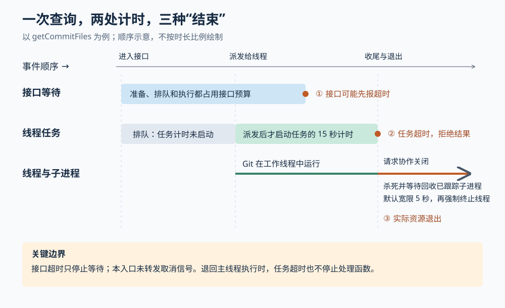

# 查询超时以后，Git 停了吗：Superset 主机线程池的调度、收尾与降级边界

假设你同时打开几个工作区：一个查看大型提交，一个持续刷新代码改动，另一个终端里的代理正在运行测试。你希望查看提交不会拖慢其他操作；点走面板之后，后台也不要留下无人管理的 Git 进程。**这是解释源码的假设场景，并非仓库记录的事故。**

Superset 把一部分 Git 工作交给主机服务内部的工作线程，并限制同时进入的查询数量。查询超时或取消时，线程调度器会停止等待结果，并安排线程与子进程退出；线程本身崩溃时，外层又可能回到主线程重新执行。这里最需要分清的是：**界面不再等待、任务结果被拒绝、实际进程已经退出，是三个不同的时刻。**

本篇接续输入中的十八篇历史研报，深入此前 Changes 刷新和终端生命周期文章未展开的主机后台执行机制。Superset 将代码、终端和编码代理组织为工作区，当前项目已改名 Paradev，本文沿用来源名称。依据为 `input/repository/`，已核对 HEAD 与输入一致，为 `45e426ede96d235f1ecc059d5582fcf06049ac25`。本次只读源码、测试和设计记录，没有安装依赖、启动应用或运行仓库测试；下文测试描述均指读到的断言。输入注明子模块与 Git LFS 大文件未拉取；所涉主机线程和 Git 实现可直接读取，未发现 LFS 指针。真实负载下的延迟、外部 Git 扩展程序及不同系统的进程行为未做现场验证。

**先看“查看一次提交”究竟把哪些工作交了出去。**

桌面第二代工作区的 `useChangeset` 在用户选择某次提交时，调用 `workspaceTrpc.git.getCommitFiles`，携带工作区编号、目标提交以及可选的起点提交。主机根路由确实将 `gitRouter` 注册为 `git`；请求随后进入 `git.ts` 的 `getCommitFiles`。[界面调用][ui]、[路由注册][router]和[接口实现][git]连接了这条真实路径。

接口先在主线程确定工作目录，并从凭据提供器取得 Git 所需的环境变量。然后，它把目录、提交标识和环境变量作为普通数据交给 `gitCommitFilesTask`。主线程没有把数据库连接、凭据提供器对象或一个已经创建好的 Git 客户端一起传过去。

`HostWorkerPool` 负责选取执行方式，`WorkerTaskRunner` 负责排队、分配线程和接收结果。后者通过 `postMessage` 发送任务编号、任务类型与参数；`host-worker.ts` 按预先登记的类型找到处理函数。这里的工作线程是**同一主机服务进程中的独立 JavaScript 执行线程**，不是另一台机器，也不是前两篇文章中的云端任务会话。[线程池][pool]、[调度器][runner]与[线程入口][entry]给出了这几层分工。

工作线程里的 `gitCommitFilesTask` 自己创建 Git 客户端，默认比较目标提交及其父提交；提供起点时则比较两个指定提交。`getChangedFilesForDiff` 分别读取文件状态和增删行数，再合并成文件列表。结果回到主线程后，接口返回 `{ files }`，桌面将它转换为可供审阅的列表。[任务实现][tasks]与[差异读取函数][helpers]展示了实际计算。

这样安排不只是在等待 Git 命令结束时“让出执行”。创建子进程、接收它的输出、解析输出和组装列表也都有工作量；把 Git 客户端建立在工作线程里，才能让这些环节一起离开主线程。主线程的事件循环——逐个处理网络、定时器和其他回调的调度机制——因此少承担一批工作。**这是实现提供的隔离方向，不是所有操作都能保持流畅的性能保证。**

**线程池之外，还要决定谁能先进去。**

假如每次点击都立即提交一个新任务，线程数有限，大批提交查询仍会把后来的状态查询挡在队尾。当前实现因此分了两层控制。

查看提交文件时，`runCommitFilesDeduped` 先按“工作区＋起点＋目标提交”共享尚未完成的请求，再进入最多同时放行两个任务的入口。共享发生在并发限制之前，所以十个相同查询不会占掉两个名额，也不会在排队结束后把已经完成的查询再做一次。线程池内部还传入 `coalesce` 策略，即按同一个键合并请求、共享一次执行结果。这个键由调用方构造；调度器不会自行判断两份参数是否等价。[入口控制见 `git.ts`][git]。

状态查询则沿另一条入口：`runStatusSnapshot` 先经过 `gitStatusRefreshLimiter`，再把完整或局部读取交给同一个线程池。本篇不重复其刷新与缓存算法，但这个连接说明：**领域入口负责合并和安排业务请求，线程池负责承载已经放行的工作。** 两者不是互相替代的队列。

线程池默认并发数为 `max(1, min(4, CPU 数量−1))＋2`。额外的两个位置与提交文件入口的上限相配合，源码注释将其解释为给非状态任务留余量，避免它们挤满所有线程。这不是为状态查询划出两个专属线程，也没有对所有其他任务实施同一上限。线程按队列需求创建，空闲默认三十秒后回收，避免长期保留整池线程。[并发和回收配置][pool]、[按需创建与回收][runner]。

由此可以推断，适当限制入口比一味增加线程更重要：线程多了，Git 子进程、磁盘访问和结果搬运仍会争用同一台机器。仓库的[设计记录][plan]也讨论了这类权衡，但其中的历史测量不是本次测量；本篇不据此给出当前版本的速度或容量承诺。

**两个“十五秒”，并不构成同一个截止时间。**

`getCommitFiles` 的接口元数据把查询预算设为十五秒。`queryProcedure` 的超时中间件用 `Promise.race` 竞争“接口执行”与“定时错误”：到时便返回超时，代码没有在这里停止执行中的接口函数。[查询计时实现][trpc]。

线程任务也配置十五秒，但 `WorkerTaskRunner` 在任务实际被分配给某个线程、即将发送消息时，才建立它的计时器；排队时尚未开始计时。所以，前面的准备与排队可以消耗接口预算，却不消耗线程任务预算。若接口先超时，后台任务仍可能继续排队或运行。

更关键的是，这个具体接口没有接收并转发请求的 `signal`。`signal` 是取消信号，通知下游调用者已经放弃等待。仓库的通用 `offLoop` 辅助函数能够自动把该信号交给线程池，但 `getCommitFiles` 使用的是手写流程，不能因为辅助函数存在，就认定所有入口都有相同的取消行为。[通用辅助函数][offloop]与[具体接口][git]需要对照阅读。

图中展示的是可能发生的顺序，不是实测时长。它解释了一个实际判断：看到面板报超时，可以确认这次等待失败；不能据此确认 Git 已停止，也不能认为重试会获得一个完全独立的新任务。相同查询仍在运行时，新请求可能继续共享它。

在线程调度层，收到取消信号或任务计时到期后，`abortTask`、`handleTaskTimeout` 会拒绝任务，并把相应线程置为退出中。尚在队列中的取消请求无需停线程；已经运行的请求则需要下面这套资源收尾。退出中的线程不再接新任务，调度器可为其余工作补充线程，因此配置的并发数也不是“连退出中线程一起计算”的瞬时总线程上限。[调度器实现][runner]。

**停止线程以前，先处理它启动的程序。**

Git 是工作线程启动的操作系统子进程。直接强制终止工作线程，会销毁它管理子进程的底层句柄；子进程即使已经结束，退出状态也可能没有被回收，留下通常称为“僵尸进程”的记录。源码注释明确指出这是协作关闭协议要处理的问题。

`shutdownSlot` 先发出 `shutdown` 消息。线程入口收到后调用 `killAndReapTrackedChildren`：向已跟踪的子进程发送强制结束信号，并等待其退出事件，再结束线程。跟踪器通过包装 `ChildProcess.prototype.spawn` 记录子进程，覆盖经过这一入口的创建方式，而不是要求每个 Git 调用点单独登记。[关闭协议][runner]、[线程入口][entry]与[子进程跟踪器][children]共同完成这条链。

收尾期间还有一个容易漏掉的情况：原子进程被结束后，它的退出回调可能又启动后续程序。跟踪器设置“正在关闭”标记，后来新建的子进程也会立刻收到结束信号；它还等待连续两个安静的事件循环轮次，降低刚清空名册又冒出后继程序的风险。

这仍有边界。默认五秒宽限期内线程没有退出，父线程便调用 `terminate()` 强制终止它。源码没有在这里提供任意后代进程树的完整追踪，也无法保证不可中断的系统调用或更晚启动的程序都能完成优雅收尾。因此，这套协议比“直接杀线程”更有控制力，但不能解释为每次超时都保证所有外部资源已回收。

对于会报告执行阶段的任务，工作线程还会提前发送阶段消息。例如移除工作目录时，`gitWorktreeRemoveTask` 区分路径解析、执行移除、重读工作目录登记三个阶段。父线程把最后收到的阶段附在超时错误中，便于判断卡在哪里。这是诊断线索，不是任务进度百分比，也不证明最后一个阶段已经完成。[阶段协议][protocol]、[任务中的阶段上报][tasks]。

**线程坏了，系统选择继续提供结果；代价是退回原来的执行位置。**

任务处理函数抛出错误时，线程入口序列化错误，父线程将它恢复成 `WorkerTaskError`。线程本身异常退出则使用另一种标记 `WorkerCrashedError`，外层线程池据此决定是否重试。业务错误和任务超时不会自动进入这条崩溃重试路径。[错误消息][protocol]与[重试判断][pool]。

对于线程崩溃，`HostWorkerPool` 在主线程再执行一次处理函数。多个已合并的调用者继续共享同一次重试，同一个崩溃也只记一次，避免“一次事故、多个等待者”立即耗尽故障预算。六十秒内累计三次线程崩溃后，线程池在当前进程余下生命周期内改为直接执行；找不到可用的线程入口文件时，也采用直接执行。已在运行的旧线程任务允许自行结束，队列中的任务则通过崩溃错误进入各自的直接重试。[降级与崩溃计数][pool]。

这种选择让缺失构建产物或线程持续异常时，部分调用仍有机会拿到结果。但有三项代价：

- 直接执行后，创建进程和解析结果重新占用主线程，先前的执行隔离不再成立。
- 直接执行的超时或取消只拒绝等待结果的 Promise，即表示将来结果的对象；处理函数本身仍可能继续运行。若同步代码堵住主线程，定时器也不能准时执行。
- 崩溃重试重新建立执行预算，没有沿用一次调用从入口开始的统一截止时间。

此外，“线程崩溃”只证明执行载体丢失，不证明崩溃前没有产生副作用。当前任务表不只包含查询，也包含提交、推送和移除工作目录；线程池对崩溃后的直接重试没有统一的操作编号或结果对账协议。**据此可推断，不能把这套重试当成通用的“写操作只发生一次”保证。** 例如提交任务会先检查暂存内容，具体业务可能自行吸收一部分重复执行，但这不等于线程池证明了每项写操作的最终状态。[写任务实现][tasks]。

**执行层返回成功，也未必证明领域读取成功。**

沿调用链继续下钻还能发现一个值得补充的边界：`getChangedFilesForDiff` 捕获差异读取过程中的错误后返回空数组。于是，目标引用无效、默认父提交不可用或其他 Git 读取失败，都可能表现为一次正常返回的空列表；线程池没有收到异常，自然也无法替它区分“没有改动”和“读取失败”。这修正了一个容易形成的直觉：把计算移到线程，不会自动增强原有业务函数的错误表达。[差异函数的捕获分支][helpers]。

相对地，通用接口适配层会把主动取消与真正故障分开：`rethrowWorkerTaskAbort` 将服务退出映射为暂时不可用，将取消或被更新请求替代映射为客户端已结束请求；任务超时和处理函数错误仍按故障保留。这套转换只有调用方实际使用时才生效，不能扩大到所有手写接口。[错误分类函数][abort]。

**现有测试证明到哪一层，实践中就应判断到哪一层。**

本次阅读的 `host-worker-pool.test.ts` 包含真实任务在线程与直接执行两种方式下的状态结果对比，也检查缺失入口时的降级、崩溃后的直接重试、多调用者共享一次重试、排队任务退出崩溃循环，以及不可复制参数失败后不会卡住线程位置。[线程池测试][pooltest]。

`worker-termination.node-test.ts` 则使用真实工作线程和子进程，在超时、取消及退出回调启动后继程序的场景下，检查子进程编号消失、当前进程没有僵尸子进程；另有忽略关闭消息的线程夹具，用于检查宽限期后的强制退出。这比只断言 Promise 报错更接近资源收尾，但依然没有覆盖任意 Git 钩子和完整后代进程树。[终止测试][terminationtest]。上述测试本次均未运行。

仓库还用静态检查限制主线程新增同步进程调用和部分 Git 客户端入口，并禁止线程任务直接导入若干原生模块或主机单例。已有调用位置仍有明确计数额度，检查本身也基于文本匹配，所以它们是约束迁移方向的工具，不能证明整个主机已没有阻塞工作。[主线程检查][ratchet]、[线程依赖检查][purity]。主机应用退出时确实调用线程池 `dispose()`，使资源收尾不只依赖进程最终退出。[应用关闭入口][app]。

对使用者，最直接的建议是：大型提交查询超时时先区分接口等待与后台执行；空列表若不符合预期，再用 Git 核对引用和实际差异；涉及提交、推送或删除的失败，则先检查真实状态再决定重试。

对类似开发工具的实现者，可迁移的设计是把主线程上的身份与配置解析、业务入口的合并限流、工作线程中的执行、子进程的退出回收分别安排清楚。若需要更强的保证，还要让截止时间和取消信号贯穿排队与执行，让写任务能够查询先前操作结果，并限制返回数据体积。当前线程池对大结果只做告警，结果仍需回到主线程并经过接口序列化；将计算交出去，不能替代对返回路径的控制。

配图已通过 SVG XML 解析检查。系统 Quick Look 渲染因当前沙箱初始化失败而不可用，本次未完成实际渲染后的视觉核验。

[ui]: https://github.com/ParadevAI/Paradev/blob/45e426ede96d235f1ecc059d5582fcf06049ac25/apps/desktop/src/renderer/routes/_authenticated/_dashboard/v2-workspace/$workspaceId/hooks/useChangeset/useChangeset.ts
[router]: https://github.com/ParadevAI/Paradev/blob/45e426ede96d235f1ecc059d5582fcf06049ac25/packages/host-service/src/trpc/router/router.ts
[git]: https://github.com/ParadevAI/Paradev/blob/45e426ede96d235f1ecc059d5582fcf06049ac25/packages/host-service/src/trpc/router/git/git.ts
[pool]: https://github.com/ParadevAI/Paradev/blob/45e426ede96d235f1ecc059d5582fcf06049ac25/packages/host-service/src/workers/host-worker-pool.ts
[runner]: https://github.com/ParadevAI/Paradev/blob/45e426ede96d235f1ecc059d5582fcf06049ac25/packages/host-service/src/workers/WorkerTaskRunner.ts
[entry]: https://github.com/ParadevAI/Paradev/blob/45e426ede96d235f1ecc059d5582fcf06049ac25/packages/host-service/src/workers/host-worker.ts
[tasks]: https://github.com/ParadevAI/Paradev/blob/45e426ede96d235f1ecc059d5582fcf06049ac25/packages/host-service/src/workers/tasks/git.ts
[helpers]: https://github.com/ParadevAI/Paradev/blob/45e426ede96d235f1ecc059d5582fcf06049ac25/packages/host-service/src/trpc/router/git/utils/git-helpers.ts
[trpc]: https://github.com/ParadevAI/Paradev/blob/45e426ede96d235f1ecc059d5582fcf06049ac25/packages/host-service/src/trpc/index.ts
[offloop]: https://github.com/ParadevAI/Paradev/blob/45e426ede96d235f1ecc059d5582fcf06049ac25/packages/host-service/src/trpc/off-loop.ts
[children]: https://github.com/ParadevAI/Paradev/blob/45e426ede96d235f1ecc059d5582fcf06049ac25/packages/host-service/src/workers/worker-child-tracker.ts
[protocol]: https://github.com/ParadevAI/Paradev/blob/45e426ede96d235f1ecc059d5582fcf06049ac25/packages/host-service/src/workers/worker-task-protocol.ts
[abort]: https://github.com/ParadevAI/Paradev/blob/45e426ede96d235f1ecc059d5582fcf06049ac25/packages/host-service/src/trpc/worker-abort.ts
[plan]: https://github.com/ParadevAI/Paradev/blob/45e426ede96d235f1ecc059d5582fcf06049ac25/plans/20260717-host-service-git-worker-pool.md
[pooltest]: https://github.com/ParadevAI/Paradev/blob/45e426ede96d235f1ecc059d5582fcf06049ac25/packages/host-service/src/workers/host-worker-pool.test.ts
[terminationtest]: https://github.com/ParadevAI/Paradev/blob/45e426ede96d235f1ecc059d5582fcf06049ac25/packages/host-service/src/workers/worker-termination.node-test.ts
[ratchet]: https://github.com/ParadevAI/Paradev/blob/45e426ede96d235f1ecc059d5582fcf06049ac25/packages/host-service/src/no-main-loop-blocking.test.ts
[purity]: https://github.com/ParadevAI/Paradev/blob/45e426ede96d235f1ecc059d5582fcf06049ac25/packages/host-service/test/integration/no-native-worker-imports.test.ts
[app]: https://github.com/ParadevAI/Paradev/blob/45e426ede96d235f1ecc059d5582fcf06049ac25/packages/host-service/src/app.ts
