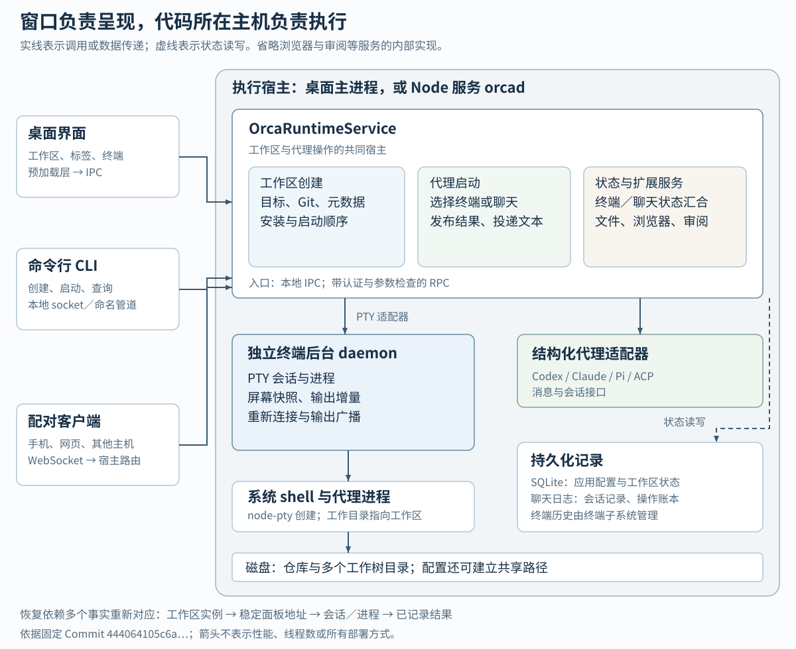
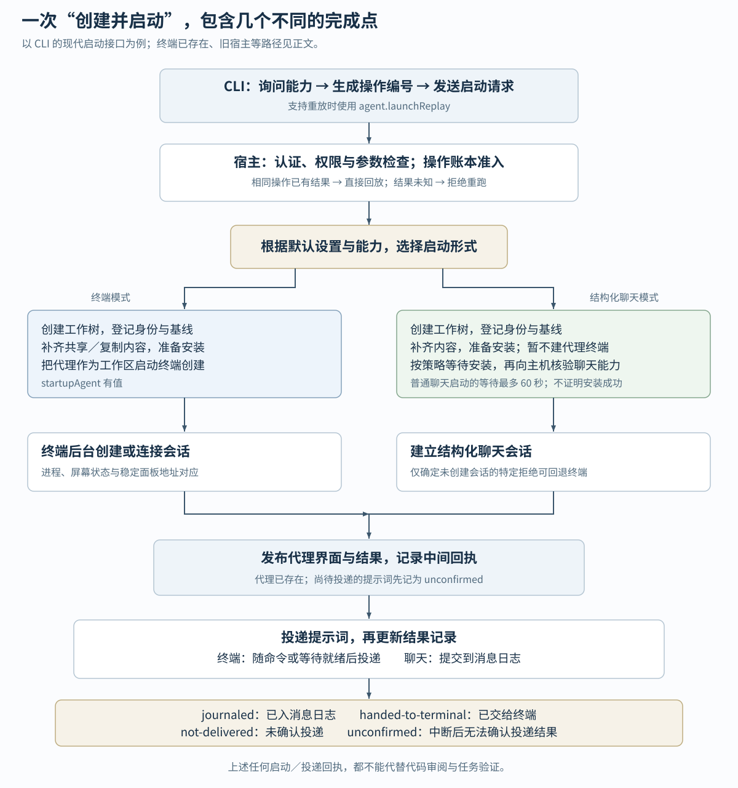

# Orca 如何组织多个编码代理：从独立工作区到终端、聊天与故障恢复

假设你要给一个网站增加搜索功能，想让一个编码代理实现接口，另一个尝试页面交互，再由你检查结果。这是本文自拟的使用场景。若它们都修改同一个目录，尚未提交的文件就可能相互覆盖；即使各开一个终端，你还得记住每个代理在哪个分支、是否等你确认、结果该去哪里看。

Orca 把这些工作组织到同一个工作台：先为任务安排工作区，再启动代理，把终端或聊天、关联任务和运行状态连到这个工作区。这里的 **Git 工作树（worktree）**，是同一个仓库的另一个检出目录，可以使用自己的分支。源码中的创建流程确实生成新工作树，并另存应用需要的名称、基线和身份；多个代理由此可以在各自目录中推进，读者则能按工作区回看结果。[实际 Git 创建](https://github.com/stablyai/orca/blob/444064105c6a7397a2f48ec7132ce92579f7d6b7/src/main/git/worktree-add.ts#L236-L278)、[应用元数据](https://github.com/stablyai/orca/blob/444064105c6a7397a2f48ec7132ce92579f7d6b7/src/main/runtime/runtime-local-worktree-materialization.ts#L68-L88)。

本文是首次系统研读，基于固定 Commit `444064105c6a7397a2f48ec7132ce92579f7d6b7`。重点回答三件事：系统由谁接收操作、谁执行和保存状态；一次“创建工作区并启动代理”怎样贯穿这些部分；发生失败或重启时，哪些结果可以确认，哪些必须保留不确定性。

**先看整体：窗口、运行时和终端后台各做什么。**



图中的“运行时”指 `OrcaRuntimeService`：负责工作区、代理会话、终端等操作的宿主服务对象。桌面应用在 Electron 主进程中构造它；Electron 是把网页界面与本机能力组合成桌面应用的框架。另一个入口 `orcad` 在 Node 环境中构造同一服务，并启动远程接口、提供网页客户端目录，因此窗口并非所有执行工作的前提。[桌面装配](https://github.com/stablyai/orca/blob/444064105c6a7397a2f48ec7132ce92579f7d6b7/src/main/startup/main-process-runtime-service.ts#L88-L111)、[Node 宿主装配](https://github.com/stablyai/orca/blob/444064105c6a7397a2f48ec7132ce92579f7d6b7/src/main/orcad/orcad-entry.ts#L212-L237)、[无窗口服务入口](https://github.com/stablyai/orca/blob/444064105c6a7397a2f48ec7132ce92579f7d6b7/src/main/orcad/orcad-entry.ts#L326-L342)。

| 部分 | 在这个系统里负责什么 | 已核验的连接 |
| --- | --- | --- |
| 桌面界面 `src/renderer` | 展示工作区、标签和终端，接收用户操作 | React 挂载 `App`；通过预加载层提供的 `window.api` 调用后台。[界面入口](https://github.com/stablyai/orca/blob/444064105c6a7397a2f48ec7132ce92579f7d6b7/src/renderer/src/main.tsx#L57-L81)、[桥接入口](https://github.com/stablyai/orca/blob/444064105c6a7397a2f48ec7132ce92579f7d6b7/src/preload/index.ts#L188-L198) |
| 预加载层与主进程接口 `src/preload`、`src/main/ipc` | 把界面操作送入主进程 | 本地创建调用 `worktrees:create`；IPC 即进程间通信。[创建调用](https://github.com/stablyai/orca/blob/444064105c6a7397a2f48ec7132ce92579f7d6b7/src/preload/api/worktrees-bridge.ts#L13-L31) |
| 运行时与 RPC `src/main/runtime` | 解析目标、调度工作区与代理，向其他客户端提供操作 | RPC 即远程过程调用：把方法名和参数发送给宿主执行。方法表显式注册代理、终端、文件、Git、浏览器和审阅等服务。[服务注册表](https://github.com/stablyai/orca/blob/444064105c6a7397a2f48ec7132ce92579f7d6b7/src/main/runtime/rpc/methods/index.ts#L74-L125) |
| Git 与工作区实现 | 创建检出目录，补齐本地内容，登记应用身份 | Git 操作完成后进入内容补齐和元数据处理。[创建连接点](https://github.com/stablyai/orca/blob/444064105c6a7397a2f48ec7132ce92579f7d6b7/src/main/runtime/runtime-local-worktree-create.ts#L164-L209) |
| 终端后台 `src/main/daemon` | 持有终端进程，保存屏幕状态，处理重新连接 | 宿主通过适配器调用独立后台；后台按会话编号创建或重新连接终端。[后台装配](https://github.com/stablyai/orca/blob/444064105c6a7397a2f48ec7132ce92579f7d6b7/src/main/daemon/daemon-provider-init.ts#L64-L100)、[协议调用](https://github.com/stablyai/orca/blob/444064105c6a7397a2f48ec7132ce92579f7d6b7/src/main/daemon/daemon-pty-spawn-request.ts#L148-L155) |
| 结构化代理适配层 | 将支持的代理接成可记录消息的聊天会话 | 登记 Pi、Codex、Claude，以及 ACP（代理客户端协议）适配项；具体可用性还由执行宿主确认。[代理目录](https://github.com/stablyai/orca/blob/444064105c6a7397a2f48ec7132ce92579f7d6b7/src/main/runtime/structured-agent-runtime-metadata.ts#L80-L123)、[主机核验](https://github.com/stablyai/orca/blob/444064105c6a7397a2f48ec7132ce92579f7d6b7/src/main/agent-launch/agent-launch-mode.ts#L208-L241) |

浏览器、代码审阅、任务系统接入和自动化扩大了工作台的能力；上表中的服务注册能够证明它们进入同一个操作入口，但本文没有逐项验证这些功能的完整行为。`cloud/` 还有独立 relay（中继）服务及数据库入口，不应与持有本地终端的 daemon 混为一谈。[云端入口](https://github.com/stablyai/orca/blob/444064105c6a7397a2f48ec7132ce92579f7d6b7/cloud/apps/relay/src/index.ts#L46-L55)。

**状态不能只用“一个代理编号”概括。**

源码至少区分工作目录、一次工作区实例、终端面板和实际进程。工作区编号由仓库编号与路径组成，元数据再写入随机 `instanceId`，用于区别同一路径上的不同实例。终端的 `paneKey` 则由标签编号和持久化面板叶子编号组成，后者是 UUID，即用于唯一标识对象的一串编号；它能跨界面重载保持地址稳定。终端创建先认领这个地址，再尝试连接已有面板。[工作区身份](https://github.com/stablyai/orca/blob/444064105c6a7397a2f48ec7132ce92579f7d6b7/src/main/runtime/runtime-local-worktree-materialization.ts#L68-L88)、[面板地址规则](https://github.com/stablyai/orca/blob/444064105c6a7397a2f48ec7132ce92579f7d6b7/src/shared/stable-pane-id.ts#L1-L29)、[认领与连接](https://github.com/stablyai/orca/blob/444064105c6a7397a2f48ec7132ce92579f7d6b7/src/main/runtime/terminal/launch/terminal-create.ts#L49-L79)。

持久化也分开管理：应用配置和工作区等状态由 `Store` 读取 SQLite 数据库；SQLite 是本机文件形式的关系数据库。聊天会话记录及操作账本则从聊天日志数据库加载，由事务对象管理。终端后台另外保留屏幕模拟器和输出增量。因此，“恢复工作台”涉及配置、会话记录、终端内容和存活进程的重新对应；仅保存标签列表不足以完成这些连接。前半句是实现事实，最后一句是由这些状态分工得出的推断。[应用状态加载](https://github.com/stablyai/orca/blob/444064105c6a7397a2f48ec7132ce92579f7d6b7/src/main/persistence/loading-store/store.ts#L75-L108)、[聊天记录加载](https://github.com/stablyai/orca/blob/444064105c6a7397a2f48ec7132ce92579f7d6b7/src/main/runtime/agent-session-record-store.ts#L100-L107)、[终端输出状态](https://github.com/stablyai/orca/blob/444064105c6a7397a2f48ec7132ce92579f7d6b7/src/main/daemon/session-output-plane.ts#L205-L225)。

**用一次创建，把主要执行链路串起来。**

下面使用仓库实际提供的命令入口，参数值为自拟示例。前提是 Orca 宿主已经运行、项目已登记，并且该执行环境能启动所选代理：

```sh
orca worktree create --repo <已登记的项目> --name search-api \
  --agent claude --prompt '实现搜索接口并说明验证方法'
```

它表达的是“创建一个工作区，并在那里启动代理”。命令中的 `--agent` 会让创建流程进入代理启动入口；不是先开终端再凭界面猜测里面跑了谁。[命令参数与分支](https://github.com/stablyai/orca/blob/444064105c6a7397a2f48ec7132ce92579f7d6b7/src/cli/handlers/worktree.ts#L187-L219)。



1. **客户端先询问主机能做什么。** CLI 读取能力列表；满足要求时，将新工作区作为 `agent.launch` 的目标。支持重放的主机会收到带操作编号的 `agent.launchReplay` 请求。旧主机可退回 `worktree.create`，但对无法兑现的模型等参数会明确拒绝。能力协商在这里就是先确认对方理解哪套方法和结果，再决定发送什么。[兼容分支](https://github.com/stablyai/orca/blob/444064105c6a7397a2f48ec7132ce92579f7d6b7/src/cli/handlers/worktree-create-agent-launch.ts#L44-L94)、[操作编号与请求](https://github.com/stablyai/orca/blob/444064105c6a7397a2f48ec7132ce92579f7d6b7/src/cli/agent-launch-request.ts#L125-L138)。

2. **宿主接收请求，先检查，再执行。** 本机 CLI 使用 Unix socket，Windows 对应命名管道；也可以开启 WebSocket，供持续网络连接使用。本机请求验证认证令牌，分发器随后检查调用者权限、解析参数并调用注册的方法。错误会转换成统一响应。[传输建立](https://github.com/stablyai/orca/blob/444064105c6a7397a2f48ec7132ce92579f7d6b7/src/main/runtime/runtime-rpc/runtime-rpc-lifecycle.ts#L48-L85)、[认证](https://github.com/stablyai/orca/blob/444064105c6a7397a2f48ec7132ce92579f7d6b7/src/main/runtime/runtime-rpc/runtime-rpc-request-admission.ts#L121-L143)、[权限与参数](https://github.com/stablyai/orca/blob/444064105c6a7397a2f48ec7132ce92579f7d6b7/src/main/runtime/rpc/rpc-request-admission-prologue.ts#L41-L77)、[分发与错误返回](https://github.com/stablyai/orca/blob/444064105c6a7397a2f48ec7132ce92579f7d6b7/src/main/runtime/rpc/dispatcher.ts#L56-L92)。

3. **启动器决定使用终端还是结构化聊天。** 结构化聊天是代理通过适配接口提供消息与会话信息，由 Orca 自己呈现对话。`decideAgentLaunchMode` 先考虑用户默认，再检查代理登记、目录要求及客户端显示能力；工作区确定后，还要询问执行主机是否真的支持。不能确认支持时，会返回带原因的终端选择。终端模式把 `startupAgent` 传给工作区创建器；结构化模式先建立没有启动代理终端的工作区，再建立聊天。[第一次决定](https://github.com/stablyai/orca/blob/444064105c6a7397a2f48ec7132ce92579f7d6b7/src/main/agent-launch/agent-launch-mode.ts#L130-L184)、[主机作最终核验](https://github.com/stablyai/orca/blob/444064105c6a7397a2f48ec7132ce92579f7d6b7/src/main/agent-launch/agent-launch-mode.ts#L208-L241)、[两条路径的连接点](https://github.com/stablyai/orca/blob/444064105c6a7397a2f48ec7132ce92579f7d6b7/src/main/agent-launch/agent-launch-executor.ts#L247-L263)。

4. **工作区创建器落实文件与身份。** 普通新分支路径构造 `git worktree add --no-track -b ...`，并使用解析出的基线。`--no-track` 避免新任务分支直接继承基线分支的上游关系。随后登记工作区身份和比较基线，处理配置的链接、共享目录及复制内容，再准备安装与启动终端。若仓库安装策略要求用户选择，缺少选择会在修改 Git 之前拒绝。[Git 参数构造](https://github.com/stablyai/orca/blob/444064105c6a7397a2f48ec7132ce92579f7d6b7/src/main/git/worktree-add.ts#L236-L278)、[内容补齐顺序](https://github.com/stablyai/orca/blob/444064105c6a7397a2f48ec7132ce92579f7d6b7/src/main/runtime/runtime-local-worktree-materialization.ts#L143-L179)、[修改前检查](https://github.com/stablyai/orca/blob/444064105c6a7397a2f48ec7132ce92579f7d6b7/src/main/runtime/runtime-local-worktree-create.ts#L85-L100)。普通创建还可能消费已准备的检出目录；稀疏检出、检出已有分支等条件会绕过它。这说明代码尝试减少创建时的重复工作，但本次没有测量收益。[预备检出与回退路径](https://github.com/stablyai/orca/blob/444064105c6a7397a2f48ec7132ce92579f7d6b7/src/main/runtime/runtime-local-git-worktree-create.ts#L136-L185)。

5. **代理开始运行，结果再回到客户端。** 终端模式把工作目录、命令和环境交给终端创建流程；终端后台最终通过 `node-pty` 创建系统进程。PTY 是伪终端：让程序像在交互式终端中一样接收键盘输入、输出文字和控制屏幕。后台将输出送入屏幕模拟器并广播给连接者，界面订阅数据、按终端编号分发，处理器未挂载时先暂存。结构化模式则调用会话宿主创建接口，获得会话身份。[终端启动](https://github.com/stablyai/orca/blob/444064105c6a7397a2f48ec7132ce92579f7d6b7/src/main/runtime/runtime-local-worktree-terminal-startup.ts#L84-L134)、[控制器接线](https://github.com/stablyai/orca/blob/444064105c6a7397a2f48ec7132ce92579f7d6b7/src/main/ipc/pty/runtime/controller.ts#L41-L55)、[提供方安装](https://github.com/stablyai/orca/blob/444064105c6a7397a2f48ec7132ce92579f7d6b7/src/main/daemon/daemon-provider-state.ts#L111-L115)、[系统进程创建](https://github.com/stablyai/orca/blob/444064105c6a7397a2f48ec7132ce92579f7d6b7/src/main/daemon/pty-subprocess/native-pty-spawn.ts#L39-L60)、[输出广播](https://github.com/stablyai/orca/blob/444064105c6a7397a2f48ec7132ce92579f7d6b7/src/main/daemon/session-output-plane.ts#L205-L225)、[界面订阅](https://github.com/stablyai/orca/blob/444064105c6a7397a2f48ec7132ce92579f7d6b7/src/renderer/src/components/terminal-pane/pty-dispatcher.ts#L99-L108)、[分发与暂存](https://github.com/stablyai/orca/blob/444064105c6a7397a2f48ec7132ce92579f7d6b7/src/renderer/src/components/terminal-pane/pty-dispatcher.ts#L143-L167)、[聊天创建](https://github.com/stablyai/orca/blob/444064105c6a7397a2f48ec7132ce92579f7d6b7/src/main/runtime/rpc/methods/agent-launch-surfaces.ts#L71-L115)。

这条链路也解释了一个兼容性取舍：`worktree.create` 的启动代理路径明确设置 `terminalOnly`，即只返回终端语义；会选择聊天的调用者走新的启动入口。不能把旧方法悄悄改成聊天，否则原本等待终端句柄的客户端会拿不到它。桌面端也尚未完全统一为 CLI 的请求方式：AI 按钮的一条路径会先建标签，再把启动请求放入面板自身的 `pendingStartup`，由面板启动。[旧创建契约](https://github.com/stablyai/orca/blob/444064105c6a7397a2f48ec7132ce92579f7d6b7/src/main/agent-launch/startup-agent-worktree-create.ts#L42-L69)、[桌面面板路径](https://github.com/stablyai/orca/blob/444064105c6a7397a2f48ec7132ce92579f7d6b7/src/renderer/src/lib/agent-launch-through-host.ts#L69-L101)。这是当前实现的多入口结构，不能画成“所有操作都直接调用同一个 RPC”。

**代理存在、提示词送达、任务完成，是三件事。**

统一启动器会先发布已经创建的代理界面与结果，再完成提示词投递。提示词可能随启动命令传入，也可能等终端输入框就绪后再送入；结构化聊天则写入自己的消息日志。[发布与投递顺序](https://github.com/stablyai/orca/blob/444064105c6a7397a2f48ec7132ce92579f7d6b7/src/main/agent-launch/agent-launch-executor.ts#L182-L204)、[投递分支](https://github.com/stablyai/orca/blob/444064105c6a7397a2f48ec7132ce92579f7d6b7/src/main/agent-launch/agent-launch-prompt-delivery.ts#L52-L64)。

| 回执值 | 能确认的事实 | 使用时应怎样理解 |
| --- | --- | --- |
| `journaled` | 结构化会话已有对应消息记录及消息编号 | 可以从会话日志继续追踪，不能据此断言模型已完成任务 |
| `handed-to-terminal` | 文字已由启动命令携带，或终端投递已被接受 | 仍要观察代理后续状态和输出 |
| `not-delivered` | 此次投递没有确认交付；草稿也保留为未投递 | 保留原文，结合代理现状处理 |
| `unconfirmed` | 已有代理，但重放记录无法确定中途投递是否完成 | 不应直接推断为“没发过”并自动重发 |

这些词对应不同的证据强度。代理界面创建时，尚待发送的提交文本先记作 `unconfirmed`；终端输入未就绪会停止粘贴。结构化发送即使抛错，也会再查消息日志，确认是否其实已经写入，以免重复消息。[投递前的记录](https://github.com/stablyai/orca/blob/444064105c6a7397a2f48ec7132ce92579f7d6b7/src/main/agent-launch/agent-launch-prompt-delivery.ts#L35-L48)、[终端写入条件](https://github.com/stablyai/orca/blob/444064105c6a7397a2f48ec7132ce92579f7d6b7/src/main/runtime/rpc/methods/agent-launch-terminal-prompt.ts#L112-L147)、[抛错后的日志核对](https://github.com/stablyai/orca/blob/444064105c6a7397a2f48ec7132ce92579f7d6b7/src/main/runtime/rpc/methods/agent-launch-structured-prompt.ts#L48-L79)。

运行状态也有统一入口：终端状态进入 `AgentHookServer`，结构化会话把状态投影写入同一状态存储。这里的 hook 是代理或终端上报事件的接入机制。变化检测器先载入已有快照，再订阅更新；恢复或重放的记录标为已有状态，不当作刚发生的新变化。由此可以减少恢复时的虚假状态变化，但“代理空闲”仍不能证明功能正确，结果需要检查代码和验证记录。[两类状态汇合](https://github.com/stablyai/orca/blob/444064105c6a7397a2f48ec7132ce92579f7d6b7/src/main/agent-hooks/agent-hook-runtime-deps.ts#L14-L39)、[订阅顺序](https://github.com/stablyai/orca/blob/444064105c6a7397a2f48ec7132ce92579f7d6b7/src/main/agent-hooks/agent-transition-detector.ts#L94-L104)、[恢复记录处理](https://github.com/stablyai/orca/blob/444064105c6a7397a2f48ec7132ce92579f7d6b7/src/main/agent-hooks/agent-transition-detector.ts#L126-L158)。

**失败以后，代码优先保留已经发生的事实。**

最值得注意的是安装等待。普通 `agent.launch` 的结构化分支，只有安装回执表示“需要等待、仍在运行且有终端句柄”时才等待；最长 60 秒，超时中止等待，等待异常也被吞掉，然后继续启动。因此这里提供的是有上限的启动协调，不能把“聊天打开了”理解成依赖安装成功。测试明确断言了正常等待顺序和超时后仍返回结构化聊天。[等待上限](https://github.com/stablyai/orca/blob/444064105c6a7397a2f48ec7132ce92579f7d6b7/src/main/runtime/rpc/methods/agent-launch-worktree-creation.ts#L35-L35)、[等待条件与异常](https://github.com/stablyai/orca/blob/444064105c6a7397a2f48ec7132ce92579f7d6b7/src/main/runtime/rpc/methods/agent-launch-worktree-creation.ts#L159-L187)、[对应测试断言](https://github.com/stablyai/orca/blob/444064105c6a7397a2f48ec7132ce92579f7d6b7/src/main/runtime/rpc/methods/agent-launch.test.ts#L252-L308)。

回退也有条件。结构化创建返回某些能够确定未创建会话的拒绝，才会改开终端；其他错误继续抛出。若新工作区已存在却未成功发布代理界面，执行器尝试给它创建恢复 shell，让已有目录仍可处理。恢复 shell 自身失败只记警告，并不把第一次错误掩盖掉。[有条件回退](https://github.com/stablyai/orca/blob/444064105c6a7397a2f48ec7132ce92579f7d6b7/src/main/agent-launch/agent-launch-executor.ts#L156-L171)、[失败后的恢复调用](https://github.com/stablyai/orca/blob/444064105c6a7397a2f48ec7132ce92579f7d6b7/src/main/agent-launch/agent-launch-executor.ts#L182-L204)、[恢复实现](https://github.com/stablyai/orca/blob/444064105c6a7397a2f48ec7132ce92579f7d6b7/src/main/agent-launch/agent-launch-created-workspace.ts#L62-L70)。

对于带操作编号的启动，宿主先按调用者和请求指纹在持久化账本中检查、认领。已经记录的结果直接返回；认领已被占用、结果仍不明时返回 `unknown`，不会因此再启动一次。代理界面建立后的中间结果和投递后的最终结果写回同一条记录。**这保证重试不会轻率地制造第二个代理，不保证每一次中断都能自动恢复到完整成功。** 重启模拟测试同时覆盖了“投递中断但不重复发送”和“尚未记录代理界面，只能返回未知”。[准入、重放与未知分支](https://github.com/stablyai/orca/blob/444064105c6a7397a2f48ec7132ce92579f7d6b7/src/main/runtime/rpc/methods/agent-launch-replay.ts#L203-L242)、[两次结果记录](https://github.com/stablyai/orca/blob/444064105c6a7397a2f48ec7132ce92579f7d6b7/src/main/runtime/rpc/methods/agent-launch-replay.ts#L244-L268)、[投递中断测试](https://github.com/stablyai/orca/blob/444064105c6a7397a2f48ec7132ce92579f7d6b7/src/main/runtime/rpc/methods/agent-launch-restart-replay.test.ts#L214-L243)、[未记录界面测试](https://github.com/stablyai/orca/blob/444064105c6a7397a2f48ec7132ce92579f7d6b7/src/main/runtime/rpc/methods/agent-launch-restart-replay.test.ts#L282-L301)。

终端恢复还有独立条件：daemon 中会话仍存活时，重新连接返回快照并绑定客户端；`attachOnly` 只允许连接，找不到就报错，不会偷偷新开进程。若退化到进程内的本地终端实现，就没有相同的跨宿主重启保留条件。启动门槛专门区分“先显示窗口”和“允许创建终端”，避免因为窗口等不及而过早落到这种降级实现。[重新连接契约](https://github.com/stablyai/orca/blob/444064105c6a7397a2f48ec7132ce92579f7d6b7/src/main/daemon/terminal-host-session-create.ts#L78-L102)、[启动边界说明](https://github.com/stablyai/orca/blob/444064105c6a7397a2f48ec7132ce92579f7d6b7/src/main/startup/first-window-startup-services.ts#L19-L25)、[恢复能力判断](https://github.com/stablyai/orca/blob/444064105c6a7397a2f48ec7132ce92579f7d6b7/src/main/orcad/orcad-entry.ts#L212-L237)。

**多人式分工，复用的是执行机制，另加任务与交付记录。**

当代理通过编排接口启动 worker（执行某项分工的代理）时，系统先写任务、依赖、运行批次及 Dispatch（一次任务执行分派），再安排代理。它复用 `executeAgentLaunch`，但注入自己的工作区工厂、会话工厂和恢复逻辑。工作区创建后，会记录阶段及可能残留的资源；因此失败结果可以说明已经创建了什么，而不只有一条报错。[先记分派再执行](https://github.com/stablyai/orca/blob/444064105c6a7397a2f48ec7132ce92579f7d6b7/src/main/runtime/rpc/methods/orchestration/worker/local-worker-start.ts#L147-L181)、[共同执行器](https://github.com/stablyai/orca/blob/444064105c6a7397a2f48ec7132ce92579f7d6b7/src/main/runtime/rpc/methods/orchestration/worker/worker-start-agent-placement.ts#L113-L164)、[资源记录](https://github.com/stablyai/orca/blob/444064105c6a7397a2f48ec7132ce92579f7d6b7/src/main/runtime/rpc/methods/orchestration/worker/worker-worktree-creation.ts#L75-L94)。

完成报告也不是随意往终端发一句话。`worker_done` 消息的处理将消息、执行结算与重放回执放到事务中，提交以后才唤醒接收方。从实现推断，这减少了协调方被唤醒时还读不到完成记录的窗口。它没有替用户判断补丁质量，也没有在本文示例中自动选出应当合并的实现。[提交后唤醒](https://github.com/stablyai/orca/blob/444064105c6a7397a2f48ec7132ce92579f7d6b7/src/main/runtime/rpc/methods/orchestration/messaging/send-point-to-point.ts#L128-L151)。

**实际采用时，按这些边界安排流程。**

- 给会同时修改代码的任务分配不同工作树；但另行检查共享内容。创建器会按配置建立链接和共享目录，所以独立检出目录不意味着所有依赖、配置或可写资源都相互独立。[共享与复制步骤](https://github.com/stablyai/orca/blob/444064105c6a7397a2f48ec7132ce92579f7d6b7/src/main/runtime/runtime-local-worktree-materialization.ts#L143-L179)。
- 把安装结果作为单独检查项。尤其需要依赖准备完成才能工作的任务，应确认安装终端的实际结果；普通启动的超时等待不是成功证明。[等待实现](https://github.com/stablyai/orca/blob/444064105c6a7397a2f48ec7132ce92579f7d6b7/src/main/runtime/rpc/methods/agent-launch-worktree-creation.ts#L159-L187)。
- 丢失启动响应时保留操作编号，使用同一主机的重放路径。把“再次查询原操作”和“有意再启动一次”区分开；未知结果应先检查已有工作区和代理。[客户端编号保留](https://github.com/stablyai/orca/blob/444064105c6a7397a2f48ec7132ce92579f7d6b7/src/cli/agent-launch-request.ts#L125-L138)、[主机重放处理](https://github.com/stablyai/orca/blob/444064105c6a7397a2f48ec7132ce92579f7d6b7/src/main/runtime/rpc/methods/agent-launch-replay.ts#L203-L242)。
- 远程任务先确认执行宿主。创建器对未由当前宿主服务的 SSH 目标和不可分发 runtime 直接拒绝；手机请求也由主机检查目标，不会把不可达目标自动当作本地执行。SSH 是加密远程连接协议，这里的主机身份决定文件和命令实际落在哪里。[创建目标检查](https://github.com/stablyai/orca/blob/444064105c6a7397a2f48ec7132ce92579f7d6b7/src/main/runtime/workspaces/workspace-creation.ts#L135-L167)、[手机目标路由](https://github.com/stablyai/orca/blob/444064105c6a7397a2f48ec7132ce92579f7d6b7/src/main/runtime/runtime-rpc/runtime-rpc-websocket-dispatch.ts#L44-L86)。

可以迁移到其他工具的设计思想，是让身份、执行和结果各自有明确记录：目录有工作区身份，终端有稳定面板地址，启动操作有重放编号，提示词有与证据相称的回执。再通过工厂注入，把普通启动与带任务记录的编排接到同一执行顺序上。这是对上述实现的归纳，而不是作者给出的性能或可靠性承诺。

本次核验访问了完整跟踪源码，实际 HEAD 与输入 Commit 一致，源码工作区无修改；仓库未发现子模块条目或 LFS 指针。输入中的 `submodules_fetched`、`lfs_fetched` 均为 `false`，本次未发现由此缺失而影响主链路的内容。已阅读核心实现、调用方、相关测试和仓库使用文档；测试仅用于交叉核对预期，**没有安装依赖、启动 Orca 或运行项目测试**。仓库中的真实 Git 测试有创建普通及预备工作树、检查文件内容的断言，但不代表本次已执行通过。[真实 Git 测试](https://github.com/stablyai/orca/blob/444064105c6a7397a2f48ec7132ce92579f7d6b7/src/main/git/worktree-create-git-executor-real-git.test.ts#L72-L103)。

本文完成的是首次架构全貌及代表链路核验；浏览器交互、账号切换、自动化调度、云端中继内部协议和全部代理适配器未逐项深研，不据此声称它们具有相同的恢复或投递保证。逐行原文证据保存在 `output/evidence.json`，两张图表示源码支持的组件关系与执行顺序，不包含性能测量。两张 SVG 已实际渲染并检查文字、连线及边界；正文链接、行号和证据原文已逐项校验。