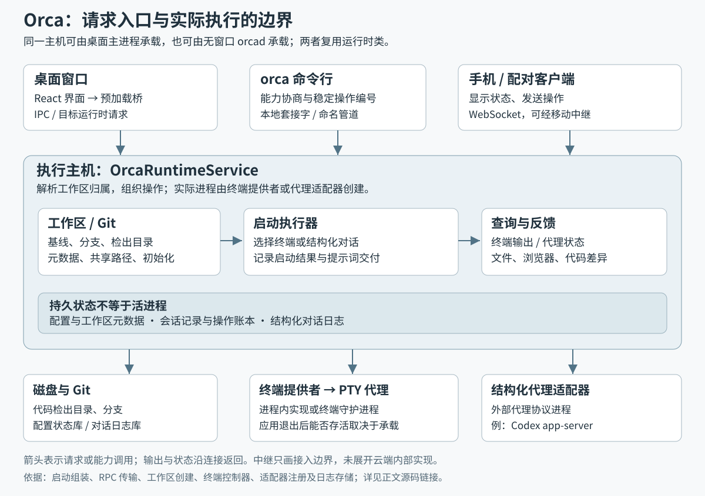
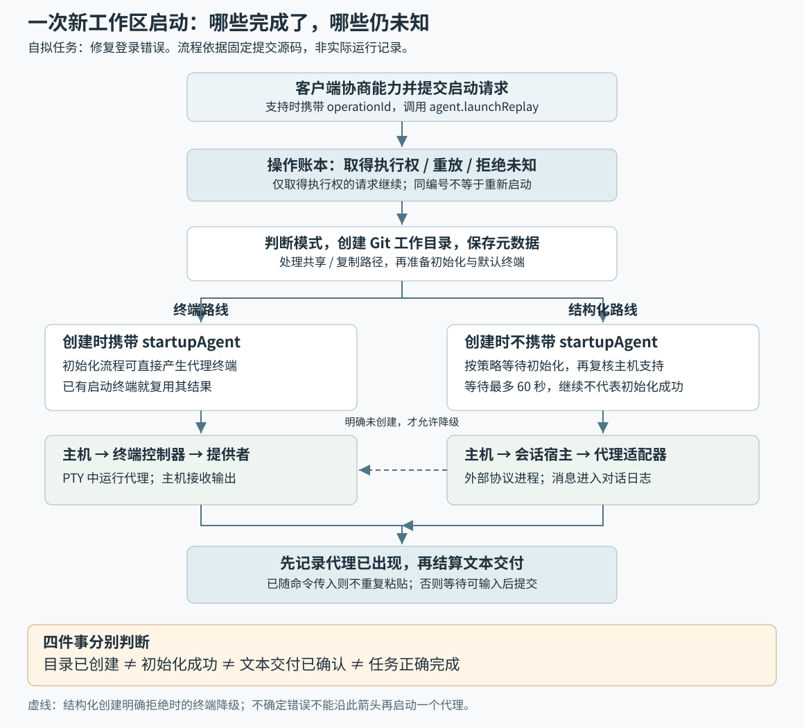

# Orca 如何把一个开发任务变成独立工作区、代理进程和可追踪的结果

假设你要修复购物网站的登录错误，同时尝试两种修复方案。这是自拟场景：你希望两个编码代理各改各的文件，自己能切换查看进度，最后检查差异，再决定采用哪个方案。Orca 提供的基础做法是为任务建立独立的 Git 工作目录，把代理、终端和相关界面组织在工作区里。源码中的命令行入口确实把“创建工作目录并启动代理”作为一个组合请求提交；下面用其中一次启动解释整个系统，不假定两份结果会被自动比较或合并。[组合请求的实际调用方](https://github.com/stablyai/orca/blob/444064105c6a7397a2f48ec7132ce92579f7d6b7/src/cli/handlers/worktree-create-agent-launch.ts#L82-L105)

这里的 **Git worktree（关联工作目录）**，是同一个仓库下可同时存在的多个检出目录。Orca 的普通新建路径会调用 `git worktree add --no-track -b`，创建分支与目录；选择已有分支时走另一条分支。因此，它首先解决并行修改代码时的目录与分支组织问题。**从这些实现推断，目录分开能减少文件互相覆盖，但不能保证不同任务的改动没有逻辑冲突。**[实际 Git 命令](https://github.com/stablyai/orca/blob/444064105c6a7397a2f48ec7132ce92579f7d6b7/src/main/git/worktree-add.ts#L242-L278)

本篇是首次系统研读，依据本地 `input/repository/` 的固定版本 **`444064105c6a7397a2f48ec7132ce92579f7d6b7`**。重点回答：Orca 由哪些部分组成、一次任务怎样启动、状态存在哪里，以及哪些失败允许继续、哪些必须保留不确定性。以下“源码事实”来自静态阅读；设计动机的推断会单独标出，未将测试文件的断言当成本次实测结果。

## 先分清：工作区、界面和代理并不是同一个东西

Git 返回的工作目录信息主要是路径、提交位置、分支和锁定状态；Orca 则给它增加项目、执行主机、实例、显示名称和任务关联。这解释了为什么侧栏中的一个工作区能承载远多于一条分支的信息。**执行主机**就是实际拥有目录并运行进程的那台机器；同名路径不能替代主机身份。[Git 层信息](https://github.com/stablyai/orca/blob/444064105c6a7397a2f48ec7132ce92579f7d6b7/src/shared/worktree/types.ts#L50-L70)、[应用层工作区记录](https://github.com/stablyai/orca/blob/444064105c6a7397a2f48ec7132ce92579f7d6b7/src/shared/worktree/types.ts#L100-L128)

工作区也不等于代理会话。启动执行器明确支持两类结果：一种是运行在终端里的代理，另一种是 **结构化对话**，即通过程序协议交换消息和状态、由 Orca 绘制聊天界面的会话。创建新工作目录时，终端路线携带 `startupAgent`，让初始化过程直接启动代理；结构化路线刻意不携带这个字段，先建立工作目录，再创建会话。[两条路线的关键分叉](https://github.com/stablyai/orca/blob/444064105c6a7397a2f48ec7132ce92579f7d6b7/src/main/agent-launch/agent-launch-executor.ts#L247-L263)、[对应测试断言](https://github.com/stablyai/orca/blob/444064105c6a7397a2f48ec7132ce92579f7d6b7/src/main/runtime/rpc/methods/agent-launch.test.ts#L202-L214)

图中外框表示执行主机上的运行时职责范围，不表示所有组件都在一个进程中；下方的代理进程和终端守护进程另有生命周期。桌面版与无窗口服务是两种承载方式，不应把图读成“桌面每次都通过独立 orcad 服务工作”。

| 部分 | 实际职责及连接证据 |
| --- | --- |
| 桌面界面 `src/renderer` | React 挂载应用，呈现工作区和操作状态；本地创建经预加载桥转成 **IPC（进程间通信）** 调用。[界面入口](https://github.com/stablyai/orca/blob/444064105c6a7397a2f48ec7132ce92579f7d6b7/src/renderer/src/main.tsx#L57-L81)、[创建桥接](https://github.com/stablyai/orca/blob/444064105c6a7397a2f48ec7132ce92579f7d6b7/src/preload/api/worktrees-bridge.ts#L13-L31) |
| 主机运行时 `src/main/runtime` | `OrcaRuntimeService` 组织工作目录、会话和终端能力；桌面启动时直接构造它，并注入终端提供者等依赖。[桌面的组装位置](https://github.com/stablyai/orca/blob/444064105c6a7397a2f48ec7132ce92579f7d6b7/src/main/startup/main-process-runtime-service.ts#L85-L111) |
| 无窗口入口 `src/main/orcad` | `orcad` 使用同一个运行时类并启动 **RPC（远程过程调用）** 服务，让其他客户端通过消息请求操作。[复用运行时](https://github.com/stablyai/orca/blob/444064105c6a7397a2f48ec7132ce92579f7d6b7/src/main/orcad/orcad-entry.ts#L211-L239)、[启动服务](https://github.com/stablyai/orca/blob/444064105c6a7397a2f48ec7132ce92579f7d6b7/src/main/orcad/orcad-entry.ts#L327-L342) |
| 工作目录与状态存储 | Git 管理代码检出；应用保存额外元数据。可写 `Store` 要求 SQLite 配置状态存储；会话记录与操作账本另接入主机聊天日志数据库。SQLite 是这里使用的本地数据库。[配置存储约束](https://github.com/stablyai/orca/blob/444064105c6a7397a2f48ec7132ce92579f7d6b7/src/main/persistence/loading-store/store.ts#L75-L93)、[会话记录入口](https://github.com/stablyai/orca/blob/444064105c6a7397a2f48ec7132ce92579f7d6b7/src/main/runtime/agent-session-record-store.ts#L100-L107)、[日志数据库文件](https://github.com/stablyai/orca/blob/444064105c6a7397a2f48ec7132ce92579f7d6b7/src/main/native-chat/agent-session-journal/journal-host-database.ts#L18-L45) |
| 终端与结构化代理适配器 | 终端控制器提供创建、输入、附接和停止；结构化注册把不同代理连接到各自适配器。适配器负责把 Orca 的操作翻译成代理理解的协议。[终端控制器](https://github.com/stablyai/orca/blob/444064105c6a7397a2f48ec7132ce92579f7d6b7/src/main/ipc/pty/runtime/controller.ts#L41-L67)、[结构化适配器注册](https://github.com/stablyai/orca/blob/444064105c6a7397a2f48ec7132ce92579f7d6b7/src/main/runtime/structured-agent-runtime-registrations.ts#L148-L165) |
| 编辑、浏览、评审与任务集成 | 浏览器、文件、Git、GitHub、GitLab、Linear、Jira 以及编排能力登记在共同 RPC 方法表。它们围绕工作区扩展操作范围；本篇不逐项验证这些功能的全部实现。[统一注册位置](https://github.com/stablyai/orca/blob/444064105c6a7397a2f48ec7132ce92579f7d6b7/src/main/runtime/rpc/methods/index.ts#L91-L125) |

客户端与执行位置之间还有一层明确路由。界面创建逻辑会选择本地 API 或目标运行时 RPC；执行端遇到不属于自己的运行时目标，或未被服务的 SSH（安全远程连接）目标，会拒绝创建，避免误把远程路径当成本地路径。这里的边界比“传一个目录字符串”严格。[客户端路由](https://github.com/stablyai/orca/blob/444064105c6a7397a2f48ec7132ce92579f7d6b7/src/renderer/src/store/slices/worktrees/create/create-worktree.ts#L77-L91)、[执行端拒绝误路由](https://github.com/stablyai/orca/blob/444064105c6a7397a2f48ec7132ce92579f7d6b7/src/main/runtime/workspaces/workspace-creation.ts#L135-L167)

本地命令行使用套接字，Windows 上对应命名管道；配对客户端可使用 WebSocket，也就是持续保持的双向消息连接。移动中继服务把运行时的移动连接接到中继会话。**本篇只核验这些连接点，不把它扩展为对云端中继、配对加密或跨网络重连的完整审计。**[本地传输](https://github.com/stablyai/orca/blob/444064105c6a7397a2f48ec7132ce92579f7d6b7/src/main/runtime/runtime-rpc/runtime-rpc-lifecycle.ts#L41-L58)、[配对传输](https://github.com/stablyai/orca/blob/444064105c6a7397a2f48ec7132ce92579f7d6b7/src/main/runtime/runtime-rpc/runtime-rpc-lifecycle.ts#L81-L104)、[中继接线](https://github.com/stablyai/orca/blob/444064105c6a7397a2f48ec7132ce92579f7d6b7/src/main/runtime/mobile-cloud-relay/desktop-relay-service.ts#L54-L85)

## 一次启动，怎样落到文件和进程上

下面选择源码中完整可追踪的路径：命令行发起“在新工作目录中启动代理”，执行主机已经就绪，且双方支持相应启动能力。这个入口便于观察跨组件连接；桌面还保留直接创建工作目录等入口，不能假定所有界面动作都经过同一个方法。

**第一步，客户端先问主机能做什么。** `getAgentLaunchCapabilities` 读取 `status.get`；支持可重放启动时，客户端生成或复用 `operationId`，即给这次操作起一个稳定编号，然后调用 `agent.launchReplay`；否则在适用条件下调用 `agent.launch`。能力不足的旧主机可能走传统 `worktree.create` 路线。这里的能力协商决定结果格式与重试方式，不能只看命令名称判断行为。[能力检查与调用选择](https://github.com/stablyai/orca/blob/444064105c6a7397a2f48ec7132ce92579f7d6b7/src/cli/agent-launch-request.ts#L91-L138)、[新入口调用](https://github.com/stablyai/orca/blob/444064105c6a7397a2f48ec7132ce92579f7d6b7/src/cli/handlers/worktree-create-agent-launch.ts#L82-L105)、[旧主机兼容路线](https://github.com/stablyai/orca/blob/444064105c6a7397a2f48ec7132ce92579f7d6b7/src/cli/handlers/worktree-create-agent-launch.ts#L44-L80)

**第二步，主机决定代理怎样呈现。** RPC 处理器把请求交给 `executeAgentLaunch`，并提供工作目录工厂和会话工厂。执行器先结合用户默认、代理注册情况、启动目录和客户端能否显示该类对话作判断；在工作区解析后，还会询问实际执行主机是否支持创建结构化会话。指定工作区根目录以外的启动目录、复用现有终端、主机不支持等条件，可能让结果落到终端路线。**远程客户端不等于远程执行：应看收到请求的主机和工作区归属，不能笼统说“远程就只能用终端”。**[入口装配](https://github.com/stablyai/orca/blob/444064105c6a7397a2f48ec7132ce92579f7d6b7/src/main/runtime/rpc/methods/agent-launch.ts#L116-L144)、[首次选择](https://github.com/stablyai/orca/blob/444064105c6a7397a2f48ec7132ce92579f7d6b7/src/main/agent-launch/agent-launch-mode.ts#L130-L183)、[主机复核](https://github.com/stablyai/orca/blob/444064105c6a7397a2f48ec7132ce92579f7d6b7/src/main/agent-launch/agent-launch-mode.ts#L191-L220)

**第三步，真正建立 Git 工作目录。** `createManagedWorktree` 解析项目和主机后，进入本地主机创建流程。已有初始化脚本但缺少必要运行决策时，它在 Git 操作前拒绝；随后解析基线、名称和路径，完成 Git 创建，再补应用状态。普通路径调用前述 `git worktree add`；实现还可能消费预先准备的检出目录，或进行稀疏检出——只展开选定目录。因此，不能把每次点击都解释成一条全新的普通 Git 检出命令。[创建前的决策检查](https://github.com/stablyai/orca/blob/444064105c6a7397a2f48ec7132ce92579f7d6b7/src/main/runtime/runtime-local-worktree-create.ts#L82-L100)、[Git 与物化顺序](https://github.com/stablyai/orca/blob/444064105c6a7397a2f48ec7132ce92579f7d6b7/src/main/runtime/runtime-local-worktree-create.ts#L169-L207)、[预备检出及其他路径](https://github.com/stablyai/orca/blob/444064105c6a7397a2f48ec7132ce92579f7d6b7/src/main/runtime/runtime-local-git-worktree-create.ts#L135-L186)

**第四步，把目录变成可管理的工作区。** 物化函数保存随机实例编号、显示名称、创建时间和比较基线等元数据，然后合并 Git 信息与应用信息。之后处理用户配置的共享路径、共享目录和需要复制的文件。以自拟场景中的两种登录修复为例，代码目录虽分开，如果把依赖目录或配置路径设为共享，它们仍可能共用部分内容。选择共享还是复制，是工作区环境设计的一部分。[元数据写入](https://github.com/stablyai/orca/blob/444064105c6a7397a2f48ec7132ce92579f7d6b7/src/main/runtime/runtime-local-worktree-materialization.ts#L68-L89)、[共享与复制的顺序](https://github.com/stablyai/orca/blob/444064105c6a7397a2f48ec7132ce92579f7d6b7/src/main/runtime/runtime-local-worktree-materialization.ts#L143-L179)

**第五步，读取新工作目录中的初始化配置，再启动相关终端。** 初始化代码从新目录加载 `orca.yaml`，结合运行决策生成执行脚本或跳过运行。创建流程随后启动初始化、默认终端和代理启动终端，并发布工作区已创建事件。目标分支新增了未经确认的初始化脚本时，已有工作目录可以保留，初始化则被跳过或附带警告；“目录创建成功”不是“环境已准备成功”的同义词。[配置读取与降级](https://github.com/stablyai/orca/blob/444064105c6a7397a2f48ec7132ce92579f7d6b7/src/main/runtime/runtime-local-worktree-setup.ts#L34-L85)、[终端启动与事件发布](https://github.com/stablyai/orca/blob/444064105c6a7397a2f48ec7132ce92579f7d6b7/src/main/runtime/workspaces/workspace-creation.ts#L218-L247)

这里有一个具体限制：结构化路线在要求 `wait-for-setup`、即等待初始化时，仅对“正在运行且有终端标识”的初始化做等待。它将完成等待与 **60 秒**计时器竞速；超时会取消等待并继续，异常也被吞掉。返回的退出结果并未在这里用于判断初始化是否成功。因此，这段代码提供的是有上限的等待，而非初始化成功保证。测试也明确断言超时后仍能得到结构化会话。[等待的调用点](https://github.com/stablyai/orca/blob/444064105c6a7397a2f48ec7132ce92579f7d6b7/src/main/runtime/rpc/methods/agent-launch-worktree-creation.ts#L101-L119)、[时限常量](https://github.com/stablyai/orca/blob/444064105c6a7397a2f48ec7132ce92579f7d6b7/src/main/runtime/rpc/methods/agent-launch-worktree-creation.ts#L35-L35)、[完整等待实现](https://github.com/stablyai/orca/blob/444064105c6a7397a2f48ec7132ce92579f7d6b7/src/main/runtime/rpc/methods/agent-launch-worktree-creation.ts#L159-L187)、[超时测试断言](https://github.com/stablyai/orca/blob/444064105c6a7397a2f48ec7132ce92579f7d6b7/src/main/runtime/rpc/methods/agent-launch.test.ts#L262-L278)

## 代理启动以后，数据怎样回来

终端路线需要 **PTY（伪终端）**：它让命令行程序获得类似真实终端的输入、屏幕尺寸和控制序列。`createTerminal` 在主机上解析工作区、启动参数和目录，先占用稳定面板身份，再通过终端控制器进入提供者的 `spawn`。进程内本地提供者最终使用 `node-pty` 创建 shell。这里的提供者是可替换实现，运行时不必把每一种终端承载方式写进启动决策里。[主机解析与面板占用](https://github.com/stablyai/orca/blob/444064105c6a7397a2f48ec7132ce92579f7d6b7/src/main/runtime/terminal/launch/terminal-create.ts#L26-L63)、[控制器连接](https://github.com/stablyai/orca/blob/444064105c6a7397a2f48ec7132ce92579f7d6b7/src/main/ipc/pty/runtime/controller.ts#L41-L67)、[提供者执行](https://github.com/stablyai/orca/blob/444064105c6a7397a2f48ec7132ce92579f7d6b7/src/main/ipc/pty/runtime/spawn-execute.ts#L85-L99)、[本地进程实现](https://github.com/stablyai/orca/blob/444064105c6a7397a2f48ec7132ce92579f7d6b7/src/main/providers/local-pty-runtime-spawn.ts#L7-L14)

终端的寿命也取决于承载方式。使用终端守护进程时，应用退出可以只断开连接，让会话留下等待再次附接；但降级提供者会把新终端建在当前进程里，这些新终端不具有相同的退出后存活条件。**因此，“能恢复终端”必须带上守护进程是否拥有该会话的条件。**[新终端持久性的判断](https://github.com/stablyai/orca/blob/444064105c6a7397a2f48ec7132ce92579f7d6b7/src/main/daemon/daemon-provider-state.ts#L37-L46)、[退出时仅断开](https://github.com/stablyai/orca/blob/444064105c6a7397a2f48ec7132ce92579f7d6b7/src/main/daemon/daemon-provider-state.ts#L117-L120)

结构化路线则通过代理适配器运行。注册表不仅记录名称，还会拒绝“宣称有某项能力、适配器却没有相应方法”的注册。以 Codex 为例，启动解析器生成带 `app-server` 子命令的计划，携带已有线程的恢复标识；协议连接实现再创建受管子进程。Orca 仍要启动和管理外部代理，只是对话数据通过协议传递。各代理适配器的消息、停止和恢复细节各不相同，本篇没有把它们视为同一种实现。[能力与实现一致性检查](https://github.com/stablyai/orca/blob/444064105c6a7397a2f48ec7132ce92579f7d6b7/src/main/native-chat/agent-session-wire/structured-agent-registry.ts#L28-L48)、[Codex 启动计划](https://github.com/stablyai/orca/blob/444064105c6a7397a2f48ec7132ce92579f7d6b7/src/main/codex/codex-structured-launch-resolution.ts#L91-L108)、[协议进程创建](https://github.com/stablyai/orca/blob/444064105c6a7397a2f48ec7132ce92579f7d6b7/src/main/codex/codex-app-server-connection.ts#L40-L51)

提示词交付是另一件独立的事。终端启动命令已经携带文本时，执行器不再粘贴；否则主机等待代理可输入，再通过统一写入方法提交文本，并返回是否已接收。这个结果说明文本是否交给终端，不能证明代理已经完成任务。相应测试分别断言“需要粘贴”和“已随命令传入、不可重复粘贴”。[避免重复交付](https://github.com/stablyai/orca/blob/444064105c6a7397a2f48ec7132ce92579f7d6b7/src/main/agent-launch/agent-launch-executor.ts#L116-L139)、[等待与写入](https://github.com/stablyai/orca/blob/444064105c6a7397a2f48ec7132ce92579f7d6b7/src/main/runtime/rpc/methods/agent-launch-terminal-prompt.ts#L117-L147)、[两条路径的测试](https://github.com/stablyai/orca/blob/444064105c6a7397a2f48ec7132ce92579f7d6b7/src/main/runtime/rpc/methods/agent-launch-prompt-carry.test.ts#L53-L72)

输出回程也不完全依赖窗口：终端提供者把输出送到运行时并交给界面；检测到输出缺口时，要求从终端快照恢复。另一方面，终端状态和结构化会话状态被接到同一主机状态接口，供工作区进程列表、移动端等读取。这里能复用的是状态入口，不代表两类代理使用相同的状态检测机制。[终端输出回程](https://github.com/stablyai/orca/blob/444064105c6a7397a2f48ec7132ce92579f7d6b7/src/main/ipc/pty/provider/bind-listeners.ts#L56-L85)、[状态接口接线](https://github.com/stablyai/orca/blob/444064105c6a7397a2f48ec7132ce92579f7d6b7/src/main/agent-hooks/agent-hook-runtime-deps.ts#L14-L39)

回到登录修复场景，代理结束只是开始评审的信号。差异入口 `git.diff`、`git.branchDiff` 按工作区获取文件或分支差异；远程请求还受内容预算限制。使用者仍需结合实际差异与自己的验证决定是否提交；本次研究没有运行示例项目，也没有证明生成的代码正确。[评审数据入口](https://github.com/stablyai/orca/blob/444064105c6a7397a2f48ec7132ce92579f7d6b7/src/main/runtime/rpc/methods/git-diff-methods.ts#L14-L39)

## 最重要的失败边界：没有回包，不等于没有执行

假设启动请求已发出，连接却断了。客户端无法仅凭超时知道代理是否已经运行。若直接重做整个请求，就可能多出一个工作目录或第二个代理。Orca 为带稳定操作编号的启动使用 **操作账本**，即持久保存“谁请求、请求内容是否一致、谁获得执行权、已知结果是什么”的记录。准入与争取执行权发生在同一次存储操作中；同进程的相同请求还会共享正在执行的结果，内容改变则报告冲突。此保证依赖调用方身份、同一执行主机和相同操作编号，不适用于任意新请求。[账本准入与重放](https://github.com/stablyai/orca/blob/444064105c6a7397a2f48ec7132ce92579f7d6b7/src/main/runtime/rpc/methods/agent-launch-replay.ts#L208-L242)、[进程内并发合并](https://github.com/stablyai/orca/blob/444064105c6a7397a2f48ec7132ce92579f7d6b7/src/main/runtime/rpc/methods/agent-launch.ts#L284-L307)

| 已知情况 | 实现采取的动作 | 使用时的含义 |
| --- | --- | --- |
| 相同操作已有结果 | 返回记录，不重新创建资源 | 用同一编号查询或重试，可以得到先前答案。重开磁盘记录的测试断言不会再次创建工作目录。[重启后重放测试](https://github.com/stablyai/orca/blob/444064105c6a7397a2f48ec7132ce92579f7d6b7/src/main/runtime/rpc/methods/agent-launch-replay.test.ts#L282-L293) |
| 能证明尚未产生相关副作用的失败 | 保存确定失败 | 需根据错误修正配置，并有意识地发起新操作。判断同时考虑目标类型与启动请求是否已发出；已有工作目录和新建工作目录不能混为一谈。[无副作用失败分类](https://github.com/stablyai/orca/blob/444064105c6a7397a2f48ec7132ce92579f7d6b7/src/main/runtime/rpc/methods/agent-launch-failure-code.ts#L66-L89) |
| 已争取执行权，但结果仍未知 | 拒绝再次执行 | 先回到原主机检查实际工作区与进程。测试要求这时不新建工作目录、终端或结构化会话。[未知状态测试](https://github.com/stablyai/orca/blob/444064105c6a7397a2f48ec7132ce92579f7d6b7/src/main/runtime/rpc/methods/agent-launch-replay.test.ts#L315-L331) |
| 代理已出现，但提示词交付未确认 | 先记录已出现的代理，再保留提示词的不确定性 | 能显示 `unconfirmed` 的客户端得到“未确认”；旧客户端可能得到未知错误，避免把它误读成“没有交付”而重复发送。[分阶段记录](https://github.com/stablyai/orca/blob/444064105c6a7397a2f48ec7132ce92579f7d6b7/src/main/runtime/rpc/methods/agent-launch.ts#L250-L281)、[客户端兼容处理](https://github.com/stablyai/orca/blob/444064105c6a7397a2f48ec7132ce92579f7d6b7/src/main/runtime/rpc/methods/agent-launch-replay.ts#L176-L186) |

同样的原则用于结构化对话降级：只有明确说明未创建会话的拒绝，执行器才再建一个终端代理；其他错误继续向外传播。**从实现推断，这是用更保守的继续策略换取避免双重启动。代价是有些失败需要人工查明状态，安全重试本身不等于自动恢复。**[允许降级的精确条件](https://github.com/stablyai/orca/blob/444064105c6a7397a2f48ec7132ce92579f7d6b7/src/main/agent-launch/agent-launch-executor.ts#L156-L170)

## 怎样使用这套架构，以及能迁移什么

Orca 适合的场景是：你已有命令行编码代理，需要把多个任务放在不同目录里工作，还希望集中查看会话、环境初始化和代码差异。若只是编辑一份代码，额外的主机身份、工作区实例和操作账本会增加理解成本；当窗口、命令行和远程客户端都可能操作同一批进程时，这些状态才显出必要性。这是基于上述结构的适用性判断，不是性能测量结论。

实际使用时，可以从三个具体动作开始：

1. **先决定哪些环境内容必须独立。** 需要独立修改的配置选择复制；允许共同使用的缓存或依赖才共享。共享和复制确实是两条实现路径，不能把“独立工作区”理解为整个运行环境完全隔离。[路径物化实现](https://github.com/stablyai/orca/blob/444064105c6a7397a2f48ec7132ce92579f7d6b7/src/main/runtime/runtime-local-worktree-materialization.ts#L143-L179)
2. **分别检查初始化、代理和文本交付结果。** 工作目录已建好时，优先检查已有资源；提示词未确认时，先看会话再决定是否补发。等待初始化超时仍可能继续，不能让业务正确性依赖这一个等待步骤。[等待边界](https://github.com/stablyai/orca/blob/444064105c6a7397a2f48ec7132ce92579f7d6b7/src/main/runtime/rpc/methods/agent-launch-worktree-creation.ts#L159-L187)、[交付未确认状态](https://github.com/stablyai/orca/blob/444064105c6a7397a2f48ec7132ce92579f7d6b7/src/main/runtime/rpc/methods/agent-launch-replay.ts#L176-L186)
3. **按实际权限配置代理。** 工作目录隔离并不限制进程能访问的其他路径。源码中存在跳过审批或沙箱的代理参数模式，启动参数解析会让显式配置覆盖默认值，空字符串也有效。若需要受限执行，应单独安排代理权限与运行环境。[权限模式参数](https://github.com/stablyai/orca/blob/444064105c6a7397a2f48ec7132ce92579f7d6b7/src/shared/tui-agent-permissions.ts#L12-L20)、[参数覆盖规则](https://github.com/stablyai/orca/blob/444064105c6a7397a2f48ec7132ce92579f7d6b7/src/shared/tui-agent-launch-defaults.ts#L120-L139)

“编排”也有比并排显示终端更具体的实现：`orchestration.workerStart` 要先验证请求来自当前任务运行绑定的协调者，再选择本地工作代理或跨主机工作代理入口。协调者是负责分派工作的会话，工作代理负责执行所分配的任务。本篇仅核验这层入口与约束；消息投递、任务接管和跨主机一致性值得后续沿各自调用链研究，不能由“有编排模块”推导为任意任务都会自动完成。[协调者与任务运行约束](https://github.com/stablyai/orca/blob/444064105c6a7397a2f48ec7132ce92579f7d6b7/src/main/runtime/rpc/methods/orchestration/worker/workers.ts#L34-L46)、[本地和跨主机分支](https://github.com/stablyai/orca/blob/444064105c6a7397a2f48ec7132ce92579f7d6b7/src/main/runtime/rpc/methods/orchestration/worker/workers.ts#L68-L92)

可复用的设计思想有三点：**把资源创建与界面显示分开，把通用执行顺序与代理适配分开，把已知失败与结果未知分开。**前者让无窗口主机也能执行任务；中间一层让不同代理沿共同工作区流程接入；最后一层让客户端遇到断线时有依据决定下一步。它们的共同前提，是每一层都说清自己实际完成了什么，而不把“目录存在”“进程启动”“文本已交付”和“任务正确完成”压成一个成功标记。

## 核验范围

已核对仓库实际提交号与 `input/repository.json` 一致；Git 工作树无改动，未发现缺失的跟踪文件、子模块条目或 Git LFS 指针。输入标记子模块和 LFS 未抓取，但本次未发现需要它们补齐的源码。仓库内指令均作为研究数据，未执行项目脚本、安装依赖或启动服务。

本次沿实际调用方、RPC 注册、创建实现、数据结构、终端控制器、结构化适配器和异常分支进行了静态核验，并阅读相关测试与工作目录、会话、初始化配置文档。**没有运行项目测试，没有测量性能，没有完成云端中继、所有代理适配器、删除恢复或平台差异的全面验证。**文档中把会话简化为“一个终端里的代理”的介绍不足以覆盖本次版本已有的结构化路线，本文以实现和测试连接为准。配图表达已核验的职责和流程，不表示测量结果。逐行原文证据见同目录 `evidence.json`。