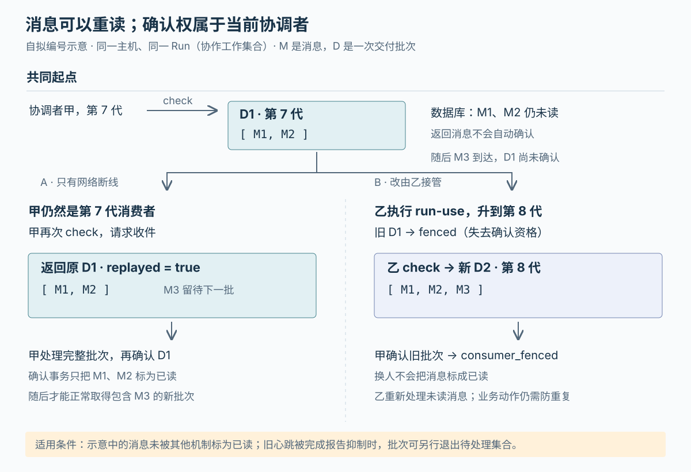

# Orca 如何交付代理结果：断线重读、整批确认与协调者接管

假设一个代理负责修复结账页面，另一个代理负责协调：收集修复结果，再安排后续检查。这是本文自拟场景。修复代理已经报告“完成”，协调者却在读取结果时断线。重新连接后，它应该再看到原来的报告；如果换成另一个协调者接手，旧协调者又不应该继续确认消息。否则，结果可能被遗漏，也可能由两个协调者同时推进下一步。

Orca 为此把三个动作分开：**接受工作代理的完成报告、把消息交给协调者、由协调者确认处理完毕。**完成报告可以先更新任务状态，消息仍保持未读；普通断线重试可以拿回原批次；更换协调者则撤销旧批次的确认资格，把未读消息交给新协调者。这里保证的是有记录、有边界的交付流程，不能据此认定“安排后续检查”这样的业务动作只会执行一次。[发送实现](https://github.com/stablyai/orca/blob/be4e0719b8949dd44b6b1681f70499b486a6c1a3/src/main/runtime/rpc/methods/orchestration/messaging/send-point-to-point.ts)、[收件与确认实现](https://github.com/stablyai/orca/blob/be4e0719b8949dd44b6b1681f70499b486a6c1a3/src/main/runtime/orchestration/db/messages/role-mailbox-delivery.ts)

前两篇已解释 Orca 怎样用独立工作目录组织编码代理，以及代理如何启动。本篇继续研究其协作机制，不重复整体启动流程。依据是本次本地源码 `be4e0719b8949dd44b6b1681f70499b486a6c1a3`，重点限定在同一执行主机上的当前编排协议；跨主机转发和旧协议迁移不作同等保证。以下实现结论来自静态阅读，测试断言只用于交叉核对，没有运行项目测试。

**先把“交给谁”从某个终端中分离出来。**

Orca 既能并排运行代理，也提供记录任务归属和结果的编排层。在这一层，**Run** 是一组协作工作的持久标识及其协调者收件箱；**Task** 是要完成的工作；**Dispatch** 是把某个任务交给某个代理执行的一次分派。任务重试可以产生另一次分派，因此只知道任务编号不足以决定谁有权报告完成。仓库文档也明确：Run 本身不安排代理在哪里运行。[编排使用文档](https://github.com/stablyai/orca/blob/be4e0719b8949dd44b6b1681f70499b486a6c1a3/docs/site/content/docs/cli/orchestration.mdx)

协调者收件箱的地址是 `run:<id>`，可以保持不变，而读取它的协调者可以更换。运行时将编排数据保存在用户数据目录下的 `orchestration.db`；这是 SQLite 本地数据库文件。它至少保存以下几类彼此独立的记录：[数据库打开位置](https://github.com/stablyai/orca/blob/be4e0719b8949dd44b6b1681f70499b486a6c1a3/src/main/runtime/workspaces/persisted-surfaces/automation-operations.ts)、[表结构](https://github.com/stablyai/orca/blob/be4e0719b8949dd44b6b1681f70499b486a6c1a3/src/main/runtime/orchestration/db/schema/create-core-tables-sql.ts)

| 记录 | 解决的问题 | 关键内容 |
| --- | --- | --- |
| Run | 哪组工作由谁读取和协调 | 协调者身份、`consumer_generation`（当前消费者的代次） |
| Message | 一条消息说了什么、归哪个收件箱 | 消息编号、Run、收件地址、递增顺序号、是否已读 |
| Delivery | 这一次具体交出了哪些消息 | 批次编号、所属收件箱、消费者代次、有序消息编号列表、批次状态 |
| Mutation receipt（修改操作回执） | 请求响应丢失后，如何找回已发生的结果 | 调用者标识、请求编号、输入摘要、保存的结果 |

因此，消息编号、交付批次编号和请求编号不能互换。消息编号回答“哪一条报告”，交付批次编号回答“确认哪一批”，请求编号回答“重试哪一次操作”。数据库会专门拒绝把消息编号当成批次编号来确认，并给出说明。

**一份完成报告，在协调者读取之前就会结算任务。**

真实入口是 `orchestration.send`，即通过 RPC（远程过程调用，把方法名和参数交给主机执行）发送消息。它和 `orchestration.check` 收件方法都登记在编排方法表，再进入运行时的统一方法集合。发送处理器先解析调用者与分派、确定 Run，再进入 `sendPointToPointMessage` 处理单个收件地址。[方法注册](https://github.com/stablyai/orca/blob/be4e0719b8949dd44b6b1681f70499b486a6c1a3/src/main/runtime/rpc/methods/orchestration.ts)、[发送入口](https://github.com/stablyai/orca/blob/be4e0719b8949dd44b6b1681f70499b486a6c1a3/src/main/runtime/rpc/methods/orchestration/messaging/send-methods.ts)

工作代理发送 `worker_done`，也就是完成报告时，需要提供任务编号、分派编号和 `succeeded` 或 `failed` 结果。没有显式收件地址、但能够解析所属 Run 时，处理器会将报告送到该 Run 的收件箱；有关联分派的完成报告也会归到所属 Run。这样，报告不必追着某个暂时存在的协调者终端走。

接收报告并非相信正文写了“完成”就改状态。代码会核对任务与分派是否对应、发送者是否拥有分派，以及在记录了进程身份的路径中，是否仍是原来的实际进程。正在停止的工作代理会被拒绝报告；无效报告可以转成带拒绝原因的诊断消息。随后 `reconcileLifecycleMessage` 调用 `settleWorkerReport`，正常成功路径更新任务、分派和受监管工作代理的状态，保存报告结果，并检查哪些后续任务可以转为就绪。[身份与停止状态检查](https://github.com/stablyai/orca/blob/be4e0719b8949dd44b6b1681f70499b486a6c1a3/src/main/runtime/orchestration/worker-report-admission.ts)、[报告解析与拒绝](https://github.com/stablyai/orca/blob/be4e0719b8949dd44b6b1681f70499b486a6c1a3/src/main/runtime/orchestration/lifecycle-reconciliation.ts)、[任务结算](https://github.com/stablyai/orca/blob/be4e0719b8949dd44b6b1681f70499b486a6c1a3/src/main/runtime/orchestration/db/dispatch-context/worker-report-settlement.ts)

这修正了一种容易产生的理解：**协调者读取报告，不是任务变成完成状态的必要触发点；结算已经发生在发送被接受时。**反过来，任务显示完成，也不能证明协调者已经读到摘要，更不能证明补丁通过了独立验收。结果记录中的 `provenance: 'worker_report'` 明确说明它来自工作代理报告。

这里最关键的执行顺序是：在同一数据库事务中插入报告消息、结算任务、保存修改操作回执，提交后才调用 `notifyMessageArrived` 唤醒接收方。事务就是让一组数据库改动一起生效，失败时一起撤回；嵌套调用通过保存点保留外层事务的边界。由此，协调者不会因为这一发送路径的通知先到，而读到尚未提交的完成记录。[事务边界](https://github.com/stablyai/orca/blob/be4e0719b8949dd44b6b1681f70499b486a6c1a3/src/main/runtime/orchestration/db/messages/message-insert.ts)、[嵌套事务处理](https://github.com/stablyai/orca/blob/be4e0719b8949dd44b6b1681f70499b486a6c1a3/src/main/runtime/orchestration/db/lifecycle-transition.ts)

通知仍可能失败。Orca 把“重放时要再次通知哪个地址”也附在已保存的回执里；相同调用者以相同请求编号、相同输入重试时，可以返回原结果并再次通知，而不用再插入一份报告。客户端会为需要持久回执的操作生成或复用请求编号。若重启后只剩一条未完成记录，执行器只有在记录了“尚未产生效果”的特定 `worker_done` 检查点时才允许继续；缺少该证据则返回 `operation_unknown`，即无法确认执行结果。[客户端请求编号](https://github.com/stablyai/orca/blob/be4e0719b8949dd44b6b1681f70499b486a6c1a3/src/cli/runtime/client.ts)、[回执执行器](https://github.com/stablyai/orca/blob/be4e0719b8949dd44b6b1681f70499b486a6c1a3/src/main/runtime/rpc/orchestration-mutation-executor.ts)、[通知重放](https://github.com/stablyai/orca/blob/be4e0719b8949dd44b6b1681f70499b486a6c1a3/src/main/runtime/rpc/methods/orchestration/messaging/mutation-replay-nudge.ts)

这套处理依赖原来的调用者身份、请求编号与数据库。换一个编号重新发送，是另一项请求，不能把它当成原请求重放。

**读取消息时，主机先保存“这一批是什么”。**

协调者运行 `orca orchestration check` 后，命令行把身份、Run、确认编号和等待参数交给主机。`checkRunMailbox` 先核实当前协调者的绑定，处理已有确认，再读取或创建交付批次。默认路径最终进入 `getOrCreateMailboxDelivery`；它在 `BEGIN IMMEDIATE` 事务中核验消费者代次、查找已有待处理批次，或按消息顺序号从小到大选取未读消息，最多 50 条，然后保存其编号列表。该事务会先取得写入资格，使批次选择和建立不被另一写连接插入修改。[命令行调用方](https://github.com/stablyai/orca/blob/be4e0719b8949dd44b6b1681f70499b486a6c1a3/src/cli/handlers/orchestration/message-check-handler.ts)、[Run 收件流程](https://github.com/stablyai/orca/blob/be4e0719b8949dd44b6b1681f70499b486a6c1a3/src/main/runtime/rpc/methods/orchestration/messaging/check-run.ts)、[批次实现](https://github.com/stablyai/orca/blob/be4e0719b8949dd44b6b1681f70499b486a6c1a3/src/main/runtime/orchestration/db/messages/role-mailbox-delivery.ts)

例如，第一次返回 D1，包含 M1 和 M2。这次读取不会把它们标为已读。只要 D1 仍有未读成员且消费者没有更换，再次正常收件就返回原 D1，并设置 `replayed: true`。后来到达的 M3 不会被追加进去。批次编号及成员列表稳定，调用方才能知道自己究竟在确认什么。

处理完整批次后，协调者用 `--ack <deliveryId>` 确认。数据库在事务中把该批次成员标为已读，并将批次记为 `acknowledged`；重复确认返回 `duplicate: true`。确认 D1 不会顺带消耗后来才到的 M3。即使关闭数据库再重新打开，原来的有效未确认批次也能被重新取回；对应测试明确断言批次编号保持相同。[批次、重复确认与重开数据库的测试](https://github.com/stablyai/orca/blob/be4e0719b8949dd44b6b1681f70499b486a6c1a3/src/main/runtime/orchestration/orchestration-run-delivery-db.test.ts)



图中的第 7、8 代及 M、D 编号均为自拟示意。普通重试保留当前批次；换人接管保留未读消息，但撤销旧批次的确认资格。

**类型参数决定何时醒来，不一定决定这一批里有什么。**

仓库推荐这样的循环：先等待消息，处理收到的整个批次，再确认上一批并等待下一批。以下只是用法说明，本次没有执行：

```sh
orca orchestration check --wait --types worker_done,escalation,question --json
orca orchestration check --ack <deliveryId> --wait --types worker_done,escalation,question --json
```

在 Run 的正常批次路径中，`--wait --types worker_done` 意味着：没有待重放批次时，先确认存在匹配类型的未读消息，再按顺序交出最早的一整批。它不会把其他类型从批次中剔除。如果完成消息排在第 51 条，第一批仍可能是前面的 50 条；调用方必须处理并确认它们，再继续取得完成报告。已有有效批次则优先重放，不能靠修改类型参数跳过。[等待入口](https://github.com/stablyai/orca/blob/be4e0719b8949dd44b6b1681f70499b486a6c1a3/src/main/runtime/rpc/methods/orchestration/messaging/check-run.ts)、[匹配条件与整批选择](https://github.com/stablyai/orca/blob/be4e0719b8949dd44b6b1681f70499b486a6c1a3/src/main/runtime/orchestration/db/messages/role-mailbox-delivery.ts)

这有具体的工程代价：只关心完成报告的协调者，也得处理批次中的普通状态消息。由实现推断，这种选择维护了统一收件顺序和整批确认语义，避免调用方只处理筛出的报告，却误把同批其他消息一起确认掉。

`--peek` 查看未读消息、`--all` 查看历史时，类型参数才会直接筛选返回内容，这两种读取不创建正常交付批次。不过，**同时提供 `--ack` 仍会先执行确认**，不能因为命令里有 `--peek` 就把整次操作当成纯查看。Run 的历史和查看路径也仍需通过当前协调者检查，不应把它们理解为任意调用者都可读取的接口。[先确认后查看](https://github.com/stablyai/orca/blob/be4e0719b8949dd44b6b1681f70499b486a6c1a3/src/main/runtime/rpc/methods/orchestration/messaging/check-run-pending-mail.ts)、[对应查看测试](https://github.com/stablyai/orca/blob/be4e0719b8949dd44b6b1681f70499b486a6c1a3/src/main/runtime/rpc/methods/orchestration/messaging/check.test.ts)

**协调者换人后，旧请求为什么不能继续确认。**

Run 中的 `consumer_generation` 可以理解为“这一任收件人的代次”。新的协调者通过 `run-use` 绑定已有 Run 时，`bindRun` 在事务内更新协调者身份、增加代次，并把该收件箱尚未确认的批次标成 `fenced`，即已失去确认资格。保持同一有效绑定的普通重绑不会无条件增加代次。[绑定实现](https://github.com/stablyai/orca/blob/be4e0719b8949dd44b6b1681f70499b486a6c1a3/src/main/runtime/orchestration/db/runs/run-binding.ts)

这里有两道检查。入口 `resolveRunScope` 检查当前调用者是否仍绑定该 Run；数据库领取或确认批次时，再在事务中检查 Run 的当前代次。即使旧调用已经开始、随后因等待让出了执行机会，`checkRunMailbox` 也会在继续时重新核验身份和代次。`runUse` 还会取消受影响的等待，让旧调用尽快结束。[调用者范围检查](https://github.com/stablyai/orca/blob/be4e0719b8949dd44b6b1681f70499b486a6c1a3/src/main/runtime/rpc/methods/orchestration/runs/run-scope.ts)、[事务内消费者检查](https://github.com/stablyai/orca/blob/be4e0719b8949dd44b6b1681f70499b486a6c1a3/src/main/runtime/orchestration/db/messages/mailbox-consumer.ts)、[绑定后取消等待](https://github.com/stablyai/orca/blob/be4e0719b8949dd44b6b1681f70499b486a6c1a3/src/main/runtime/rpc/methods/orchestration/runs/runs.ts)

更换消费者不会把消息标为已读。因此，新协调者可以为这些未读消息取得新批次；旧协调者即使拿着原批次编号，也会遭遇 `consumer_fenced`。这就是图中 D1 和 D2 成员可以重叠的原因。

但这里阻止的是旧消费者继续通过这些接口领取、确认消息。假如旧协调者已读到报告，并已在别处创建了检查任务，交接不会撤销那个动作。新协调者再次读到报告时，仍需检查后续任务是否存在。**消息确认与调用方的外部业务动作，没有被这段代码放进同一个事务。**所以，可以从实现得出“支持未确认消息重读”，不能进一步推出“端到端业务恰好执行一次”。

**一个重要例外：旧心跳失效，不等于协调者确认过它。**

“未确认批次一直重放”还需要一个条件：其中至少有一条消息仍未读。工作代理发送成功接受的完成报告时，`suppressEarlierHeartbeats` 会把同一分派、同一收件地址中更早的未读心跳标为已读。心跳是代理报告自己仍在活动的消息；任务已经结束后，这些旧活动信息不应继续挡在完成报告前面。[旧心跳抑制](https://github.com/stablyai/orca/blob/be4e0719b8949dd44b6b1681f70499b486a6c1a3/src/main/runtime/orchestration/lifecycle-reconciliation.ts)

数据库因此通过 `outstanding_deliveries` 视图计算真正还需处理的批次：批次状态必须是 `outstanding`，而且成员中至少有一条消息未读。视图是根据已有表查询出的结果，不是再存一份独立状态。数据库触发器还限制同一收件箱同时出现多个这样的有效批次。[视图与触发器](https://github.com/stablyai/orca/blob/be4e0719b8949dd44b6b1681f70499b486a6c1a3/src/main/runtime/orchestration/db/schema/migrate-v41.ts)

具体来说，若 D1 只有旧心跳，完成报告使它们全部失效，下一次收件可以直接取得包含完成报告的新批次。D1 的 `acknowledged_at` 仍为空，没有伪造确认时间。如果 D1 还有一条普通消息未读，重放则仍返回 D1 的完整成员列表，包括已经失效的心跳；不会悄悄改变原批次的成员。[这两种情况的测试断言](https://github.com/stablyai/orca/blob/be4e0719b8949dd44b6b1681f70499b486a6c1a3/src/main/runtime/orchestration/orchestration-delivery-consumption.test.ts)

从实现推断，这个设计同时保留了两种事实：“这批已经没有需要处理的内容”和“消费者确实提交了确认”。二者分开后，系统内部清理过期消息不会冒充用户或代理的确认行为。代价是不能只检查批次的 `status` 字段判断它是否仍阻塞下一批，必须结合成员的未读状态。

**确认上一批并等待下一批，可能只完成前半段。**

`check --ack D1 --wait` 是便利用法，但不是把确认与未来等待包成不可分割的一项操作。`checkRunPendingMail` 先提交确认，再立即保存包含 `acknowledged: D1` 的操作回执，然后才继续收件或等待。如果等待期间换人，返回可以同时说明“D1 已确认”和 `waitInterrupted: 'consumer_fenced'`；等待传输抛错时，持久回执仍能保留已经发生的确认。相关测试还通过 RPC 分发器核对：用同一请求重放不会再次确认，也不会重新等待。[确认后的回执保存](https://github.com/stablyai/orca/blob/be4e0719b8949dd44b6b1681f70499b486a6c1a3/src/main/runtime/rpc/methods/orchestration/messaging/check-run-pending-mail.ts)、[跨绑定与等待失败测试](https://github.com/stablyai/orca/blob/be4e0719b8949dd44b6b1681f70499b486a6c1a3/src/main/runtime/rpc/orchestration-session-run-binding.test.ts)

确认事务与回执保存是先后步骤。如果恰在两者之间中断，不能把上述测试扩展成覆盖所有崩溃时刻的保证。

等待本身另有返回状态：超时用 `timedOut` 表示，取消用 `cancelled` 表示，连接导致的中止还可带 `connectionLost`。正常 Run 收件使用独占等待；同一收件箱已有等待者时，第二个会得到 `waiter_exists`，而不是再挂起一个竞争相同消息的等待者。这项限制作用于等待阶段，不能把它扩大成“整个应用只有一个读请求”。[等待者管理](https://github.com/stablyai/orca/blob/be4e0719b8949dd44b6b1681f70499b486a6c1a3/src/main/runtime/runtime-message-waiters.ts)

因此，调用方不能仅看最终有没有新消息来判断上一批是否确认，也不能把一次响应失败理解为没有产生改动。应同时看 `acknowledged`、`deliveryId`、等待结果和原请求回执。

**按这套机制安排协作，实践上要做什么。**

- 处理正常交付时，保存批次编号和全部成员，逐条处理完再确认；不要只处理 `--types` 中感兴趣的消息就确认整批。
- 发送响应丢失时，沿原请求编号和原身份查询或重试；单纯重输一条产生新编号的发送命令，不等于恢复原操作。
- 协调者接管后，先核对已存在的后续任务和外部结果，再根据重读的报告继续工作。需要避免重复的业务动作，应另有可核对的稳定标识或记录。
- 调试时分别检查任务结算、消息未读状态和批次确认状态。“任务完成”“消息已返回”“批次已确认”各自有证据，不能相互代替。

这些做法适用于需要收集结果、接管协调工作、经受连接中断的多代理流程。对于一次性的提示词投递，仓库文档建议使用更轻的终端发送；采用持久收件箱，就需要承担批次确认、消费者身份和重放处理的复杂度。[使用边界](https://github.com/stablyai/orca/blob/be4e0719b8949dd44b6b1681f70499b486a6c1a3/docs/site/content/docs/cli/orchestration.mdx)

本次还阅读了故障注入测试：通知在提交后抛错时，同请求重放只保留一份完成消息并再次唤醒；结算或回执写入抛错时，消息与任务变化一起回滚；在特定无副作用检查点中断并重开数据库后，可以继续完成原报告。这些断言与上述调用链一致，但属于测试代码表达的预期，不是本次执行结果。[提交、通知与重启测试](https://github.com/stablyai/orca/blob/be4e0719b8949dd44b6b1681f70499b486a6c1a3/src/main/runtime/rpc/orchestration-commit-notify-characterization.test.ts)

已确认本地源码提交号与输入记录一致，源码工作区无修改；未安装依赖、启动服务或执行项目脚本。本篇没有验证断电后的落盘保证、跨主机消息一致性、所有旧版本迁移分支，或代理收到报告后实际作出的业务决策。图示表达的是当前源码支持的状态关系，不包含性能测量。
