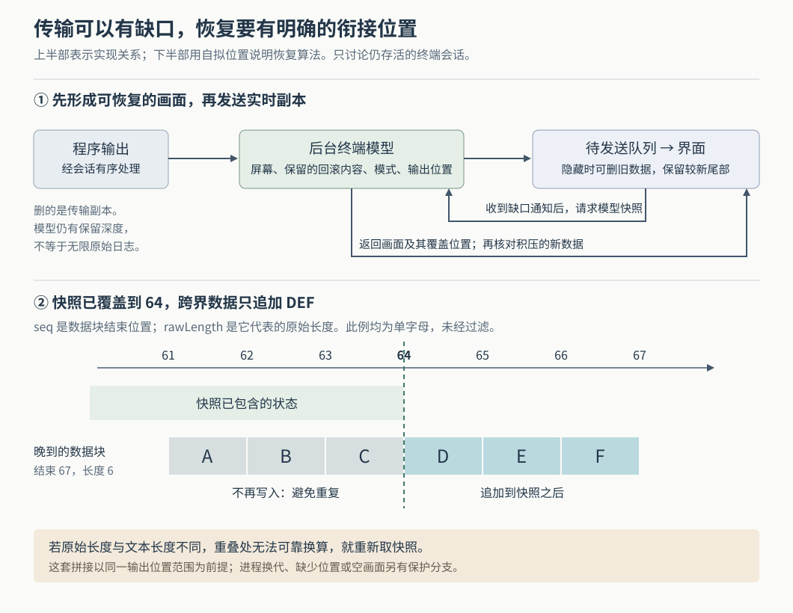

# Orca 怎样在终端输出被丢弃后恢复画面：快照、位置对齐与有界等待

假设一个编码代理正在运行测试，你切到另一个工作区，几分钟后再回来。这是本文自拟场景。测试期间可能产生大量输出；代理的终端界面还可能反复移动光标、擦掉旧进度再画新进度。如果 Orca 把所有内容一直排队，隐藏面板也会占用内存、拖慢其他终端；如果直接丢掉旧输出，回来时又可能看到残缺画面。即使取回一张完整画面，恢复期间继续到达的数据也可能与它重叠，造成重复显示。

当前源码的做法是：**后台先维护终端状态，向界面发送的实时副本允许有条件地删减；发生缺口后，界面取回带输出位置的快照，再接上尚未包含的新内容。**因此，能重新显示当前终端，不要求重传每一段旧输出；但这也不等于保存了无限、逐字完整的运行日志。[后台更新与广播](https://github.com/stablyai/orca/blob/afcb385c86d8abb62419fbdb84c62420cc41c9d2/src/main/daemon/session-output-plane.ts)、[删减实现](https://github.com/stablyai/orca/blob/afcb385c86d8abb62419fbdb84c62420cc41c9d2/src/main/daemon/daemon-stream-keep-tail-drop.ts)

前三篇已经研究工作区、代理启动和协作消息交付。本篇继续追踪“终端快照怎样真正恢复画面”，依据本次本地版本 `afcb385c86d8abb62419fbdb84c62420cc41c9d2`，重点限定在终端守护进程仍持有会话、桌面界面隐藏后重新显示的路径。守护进程就是独立承载终端会话的后台进程。进程死亡后怎样从磁盘重建、手机和跨主机的完整恢复协议，不在本文的同等核验范围内。以下结论来自静态源码阅读，相关测试用于核对预期，本次未运行项目测试。

**先看为什么需要“终端模型”，而不只是保存字符串。**

普通日志通常按行追加，交互式终端却会解释控制序列：例如移动光标、改变颜色、切换到全屏程序使用的另一块屏幕。`HeadlessEmulator` 是不显示窗口的终端模拟器，它接收这些序列，维护屏幕网格、光标和模式；`getSnapshot` 再把可恢复状态序列化为 ANSI 控制序列，即终端能够解释并重画状态的文本指令。快照还携带尺寸、标题、工作目录，以及尚未接收完整的控制序列尾部。[模型写入与快照](https://github.com/stablyai/orca/blob/afcb385c86d8abb62419fbdb84c62420cc41c9d2/src/main/daemon/headless-emulator.ts)

真实接线从 `Session` 开始：系统终端的输出进入启动处理，再经恢复屏障交给 `SessionOutputPlane.emit`。后者累计输出位置、写入后台模型，随后通知已连接客户端。客户端回调由 `DaemonTerminalAdmission.createStreamClient` 建立：先提取需要保留的事件，再把数据交给 `DaemonStreamDataBatcher` 合并和发送。**决定删掉哪些待发送内容，发生在模型接收之后。**这就是画面能够摆脱传输积压、单独恢复的前提。[会话接线](https://github.com/stablyai/orca/blob/afcb385c86d8abb62419fbdb84c62420cc41c9d2/src/main/daemon/session.ts)、[模型与屏障连接](https://github.com/stablyai/orca/blob/afcb385c86d8abb62419fbdb84c62420cc41c9d2/src/main/daemon/session-output-pipeline.ts)、[实际发送回调](https://github.com/stablyai/orca/blob/afcb385c86d8abb62419fbdb84c62420cc41c9d2/src/main/daemon/daemon-terminal-admission.ts)

图中下半部的位置与字母是自拟示例，对应后文的重叠切分算法。后台模型保存的是有保留深度的终端状态，不应把图中的模型理解为所有历史原文的永久副本。

**界面跟不上时，前台和后台采用不同办法。**

对需要完整传输的数据，`DaemonStreamBackpressure` 统计尚未发送的字符串、控制信息和已经交给套接字但尚未完成的写入。套接字是这里连接进程的数据通道。总积压达到 4 MiB（二进制兆字节）后，代码会对其当前连接所拥有、单会话积压达到 64 KiB（二进制千字节）的终端施加暂停；总量退到 1 MiB，或该会话退到 32 KiB，才释放对应暂停。上下门槛不同，能减少在临界点反复暂停和恢复。这里的 **背压**，就是让消费端的积压反过来限制生产端读取；它可能最终使输出过快的程序阻塞在写入上。[统计与门槛](https://github.com/stablyai/orca/blob/afcb385c86d8abb62419fbdb84c62420cc41c9d2/src/main/daemon/daemon-stream-backpressure.ts)、[暂停与恢复](https://github.com/stablyai/orca/blob/afcb385c86d8abb62419fbdb84c62420cc41c9d2/src/main/daemon/session-producer-pause.ts)

隐藏面板的普通输出则可以走另一条路：只保留队列中较新的尾部，丢掉更旧部分，再在原来的顺序位置插入 `dataGap`，即“输出存在缺口”的事件。单个会话独占预算时，超过约 1024×1024 个字符串计数单位就删减到 512×1024；多个可删减会话同时积压时，每份尾部按共享预算缩小，但至少保留 64×1024。这里按 JavaScript 字符串长度计数，即 UTF-16 字符串编码中的 16 位单元，并非网络字节数，也不等于中文或表情的可见字符数。由于存在最低保留量，共享预算不能理解成任意会话数量下的绝对总内存上限。[尾部预算与缺口插入](https://github.com/stablyai/orca/blob/afcb385c86d8abb62419fbdb84c62420cc41c9d2/src/main/daemon/daemon-stream-keep-tail-drop.ts)、[多会话预算收紧](https://github.com/stablyai/orca/blob/afcb385c86d8abb62419fbdb84c62420cc41c9d2/src/main/daemon/daemon-stream-droppable-membership.ts)

普通可删减数据不计入需要暂停的队列字符串总量，但不可丢的控制信息和在途写入仍受背压约束，不能概括为“隐藏终端永远不会暂停”。发送器也允许其他小流量会话越过大量积压，减少某个终端刷屏对另一个终端输入回显的影响；同一会话中，一旦较早条目被暂留，后面的条目也必须暂留，避免借此改变该会话内部的顺序。[发送与顺序保护](https://github.com/stablyai/orca/blob/afcb385c86d8abb62419fbdb84c62420cc41c9d2/src/main/daemon/daemon-stream-data-batcher.ts)

还有一个例外值得注意：连接可能既不关闭，也一直不消费。流背压持续 60 秒后，`SessionProducerPause` 的看门狗会让该会话进入可删减状态，再释放暂停；积压彻底离开后，恢复普通暂停规则。这里处理的是“消费者长期不可达”，代码没有据此宣布代理退出。这体现了一项取舍：有限等待之后，允许画面传输出现可恢复缺口，让程序继续运行。相关测试用模拟套接字和假时钟断言了释放、删减及重新启用背压的过程，并非真实网络压测。[看门狗](https://github.com/stablyai/orca/blob/afcb385c86d8abb62419fbdb84c62420cc41c9d2/src/main/daemon/session-producer-pause.ts)、[连接测试](https://github.com/stablyai/orca/blob/afcb385c86d8abb62419fbdb84c62420cc41c9d2/src/main/daemon/daemon-stream-producer-stall-watchdog.test.ts)

**能重画屏幕，不代表能重建所有已经发生的事件。**

例如，提示音响过一次，或 shell 发出一次命令结束标记，后续画面未必留下可辨认痕迹。Orca 因此在后台删减前，通过 `BackgroundTransientFactRelay` 扫描隐藏会话的输出，把提示音、命令结束、拉取请求链接，以及颜色方案通知订阅的变化提取成小型事件。切换后台状态时，`sessionBackgroundMarker` 随数据流有序发送，通知主进程从哪个位置开始或结束委托扫描；主进程据此抑制自己的对应扫描，减少重复触发。[事件提取](https://github.com/stablyai/orca/blob/afcb385c86d8abb62419fbdb84c62420cc41c9d2/src/main/daemon/daemon-background-transient-facts.ts)、[扫描职责交接](https://github.com/stablyai/orca/blob/afcb385c86d8abb62419fbdb84c62420cc41c9d2/src/main/daemon/daemon-session-background-routing.ts)、[主进程接收](https://github.com/stablyai/orca/blob/afcb385c86d8abb62419fbdb84c62420cc41c9d2/src/main/ipc/pty/provider/bind-listeners.ts)

程序发出的终端能力或光标位置查询，也不能当作普通旧画面全部扔掉：程序可能正在等待答复。删减器会从被丢数据中抢救能够识别的查询，放在缺口之后、保留尾部之前；这些重送查询的 `sequenceChars` 为零，表示它们没有增加原始输出位置。抢救内容有 4096 个编码单元的上限，因此它是有界补救，不能扩大为“任意查询洪流都不会丢失”。标题和代理状态则仍由主进程处理，不在这套瞬时事件转发清单内。[查询提取接线](https://github.com/stablyai/orca/blob/afcb385c86d8abb62419fbdb84c62420cc41c9d2/src/main/daemon/daemon-server.ts)、[有界抢救与位置计数](https://github.com/stablyai/orca/blob/afcb385c86d8abb62419fbdb84c62420cc41c9d2/src/main/daemon/daemon-stream-keep-tail-drop.ts)

由这些实现可以归纳：**画面状态、需要及时处理的事件、需要回复的查询，恢复方式不同。**快照适合恢复前者；后两者必须尽量在删减前另行处理，不能指望事后重画屏幕补回来。测试也专门核对了查询抢救、缺口计数，以及跨数据块的控制序列不会把标题结束符误当作提示音。[删减与查询测试](https://github.com/stablyai/orca/blob/afcb385c86d8abb62419fbdb84c62420cc41c9d2/src/main/daemon/daemon-stream-data-batcher.test.ts)、[事件扫描测试](https://github.com/stablyai/orca/blob/afcb385c86d8abb62419fbdb84c62420cc41c9d2/src/main/daemon/daemon-background-transient-facts.test.ts)

**缺口怎样真正触发恢复，可以沿调用链逐段接起来。**

守护进程发送 `dataGap` 后，`DaemonPtyAdapter` 将其转换为提供者事件；`bindProviderListeners` 把该终端记为必须从提供者取快照，并发布需要恢复模型的标记。界面的 `handleModelRestoreNeededMarker` 接到标记，登记恢复需求；面板可见时再请求恢复。这里还会清理跨块解析状态，避免缺口前半条控制序列与缺口后的无关内容拼成错误指令。[事件转换](https://github.com/stablyai/orca/blob/afcb385c86d8abb62419fbdb84c62420cc41c9d2/src/main/daemon/daemon-pty-adapter.ts)、[主进程标记](https://github.com/stablyai/orca/blob/afcb385c86d8abb62419fbdb84c62420cc41c9d2/src/main/ipc/pty/provider/bind-listeners.ts)、[界面恢复入口](https://github.com/stablyai/orca/blob/afcb385c86d8abb62419fbdb84c62420cc41c9d2/src/renderer/src/components/terminal-pane/pty-connection/foreground-output-refresh.ts)

桌面这条路径随后经 `serializeHiddenOutputSnapshot` 调用 `pty:getMainBufferSnapshot`。主进程发现先前标记后，要求终端提供者返回完整模型快照；提供者向守护进程请求 `getSnapshot`，后者进入 `getSettledSnapshot`，等待正在进行的 shell 归属确认及此前解析写入结束，再读取状态。若提供者拿不到快照，主进程返回不可用，**不会拿只剩尾部的局部内容冒充完整画面**。旧守护进程若缺少输出位置，提供者同样拒绝把该快照用于这套安全拼接。[界面取图](https://github.com/stablyai/orca/blob/afcb385c86d8abb62419fbdb84c62420cc41c9d2/src/renderer/src/components/terminal-pane/pty-connection/hidden-output-snapshot-serialize.ts)、[主进程选择](https://github.com/stablyai/orca/blob/afcb385c86d8abb62419fbdb84c62420cc41c9d2/src/main/ipc/pty/ipc/snapshot.ts)、[提供者取图](https://github.com/stablyai/orca/blob/afcb385c86d8abb62419fbdb84c62420cc41c9d2/src/main/daemon/daemon-pty-buffer-snapshots.ts)、[请求路由](https://github.com/stablyai/orca/blob/afcb385c86d8abb62419fbdb84c62420cc41c9d2/src/main/daemon/daemon-request-router.ts)

后台模型写入优先使用底层终端库 xterm 的内部同步接口 `_core.writeSync`，使紧随输出而来的快照能够看到已解析的状态；不可用时有异步写入分支。专门的测试断言“写入后立即取快照”和该内部接口仍然可用。由此可以推断，这项设计用第三方内部接口换取了明确的即时解析行为，也承担了升级依赖时重新核验兼容性的成本。[同步写入与回退](https://github.com/stablyai/orca/blob/afcb385c86d8abb62419fbdb84c62420cc41c9d2/src/main/daemon/headless-emulator.ts)、[相应测试](https://github.com/stablyai/orca/blob/afcb385c86d8abb62419fbdb84c62420cc41c9d2/src/main/daemon/headless-emulator.test.ts)

**恢复的难点，是判断晚到的数据究竟是不是新的。**

快照请求和实时输出可以走不同通道，不能靠响应到达顺序推断谁先发生。Orca 为会话输出累计位置，快照用 `outputSequence` 标明已覆盖到哪里；界面使用的数据块元信息包含 `seq`，即结束位置，以及 `rawLength`，即这段文本代表的原始输出长度。这里的“原始”相对于管线中的变换而言，计数仍来自字符串长度，不是操作系统读取的网络字节数。启动处理可能改变文本，因此实际显示长度不一定等于原始长度。[源位置累计](https://github.com/stablyai/orca/blob/afcb385c86d8abb62419fbdb84c62420cc41c9d2/src/shared/pty-startup-ingress.ts)、[输出位置与快照](https://github.com/stablyai/orca/blob/afcb385c86d8abb62419fbdb84c62420cc41c9d2/src/main/daemon/session-output-plane.ts)

以图中的自拟例子说明：快照已经覆盖到 64，随后收到 `ABCDEF`，结束位置为 67、原始长度为 6，所以它从位置 61 开始。若文本没有变换，前三个字母已经包含在快照里，只需追加 `DEF`。实现中的判断是：

| 数据相对快照的位置 | 恢复动作 |
| --- | --- |
| 整块都在快照覆盖范围内 | 不再写入终端，避免重复 |
| 整块都在快照之后 | 追加整块 |
| 跨过快照边界，且原始长度等于文本长度 | 切去已经覆盖的前缀，只追加后缀 |
| 跨界，但长度不同，无法映射切分位置 | 要求更新的快照 |
| 后续数据起点超过预期连续位置 | 视为还有缺口，要求再次恢复 |

这不是只有一个辅助函数的设想：`live-data-callback` 在写终端前实际调用重叠核对；恢复请求完成重画后设置基准，再排空恢复期间暂存的新数据，之后仍核对晚到的积压。测试直接断言了只写 `DEF`、丢掉旧块、长度不匹配时重新取图，以及发现位置缺口后再恢复。[切分与连续性判断](https://github.com/stablyai/orca/blob/afcb385c86d8abb62419fbdb84c62420cc41c9d2/src/renderer/src/components/terminal-pane/pty-connection/hidden-output-restore-chunk.ts)、[实际消费方](https://github.com/stablyai/orca/blob/afcb385c86d8abb62419fbdb84c62420cc41c9d2/src/renderer/src/components/terminal-pane/pty-connection/live-data-callback.ts)、[相关测试断言](https://github.com/stablyai/orca/blob/afcb385c86d8abb62419fbdb84c62420cc41c9d2/src/renderer/src/components/terminal-pane/pty-connection-hidden-backlog-reconciliation.spec.ts)

位置比较还需要前提。界面会检查终端身份和恢复代次，拒绝把旧请求的结果画到已经换掉的终端上；进程重建时，运行时另有输出代次和偏移调整。设置去重基准时，还要求快照实际画出了足以支撑该位置的内容，并参考 `pendingDeliveryStartSeq`，即主进程尚可能交付的积压起点。如果已无旧积压，代码不盲目保留基准，以免把计数已重启的新输出当作重复。因此，上表解释的是同一有效位置范围内的算法，不能推广成对所有来源数字的直接比较。[恢复身份检查](https://github.com/stablyai/orca/blob/afcb385c86d8abb62419fbdb84c62420cc41c9d2/src/renderer/src/components/terminal-pane/pty-connection/hidden-output-restore-request.ts)、[基准建立条件](https://github.com/stablyai/orca/blob/afcb385c86d8abb62419fbdb84c62420cc41c9d2/src/renderer/src/components/terminal-pane/pty-connection/deferred-cold-restore-and-snapshot.ts)、[运行时换代处理](https://github.com/stablyai/orca/blob/afcb385c86d8abb62419fbdb84c62420cc41c9d2/src/main/runtime/terminal/output/terminal-output-generation.ts)

**位置正确以后，还得恢复终端解析器和屏幕模式。**

全屏程序常使用“备用屏幕”，退出时回到原来的 shell 屏幕。`buildMainModelSnapshotReplayWrites` 会按快照类型安排正常屏幕、回滚内容、备用屏幕和模式的重放顺序，并先中止缺口留下的半条控制字符串。否则即使字面内容齐全，也可能把历史画进错误屏幕，或继承缺口前尚未关闭的颜色、加粗状态。界面还按快照尺寸重画，再结合实际面板尺寸调整；较宽的备用屏幕画面无法安全放入较窄网格时，有跳过旧画面、请求程序重画的分支。[重放顺序与宽度判断](https://github.com/stablyai/orca/blob/afcb385c86d8abb62419fbdb84c62420cc41c9d2/src/renderer/src/components/terminal-pane/terminal-snapshot-replay-paint.ts)、[尺寸与模式应用](https://github.com/stablyai/orca/blob/afcb385c86d8abb62419fbdb84c62420cc41c9d2/src/renderer/src/components/terminal-pane/pty-connection/hidden-output-restore-snapshot.ts)

还有更细的分包问题：快照可能恰好取在颜色指令 `ESC[3` 之后，而续段 `8;5;196m` 尚未到达。屏幕序列化看不到解析器里这条未完成指令，直接追加续段就会把它显示成乱码。Orca 另存 `pendingEscapeTailAnsi`，在其他重放和模式重置全部结束后，最后写回这条尾部，让连续的新输出完成它。[尾部保存](https://github.com/stablyai/orca/blob/afcb385c86d8abb62419fbdb84c62420cc41c9d2/src/main/daemon/headless-emulator.ts)、[最后写回尾部](https://github.com/stablyai/orca/blob/afcb385c86d8abb62419fbdb84c62420cc41c9d2/src/renderer/src/components/terminal-pane/pty-connection/hidden-output-restore-snapshot.ts)

这项办法保留了不确定性：若程序恰好在半条指令后死亡或不再输出，续段永远不来，解析器可能把下一段无关内容的首个字符当作控制序列的一部分。仓库测试明确记录了这个残余例子。因此，源码支持“连续分包时正确续接”的结论，不能据此声称所有进程中断位置都能无损恢复。[分包修复及残余边界测试](https://github.com/stablyai/orca/blob/afcb385c86d8abb62419fbdb84c62420cc41c9d2/src/main/daemon/repro-7329-remote-snapshot-corruption.test.ts)

**恢复本身也必须有上限，否则它会制造新的积压。**

界面等待快照时先暂存新输出，但队列上限是 512×1024 个编码单元；溢出后停止继续积累内容，并保留查询补救。一次恢复任务最多连续进行三轮；前台有被恢复阻塞的输出时，还有 750 毫秒的等待期限。如果不断重画导致消费跟不上，代码会退出当前恢复，让实时数据继续写入，暂时抑制反复恢复；最后一次背压信号后的两秒再安排补画。用户正在翻看历史时，补画还会等待其回到跟随输出的阅读状态。[队列与切分](https://github.com/stablyai/orca/blob/afcb385c86d8abb62419fbdb84c62420cc41c9d2/src/renderer/src/components/terminal-pane/pty-connection/hidden-output-restore-chunk.ts)、[限制常量](https://github.com/stablyai/orca/blob/afcb385c86d8abb62419fbdb84c62420cc41c9d2/src/renderer/src/components/terminal-pane/pty-connection/hidden-output-restore-limits.ts)、[退出与排空](https://github.com/stablyai/orca/blob/afcb385c86d8abb62419fbdb84c62420cc41c9d2/src/renderer/src/components/terminal-pane/pty-connection/hidden-output-restore-drain.ts)、[延后补画](https://github.com/stablyai/orca/blob/afcb385c86d8abb62419fbdb84c62420cc41c9d2/src/renderer/src/components/terminal-pane/pty-connection/foreground-output-refresh.ts)

这些数值是代码中的策略参数，不是本次测得的响应时间保证。恢复源最终不可用时，界面有明确的输出遗漏警告；若失败结论发生在隐藏期间，会保留恢复需求到重新显示，给一次新快照机会，再决定恢复或展示警告，避免在用户看不到的地方结束这件事。[放弃恢复与延期披露](https://github.com/stablyai/orca/blob/afcb385c86d8abb62419fbdb84c62420cc41c9d2/src/renderer/src/components/terminal-pane/pty-connection/hidden-output-restore-abandon.ts)、[隐藏后重新显示的测试](https://github.com/stablyai/orca/blob/afcb385c86d8abb62419fbdb84c62420cc41c9d2/src/renderer/src/components/terminal-pane/pty-connection-hidden-restore-loss-disclosure.test.ts)

后台模型同样有限：当前默认内存回滚窗口为 1000 行，更深恢复可以由持久历史补充。`getBufferSnapshot` 会在需要时尝试叠加磁盘历史，但有准入限制和五秒期限；超时可以退回当前内存快照，后台整理任务仍继续。它牺牲的是本次恢复深度，不应把“取到快照”解释成所有早期输出都已恢复。本篇核验了这一选择和回退入口，没有继续审计磁盘历史日志在全部崩溃时刻的完整性。[内存窗口](https://github.com/stablyai/orca/blob/afcb385c86d8abb62419fbdb84c62420cc41c9d2/src/main/daemon/daemon-session-scrollback-window.ts)、[历史叠加及期限](https://github.com/stablyai/orca/blob/afcb385c86d8abb62419fbdb84c62420cc41c9d2/src/main/daemon/daemon-pty-buffer-snapshots.ts)

回到开头的测试场景，实践上应分别确认三件事：程序是否还活着、当前画面是否恢复、完整测试结果是否另有记录。终端缺口不等于代理退出；画面恢复也不等于完整测试日志或测试成功。需要审计的构建结果应写入独立日志或测试报告，终端作为交互与观察入口。排查异常时，则按“后台是否收到输出—是否发生删减—缺口是否传达—快照是否可用—位置和模式是否正确接续”检查，比仅凭一张空白或重复画面判断代理状态更有依据。

这次深入补充了前文“从快照恢复终端”的含义：它需要一个先于删减更新的状态来源、明确的缺口信号、可比较的输出位置，以及会停止等待的恢复过程。可迁移的设计思想来自这些实现关系；它们没有给出全链路无损、事件永久保存或业务动作只执行一次的保证。本次实际读取了实现、调用方、相关测试和终端使用文档，源码 HEAD 与输入版本一致，研究未修改源码，也未安装依赖、启动 Orca 或执行项目测试。
