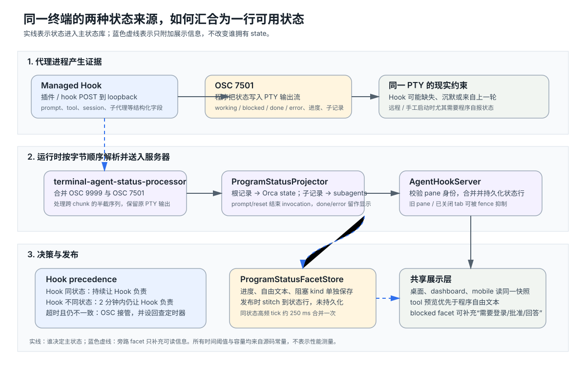

# Orca 如何把 Hook 与终端自报状态合并成可信的代理状态

想象一个代理正在终端里跑测试：它的 Orca 插件先报告“正在工作”，随后程序在终端输出里报告“需要批准”；插件可能因为长时间工具调用而暂时没有新事件，也可能根本没有安装。Orca 仍要回答三个实际问题：侧栏这一行现在显示谁的状态，程序自己说的进度和阻塞原因能否补上，以及旧证据沉默后何时允许另一条证据接管。

本次源码研读的结论是：Orca 把两种来源分成不同职责，再在 `AgentHookServer` 汇合。**Managed Hook** 是安装在代理或插件里的受控回调，它通过本机回环地址（loopback，只允许本机访问的 HTTP 端点）上报结构化字段，能带提示词、工具、会话编号和子代理。**OSC 7501** 是终端控制序列中的 Program Status Protocol，程序把 `working`、`blocked`、`done` 等状态写进原本就要经过 PTY（伪终端）的字节流。Hook 行拥有主状态的优先权；OSC 在 Hook 对同一状态保持沉默时继续让步，只有 Hook 沉默两分钟且两者状态不一致才接管。OSC 的进度、自由文本和登录/批准/提问原因则另存为 facet（附加信息），发布时贴到当前状态行上，不改写状态来源。

这套设计解决的是“证据不完整且同时到达”的问题：Hook 提供丰富身份，OSC 提供无需安装集成的退路；优先级避免旧事件把新状态覆盖，facet 又让较贫乏的来源仍能补齐可读信息。下文依据本地源码版本 `e728d2ccac668fab6e578cb775d65b5af7345c62`，重点追踪状态从 PTY 到共享状态库的真实调用链，并核对边界与测试。没有安装依赖、启动 Orca 或运行项目测试，测试文件只作为源码契约的交叉证据。

**先看两条证据怎样进入同一个入口。**

仓库的 agent-hooks 说明把来源明确分成两路：Managed integrations 通过各代理的 hook、plugin 或 extension POST 到 hook server；OSC 7501 则由代理写入终端流，Orca 从 PTY 输出解析。前者携带 `prompt`、工具名和输入、assistant 回复、provider session id、模型和 subagents，后者主要携带状态、`blocked kind`、一行消息和子记录。[agent status integrations 说明](https://github.com/stablyai/orca/blob/e728d2ccac668fab6e578cb775d65b5af7345c62/src/main/agent-hooks/README.md)

终端侧的组合入口是 `createTerminalAgentStatusProcessor`。它先运行 Orca 原有的 OSC 9999 解析器，再把剩下的输出交给 `createProgramStatusSideEffectScanner` 读取 OSC 7501，并按字节偏移把两类状态重新合并。这个顺序很关键：一个 PTY chunk（一次读取到的输出片段）里可能先出现 OSC 9999、再出现 OSC 7501，也可能反过来；如果分别处理，终端里真实的先后关系就会丢失。[终端状态处理器](https://github.com/stablyai/orca/blob/e728d2ccac668fab6e578cb775d65b5af7345c62/src/shared/terminal-agent-status-processor.ts#L25-L92)

处理器的结果通过 runtime 注入的两个回调送进同一台服务器：`onTerminalAgentStatus` 调用 `server.ingestTerminalStatus`，`onTerminalProgramStatusFacet` 调用 `server.ingestProgramStatusFacet`。结构化聊天没有 PTY，它也通过同一组 runtime 依赖把自己的状态投影写入 server；因此桌面、`orca serve` 和移动端读取的是同一个状态边界，而不是各自维护一份“终端版”和“聊天版”。[runtime 绑定](https://github.com/stablyai/orca/blob/e728d2ccac668fab6e578cb775d65b5af7345c62/src/main/agent-hooks/agent-hook-runtime-deps.ts#L12-L39)

程序要开始发 OSC 7501，先会向终端查询 `OSC 7501 ; ?`。Orca 的统一 responder 回答它支持的五种状态（`idle`、`working`、`done`、`blocked`、`error`）和三种阻塞原因（`permission`、`question`、`auth`）。代码特意把回答放在可复用的 `installProgramStatusQueryResponder` 中，并要求调用方在重放或转发窗口之外关闭回复；因为某些程序收到支持声明后会改变标题绘制，旧的标题活动检测不能继续假设它们会画同样的字符。[协议常量](https://github.com/stablyai/orca/blob/e728d2ccac668fab6e578cb775d65b5af7345c62/src/shared/program-status/protocol.ts#L1-L21)、[查询回复器](https://github.com/stablyai/orca/blob/e728d2ccac668fab6e578cb775d65b5af7345c62/src/shared/program-status/query-responder.ts#L1-L29)

**OSC 7501 不是把字符串直接当状态，而是维护一个小型记录模型。**

`createProgramStatusOscScanner` 是有状态的扫描器。它会把跨 chunk 的半截转义序列暂存在 `pending`，识别完整的 OSC 7501、shell prompt 起始标记 `OSC 133;A` 和终端全重置（RIS），并在序列超过 4096 字节时丢弃这一帧而继续扫描。它不从输出中删掉 OSC 7501；剥离和终端显示由上游处理，扫描器只产生有偏移的事件。[OSC 扫描器](https://github.com/stablyai/orca/blob/e728d2ccac668fab6e578cb775d65b5af7345c62/src/shared/program-status/osc-scanner.ts#L9-L145)

协议解析还对字段逐项设限：键名、应用名、子记录 id 的长度和层级，`msg`/`title` 的 Base64 编码长度与解码后的 UTF-8 长度都有限制；非法 UTF-8、控制字符或不合法状态会让整条报告失效。这里的取舍是把终端当作不可信输入：坏帧不会部分写入状态，也不会因为一条超长消息让解析工作无限增长。[协议解析与边界](https://github.com/stablyai/orca/blob/e728d2ccac668fab6e578cb775d65b5af7345c62/src/shared/program-status/protocol.ts#L21-L150)

记录集合把 `id=null` 的记录视为根代理，把带 id 的记录视为子代理。投影器 `projectRoot` 将根状态映射为 Orca 的 `AgentStatusState`：`blocked` 且 kind 为 permission/question 会成为界面上的 `waiting`，auth 或未命名阻塞保持 `blocked`，error 成为带失败 outcome 的 `done`。`idle` 只说明程序已回到休息状态，不自动推断“用户取消”；取消需要另一路中断证据。完成和失败记录会保留给用户看，但当下一个 shell prompt、清除报告或终端 reset 证明程序已经离开时，根记录被结束，最后没有任何记录则要求删除只由 OSC 创建的状态行。[根状态投影](https://github.com/stablyai/orca/blob/e728d2ccac668fab6e578cb775d65b5af7345c62/src/shared/program-status/agent-status-projector.ts#L90-L190)、[结束与移除处理](https://github.com/stablyai/orca/blob/e728d2ccac668fab6e578cb775d65b5af7345c62/src/shared/program-status/agent-status-projector.ts#L220-L270)

子代理也不是另开一套存储。投影器每次从记录集合生成活动子记录快照，将 `working`、`blocked`、`idle` 映射到子代理状态，完成或错误的子代理从活动列表消失；应用名通过映射归一化，例如 `claude-code` 变成 Orca 的 `claude`。过长的子代理路径保留叶节点并加哈希前缀，保证在 64 字符上限内仍尽量区分两个 id。[子代理快照与 id 限制](https://github.com/stablyai/orca/blob/e728d2ccac668fab6e578cb775d65b5af7345c62/src/shared/program-status/agent-status-projector.ts#L131-L162)

**谁拥有主状态，由一个明确的优先级函数决定。**

`programStatusYieldsToHookRow` 体现了 Orca 的核心判断：没有 Hook 行、Hook 行本身来自 OSC、或 Hook 行只是 provider-session identity 时，OSC 不需要让步。若确实有 Hook 行，则同一状态一直让 Hook 负责；状态不一致时，只要距离 Hook 最近一次事件不足两分钟，也继续让 Hook 负责。代码还专门处理应用名不一致的情况：一个仍在进行的 Hook 回调可能来自 `openclaude`，而 OSC 只报 `claude`，这时仍由 Hook 胜出；但一个已经 `done` 的旧 Hook 行不能阻止另一个程序在同一 pane 开始新的工作。[Hook 优先级](https://github.com/stablyai/orca/blob/e728d2ccac668fab6e578cb775d65b5af7345c62/src/main/agent-hooks/server/program-status/hook-precedence.ts#L4-L31)

这个两分钟不是“状态两分钟后必然正确”的证明，而是长工具调用的容错窗口。源码注释的理由是：工具调用期间可能很久没有新的 Hook，但程序状态并未改变；只有旧 Hook 证据与当前程序报告发生分歧，且旧证据已沉默足够久，才让 OSC 接管。测试明确覆盖了“同状态沉默很久仍让 Hook 负责”和“分歧恰好到两分钟才接管”两个边界。[优先级单元测试](https://github.com/stablyai/orca/blob/e728d2ccac668fab6e578cb775d65b5af7345c62/src/main/agent-hooks/server/program-status/hook-precedence.test.ts#L31-L84)

真正的入口 `ingestTerminalStatus` 先做 pane key、tab id、长度和已关闭 pane 的校验，再查找终端句柄对应的现有行；这一步防止旧 pane、错误 tab 或已退休的身份把状态写回当前界面。之后它分别计算两种“让步”：`hookOwnsCommand` 表示本次命令期间已经有 Hook 事件，`hookOwnsAgent` 表示 OSC 受上述两分钟规则约束。两者成立时，OSC 事件直接返回；若只是状态不一致导致让步，服务器会为那一条 Hook 观测安排一次延迟回查。[终端状态接收与身份校验](https://github.com/stablyai/orca/blob/e728d2ccac668fab6e578cb775d65b5af7345c62/src/main/agent-hooks/server/server-ingest-terminal.ts#L97-L218)

延迟回查不是把 OSC 原报告重新发送给程序，而是服务器在计时器到期时重新拿当前行核对：pane 仍存在、`receivedAt` 仍等于当时那条 Hook 观测，才再次调用 `ingestTerminalStatus`。如果中间来了新一轮 Hook，或 pane 被清除，旧计时器什么也不做。这样既能在程序不会重复发送 `done` 的情况下最终接过状态，也不会让上一轮的回查结束下一轮新任务。[有界回查](https://github.com/stablyai/orca/blob/e728d2ccac668fab6e578cb775d65b5af7345c62/src/main/agent-hooks/server/server-ingest-terminal.ts#L216-L239)、[对应行为测试](https://github.com/stablyai/orca/blob/e728d2ccac668fab6e578cb775d65b5af7345c62/src/main/agent-hooks/server-program-status-hook-yield.test.ts#L63-L127)

后来到达的 Hook 没有“再等两分钟”的特殊待遇：`ingestTerminalStatus` 的 Hook 路径会直接写入状态行，并取消针对该 pane 的 OSC 回查。测试也覆盖了“OSC 已经等待旧 Hook，新的 Hook 回调到达后，旧回查不能结算新一轮”的场景。这是把“谁最新”与“谁信息更丰富”同时编码进流程，而不是简单按网络到达顺序覆盖。[Hook 重新夺回 pane 的测试](https://github.com/stablyai/orca/blob/e728d2ccac668fab6e578cb775d65b5af7345c62/src/main/agent-hooks/server-program-status-hook-yield.test.ts#L80-L127)

**进度和阻塞原因走旁路 facet，避免污染主状态的所有权。**

OSC 的一条报告可以带 `progress`、`msg` 和 `kind`，但 Hook 行可能拥有更可靠的 prompt、工具预览和 provider session。Orca 因此使用 `ProgramStatusFacetStore` 按 pane 保存最近的 OSC facet；状态行本体不保存这份对象，发布时由 `server-listeners.ts` 的 `stitch` 复制一份附加上去。facet 最多保留 1024 个 pane，旧 pane 先淘汰；它不会因为主状态行来自 Hook 就消失。[facet 存储](https://github.com/stablyai/orca/blob/e728d2ccac668fab6e578cb775d65b5af7345c62/src/main/agent-hooks/server/program-status/facet-store.ts#L6-L77)、[发布时拼接](https://github.com/stablyai/orca/blob/e728d2ccac668fab6e578cb775d65b5af7345c62/src/main/agent-hooks/server/server-listeners.ts#L35-L81)

共享展示解析器 `resolveProgramStatusPresentation` 再做最后一次条件判断：只有状态行和 facet 都处于 live 状态时才显示进度；已有结构化 `toolName` 时，Hook 的工具预览优先于程序自由文本；如果 facet 报告 blocked，而状态行已经显示为 done，仍可附加“需要登录”“需要批准”或“需要回答”的 attention。这个规则让 OSC 提供额外信息，却不能把一个已经完成的 Hook 行重新涂成 working。[共享展示规则](https://github.com/stablyai/orca/blob/e728d2ccac668fab6e578cb775d65b5af7345c62/src/shared/program-status/presentation.ts#L1-L65)

facet 的高频更新还和生命周期更新分开处理：状态改变立即发布；同一状态下只有 progress 或 message 变化时，服务器通过 `PaneTimers` 延迟 250 毫秒合并多次 tick。测试断言了 42、43、44、45 的快速进度变化最终只发布初值和最后值。这里能确认的是源码规定的合并行为，不能据此推导用户感受到的延迟或吞吐数据。[facet 合并测试](https://github.com/stablyai/orca/blob/e728d2ccac668fab6e578cb775d65b5af7345c62/src/main/agent-hooks/server-program-status-hook-yield.test.ts#L247-L262)

**稀疏报告、掉输出和安全边界决定了这套方案的限制。**

OSC 7501 的程序通常只报告变化，不会每秒重发 `working`。因此运行时会保留每个活跃 PTY 的最后一份 live payload，并每 10 分钟发一次租约续期；续期前还检查“live facet 仍存在”和 PTY 是否仍存活。若终端输出发生 gap（输出被丢弃），运行时会结束当前程序活动并清除 live facet，因为解析器已经无法证明中间发生了什么。这是 liveness（仍在运行）维护，不是对丢失历史的恢复。[租约与 gap 处理](https://github.com/stablyai/orca/blob/e728d2ccac668fab6e578cb775d65b5af7345c62/src/main/runtime/terminal/output/terminal-derived-agent-facts.ts#L18-L22)、[状态续期与 gap 清理](https://github.com/stablyai/orca/blob/e728d2ccac668fab6e578cb775d65b5af7345c62/src/main/runtime/terminal/output/terminal-derived-agent-facts.ts#L108-L230)

当程序发送 `clear` 或终端 reset 时，投影器会生成“程序离开”的边界；`AgentHookServer` 只删除由 OSC 独自创建的行，不会因为 OSC 的记录消失而删除 Hook 行。状态行还有 pane retirement、closed tab 和 alias fence 等身份保护，防止旧 pane 的迟到数据复活已经关闭的界面。对于本专题而言，这意味着“程序清空自己的记录”和“用户关闭终端 pane”是两个不同事件，不能用一个通用的 cleanup 来处理。[只删除 OSC 行的分支](https://github.com/stablyai/orca/blob/e728d2ccac668fab6e578cb775d65b5af7345c62/src/main/agent-hooks/server/server-ingest-terminal.ts#L203-L214)、[pane 退休与关闭保护](https://github.com/stablyai/orca/blob/e728d2ccac668fab6e578cb775d65b5af7345c62/src/main/agent-hooks/server/server-status-disposition.ts#L1-L45)

边界限制也有清晰的分层：协议帧最多 4096 字节，记录集合最多 256 条，facet 缓存最多 1024 个 pane，展示文本清理不可见双向控制符并截到 400 个字符。长子代理 id 用哈希和叶节点压缩，重复报告用 payload key 去重。它们共同表达一个工程取舍：状态面板只需要当前可解释快照，不应该承担无限日志、无限子代理树或任意终端输出的存储责任。[记录集合上限](https://github.com/stablyai/orca/blob/e728d2ccac668fab6e578cb775d65b5af7345c62/src/shared/program-status/records.ts#L1-L80)、[展示文本清理与长度限制](https://github.com/stablyai/orca/blob/e728d2ccac668fab6e578cb775d65b5af7345c62/src/shared/program-status/facet.ts#L1-L48)

**测试把设计边界写成了可观察契约。**

`server-program-status-hook-yield.test.ts` 覆盖了没有 Hook 时 OSC 独立驱动 pane、Hook 行优先、不同 app id 的中途让步、两分钟后接管、迟到 Hook 重新夺回、清除只由 OSC 写入的行，以及 Hook 行上的 facet 拼接。`agent-status-projector.test.ts` 则覆盖了 Claude 的 `blocked/permission` 到 `waiting`、错误 outcome、prompt 边界、子代理状态、重复 redraw 去重、跨 invocation 的相同结果仍算新事件，以及超长子代理 id 的压缩。源码阅读能确认这些断言意图和实现分支；本次没有执行测试命令，所以不能报告当前环境下的通过结果。[状态优先级测试](https://github.com/stablyai/orca/blob/e728d2ccac668fab6e578cb775d65b5af7345c62/src/main/agent-hooks/server-program-status-hook-yield.test.ts)、[投影器测试](https://github.com/stablyai/orca/blob/e728d2ccac668fab6e578cb775d65b5af7345c62/src/shared/program-status/agent-status-projector.test.ts)

从这些实现可以得到一个可迁移的设计原则：**把“谁有资格改变主状态”和“谁能补充展示事实”拆开，并为证据冲突设定带身份检查的有限等待。**在 Orca 中，Hook 之所以优先，是因为它能证明更丰富的代理身份和会话关系；OSC 之所以保留，是因为它穿过终端这一普遍边界，能覆盖没有集成或远程环境。facet 之所以不直接覆盖 state，是因为进度和自由文本不够资格改变生命周期判断。两分钟回查、pane key fence、租约续期和输出 gap 清理，则把“最终会看到某个状态”与“永远不会误判”之间的边界说清楚：前者在特定证据仍有效时成立，后者源码没有承诺。

本篇没有重复前几篇对工作树、代理启动、消息交付和终端快照恢复的整体介绍，而是把其中曾被提及的“hook 状态汇合”单独追到底层协议、状态投影、优先级和发布层。当前未逐项研究各代理 hook 安装器的供应商差异、远程 relay 的传输重放协议和所有 renderer attention 消费者；这些区域可能改变某个代理的上报细节，但不会改变本文核验的合并骨架。
