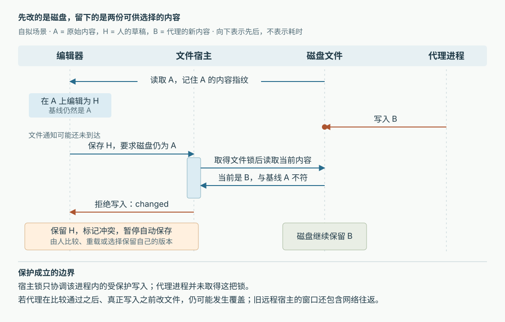

# Orca 如何避免自动保存覆盖代理改动：磁盘基线、写入排队与远程确认

假设你在 Orca 中打开一个配置文件，把超时从 10 秒改成 20 秒，还没保存；与此同时，编码代理给磁盘上的同一文件增加了重试配置。这是本文自拟场景。编辑器若直接保存整个缓冲区，代理的新配置就可能消失；若收到文件通知便重新加载，你尚未保存的修改又会消失。把两个任务放进不同工作区，无法解决人与代理正在操作同一文件的这次冲突。

当前 Orca 的处理方式是：**保留人的草稿，记住草稿所依据的磁盘内容，在保存前检查磁盘是否仍符合这个依据；发现冲突后暂停自动保存，让人比较和选择。**文件通知负责尽早提醒，真正执行写入的宿主负责再次检查。两者配合，却没有把普通文件变成能够任意并发合并的协作文档。[保存决策](https://github.com/stablyai/orca/blob/e61d062ef19aea3eb2903de79db924cb61407d7d/src/renderer/src/components/editor/editor-save-disk-precondition.ts)、[宿主比较与写入](https://github.com/stablyai/orca/blob/e61d062ef19aea3eb2903de79db924cb61407d7d/src/main/ipc/filesystem/local-disk-write-precondition.ts)

前五篇已覆盖工作区、代理启动、协作消息、终端恢复和状态汇合。本篇转向这些能力共同使用的文件：人和代理怎样避免互相抹掉修改。依据是本次本地源码 `e61d062ef19aea3eb2903de79db924cb61407d7d`；下文来自静态调用链和测试内容核对，没有启动 Orca、安装依赖或运行项目测试。

**先分清三份内容：草稿、草稿的依据、现在的磁盘。**

用图中的字母表示：打开文件时读到 A，人在编辑器里改成 H，代理随后把磁盘改成 B。保存 H 时，要比较的是“磁盘是否仍为 A”，不能只问“H 是否等于磁盘”。H 本来就是人想写入的新内容，不相等通常意味着有编辑，单凭这一点无法识别冲突。

Orca 用 `lastKnownDiskSignature` 保存 A 的内容指纹，即由内容计算出的简短校验值；草稿另存于 `editorDrafts`，`isDirty` 表示仍有未保存修改，`externalMutation` 表示已发现磁盘变化。这些字段由 `EditorBufferRecord` 统一管理，同一记录的各个视图同步映射它们。因此，两个标签页若共享一份编辑缓冲区，就不能各自宣称拥有不同的保存基线。[缓冲区记录与同步更新](https://github.com/stablyai/orca/blob/e61d062ef19aea3eb2903de79db924cb61407d7d/src/renderer/src/store/slices/editor/buffers/editor-buffer-record.ts)

基线的建立也有条件。`stampCleanTabDiskBaseline` 在成功加载可编辑文本且缓冲区没有未保存修改时，记录读到的内容。若另一个视图已经在编辑，共享草稿仍以旧内容为依据，新读取不能悄悄推进基线；读到不同内容时反而要标记冲突。否则只需打开第二个视图，就可能把第一次编辑赖以成立的依据换掉。[加载后的基线处理](https://github.com/stablyai/orca/blob/e61d062ef19aea3eb2903de79db924cb61407d7d/src/renderer/src/components/editor/editor-clean-tab-disk-baseline.ts)

这里使用内容指纹，而非只比较修改时间或文件大小。`DiskBaselineSignatureBuilder` 对文本做两路整数哈希计算，再附上文本长度；因此同样长度的重写也能被检测。哈希是把长内容压缩成短值的算法；这份实现不是密码学签名，也不能排除不同内容产生相同指纹。两路计算加长度降低了误判风险，但源码没有给出碰撞概率或绝对无冲突保证。[指纹实现](https://github.com/stablyai/orca/blob/e61d062ef19aea3eb2903de79db924cb61407d7d/src/shared/disk-baseline-signature.ts)

**一次真实保存，先经过编辑器队列，再交给文件所在的宿主。**

`TerminalSurface` 挂载的 `EditorAutosaveController` 会把保存控制器接到应用状态库上，切换编辑标签不需要销毁它。控制器订阅草稿与保存相关状态，给到期草稿安排计时器；手动保存则通过保存事件进入同一个 `queueSave`。两条入口最终共用 `writeSave`，没有各自维护一套写入规则。[控制器装配](https://github.com/stablyai/orca/blob/e61d062ef19aea3eb2903de79db924cb61407d7d/src/renderer/src/components/editor/EditorAutosaveController.tsx)、[队列与执行](https://github.com/stablyai/orca/blob/e61d062ef19aea3eb2903de79db924cb61407d7d/src/renderer/src/components/editor/editor-save-queue.ts)

队列每份缓冲区至多保留一个正在执行的保存和一个等待保存。后续请求并入等待项，执行时重新取得最新草稿；已经被前一个保存写干净的草稿，不再重复写。文件路径对应的前端锁还让普通编辑视图与可写差异视图依次操作同一文件。这里的锁是用 Promise 链安排执行顺序，不是操作系统提供的跨进程文件锁。[请求合并](https://github.com/stablyai/orca/blob/e61d062ef19aea3eb2903de79db924cb61407d7d/src/renderer/src/components/editor/editor-save-slots.ts)、[前端写入排队](https://github.com/stablyai/orca/blob/e61d062ef19aea3eb2903de79db924cb61407d7d/src/renderer/src/components/editor/editor-file-write-lock.ts)

轮到保存时，`editorSavePrecondition` 决定这次能做什么。**普通手动保存也需要基线，快捷键不会自动获得覆盖新磁盘内容的权限。**没有基线便拒绝；只有冲突横幅的显式覆盖入口，才生成不带比较条件的写入。不同触发方式还有两项区别：

| 保存入口 | 磁盘文件已消失时 | 编码要求 |
| --- | --- | --- |
| 自动保存 | 拒绝，避免自行复活已删除文件 | 要求能够无损按 UTF-8 处理 |
| 普通手动保存 | 允许重新创建；文件仍在时继续比较基线 | 不强制上述无损条件 |
| 重启前保存 | 允许重新创建 | 要求上述无损条件 |
| 横幅中的“覆盖” | 不带磁盘比较条件 | 按 UTF-8 写入草稿 |

UTF-8 是这里读写文本使用的字符编码。编码条件的目的，是避免自动操作未经询问就转换原文件；它与内容冲突是两种拒绝原因。[触发方式与条件生成](https://github.com/stablyai/orca/blob/e61d062ef19aea3eb2903de79db924cb61407d7d/src/renderer/src/components/editor/editor-save-disk-precondition.ts)

随后，`writeRuntimeFile` 根据文件归属选择路径。本地文件通过 IPC（进程间通信）进入 `fs:writeFile`；远程文件通过 RPC（远程过程调用）请求文件宿主。远程的 `files.writeIfUnchanged` 注册项把条件传给 `writeFileExplorerFile`，后者解析工作区和相对路径、核对执行主机，再调用文件提供者。当前本地提供者与本地 IPC 最终都调用 `writeLocalTextFileWithDiskPrecondition`，没有在界面检查后就省掉宿主检查。[客户端路由](https://github.com/stablyai/orca/blob/e61d062ef19aea3eb2903de79db924cb61407d7d/src/renderer/src/runtime/runtime-file-mutation-client.ts)、[RPC 注册](https://github.com/stablyai/orca/blob/e61d062ef19aea3eb2903de79db924cb61407d7d/src/main/runtime/rpc/methods/files-mutation-methods.ts)、[运行时文件操作](https://github.com/stablyai/orca/blob/e61d062ef19aea3eb2903de79db924cb61407d7d/src/main/runtime/files/file-mutations.ts)、[本地提供者](https://github.com/stablyai/orca/blob/e61d062ef19aea3eb2903de79db924cb61407d7d/src/main/providers/local-filesystem-provider.ts)

**宿主把“比较后写入”排成串，但只约束参与这条路径的写入。**

只有检查函数还不够：两个客户端都拿着 A，各自读到磁盘 A，都通过检查，然后依次写入不同内容，仍会发生覆盖。Orca 因此让整个比较与写入过程在宿主内按文件排队。后一个请求必须等前一个完成，再读磁盘；若前一个已写入不同内容，后一个就无法继续凭 A 通过。

文件身份不能只用请求路径。一条符号链接可以把另一个路径指向同一文件；硬链接则让多个文件名对应同一个底层文件。实现先按规范化路径排队，再按设备号与 inode 排队。inode 是文件系统中标识底层文件的编号。路径键在文件还不存在、即将被重新创建时仍然有用；inode 键则补上不同名字指向同一文件的情况。返回 inode 为零的文件系统不使用这个编号，避免所有文件误共用一把锁。每个文件独立排队，也避免一个失去响应的挂载路径堵住无关文件。[锁键计算与固定加锁顺序](https://github.com/stablyai/orca/blob/e61d062ef19aea3eb2903de79db924cb61407d7d/src/main/ipc/filesystem/local-disk-write-precondition.ts)

取得锁以后，宿主读取当前文件，并作以下判断：

- 当前字节已经与待保存内容完全一致，返回 `unchanged`，无需再次写入。即便旧基线已经过时，只要目标状态已经实现，也可以结束保存。
- 文件不存在，只有 `allowMissing` 允许时才能创建；权限等不能说明文件消失的错误继续抛出，不能冒充“文件没了”。文件增长到不可能匹配基线或保存内容的大小，则判为已变化。
- 当前内容指纹不匹配基线，返回 `changed`，保留磁盘内容。
- 基线匹配但自动保存无法无损处理编码，返回 `not-utf8`；其余情况才实际写入。

这里特别比较原始字节，是因为两组不同的非法 UTF-8 字节都可能被解码成同一个替代字符 `�`。只比较解码后的文字，会把“读起来相同”误当作“字节可以安全重写”。当前宿主用字节校验区分这些情况；只拿得到文本的兼容路径则更保守地处理替代字符。[宿主检查](https://github.com/stablyai/orca/blob/e61d062ef19aea3eb2903de79db924cb61407d7d/src/main/ipc/filesystem/local-disk-write-precondition.ts)、[共享比较规则](https://github.com/stablyai/orca/blob/e61d062ef19aea3eb2903de79db924cb61407d7d/src/shared/file-write-disk-precondition.ts)

这个设计的限制需要与收益一起看：**独立代理进程不受宿主的这两把内存锁约束。**代理若在宿主比较通过后、实际 `writeFile` 前再次改文件，仍可能被覆盖。实现注释明确保留这个窗口；代码也没有把比较与写入变成文件系统级原子事务。显式覆盖还会绕过受保护写入的锁。由此能够确认的是同一宿主进程内受保护请求之间的协调，不能推导成所有编辑器、代理和文件系统操作之间的完全串行化。

**文件通知让人早点知道，保存回执决定能否清除草稿。**

应用级 `useEditorExternalWatch` 保持文件变化订阅，按文件所属环境和工作区匹配标签页。收到外部变化后，干净缓冲区可以刷新；已有未保存修改的缓冲区保留草稿并标记“磁盘已变化”。自动保存调度和执行入口都检查这个标记，所以暂停不只是界面表现。即便通知未及时到达，保存条件仍提供另一道检查。[订阅入口](https://github.com/stablyai/orca/blob/e61d062ef19aea3eb2903de79db924cb61407d7d/src/renderer/src/hooks/useEditorExternalWatch.ts)、[通知分流](https://github.com/stablyai/orca/blob/e61d062ef19aea3eb2903de79db924cb61407d7d/src/renderer/src/hooks/editor-external-watch-event-reconciliation.ts)、[暂停规则](https://github.com/stablyai/orca/blob/e61d062ef19aea3eb2903de79db924cb61407d7d/src/renderer/src/components/editor/editor-autosave.ts)

保存本身也会产生文件通知，因此队列在写入前登记“这是我写的内容”。通知路径遇到近期自身写入时，会读取磁盘核对；若已经被代理改成另一份内容，仍要报告变化，不能仅凭时间接近就忽略。保存失败或宿主拒绝时，会清除自身写入记录，以免抑制下一次真实通知。[通知中的自身写入核对](https://github.com/stablyai/orca/blob/e61d062ef19aea3eb2903de79db924cb61407d7d/src/renderer/src/hooks/editor-external-watch-disk-verification.ts)

宿主确认成功后，队列把基线推进到本次写入的内容。如果等待期间人又输入了新文字，当前草稿仍然与已写内容不同，队列便保留未保存状态；只有没有更新修改时才清除草稿。反之，`changed` 或 `missing` 拒绝会转成冲突或删除标记，不会伪装成成功；“保存并关闭”遇到拒绝也保留标签页。[成功后的状态结算](https://github.com/stablyai/orca/blob/e61d062ef19aea3eb2903de79db924cb61407d7d/src/renderer/src/components/editor/editor-save-queue.ts)、[保存并关闭的判断](https://github.com/stablyai/orca/blob/e61d062ef19aea3eb2903de79db924cb61407d7d/src/renderer/src/components/editor/editor-autosave-controller.ts)

重启恢复同样依赖这个分工。恢复扫描会读取磁盘，重新判断带草稿的标签是否冲突；读取失败允许有限重试，过后停止提前提示。这不等于批准写入，实际保存仍须通过条件检查。因此，“扫描没弹横幅”本身不能证明磁盘没变。[恢复草稿检查](https://github.com/stablyai/orca/blob/e61d062ef19aea3eb2903de79db924cb61407d7d/src/renderer/src/components/editor/editor-restored-tab-conflict-scan.ts)

**冲突横幅中的四个动作，意味着不同的承诺。**

“比较”会在打开对话框时重新读磁盘，左边显示磁盘内容，右边显示当前草稿；它不靠可能早已过时的通知内容。“从磁盘重新加载”放弃这份共享草稿并重新读取；源码还提供短暂撤销入口，撤销时恢复旧基线和冲突状态，而非只恢复文字。

“覆盖”立即走无基线比较的显式保存。“保留我的编辑”则先保留草稿、清除冲突标记，再读取当前磁盘并更新基线；后续保存可以据此替换这份磁盘内容，但磁盘若再次变化，仍应被检查挡住。保存队列会等待这次基线读取，避免用户紧接着按保存时仍使用旧基线；更早发起的读取也不能盖掉已完成保存建立的新基线。读取失败时保留旧基线，因此冲突可能再次出现。[横幅动作及基线更新](https://github.com/stablyai/orca/blob/e61d062ef19aea3eb2903de79db924cb61407d7d/src/renderer/src/components/editor/ExternalFileChangeBanner.tsx)、[比较窗口的实时读取](https://github.com/stablyai/orca/blob/e61d062ef19aea3eb2903de79db924cb61407d7d/src/renderer/src/components/editor/ExternalFileChangeCompareDialog.tsx)

因此，“保留我的编辑”并非仅仅关闭提醒：它可能让自动保存恢复，并在条件成立时写入自己的版本。这些入口提供的是选择与覆盖控制，没有在这条流程中自动把双方改动合成第三个版本。需要同时保留超时调整和代理的重试配置时，仍需阅读差异后整理内容。

**远程保存多了两个问题：对面是否真的支持检查，丢失响应是否意味着没写。**

远程客户端先查询宿主能力，再决定使用哪个接口。支持当前检查能力时，直接发送 `files.writeIfUnchanged`，由宿主在文件旁比较；只支持早期条件写入的宿主，对自动保存所需的编码与相同内容检查，客户端先读一次，再保留宿主条件写入；缺少条件写入能力的兼容宿主，则只能客户端读、比较，再请求普通写入。这里的兼容仍受文件归属能力检查约束，不代表任意旧服务器都允许修改。[能力与兼容规则](https://github.com/stablyai/orca/blob/e61d062ef19aea3eb2903de79db924cb61407d7d/src/shared/file-write-disk-precondition.ts)、[远程条件保存](https://github.com/stablyai/orca/blob/e61d062ef19aea3eb2903de79db924cb61407d7d/src/renderer/src/runtime/runtime-file-write-disk-precondition.ts)

从实现可推断，最后一种兼容方式的竞争窗口包含客户端读取到远程写入之间的网络往返，弱于在宿主内比较。因此不能因为界面使用同一个保存按钮，就认为所有宿主版本提供相同保证。

能力查询还绑定了宿主运行时身份、连接代次和环境配对版本：不能查询到新服务器支持检查，随后恰好重连到另一台服务器，就沿用刚才的判断。发送前发现连接变化，且环境仍是原配对时，允许重新探测并重试一次；若环境被重新配对到另一台机器，就不能把本次保存继续投过去。[查询与发送的身份绑定](https://github.com/stablyai/orca/blob/e61d062ef19aea3eb2903de79db924cb61407d7d/src/renderer/src/runtime/runtime-file-mutation-rpc.ts)

请求已经发送、响应却因可恢复的连接错误丢失时，客户端不直接认定失败，也不盲目重发。它尝试从同一配对环境重新读取文件，若内容指纹匹配本次写入目标，就认可当前目标状态；否则继续报错。这里确认的是“读回时文件已有所需内容”，不是证明一定由刚才的请求写成，更不是断电后持久保存的证明。重新配对后的另一台机器即使碰巧有相同文本，也不构成证据。[丢失响应后的读回判断](https://github.com/stablyai/orca/blob/e61d062ef19aea3eb2903de79db924cb61407d7d/src/renderer/src/runtime/runtime-file-write-disk-precondition.ts)

**哪些结论有测试交叉支持，实际使用时怎样判断。**

本次阅读的宿主测试使用临时文件，并对部分系统调用设置可控阻塞：它们检查同一基线的两个不同写入只有一个成功、符号链接与硬链接别名仍需排队、文件在队列中由缺失变成存在时仍保持顺序，以及一个挂起文件不阻塞另一个文件。另有字节测试核对非法编码、相同内容免写和换行差异。[宿主测试正文](https://github.com/stablyai/orca/blob/e61d062ef19aea3eb2903de79db924cb61407d7d/src/main/ipc/filesystem/local-disk-write-precondition.test.ts)

编辑器测试通过模拟磁盘检查冲突后草稿保留、自动保存暂停、共享视图合并保存和拒绝后不关闭标签；远程测试模拟响应超时、连接替换与重新配对，检查何时可读回确认、何时必须失败。这些断言与上述分支相符，**本次未执行，不能报告测试通过或实测可靠性**。[编辑器冲突测试](https://github.com/stablyai/orca/blob/e61d062ef19aea3eb2903de79db924cb61407d7d/src/renderer/src/components/editor/editor-autosave-conflict-flow.test.ts)、[编辑器竞争测试](https://github.com/stablyai/orca/blob/e61d062ef19aea3eb2903de79db924cb61407d7d/src/renderer/src/components/editor/editor-save-disk-precondition.races.test.ts)、[远程保存测试](https://github.com/stablyai/orca/blob/e61d062ef19aea3eb2903de79db924cb61407d7d/src/renderer/src/runtime/runtime-file-write-disk-precondition.test.ts)

对使用者而言，最实用的做法是：同一文件仍由代理持续改写时，先比较双方内容；确实要保留自己的版本，再选择保留或覆盖。遇到远程保存错误，保留草稿并核对文件归属与实际内容，不能把“没收到响应”直接当作“磁盘没写”。大量并行修改仍应通过工作区和任务分工减少同文件竞争；这套保存机制适合拦截已发生的版本分歧，无法代替并发协作的全部协调。

可迁移的设计思想来自这几层的配合：用内容基线表达“我的编辑依据什么”，把比较放到实际写入处，用文件级排队协调参与者，再把拒绝结果送回保留草稿的界面。通知、提前扫描和提示可以迟到或失败，写入前的条件仍需独立成立。本文核验的是桌面编辑器及其远程文件宿主链路；未据此扩展到手机 Markdown 编辑的独立实现、任意外部程序写入或文件系统崩溃恢复。源码与输入材料保持原样，研报和配图写入 `output/`；配图已实际渲染检查，正文源码链接均已核对本地对应文件存在。
