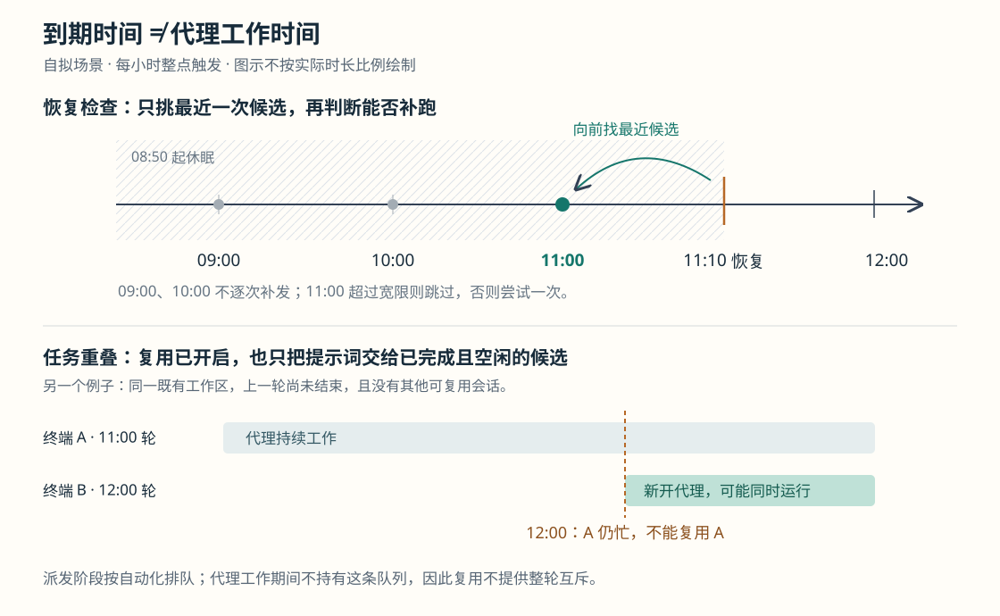
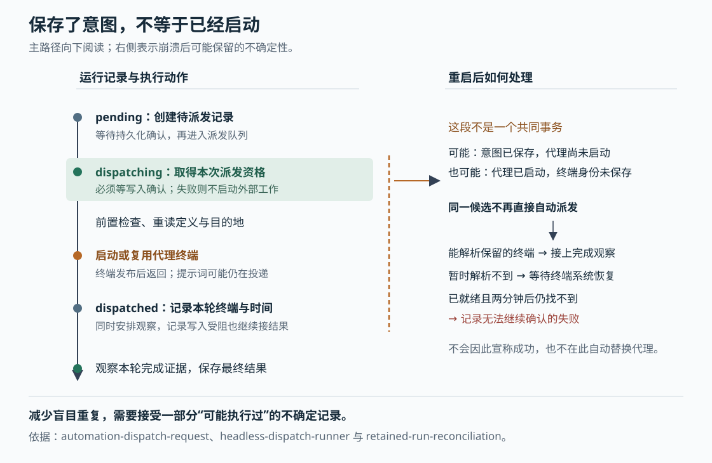

# Orca 如何运行定时代理：漏跑补偿、派发记录与会话复用的边界

假设你让 Orca 每小时检查一次待审代码，并开启“复用会话”。电脑在 08:50 休眠，11:10 恢复；此时你希望知道：09:00、10:00、11:00 的任务会不会一起启动？如果上一轮代理还在工作，新提示词会不会直接塞进它的终端？如果启动过程中 Orca 重启，又会不会重复执行？这是本文自拟场景。

当前源码给出的答案是：**恢复检查只考虑最近一次到期时间，再决定补跑或跳过；启动前先保存派发意图；复用只尝试已完成且空闲的会话，找不到就启动新终端。**这三条规则分别解决过期工作积压、重复派发和误用终端的问题。它们没有共同构成“所有漏跑都会补齐”或“同一自动化永远只有一个代理运行”的承诺。

Orca 是组织编码代理、工作区和终端的开发工作台。已有六篇研报覆盖整体架构、代理启动、协作消息、终端恢复、状态汇合和文件保存；本篇研究此前未展开的定时自动化。依据是本次本地源码 `589499e3bd99ef77adf7e018182716b88ad13e00`，重点追踪无需窗口的宿主执行路径，并核对它与公共调度服务的连接。本次只读源码和测试，没有安装依赖、启动 Orca 或运行项目测试。

先看图的上半部分。`AutomationService.evaluateDueRuns` 默认每分钟检查一次；服务启动后，如果具备无窗口派发器，也会立即检查。它先筛出启用且 `nextRunAt` 已到期的自动化，再调用 `getLatestAutomationOccurrence`，重新计算“不晚于本轮检查时间的最近一次触发”。处理结束后，`advanceNextRun` 把下一次时间推进到本轮检查时间之后。**代码没有从旧的 `nextRunAt` 开始逐次遍历漏掉的时刻。**[调度服务](https://github.com/stablyai/orca/blob/589499e3bd99ef77adf7e018182716b88ad13e00/src/main/automations/service.ts)、[最近一次与下一次的连接](https://github.com/stablyai/orca/blob/589499e3bd99ef77adf7e018182716b88ad13e00/src/main/persistence/scheduling-automations/automation-schedule-operations.ts)

因此，自拟场景在 11:10 检查时，候选时间是 11:00；09:00、10:00 不会分别进入补跑队列。候选时间还需通过补跑宽限判断：允许的迟到量等于配置的宽限分钟数，加上两个检查间隔。默认检查间隔是一分钟，所以宽限设为零，也仍容忍两分钟迟到；超过才记为 `skipped_missed`，即“错过允许补跑的时间”。这是为了容忍定时检查本身不与整点对齐，而不是严格的零迟到策略。[时间计算实现](https://github.com/stablyai/orca/blob/589499e3bd99ef77adf7e018182716b88ad13e00/src/shared/automation-schedule-occurrences.ts)、[宽限判断](https://github.com/stablyai/orca/blob/589499e3bd99ef77adf7e018182716b88ad13e00/src/main/automations/dispatch-refusal.ts)

这个取舍适合“重新检查当前情况”一类任务：停机后集中运行多份内容相近的检查，往往意义有限。这是根据行为作出的适用性推断。若业务要求每个小时都生成独立账单、处理独立批次，这条调度链本身就不够；应由任务逻辑另存待处理批次，再由代理检查积压。宽限只决定最近一次候选是否仍值得运行，不能代替业务补账。

**要理解后面的恢复行为，需要把自动化定义、一次运行和代理进程分开。**`Automation` 保存提示词、代理类型、工作区模式、计划和下一次时间；`AutomationRun` 保存某次尝试的计划时间、状态、工作区、终端身份、输出和错误。同一个定义会产生多次运行；同一个终端也可能先后服务多次运行。本文的“运行记录”指自动化的 `AutomationRun`，与前篇多代理编排中的 `Run` 是不同数据模型。[类型定义](https://github.com/stablyai/orca/blob/589499e3bd99ef77adf7e018182716b88ad13e00/src/shared/automations-types.ts)

真正负责这些动作的是宿主服务，而不是自动化列表页面。`orcad-entry.ts` 在发布无窗口运行时布局并启动 RPC 服务后，调用 `startOrcadAutomations`；RPC 是远程过程调用，让客户端把操作交给宿主。该入口构造 `createRuntimeAutomationService({ headless: true })`，由它把公共调度器、代理启动器和完成观察器接起来。因此，在这条路径中，没有打开自动化页面也能派发和观察结果。普通桌面启动也使用同一个工厂，但是否启用无窗口派发取决于是否处于服务模式。[宿主启动接线](https://github.com/stablyai/orca/blob/589499e3bd99ef77adf7e018182716b88ad13e00/src/main/orcad/orcad-entry.ts)、[自动化装配](https://github.com/stablyai/orca/blob/589499e3bd99ef77adf7e018182716b88ad13e00/src/main/automations/runtime-automation-service.ts)、[桌面装配分支](https://github.com/stablyai/orca/blob/589499e3bd99ef77adf7e018182716b88ad13e00/src/main/startup/main-process-automations.ts)

手动“立即运行”也会进入这个服务。`automation.runNow` 的注册项调用运行时控制器；控制器先检查调用方持有的归属条件，再转到 `AutomationService.runNow`。它使用当前时间创建手动运行，随后共用派发路径。需要留意：手动运行不要求自动化已启用，也不执行只为计划运行配置的前置检查，所以它适合试验提示词与目标，却不能完整模拟计划触发。[接口注册](https://github.com/stablyai/orca/blob/589499e3bd99ef77adf7e018182716b88ad13e00/src/main/runtime/rpc/methods/automations.ts)、[控制器](https://github.com/stablyai/orca/blob/589499e3bd99ef77adf7e018182716b88ad13e00/src/main/runtime/runtime-automation-controller.ts)、[手动入口与前置检查条件](https://github.com/stablyai/orca/blob/589499e3bd99ef77adf7e018182716b88ad13e00/src/main/automations/service.ts)

**一次到期尝试先成为记录，随后才有资格启动代理。**`createAutomationRun` 以“自动化编号与计划时间相同”为条件查找已有记录；找到便返回原记录，找不到才生成新的随机编号和 `pending` 状态。这里的 `pending` 表示尚未取得派发资格。去重条件没有包含触发类型，也不是仅凭运行标题判断。[运行记录创建](https://github.com/stablyai/orca/blob/589499e3bd99ef77adf7e018182716b88ad13e00/src/main/persistence/scheduling-automations/automation-run-operations.ts)

`createAutomationRunWriter` 随后等待 `flushPendingOrThrowAsync`，也就是等待持久化层确认这次状态写入；成功后才返回并发布变化事件。派发函数再把状态改成 `dispatching`，并再次等待确认，然后才允许发送界面请求或调用无窗口启动器。普通 `flush()` 会记录部分写入失败而不向调用方抛出，这里的显式等待则会传回错误；二者不能混为一谈。[运行写入包装](https://github.com/stablyai/orca/blob/589499e3bd99ef77adf7e018182716b88ad13e00/src/main/automations/automation-run-writer.ts)、[持久化等待语义](https://github.com/stablyai/orca/blob/589499e3bd99ef77adf7e018182716b88ad13e00/src/main/persistence/loading-store/write-flush-barriers.ts)

等待期间，用户可能已经删除计划、修改提示词或更换目标主机。`requestAutomationDispatch` 因此保存定义和目的地的副本，并在关键等待之后重新读取：服务是否已停止、运行是否仍存在、定义是否相同、仓库与主机及路径是否仍匹配。无窗口路径在前置检查结束、真正启动之前还会再核对一次。只把最初读到的对象留在闭包里继续执行，会让旧指令越过用户后来的决定；这些重读就是为关闭这种窗口。[派发前的重读与拒绝](https://github.com/stablyai/orca/blob/589499e3bd99ef77adf7e018182716b88ad13e00/src/main/automations/automation-dispatch-request.ts)

目标检查也不只是“路径还存在吗”。对于带已捕获执行上下文的记录，`resolveAutomationRunTarget` 核对主机登记身份、项目在该主机上的准备状态、仓库归属和路径。删除后以相同编号重新登记的主机也可能被拒绝，不能凭编号和路径相同就继承旧计划。旧格式记录另有兼容解析，不能把这些检查无条件推广到全部历史数据。[目标解析与兼容分支](https://github.com/stablyai/orca/blob/589499e3bd99ef77adf7e018182716b88ad13e00/src/main/automations/run-target-resolution.ts)

图中最关键的断点，是 `dispatching` 已保存，而代理尚未启动的时刻。重新遇到同一计划时间时，派发函数发现记录已不是 `pending`，便返回已有状态，不直接再启动。这样，即使上次已经派发、只是尚未来得及推进 `nextRunAt`，也不会因为计划时间仍旧到期就重发。[非待处理记录的返回分支](https://github.com/stablyai/orca/blob/589499e3bd99ef77adf7e018182716b88ad13e00/src/main/automations/automation-dispatch-request.ts)

代价是：如果恰好在“保存意图之后、实际启动之前”崩溃，重启也不会把它当成普通新任务自动再发一次。源码优先保留“已经可能执行”的事实，再观察能否找到终端。**这是一种避免盲目重复的取舍，不能证明外部工作恰好执行一次。**运行记录更新和操作系统中的代理启动没有组成一个共同事务；保存成功后未启动、启动成功后结果未保存，都是必须承认的窗口。这里的去重还以当前保留的运行记录和宿主执行路径为前提，不是跨多个独立调度进程的通用锁。

**派发有顺序，不代表代理整个工作期间都被串行限制。**`runInAutomationLane` 按自动化编号串行执行“取得资格、前置检查、选择终端、发起启动或复用、记录派发”这段过程。它使用 Promise 链，也就是把后一个异步操作接在前一个之后；前一次失败不会让后续队列永远失败。这段队列只持有到派发结束，不会一直等到代理工作完成；某些启动后的提示词投递也可能尚未结束，后文会说明这个返回时机。[队列使用位置](https://github.com/stablyai/orca/blob/589499e3bd99ef77adf7e018182716b88ad13e00/src/main/automations/service.ts)、[串行队列实现](https://github.com/stablyai/orca/blob/589499e3bd99ef77adf7e018182716b88ad13e00/src/main/cli/keyed-promise-queue.ts)

计划运行可以先执行 `precheck`，即一条判断当前是否值得启动代理的 shell 命令。无窗口派发器只有在检查未超时、没有执行错误且退出码为零时才继续，否则保存 `skipped_precheck`。输出会保留受限长度的尾部；检查超时也有进程或通道清理。它发生在创建本轮新工作区之前，使用目标解析提供的目录，不应假定检查已经处于尚未创建的工作区。[派发中的检查顺序](https://github.com/stablyai/orca/blob/589499e3bd99ef77adf7e018182716b88ad13e00/src/main/automations/headless-dispatch-runner.ts)、[检查执行器](https://github.com/stablyai/orca/blob/589499e3bd99ef77adf7e018182716b88ad13e00/src/main/automations/precheck-runner.ts)、[通过条件与限制](https://github.com/stablyai/orca/blob/589499e3bd99ef77adf7e018182716b88ad13e00/src/shared/automation-precheck.ts)

前置检查还有一个影响调度的代价。`evaluateDueRuns` 按顺序等待各条记录的派发，并在整轮期间阻止新的检查轮次重入；无窗口派发会等待前置检查和工作区创建。因此，一个慢检查可能拖延后续计划。`missedBeyondGrace` 的注释明确承认：当一轮耗时超过迟到容忍量，后续检查可能把调度器自身的阻塞误当成停机迟到。这里不能从“每个自动化有独立队列”推导出“定时检查已并行且互不影响”。[调度循环与重入保护](https://github.com/stablyai/orca/blob/589499e3bd99ef77adf7e018182716b88ad13e00/src/main/automations/service.ts)、[已说明的长轮次限制](https://github.com/stablyai/orca/blob/589499e3bd99ef77adf7e018182716b88ad13e00/src/main/automations/dispatch-refusal.ts)

接下来才到图一的下半部分。`launchHeadlessAutomationAgent` 在“复用已开启、使用现有工作区、提示词非空”时寻找可复用代理。共享选择函数要求候选属于同一自动化、同一工作区，记录已经 `completed`，并且保存了终端面板编号和 PTY 编号。PTY 是承载终端程序的伪终端会话；再核对当前面板持有的 PTY，才能避免把旧记录对应到后来重启的新进程上。候选的当前状态还必须是 `done`，已知代理类型也不能与本次不同。[无窗口启动与身份核对](https://github.com/stablyai/orca/blob/589499e3bd99ef77adf7e018182716b88ad13e00/src/main/automations/headless-automation-agent-launch.ts)、[共享复用规则](https://github.com/stablyai/orca/blob/589499e3bd99ef77adf7e018182716b88ad13e00/src/shared/automation-session-reuse.ts)

选择时按实际派发时间优先排序，并先认定每个面板最新一次运行的归属，再判断能否复用。这个顺序很重要：面板上最新运行还在工作，即使同一面板更老的记录写着 `completed`，也不能绕回老记录，把它当成空闲终端。若另一个面板有符合条件的旧会话，仍可以尝试那个会话；若没有候选，或者提示词投递返回未接受，就走新终端启动路径。

所以，假设 11:00 的代理到 12:00 还没结束，下一轮并不会仅因开启复用就等待它完成；当前链路可能在同一既有工作区新开另一个代理终端。这减少了向忙碌代理插入下一轮提示词的机会，却不消除两个代理同时修改同一目录的风险。要减少这种竞争，可以使用每轮新建工作区；需要严格串行的业务仍应另设覆盖完整工作期间的互斥机制。宿主启动测试正文直接断言了“上一轮仍在复用代理中工作时，新开终端”的行为。[复用与回退测试](https://github.com/stablyai/orca/blob/589499e3bd99ef77adf7e018182716b88ad13e00/src/main/automations/headless-automation-agent-launch.test.ts)

**出现终端以后，还要证明本轮代理确实结束。**无窗口路径使用公共代理启动执行器，但强制选择终端形式；这里不重复前篇的完整启动过程。需要保留的边界是：`launchUntilPublished` 在终端发布时就返回，某些代理的启动后提示词仍可能正在投递。因此运行被记为 `dispatched`，主要说明已取得可观察终端，不等于提示词已经执行完，更不等于业务成功。[终端发布与返回时机](https://github.com/stablyai/orca/blob/589499e3bd99ef77adf7e018182716b88ad13e00/src/main/automations/headless-automation-agent-launch.ts)

`runHeadlessAutomationDispatch` 把 `dispatchedAt` 记在调用启动器之前，随后保存启动返回的终端身份，并接上完成观察器。提前记时间是为了接住一种真实边界：代理可能很快完成，启动函数却还没返回。如果用返回时间作起点，这次已经发生的完成信号就会被误判为旧信号。即使启动后的派发状态持久化发生等待或失败，代码也已经为观察终端安排了路径；这能在进程仍存活时继续收集结果，不能消除再次崩溃造成的信息缺失。[启动时间与观察顺序](https://github.com/stablyai/orca/blob/589499e3bd99ef77adf7e018182716b88ad13e00/src/main/automations/headless-dispatch-runner.ts)

完成观察器等待 `tui-idle`，即终端交互程序进入空闲的条件。但空闲也可能是上一轮留下的状态，甚至只是代理根本没启动、shell 正在等命令。当前宿主装配会提供代理状态证据，`judgeIdleRun` 再按本轮时间判断：[终端观察器](https://github.com/stablyai/orca/blob/589499e3bd99ef77adf7e018182716b88ad13e00/src/main/automations/runtime-terminal-run-observer.ts)、[空闲证据判定](https://github.com/stablyai/orca/blob/589499e3bd99ef77adf7e018182716b88ad13e00/src/main/automations/automation-run-agent-evidence.ts)

| 空闲时看到了什么 | 本轮的处理 |
| --- | --- |
| 状态进入 `done` 的时间不早于本轮派发，且不是连接时的会话边界报告 | 可以记为完成 |
| 只有上一轮的旧 `done`，或当前仍报告工作中 | 继续等待，不能因已空闲两分钟就认定完成 |
| 近期终端尾部出现常见的“找不到命令”提示，并包含代理命令名 | 记为派发失败 |
| 没有可用代理状态行，也没有上述拒绝证据 | 从本轮派发起等待两分钟，再允许用空闲推断完成 |

这里比较的是 `stateStartedAt`，即状态真正开始的时间，而非重连后再次收到状态的时间。仅重放上一轮 `done`，不会把它变成本轮结果。不过最后一行是有意保留的兼容推断：缺少结构化状态时，源码无法总是分清“做完了”和“没有可靠报告”。命令错误检查也只是匹配有限尾部中的常见表达，不能据此保证识别所有启动故障。**`completed` 是运行观察结果，不是对代码正确性、测试通过或业务效果的独立验收。**

单次空闲等待超时不会立即结束运行；观察器会重新等待，因为代理可能仍在长时间工作。整次观察设有六小时预算，耗尽后记录“停止观察且没有完成信号”的失败。重启后可以重新接上观察，所以这不是跨重启累计的六小时执行上限，也没有在此分支承诺终止代理进程。[等待重试与观察预算](https://github.com/stablyai/orca/blob/589499e3bd99ef77adf7e018182716b88ad13e00/src/main/automations/runtime-terminal-run-observer.ts)

**重启恢复先寻找证据，找不到时也要等终端系统准备好。**`AutomationRunCompletionWatcher` 会重接保留的 `dispatched`、`dispatching` 和手动 `pending` 记录。刚启动时查不到面板，可能只是布局或远程终端尚未恢复，不能立即宣告丢失。`RetainedRunReconciler` 每两秒重试；终端系统报告准备就绪后，再给两分钟恢复窗口，仍无法解析才写入 `dispatch_failed`，并根据阶段说明“未报告代理启动”或“完成前丢失终端”。它不会把无法观察伪装成成功，也不会在这里自动重启一个替代代理。[完成观察与恢复范围](https://github.com/stablyai/orca/blob/589499e3bd99ef77adf7e018182716b88ad13e00/src/main/automations/run-completion-watcher.ts)、[分阶段恢复](https://github.com/stablyai/orca/blob/589499e3bd99ef77adf7e018182716b88ad13e00/src/main/automations/retained-run-reconciliation.ts)

计划触发的 `pending` 不在上述启动恢复筛选中，它仍可能由到期检查处理；这不等于重启后所有待处理记录都会逐个重放。结合“只取最近候选”的规则看，Orca 维护的是有状态的周期尝试，并非一条会排空全部历史任务的持久队列。

运行历史本身也有取舍。连续计划触发若都因同一不可用原因跳过，`recordRepeatedAutomationSkip` 会折叠到最近一条计划跳过记录，增加发生次数并更新最近触发时间；手动尝试、不同原因或中间出现真实运行，不按同一方式折叠。一般保留策略为每个自动化保留最多一百条最终状态记录，未结束记录额外保留，避免长任务结束时找不到自己的记录。因此，历史适合解释发生了什么，但条目数不必等于每次计划触发数，也不适合作为无限审计日志。[跳过合并](https://github.com/stablyai/orca/blob/589499e3bd99ef77adf7e018182716b88ad13e00/src/main/persistence/scheduling-automations/automation-run-operations.ts)、[保留规则](https://github.com/stablyai/orca/blob/589499e3bd99ef77adf7e018182716b88ad13e00/src/shared/automation-run-retention.ts)

本次读到的测试为这些结论提供了交叉依据：持久化测试阻塞写入确认，断言确认前不启动、写入失败不启动、等待时删除或修改计划不会继续执行，并检查“派发后尚未推进下一次时间”不会重派；复用测试核对面板最新归属和 PTY 替换；完成测试把重连收到的旧 `done`、无状态代理和长时间等待分开；恢复测试检查面板晚到与超过恢复窗口的不同结果。这些都是阅读到的断言，未在本次环境运行，不能报告测试通过。[派发持久化测试](https://github.com/stablyai/orca/blob/589499e3bd99ef77adf7e018182716b88ad13e00/src/main/automations/automation-worker-durability.test.ts)、[复用选择测试](https://github.com/stablyai/orca/blob/589499e3bd99ef77adf7e018182716b88ad13e00/src/shared/automation-session-reuse.test.ts)、[完成证据测试](https://github.com/stablyai/orca/blob/589499e3bd99ef77adf7e018182716b88ad13e00/src/main/automations/runtime-terminal-run-observer-evidence.test.ts)、[恢复测试](https://github.com/stablyai/orca/blob/589499e3bd99ef77adf7e018182716b88ad13e00/src/main/automations/retained-run-reconciliation.test.ts)

实际配置时，可以先用手动运行验证提示词和目标，再用计划触发核对前置检查；让前置检查保持短小，避免拖慢同轮调度。复用适合继续已有上下文，但需要接受候选不可用时的新终端回退；每轮会修改代码时，还应明确是否需要新建工作区。遇到派发失败、观察超时或重启后的不确定记录，先检查已有工作区、终端和外部结果，再决定重跑；涉及发消息、提交工单等外部动作时，应由任务自己的稳定业务编号防止重复产生效果。

可迁移的实现思想是把几个不同问题分别记录：计划时间决定哪次尝试仍有意义，持久派发状态决定是否还应自动发起，终端身份决定提示词可以送给谁，本轮状态时间决定哪个完成信号有效。这种分工让异常可以被解释，也让边界保持可见。本篇未全面核验跨主机归属迁移、第三方自动化管理器、时区与夏令时计算，以及所有桌面派发分支；这些领域不能直接套用本文无窗口执行路径的全部结论。
