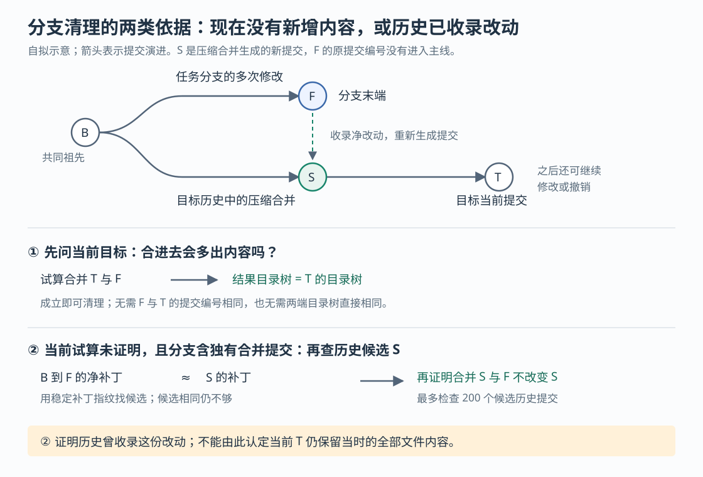
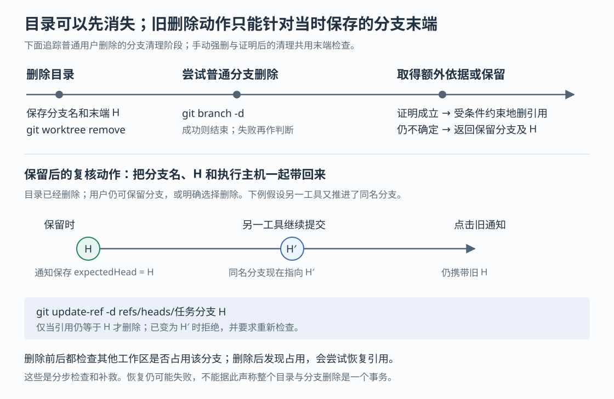

# Orca 删除工作区时如何保住分支：压缩合并判断、远程刷新与旧操作保护

假设编码代理在独立工作区修好了登录错误，产生三次提交；你把它们压成一次提交合入主线，然后删除这个工作区。这是本文自拟场景。此时，任务分支的原提交编号并没有进入主线，普通分支删除可能仍被 Git 拒绝。若一律强删，会丢掉真正尚未收录的工作；若一律保留，又会积累许多实际已经完成的分支。

Orca 的做法是：**先删除工作目录，再尝试 Git 的普通安全分支删除；失败后，补查合并结果或历史补丁；仍不能确认时，保留分支并提供复核入口。**额外清理和复核后的强删还带着先前保存的提交编号，避免旧动作误删后来推进的同名分支。理解这条链路，可以分清“工作区已消失”“改动已被收录”和“分支可以删除”各自意味着什么。

Orca 是把编码代理、终端和 Git 工作区组织在一起的开发工作台。已有七篇研报覆盖整体架构、启动、消息、终端恢复、状态、保存与调度，本篇深入此前未展开的任务清理。依据是本次本地源码 `6ed9382c050294f3051c6dcd02912316489f9e54`，重点核验普通 Git 关联工作目录的本地删除及分支处理；不把历史研报当作当前实现依据。本次只做静态阅读，没有安装依赖、启动 Orca 或执行项目测试。

**先看实际顺序：删目录成功，不要求删分支也成功。**

Git 工作树（worktree）是同一个仓库的另一个检出目录，它与分支是两种资源：目录保存当前文件，分支名指向一条提交历史的末端。删掉目录后，分支仍可存在，已提交的工作仍可沿分支找到；未提交文件则不因此得到备份。

界面的 `dispatchWorktreeRemoval` 按工作区归属，把请求交给桌面主进程接口，或交给宿主的 `worktree.rm`。后者是 RPC，即让客户端请求宿主执行操作的远程过程调用。注册项实际调用 `removeManagedWorktree`，工作区删除层再进入 `removeRuntimeRegisteredLocalWorktree`。桌面路径有对应的删除协调实现，两路最终共用 Git 层的 `removeWorktree`。[界面派发](https://github.com/stablyai/orca/blob/6ed9382c050294f3051c6dcd02912316489f9e54/src/renderer/src/store/slices/worktrees/teardown/dispatch-worktree-removal.ts)、[宿主接口注册](https://github.com/stablyai/orca/blob/6ed9382c050294f3051c6dcd02912316489f9e54/src/main/runtime/rpc/methods/worktree.ts)、[宿主调用连接](https://github.com/stablyai/orca/blob/6ed9382c050294f3051c6dcd02912316489f9e54/src/main/runtime/workspaces/workspace-removal.ts)

在本文跟踪的宿主正常路径中，归档脚本若被要求运行，会先运行并经过失败检查；随后重新读取工作树登记，检查锁定状态与未提交改动，再停止相关终端，执行目录删除。重新读取也更新了要保存的分支末端，避免归档脚本改变提交后还使用脚本运行前的旧值。普通删除会检查未跟踪文件及子模块修改；`force` 可以跳过这项清洁检查，但不自动豁免归档脚本失败。[删除前的实际顺序](https://github.com/stablyai/orca/blob/6ed9382c050294f3051c6dcd02912316489f9e54/src/main/runtime/runtime-registered-local-worktree-removal.ts)、[文件状态检查](https://github.com/stablyai/orca/blob/6ed9382c050294f3051c6dcd02912316489f9e54/src/main/git/worktree-removal-preflight.ts)

Git 层先保存分支名和末端提交，再执行 `git worktree remove`；目录删除成功后，才进入 `deleteBranchAfterWorktreeRemoval`。工作区若配置了保留分支，上层传入 `deleteBranch: false`，这里直接结束；没有分支的工作树也不执行分支删除。否则先用 `git branch -d`，由 Git 按自身的安全删除规则决定能否删除。[目录删除与分支删除的连接](https://github.com/stablyai/orca/blob/6ed9382c050294f3051c6dcd02912316489f9e54/src/main/git/worktree-removal.ts)

这里有两个容易混淆的开关：**强制删目录的 `force`，与绕过分支合并检查的 `forceBranchDelete` 分开传递。**普通用户删除传入前者，并不会让分支删除自动变成 `git branch -D`；后者在代码中另有入口，用于创建失败后的新分支回滚。因此，“我允许丢弃目录里的未提交修改”不能直接解释为“我也允许丢弃这条分支的独有提交”。

目录删除后的普通分支清理失败，通常返回 `preservedBranch`，其中带分支名和已保存的末端，而不让已经完成的目录删除重新变成整体失败。另有一个特殊处理：若 Git 报告分支仍被其他工作树占用，Orca 会清理过期登记并重试；重试后仍占用，就保留该分支并正常返回，不一定附带 `preservedBranch`。所以，“没有保留分支提示”也不足以单独证明本地分支已经消失。[分支删除及占用分支处理](https://github.com/stablyai/orca/blob/6ed9382c050294f3051c6dcd02912316489f9e54/src/main/git/worktree-branch-removal.ts)

较长的本地目录删除可以在后台继续。宿主返回的 `removing: true` 表示已受理且仍在处理，支持当前协议的客户端可等待最终结果。本文后面的分支判断发生在目录删除之后，不能从一次受理响应提前推导它的最终结论。

**普通删除被拒后，Orca 去哪里寻找“改动已经收录”的依据？**

额外检查并不查询代码托管平台的合并按钮状态。`getBranchCleanupTargetRefs` 收集三个候选：分支配置中的 `branch.<分支名>.base`、`refs/remotes/origin/HEAD` 指向的默认远程跟踪分支，以及仓库当前的 `HEAD`。这里的“引用”就是 Git 为提交保存的名字；`HEAD` 通常表示当前检出的提交。创建新工作树时，Orca 会尝试把实际使用的起点存入上述 `base` 配置，清理时由此找回候选目标。[候选收集与判断入口](https://github.com/stablyai/orca/blob/6ed9382c050294f3051c6dcd02912316489f9e54/src/shared/git-branch-cleanup.ts)、[创建时保存起点](https://github.com/stablyai/orca/blob/6ed9382c050294f3051c6dcd02912316489f9e54/src/main/git/worktree-add.ts)

候选收集后，`branchHasNoUnmergedChangesWithLazyTargetRefresh` 会先检查本地目标，再检查需要刷新的远程目标。任意一个目标给出肯定结果就足够，并不要求所有候选一致。**这套条件也不要求改动必须已经推送到服务器：本地 `HEAD` 就可能提供足够依据。**而且，这些额外检查只有普通 `branch -d` 失败后才会运行，不能把远程刷新规则推广成每次分支删除的共同前置条件。

远程跟踪引用是本地保存的远程分支位置，可能已经过时。需要依赖它时，Orca 先读取远程的 fetch 映射，即“服务器哪条引用应更新本地哪条引用”，再只抓取需要的候选，关闭标签抓取和该次抓取的自动维护。自定义重命名映射、包含斜杠的远程名称，以及明确排除的分支都参与解析；映射有歧义时不猜测。抓取失败的候选不会继续用旧位置作证明。若批量抓取只因某条远程引用已删除而失败，还会分别尝试其他候选，避免失效起点挡住仍存在的默认分支。[按映射刷新与失败处理](https://github.com/stablyai/orca/blob/6ed9382c050294f3051c6dcd02912316489f9e54/src/shared/git-branch-cleanup-fetch.ts)

由此可以解释一个实际现象：目录已经删完，分支清理却仍在等网络。源码为同一仓库的分支清理设置了串行队列，避免多个删除争抢引用锁；目录删除不必按这条队列逐个等待。这是对不同副作用分别排队的选择，不是把所有清理都变成一个全局串行操作。

**压缩合并后，先比较试算结果，再在必要时检查历史补丁。**

回到登录修复。压缩合并会把多次提交的净改动合成一个新提交，所以“原提交编号不在主线”不代表“改动没进主线”。另一方面，主线后来增加了别的功能，两端完整文件快照不同，也不代表任务分支还有独有改动。



图中的 B 是共同祖先，F 是任务分支末端，S 是收录净改动的新提交，T 是目标当前提交。清理算法先把目标引用解析成固定提交编号，再寻找它与任务分支的共同祖先。找不到共同祖先就跳过这个目标；只下载部分历史的浅克隆可能因此无法证明，代码不会在这里自动补齐整个历史。

找到共同祖先后，主要有三条判断路径：

| 路径 | 实际动作 | 肯定结果说明什么 |
| --- | --- | --- |
| 当前合并试算 | 执行 `merge-tree --write-tree`，把合并结果的目录树编号与目标的目录树编号比较 | 把任务分支合入这个目标，不会给目标增加文件变化 |
| 无分支独有合并提交时的补丁检查 | 执行 `git cherry -v`，要求返回的提交条目全部以 `-` 开头 | 被列出的分支补丁在目标历史中存在等价补丁 |
| 有分支独有合并提交时的压缩合并检查 | 计算分支净补丁指纹，搜索目标历史中的匹配提交，并在该提交上再作合并试算 | 某个目标历史提交已经收录这份净改动，任务分支合入它也不会再增加变化 |

“目录树”是 Git 对文件名称、目录层次、内容对象和相关模式的记录；比较其编号，是比较 Git 记录的文件状态。`merge-tree` 在这里计算结果而不把工作目录切到结果。它若报告冲突，或者目录树不同，第一条路径就不成立；程序还可能继续检查其他路径，而不是立刻强删。[三条路径的完整实现](https://github.com/stablyai/orca/blob/6ed9382c050294f3051c6dcd02912316489f9e54/src/shared/git-branch-cleanup.ts)

第三条路径需要多解释一步。若分支独有历史里含合并提交，简单逐个检查普通提交的补丁，不能充分描述合并时产生的最终修改。代码因此对“共同祖先到分支末端”的整体差异计算 `patch-id --stable`，即按 Git 的补丁归一化规则计算稳定指纹，再与目标历史提交的补丁指纹比较。**指纹匹配只用来找候选，不直接批准删除**；还必须证明把 F 合入这个历史候选，结果目录树不变。

这项历史搜索有明确预算：最多接受 200 个候选提交。代码先读取最多 201 个；如果得到 201 个，就放弃本目标的这条证明，而不是检查前 200 个后便下结论。补丁无法读取、指纹无法计算或没有匹配候选，也不能从这条路径取得肯定结果。这个上限限制了清理动作愿意付出的历史搜索量，未在本次测量中转换为任何性能保证。

这三条路径的含义不同。第一条直接比较当前目标的试算结果；后两条会使用历史收录证据，第三条最后验证的也是历史候选 S，而非当前 T。**据此推断，即使目标后来修改或撤销了相关内容，历史证据仍可能使分支符合清理条件。**本次没有执行这样的撤销场景，不能声称已实测其完整结果；但代码的比较对象足以说明，“允许清理”不承诺当前目标仍保持分支当时的所有文件内容，更不负责判断登录错误现在是否真的修好。

旧版 Git 不支持 `merge-tree --write-tree` 时，能力缓存会暂时记住这项不支持，避免每次重复尝试；其他可用路径仍可能继续提供依据。反过来，试算遇到冲突虽然不能证明可删，但若输出了合法目录树编号，代码仍把它看成“这个 Git 支持该命令”的证据。**命令能力可用，与这次分支可以删除，是两种独立结论。**

还需要保留一个异常处理上的限制：`hasBranchOnlyMergeCommits` 读取独有合并提交数量失败时，会把缺失结果按零处理，随后可能进入 `cherry` 检查，并非立即保留分支。本次阅读的相关测试没有为这条读取失败分支提供对应断言。因此，可以确认许多缺证据分支会拒绝额外清理，却不能概括成“任意 Git 查询失败都必然停止判断并保留”。

**证明成立以后，也不能只按分支名字删除。**

假设删除目录时分支指向 H。稍后另一工具沿同名分支继续提交，使它指向 H′；此时旧通知中的“删除分支”动作已经过时。Orca 的 `forceDeleteLocalBranch` 要求调用方提供先前保存的 H，实际执行：

```text
git update-ref -d refs/heads/<分支名> <H>
```

这里的条件是：引用现在仍等于 H，才删除。这让“删除我当时确认的分支版本”成为 Git 真正检查的条件，避免先在应用里读一次、随后无条件删除的竞争窗口。自动证明通过后的额外清理与用户复核后的强删共用这个函数；最初的普通 `branch -d` 则仍由 Git 自身的删除规则约束。[带预期末端的删除实现](https://github.com/stablyai/orca/blob/6ed9382c050294f3051c6dcd02912316489f9e54/src/main/git/worktree-branch-removal.ts)



删除前，函数还检查其他工作树是否正在使用这条分支。检查不止读取普通分支栏：变基（rebase，重新组织提交历史）和二分定位（bisect，逐步定位问题提交）期间，工作树可能暂时不直接检出该分支，管理文件仍显示它被操作占用。`isBranchReservedByWorktreeOperation` 会读这些标记，也检查变基计划更新的其他分支。[操作占用检查](https://github.com/stablyai/orca/blob/6ed9382c050294f3051c6dcd02912316489f9e54/src/shared/git-worktree-admin.ts)

删完引用后，函数再次检查占用。若此时发现另一个工作树已经抢先使用该分支，就尝试把引用恢复到 H，而且要求该名字当前不存在，以免覆盖后来新建的引用。恢复失败会写警告并继续抛出原错误。清除分支配置则是尽力执行，失败不推翻已经完成的引用删除。

这些检查缩小了竞争风险，但它们是多个步骤：**目录删除、合并判断、引用删除与占用复查没有组成一个不可分割的事务。**同仓库队列只协调 Orca 这条调用链里的清理，不能锁住其他 Git 客户端；恢复也可能失败。源码中的保护应理解为带条件的删除和补救，不能扩展成“所有并发时刻都能完整回滚”。此外，`update-ref` 的不同错误在这里会被统一改写为“分支已变化，请复核”，因此该用户提示也不保证底层一定发生过新提交。

**保留结果要回到正确的主机，用户设置也会改变后续行为。**

宿主把保留分支的名字、H、工作区身份和执行主机放进内存映射，作为待清理目标；界面也保留删除时的宿主路由。之后复核不能仅靠同名分支或当前选中的工作区猜目标。宿主会核对确实存在这份待清理记录，且分支名和 H 都匹配；有多个可能的主机而请求未说明时，不任意选择。[宿主待清理记录](https://github.com/stablyai/orca/blob/6ed9382c050294f3051c6dcd02912316489f9e54/src/main/runtime/runtime-preserved-branch-cleanup.ts)、[界面保留路由与再次请求](https://github.com/stablyai/orca/blob/6ed9382c050294f3051c6dcd02912316489f9e54/src/renderer/src/store/slices/worktrees/teardown/force-delete-preserved-branch.ts)

提示框明确表达“工作树已删除，分支保留”。只有拿到了 H，才提供强删动作；缺失 H 时不展示该按钮。批量删除则可以汇总保留分支供复核，未选择的分支继续留在仓库，已经删除的目录不会因此恢复。这与仓库工作区文档的描述一致。[提示框实现](https://github.com/stablyai/orca/blob/6ed9382c050294f3051c6dcd02912316489f9e54/src/renderer/src/components/sidebar/preserved-branch-toast.tsx)、[保留分支使用说明](https://github.com/stablyai/orca/blob/6ed9382c050294f3051c6dcd02912316489f9e54/docs/site/content/docs/model/worktrees.mdx)

但“不能证明就保留”还受到用户偏好的影响。`alwaysForceDeletePreservedBranches` 默认关闭；启用后，界面在收到保留结果时，会自动请求同一受条件约束的强删入口。它仍要满足 H 和主机等检查，却不再要求合并证明成立。自动强删失败才继续保留并提示。因此，这个偏好改变的是是否愿意放弃仍可能独有的提交，不只是少显示一个通知。[默认设置](https://github.com/stablyai/orca/blob/6ed9382c050294f3051c6dcd02912316489f9e54/src/shared/default-global-settings.ts)、[保留结果后的自动强删](https://github.com/stablyai/orca/blob/6ed9382c050294f3051c6dcd02912316489f9e54/src/renderer/src/store/slices/worktrees/teardown/complete-preserved-branch-cleanup.ts)

**合并试算不改工作目录，仍可能写入 Git 对象。**

`merge-tree --write-tree` 会生成目录树等 Git 对象。清理器只需要返回的编号，不需要长期保留试算产生的对象。为减少这些无用对象的积累，已经确认命令能力后，调用方可要求把写入放入临时对象目录；读取则通过备用对象目录继续访问真实仓库。命令结束后，无论成功、失败还是中止，包装层都会尝试清理临时目录。[调用处的临时写入标记](https://github.com/stablyai/orca/blob/6ed9382c050294f3051c6dcd02912316489f9e54/src/shared/git-branch-cleanup.ts)、[本地对象目录定位](https://github.com/stablyai/orca/blob/6ed9382c050294f3051c6dcd02912316489f9e54/src/main/git/local-git-object-quarantine.ts)、[临时对象写入与清理](https://github.com/stablyai/orca/blob/6ed9382c050294f3051c6dcd02912316489f9e54/src/shared/git-object-quarantine.ts)

这里没有把“清理临时对象”扩大成“删掉本次产生的一切文件”。部分克隆可能在读取时按需下载缺失文件内容，Git 会把下载对象保存为包文件；包装层先把这些包留回真实对象库，再删临时目录，避免下次检查重复下载。也有明确回退：首次尚未确认能力的试算可能直接使用真实对象库；无法可靠镜像继承的对象目录配置、真实对象库自带备用库链，或临时目录创建失败时，也会直接运行原命令。因此，这是一项尽量减少试算残留的优化，不能承诺删除检查完全不写磁盘或不访问网络。

从这些实现推断，可迁移的取舍是：区分只为本次计算生成的对象和具有后续价值的下载内容，再决定哪些可以丢弃。临时写入优化失败不应伪造合并结果，也不负责替代前面的删除条件。

**本次证据支持哪些判断，实践中怎样用。**

本次阅读的测试包含几类相互补充的断言：共享算法测试检查匹配净补丁后仍须合并不变、超过 200 个候选便拒绝，以及远程刷新失败后不信旧引用；删除测试检查引用锁失败时返回保留结果、旧 H 被拒和并发占用后的恢复尝试；真实 Git 测试构造已压缩合并与仍有额外改动的分支，并比较临时对象机制的结果与对象残留；界面测试检查缺少 H 不给强删动作，以及自动强删失败仍返回保留分支。这些是读到的测试内容，**本次未运行，不能报告测试通过或实测可靠性**。[算法测试](https://github.com/stablyai/orca/blob/6ed9382c050294f3051c6dcd02912316489f9e54/src/shared/git-branch-cleanup.test.ts)、[删除与竞争测试](https://github.com/stablyai/orca/blob/6ed9382c050294f3051c6dcd02912316489f9e54/src/main/git/remove-worktree-branch-cleanup.test.ts)、[真实 Git 对象及分支测试](https://github.com/stablyai/orca/blob/6ed9382c050294f3051c6dcd02912316489f9e54/src/main/git/merge-tree-object-quarantine-real-git.test.ts)、[自动强删偏好测试](https://github.com/stablyai/orca/blob/6ed9382c050294f3051c6dcd02912316489f9e54/src/renderer/src/store/slices/worktrees-always-force-delete.test.ts)

实际使用时，可以据此作出三个具体判断：

- 收到保留提示，先检查分支提交与目标差异，再决定是否删除。浅历史、网络失败、搜索预算或引用竞争都可能使额外清理无法完成，提示本身不证明改动一定未合入。
- 若希望以后还能找回任务分支的独特历史，就保留分支或另存引用；净改动已经收录，不代表原提交拆分、提交说明和分支名字都有其他保留位置。保留提交历史的需求应与释放目录空间分开决定。
- 把强制删目录和“总是删除保留分支”分别配置。前者可能丢弃未提交文件，后者会在没有合并证明时继续清理提交引用；带 H 的条件检查防止删错后来的版本，却不替用户判断 H 本身是否值得保留。

这次研读补充了工作区生命周期的结束阶段：Orca 把目录、分支引用、改动收录证据与用户复核分开处理，再用执行主机和预期提交把后续动作约束在原目标上。本文没有全面核验远程旧宿主、所有平台恢复、后台删除的全部崩溃时刻或引用丢失后的对象回收；不据此保证任何已删除工作都能恢复。本地源码提交号与输入一致，源码工作区无修改；研报与两张配图写入 `output/`，配图已实际渲染检查。
