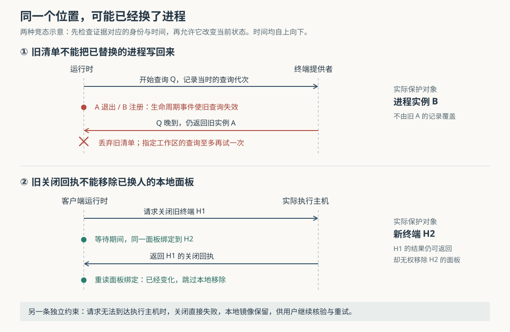

# Orca 如何确认终端已经停止：主机证据、旧查询隔离与关闭回执

假设编码代理正在远程服务器上修改登录逻辑，你合上笔记本，重新连接后发现终端暂时不见了；于是点击关闭，又马上打开另一个终端。这是本文自拟场景。此时有三个不同问题：原代理是否还在运行，关闭请求是否真的停止了它，以及迟到的查询或关闭结果会不会影响新终端。只用一个“已连接”标记，无法同时回答这些问题。

Orca 的核心做法是：**让实际运行进程的主机提供证据，区分失联与退出，并在异步操作返回时重新检查目标身份。**因此，“列表中没有”“窗口消失”“关闭请求已发出”和“进程确认停止”各有不同含义。理解这条边界，有助于判断何时可以重试连接，何时应核验服务器，何时可以相信关闭结果。

Orca 是组织编码代理、终端和独立代码工作区的开发工作台。此前八篇研究已覆盖整体架构、代理启动、消息交付、画面恢复、状态汇合、保存、调度和工作区删除。本篇研究终端生命周期中的证据与操作权限，依据本地源码 `2d06b6d6f93edbbf76427fb90a4b4371c780d811`，不重复画面快照恢复算法。本次只读源码、文档和测试，没有安装依赖、启动 Orca 或运行项目测试。

**先找到真正能回答问题的主机。**

在这个场景里，笔记本负责显示，服务器负责运行代理。源码把终端提供者，也就是实际创建、查询和停止终端进程的组件，按执行主机寻址。当前 `registeredPtyProviders()` 只登记本机提供者；`getProvider()` 对其他主机拒绝直接派发。远程运行时通过自己的接口处理自己的终端。因此，代码中的“本地”是相对于正在执行这段服务的进程而言：在服务器运行的 Orca 服务中，服务器自己的终端就是本地终端。[提供者登记与主机解析](https://github.com/stablyai/orca/blob/2d06b6d6f93edbbf76427fb90a4b4371c780d811/src/main/ipc/pty/provider/registry.ts)

这不是单靠接口命名得出的结论。无窗口服务入口 `orcad-entry.ts` 先启动终端守护进程，再注册终端运行时；守护进程是独立承载终端会话的后台进程。`installPtyRuntimeController` 随后把查询、探测、停止等操作实际连接到提供者。另一端，客户端表示远程终端的标识带有远程环境与终端句柄；句柄就是后续操作用来寻址终端的令牌。查询函数遇到这类远程标识会返回“无法在这里判断”，不会把它交给笔记本的本地进程表，得到一个错误的“不存在”。[宿主启动顺序](https://github.com/stablyai/orca/blob/2d06b6d6f93edbbf76427fb90a4b4371c780d811/src/main/orcad/orcad-entry.ts)、[控制器实际接线](https://github.com/stablyai/orca/blob/2d06b6d6f93edbbf76427fb90a4b4371c780d811/src/main/ipc/pty/runtime/controller.ts)、[本机探测的拒绝边界](https://github.com/stablyai/orca/blob/2d06b6d6f93edbbf76427fb90a4b4371c780d811/src/main/ipc/pty/runtime/operations.ts)

这里也需要校正阅读材料带来的印象：仓库的 SSH 使用文档仍描述通过远程中继为终端续租；但当前持久化实现明确只清理旧版中继留下的租约，不再新建这类租约，另有专门的兼容桥接目录。租约是记录终端保留与归属关系的数据。不能把这份旧路径说明推广成当前所有远程终端的架构；远程服务器文档所说的“服务器保存终端、客户端提供界面”，与上述当前注册和路由更吻合。[SSH 文档](https://github.com/stablyai/orca/blob/2d06b6d6f93edbbf76427fb90a4b4371c780d811/docs/site/content/docs/ssh.mdx)、[旧租约写入边界](https://github.com/stablyai/orca/blob/2d06b6d6f93edbbf76427fb90a4b4371c780d811/src/main/persistence/leasing-ssh-ptys/ssh-pty-lease-operations.ts)、[远程服务器职责说明](https://github.com/stablyai/orca/blob/2d06b6d6f93edbbf76427fb90a4b4371c780d811/docs/site/content/docs/remote-servers.mdx)

**一次终端列表查询，需要同时带回“看到了谁”和“问到了谁”。**

真实入口 `terminal.list` 调用运行时的 `listTerminals`，再进入 `RuntimeTerminalList.list`。运行时构造时注入的 `refreshPtys`，实际连接到 `refreshPtyWorktreeRecordsWithControllerInventory`，由它查询终端控制器并更新记录。这里的 PTY 是伪终端，即交互式命令行程序连接的终端通道；Orca 用 PTY 标识跟踪背后的终端会话。[接口注册](https://github.com/stablyai/orca/blob/2d06b6d6f93edbbf76427fb90a4b4371c780d811/src/main/runtime/rpc/methods/terminal/terminal-query-methods.ts)、[列表消费逻辑](https://github.com/stablyai/orca/blob/2d06b6d6f93edbbf76427fb90a4b4371c780d811/src/main/runtime/runtime-terminal-list.ts)、[构造时的连接](https://github.com/stablyai/orca/blob/2d06b6d6f93edbbf76427fb90a4b4371c780d811/src/main/runtime/construction/runtime-service-state.ts)

查询结果不只有进程数组，还包含回答了查询的主机集合 `hostIds`。更新层据此生成 `queriedHostIds`：某台主机没有回答，就不能用其他主机的列表证明它的终端已经消失。查询超时则返回“本轮没有可用清单”；如果调用方要求最新存活证据，列表层抛出 `terminal_liveness_unavailable`，不会用空列表假装查询成功。[主机范围清单](https://github.com/stablyai/orca/blob/2d06b6d6f93edbbf76427fb90a4b4371c780d811/src/main/ipc/pty/runtime/inventory-operations.ts)、[清单更新与超时处理](https://github.com/stablyai/orca/blob/2d06b6d6f93edbbf76427fb90a4b4371c780d811/src/main/runtime/terminal/lifecycle/pty-controller-inventory-refresh.ts)

即使同在一台机器，也可能有多个版本的终端后台需要查询。`DaemonPtyRouter` 背后的清单处理会检查结果是否完整、同一会话是否出现多个候选归属；存在无法消解的歧义时，普通列表直接报错，不悄悄略过有歧义的终端。停止检查只请求目标 PTY，能避开其他终端的归属冲突；但任何相关后台清单仍不完整时，也不能证明目标缺席。这是在查询可用性与停止判断可靠性之间作出的具体选择。[后台会话归属与完整性检查](https://github.com/stablyai/orca/blob/2d06b6d6f93edbbf76427fb90a4b4371c780d811/src/main/daemon/daemon-session-owner-inventory.ts)、[针对目标的停止核验](https://github.com/stablyai/orca/blob/2d06b6d6f93edbbf76427fb90a4b4371c780d811/src/main/ipc/pty/provider/liveness.ts)

运行时另存一份 `PtyLivenessVerdict`，即对终端是否存活的证据判断：

| 记录 | 含义 | 不能据此推导的结果 |
| --- | --- | --- |
| `live` | 所属提供者观察到这个 PTY | 代理任务已经成功 |
| `unverifiable` | 当前无法核验，并保留原因 | 进程已停止，可以放心再开一个代理 |
| `exited` | 当前生命周期收到了足够的退出或停止证据 | 该终端完成了预期业务 |
| 没有记录，即 `null` | 这份证据表目前没有可用判断 | 进程一定存活或一定死亡 |

最后一行尤其重要。旧中继重新启动后，可能不认识以前分配的终端标识；因此，清单更新发现旧 SSH PTY 缺席且 `hasPty` 返回 `false` 时，会清除较弱判断，而不是直接写入 `exited`。返回 `null` 又可能只是尚未查询。它们都不能变成统一的退出证明。[存活判断类型](https://github.com/stablyai/orca/blob/2d06b6d6f93edbbf76427fb90a4b4371c780d811/src/shared/pty-liveness-verdict.ts)、[证据登记与读取](https://github.com/stablyai/orca/blob/2d06b6d6f93edbbf76427fb90a4b4371c780d811/src/main/runtime/terminal/layout/terminal-input-floor.ts)

**证据来自正确主机，还必须没有落后于目标的变化。**

假设查询开始时终端实例是 A，查询尚未返回，A 已退出，同一个终端标识又用于实例 B。旧查询即使真实看到过 A，也无权把当前状态改回 A。Orca 为此保存 `incarnationId`，也就是区分同一标识下不同进程实例的编号，同时给清单查询维护递增代次。

图的上半部分对应两道检查。第一道检查整次查询：查询开始时记住代次；进程注册、启动或退出会使相关主机的旧查询失效。查询回来时若代次已旧，便不应用。指定工作区的查询可以在原截止时间内再试一次；再次失效就保留未知，避免无限追赶。对不同主机的定向查询分别记代次，整体查询则与定向查询协调顺序。[生命周期使清单失效](https://github.com/stablyai/orca/blob/2d06b6d6f93edbbf76427fb90a4b4371c780d811/src/main/runtime/terminal/lifecycle/pty-handle-invalidation.ts)、[查询返回时的代次检查](https://github.com/stablyai/orca/blob/2d06b6d6f93edbbf76427fb90a4b4371c780d811/src/main/runtime/terminal/lifecycle/pty-controller-inventory-refresh.ts)

第二道检查证据本身：查询开始时还记住证据序号。若等待期间已经记录失联，较早发起的查询回来后不能抹去这个较新的判断。`markPtyLivenessLive` 与清理旧判断的函数都检查观察顺序。由此可以看出，`connected` 连接标记与存活证据表承担不同职责；消费者若只读连接标记，仍会丢失“查询结果虽晚到，观察却更早”这一层信息。[证据序号保护](https://github.com/stablyai/orca/blob/2d06b6d6f93edbbf76427fb90a4b4371c780d811/src/main/runtime/terminal/layout/terminal-input-floor.ts)

退出事件也要核对实例。提供者监听层先用 `isCurrentPtyExit` 筛掉不属于当前实例的事件；运行时 `onPtyExit` 再检查记录与待注册实例。旧 A 的退出事件因而不能直接结束新 B。没有实例编号的兼容记录无法得到完全相同的保护，不能把这一机制描述为对所有旧会话都同等严格。[提供者退出接线](https://github.com/stablyai/orca/blob/2d06b6d6f93edbbf76427fb90a4b4371c780d811/src/main/ipc/pty/provider/bind-listeners.ts)、[实例匹配规则](https://github.com/stablyai/orca/blob/2d06b6d6f93edbbf76427fb90a4b4371c780d811/src/main/ipc/pty/provider/ownership-state.ts)、[运行时退出处理](https://github.com/stablyai/orca/blob/2d06b6d6f93edbbf76427fb90a4b4371c780d811/src/main/runtime/terminal/lifecycle/pty-exit-lifecycle.ts)

**点了关闭以后，面板移除与进程停止仍是两项结果。**

`terminal.close` 的注册项进入 `closeTerminal`。当客户端持有的是另一个运行时的终端镜像，`closePairedHostLeafFirst` 先检查固定标签页的保护，再向实际执行主机发送关闭请求；这一步是 RPC，即把方法名和参数交给另一端执行的远程过程调用。请求超时或连接失败会向上报错，本地镜像保留。客户端不会改用本机停止函数“处理”一个远程标识。[关闭接口](https://github.com/stablyai/orca/blob/2d06b6d6f93edbbf76427fb90a4b4371c780d811/src/main/runtime/rpc/methods/terminal/terminal-lifecycle-methods.ts)、[关闭协调流程](https://github.com/stablyai/orca/blob/2d06b6d6f93edbbf76427fb90a4b4371c780d811/src/main/runtime/session-tabs/explicit-terminal-close-stops.ts)、[先询问所属主机](https://github.com/stablyai/orca/blob/2d06b6d6f93edbbf76427fb90a4b4371c780d811/src/main/runtime/session-tabs/paired-host-terminal-close.ts)

主机返回以后，还要处理图下半部分的竞争：等待期间，面板可能已从 H1 绑定到 H2。代码重新读取标签页、面板和 PTY 标识；任何一项不匹配，就返回旧关闭结果，但跳过对当前本地面板的移除。因此，“H1 已关闭”不能自动授权删除现在显示 H2 的位置。

回执也保留不同强度的结果。主机返回可读的关闭回执时，客户端传递 `ptyKilled`、`ptyStopVerdict` 和原因；主机只说句柄已过期时，结果是“未确认停止”，不是编造成功。主机回应 `terminal_not_found` 时，代码允许清理镜像，但仍不声称自己停止了进程。即使收到了无法识别的回执，也会返回无法核验。**主动关闭可以移除一个已经失去寻址能力的面板，同时承认其进程停止尚未得到确认。**这与“网络请求失败便保留镜像”是不同分支。

实际执行停止的默认控制器提供 `stopAndWait`：先等待提供者就绪，再请求关闭，再用所属提供者的新清单核验目标。若进程仍在，记录存活并返回失败；查询出错也不确认停止。只有确认缺席或观察到退出后，才完成相应清理。这里先前的保守策略也有正向补充：如果停止后，汇总核验被其他后台的问题阻塞，但运行时已经收到了**正在关闭的同一个实例**的退出证据，`stopExplicitlyClosedTabPtys` 可以承认它已停止，不让无关故障抹掉已经取得的事实。[停止与核验的真实顺序](https://github.com/stablyai/orca/blob/2d06b6d6f93edbbf76427fb90a4b4371c780d811/src/main/ipc/pty/runtime/kill.ts)、[同实例退出的补充确认](https://github.com/stablyai/orca/blob/2d06b6d6f93edbbf76427fb90a4b4371c780d811/src/main/runtime/session-tabs/explicit-terminal-close-pty-stops.ts)

仍未确认时，主动关闭路径可能补发一次停止请求，并返回未确认结果。它不会把补发本身当成确认。另有兼容边界：不提供 `stopAndWait` 的控制器会退回使用 `kill` 的布尔结果；整页关闭的某些分支也只返回标签页关闭结果。因此，判断具体关闭是否完成，应读对应接口回执，不能把所有 `close` 调用都解释为同一种强停止保证。

**输出流结束，同样不能单独充当死亡证明。**

`terminal.subscribe` 先解析句柄并取得 PTY，再把订阅绑定到该 PTY 的退出监听；之后句柄失效，本身不会自动结束已经绑定的流。真正释放订阅时，会清理输出监听、手机使用登记和取消信号。单纯中继失联、连接标记变为 `false` 而没有退出码时，`getPtyTerminalState` 返回 `unknown`，退出监听继续等待。[订阅入口](https://github.com/stablyai/orca/blob/2d06b6d6f93edbbf76427fb90a4b4371c780d811/src/main/runtime/rpc/methods/terminal/terminal-subscribe-method.ts)、[订阅释放](https://github.com/stablyai/orca/blob/2d06b6d6f93edbbf76427fb90a4b4371c780d811/src/main/runtime/rpc/methods/terminal/terminal-subscription-registration.ts)、[连接与退出状态的计算](https://github.com/stablyai/orca/blob/2d06b6d6f93edbbf76427fb90a4b4371c780d811/src/main/runtime/terminal-wait-results.ts)

但订阅也会因为取消、连接关闭或替换而释放；某些失败停止路径还会发布合成退出，用于结束当前连接与界面资源。旧 SSH 路径的负退出码若没有所属主机确认，`onPtyExit` 会保留无法核验的判断，而不是把它提升成物理进程死亡。因此，流的 `end`、终端摘要的退出状态与存活证据回执不是可以互换的三个字段。它们分别服务于流清理、界面状态和后续操作决策。

**旧 SSH 面板恢复存在明确的取舍，不能从上述保护推出“绝不重复进程”。**

兼容入口 `terminal.recoverPane` 要求工作区、稳定面板地址和预期旧句柄都匹配，并且有近期仍可恢复的过期租约。确认仍存活、或已经记录无法核验时，它拒绝替代创建；同一面板并发恢复共享一次进行中的请求。

然而，没有存活判断，即 `null`，不会在这里一律被拒绝。符合其余条件时，代码会进入 `createTerminal` 尝试建立替代终端。注释说明其原因：旧中继不认识某个标识，不足以证明原进程已死；但若恢复必须取得明确退出证明，这条兼容路径又可能永远无法恢复。**实现选择在受限条件下保留恢复机会，也就保留了不能仅凭此路径排除旧进程幸存的边界。**本次读到的允许创建测试替换了实际创建器，证明的是恢复门槛，不是当前未挂接旧主机时一定能成功启动新进程。[恢复条件与并发合并](https://github.com/stablyai/orca/blob/2d06b6d6f93edbbf76427fb90a4b4371c780d811/src/main/runtime/terminal/recovery/resolve-terminal-pane.ts)、[恢复门槛测试](https://github.com/stablyai/orca/blob/2d06b6d6f93edbbf76427fb90a4b4371c780d811/src/main/runtime/terminal-pane-recovery-liveness-gate.test.ts)

前端还特别排除“标识存在，但属于其他面板”的错误。它说明找到了一个仍可寻址的终端，却不能证明是原目标，不能按普通会话过期直接恢复。该检查与主机端门槛共同说明：错误字符串、失联状态与退出证据，必须按实际含义分别处理。[前端过期错误分类](https://github.com/stablyai/orca/blob/2d06b6d6f93edbbf76427fb90a4b4371c780d811/src/renderer/src/components/terminal-pane/pty-connection/pty-connect-limits.ts)、[远程恢复的调用方](https://github.com/stablyai/orca/blob/2d06b6d6f93edbbf76427fb90a4b4371c780d811/src/renderer/src/components/terminal-pane/remote-runtime-pty-transport.ts)

**这些判断有哪些交叉依据，实际使用时应怎样理解？**

测试没有只检查类型名称。清单测试把查询挂起，再插入退出或新实例注册，检查旧结果被丢弃、其他主机的定向查询不受无关事件影响，以及重试只进行一次。证据测试模拟查询期间失联，检查晚到结果不会清除新判断。远程关闭测试检查请求失败时本地镜像保留、返回主机原始停止结论，以及面板换人后不再移除新面板。停止测试还通过套接字场景区分“已经收到物理退出”与“清单暂时缺席但退出流尚未到达”。这些是本次阅读到的测试安排与断言，**没有在本次环境执行，不能报告测试通过**。[清单竞争测试](https://github.com/stablyai/orca/blob/2d06b6d6f93edbbf76427fb90a4b4371c780d811/src/main/runtime/pty-inventory-lifecycle-scope.test.ts)、[证据竞争测试](https://github.com/stablyai/orca/blob/2d06b6d6f93edbbf76427fb90a4b4371c780d811/src/main/runtime/pty-inventory-liveness-verdict.spec.ts)、[远程关闭测试](https://github.com/stablyai/orca/blob/2d06b6d6f93edbbf76427fb90a4b4371c780d811/src/main/runtime/paired-host-terminal-close.test.ts)、[实际退出与停止回执测试](https://github.com/stablyai/orca/blob/2d06b6d6f93edbbf76427fb90a4b4371c780d811/src/main/runtime/terminal-close-observed-exit.test.ts)

对开头的场景，实践上的判断顺序应当是：先确认实际执行主机是否恢复可达，再核对原终端和代理；关闭后检查停止回执，遇到无法核验时继续到所属主机确认，不仅凭面板消失就新开同一任务。需要自动清理或重试的上层逻辑，也应携带主机和进程实例身份，避免只按一个可能已被复用的位置行动。这些建议来自上述实现边界，不构成对网络分区或主机崩溃后进程状态的额外保证。

可迁移的设计思想，是让一份结果只影响它能够证明的对象：本机清单不能裁决另一台主机，旧查询不能覆盖新生命周期，旧终端的关闭回执不能移除新面板，关闭意图不能冒充停止事实。本篇未全面核验旧中继桥接的停止重放、所有平台的进程树终止行为、宿主崩溃后的全部恢复，以及无终端通道的结构化代理会话；这些范围不能直接套用本文的 PTY 结论。
