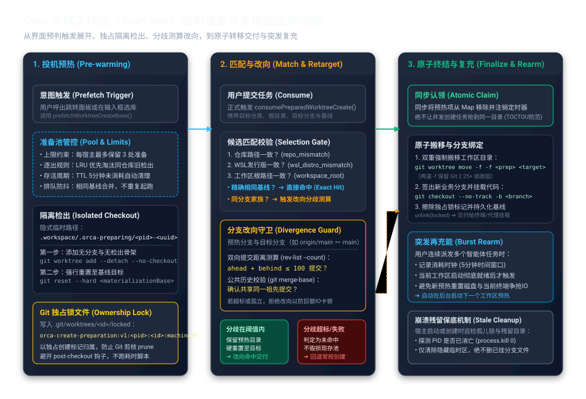

# Orca 如何预热与复用工作区检出：投机准备池、改向分支分歧与防冲撞锁

假设你正准备让两个编码代理分别重构前端路由和修复后端接口。在传统开发工作流中，每为代理建立一个独立的 Git 工作树（worktree，即同一个仓库的多个独立代码检出目录），系统都要完整遍历仓库对象、将成千上万个文件写入磁盘，并触发项目配置的各种检出钩子。大型工程的检出动辄耗时数秒到十几秒，多个代理并发启动时还会引发剧烈的磁盘 I/O 争抢；如果提前为用户悄悄建立工作目录，又会面临磁盘空间膨胀、钩子脚本偷跑、以及用户在输入框随时更换目标分支导致预建目录作废的难题。这是本文自拟的典型开发场景。

Orca 的核心解法是：**以极低优先级在隔离空间中投机建立无分支工作区，规避用户钩子执行；通过双重独占锁确立机器级所有权；在用户提交时按“分支家族”和“双向提交分歧预算”灵活改向复用；最终通过原子搬移完成秒级交付并触发突发复充。**

这套机制将耗时最长的新目录初始化、对象解包与磁盘写入动作前置到用户构思任务的几秒“思考空隙”中，使得任务正式派发时几乎可以“即点即用”。理解这套机制，有助于分清“工作区何时预热”“改向复用的边界在哪里”，以及“多进程并发与异常崩溃时如何避免误删数据”。

Orca 是组织编码代理、终端与独立代码工作区的开发工作台。此前已有九篇研报分别分析了其运行时整体边界、启动链路、多代理编排信箱、终端画面快照恢复、代理状态合成、编辑器防覆盖保存、定时自动化调度、工作区删除分支保护以及终端停止生命周期。本篇研究此前未曾展开的**工作区检出投机预热池与复用机制**。本文依据本地源码版本 `c90d0f93c0f2f2c3ec243046c36059a1f4ec5cd2` 进行静态追踪与契约核验，没有安装外部依赖、启动 Orca 桌面程序或执行实际自动化测试。



---

## 1. 意图捕获：在用户输入思考时提前起跑

要让工作区创建“感觉不到等待”，系统必须在用户正式点击“创建”按钮之前就感知到意图。Orca 的设计哲学是：**把预热动作绑定在用户的交互前置路径上，而不是盲目常驻。**

在桌面端界面中，当用户按下全局快捷键呼出任务跳转调色板（`WorktreeJumpPalette`），或者在任务编写框（Composer）中选中了目标代码仓库时，界面状态层会立刻通过 IPC（进程间通信）向主进程派发基线预取指令 `prefetchWorktreeCreateBase`。[跳转面板动作](https://github.com/stablyai/orca/blob/c90d0f93c0f2f2c3ec243046c36059a1f4ec5cd2/src/renderer/src/components/use-worktree-jump-palette-quick-actions.ts)、[预取绑定](https://github.com/stablyai/orca/blob/c90d0f93c0f2f2c3ec243046c36059a1f4ec5cd2/src/main/worktree-create-base-prefetch.ts)

整个预热链路的装配与调度起点如下：

```
[界面层: 呼出任务面板/输入聚焦]
             │
             ▼
[prefetchWorktreeCreateBase] (解析远程跟踪分支与本地基线)
             │
             ▼
[prepareWorktreeCreateForRepo] (绑定仓库、WSL环境与工作区根目录)
             │
             ▼
[startPreparation] ──► 检查准备池上限与相同基线排队
             │
             ▼
[prepareWorktreeCreateCheckout] (进入后台执行无钩子检出与加锁)
```

预取逻辑首先对目标仓库类型做严格准入判断：纯普通文件夹（Folder Repo，非 Git 仓库）直接忽略；配置了远程 SSH 中继的主机仓库（SSH Repo）由于其本地并不维护可直接映射的 Git 引用，也一律不执行预热。只有确定的本地仓库或受控 WSL（Windows 的 Linux 子系统）环境，才会继续推进。

更关键的是对“目标基线分支”的推导：如果用户尚未显式输入分支，系统通过 `resolveWorktreeCreateBase` 获取仓库默认推荐分支（如 `origin/main`）；如果该分支在远端有对应跟踪引用，还会先触发一次异步刷新，确保检出内容不至于落后于远程最新状态。

---

## 2. 隔离检出：无检出添加、硬重置与钩子规避

在用户尚未正式提交任务前，任何预热动作都不能对用户的工作区造成“侵入性”影响：
1. 不能提前占用用户可能想用的分支名称；
2. 不能污染用户正常存放工作树的根目录；
3. **绝不能提前触发项目仓库中的用户钩子（如 `post-checkout` 脚本、Husky 或自动化包安装）**，否则不但会大量消耗 CPU，还会让用户在仅仅打开弹窗时就观察到底层系统在偷偷运行外部代码。

Orca 在 Git 底层实现上采取了非常精妙的“分步物化”策略：[检出实现源码](https://github.com/stablyai/orca/blob/c90d0f93c0f2f2c3ec243046c36059a1f4ec5cd2/src/main/git/worktree-create-preparation.ts)、[底层添加逻辑](https://github.com/stablyai/orca/blob/c90d0f93c0f2f2c3ec243046c36059a1f4ec5cd2/src/main/git/worktree-preparation-add.ts)

### 2.1 隐蔽路径与游离指针

预热的工作区不会直接建立在用户的正常工作区目录下，而是存放在隐藏的前缀子目录中：
```text
<workspaceRoot>/.orca-preparing/<process.pid>-<UUID>
```
在调用 Git 原生命令时，Orca 执行：
```bash
git worktree add --detach --no-checkout <lockArgs> <preparedPath> <effectiveBase>
```
- `--detach`（游离指针）：不创建、不绑定任何具体分支，HEAD 处于游离状态，杜绝任何对用户分支命名空间的侵占。
- `--no-checkout`（不检出文件）：仅在 Git 管理元数据（`.git/worktrees/`）中注册该工作目录的指针结构，磁盘上此时只有一个空的占位目录，耗时不到 10 毫秒。

### 2.2 为什么必须用 `reset --hard` 物化文件？

既然用了 `--no-checkout`，文件何时写入磁盘？源码中的核心实现是接着调用：
```bash
git reset --hard <materializationBase>
```
源码注释明确指出了这一设计的技术考量：**`git worktree add` 如果直接附带检出，Git 会在建立工作树后立刻无差别触发仓库定义的 `post-checkout` 钩子；而通过 `--no-checkout` 配合随后的 `git reset --hard`，可以在将全量文件精准解包到工作区的同时，完全绕开 Git 自动调用 `post-checkout` 的生命周期点。**

耗时的钩子被完全延迟到用户真正点击提交、新分支被显式绑定时的 `git checkout -b` 阶段。这样一来，用户界面在预热期间完全静默，只付出纯粹的文件磁盘写入开销。

---

## 3. 防冲撞机制：机器级所有权与 Git 原生独占锁

由于 Orca 允许在同一台计算机上多开窗口、允许以无头守护进程（`orcad`）运行，甚至支持跨 WSL 与 Windows 文件系统访问同一个仓库，多个独立进程很可能同时发现同一个准备目录。如何确保一个正在预热或已经预热的工作目录不被其他进程篡改，也不被 Git 自身的垃圾回收（`git worktree prune`）当作废弃目录强行清理？

Orca 没有在外部搞一套自拟的临时标记，而是深度利用了 Git 原生的工作区锁定协议：[锁机制实现](https://github.com/stablyai/orca/blob/c90d0f93c0f2f2c3ec243046c36059a1f4ec5cd2/src/main/git/worktree-preparation-lock.ts)、[锁内容协议](https://github.com/stablyai/orca/blob/c90d0f93c0f2f2c3ec243046c36059a1f4ec5cd2/src/shared/worktree/create-preparation.ts)

### 3.1 锁标记与所有权编码

Git 规范规定，若 `.git/worktrees/<id>/locked` 文件存在，任何 `git worktree remove` 或 `git worktree prune` 均会被拒绝。Orca 在创建准备树时，直接向该锁文件中写入高度结构化的所有权凭证：
```text
orca-create-preparation:v1:<PID>:<sessionId>:machine=<machineIdentity>
```
这一设计兼顾了多维度的安全考量：
- **版本前缀与进程号（PID）**：标明是 Orca v1 协议建立的预热目录，并绑定当前持有者进程的 PID。
- **随机自增令牌（SessionId）**：防止操作系统在崩溃后快速复用同一 PID 导致代际混淆。
- **机器指纹（machineIdentity）**：解决网络共享存储或挂载卷场景下的“幽灵所有权”问题。如果一个仓库位于局域网共享盘上，另一台计算机看到的相同 PID 根本不是同一个进程；因此只有当锁中的机器指纹与本机完全一致时，PID 才具有判定生死的证据效力。
- **文件独占写入（`flag: 'wx'`）**：在系统调用层使用独占创建模式，一旦文件已存在立刻抛出 `EEXIST` 异常，避免并发写冲突。

---

## 4. 资源节制：准备池上限、LRU 逐出与生存周期

如果用户在任务框里反复切换不同的仓库、打开后又关闭弹窗，系统会不会在后台悄悄堆积几十个未使用的 Git 工作目录，把开发者的磁盘空间吃光？

`worktree-create-preparation-pool.ts` 施加了严格的资源约束：[准备池实现源码](https://github.com/stablyai/orca/blob/c90d0f93c0f2f2c3ec243046c36059a1f4ec5cd2/src/main/worktree-create-preparation-pool.ts)

| 约束维度 | 规则标准 | 违规/超期后的处置动作 |
| :--- | :--- | :--- |
| **池容量上限** | `WORKTREE_CREATE_PREPARATION_LIMIT = 3` | 当池内已有 3 处准备时，按 LRU（最近最少使用）原则挑选牺牲者；优先逐出当前申请仓库名下的最老预热项，次选全局最老项 |
| **存活时间（TTL）** | `WORKTREE_CREATE_PREPARATION_TTL_MS = 5 * 60_000` (5分钟) | 预热完成 5 分钟后若仍未被认领，定时器自动触发注销并在后台安全删除 |
| **I/O 准入优先级** | Git 准入层分级：`interactive` > `status` > `background` | 用户的直接交互操作为 `interactive`；预热检出运行于 `status` 级别；超期清理运行于 `background` 最低优先级 |
| **逐出中止控制** | `AbortController` 绑定底层命令的 `AbortSignal` | 一旦某个预热项被逐出或超时，其内部的 `AbortController.abort()` 立即打断正在执行的 Git 子进程 |

当一个预热条目因超限被逐出或因超时过期时，它不会残留为孤儿。系统调用 `discardPreparationEntry`，核验自身是否依然持有锁的所有权，随后以双重强制参数（`git worktree remove --force --force`）在后台悄然将临时目录连同元数据彻底抹去。

---

## 5. 命中与改向：分支家族与双向提交分歧预算

预热是一次“投机猜想”。但现实中，开发者很可能猜不准：输入框最初默认选中 `origin/main`，用户思考了三秒后，改成了本地分支 `main`，或者改成了 `origin/release`。

如果只要目标分支文字不完全一致就直接宣告“预热失败”、回退到慢速的冷启动检出，那么预热机制的收益就会大打折扣。为此，Orca 设计了一套极其精巧的**分支家族改向与分歧守卫机制**：[候选选择算法](https://github.com/stablyai/orca/blob/c90d0f93c0f2f2c3ec243046c36059a1f4ec5cd2/src/main/worktree-create-preparation-claim.ts)、[分歧测算守卫](https://github.com/stablyai/orca/blob/c90d0f93c0f2f2c3ec243046c36059a1f4ec5cd2/src/main/git/worktree-base-divergence.ts)

### 5.1 候选匹配的硬性条件

当用户提交任务、进入 `consumePreparedWorktreeCreate` 时，系统首先执行筛选门禁：
1. **仓库物理路径（`repoPathKey`）**必须严格相等；
2. **执行宿主与 WSL 发行版（`wslDistro`）**必须严格一致（因为不同发行版处于不同文件系统）；
3. **工作区根路径（`workspaceRootKey`）**必须匹配。

任何一项不合，立刻返回 `repo_mismatch`、`wsl_distro_mismatch` 或 `workspace_root_mismatch`，绝不跨边界冒险复用。

### 5.2 规范化全称与“分支家族”

如果硬性条件满足，系统检查目标分支基线。如果文字完全相同（如都是 `origin/main`），直接判定为**精确命中（Exact Hit）**。

如果字面不同，Orca 不会直接放弃，而是解析它们归属的“分支家族”（`worktreeBaseRefFamily`）：
- `refs/remotes/origin/main` 和 `refs/heads/main` 剥除前缀后，识别出的家族名称均为 `main`；
- 两个虽然来源不同（一个是远程跟踪分支，一个是本地分支）、但指向同一逻辑业务分支的基线，被视作改向候选者。

### 5.3 测算改向分歧：百次提交步长与公共祖先

一旦确定是同家族改向，系统就面临一道权衡选择：将已经解包完成的目录重置（`git reset --hard`）到新基线，究竟比“从零重新创建工作树”快多少？

如果本地 `main` 已经落后远程 `origin/main` 几千个提交，或者本地分支被强制重置到了完全无关的历史节点，执行一次巨量的 `git reset --hard` 所产生的磁盘写操作，可能比新创建一个目录还要沉重！

为了防止负优化，Orca 引入了 `measureRetargetDivergence`（改向分歧测算）：
```bash
# 1. 测算双向提交差异距离（上限 101）
git rev-list --count --max-count=101 --end-of-options fromRef..toRef
git rev-list --count --max-count=101 --end-of-options toRef..fromRef

# 2. 验证公共祖先
git merge-base --end-of-options leftRef rightRef
```

分歧评估的核心指标如下：
1. **硬上限预算**：`RETARGET_MAX_COMMIT_DIVERGENCE = 100`。
   只有当两个基线之间的双向差异提交总数（`ahead + behind`）**小于或等于 100 个提交**时，才被认定为 `within`（在允许预算内）。
2. **公共祖先硬校验**：必须通过 `git merge-base` 证实两者拥有共同祖先。如果没有任何共同提交（例如两个完全脱节的分支），即便差异数量未超标，也严禁复用。
3. **确定性防退化**：如果分歧测算超时或由于 Git 状态异常返回 `unknown`，状态记为 `retarget_unverifiable`；如果分歧超过 100，状态记为 `retarget_too_divergent`。在这两种情况下，预热池中的目录均保持原样不动，当前创建任务安全地回退为普通冷启动检出，既不破坏现存预热成果，也不让用户承担不可预估的巨量重置卡顿。

---

## 6. 原子终结：双重强力搬移与突发再充能

当一切匹配与分歧验证通过后，Orca 如何把隐藏在 `.orca-preparing/` 下的半成品，在不被任何并发任务冲突的前提下，瞬间转正为用户可见的正式工作区？

核心流程在 `finalizePreparedWorktree` 中完成：[终结实现源码](https://github.com/stablyai/orca/blob/c90d0f93c0f2f2c3ec243046c36059a1f4ec5cd2/src/main/git/worktree-create-preparation.ts#L150-L280)

### 6.1 同步认领防止并发争抢（TOCTOU 防范）

在多代理任务并发派发时，可能有两个任务同时请求同一个基线。为了防止它们同时抢夺同一个准备好的工作树（典型的“检查到使用时状态已改变”漏洞，即 TOCTOU），`takePreparation` 采用纯同步操作：**在当前事件循环切片内立刻从 `preparations` Map 中删除该项并注销其 TTL 定时器，然后再异步展开后续工作。** 第二个并发请求进入时，只能看到一个已空的池子，自动转为等待或冷创建，杜绝目录争用。

### 6.2 双重强制参数的 Git 移动

移动锁定的工作区是整个交付的核心。常规的 `git worktree move` 遇到带锁的工作树会直接报错拒绝；即便传一个 `-f`，在 Git 2.25 及更高版本中，移动操作也会顺带抹掉工作树自带的锁原因。

因此，Orca 在源码中特意强调并使用了两个 `-f` 参数：
```bash
git worktree move -f -f <preparedPath> <finalWorktreePath>
```
两个连续的 `--force` 参数向 Git 表明：**显式强制移动该锁定的工作树，并在重写相关管理文件路径的同时完整保留其锁原因**。

### 6.3 最终分支挂载与锁解除

目录就位后，系统执行快速收尾动作：
1. **生成并签出新分支**：
   ```bash
   git checkout --no-track -b <newBranch> <targetHead>
   ```
   此时代码已经完全存在于磁盘上，该分支签出动作瞬间完成，仅更新 Git HEAD 指针并触发必要的开发环境响应。
2. **清理锁文件**：
   通过 `unlink(lockPath)` 删除 `.git/worktrees/<id>/locked`，宣告该工作树正式转入正常使用状态，成为可供终端、编辑器和编码代理读写的完整空间。
3. **异常自动回滚（`removeFailedFinalization`）**：
   如果在移动或签出分支过程中发生意外中断（如磁盘满或权限不足），只要所有权未发生转移，系统会自动根据移动状态执行针对性清理：若已经移动到最终目录，清理最终路径；若已创建分支，执行 `git branch -D` 销毁半成品分支，保证操作的准事务性回退。

### 6.4 突发再充能（Burst Re-arm）

在多代理协作场景中，用户往往不是创建一个工作区就结束，而是连续启动数个代理。Orca 通过 `worktree-create-preparation-burst.ts` 实现了**突发再充能机制**：[突发控制源码](https://github.com/stablyai/orca/blob/c90d0f93c0f2f2c3ec243046c36059a1f4ec5cd2/src/main/worktree-create-preparation-burst.ts)

- 记录每次成功消耗预热项的时间戳；
- 如果在 5 分钟（`WORKTREE_CREATE_BURST_MS = 5 * 60_000`）内发生了连续的创建请求，系统判定当前处于“多代理派发爆发期”；
- **但它不会在当前工作树物化期间抢跑充能**。当前任务创建过程中的 `rearm.fire()` 会被挂起，一直延迟到当前代理的所有终端引导与启动彻底完成之后才触发。这确保了新的后台预热不会和当前刚刚启动的代理争抢磁盘与 CPU 资源。

---

## 7. 崩溃与恢复：跨进程孤儿判定与保护性解锁

如果开发者的电脑突然断电，或者 Orca 进程在预热阶段被操作系统强制杀死，遗留在 `.orca-preparing/` 目录下的磁盘文件该如何处理？会不会把用户真正的代码误删？

在每次启动或开启新一轮准备时，`startStalePreparationCleanup` 会在后台静默运行一次全量孤儿扫描：[过期清理源码](https://github.com/stablyai/orca/blob/c90d0f93c0f2f2c3ec243046c36059a1f4ec5cd2/src/main/worktree-create-preparation-stale-cleanup.ts)

清理逻辑严格遵守以下三道防线：
1. **机器指纹与进程存活探测**：
   读取锁文件中的机器 ID。若与当前机器一致，通过底层系统调用 `process.kill(pid, 0)` 探测该 PID 是否还在运行。只有当确认操作系统报错 `ESRCH`（目标进程已消亡）时，才证明此锁已失去持有者。
2. **区分“游离准备”与“正式分支”**：
   - 如果目标目录仍位于 `.orca-preparing/` 内部，且没有绑定任何正式业务分支，证明它是一处纯粹未完成的投机临时产物，系统通过 `discardPreparedWorktree` 彻底回收磁盘空间。
   - **如果目标目录已经被移动到了正式工作区路径、且已经挂载了业务分支（`worktree.branch` 存在）**，这意味着崩溃发生在前次创建的“临门一脚”（例如分支刚签出、准备删除锁文件的那一瞬间）。**此时系统绝对不会删除该工作目录中的任何文件，而是仅仅调用 `unlockPreparedWorktree` 摘除过期的锁标记，原样保留用户代码与分支状态！**

---

## 8. 架构启示与实践总结

从 Orca 对 Git 工作区的投机预热、防冲撞锁与改向复用实现中，可以提炼出若干对构建复杂开发工具极具价值的工程原则：

1. **投机必须前置且静默**：
   预热的本质是用闲置的计算资源换取用户操作的确定性响应。但投机操作必须保持绝对克制：通过 `--detach` 和 `--no-checkout` 配合 `reset --hard` 避开一切外部钩子脚本，不惊扰用户、不抢占业务命名。
2. **复用必须设定清晰的分歧预算**：
   预热不是“全盘接受”也不是“稍有不合就放弃”。通过抽象“分支家族”捕获跨本地与远端的相同业务分支，并借助 `rev-list` 严格圈定 100 个提交以内的分歧距离，既最大化复用了已有解包文件，又坚决遏制了退化全量重置的次生灾害。
3. **并发必须使用独占锁确保证据链**：
   在多进程、多发行版和文件系统共享的复杂环境下，单一的 PID 或内存标记脆弱不堪。将机器唯一凭证与进程标识打入底层 Git 的原生 `locked` 文件中，并用系统级独占创建（`wx` 标记）守护，才构成了经得起断电和并发检验的可靠状态机。
4. **清理必须秉持非对称的保护偏向**：
   对于未命名的临时准备区，坚决以限制容量与超时机制予以回收，保持工作台轻盈；而一旦工作区完成身份绑定、挂载了用户分支，即便发生任何异常中断，系统宁可残留多余锁文件，也绝不跨界破坏任何已经落盘的用户业务资产。
