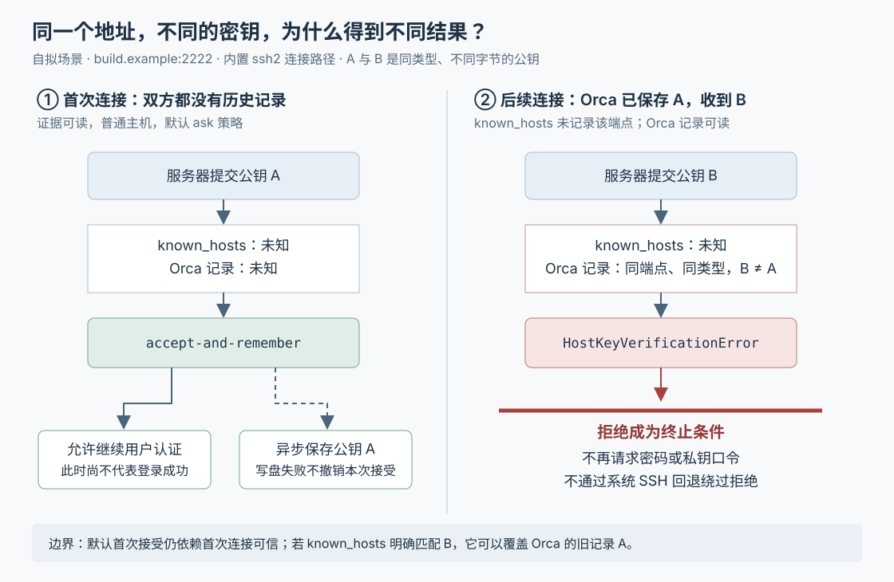

# Orca 如何确认 SSH 服务器身份：信任来源、密钥变更与登录回退边界

假设你在 Orca 中连接 `build.example:2222`，让编码代理在服务器上跑构建。第一次连接成功后，服务器被重装了；地址没变，服务器出示的公钥却变了。这是本文自拟场景。此时，重新输入密码并不能说明对面还是原来的机器：系统需要先处理“服务器身份是否符合已知记录”，再处理“你有没有资格登录”。

Orca 的内置连接路径把这两件事分开：**读取已有信任，比较服务器公钥；发现明确冲突便终止连接，并阻止后续密码重试和系统 SSH 回退。**但默认首次连接会自动接受并尝试记住公钥，并没有先让人确认。因此，这套机制能够发现后续连接与既有证据的矛盾，不能凭空证明第一次遇到的服务器就是预期对象。

Orca 是组织编码代理、终端和独立代码工作区的开发工作台；远程执行需要先建立 SSH，即用于加密远程登录和传输的连接。历史十篇研报已覆盖整体架构、工作区、代理启动、协作消息、终端、保存和调度，本篇深入此前未展开的服务器身份校验。依据是本次本地源码 `e26e4185bc4a5a0b4f07d142d623d6fca911f719`，重点限定在使用 `ssh2` 库的内置连接路径，并核对它与系统 OpenSSH 的分工。以下来自静态阅读；本次没有安装依赖、连接真实服务器、启动 Orca 或运行项目测试。

**从“测试连接”追进去，校验器确实装在握手之前。**

桌面主进程的 `registerSshConnectionHandlers` 注册 `ssh:testConnection` 请求。没有正在进行的连接可复用时，它从目标注册表取出配置，调用 `SshConnectionManager.connect(target, { probe: true })`。管理器创建 `SshConnection`，再调用其 `connect()`。因此，“测试”也会进入真实连接流程，可能触发首次公钥记录，并非只检查地址是否可达。[桌面请求处理](https://github.com/stablyai/orca/blob/e26e4185bc4a5a0b4f07d142d623d6fca911f719/src/main/ipc/ssh/ssh-connection-handlers.ts)、[连接管理器](https://github.com/stablyai/orca/blob/e26e4185bc4a5a0b4f07d142d623d6fca911f719/src/main/ssh/connection/ssh-connection-manager.ts)

`attemptConnect` 先解析有效 SSH 配置，再决定使用系统程序还是内置库。进入内置路径后，`doSsh2Connect` 先等待 `installSsh2HostKeyVerification` 把 `hostVerifier` 安装到连接配置，随后才调用 `runSsh2Handshake` 创建客户端并连接。服务器在握手中出示公钥时，库通过这个回调取得接受或拒绝的决定。[连接路径](https://github.com/stablyai/orca/blob/e26e4185bc4a5a0b4f07d142d623d6fca911f719/src/main/ssh/connection/ssh-connection.ts)、[安装校验器](https://github.com/stablyai/orca/blob/e26e4185bc4a5a0b4f07d142d623d6fca911f719/src/main/ssh/connection/ssh2-host-key-verification.ts)、[实际握手](https://github.com/stablyai/orca/blob/e26e4185bc4a5a0b4f07d142d623d6fca911f719/src/main/ssh/connection/ssh2-handshake.ts)

这段局部架构有清楚的分工：配置层收集证据；`matchKnownHosts` 和自身记录的匹配器把证据变成结果；`decideHostKey` 只根据传入证据决定如何处理；握手接线层把决定交给库，并将拒绝传回登录流程。保存记录另由持久化模块负责。这使“应该信任什么”可以脱离网络握手单独核对，也让网络故障与身份冲突保留不同含义。

**先确认查的是哪台机器，再讨论公钥是否相同。**

界面中的“构建服务器”只是显示名称。`resolveKnownHostsLookupHost` 使用实际拨号主机，或者有效配置中的 `HostKeyAlias`，也就是专门用于查找服务器身份的别名，不用 Orca 的目标标签替代它。例如实际连接经过本地转发地址时，别名可以让身份记录仍指向原服务器。[查找身份的选择](https://github.com/stablyai/orca/blob/e26e4185bc4a5a0b4f07d142d623d6fca911f719/src/main/ssh/config/ssh-known-hosts-source.ts)

配置解析尽量交给系统的 `ssh -G`：这个命令输出应用配置规则后的结果，Orca 再读取主机、端口、信任文件、严格校验开关等字段。它没有自己完整复制 SSH 配置中的条件匹配和文件包含规则。`resolveKnownHostsFiles` 合并配置报告的用户及系统信任文件；其中显式的 `none` 表示停用相应来源。探测没有给出文件列表时，则回退到用户目录的 `.ssh/known_hosts` 和 `.ssh/known_hosts2`。[有效配置解析](https://github.com/stablyai/orca/blob/e26e4185bc4a5a0b4f07d142d623d6fca911f719/src/main/ssh/config/ssh-g-config-resolution.ts)、[文件来源解析](https://github.com/stablyai/orca/blob/e26e4185bc4a5a0b4f07d142d623d6fca911f719/src/main/ssh/config/ssh-known-hosts-source.ts)

`known_hosts` 是 SSH 客户端保存“哪些主机对应哪些公钥”的文件。Orca 读取这些文件，但不会把自己首次接受的密钥写回它们；新记录写在当前 Orca 配置数据文件旁的 `ssh-host-keys.json`。桌面启动和无窗口服务启动都显式绑定这个位置。后续比较使用公钥原始字节，`SHA256:…` 指纹只是公钥的简短摘要，便于显示和核对。[自身记录结构与匹配](https://github.com/stablyai/orca/blob/e26e4185bc4a5a0b4f07d142d623d6fca911f719/src/main/ssh/ssh-host-key-store.ts)、[桌面绑定](https://github.com/stablyai/orca/blob/e26e4185bc4a5a0b4f07d142d623d6fca911f719/src/main/startup/main-process-ready-foundation.ts)、[服务绑定](https://github.com/stablyai/orca/blob/e26e4185bc4a5a0b4f07d142d623d6fca911f719/src/main/orcad/orcad-profile-state-startup.ts)

**非默认端口有两轮查找，不能简单地把同名主机的记录混在一起。**

这里把主机名与端口的组合称为端点。`matchKnownHosts` 对普通主机的默认端口 22 查裸主机名；对于 2222 这样的其他端口，先查 `[build.example]:2222`，没有普通公钥条目决定结果时，才回查 `build.example`。若使用 `HostKeyAlias`，则只查裸别名，不附加端口。

下面假设服务器出示公钥 A，A 和 B 类型相同但内容不同，且没有撤销记录或其他来源干预：

| `known_hosts` 中已有内容 | 连接 2222 时的匹配结果 | 原因 |
| --- | --- | --- |
| `[build.example]:2222 → A` | 匹配 | 精确端点一致 |
| `[build.example]:2222 → B`，另有 `build.example → A` | 冲突 | 第一轮已有普通公钥，不能越过去找有利证据 |
| 只有 `build.example → A` | 匹配 | 第一轮没有记录，允许裸主机名回查 |
| 只有 `build.example → B` | 未知 | 回查中的不匹配，不被当作该端口的密钥变更 |
| 精确端点只有另一种类型的公钥 | 已知主机提出陌生类型 | 不能因此把它当作首次连接 |

这解释了一个容易误判的边界：**“未知”既可能表示从未见过，也可能表示没有找到足以判断这个端点变化的证据。**Orca 自身的 JSON 记录采用另一套明确规则，严格匹配主机、端口和公钥类型，不做裸主机名回查。[两轮查找实现](https://github.com/stablyai/orca/blob/e26e4185bc4a5a0b4f07d142d623d6fca911f719/src/main/ssh/config/ssh-known-hosts.ts)、[端口与回查测试断言](https://github.com/stablyai/orca/blob/e26e4185bc4a5a0b4f07d142d623d6fca911f719/src/main/ssh/config/ssh-known-hosts.test.ts)

匹配器还先扫描所有查找轮次中的撤销记录：匹配主机且公钥相同的 `@revoked` 条目优先拒绝，不受文件顺序影响。同一轮里，一条普通记录不匹配，并不立即否定另一条完全匹配的普通记录。解析支持通配符、否定主机模式和隐藏主机名的哈希条目；对哈希条目，它重新计算候选名字对应的值来比较，无须还原名字。公钥编码、声明类型与数据内部类型不一致，或数据长度结构不完整的行会被丢弃。因此，“成功读到文件”也不意味着文件内每一行都构成有效证据。

**两个来源发生分歧时，代码按顺序裁决，而非要求双方一致。**

`decideHostKey` 的关键顺序如下；表中从上向下执行，先命中的规则决定结果：

| 证据条件 | 动作 |
| --- | --- |
| `known_hosts` 判定所提交公钥已撤销 | 拒绝 |
| `known_hosts` 判定同类型公钥冲突 | 拒绝，即使 Orca 自身记录匹配 |
| `known_hosts` 明确匹配 | 接受，即使 Orca 自身记录仍是旧公钥 |
| Orca 自身记录判定同类型公钥冲突 | 拒绝 |
| Orca 自身记录明确匹配 | 接受 |
| 前面均未决定，任一来源表明该端点只认识其他公钥类型 | 拒绝 |
| 仍然未知 | 再按首次连接策略处理 |

所以，若管理员已独立核验新公钥，并把 `known_hosts` 更新成 B，Orca 可以在自身仍记着 A 时接受 B。反过来，自身曾接受 B，不能推翻 `known_hosts` 对 B 的同类型冲突判定。这里也不能概括为“只要一个来源报告陌生类型就拒绝”：另一来源的明确匹配可能先决定接受。[裁决顺序](https://github.com/stablyai/orca/blob/e26e4185bc4a5a0b4f07d142d623d6fca911f719/src/main/ssh/ssh-host-key-decision.ts)、[双向分歧测试](https://github.com/stablyai/orca/blob/e26e4185bc4a5a0b4f07d142d623d6fca911f719/src/main/ssh/ssh-host-key-decision.test.ts)

这并不是自动迁移两份记录：明确匹配返回的是 `accept`，不会顺便重写 Orca 旧记录。由此推断，今后如果删掉了起决定作用的 `known_hosts` 条目，自身旧记录仍可能重新造成拒绝。排障需要辨别错误来自哪个来源，不能把“这次能连上”解释为“两个来源已同步”。

对于仍然未知的普通主机，严格开关 `StrictHostKeyChecking=yes` 会拒绝；`no/off` 接受但不新增自身信任记录；默认 `ask` 与 `accept-new` 当前都自动接受并尝试记住。类型中虽然预留了 `prompt`，实际裁决不会返回它，校验器也会拒绝尚未实现的提示动作。这属于“首次使用即信任”：后续可比较，但第一次没有外部可信证据时，仍依赖首次连接环境可信。

另有两项明确限制。短期创建、会反复更换公钥的临时运行环境，首次接受但不记录；它仍不能越过已有冲突或显式严格策略。只有 `@cert-authority` 条目时，内置路径也不会因此证明普通公钥可信：这类条目指定证书颁发机构，当前代码将结果保留为 `ca-only`，再按未知主机策略处理。默认可能接受，并不表示完成了证书签发关系校验。

已知证据还会影响握手选用哪类公钥。`orderServerHostKeyAlgorithms` 把该端点已知的类型排到客户端提议列表前面，同时保留其余受支持类型；对 RSA 这类公钥算法，也提升使用 SHA-2 摘要算法的对应签名方案，而不是只认一个字面名称。它从实际安装的 `ssh2` 读取默认算法列表，读取不到便保持库默认值，不凭空补一份名单。这是在协商阶段提前利用既有信任，避免服务器换一种陌生类型就被误当作首次连接；最终是否接受，仍由上面的匹配和裁决决定。[算法排序与默认值处理](https://github.com/stablyai/orca/blob/e26e4185bc4a5a0b4f07d142d623d6fca911f719/src/main/ssh/ssh-host-key-verifier.ts)

**真正让拒绝有效的，是它能终止后面的恢复流程。**

握手失败后，Orca 原本有多种恢复动作：尝试另一种登录凭据、请求私钥口令或密码，以及在特定故障下尝试系统 SSH。如果服务器身份冲突只变成一条普通连接错误，这些恢复动作可能继续运行。

为避免这种情况，安装层把拒绝保存为该次握手专属的 `HostKeyVerificationError`。`runSsh2Handshake` 处理库的通用失败时，优先返回这份身份拒绝。`recoverFailedSsh2Attempt` 在进入凭据或传输方式回退前检查这个类型，发现后关闭本次代理连接并直接抛出；在后续凭据尝试中新发生身份拒绝时，也有对应退出检查。重连错误分类同样将它排除在可重试故障之外。**源码支持的保证是：一旦身份校验已经拒绝，就不再靠请求凭据或换传输方式绕过去。**[握手错误传播](https://github.com/stablyai/orca/blob/e26e4185bc4a5a0b4f07d142d623d6fca911f719/src/main/ssh/connection/ssh2-handshake.ts)、[凭据与传输回退](https://github.com/stablyai/orca/blob/e26e4185bc4a5a0b4f07d142d623d6fca911f719/src/main/ssh/connection/ssh2-credential-fallback.ts)、[重连分类](https://github.com/stablyai/orca/blob/e26e4185bc4a5a0b4f07d142d623d6fca911f719/src/main/ssh/ssh-reconnect-error-classification.ts)

回调本身还有一个重要契约：`createHostKeyVerifier` 同步返回 `undefined`，通过 `verify(true/false)` 给出决定，而不是写成异步函数并返回代表未来结果的 Promise 对象。源码注释明确指出，这个库会把非 `undefined` 返回值当作接受依据；错误的异步写法可能绕过回调结果。信任来源因此提前读取，真正的回调只做内存中的比较和决策；内部依赖抛错时则尝试报告拒绝并调用 `verify(false)`。[校验回调实现](https://github.com/stablyai/orca/blob/e26e4185bc4a5a0b4f07d142d623d6fca911f719/src/main/ssh/ssh-host-key-verifier.ts)

每轮连接还带有递增的代次编号，用来判断自己是否仍是当前尝试。旧校验回调迟到时直接拒绝，不写信任、不发布新的指纹；旧握手即使晚到登录成功事件，也不能恢复已被替换的连接。每个代次只读取一次信任来源，同一代次的凭据重试复用这份快照。这既减少重复读取，也意味着正在进行的一轮连接不会实时吸收后来修改的信任文件。

**证据读不到时，Orca 选择的并不是一律拒绝。**

`readHostKeyTrustSources` 对握手前的读取设置了 5 秒超时，包括可能位于网络磁盘上的信任文件。这是等待上限的配置值，不是本次测得的连接耗时。各类读失败的后续行为不同：

| 读取问题 | 当前实现怎样处理 |
| --- | --- |
| `known_hosts` 文件不存在 | 正常视为没有该来源的记录，允许进入首次连接策略 |
| `known_hosts` 读取失败或整组读取超时 | 标记证据不完整；没有其他拒绝条件、严格要求或系统策略疑点时，可以接受，但不新增信任记录 |
| Orca 自身记录不可读，或格式版本比当前程序更新 | 读取端不提供可信记录；写入端保留原文件，不用新记录覆盖它 |
| `ssh -G` 因指定配置文件而绕过了系统配置，额外检查又发现可能存在严格策略或无法判断 | 对未知的普通主机拒绝；已有明确匹配仍可接受 |

最后一行针对一个具体兼容问题：环境变量指定的用户目录与系统账户目录不一致时，Orca 可能通过 `-F` 指定用户配置；这又会排除系统配置。代码于是额外扫描系统配置及部分包含文件，遇到严格校验指令、不能可靠展开的包含规则或读取疑点，就不为未知普通主机放行。这是保守检测“可能遗漏策略”，并不是另一套完整的 SSH 配置解释器。[来源读取与超时](https://github.com/stablyai/orca/blob/e26e4185bc4a5a0b4f07d142d623d6fca911f719/src/main/ssh/connection/ssh2-host-key-verification.ts)、[系统配置疑点检测](https://github.com/stablyai/orca/blob/e26e4185bc4a5a0b4f07d142d623d6fca911f719/src/main/ssh/config/ssh-g-config-resolution.ts)

这些分支保留了文件暂时不可用时的连接能力，但不能解释成“证据不完整仍完成了身份确认”。尤其是自身记录不可读时，匹配器拿到的是空列表，默认策略可能回到首次接受；写入端保护旧文件，保护的是已有记录不被抹掉，并没有恢复本次缺失的校验证据。另一个边界是 `ssh -G` 本身失败时，只能回退到上述默认来源和默认策略，不能声称完整继承了所有有效系统配置。

**接受本次公钥、用户登录成功、记录可靠落盘，是三件不同的事。**

首次接受时，安装层异步调用 `trustHostKey`，没有等待它完成再放行握手。写入失败只记日志，不撤销已接受的连接；记录动作也发生在用户登录完成之前。因此，保存了主机公钥不代表用户登录成功，连接成功也不代表新记录一定已落盘。

保存流程用按文件排队的方式串行执行“读取旧记录、替换相同主机/端口/类型的条目、写入新列表”，避免两个不同主机的并发更新互相覆盖。底层先写临时文件并同步文件数据，再重命名发布，并在支持时同步目录。这里的同步是请求文件系统将数据提交到存储设备；目录同步失败会被容忍，不能据此承诺所有平台上完全相同的断电恢复能力。[信任记录更新](https://github.com/stablyai/orca/blob/e26e4185bc4a5a0b4f07d142d623d6fca911f719/src/main/ssh/ssh-host-key-store.ts)、[文件队列](https://github.com/stablyai/orca/blob/e26e4185bc4a5a0b4f07d142d623d6fca911f719/src/main/sidecar-snapshot-file.ts)、[写盘与发布](https://github.com/stablyai/orca/blob/e26e4185bc4a5a0b4f07d142d623d6fca911f719/src/main/durable-file-write.ts)

这个队列保存在进程内存中；它串行化文件更新，并未把“读取握手证据—接受公钥—保存信任”变成一个不可分割的操作。由此不能推出跨进程写入互斥，也不能推出同一端点并发首次连接时只会接受一个公钥。对于损坏文件，策略也有区分：不可读或较新版本保留不动；无效 JSON 则按空记录处理并允许以后替换。后者有利于恢复可用性，代价是损坏前的比较基线不再参与判断。

**怎样使用这些结论，哪些仍需另行验证。**

仓库测试对上述连接提供了多层交叉证据：策略测试检查两个来源的优先顺序及严格开关；匹配测试检查端口回查、哈希条目和撤销优先级；连接测试使用模拟的 `ssh2` 客户端，断言拒绝后不请求凭据、不重试；记录接线测试检查首次记录和下一次换钥被拒绝；另有旧代次不能替换当前指纹的断言。部分测试注释记录了与 OpenSSH 的对照来源，但本次只阅读断言，没有重新运行这些测试或现场复测兼容性。[连接拒绝测试](https://github.com/stablyai/orca/blob/e26e4185bc4a5a0b4f07d142d623d6fca911f719/src/main/ssh/connection/ssh-connection-host-key-verification.test.ts)、[记录接线测试](https://github.com/stablyai/orca/blob/e26e4185bc4a5a0b4f07d142d623d6fca911f719/src/main/ssh/connection/ssh-connection-host-key-store-wiring.test.ts)、[旧代次测试](https://github.com/stablyai/orca/blob/e26e4185bc4a5a0b4f07d142d623d6fca911f719/src/main/ssh/connection/ssh-connection.test.ts)

对使用者而言，实际操作取决于失败原因：

- 需要预先确认服务器身份时，先通过独立可信渠道核验公钥并建立信任记录，再使用严格策略；默认首次接受不承担这项核验。
- 服务器重建后，先核验新指纹，再处理报错指出的来源。`known_hosts` 冲突与 Orca 自身记录冲突有不同恢复入口；`ssh-keygen -R` 不会删除 Orca 的 JSON 记录。非默认端口的提示还需要定位 `[主机]:端口` 对应项。
- 修改信任文件后发起新一轮连接，让新代次重新读取；不要指望正在进行的凭据重试自动刷新快照。

最后，这些结论不能无条件套在所有 SSH 连接上。`attemptConnect` 可以因配置、硬件安全密钥或其他适配条件先选择系统 OpenSSH；这条分支由系统程序执行握手，不经过本文的内置校验器。系统参数构造保留 SSH 配置和身份别名，但没有接入 Orca 自身的 JSON 信任库。因此，“内置库已经拒绝后不允许切换来绕过”与“最初就选择系统程序”是两个不同场景。[传输选择入口](https://github.com/stablyai/orca/blob/e26e4185bc4a5a0b4f07d142d623d6fca911f719/src/main/ssh/connection/ssh-connection.ts)、[系统 SSH 参数构造](https://github.com/stablyai/orca/blob/e26e4185bc4a5a0b4f07d142d623d6fca911f719/src/main/ssh/system-transport/system-ssh-args.ts)

对实现类似远程工作台的人，值得借鉴的具体做法是：让身份拒绝携带独立类型并贯穿恢复链，同时分别记录本次接受、登录结果和持久信任，避免连接恢复逻辑无意间改变信任决定。
