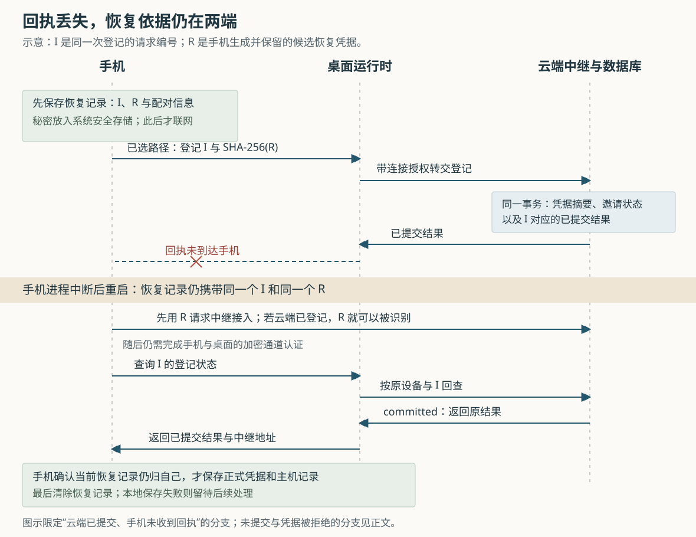

# Orca 手机配对中断后如何继续：凭据登记、提交回查与旧恢复隔离

假设你用手机扫描电脑上的 Orca 配对码。电脑已经替手机登记了以后从外网连接所需的凭据，但手机突然断网，没收到回执；重新打开应用时，主机列表里也没有这台电脑。这是本文自拟场景。此时直接重新生成凭据，可能让手机丢掉唯一有效的秘密；只凭连接超时宣布失败，又可能把已经完成的登记当成没有发生。

Orca 的处理方式是：**手机先保存本次操作的请求编号和候选凭据，再发起登记；中断后优先拿原候选凭据连接，按原编号查询云端提交结果，确认后补齐本地主机记录。**恢复期间还要检查这份记录是否已被新扫码替换。它解决的是跨手机、桌面和云端的“结果已经产生，但调用者不知道”问题；恢复机会受凭据、网络、存储和记录保留条件约束。

Orca 是组织编码代理、终端和独立代码工作区的开发工作台，手机端让人远程查看和操作这些工作。历史十一篇研报已覆盖工作区、代理启动、终端、协作消息、保存、调度及 SSH 服务器身份，本篇转向此前未展开的手机配对恢复。依据为本次本地源码 `82ab53ba61cf76511d9304618ac18a20d670a9ad`。本文核验原生手机端携带云端中继信息的配对路径；没有安装依赖、启动 Orca、连接云端或执行项目测试，测试只作为实现预期的交叉证据。

**先分清：连上电脑、登记中继凭据、出现在主机列表，是三个结果。**

手机可以直接连接电脑，也可以经由 Relay，即替两端转发连接的云端中继。配对信息中的 `endpoint` 是直连地址；`relay` 则包含中继地址、邀请和有效期。手机扫码入口 `pair-scan.tsx` 调用 `startPreProfilePairing`，这个函数在正式保存主机之前测试路径、登记凭据并核对结果。因此，扫码页正在“连接”时，流程可能已经走到有持久副作用的阶段。[扫码入口](https://github.com/stablyai/orca/blob/82ab53ba61cf76511d9304618ac18a20d670a9ad/mobile/app/pair-scan.tsx)、[配对协调实现](https://github.com/stablyai/orca/blob/82ab53ba61cf76511d9304618ac18a20d670a9ad/mobile/src/transport/pre-profile-pairing-coordinator.ts)

其中几种值不能混为一谈：

| 值 | 解决的问题 | 本篇路径中的处理 |
| --- | --- | --- |
| 桌面公钥 `publicKeyB64` | 手机预期连接哪一个桌面加密身份 | 来自配对信息，也用于查找已有主机身份 |
| 设备令牌 `deviceToken` | 桌面是否接受这台已配对设备 | 在手机与桌面的加密通道中用于认证 |
| 中继邀请 `inviteToken` | 尚无正式恢复凭据时，如何获得中继接入机会 | 有有效期和尝试限制，登记时被消费或失效 |
| 恢复凭据 `pendingResumeToken` | 以后如何重新接入中继 | 手机生成并先保存原值，登记时提交其摘要，确认后提升为正式凭据 |
| 登记编号 `installReqId` | 回查和重试是否仍指同一次登记 | 跨直连、中继和恢复过程保持不变 |

“摘要”是用 SHA-256 算法从凭据文本计算出的固定长度校验值。手机在登记请求中发送 `newResumeTokenHash`，云端保存它；重新接入时，手机提供凭据原值，云端计算摘要进行匹配。恢复凭据与桌面设备令牌因此承担不同职责，前者获得中继接入并不自动完成桌面认证。[恢复记录构造](https://github.com/stablyai/orca/blob/82ab53ba61cf76511d9304618ac18a20d670a9ad/mobile/src/transport/mobile-relay-pairing-journal.ts)、[凭据摘要](https://github.com/stablyai/orca/blob/82ab53ba61cf76511d9304618ac18a20d670a9ad/mobile/src/transport/mobile-relay-credential-hash.ts)、[中继配对连接](https://github.com/stablyai/orca/blob/82ab53ba61cf76511d9304618ac18a20d670a9ad/mobile/src/transport/mobile-relay-physical-client.ts)

**联网前先留下足够继续的东西。**

`runPairing` 先按桌面公钥寻找已有主机：重新配对同一个公钥时，复用主机编号和名称，减少列表里的重复项。对于包含中继信息的原生配对，它随后生成恢复记录，里面有新的登记编号、恢复确认编号、32 字节随机数生成的候选恢复凭据，以及原配对信息。记录保存成功之后，才创建直连与中继客户端。[主机身份复用](https://github.com/stablyai/orca/blob/82ab53ba61cf76511d9304618ac18a20d670a9ad/mobile/src/transport/host-store.ts)、[构造与保存顺序](https://github.com/stablyai/orca/blob/82ab53ba61cf76511d9304618ac18a20d670a9ad/mobile/src/transport/pre-profile-pairing-coordinator.ts)

这里的 journal 是一份**跨应用重启保留的操作恢复记录**。它不是终端日志，也不是已经配对成功的主机档案。普通字段存入 AsyncStorage，即手机应用的键值存储；设备令牌、邀请原值和候选恢复凭据则单独存入系统安全存储。两部分带相同的 `journalId`，读取时必须匹配。[恢复记录存储](https://github.com/stablyai/orca/blob/82ab53ba61cf76511d9304618ac18a20d670a9ad/mobile/src/transport/mobile-relay-pairing-journal-store.ts)

存储顺序也是协议的一部分：先写普通记录，再写秘密；若中途退出，下一次读取会清理缺少秘密或编号不匹配的不完整记录。由于客户端尚未开始联网，这种不完整写入不会对应一次已经发出的登记。清除时则先移除普通记录，再删秘密；如果第二步未完成，下一次加载发现没有普通记录，会尝试清理残留秘密。这是用可识别、可清理的中间状态衔接两个存储位置，并没有让它们获得数据库事务般的共同提交能力。

**两条路径竞争的是可用连接，胜者还不能直接宣布配对完成。**

`racePairingCandidates` 同时请求两条路径上的 `status.get`。中继客户端先把邀请交给云端，获准后才启动 E2EE，即由手机与桌面两端处理的端到端加密通道，并完成桌面设备认证。状态请求能够成功回答后，该路径才进入候选成功集合；同一轮微任务里两路都成功时，直连优先，其他客户端被关闭。这里的微任务是当前异步回调结束后安排的一小轮执行，用来让同时成功的结果一起参与选择。[路径竞争](https://github.com/stablyai/orca/blob/82ab53ba61cf76511d9304618ac18a20d670a9ad/mobile/src/transport/pairing-candidate-race.ts)、[中继认证次序](https://github.com/stablyai/orca/blob/82ab53ba61cf76511d9304618ac18a20d670a9ad/mobile/src/transport/mobile-relay-physical-client.ts)

胜者选出后，手机把路径及授权方式记入恢复记录，再调用 `pairing.provisionRelay` 登记候选恢复凭据。即使直连赢了，仍可以替后续外网连接准备中继凭据。收到登记回执后，手机继续调用 `pairing.getEndpoints`，携带同一个 `installReqId` 查询登记状态。只有结果为 `committed`，即已提交，而且查询结果与刚才的回执一致，才依次写入正式凭据包、保存主机、清除恢复记录。[协调实现](https://github.com/stablyai/orca/blob/82ab53ba61cf76511d9304618ac18a20d670a9ad/mobile/src/transport/pre-profile-pairing-coordinator.ts)、[提交结果比较](https://github.com/stablyai/orca/blob/82ab53ba61cf76511d9304618ac18a20d670a9ad/mobile/src/transport/pairing-relay-host.ts)

兼容分支需要单独理解：若直连胜出，但旧桌面对登记方法返回 `method_not_found` 或 `forbidden`，手机允许只保存直连主机并清除恢复记录；中继路径胜出时则不接受这种降级。所以，“主机保存成功”本身也不总意味着获得了中继凭据。[旧桌面兼容判断](https://github.com/stablyai/orca/blob/82ab53ba61cf76511d9304618ac18a20d670a9ad/mobile/src/transport/pairing-relay-rpc-unavailable.ts)

**桌面怎样证明自己有权替手机登记？**

两项配对方法在 `PAIRING_METHODS` 中注册。请求经 RPC，也就是让另一端执行指定操作的远程过程调用，进入桌面后，分发器从已经认证的连接取出设备编号、连接编号和传输来源，构造调用上下文。`DesktopRelayService` 接着确认该设备属于手机范围，并根据连接来源选择授权：直连使用当前连接编号；经邀请进入的中继连接使用 `basisConnId`，也就是云端为那次获准接入保存的连接依据编号。[方法注册](https://github.com/stablyai/orca/blob/82ab53ba61cf76511d9304618ac18a20d670a9ad/src/main/runtime/rpc/methods/pairing.ts)、[认证上下文接线](https://github.com/stablyai/orca/blob/82ab53ba61cf76511d9304618ac18a20d670a9ad/src/main/runtime/runtime-rpc/runtime-rpc-websocket-dispatch.ts)、[授权选择](https://github.com/stablyai/orca/blob/82ab53ba61cf76511d9304618ac18a20d670a9ad/src/main/runtime/mobile-cloud-relay/relay-pairing-authorization.ts)

手机的登记参数只包含请求编号、候选摘要和可选的当前摘要条件，不包含让它自行宣称授权方式的字段。云端还会核对连接依据对应的账号、桌面、设备、控制连接代次、存活状态和期限。控制连接代次用于区别桌面先后建立的控制会话，避免把旧会话依据直接用于新会话。中继恢复凭据建立的连接可以请求恢复确认，却不能在这条服务路径上直接获得新的初始登记授权。[桌面登记服务](https://github.com/stablyai/orca/blob/82ab53ba61cf76511d9304618ac18a20d670a9ad/src/main/runtime/mobile-cloud-relay/desktop-relay-service.ts)、[请求字段约束](https://github.com/stablyai/orca/blob/82ab53ba61cf76511d9304618ac18a20d670a9ad/src/shared/mobile-relay-credential-contract.ts)、[云端授权校验](https://github.com/stablyai/orca/blob/82ab53ba61cf76511d9304618ac18a20d670a9ad/cloud/apps/relay/src/credential-store.ts)

这条调用链真正落到云端的连接也能追到：安装器把配对提供者绑定到 `DesktopRelayService`；服务调用 `RelaySessionBroker.installCredential`，后者经桌面控制连接发送 `device-credential-install`；云端 `HostSessionRegistry.acceptControlCommandUnfenced` 解析后调用 `RelayCredentialStore.installCredential`。因此，提交状态来自云端数据库中的登记结果，不是桌面仅凭内存返回的“我发出过请求”。[提供者装配](https://github.com/stablyai/orca/blob/82ab53ba61cf76511d9304618ac18a20d670a9ad/src/main/runtime/mobile-cloud-relay/desktop-relay-service-installer.ts)、[桌面控制桥接](https://github.com/stablyai/orca/blob/82ab53ba61cf76511d9304618ac18a20d670a9ad/src/main/runtime/mobile-cloud-relay/relay-session-broker.ts)、[云端命令处理](https://github.com/stablyai/orca/blob/82ab53ba61cf76511d9304618ac18a20d670a9ad/cloud/apps/relay/src/host-session-registry.ts)

**云端把凭据变更和“这次已经做过”共同提交。**

`installCredentialOnce` 在一个数据库事务中先查旧结果；没有结果才校验授权，写入恢复凭据摘要与版本，调整邀请状态，并保存本次结果。经中继邀请授权时，关联邀请被标为 `consumed`；经直连授权时，该设备尚可使用的邀请被标为 `invalidated`。这些变化连同结果记录一起提交，普通执行错误则一起回滚。[登记事务](https://github.com/stablyai/orca/blob/82ab53ba61cf76511d9304618ac18a20d670a9ad/cloud/apps/relay/src/credential-store.ts)

`relay_install_results` 用“账号、桌面、设备、请求编号”作为共同主键，没有把直连或中继授权方式加入主键。因此，恢复时虽然可能改用邀请路径，同一个请求仍可找到原来由直连提交的结果。这是幂等处理：对同一次操作重复查找或尝试时，复用已有结果，避免再产生一轮凭据版本。它依赖客户端保持原编号与候选秘密的对应关系；不能把旧编号随意配给一份新秘密。[结果表结构](https://github.com/stablyai/orca/blob/82ab53ba61cf76511d9304618ac18a20d670a9ad/cloud/apps/relay/src/database.ts)

源码中的 `installCredential` 还会在部分数据库异常后先查结果，再决定是否重试若干可重试错误。数据库提交时断线仍可能让调用方不知道结果；事务的价值，是让最终可查询的结果与凭据变更保持在同一次提交中，给后续恢复提供依据，而非保证每次请求都能及时收到答案。

邀请被消费或失效，只说明云端拒绝它用于后续邀请接入；这没有同时删除配对信息中的桌面设备令牌。桌面端另有设备登记与认证检查，不能把“邀请过期”解释为整份二维码内所有授权都已撤销。[邀请接入检查](https://github.com/stablyai/orca/blob/82ab53ba61cf76511d9304618ac18a20d670a9ad/cloud/apps/relay/src/credential-store.ts)、[桌面设备认证](https://github.com/stablyai/orca/blob/82ab53ba61cf76511d9304618ac18a20d670a9ad/src/main/runtime/rpc/mobile-socket-wiring.ts)

**回执没收到时，按证据决定继续哪一步。**

手机应用启动时会调用 `recoverMobileRelayPairing`。恢复器读取记录，按以下顺序尝试连接：本次候选恢复凭据、已有正式凭据中与它不同的当前凭据、尚未过期的邀请。优先尝试候选凭据很关键：它在手机看来仍是“待确认”，在云端却可能已经是正式凭据。[启动恢复入口](https://github.com/stablyai/orca/blob/82ab53ba61cf76511d9304618ac18a20d670a9ad/mobile/app/_layout.tsx)、[恢复实现](https://github.com/stablyai/orca/blob/82ab53ba61cf76511d9304618ac18a20d670a9ad/mobile/src/transport/mobile-relay-pairing-recovery.ts)

连接建立后，恢复器按原 `installReqId` 查询，随后分三种情况：

- **查到已提交结果。**确认当前恢复记录仍可发布，把原候选秘密提升为正式凭据，保存主机，再清除恢复记录。若最终结果显示授权实际来自直连，即使恢复器刚转向邀请路径，也按云端结果修正本地授权方式。
- **通过邀请查询，明确得到 `not-found`。**这表示此次查询没有找到原登记结果，恢复器才记录转向邀请授权，并用原编号和原候选摘要重新发起登记。之后仍要回查，比较登记回执与提交结果。
- **连接失败、查询无结果或状态无法确认。**不凭网络错误重写登记事实，继续其他候选；满足保留条件时延后处理。

`not-found` 是查询当时的回答，不保证旧直连请求以后不会提交。因此恢复重用同一编号，而不是另开一个请求；云端结果也可能最终仍是直连的那份。测试专门构造了“邀请先查到不存在，随后拿到迟到的直连提交结果”的场景，并断言手机保留同一候选秘密、采纳真实授权方式。[恢复分支测试](https://github.com/stablyai/orca/blob/82ab53ba61cf76511d9304618ac18a20d670a9ad/mobile/src/transport/mobile-relay-pairing-recovery.test.ts)

**恢复记录也有主人，迟到结果不能随意覆盖新扫码。**

手机只有一个配对恢复记录槽位。新扫码会先给旧恢复最多八秒的等待机会，随后尝试保存新记录；八秒只是等待预算，超时不会自动取消仍在进行的恢复。真正控制写入资格的是记录存储层。

该层把读、写、清理串在同一异步队列中，并检查 `journalId`。当前进程里仍在执行、且已经选定授权路径的配对，不能直接被另一条记录替换。恢复器准备写入正式凭据和主机时，还必须通过 `claimMobileRelayPairingJournalPublication` 取得当前记录的发布资格：若新扫码已经替换它，旧恢复的申请失败；若旧恢复先取得资格，新扫码要等待它释放。旧请求的更新和清理同样受编号检查约束。[恢复记录所有权](https://github.com/stablyai/orca/blob/82ab53ba61cf76511d9304618ac18a20d670a9ad/mobile/src/transport/mobile-relay-pairing-journal-store.ts)

这些保护针对当前手机进程内的并发操作。进程结束后，内存里的执行标记不保留，下一次恢复靠磁盘记录继续。它不是保存所有历史尝试的任务队列；新扫码可以替换已经结束或前次启动留下的记录，恢复发布过程则获得额外保护。

**恢复能力有清晰期限，也有需要保留疑问的捷径。**

凭据失败并不总是凭据无效。`isExplicitCredentialRejection` 要求收到中继握手中的明确拒绝；只有 WebSocket 关闭码 `4401` 不够，因为它也可能来自首帧等待超时。恢复器据此区分“所有候选都被明确拒绝”和“至少一路只是没连通”。[明确拒绝的判断](https://github.com/stablyai/orca/blob/82ab53ba61cf76511d9304618ac18a20d670a9ad/mobile/src/transport/relay-credential-eligibility.ts)

当前实现允许两类情况放弃尚未确认提交的记录：所有候选都被明确拒绝，或者邀请到期后又经过十分钟宽限。宽限期内的网络故障通常延后处理；超过期限，即使仍只是网络不可达，也可能清除记录。若本轮已观察到提交成功，但写入手机失败，则本轮会保留记录。这个“已观察到”标记存在当前恢复调用的内存中，代码没有另存一个跨重启的已提交标记，因此不能扩展成任意重启后永久保留的保证。[恢复保留与放弃条件](https://github.com/stablyai/orca/blob/82ab53ba61cf76511d9304618ac18a20d670a9ad/mobile/src/transport/mobile-relay-pairing-recovery.ts)

还有一个会改变理解的快速结束分支：如果本地已有同一主机的中继路由，且其 `relayHostId` 与恢复记录一致，同时能够读到凭据包，恢复器直接清除记录并返回恢复完成，不再联网回查。它并未进一步比较该包是否对应本次 `installReqId` 或候选摘要。源码与测试都明确保留了这个分支；可以确认它把已有本地配置视为足够的结束条件，**不能据此断言每次返回“恢复完成”都重新证明了本次云端登记。**本篇未确认多次配对交错时，这个宽松匹配条件的全部影响。[实现及对应测试](https://github.com/stablyai/orca/blob/82ab53ba61cf76511d9304618ac18a20d670a9ad/mobile/src/transport/mobile-relay-pairing-recovery.test.ts)

从设计取舍看，手机先保存秘密、云端共同提交结果、恢复按稳定编号回查，让三处存储无须共同参与一个跨网络事务；代价是主机列表可能暂时没有完成的登记，代码也必须处理半完成状态、迟到结果和清理。这里关于降低跨端协调需求的判断来自实现关系，是分析推断，并非仓库给出的性能测量。

实践上，配对超时后应先让应用恢复已有记录，再判断是否需要重新扫码；主机卡片出现后，也应分别确认直连和中继能力。实现类似功能时，值得迁移的做法是：在产生远端副作用之前保留秘密和请求身份，把结果记录与副作用共同提交，让恢复发布再次检查所有权，并明确什么时候停止自动恢复。清除手机恢复记录、撤销云端凭据、删除桌面设备身份是不同操作，不能互相替代。

本次还阅读了两类关键测试：云端测试并发提交直连与邀请授权，预期只产生一个登记结果；注入结果表写入错误时，预期凭据和邀请变化一并回滚。手机测试检查联网前保存记录、凭据包先于主机写入、迟到结果调和，以及新扫码等待发布或拒绝旧发布资格。这些断言支持上述机制解释，但均未在本次执行。[云端事务测试](https://github.com/stablyai/orca/blob/82ab53ba61cf76511d9304618ac18a20d670a9ad/cloud/apps/relay/src/credential-store.test.ts)、[手机配对顺序测试](https://github.com/stablyai/orca/blob/82ab53ba61cf76511d9304618ac18a20d670a9ad/mobile/src/transport/pre-profile-pairing-coordinator.test.ts)、[恢复记录竞争测试](https://github.com/stablyai/orca/blob/82ab53ba61cf76511d9304618ac18a20d670a9ad/mobile/src/transport/mobile-relay-pairing-journal-store.test.ts)

本文没有全面核验加密算法与密钥协商、正式凭据轮换、中继迁移、撤销传播和所有手机系统存储故障，也不对已部署云端版本作出判断。源码和输入保持原样；本地提交号与输入一致，研报配图已实际渲染检查。
