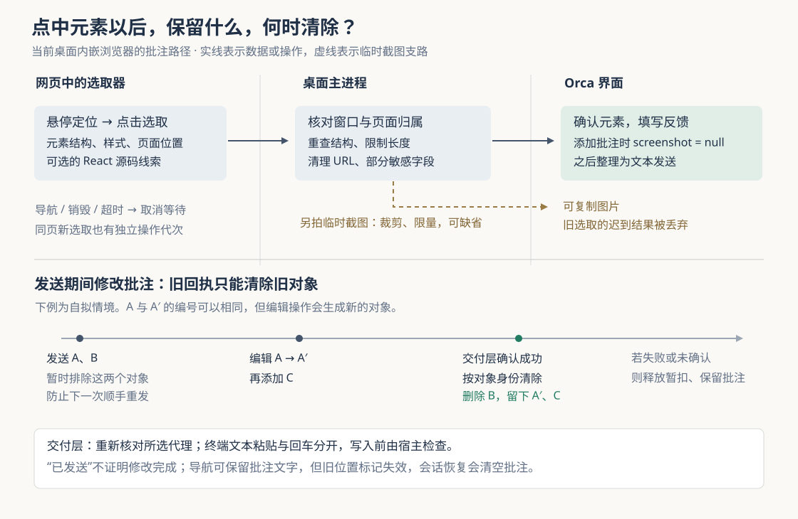

# Orca 怎样把页面上的“这个按钮”交给代理：元素取样、批注快照与发送边界

假设你在预览结账页面，发现“提交订单”按钮的内边距太小，想让编码代理把它改得和旁边的按钮一致。这是本文自拟场景。只说“改这个按钮”，代理不知道你指哪一个；只发截图，它还需要寻找对应代码。与此同时，你可能继续切换页面、修改反馈，甚至在上一批反馈尚未发完时再添加一条。工具既要提供定位线索，也要避免迟到的截图和发送回执处理错对象。

当前 Orca 的做法是：**从鼠标指向的页面元素提取结构、样式和位置，允许用户添加批注，再把批注整理成文本交给选定代理。选取按操作代次隔离，发送按批注对象保留快照，成功后只清除实际交付的旧对象。**这里有一个容易被文档简化掩盖的边界：临时选取可以拍摄截图，但本文核验的“添加批注后发送”路径会主动丢弃图片，并不是把截图和文字一起作为附件发送。

Orca 是组织编码代理、终端和独立代码工作区的开发工作台。此前十二篇研报已覆盖整体架构、工作区、代理启动、消息、终端、保存、调度、SSH 身份和手机配对；本篇深入此前未展开的浏览器反馈链。依据为本地源码 `e71d4358c1dc4bea761de38dcb885c7ac418ecc6`，范围限定在桌面内嵌浏览器的元素选取、批注和发送路径。本次进行静态阅读与测试断言核对，没有安装依赖、启动 Orca 或运行项目测试。

**先把文档中的“一次点击”拆成三个动作。**

仓库的 Design Mode（设计模式）文档说，点击元素会把 HTML、计算后的样式、截图和可用的源码位置送入代理终端。这里的 HTML 是页面元素的标记文本；计算后的 CSS 样式，是浏览器应用样式规则后实际得到的颜色、字体和间距。文档描述了功能意图，但不能代替当前调用链。[设计模式说明](https://github.com/stablyai/orca/blob/e71d4358c1dc4bea761de38dcb885c7ac418ecc6/docs/site/content/docs/browser/design-mode.mdx)

实际装配点 `BrowserPagePane` 为同一个浏览器页面建立了三个相连的控制器：`useGrabMode` 负责选取元素，`useBrowserPageGrabAnnotations` 负责复制或添加批注，`useBrowserPageAnnotationSend` 负责把已有批注交给代理。页面编号把前两步的结果放回对应页面，工作区编号则限定发送目标的范围。它们没有在点击元素时直接调用代理发送函数。[页面装配](https://github.com/stablyai/orca/blob/e71d4358c1dc4bea761de38dcb885c7ac418ecc6/src/renderer/src/components/browser-pane/assemble-chrome/browser-page-pane.tsx)

具体行为取决于选取意图：

| 用户动作 | 当前实现产生的结果 |
| --- | --- |
| 以复制意图左键选取 | 将元素上下文格式化后复制为文字，并显示提示 |
| 以复制意图右键选取 | 打开菜单；截图存在时，可以单独复制图片 |
| 以批注意图选取 | 显示待填写的反馈卡片，添加后进入批注集合 |
| 发送批注 | 整理反馈文本，选择已有代理，或通过菜单启动新代理 |

这些分支由 `useBrowserPageGrabAnnotations` 和 `BrowserGuestAnnotateOverlays` 实际连接。后者当前显示的是批注卡片、批注列表以及复制菜单；不能仅凭仓库里还有一个叫 `GrabConfirmationSheet` 的组件，就认定它是这条路径上正在使用的附件确认界面。[选取结果处理](https://github.com/stablyai/orca/blob/e71d4358c1dc4bea761de38dcb885c7ac418ecc6/src/renderer/src/components/browser-pane/annotate/use-browser-page-grab-annotations.ts)、[实际结果界面](https://github.com/stablyai/orca/blob/e71d4358c1dc4bea761de38dcb885c7ac418ecc6/src/renderer/src/components/browser-pane/annotate/browser-guest-annotate-overlays.tsx)

**“指向哪个元素”由网页内的取样器回答，桌面主进程负责接纳结果。**

`useGrabMode` 先调用 `window.api.browser.setGrabMode`，再调用 `awaitGrabSelection` 等待选取。预加载桥把这两个调用转成 IPC，即界面进程与桌面主进程之间的通信；`registerBrowserGrabHandlers` 注册对应处理器。主进程先检查请求是否来自可信的应用窗口，再通过 `getAuthorizedGuest` 确认这个窗口确实拥有目标页面。这里的 guest 是内嵌网页的执行环境，与 Orca 自己的操作界面分开。因此，仅提供一个页面编号并不足以任意操作别的窗口中的网页。[预加载桥](https://github.com/stablyai/orca/blob/e71d4358c1dc4bea761de38dcb885c7ac418ecc6/src/preload/api/browser-bridge-page-interaction-and-sessions.ts)、[请求注册与检查](https://github.com/stablyai/orca/blob/e71d4358c1dc4bea761de38dcb885c7ac418ecc6/src/main/ipc/browser-grab-ipc.ts)、[页面归属解析](https://github.com/stablyai/orca/blob/e71d4358c1dc4bea761de38dcb885c7ac418ecc6/src/main/browser/browser-manager-grab.ts)

取得授权后，`BrowserManagerGrab.setGrabMode` 将脚本注入网页。脚本铺设覆盖整个视口的选取层，鼠标移动时暂时让它退出命中检测，用 `document.elementFromPoint` 找到下面的真实元素，再画轮廓。对于开放的 Shadow DOM——网页组件内部的一棵子元素树——它会继续向内查找；封闭的子树仍然不透明。这已经给“点击任意元素”的文档措辞划出一个具体条件。[选取层与命中检测](https://github.com/stablyai/orca/blob/e71d4358c1dc4bea761de38dcb885c7ac418ecc6/src/main/browser/grab-guest-overlay-script.ts)

点击发生后，脚本尝试阻止默认动作和事件继续传播，提取选中元素，再保留轮廓供确认界面使用。不过，主进程控制器的注释明确提醒：页面预先安装的捕获阶段监听器仍可能看到点击。因此，元素选取不应被解释成“网页绝对观察不到这次交互”。这是代码明确保留的事件边界。

取样结果是 `BrowserGrabPayload`：包含页面地址、视口尺寸、滚动位置、采集时间，以及目标元素的选择器、HTML 片段、文字、位置矩形和一组计算样式。DOM，即浏览器维护的页面元素树，提供“这是什么、位于哪里”的结构线索；附近文字和相邻元素补上“它处在什么语境”。对于开头的按钮，代理可能同时拿到按钮文字、所属容器路径、当前 `padding` 和旁边按钮的描述，从而缩小代码搜索范围。这是机制的用途说明，不代表本次实际运行得到了某份按钮数据。

源码位置也有明确条件。`getReactMetadata` 查找元素上的 React 内部关联，沿 Fiber——React 用来记录组件及其父子关系的内部结构——向上寻找组件名和 `_debugSource` 等调试信息。找到时才填入文件与行号，缺失或异常时返回空值。**这条实现不是通用的源码映射服务，也没有在这里下载并解析任意构建产物的 source map（编译结果到原始源码的映射文件）。**生产构建、其他界面框架或内部结构变化，都可能让这条线索缺席。[上下文提取与 React 线索](https://github.com/stablyai/orca/blob/e71d4358c1dc4bea761de38dcb885c7ac418ecc6/src/main/browser/grab-guest-react-script.ts)、[元素路径与附近内容](https://github.com/stablyai/orca/blob/e71d4358c1dc4bea761de38dcb885c7ac418ecc6/src/main/browser/grab-guest-element-context-script.ts)

**结果先经过限量与清理，但它仍然只是页面提供的材料。**

网页脚本设有保留上限，例如目标文字 200 字符、HTML 片段 4096 字符、附近文字最多十项；文本节点和附近兄弟元素的扫描也有数量限制。主进程收到结果后，`clampGrabPayload` 再检查基本结构、限制字段长度，把非有限数值替换为默认值，并重新执行部分清理。它还强制把传来的 `screenshot` 设为 `null`，图片要由另一路真实截图产生。[共享数据与预算](https://github.com/stablyai/orca/blob/e71d4358c1dc4bea761de38dcb885c7ac418ecc6/src/shared/browser-grab-types.ts)、[主进程结果整理](https://github.com/stablyai/orca/blob/e71d4358c1dc4bea761de38dcb885c7ac418ecc6/src/main/browser/browser-grab-payload.ts)

这些清理有不同覆盖面。页面地址会去掉查询参数和片段，属性只保留允许的名称，部分属性和元数据会按 `password`、`access_token` 等关键词遮盖。HTML 片段的生成则是复制元素子树、删除其中的 `script` 节点，再截断文本；主进程对它主要做长度限制，并没有把安全属性白名单重新应用到整段 HTML。普通文字片段也没有得到全面的秘密识别。因此，这里能确认的是有针对性的缩减与清理，不能声称输出已经彻底脱敏。去掉 URL 查询参数还有相应代价：仅靠参数区分的页面状态，在反馈中可能失去区别。[网页内容提取](https://github.com/stablyai/orca/blob/e71d4358c1dc4bea761de38dcb885c7ac418ecc6/src/main/browser/grab-guest-content-script.ts)

同样，保留长度不等于全部执行工作都有严格上限：`getHtmlSnippet` 是先复制完整子树，再把序列化结果截短。由此可以推断，大子树仍可能带来额外工作；本次没有测量其开销。把这些限制理解为“控制带回多少材料”，比笼统称作性能保证更准确。

选择器也只是当时的定位线索。生成器优先采用元素编号、较稳定的类名，必要时加入同类兄弟元素的位置，并向上扩展路径、检查是否唯一；深度和长度都有上限。它没有给页面元素分配跨热更新、跨导航永久有效的身份。代理拿到文本后仍需核对当前页面和代码，不能把旧选择器直接当成永久地址。

**截图和元素结构分两次取得，旧操作不能借迟到结果重新出现。**

主进程的 `BrowserGrabSessionController` 按页面保存正在等待的选取操作；结果只允许结算一次。启动同页新操作会取消前一项，但保留已经为替代操作准备的选取层，避免旧清理拆掉新界面。主框架发生非原地导航、页面销毁或等待达到两分钟，都会结束等待；普通子框架加载和原地地址变化不会在这一层直接取消。[选取生命周期](https://github.com/stablyai/orca/blob/e71d4358c1dc4bea761de38dcb885c7ac418ecc6/src/main/browser/browser-grab-session-controller.ts)

界面收到元素结果后，才单独请求截图。截图器先隐藏选取轮廓和批注覆盖层，拍下页面，再尝试恢复这些覆盖层；随后根据图像宽度与网页视口宽度的比例，把页面坐标换算成裁剪坐标。图片为空、矩形无有效面积、页面消失，或 PNG 数据超过 2 MiB 时，返回无截图。`useGrabMode` 把截图失败视为非致命错误，仍允许使用元素上下文。[截图实现](https://github.com/stablyai/orca/blob/e71d4358c1dc4bea761de38dcb885c7ac418ecc6/src/main/browser/browser-grab-screenshot.ts)

这两次采集并不共同冻结页面：元素矩形来自先前取样，图片来自后续捕获，中间仍可能发生布局变化。源码没有在这里建立“结构和像素必属同一帧”的保证。

更常见的异步问题是：截图还没回来，你就取消并在同一页重新选了另一个按钮。仅检查页面编号会误收旧图，所以 `useGrabMode` 还保存启用代次和操作编号。等待选取时核对操作身份，截图返回时再次核对代次、页面归属与组件是否仍在。旧结果不符合条件就直接丢弃。主进程的启用请求也按页面排队，并在等待页面登记、实际注入前后检查当前意图，减少旧“开启”覆盖新“关闭”的机会。[界面选取控制](https://github.com/stablyai/orca/blob/e71d4358c1dc4bea761de38dcb885c7ac418ecc6/src/renderer/src/components/browser-pane/annotate/useGrabMode.ts)

页面导航还会经过界面生命周期处理：新文档开始加载时，取消待确认选取并撤销旧位置标记；同地址重新加载也算更换文档。已经添加的批注文字可以继续保留，但旧坐标不再自动获得在新文档上画标记的资格。路由变化与仅修改地址片段也有所区分。这使“保留反馈内容”与“继续相信原来的几何位置”成为两项决定。[导航处理](https://github.com/stablyai/orca/blob/e71d4358c1dc4bea761de38dcb885c7ac418ecc6/src/renderer/src/components/browser-pane/host-guest/browser-page-webview-navigation-handlers.ts)、[撤销位置与待选取状态](https://github.com/stablyai/orca/blob/e71d4358c1dc4bea761de38dcb885c7ac418ecc6/src/renderer/src/components/browser-pane/host-guest/use-browser-page-webview-lifecycle.ts)

**批注保存的是文字上下文，发送保存的是这一版批注的身份。**

点击添加批注时，`createBrowserAnnotationPayload` 主动将截图清空，注释给出的理由是：临时截图可能为每次选取带来数兆字节的数据。状态层的 `sanitizeBrowserPageAnnotation` 再做一次同样处理，并限制评论长度。每个页面编号最多保留二十条，超出时淘汰最早的条目。因此，图片可用于选取阶段的复制，并不意味着之后的批注携带图片；添加批注也不意味着可以无限积累反馈。[批注数据转换](https://github.com/stablyai/orca/blob/e71d4358c1dc4bea761de38dcb885c7ac418ecc6/src/renderer/src/components/browser-pane/describe-page/browser-annotation-geometry.ts)、[状态写入与清理](https://github.com/stablyai/orca/blob/e71d4358c1dc4bea761de38dcb885c7ac418ecc6/src/renderer/src/store/slices/browser/browser-page-metadata-actions.ts)

`formatBrowserAnnotationsAsMarkdown` 把这些条目按采集时的页面地址分组，写出浏览器页面编号、视口尺寸、选择器、可选源码线索、样式、HTML 和用户反馈。对于来自不同地址的条目，它分别列出页面信息。HTML 使用足够长的反引号围栏，避免片段自身的反引号提前结束代码块。这是在保持文本格式完整，不代表页面文字因此变成可信指令。[反馈文本生成](https://github.com/stablyai/orca/blob/e71d4358c1dc4bea761de38dcb885c7ac418ecc6/src/renderer/src/components/browser-pane/annotate/browser-annotation-output.ts)

发送期间怎样避免丢掉新反馈，可以用图中的 A、B 解释：提交发送时，回调捕获当时的两个批注对象；如果你把 A 改成 A′，更新函数会生成新对象，再添加的 C 也是新对象。成功回执到达后，`removeDeliveredBrowserPageAnnotations` 用对象身份匹配，只删除仍是原对象的条目。因此 B 被移除，A′ 和 C 留下；即使 A′ 沿用同一个批注编号，也不会被旧回执一起删掉。

与此同时，`holdNotesForSend` 在发送尚未结束时暂扣那批对象，后续待发送文本会排除它们；成功由交付回调清理，失败则释放暂扣，让原反馈重新可选。复制文字或关掉发送选择界面都不会单独触发成功清理。这是一套当前界面内的协调机制，不能据此推出跨重启的消息去重保证：暂扣表在内存中，而浏览器会话恢复函数明确把批注集合和位置标记重置为空。[发送快照与暂扣接线](https://github.com/stablyai/orca/blob/e71d4358c1dc4bea761de38dcb885c7ac418ecc6/src/renderer/src/components/browser-pane/annotate/use-browser-page-annotation-send.ts)、[暂扣实现](https://github.com/stablyai/orca/blob/e71d4358c1dc4bea761de38dcb885c7ac418ecc6/src/renderer/src/lib/notes-send-in-flight.ts)、[会话恢复边界](https://github.com/stablyai/orca/blob/e71d4358c1dc4bea761de38dcb885c7ac418ecc6/src/renderer/src/store/slices/browser/browser-hydration-state.ts)

**选中代理以后，还有真正写入前的检查。**

批注发送界面复用了代码审阅笔记的发送组件。已有目标包括终端里的代理，以及应用内的结构化代理会话——后者有独立消息接口，无须模拟终端输入。候选目标按工作区列出，点击时重新计算资格；侧栏发送路径同样重新解析目标，不能只相信菜单打开时的列表。[共享发送菜单](https://github.com/stablyai/orca/blob/e71d4358c1dc4bea761de38dcb885c7ac418ecc6/src/renderer/src/components/browser-pane/annotate/BrowserAnnotationSendMenuContent.tsx)、[侧栏目标选择与回执](https://github.com/stablyai/orca/blob/e71d4358c1dc4bea761de38dcb885c7ac418ecc6/src/renderer/src/store/slices/ui/ui-slice-agent-actions.ts)

`sendMessageToAgent` 根据目标类型分流。结构化路径检查当前会话与所属运行时，正在启动的会话暂不接收；消息结果为 `recorded` 时才映射为已发送，不确定结果继续保留为 `unconfirmed`。终端路径则从工作区和所选面板找到宿主上的真实终端句柄，再执行受保护的发送。这里的宿主是实际运行该终端进程的机器。[发送分流](https://github.com/stablyai/orca/blob/e71d4358c1dc4bea761de38dcb885c7ac418ecc6/src/renderer/src/lib/agent-message-send.ts)

对于明确选择的终端目标，文本粘贴与按回车是两次请求。第一次使用 bracketed paste，即用终端约定的开始、结束标记包住整段文本，减少多行内容被当作逐行键入的歧义；之后再次检查可发送状态，才请求回车。两次都携带 `requireAgentStatus: 'sendable'`，要求宿主在实际写入前检查。宿主还核对句柄是否仍绑定到预期 PTY，即承载终端程序输入输出的伪终端，防止等待期间发生句柄改绑后写错终端。它明确拒绝把受保护的文本与提交后缀合并为一个请求。[终端交付实现](https://github.com/stablyai/orca/blob/e71d4358c1dc4bea761de38dcb885c7ac418ecc6/src/renderer/src/lib/active-agent-note-send-delivery.ts)、[宿主写入门槛](https://github.com/stablyai/orca/blob/e71d4358c1dc4bea761de38dcb885c7ac418ecc6/src/main/runtime/rpc/methods/terminal/terminal-send-method.ts)

两步发送也产生一种不能隐藏的中间结果：文本已经粘贴，回车却失败。代码将其报告为 `partial-submit-failed`，批注不会按成功清除；但代理输入框中可能已经有草稿。此时直接重发可能重复粘贴，应先检查目标终端。明确选择的终端路径还关闭了旧运行时兼容回退：无法核验代理状态时，不退化成一次未经同等检查的发送。这与某些“向当前活动终端发送”的兼容路径不同。

终端路径最终的 `sent` 来自发送请求被接受，结构化路径则来自消息层的记录结果。**两者都不证明代理已经阅读反馈，更不证明按钮改对了。**“批注消失”“提示词已交付”“代码修改完成”和“页面效果正确”仍应分别核验。

**怎样使用这条链路，哪些结论已经交叉核对。**

对开头的按钮问题，合适的工作方式是：选中元素，写清希望改变什么、与哪个邻近元素比较，确认发送到该工作区的目标代理；如果判断依赖视觉细节，再另行补充截图。页面热更新后重新选取和检查效果，不把旧坐标或旧源码线索当成当前事实。遇到部分提交失败，先查看代理输入框，再决定重试；需要长期保存的反馈，应另存文本，因为当前会话恢复会清空批注。

从实现可以归纳出三项可迁移的取舍。第一，页面结构提供可搜索线索，截图提供外观证据，二者有不同成本和有效期，应明确选择保留哪些。第二，保留批注内容不要求继续相信旧页面位置，导航时可以撤销几何信息而留下文字。第三，异步清理应绑定提交时的具体对象，才能允许用户在等待期间继续编辑。这些是对代码关系的分析归纳，不是作者给出的可靠性或性能承诺。

本次阅读的测试包含具体反例：同页重新选取后才返回旧截图，预期仍保持新选取等待；替换选取操作时，预期不拆除新覆盖层；图像测试模拟两倍像素比例和超预算图片；批注测试在发送后编辑、添加和导航，预期只清除旧快照；终端发送测试模拟旧运行时无法核验，以及粘贴后失去提交资格，预期拒绝或返回部分失败。它们支持上述边界解释，**均未在本次执行，不能报告测试通过**。[旧截图测试](https://github.com/stablyai/orca/blob/e71d4358c1dc4bea761de38dcb885c7ac418ecc6/src/renderer/src/components/browser-pane/annotate/useGrabMode.test.ts)、[批注保留测试](https://github.com/stablyai/orca/blob/e71d4358c1dc4bea761de38dcb885c7ac418ecc6/src/renderer/src/store/slices/browser-annotation-retention.test.ts)、[明确目标发送测试](https://github.com/stablyai/orca/blob/e71d4358c1dc4bea761de38dcb885c7ac418ecc6/src/renderer/src/lib/active-agent-note-send-explicit-target.test.ts)

已确认本地提交号与输入一致，源码工作区无改动。本篇没有全面核验手机或网页客户端的浏览器反馈、所有嵌套框架与跨域页面、结构化消息的底层持久化，以及代理收到反馈后的实际修改行为；也没有把仓库文档中的速度描述当成实测。配图表达的是本篇核验的状态与数据关系。
