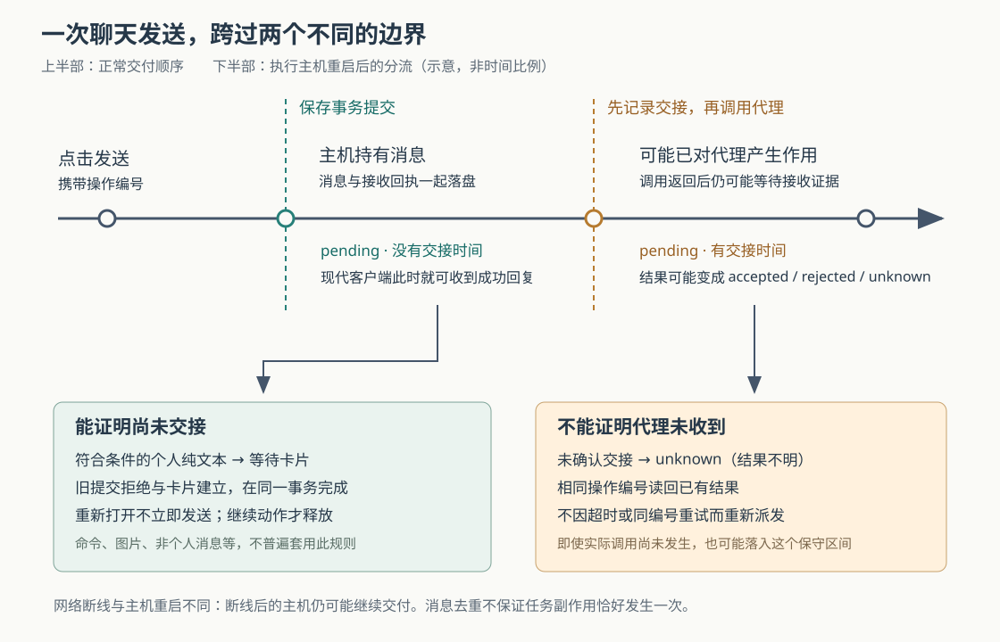

# Orca 聊天消息发出后谁负责：持久接收、代理交接与重启恢复

假设你在 Orca 的聊天框输入“修复结账接口，并运行测试”，点击发送后网络立即断开。电脑上的代理可能还在启动，也可能已经开始改文件；重新连接时，再点一次发送会不会让它重复工作？这是本文自拟场景。要回答它，必须区分三件事：主机有没有保存消息、有没有尝试交给代理、代理有没有提供可核对的接收证据。

当前源码的做法是：**先把消息和接收回执一起写入数据库，再由独立的交付循环启动代理、交接输入。相同操作编号用来读回已有结果；已经可能交接的消息，不能仅凭超时重新发送。**重启后，能够证明尚未交接的个人纯文本还可以变成等待卡片，但不会因为重新打开聊天就立即运行。

Orca 是组织编码代理、终端和独立代码工作区的开发工作台。本篇研究其原生的结构化聊天：界面直接通过适配接口与代理交换消息，由 Orca 呈现对话，不依赖终端画面来表达聊天。此前十三篇已覆盖启动、终端、协作信箱、工作区、保存、调度、配对和浏览器反馈；本篇深入此前只被概括提及的聊天消息接收与交付边界。依据为本地源码 `251c0239475c442d8b00a2f4dd113121847fb5d9`，采用静态追踪与测试断言核对，没有安装依赖、启动程序或运行项目测试。这里的主机指保存会话并运行代理的执行端；网络断开不等于这个主机进程重启。

**一次成功回复，首先可以是“主机已经接收”。**

桌面发送入口 `attemptStructuredAgentSessionSend` 先检查消息大小、远程环境兼容性及会话信息，再调用 `agentSession.send`。这里的 RPC（远程过程调用）是请求执行主机运行一个方法；本机也使用这套调用抽象。请求携带 `clientOperationId`，即标识这一次操作的编号，消息编号直接沿用它。主机的接口注册把请求交给 `sendStructuredAgentSessionForClient`，后者调用会话宿主的 `send`；宿主再经会话命令控制器进入 `sendStructuredAgentSessionTurn`。这条链确实连接到了聊天的持久化流程，不能按名字把它理解成一次终端键盘输入。[界面请求](https://github.com/stablyai/orca/blob/251c0239475c442d8b00a2f4dd113121847fb5d9/src/renderer/src/components/native-chat/structured-agent-session-send-attempt.ts)、[接口注册](https://github.com/stablyai/orca/blob/251c0239475c442d8b00a2f4dd113121847fb5d9/src/main/runtime/rpc/methods/structured-agent-session.ts)、[宿主接线](https://github.com/stablyai/orca/blob/251c0239475c442d8b00a2f4dd113121847fb5d9/src/main/native-chat/agent-session-wire/structured-agent-session-host.ts)

宿主的 `sendPlan` 声明这次操作是会话写入，并要求生成命令接收回执。`performSend` 并不直接调用代理：它先检查同编号消息，再捕获执行选项，最后追加一条 submission，即记录“主机收到了这条输入”的提交记录。新记录设置 `handoverRecorded: true`，初始交付状态为 `pending`。这个布尔字段表示该记录采用了可追踪交接的机制，**不能按字面误读为已经交接**；此时还没有 `handedOverAt`，即开始交接的时间。[发送计划](https://github.com/stablyai/orca/blob/251c0239475c442d8b00a2f4dd113121847fb5d9/src/main/native-chat/agent-session-wire/structured-agent-session-mutation-plans.ts)、[接收实现](https://github.com/stablyai/orca/blob/251c0239475c442d8b00a2f4dd113121847fb5d9/src/main/native-chat/agent-session-wire/structured-agent-session-turns.ts)

因此，需要把三个容易混淆的“成功”分开：

| 观察到的结果 | 能够说明什么 | 还不能说明什么 |
| --- | --- | --- |
| 发送返回成功，记录仍为 `pending` 且没有交接时间 | 主机已经保存并接管这条消息 | 代理已启动或已经收到 |
| 记录有交接时间，但仍为 `pending` | 系统已进入可能对代理产生作用的交接阶段 | 代理明确接收，或任务已经完成 |
| 记录为 `accepted` | 交付已获得适配器认可的接收证据 | 修复正确、测试通过，或任务只会产生一次外部副作用 |

回复时机还受客户端能力影响。`sendStructuredAgentSessionForClient` 对能够展示后续失败的现代客户端可以直接返回接收结果；较旧客户端则有预算地等待交接或代理答复，避免它们误把早期接收当成最终结果。等待结束也可能仍返回原结果，不能据此保证一定拿到终局状态。对应接口测试明确覆盖桌面客户端在 `pending` 时返回，以及旧客户端进入等待。[客户端兼容等待](https://github.com/stablyai/orca/blob/251c0239475c442d8b00a2f4dd113121847fb5d9/src/main/runtime/rpc/methods/structured-agent-session-send-compatibility.ts)、[回复时机测试](https://github.com/stablyai/orca/blob/251c0239475c442d8b00a2f4dd113121847fb5d9/src/main/runtime/rpc/methods/structured-agent-session-wire-contracts.test.ts)

**防重复的关键，是让消息和回执一起落盘。**

设想主机先写消息、随后写回执，恰好在两次写入之间崩溃。重试可能找不到回执，却已经存在一条待交付消息。反过来先写回执也不够：调用者可能拿到“已接收”，数据库里却没有消息。以上是解释实现必要性的假设故障窗口。

Orca 的 `JournalSubmissionWriter.append` 把消息提交交给 `JournalRowWriter.enqueueRows`；后者在同一个 SQLite 事务里插入日志行并写入操作回执。SQLite 是存放在本机文件中的关系数据库；事务意味着这组写入一起提交或一起回滚。这里同时处理附件声明及需要消费的队列卡片，避免消息和这些关联状态各自生效。回执记录接收结果所对应的日志位置，事务提交以后才通知内存状态与订阅者。[消息写入](https://github.com/stablyai/orca/blob/251c0239475c442d8b00a2f4dd113121847fb5d9/src/main/native-chat/agent-session-journal/journal-submission-writer.ts)、[事务写入器](https://github.com/stablyai/orca/blob/251c0239475c442d8b00a2f4dd113121847fb5d9/src/main/native-chat/agent-session-journal/journal-row-writer.ts)

发送的操作编号采用全局作用域：不只在某一个调用者的账本中查重。主机重新计算请求的内容指纹，即对规范化字段计算 SHA-256 摘要；同一编号改成另一个请求会被拒绝。同编号同请求则根据回执重建已有回答。操作级指纹包含发送控制字段，提交记录用于消息匹配的指纹只覆盖正文，两者职责不同。[回执准入](https://github.com/stablyai/orca/blob/251c0239475c442d8b00a2f4dd113121847fb5d9/src/main/native-chat/agent-session-wire/structured-agent-session-command-admission.ts)、[指纹计算](https://github.com/stablyai/orca/blob/251c0239475c442d8b00a2f4dd113121847fb5d9/src/shared/structured-agent-session-mutation.ts)

即使前面的查询误认为回执不存在，事务内的“仅在不存在时插入”还会再查一次。发现重复时抛出 `CommandReceiptExistsError`，让第二次追加回滚，再读取已有回执。测试模拟了这个情形，断言日志位置没有推进、代理调用次数仍为一次。测试还覆盖回执内容损坏时返回结果不明，以及事务已提交、后续发布通知抛错时仍从回执回答。它们说明：**提交后的通知失败，不能把已接收改判为未接收。**[事务内重复处理](https://github.com/stablyai/orca/blob/251c0239475c442d8b00a2f4dd113121847fb5d9/src/main/native-chat/agent-session-journal/command-receipt-transaction.ts)、[重试及发布失败测试](https://github.com/stablyai/orca/blob/251c0239475c442d8b00a2f4dd113121847fb5d9/src/main/native-chat/agent-session-wire/structured-agent-session-resend-answer.test.ts)

这里的幂等性，指相同操作编号重复请求时复用已有结果。它有明确前提：编号必须保持不变，且回执与会话状态仍可读取；换一个新编号会成为新操作。当前代码还同写一份旧操作账本以维持不同操作类型之间的编号兼容，不能把它描述为已经彻底移除旧账本的新协议。[回执与兼容账本同写](https://github.com/stablyai/orca/blob/251c0239475c442d8b00a2f4dd113121847fb5d9/src/main/native-chat/agent-session-wire/structured-agent-session-command-receipt.ts)

**保存完以后，交付循环才去启动和接触代理。**

`runCommandReceiptMutation` 在确认提交成功且写入的是消息提交后，在 `finally` 中唤醒交付。因此即使接收结果发布时出现异常，仍会尝试推进已保存的工作。会话打开与日志提交也接入交付检查，使交付不只依赖界面收到成功回复。[提交后唤醒](https://github.com/stablyai/orca/blob/251c0239475c442d8b00a2f4dd113121847fb5d9/src/main/native-chat/agent-session-wire/structured-agent-session-command-receipt.ts)、[打开与提交接线](https://github.com/stablyai/orca/blob/251c0239475c442d8b00a2f4dd113121847fb5d9/src/main/native-chat/agent-session-wire/structured-agent-session-host-delivery.ts)

`StructuredAgentSessionDeliveryLoop` 每个会话维护一个循环。它从日志中寻找最早尚未交接的提交，检查正在运行的会话命令、失败的启动、已有代理以及用户关闭状态，然后决定等待、启动或交接。启动和就绪等待放在会话串行区之外；串行区就是让同一会话的短状态操作依次执行的范围。这样代理启动较慢时，新的消息接收和停止操作仍有机会执行。这是代码结构带来的并发取舍，不是本次测得的响应速度。[交付循环](https://github.com/stablyai/orca/blob/251c0239475c442d8b00a2f4dd113121847fb5d9/src/main/native-chat/agent-session-wire/structured-agent-session-delivery-loop.ts)

等待返回后，循环不会沿用旧判断直接发送。它重新核对代理子进程的 `generation` 和 `fence`：前者标识具体一代子进程，后者是隔离不同运行代次的数值标记。还要确认代理已经就绪、没有进入停止流程，以及选中的消息仍待交付。随后 `beginSubmissionHandover` 先在日志中写入交接阶段的 `pending` 记录，日志归并器据此填入 `handedOverAt`，再在串行区外调用适配器。[交接前身份检查](https://github.com/stablyai/orca/blob/251c0239475c442d8b00a2f4dd113121847fb5d9/src/main/native-chat/agent-session-wire/structured-agent-session-input-handover.ts)、[交接与外部调用](https://github.com/stablyai/orca/blob/251c0239475c442d8b00a2f4dd113121847fb5d9/src/main/native-chat/agent-session-wire/structured-agent-session-handover.ts)、[交接时间归并](https://github.com/stablyai/orca/blob/251c0239475c442d8b00a2f4dd113121847fb5d9/src/main/native-chat/agent-session-journal/journal-dispatch-reducer.ts)

**交接时间先于外部调用，故意留下了一段保守区间。**如果主机在写完交接记录后、真正调用代理前崩溃，恢复端也会认为“可能已经交出”。这可能让一条实际未发出的消息进入结果不明，却避免把已经发出的消息误判为可以安全重发。数据库和代理进程之间没有共享的原子事务；本篇看到的机制是在管理这段不确定性。

适配器的答复也有层次。公共交接代码遇到 `accepted` 时写入接收结果；遇到 `admitted` 时暂不结束提交，等待后续证据。以 Codex 路径为例，`startCodexTurn` 把客户端消息编号带入 `turn/start`，有合适的运行中轮次时也可能使用 `turn/steer` 将后续输入交给它。`dispatchCodexTurn` 对正常请求答复通常返回 `admitted`；明确的协议拒绝可以返回 `rejected`，传输异常则保留关联信息并抛出，由上层记录不确定性。因此“代理接口调用返回”也不能统一翻译成“消息已确认接收”。这里仅用 Codex 说明差异，没有把它推广成所有代理的相同协议。[公共结果处理](https://github.com/stablyai/orca/blob/251c0239475c442d8b00a2f4dd113121847fb5d9/src/main/native-chat/agent-session-wire/structured-agent-session-operation-settlement.ts)、[Codex 请求与接纳](https://github.com/stablyai/orca/blob/251c0239475c442d8b00a2f4dd113121847fb5d9/src/main/codex/codex-structured-turn-start.ts)

**断线和重启走两套判断，不能只看一个 `pending`。**

先看窗口与主机之间断线。界面在发出真正的发送请求前失败，可以证明请求没有离开客户端；请求发出后的一般异常则可能是回执丢失。`structuredAgentSessionSendEvidence` 将后者视为 `uncertain`，即结果不明。当前桌面发送器不会自动重发这条消息，而是把文字交还并显示未确认提示；主机若已保存，后续仍由主机持有的记录决定交付。客户端的待发送集合只存在内存中，不能当作跨重启的可靠发件箱。[发送证据分类](https://github.com/stablyai/orca/blob/251c0239475c442d8b00a2f4dd113121847fb5d9/src/shared/structured-agent-session-send-evidence.ts)、[桌面发送器](https://github.com/stablyai/orca/blob/251c0239475c442d8b00a2f4dd113121847fb5d9/src/renderer/src/components/native-chat/structured-agent-session-message-sender.ts)、[内存待发送记录](https://github.com/stablyai/orca/blob/251c0239475c442d8b00a2f4dd113121847fb5d9/src/renderer/src/components/native-chat/structured-agent-session-pending-sends.ts)

再看执行主机重启。打开日志时先运行 `markPendingSubmissionsUnknown`：已经进入交接、但没有确定答复的旧记录被标为 `unknown`，并设置恢复标记。历史格式若没有可证明未交接的字段，也采用保守判断。同编号请求读回这份结果，不会因为 `retryUnknown` 参数存在就再次派发；源码中该参数仅为兼容保留。[打开时恢复](https://github.com/stablyai/orca/blob/251c0239475c442d8b00a2f4dd113121847fb5d9/src/main/native-chat/agent-session-wire/structured-agent-session-conversation-open.ts)、[已交接提交恢复](https://github.com/stablyai/orca/blob/251c0239475c442d8b00a2f4dd113121847fb5d9/src/main/native-chat/agent-session-journal/journal-pending-submission-recovery.ts)、[不确定结果不重派测试](https://github.com/stablyai/orca/blob/251c0239475c442d8b00a2f4dd113121847fb5d9/src/main/native-chat/agent-session-wire/structured-agent-session-send-idempotency.test.ts)

尚未开始交接的记录则不同。`isQueuedAgentJournalSubmission` 要同时满足：采用交接跟踪、状态仍待处理、没有交接时间。`holdUnsentSends` 只对当前打开以前留下的此类提交做重启恢复。若是个人发出的纯文本，并且不是会话命令、既有卡片的交付或含图片等其他块的消息，它会在同一事务中把旧提交标为拒绝，并建立等待卡片，用 `keptAsQueuedMessageId` 将二者连起来。这样旧提交不会继续交接，文字也有一个可恢复的归属。其他类型不会被这条规则普遍转换成卡片。[未交接判定](https://github.com/stablyai/orca/blob/251c0239475c442d8b00a2f4dd113121847fb5d9/src/shared/agent-session-queued-submission.ts)、[保留未发出的消息](https://github.com/stablyai/orca/blob/251c0239475c442d8b00a2f4dd113121847fb5d9/src/main/native-chat/agent-session-journal/journal-unsent-send-hold.ts)

卡片并不意味着立即重跑。恢复流程建立重新打开的队列标记，等待明确的继续动作；测试覆盖“只重新打开不发送”“Resume 后发送”“Send now 后发送”和删除卡片。还有一个容易忽略的行为：后续新消息可以先运行，随后释放之前保留的卡片。它不是把所有恢复消息无条件插到下一条新请求前。[重启保留与恢复测试](https://github.com/stablyai/orca/blob/251c0239475c442d8b00a2f4dd113121847fb5d9/src/main/native-chat/agent-session-wire/structured-agent-session-unsent-send-hold.test.ts)

恢复也会失败。若创建卡片失败，代码尝试退回普通拒绝；若拒绝也无法持久化，则保留错误。打开流程记录警告并允许继续读取，而交付循环在任何交接前再次恢复旧提交，避免直接把遗留输入交给代理。测试模拟了卡片写入失败，以及打开时连续失败、后续交付检查再次恢复的情况。这一分工既保留查看会话的机会，也给继续产生外部动作设置了更严格的条件；磁盘故障下仍不能承诺文字一定能转换保存。[恢复失败与回退](https://github.com/stablyai/orca/blob/251c0239475c442d8b00a2f4dd113121847fb5d9/src/main/native-chat/agent-session-journal/journal-unsent-send-hold.ts)、[故障模拟测试](https://github.com/stablyai/orca/blob/251c0239475c442d8b00a2f4dd113121847fb5d9/src/main/native-chat/agent-session-wire/structured-agent-session-unsent-send-hold.test.ts)

**这套设计适合什么，又需要怎样使用。**

对于代理要改文件、执行命令的开发工具，重复输入可能再次触发真实工作。把接收和交付分开，能让主机在代理尚未就绪时接管消息；把回执与消息放入同一事务，能让调用者用稳定编号查回接收结果；把不确定性保留下来，则避免用一次超时替代执行事实。代价是状态和恢复流程更复杂，而且有些故障需要人判断后再决定是否创建新请求。这些取舍是从实现推导出的解释，不是仓库给出的性能结论。

实践中，看到早期成功回执，应继续看后续交付和代理回复；看到未确认提示，应先核对聊天记录及实际工作，再决定是否重新发送。接入客户端时，应区分“主机已记录”“可以证明未记录”和“无法确认”，并按自身是否能展示后续失败声明能力。对于含附件、会话命令或其他代理发来的输入，不应假设它们都享有个人纯文本的卡片恢复规则。

这也补足了早期整体研报中“结构化聊天写入自己的日志”的概括：日志在这里不仅保存展示内容，还参与接收判定、交接顺序和恢复决策。本次确认的是这些边界及当前测试表达的预期；尚未验证真实网络故障、真实代理版本差异与数据库故障下的端到端运行效果，也不能从消息去重推出代理执行的业务副作用恰好发生一次。
