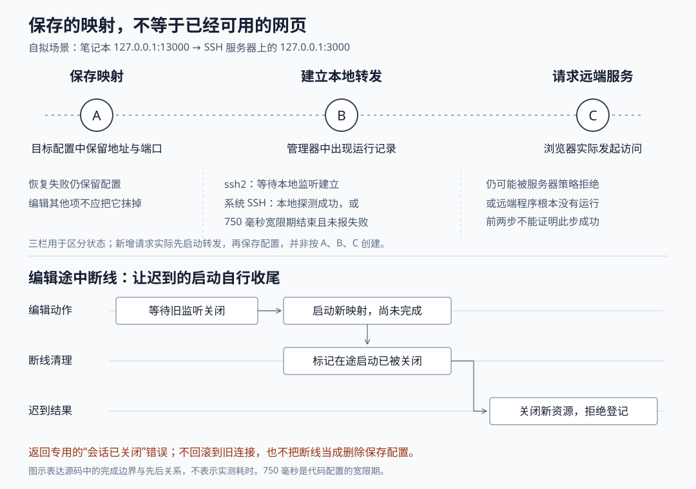

# Orca 的端口转发为什么需要恢复：保存映射、连接归属与启动成功的边界

假设编码代理在远程服务器上启动了一个网页，监听 `127.0.0.1:3000`；你希望在笔记本上打开 `127.0.0.1:13000` 查看它。随后电脑断网，你又把转发端口改了一次。这是本文自拟场景。此时 Orca 要解决的不只是“把两个端口接起来”：旧连接可能还占着本地端口，迟到的启动可能在断线后才完成，恢复动作也可能把刚删除的映射重新打开。

当前源码的处理方式是：**把保存的映射与正在运行的转发分开；同一目标的恢复和编辑排队执行；断线时同时处理已登记和启动中的资源；恢复失败保留配置，再按连接身份和失败次数限制重试。**但转发记录存在，并不证明远端网页已经可访问，系统 OpenSSH 路径甚至允许在尚未探测到本地监听时先返回启动成功。

Orca 是组织编码代理、终端和独立代码工作区的开发工作台。本篇研究桌面端 SSH 目标的端口转发，SSH 指提供加密远程登录和连接通道的协议。此前十四篇已覆盖工作区、代理启动、消息、终端、保存、调度、服务器身份、手机配对和页面反馈；这里继续解释远程开发中“怎样访问代理启动的服务”，不重复服务器身份验证。依据为本地源码 `47713a90d850df6a911b9cae01e66bbcab45626b`。本次采用静态调用链与测试断言核对，没有安装依赖、连接服务器或运行项目测试。

**先看连接从哪里到哪里。**

在这个例子中，笔记本的 `127.0.0.1` 与服务器的 `127.0.0.1` 指向不同机器。Orca 在笔记本建立本地监听，再通过 SSH 要求服务器连接其自身的 `127.0.0.1:3000`，把两边的字节来回转送。这就是本地端口转发。它不要求远端网页直接监听公网，也没有把网页复制到笔记本。

真实入口是 `SshPortForwardDialog`。表单检查本地和远端端口必须在 1—65535 之间；远端主机默认为 `localhost`，远端端口小于 1024 时，建议本地使用“远端端口加 10000”，例如 80 对应 10080。这个规则只是在界面上提供默认值，不能保证新端口没有被占用。[表单与默认值](https://github.com/stablyai/orca/blob/47713a90d850df6a911b9cae01e66bbcab45626b/src/renderer/src/components/right-sidebar/ssh-port-forward-dialog.tsx)

表单调用 `window.api.ssh.addPortForward`，预加载桥将其转换为 `ssh:addPortForward` 的 IPC 请求，即从界面进程请求桌面主进程执行操作。主进程的 `registerSshPortForwardHandlers` 查找目标连接，调用 `SshPortForwardManager.addForward`，成功后保存映射并广播列表。这里确实连接到了转发管理器，而不是仅修改一行界面数据。[预加载桥](https://github.com/stablyai/orca/blob/47713a90d850df6a911b9cae01e66bbcab45626b/src/preload/api/ssh-bridge.ts)、[请求处理与保存顺序](https://github.com/stablyai/orca/blob/47713a90d850df6a911b9cae01e66bbcab45626b/src/main/ipc/ssh/ssh-port-forward-handlers.ts)

管理器固定把本地监听地址设为 `127.0.0.1`。因此，这条路径提供的是笔记本本机的访问入口，不自动向局域网开放。远端地址则可以由用户填写，并不局限于远端服务器自身；是否允许连接，要看服务器的转发策略和目标服务。[转发管理器](https://github.com/stablyai/orca/blob/47713a90d850df6a911b9cae01e66bbcab45626b/src/main/ssh/port-forwarding/ssh-port-forward.ts)

**两种执行方式，对“启动成功”提供的证据不同。**

管理器按照当前连接选择提供者，也就是实际创建和关闭转发的组件。内置 `ssh2` 客户端存在时，使用 `Ssh2PortForwardProvider`；没有该客户端、但连接使用系统 SSH 时，使用 `SystemSshPortForwardProvider`。两者共用列表和编辑流程，底层资源却不同。

| 执行方式 | 实际创建的资源 | 当前路径何时返回启动成功 |
| --- | --- | --- |
| 内置 ssh2 | Node 本地 TCP 监听器；每次本地连接再打开 SSH 通道 | 本地监听器发出 `listening` 事件 |
| 系统 OpenSSH | 运行 `ssh -N -L 127.0.0.1:本地端口:远端地址:远端端口` 的子进程 | 本地连接探测成功，或默认 750 毫秒宽限期结束且尚未报告错误、退出 |

内置路径中，浏览器连接到本地端口后，提供者才调用 `client.forwardOut`，请求打开到远端地址的通道；成功后通过双向 `pipe` 转送数据。因此，创建转发时远端程序即使尚未启动，本地监听仍可能成功。后续通道打开失败会销毁这次本地连接；它不会自动把整个映射认定为配置错误。同步异常和异步通道错误都被就地收住，避免单次访问失败直接冲垮主进程。[内置转发实现](https://github.com/stablyai/orca/blob/47713a90d850df6a911b9cae01e66bbcab45626b/src/main/ssh/port-forwarding/ssh2-port-forward-provider.ts)

系统路径的限制更值得注意：提供者调用不带严格监听期限的 `waitForStartup()`，而底层 `waitForSystemSshForwardStartup` 默认每 50 毫秒探测本地端口，750 毫秒后也可以直接成功。代码另有“必须等到监听”的参数，但本篇普通转发提供者没有传入。相关测试明确模拟本地探测一直拒绝连接，仍预期宽限期结束后成功。因此，不能把界面中的运行记录解释成“监听已经得到确认”。这不是本次测出的延迟，而是源码规定的完成条件。[系统提供者](https://github.com/stablyai/orca/blob/47713a90d850df6a911b9cae01e66bbcab45626b/src/main/ssh/port-forwarding/system-ssh-port-forward-provider.ts)、[启动判定与探测](https://github.com/stablyai/orca/blob/47713a90d850df6a911b9cae01e66bbcab45626b/src/main/ssh/system-transport/system-ssh-forward-process.ts)、[宽限期测试](https://github.com/stablyai/orca/blob/47713a90d850df6a911b9cae01e66bbcab45626b/src/main/ssh/system-transport/system-ssh-forward-process.test.ts)

系统命令还显式使用 `ExitOnForwardFailure=no`。代码注释说明，这是为了不让 SSH 配置文件中其他转发的冲突误伤当前转发；作为补偿，它监视标准错误中的当前端口监听失败信息，并在发现自己的端口无法监听时结束进程。由此可见，启动判断是在兼容用户 SSH 配置与确认本次资源之间折中，仍不包含远端网页的应用层健康检查。

**保存的是以后还想要的映射，不是当前连接的快照。**

管理器用 `forwards` 保存运行条目，条目带有临时编号、连接编号、地址和端口。保存配置则写入 SSH 目标的 `portForwards`，只保留映射和标签，不保留运行编号。重新启动应用后，需要重新创建资源，而不是复用原来那个编号。

`persistPortForwards` 没有简单地用运行列表覆盖保存列表。它先收集当前活动映射，再保留尚未恢复的旧映射；只有被活动映射占用同一本地端口，或被本次明确删除、替换的旧映射，才从旧配置中剔除。比如原先保存网页和接口两个转发，重启后它们都没启动；此时新增数据库转发，不应让前两个配置消失。这一点有直接的测试断言。[配置合并实现](https://github.com/stablyai/orca/blob/47713a90d850df6a911b9cae01e66bbcab45626b/src/main/ipc/ssh/ssh-port-forward-persistence.ts)、[未恢复映射保留测试](https://github.com/stablyai/orca/blob/47713a90d850df6a911b9cae01e66bbcab45626b/src/main/ipc/ssh/ssh-port-forward-restore.test.ts)

没有运行编号的保存项也可以删除。`removeSavedPortForward` 按“本地端口、远端地址、远端端口”识别映射；真正轮到它执行时还会再查一次活动列表。如果先前排队的恢复已经把它打开，就先关闭新资源，再移除保存项，避免出现“界面删除了，后台仍监听”的结果。

界面的 `SshUnrestoredPortRow` 对这类条目分别显示尚未启动、无法启动及启动后停止，并允许删除。失败不是被隐藏的空列表，而是仍可见、可清理的配置。[未恢复条目界面](https://github.com/stablyai/orca/blob/47713a90d850df6a911b9cae01e66bbcab45626b/src/renderer/src/components/right-sidebar/ssh-unrestored-port-row.tsx)

**编辑不是一次原子替换，断线也不是删除意图。**

同一目标上的新增、编辑、删除和恢复，通过 `serializePortForwardChange` 接到同一条 Promise 链中。这里的 Promise 表示尚未完成的异步工作；排队使后一个操作等前一个结束，并把前一个失败转成可继续的队列状态。恢复在出队后再次检查条件，不能只依赖入队时看到的旧状态。[串行化与复查](https://github.com/stablyai/orca/blob/47713a90d850df6a911b9cae01e66bbcab45626b/src/main/ipc/ssh/ssh-managed-port-forward-restore.ts)

但操作系统无法把旧监听和新监听无缝交换。`updateForward` 先等待旧资源关闭，再尝试新配置；否则即使只是改远端地址，也可能因为旧监听仍占用同一本地端口而失败。新配置失败时，它尝试用原编号重建旧配置；回滚失败会被吞掉，原始编辑错误仍抛给调用者。因此，“编辑失败”不等于“旧转发一定还在”，界面需要重新同步真实列表。

断线在另一条生命周期清理路径中发生，不能仅靠编辑队列规避。管理器另用 `inTransit` 集合跟踪“启动中”和“关闭中”的资源。清理会标记已有的在途启动已关闭；启动后来返回时，注册前检查这个标记或连接是否已被释放，先关闭刚得到的资源，再抛出 `PortForwardTornDownError`，即“启动期间会话已关闭”的专用错误。这个错误禁止编辑向旧连接回滚，也让请求层跳过失败时的配置重存，保留原有保存意图。[在途资源与回滚边界](https://github.com/stablyai/orca/blob/47713a90d850df6a911b9cae01e66bbcab45626b/src/main/ssh/port-forwarding/ssh-port-forward.ts)、[断线打断编辑的请求层测试](https://github.com/stablyai/orca/blob/47713a90d850df6a911b9cae01e66bbcab45626b/src/main/ipc/ssh/ssh-port-forward-handlers.test.ts)

清理等待也有边界：对尚未完成的启动，管理器最多等待三秒，迟到结果仍负责自行关闭；对已经进入关闭流程的资源，管理器等待其 `close()`。系统 SSH 的关闭实现先发终止信号，两秒后升级为强制结束，再等最多半秒便结束等待。代码明确说明，最后这个期限只限制等待，不能证明子进程确实死亡。因此，准确说法是“尽力等资源释放，并限制卡死”，不是“返回后端口绝对空闲”。显式断开目标时，`teardownSshTargetTransport` 会同时清理普通转发、托管服务隧道和 SSH 连接；关闭主登录连接本身并不足以结束独立的系统 SSH 转发进程。[目标清理入口](https://github.com/stablyai/orca/blob/47713a90d850df6a911b9cae01e66bbcab45626b/src/main/ipc/ssh/ssh-session-teardown.ts)

**恢复既看连接身份，也控制失败节奏。**

恢复有多个真实触发点：SSH 状态重新变为已连接、主机发布可服务状态，以及托管服务隧道建立。`ssh.ts` 装配这些回调，并为系统转发的意外退出登记失败、保存配置、广播状态。`mayRestore` 要求主机服务决策已经稳定：包括托管服务就绪或旧中继桥接就绪；只有没有状态且不处于连接决策期间时，才允许用“隧道已建立”提前恢复。正在部署中的主机，即使底层 SSH 通了，也不会立即恢复。[回调装配](https://github.com/stablyai/orca/blob/47713a90d850df6a911b9cae01e66bbcab45626b/src/main/ipc/ssh/ssh.ts)、[重连回调](https://github.com/stablyai/orca/blob/47713a90d850df6a911b9cae01e66bbcab45626b/src/main/ipc/ssh/ssh-connection-state-callbacks.ts)、[托管隧道触发](https://github.com/stablyai/orca/blob/47713a90d850df6a911b9cae01e66bbcab45626b/src/main/ipc/runtime-environments/runtime-environment-managed-tunnel.ts)

恢复器记住连接对象、连接代次和上次恢复时间。代次表示同一连接对象经历的不同连接轮次；对象不变不代表底层通道没变。新连接轮次可以立即重新检查；同一轮次至少间隔三十秒，且仍有保存项没有运行时才继续。恢复前，内置提供者还用原 `ssh2` 客户端的对象身份判断转发是否属于当前通道，关闭旧客户端留下的监听，再重建映射。系统提供者没有实现相同的 `isLive` 检查，主要依靠进程退出通知和显式清理；不宜把两种方式描述成同等的健康检测。

单项失败另有退避，即连续失败后逐渐延长重试等待：从三十秒开始翻倍，上限十分钟。恢复后短暂启动又退出，失败次数继续累计；保持启动五分钟后再失败，才从基础等待重新计算。这里的“五分钟健康”只是存活时长，没有发送网页请求。手动重新添加会清除该映射的失败记录；恢复器识别到新的连接对象或代次时，也会清除旧轮次的失败。[退避、失败分类与展示数据](https://github.com/stablyai/orca/blob/47713a90d850df6a911b9cae01e66bbcab45626b/src/main/ipc/ssh/ssh-port-forward-unrestored.ts)

这些时间都是“下次允许尝试”的条件，不是自动唤醒的定时器。上述恢复模块没有在 `retryAt` 到期时自行执行恢复，仍需后续状态或隧道事件触发。因此，应把文档所说的“重启和重连后保留转发”理解为配置保留与条件恢复，不能扩展成“断线后在某个固定时限内必然恢复访问”。[使用文档](https://github.com/stablyai/orca/blob/47713a90d850df6a911b9cae01e66bbcab45626b/docs/site/content/docs/ssh.mdx)

**这些取舍怎样指导使用和实现。**

回到开头场景，排查顺序应沿真实边界推进：先看保存项是否仍在及其错误，再看本地端口是否真的监听、是否被别的程序占用，最后检查远端服务是否运行、地址是否正确，以及服务器是否允许转发。系统路径还需关注独立 SSH 进程的登录与退出信息。仅看到一个运行条目，无法跳过后两步。

从实现可以归纳出三点可迁移的设计思想：把用户想保留的配置与临时资源分开，才能在失败后继续恢复；让异步启动携带取消检查，才能在清理已经结束后处置迟到资源；把失败等待与连接身份绑定，才能既避免反复登录，又给新连接重新尝试的机会。这些是本文对代码关系的分析，不是作者提供的性能承诺。代价同样具体：编辑存在短暂中断，回滚可能失败，恢复依赖事件，运行记录的完成标准还随提供者不同而变化。

本次交叉阅读的测试覆盖了并发恢复只启动一次、编辑后不重开旧映射、保留未恢复配置、旧客户端转发清理、断线后的迟到启动、连续失败退避，以及系统 SSH 宽限期和强制结束等待。它们表达了实现预期，**本次均未执行，不能报告测试通过**。源码提交号与输入一致，Git 工作区无修改；正文源码链接已核对本地文件存在，配图已实际渲染检查。本文没有全面核验端口自动发现、浏览器代理路由、手机访问、全部 SSH 配置组合、进程孤儿回收及断电后的配置持久性；这些路径不能仅凭本篇结论推定具有相同边界。
