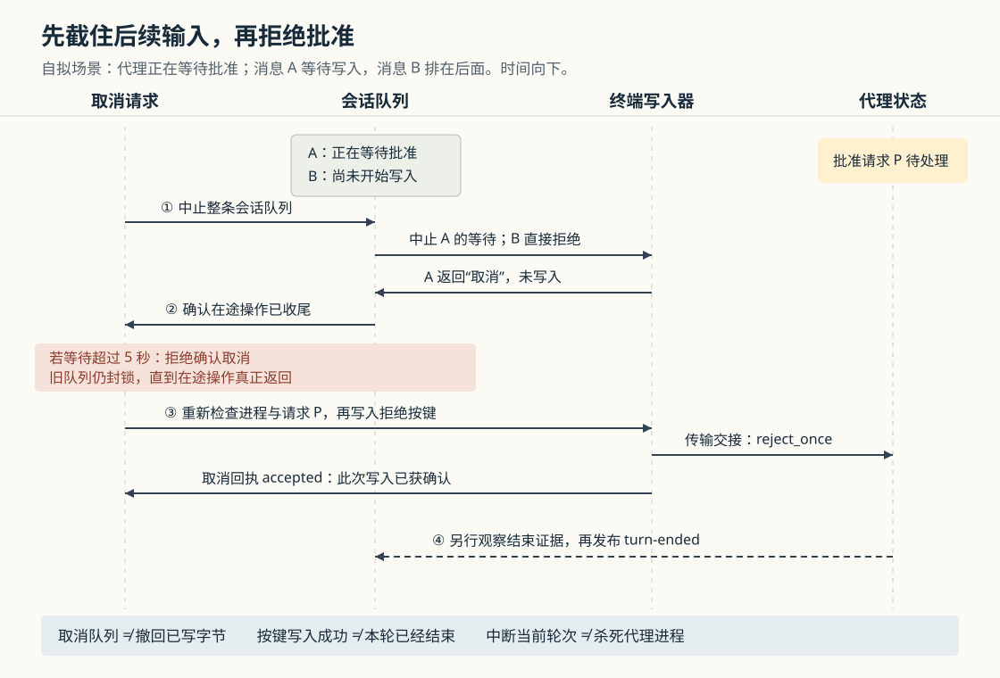

# Orca 怎样取消外部会话：先截住后续消息，再处理批准与中断

假设你从外部会话让编码代理修改支付逻辑，代理正在等待批准一条命令；此时你又发送“继续补上测试”和“顺便更新文档”，随后决定取消。这是本文自拟场景。如果工具只向代理发送一个拒绝按键，批准框消失后，原本等待的两条消息可能立即进入终端，让代理重新开始工作。“取消”因此需要同时处理尚未写入的消息和已经运行的代理。

当前 Orca 的处理顺序是：**先中止这条会话的发送队列，等待在途操作收尾，再拒绝当前批准或向正在工作的代理发送 Escape。**取消请求有独立编号，重复请求读回原结果；但按键写入成功与代理确认本轮结束仍是两件事。这套机制管理的是输入和中断边界，不会撤销代理已经修改的文件，也不等同于杀死代理进程。

Orca 是组织编码代理、终端和独立代码工作区的开发工作台。历史十五篇已覆盖整体架构、启动、内部协作消息、聊天交付、终端生命周期等；本篇研究此前未展开的外部会话取消，重点是等待批准、并发发送、迟到回执与结束证据。依据为本地 `input/repository/` 的版本 `542a2ec78b5c75f6ecc234ef782383fb8546bc59`。本次静态追踪了实际调用链并阅读测试断言，没有安装依赖、启动 Orca、连接外部服务或运行项目测试。

**先找到外部消息进入执行主机的入口。**

这里的“外部会话”由来源和外部编号共同标识，例如某个来源中的一条讨论线程。`ExternalConversationLink` 把这个标识连到工作区里的代理面板，并可保存代理自己的会话编号和报告它的执行主机。面板编号用来找到当前终端，代理会话编号则为关闭后的恢复提供依据；它们不是同一种身份。[关联记录](https://github.com/stablyai/orca/blob/542a2ec78b5c75f6ecc234ef782383fb8546bc59/src/shared/external-conversation-link.ts)、[关联读写](https://github.com/stablyai/orca/blob/542a2ec78b5c75f6ecc234ef782383fb8546bc59/src/main/external-conversations/external-conversation-links.ts)

两条实际入口最终进入同一个 `ExternalConversationSeam`。这个类负责协调外部会话的启动、发送、回答、取消和观察：

- 云连接取得待交付操作后，`dispatchDelivery` 将 `start`、`send`、`answer`、`cancel` 分别映射到它的对应方法。
- 命令行 `orca connector cancel` 携带会话编号和 `delivery-id`，调用 `connector.cancel`。RPC（远程过程调用，即请求宿主执行方法）注册项再调用同一个取消方法。

因此，本篇核验的是 Orca 执行主机这一侧的控制机制，不能据此声称已核验 Slack 等外部产品中的按钮、权限或云端全部行为。[云端操作分派](https://github.com/stablyai/orca/blob/542a2ec78b5c75f6ecc234ef782383fb8546bc59/src/main/connector-cloud/connector-deliveries.ts)、[命令行入口](https://github.com/stablyai/orca/blob/542a2ec78b5c75f6ecc234ef782383fb8546bc59/src/cli/handlers/connector.ts)、[RPC 注册](https://github.com/stablyai/orca/blob/542a2ec78b5c75f6ecc234ef782383fb8546bc59/src/main/runtime/rpc/methods/connector.ts)

这条机制受宿主的 `experimentalConnectors` 设置控制。关闭设置会释放订阅并发出中止信号；当前允许启动的代理是启用了状态回调的 Claude 和 Codex。这里的状态回调是代理向 Orca 报告工作、等待批准和会话身份等信息的集成。虽然来源类型包含多个服务，它并不意味着任意终端程序都具有同样的远程回答能力。[安装与开关](https://github.com/stablyai/orca/blob/542a2ec78b5c75f6ecc234ef782383fb8546bc59/src/main/external-conversations/external-conversations-install.ts)、[代理准入](https://github.com/stablyai/orca/blob/542a2ec78b5c75f6ecc234ef782383fb8546bc59/src/main/external-conversations/connector-agents.ts)

**为什么“等待中的消息”必须先取消。**

外部消息不是直接模拟几次键盘输入。`send` 先进入按会话分组的 `ConversationChain`：同一会话逐项执行，前一项未返回，后一项不能开始。队列为每组在途操作保存中止控制器、末尾承诺和当前运行项；不同会话有各自的队列。[会话协调器](https://github.com/stablyai/orca/blob/542a2ec78b5c75f6ecc234ef782383fb8546bc59/src/main/external-conversations/external-conversation-seam.ts)、[排队实现](https://github.com/stablyai/orca/blob/542a2ec78b5c75f6ecc234ef782383fb8546bc59/src/main/external-conversations/external-conversation-chain.ts)

正在执行的发送项也可能尚未写出任何文字。它经 `deliverFollowUp → sendAgentTurn → sendTerminalAgentPrompt` 进入终端提示词写入器，并设置 `onPermission: 'wait'`：代理等待批准时，先挂起发送。写入器监听状态变化、进程退出和中止信号，也每秒重新检查，因为仅由终端标题或画面体现的变化未必触发状态回调。这个等待本身没有超时；SSH 失联不能证明批准结束或进程退出。[后续消息交付](https://github.com/stablyai/orca/blob/542a2ec78b5c75f6ecc234ef782383fb8546bc59/src/main/external-conversations/external-conversation-send.ts)、[终端发送选项](https://github.com/stablyai/orca/blob/542a2ec78b5c75f6ecc234ef782383fb8546bc59/src/main/runtime/orchestration/send-agent-turn.ts)、[批准等待实现](https://github.com/stablyai/orca/blob/542a2ec78b5c75f6ecc234ef782383fb8546bc59/src/main/runtime/terminal/input/agent-prompt-permission-hold.ts)

回到例子：消息 A 已经进入写入器，但在等批准；消息 B 仍在会话队列中。如果先拒绝批准，再取消队列，A 可能被“批准已结束”的变化唤醒。因此 `cancelConversation` 首先调用 `chain.cancel`：中止正在运行项的信号，让尚未执行的项返回 `conversation_cancelled`，然后等待运行项真正返回，最后才读取当前关联并操作代理。普通的 `answer` 则刻意绕过会话发送队列，否则回答本身会排在等待这个回答的消息后面，互相等待。[取消顺序](https://github.com/stablyai/orca/blob/542a2ec78b5c75f6ecc234ef782383fb8546bc59/src/main/external-conversations/external-conversation-cancel.ts)、[回答入口](https://github.com/stablyai/orca/blob/542a2ec78b5c75f6ecc234ef782383fb8546bc59/src/main/external-conversations/external-conversation-prompts.ts)

这解释了两层排队的分工：会话队列维持业务操作顺序，终端写入器维持字节写入的条件。批准等待又放在终端提交队列之外，避免一个等待项堵住其他调用者的回答或拒绝动作。[提交与等待的装配](https://github.com/stablyai/orca/blob/542a2ec78b5c75f6ecc234ef782383fb8546bc59/src/main/runtime/terminal/input/terminal-agent-prompt-submit.ts)

**等待收尾最多五秒，但超时不会偷偷放行新消息。**

`chain.cancel` 不能只等待队列尾部：中止后，排队项可以先于运行项返回，尾部已经结束不代表最前面的启动或写入已经结束。因此队列单独记录 `running`，取消等待它的结果；只有它以明确拒绝返回，才认为没有需要追查的已发布副作用。

`cancelConversation` 对这一步设置五秒等待上限。超时返回 `agent_not_reachable`，不会声称取消成功，也不会接着盲发中断键。**五秒限制的是等待在途操作收尾，并非整个取消操作的统一超时。**底层操作若忽略中止信号，仍可能继续运行；源码没有把超时当作它已经终止的证据。

与此同时，被中止的旧队列会保留到运行项实际结束。期间新发送仍返回取消；等运行项结束后，后续发送才可以建立新队列。这是“调用方不必无限等回执”和“后台未知操作不能与新操作重叠”之间的取舍。[队列取消与清理](https://github.com/stablyai/orca/blob/542a2ec78b5c75f6ecc234ef782383fb8546bc59/src/main/external-conversations/external-conversation-chain.ts)、[五秒收尾预算](https://github.com/stablyai/orca/blob/542a2ec78b5c75f6ecc234ef782383fb8546bc59/src/main/external-conversations/external-conversation-cancel.ts)

启动也可能只完成了一半。代理终端已经发布、工作区关联尚未保存时，取消会等启动完成关联，再找到它发送中断。若启动明确在发布前被取消，可以直接确认取消；若代理可能已经启动但关联失败，就返回不可达，而不是把“找不到记录”解释成“没有代理”。[启动发布边界](https://github.com/stablyai/orca/blob/542a2ec78b5c75f6ecc234ef782383fb8546bc59/src/main/external-conversations/external-conversation-start.ts)

**队列停住以后，当前代理处于什么状态，决定下一步。**

`stopLinkedAgent` 先解析面板绑定；如果无法绑定，或主机的存活判断为 `unverifiable`，即无法核实，就拒绝取消。其余主要分支如下：

| 当前证据 | 采取的动作 | 不能据此断言的结果 |
| --- | --- | --- |
| 存在可回答的批准请求 | 通过回答接口选择 `reject_once` | 拒绝按键已写入，不等于本轮已结束 |
| 存在问题或其他不支持的请求 | 返回 `prompt_unsupported` | 不猜测应该选择什么答案 |
| 主代理正在工作 | 重新检查后发送一个 Escape，不附加回车 | 不等于关闭终端、杀死进程或撤销改动 |
| 状态行明确显示主代理不在工作 | 不发送中断键，返回成功 | 不证明后台工作全部结束 |
| 状态行缺失、目标换了进程或前台已是命令解释器 | 返回不可达 | 不能把缺少证据当成空闲 |

这些行为来自 `stopLinkedAgent` 和 `interruptWorkingAgent`。后者使用主代理状态判断，单独的后台活动不会让空闲输入框收到 Escape；状态缺失则是不可达，不是空闲。[取消状态分支](https://github.com/stablyai/orca/blob/542a2ec78b5c75f6ecc234ef782383fb8546bc59/src/main/external-conversations/external-conversation-cancel.ts)、[中断实现](https://github.com/stablyai/orca/blob/542a2ec78b5c75f6ecc234ef782383fb8546bc59/src/main/runtime/terminal-agent-interrupt.ts)

**怎样避免迟到按键落到新进程或新批准框。**

面板仍在原位置，不代表它仍承载原来的进程。代码比较 `ptyId` 与 `processIncarnation`：前者标识 PTY（伪终端，连接应用输入输出的终端通道），后者区分同一通道标识背后的进程实例。批准请求的 `promptId` 还由进程绑定、状态开始时间、提示内容和工具名共同计算。相同面板中的后来批准请求，或新进程中的相似请求，不会因此自动获得旧回答。[请求身份与回答](https://github.com/stablyai/orca/blob/542a2ec78b5c75f6ecc234ef782383fb8546bc59/src/main/runtime/terminal-agent-prompt-answer.ts)

在实际写入前还有两道不同检查。先由 `createLaunchedAgentWriteGuard` 检查前台是否仍为目标代理，防止把输入送到已经接管终端的 shell，也就是命令解释器。然后 `writeFencedAgentKeys` 的同步检查在传输交接前再次读取进程与请求。这里的“同步”很关键：检查与交接之间没有主动让出执行机会的异步等待。[前台检查](https://github.com/stablyai/orca/blob/542a2ec78b5c75f6ecc234ef782383fb8546bc59/src/main/runtime/launched-agent-write-guard.ts)、[按键交接](https://github.com/stablyai/orca/blob/542a2ec78b5c75f6ecc234ef782383fb8546bc59/src/main/runtime/terminal-agent-fenced-keys.ts)、[底层写入顺序](https://github.com/stablyai/orca/blob/542a2ec78b5c75f6ecc234ef782383fb8546bc59/src/main/runtime/runtime-terminal-writer.ts)

不过，这不是所有主机都必须提供前台正面证明的严格模式。外部会话采用 `write-unless-shell` 策略：明确识别到 shell 会拒绝；在宿主明确不具备代理证明能力等条件下，未知前台仍可获准。因此源码能支持“多层防止旧输入误投”，不能支持“每次写入都已证明前台必然是目标代理”的绝对结论。

回答器还会在最终检查时先记住已回答的请求，防止状态回调尚未更新时，两个并发回答都写出按键。如果宿主明确拒绝写入，可以解除这次占用；如果交接后结果未知，就保留已回答标记，避免用重复按键补偿不确定性。这份标记在内存中，不应被理解为跨重启的完整回答历史。[回答去重实现与测试](https://github.com/stablyai/orca/blob/542a2ec78b5c75f6ecc234ef782383fb8546bc59/src/main/runtime/terminal-agent-prompt-answer.test.ts)

**取消回执如何避免重试中断下一轮。**

取消与发送、启动共用 `DeliveryReceipts`，把操作登记在宿主的持久化回执账本中。同一来源、会话和 `deliveryId` 构成请求身份，方法与输入摘要用于发现编号误用。相同请求仍在运行时加入原承诺；完成后读回原结果；若同一编号改作其他方法或其他内容，就返回 `delivery_id_reused`。[持久回执](https://github.com/stablyai/orca/blob/542a2ec78b5c75f6ecc234ef782383fb8546bc59/src/main/external-conversations/external-conversation-delivery-receipts.ts)

这对空闲取消尤其重要：第一次取消发现代理已空闲，记录成功；代理后来开始新一轮，再收到相同取消编号时，只回放成功，不再发 Escape。否则，一个迟到的网络重试就可能中断后来的工作。

回执分为三个结果，不能只看有没有抛异常：

- `accepted`：该操作已获得实现所要求的确认；取消也可能因已空闲而无需写键。
- `refused`：这次操作被拒绝，拒绝结果不保留在持久回执中；条件改善后，直接重新调用可以再次尝试。拒绝并不抹掉此前已经发生的队列中止。
- `unknown`：可能已经产生写入或启动效果，保存这个结果，不能当作未执行而自动重做。进程重启后，遗留的未完成回执也会转成这种结果。

此外，账本为待处理的外部交付设置 1000 条上限，并另留 100 条只有取消能使用的额度。这限制消息积压，同时让发送积压达到上限后仍有一定空间提交取消；这些是代码中的容量设置，不是性能测量。[回执结果与容量](https://github.com/stablyai/orca/blob/542a2ec78b5c75f6ecc234ef782383fb8546bc59/src/main/external-conversations/external-conversation-delivery-receipts.ts)

云连接还另有一层边界：`received` 表示宿主接入了操作，`done` 携带上述操作结果；它们都不是代理的工作完成事件。重连后，对先前已接收但尚未确认结果的操作，客户端查询本地回执，不重新执行。因而“拒绝允许再次调用”和“云端必然自动重试该拒绝”也不能混为一谈。[接收、完成与重连回查](https://github.com/stablyai/orca/blob/542a2ec78b5c75f6ecc234ef782383fb8546bc59/src/main/connector-cloud/connector-poll-client.ts)

**代理到底结束没有，需要另一条证据链。**

取消成功不会立即广播 `turn-ended`。这个事件由 `ConversationEvents` 观察状态变化后生成，普通路径复用宿主的终端轮次观察机制。轮次指代理从开始处理输入到停止的一段工作，与终端进程寿命不同。[会话事件实现](https://github.com/stablyai/orca/blob/542a2ec78b5c75f6ecc234ef782383fb8546bc59/src/main/external-conversations/external-conversation-events.ts)

源码还处理了一个具体缺口：Claude 的某些批准拒绝没有相应结束回调。只有在取消确实成功拒绝、原先程序状态为 `blocked` 时，观察器才记住原状态行、进程绑定和拒绝时间；随后必须看到同一进程、同一批准上下文中的新 `idle` 报告，且时间符合要求，才补发停止原因为 `cancellation` 的结束事件。若状态行已经转向后续工作，或进程已替换，就丢弃这份补偿记录，交回普通状态机制判断。

它也处理“空闲报告先到，写入回执后到”的顺序：登记拒绝后立即再检查当前状态，避免遗漏刚刚到达的证据。补偿记录只存在于有效观察期间；最后一个观察者离开会清理它。发往云端的结束事件还要求可识别的轮次编号，没有编号就不会随意归属。[结束补偿与顺序测试](https://github.com/stablyai/orca/blob/542a2ec78b5c75f6ecc234ef782383fb8546bc59/src/main/external-conversations/external-conversation-cancel-settlement.test.ts)、[云端事件转换](https://github.com/stablyai/orca/blob/542a2ec78b5c75f6ecc234ef782383fb8546bc59/src/main/connector-cloud/connector-turn-events.ts)

**这些设计适合什么，以及使用时该怎样判断。**

从实现推断，这套方案适合连接已有终端代理：既保留代理自己的输入与批准交互，又让外部会话能够排队、取消和恢复。代价是 Orca 必须承认终端输入的局限：字节可能已交付，代理状态可能迟到，部分主机无法充分证明前台身份，取消不能作为事务回滚。

阅读测试也能看到这些取舍对应的具体预期：取消后批准放行仍不写出旧消息；重复空闲取消不影响后来轮次；缺失状态允许以后重试；卡住的关联、写入、恢复或就绪等待不被宣布取消成功；迟到的空闲报告必须匹配原进程与请求。终端写入器的测试另外覆盖了批准在最后检查期间重新出现，以及进程在等待中替换的情况。本次阅读了这些断言，未执行它们。[取消测试](https://github.com/stablyai/orca/blob/542a2ec78b5c75f6ecc234ef782383fb8546bc59/src/main/external-conversations/external-conversation-cancel.test.ts)、[收尾与超时测试](https://github.com/stablyai/orca/blob/542a2ec78b5c75f6ecc234ef782383fb8546bc59/src/main/external-conversations/external-conversation-cancel-liveness.test.ts)、[终端批准等待测试](https://github.com/stablyai/orca/blob/542a2ec78b5c75f6ecc234ef782383fb8546bc59/src/main/runtime/agent-prompt-permission-wait.test.ts)

实践上，一次取消应始终复用同一个交付编号处理网络重试；若明确要取消后来的一轮，应建立新操作。看到 `unknown` 或五秒收尾失败，应检查宿主和当前代理，不能不断更换编号重复中断。看到 `accepted`，可以相信此次取消按既定分支完成；若还需要确认工作已经停下，应继续核对对应轮次的结束证据，并单独检查文件、命令及后台任务留下的结果。
