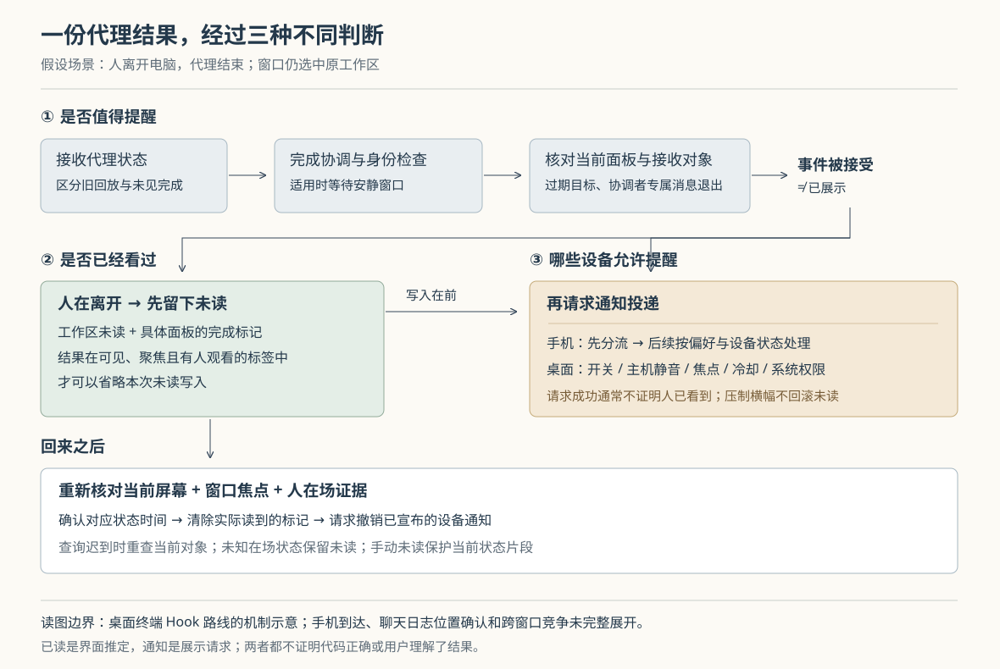

# Orca 怎样判断代理结果尚未读过：完成去重、人在场证据与通知分流

假设你让两个编码代理分别修改接口和页面，屏幕停在接口终端上，人却离开了电脑。接口代理先结束，页面代理随后请求批准；回来后，你查看接口结果，又把它手动标成未读，打算稍后复核。这是本文自拟场景。若系统只检查“哪个工作区被选中”，离开期间的结果可能被立即算作已读；若每次重连都把当前状态当作新事件，又会反复提醒同一份结果。

当前 Orca 把这个问题拆成三个判断：**这是不是值得提醒的新事件，结果是否已经出现在有人观看的界面上，以及哪些设备允许接收通知。**未读先于通知投递写入，桌面横幅被压制时仍可保留；自动已读同时检查界面位置、窗口状态和人在场证据。这里的“已读”是界面依据这些条件作出的推定，不是证明人理解了结果，更不是证明代理的修改正确。

Orca 是把编码代理、终端和独立代码工作区组织在一起的开发工作台。历史十六篇已覆盖整体架构、启动、状态来源、终端恢复及消息交付；本篇深入此前未展开的结果提醒与阅读确认。依据为本地 `input/repository/`、输入记录版本 `f138493be3534ea7ab8468717ad10bd5a49c3440`。下文主要追踪桌面终端中由 Hook（代理集成主动上报状态的回调）触发的路线，并核对桌面通知、手机分流及阅读后的清理；没有安装依赖、启动 Orca、连接服务或运行项目测试。

**先分清：代理结束、值得提醒和用户已读，是三件事。**

仓库的通知文档用“从工作转为空闲”解释完成提示，但生产代码并不对每次状态更新都直接弹窗。界面的 `createAgentStatusEventApplicator` 先整理状态的归属、时间和终端身份，把更新交给状态写入路径，再触发通知效果；批量接收时，效果也被收集到写入之后执行。它调用 `observeAgentHookCompletionForNotification`，后者为每个终端面板维护一个完成协调器，并把最终结果接到 `dispatchTerminalNotification`。面板键由终端标签和分屏叶子身份组成，能够区分同一标签里的两个终端。[事件应用](https://github.com/stablyai/orca/blob/f138493be3534ea7ab8468717ad10bd5a49c3440/src/renderer/src/hooks/ipc-events/agent-status-event-applicator.ts)、[协调器的实际装配](https://github.com/stablyai/orca/blob/f138493be3534ea7ab8468717ad10bd5a49c3440/src/renderer/src/hooks/agent-hook-completion-notifications.ts)

协调器保留本轮计数、是否见过工作状态、上次完成身份，以及待确认的结束。Hook 的完成身份优先采用 `turnCompletedAt`，其次在适用时采用 `turnEndedAt`，再退到 `stateStartedAt`，即当前状态片段的开始时间。原因写在代码里：状态时间可能跨轮保持不变，不能独自区分所有真正结束。它还协调标题、Hook 和进程退出这些不同证据，防止同一轮被多个来源重复宣布。[完成协调器](https://github.com/stablyai/orca/blob/f138493be3534ea7ab8468717ad10bd5a49c3440/src/renderer/src/components/terminal-pane/agent-completion-coordinator.ts)、[身份与派发控制](https://github.com/stablyai/orca/blob/f138493be3534ea7ab8468717ad10bd5a49c3440/src/renderer/src/components/terminal-pane/agent-completion-notification-controller.ts)

收到 `done`（本轮结束）也不总是立即提醒：若已观察到工作，或属于 Pi/OMP 这类可能在阶段之间报告完成的代理，控制器等待当前配置的 1.5 秒安静窗口。期间再出现工作状态，就撤销待发提醒。`waiting` 或 `blocked` 则走“需要人输入”的提醒分支，用单独的身份令牌合并重复上报。1.5 秒是代码中的等待规则，不是本次测量得出的性能数据，也不是对任务必然结束的证明。[Hook 状态处理](https://github.com/stablyai/orca/blob/f138493be3534ea7ab8468717ad10bd5a49c3440/src/renderer/src/components/terminal-pane/agent-completion-hook-observer.ts)、[等待常量](https://github.com/stablyai/orca/blob/f138493be3534ea7ab8468717ad10bd5a49c3440/src/shared/agent-status/lifecycle/agent-transitions.ts)

重连也不能简单地“全通知”或“全忽略”。`isSeenHostReplay` 比较回放与已有状态：若界面原先是工作中，重连得到新的完成，就允许进入提醒；若本来已经显示同一段完成且结束标记相同，就视作见过。若根本没有旧行，代码采取保守策略，不把回放当作未见完成，以免重新加载便再响一次。带有 `turnCompletedAt` 的工作状态另交协调器判断，因为代理可能仍在工作，但已有一段后台工作结束。[回放判断](https://github.com/stablyai/orca/blob/f138493be3534ea7ab8468717ad10bd5a49c3440/src/renderer/src/hooks/ipc-events/agent-status-routing.ts)

这意味着 Orca 在现有状态证据允许时补报断线期间的结果，但本篇路线并不是一份跨重启永久保存、保证每个结束都提醒的事件账本。

**接受事件之前，还要问：这个结果仍属于当前面板吗？**

`dispatchTerminalNotification` 再读取当前状态，拦截已经被新状态取代的完成快照，也避免用旧代理的提示词给新代理的事件配文。随后它进入通用的 `resolveAgentAttention` 策略；这里 attention 指“需要把人的注意力引向某个对象”，并不等于系统通知本身。[终端派发入口](https://github.com/stablyai/orca/blob/f138493be3534ea7ab8468717ad10bd5a49c3440/src/renderer/src/components/terminal-pane/use-notification-dispatch.ts)

这层策略先拒绝被静音的工作区，再拒绝仅应报告给协调代理的完成消息。有上级代理的工作代理正常完成时，人不会收到这条路线的未读或通知；但等待批准仍需要人处理，不能用“有上级”一概压制。接着检查是否仍有运行会话，或者存在可替代它的新活动证据，最后由终端适配器核对标签及具体分屏是否仍是当前目标。因此，关闭一个分屏后迟到的完成，不能因为旁边还有一个活终端就取得提醒资格。[通用决策](https://github.com/stablyai/orca/blob/f138493be3534ea7ab8468717ad10bd5a49c3440/src/renderer/src/attention/agent-attention-policy.ts)、[工作代理规则](https://github.com/stablyai/orca/blob/f138493be3534ea7ab8468717ad10bd5a49c3440/src/shared/dispatched-worker-attention.ts)、[终端目标校验](https://github.com/stablyai/orca/blob/f138493be3534ea7ab8468717ad10bd5a49c3440/src/renderer/src/components/terminal-pane/terminal-attention-surface.ts)

被接受后，策略分别返回“要不要写未读”和“请求投递通知”。如果目标已在有人观看的界面中，前者为空，后者仍可存在；桌面是否弹窗留给主进程决定。否则，`applyAgentAttention` 明确先调用未读写入，再请求投递。`markAgentAttentionUnread` 写工作区未读并记录具体面板的完成未读；更细的标签和通用面板标记还受实验设置控制，完成未读本身不依赖这个开关。[未读存储与清除](https://github.com/stablyai/orca/blob/f138493be3534ea7ab8468717ad10bd5a49c3440/src/renderer/src/store/slices/workspace-attention/workspace-attention-slice.ts)

由此可以解释开头的场景：电脑仍选中接口终端，只要没有满足观看条件，结果仍会留下未读。即使随后横幅被设置或系统权限挡住，这份未读也不会因投递失败而回滚。

**“看过”需要界面证据，桌面端还要有人在场。**

终端适配器判断观看时，复用 `isTabOnScreen`：窗口必须可见且有焦点，人在场证据必须有效，目标还必须位于实际展示的终端标签中。界面选中某个工作区只是其中一部分；停在设置页、窗口处于后台，均不能直接当作阅读。可见目标从统一标签与分组布局中计算，支持并排的标签组和浮动工作区；不能只盯全局的一个旧 `activeTabId`，否则聊天替代终端后，可能清错隐藏内容。[可见目标计算](https://github.com/stablyai/orca/blob/f138493be3534ea7ab8468717ad10bd5a49c3440/src/renderer/src/hooks/agent-auto-ack-targets.ts)

桌面端 `useReadOnScreenAttention` 启动扫描。可信的键盘、指针和滚轮输入会记录人在场时间；没有近期输入时，如果确实有待读内容，扫描向主进程查询系统空闲状态。锁屏、空闲或达到 180 秒阈值表示离开；查询失败或结果未知，不会自动清除未读。系统返回“未离开”只授权这次扫描，不会再延长输入证据的有效期。网页客户端没有原生空闲查询，采用窗口可见与焦点规则，不能把桌面端的全部人在场保障套过去。[阅读扫描](https://github.com/stablyai/orca/blob/f138493be3534ea7ab8468717ad10bd5a49c3440/src/renderer/src/hooks/on-screen-attention-scan.ts)、[人在场检查](https://github.com/stablyai/orca/blob/f138493be3534ea7ab8468717ad10bd5a49c3440/src/renderer/src/hooks/agent-auto-ack-presence.ts)、[主进程空闲查询](https://github.com/stablyai/orca/blob/f138493be3534ea7ab8468717ad10bd5a49c3440/src/main/notifications/desktop-away-state.ts)

异步查询返回后，扫描重新读取当前界面，而不是继续清理发请求时的旧对象。人已经切换标签，或窗口失去焦点，就不能用迟到的“人在场”答案清除原结果。扫描也覆盖代理退出后保留的状态行，避免进程结束恰好把待确认对象移出活动状态表。

阅读状态并非只有一个布尔值：

| 记录 | 在这里表达什么 |
| --- | --- |
| 工作区未读 | 这份工作区仍有待回看的提醒，可单独手动设置 |
| 面板完成未读 | 哪个具体终端或聊天对象留下了提醒，以及原因 |
| `acknowledgedAgentsByPaneKey` | 已确认到哪个状态时间，供代理行的未读判断使用 |
| `manuallyUnreadTurnsByPaneKey` | 用户明确要求把当前状态片段继续留作未读 |

自动确认把已确认时间与 `stateStartedAt` 比较，而非不断变化的 `updatedAt`，所以同状态重复上报不会仅凭更新时间再变成待读。真正写确认时，`acknowledgeAgents` 取本机当前时间与活动、保留记录相关时间的较大值，避免执行主机的时钟领先时反复确认同一行。手动标未读则删掉确认并保存当前状态时间；普通焦点与输入信号不会马上覆盖这个意图，切换到其他对象或进入新的状态片段后才允许保护失效。[确认策略](https://github.com/stablyai/orca/blob/f138493be3534ea7ab8468717ad10bd5a49c3440/src/renderer/src/attention/agent-attention-acknowledgement.ts)、[确认及手动未读写入](https://github.com/stablyai/orca/blob/f138493be3534ea7ab8468717ad10bd5a49c3440/src/renderer/src/store/slices/ui/ui-slice-activity-actions.ts)

这里还有一个粒度差别：终端适配器把屏幕上一个标签里的分屏都视为可见，扫描会清除该标签的提醒标记；但代理状态行的自动确认通过 `resolveViewedSubjectKey` 定位该标签的活动分屏。不能笼统地说“所有显示过的代理行都用完全相同的方法确认”。结构化聊天使用另一种适配器，隐藏的聊天和可见终端不会因为同属一个工作区就一起被读掉。[阅读对象适配](https://github.com/stablyai/orca/blob/f138493be3534ea7ab8468717ad10bd5a49c3440/src/renderer/src/hooks/agent-auto-ack-surfaces.ts)

**通知可以分流，成功回执也有自己的边界。**

渲染界面通过 `notifications.dispatch` 请求桌面主进程；`registerNotificationHandlers` 将它连接到 `createNotificationDeliveryService`。这层执行顺序决定了几个容易误解的现象：[接口注册](https://github.com/stablyai/orca/blob/f138493be3534ea7ab8468717ad10bd5a49c3440/src/main/ipc/notifications.ts)、[通知投递服务](https://github.com/stablyai/orca/blob/f138493be3534ea7ab8468717ad10bd5a49c3440/src/main/notifications/notification-delivery-service.ts)

- 窗口不可见时，代理提醒或终端响铃可以先点亮托盘提示，再检查桌面通知开关。因此关掉横幅不必然抹掉所有提示。
- 服务先把事件交给手机通知运行时，再检查桌面的来源开关、主机静音、前台压制、冷却和系统支持。桌面开关不允许时，会附带 `desktopAllowed: false`，让后续按手机偏好处理；这不是保证手机一定弹出通知。
- 桌面“前台不提醒”检查的是当前工作区及窗口焦点；它和前面的“有人在看”规则不同。因而一个人已离开、窗口仍有焦点的场景，可以保留未读同时压制横幅。
- 桌面短时冷却默认按工作区合并，带 `attentionKey` 的请求则按独立消息键合并；桌面与手机维护各自的冷却表。普通终端请求没有这个键，同一工作区不同来源的连续提醒可能在五秒内合并。

五秒冷却是有容量限制的内存表，还在确认原生支持和 macOS 权限之前预留。因此它抑制请求突发，不代表前一次实际展示成功，更不是永久的“只提醒一次”。同一完成片段中后来出现的新结束标记，还可能由 Hook 路线暂存最新修订，等冷却结束后重新检查状态与归属，再尝试一次；无法得到回执时有固定到期时间，不会无限排队。[冷却实现](https://github.com/stablyai/orca/blob/f138493be3534ea7ab8468717ad10bd5a49c3440/src/shared/notification-burst-cooldown.ts)、[完成修订暂存](https://github.com/stablyai/orca/blob/f138493be3534ea7ab8468717ad10bd5a49c3440/src/renderer/src/hooks/agent-hook-completion-revision-hold.ts)

原生投递层还揭示了另一条限制：普通终端请求调用 `notification.show()` 后即可返回 `delivered: true`；只有明确要求展示确认的请求才等待展示事件或失败、超时。本文的终端派发没有设置这项要求。所以这个成功值主要说明请求走到了展示调用，不能当作用户已经看到。收到成功后，界面才尝试播放所选桌面通知声音；macOS 权限被拒绝或未决定时则返回 `blocked-by-system`，界面可显示应用内提示。[原生展示](https://github.com/stablyai/orca/blob/f138493be3534ea7ab8468717ad10bd5a49c3440/src/main/ipc/native-notification-delivery.ts)、[声音与失败回退](https://github.com/stablyai/orca/blob/f138493be3534ea7ab8468717ad10bd5a49c3440/src/renderer/src/attention/agent-attention-notification-delivery.ts)

手机还有无需桌面窗口的生产路线。运行时订阅代理状态转换，再交给 `TerminalAgentPhonePush`；发送前重新检查窗口所有权，窗口已经负责时就退出，以免两路同时推送。手机运行时还附加桌面是否离开的信息，并有后续设备筛选、重放和推送处理。本文只核验到这些分流和所有权检查，不把“交给手机运行时”描述成手机已显示。[无窗口路线装配](https://github.com/stablyai/orca/blob/f138493be3534ea7ab8468717ad10bd5a49c3440/src/main/runtime/orca-runtime-agent-transitions.ts)、[发送前检查](https://github.com/stablyai/orca/blob/f138493be3534ea7ab8468717ad10bd5a49c3440/src/main/runtime/terminal-agent-phone-push.ts)

**回来阅读后，界面和设备提醒也要分别收尾。**

清除标记时，`collectRemovedAttention` 对照删除前后的记录，找到实际消失的面板提醒，再调用 `notifications.dismiss`。代理行确认也会带面板键及可重建的通知编号请求清理；编号由工作区、面板和状态开始时间组成。主进程同时保留按面板组织的已宣布通知记录，避免状态更新以后重新拼出的编号漏掉旧通知。记录有容量限制且只在内存中保存，重启后的补救依赖当前行重建身份及其他通知恢复机制。[移除后的清理](https://github.com/stablyai/orca/blob/f138493be3534ea7ab8468717ad10bd5a49c3440/src/renderer/src/store/slices/workspace-attention/attention-removal-follow-up.ts)、[通知编号](https://github.com/stablyai/orca/blob/f138493be3534ea7ab8468717ad10bd5a49c3440/src/shared/agent-notification-id.ts)、[已宣布记录](https://github.com/stablyai/orca/blob/f138493be3534ea7ab8468717ad10bd5a49c3440/src/main/notifications/announced-notification-registry.ts)

主进程可关闭仍持有的原生通知，并向手机运行时发出撤销。此处也不能把终端结论推广到聊天：带日志位置的结构化聊天提醒，必须由覆盖对应位置的阅读证据清除，不能只按整个面板粗略撤销。普通标记清理中的撤销调用还会吞掉失败，因此“界面未读消失”不证明每台设备的旧通知都已经同步消失。

从这些实现关系可以推导出一个设计取舍：把新消息判断、未读、展示和设备清理分开，能够避免通知设置反过来损害结果追踪，也能在迟到事件中保住对象边界；代价是它们不会总在同一时刻收敛。用户排查时应先看代理实际状态与目标是否正确，再看未读、桌面压制原因和手机偏好，而不是凭一次响铃或没有横幅推断任务结果。手动标未读适合留下复核意图；需要确认代码质量时，仍要查看差异和测试结果。

本次交叉阅读的测试断言包括：安静窗口内恢复工作会取消完成提示；已见与未见的重连完成采用不同处理；未读先于投递；人在离开、查询失败及焦点改变时保留未读；远端时间领先仍只确认一次；隐藏聊天不随可见终端清除；桌面静音和焦点压制不截断手机分流；按对象撤销已宣布通知。[安静窗口测试](https://github.com/stablyai/orca/blob/f138493be3534ea7ab8468717ad10bd5a49c3440/src/renderer/src/components/terminal-pane/agent-completion-coordinator-hook-done-quiet-window.test.ts)、[重连测试](https://github.com/stablyai/orca/blob/f138493be3534ea7ab8468717ad10bd5a49c3440/src/renderer/src/hooks/ipc-events/agent-status-reconnect-replay-notification.test.ts)、[人在场测试](https://github.com/stablyai/orca/blob/f138493be3534ea7ab8468717ad10bd5a49c3440/src/renderer/src/hooks/useReadOnScreenAttention.away.test.ts)、[时间差测试](https://github.com/stablyai/orca/blob/f138493be3534ea7ab8468717ad10bd5a49c3440/src/renderer/src/hooks/useReadOnScreenAttention.clock-skew.test.ts)、[投递服务测试](https://github.com/stablyai/orca/blob/f138493be3534ea7ab8468717ad10bd5a49c3440/src/main/notifications/notification-delivery-service.test.ts)

这些测试是实现预期的证据，**本次未执行，不能报告通过**。本文未全面核验所有代理的标题与进程探测、跨窗口竞争、手机云推送到达、所有操作系统的通知中心行为，以及结构化聊天的完整阅读协议；图中的手机分支仅表示进入后续处理。源码和输入材料保持原样。正文的 35 个源码链接已核对本地文件存在，配图通过 XML 解析；当前环境的系统缩略图与浏览器渲染均不可用，因此未完成配图的实际渲染目检。
