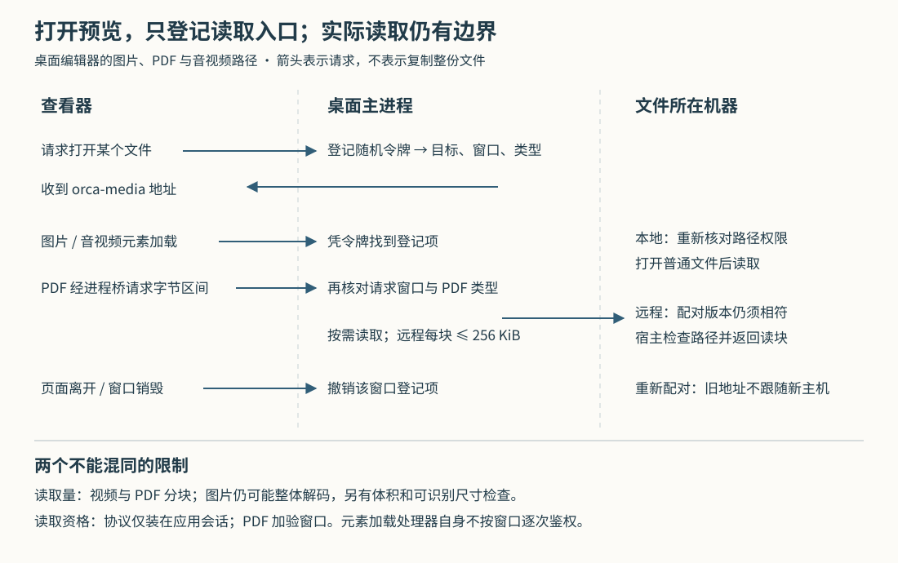

# Orca 怎样预览代理生成的文件：读取凭证、分段加载与主机身份边界

假设编码代理在远程服务器上生成了一段演示视频、一份 PDF 和一张页面截图，你在笔记本上的 Orca 中逐个打开。视频很大，不宜先完整下载；截图虽然压缩后很小，展开后却可能占用大量内存；如果这时把服务器重新配对，旧预览也不能悄悄开始读取另一台机器上的同名文件。这是本文自拟场景。

当前 Orca 的处理方式是：**桌面主进程登记文件目标，发放随机预览地址；查看器通过受限入口按需读取，本地请求重新检查路径权限，远程请求固定到创建预览时的配对版本。**视频、PDF 和图片共用部分基础设施，但读取和取消的边界不同。理解这些差异，才能判断“地址已生成”“内容可读取”和“读到同一份内容”分别意味着什么。

Orca 是组织编码代理、终端和独立代码工作区的开发工作台。此前十七篇研报已经覆盖整体架构、启动、消息交付、终端、保存、连接及通知；本篇深入此前未展开的文件预览读取机制，范围限定为桌面编辑器的 `orca-media` 路径，不包含 HTML 页面预览的另一套授权系统。依据是本地 `input/repository/`，输入记录版本为 `31d0f53cd90c4c2c8bccad94242057a38f162279`。以下来自静态调用链与测试断言阅读，没有安装依赖、启动 Orca、连接服务器或执行项目测试。

**先看一次“打开文件”怎样变成可加载的地址。**

界面读取实现 `readRuntimeFileContentAsStored` 根据文件归属选择本机接口或远程运行时。实际需要显示二进制内容的调用可以启用 `pageOversizedBinary`：本机分支把它转成 `rangePreview`，远程分支先尝试 `readRemoteRangePreview`。后者通过桌面的进程桥请求 `fs:grantRuntimeFilePreview`。这里的进程桥，也称 IPC，是网页界面请求桌面主进程执行本机操作的通道。[界面读取决策](https://github.com/stablyai/orca/blob/31d0f53cd90c4c2c8bccad94242057a38f162279/src/renderer/src/runtime/runtime-file-read-client.ts)、[远程预览请求](https://github.com/stablyai/orca/blob/31d0f53cd90c4c2c8bccad94242057a38f162279/src/renderer/src/runtime/runtime-file-range-preview.ts)

主进程注册的 `fs:readFile` 先核对本机路径，再调用 `readLocalFilePreview`。音视频可以直接进入地址登记；图片和 PDF 只有查看器明确要求地址读取时才走这条分支，否则保留原先整份内容编码成文本的方式。远程入口解析目标地址，调用 `grantRemoteFilePreview`，先查询文件大小和类型，并对非空文件试读一个字节，确认宿主确实支持分块读取。图片或 PDF 遇到宿主缺少所需接口时可以返回空结果，让上层继续尝试兼容路径；音视频则不会因此获得同样的整份预览退路。[实际接口注册](https://github.com/stablyai/orca/blob/31d0f53cd90c4c2c8bccad94242057a38f162279/src/main/ipc/filesystem/filesystem-read-handlers.ts)、[本地与远程预览实现](https://github.com/stablyai/orca/blob/31d0f53cd90c4c2c8bccad94242057a38f162279/src/main/media/media-preview-protocol.ts)

`mintPreviewUrl` 在主进程内存中保存一条登记项，包括文件目标、内容类型、请求窗口编号和相关状态，返回类似 `orca-media://file/随机令牌?revision=随机值` 的地址。本文把这条登记项称为“读取凭证”：地址里的令牌用于查找它，文件路径并不直接出现在地址中。同一窗口、相同目标与内容类型可以复用令牌，每次返回的地址仍带新 revision。**这里的 revision 是地址参数，不是文件内容版本，也不是远程配对版本。**实际查找只取路径中的令牌。[凭证登记与地址构造](https://github.com/stablyai/orca/blob/31d0f53cd90c4c2c8bccad94242057a38f162279/src/main/media/preview-grant-registry.ts)

**能显示图片，不等于网页脚本能任意读取文件字节。**

编辑器收到结果后，把音视频地址交给 `MediaViewer`，图片或 PDF 交给文档查看器。`orca-media` 自定义协议只声明标准地址、安全上下文和流式加载能力，没有启用网页 `fetch` 读取能力，也不添加允许跨来源脚本读取的 CORS 响应头。CORS 是浏览器控制不同来源页面之间读取响应的一套规则。协议处理器通过 Electron 的默认协议对象安装；Electron 是承载 Orca 桌面界面的框架。[查看器分流](https://github.com/stablyai/orca/blob/31d0f53cd90c4c2c8bccad94242057a38f162279/src/renderer/src/components/editor/EditorEditFileSurface.tsx)、[协议声明与安装](https://github.com/stablyai/orca/blob/31d0f53cd90c4c2c8bccad94242057a38f162279/src/main/media/media-preview-protocol.ts)

PDF 有额外需求：它的显示库 pdf.js 需要主动索取某个字节区间。Orca 为它实现 `createOrcaMediaRangeTransport`，把这些请求改走 `fs:readPreviewRange`，而不为整个协议打开 `fetch`。主进程只接受合法偏移与长度，单次最多 4 MiB，并核对凭证属于请求窗口、预览类型确实为 PDF。[PDF 读取适配](https://github.com/stablyai/orca/blob/31d0f53cd90c4c2c8bccad94242057a38f162279/src/renderer/src/components/editor/pdf-orca-media-range-transport.ts)、[PDF 读块检查](https://github.com/stablyai/orca/blob/31d0f53cd90c4c2c8bccad94242057a38f162279/src/main/media/preview-grant-range-read.ts)

这里需要准确限定“窗口隔离”的含义：**PDF 的进程桥读取明确检查窗口身份，媒体元素的协议处理器本身则只按令牌查表，没有逐次比较请求窗口。**元素路径依赖随机令牌、协议权限、浏览器会话分区和凭证清理共同限制访问，不能概括成所有读取都经过同一种窗口鉴权。

仓库的端到端测试确实设置了这些预期：应用页面可以显示图片，但页面 `fetch` 被拒；主进程的默认会话可以取到响应，另建的浏览器分区无法读取。它是有价值的隔离证据，但本次没有运行，不能当作已验证所有嵌入页面和框架组合的安全结论。[会话分区隔离测试](https://github.com/stablyai/orca/blob/31d0f53cd90c4c2c8bccad94242057a38f162279/tests/e2e/media-preview-partition-isolation.spec.ts)

**视频怎样跳到中间，而不用先读完前半段。**

播放器可以发送 `Range: bytes=…`，表示只要某一段字节。`createMediaRangeResponse` 支持单个闭区间、从某位置读到结尾、以及读取末尾若干字节；合法区间返回 206，无法满足或格式不合法的区间返回 416。它不支持一次请求多个不连续区间。没有 Range 时可以返回整个文件，但响应体仍按需逐块拉取，并非先分配一块和文件同样大的内存。[区间解析与流式响应](https://github.com/stablyai/orca/blob/31d0f53cd90c4c2c8bccad94242057a38f162279/src/main/media/media-range-response.ts)

底层每次读取最多 256 KiB。远程读块还要把字节转成 Base64，也就是用文本承载二进制数据的编码；因此这个上限同时约束了网络消息大小。共享常量旁的注释明确把它与中继控制队列预算联系起来，不能只按播放器吞吐需求随意调大。PDF 虽然允许一次进程桥请求 4 MiB，到远程机器时仍会拆成宿主接受的较小块。这两个上限约束的是不同层。[底层读块上限及理由](https://github.com/stablyai/orca/blob/31d0f53cd90c4c2c8bccad94242057a38f162279/src/shared/file-range-read.ts)、[远程区间拆分](https://github.com/stablyai/orca/blob/31d0f53cd90c4c2c8bccad94242057a38f162279/src/main/media/remote-file-preview-reader.ts)

实际远程调用也不是由桌面直接打开服务器路径。`files.readChunk` 注册项调用宿主的 `readFileExplorerChunk`，后者解析工作区相对路径、要求本地执行路由，再核对宿主允许访问的路径，才执行文件区间读取。桌面收到结果后还检查解码后的字节长度是否符合宿主声明、是否超过请求长度。[宿主接口连接](https://github.com/stablyai/orca/blob/31d0f53cd90c4c2c8bccad94242057a38f162279/src/main/runtime/rpc/methods/files.ts)、[宿主实际读取](https://github.com/stablyai/orca/blob/31d0f53cd90c4c2c8bccad94242057a38f162279/src/main/runtime/files/file-reads.ts)

这些限制能避免单次底层读取无界增长，但不等于整个查看器内存有相同上限：PDF 适配器仍会为 pdf.js 请求的完整区间分配数组，图片解码也有独立开销。源码没有提供这里的峰值内存或吞吐测量。

**文件会继续变化，旧地址并不冻结内容。**

本地每次协议请求或 PDF 读块都会重新解析访问权限，再打开普通文件；目录或特殊文件不能当作普通媒体文件读取。对于图片和 PDF，创建凭证时按解析后的真实目标判断内容类型；以后若符号链接指向另一种内容类型，本地读取会拒绝。符号链接就是指向另一个路径的文件入口，名称看起来像图片不代表目标也是图片。[每次打开的检查](https://github.com/stablyai/orca/blob/31d0f53cd90c4c2c8bccad94242057a38f162279/src/main/media/local-preview-grant-file.ts)、[普通文件打开](https://github.com/stablyai/orca/blob/31d0f53cd90c4c2c8bccad94242057a38f162279/src/main/ipc/filesystem/local-regular-file-read.ts)

远程请求会查询文件状态，但同一凭证在一秒内复用状态查询结果，以免一次拖动进度引发多次重复查询；查询失败后清掉缓存，后续请求可以重试。这让继续增长的录制文件有机会在新请求中被看到，同时意味着短时间内可能使用较旧的大小信息。[状态查询复用](https://github.com/stablyai/orca/blob/31d0f53cd90c4c2c8bccad94242057a38f162279/src/main/media/preview-grant-registry.ts)

虽然状态结果包含修改时间，当前读取路径没有拿它逐块比较，确认整段内容来自同一个不可变版本。远程分块也不是共用一个长期文件句柄。因此，本文的判断是：这是一条面向正在变化的文件的预览路径，不是内容快照协议；代理若在读取期间覆盖文件，不应据此假定各块必然属于同一版本。流中提前读到零字节会报“播放期间文件变化”，但这只能发现部分变化，不能检测所有同长度改写。

**图片为什么不能仅靠分块解决资源问题。**

视频可以只解码播放所需部分，图片元素通常仍要把整张图片展开。因此 `assertPreviewableRasterHeader` 对图片保留 50 MiB 文件上限；对能识别的点阵图格式，还逐步探测文件头，拒绝已能证明超过尺寸限制的图片。源码中的尺寸条件包括单边不超过 32,768 像素、总像素不超过 32 × 1024 × 1024。创建地址后再替换成超大图片，也会在实际媒体响应时重新检查。[图片预检](https://github.com/stablyai/orca/blob/31d0f53cd90c4c2c8bccad94242057a38f162279/src/main/media/preview-raster-header-check.ts)、[尺寸条件](https://github.com/stablyai/orca/blob/31d0f53cd90c4c2c8bccad94242057a38f162279/src/shared/raster-image-preview-limits.ts)

这里同样不能把预检说成完整格式验证。`rasterImageExceedsPreviewLimits` 在读到结尾或达到文件头探测上限后，若仍识别不出尺寸，会返回“不判定超限”；不在已知点阵图集合中的类型也不会执行同样的尺寸判断。远程文档的开头字节检查主要用于发现明显的类型错标，例如把 PDF 当作另一种图片，并非验证整份文档合法。[探测停止条件](https://github.com/stablyai/orca/blob/31d0f53cd90c4c2c8bccad94242057a38f162279/src/shared/raster-image-prefix-limits.ts)、[文档类型探测](https://github.com/stablyai/orca/blob/31d0f53cd90c4c2c8bccad94242057a38f162279/src/main/media/preview-document-signature.ts)

**断线、重新配对和关闭查看器，分别会发生什么。**

远程凭证创建时保存 `expectedEnvironmentPairingRevision`，即预期的配对记录版本。调用进入远程请求队列后，真正派发前还要重新解析当前记录、比较版本；这避免只在按钮按下时检查，而排队期间已经换了主机。它固定的是配对关系，不是文件内容，也不应被扩大解释为重新证明服务器的一切身份属性。[远程派发时复核](https://github.com/stablyai/orca/blob/31d0f53cd90c4c2c8bccad94242057a38f162279/src/main/ipc/runtime-environments/runtime-environment-transport-routing.ts)、[版本比较](https://github.com/stablyai/orca/blob/31d0f53cd90c4c2c8bccad94242057a38f162279/src/main/ipc/runtime-environments/runtime-environment-revision-guard.ts)

协议路径的错误处理区分几种结果：

| 情况 | 当前处理 | 对调用者的含义 |
| --- | --- | --- |
| 令牌不存在或已撤销 | 404 | 旧地址已经不可用 |
| 本地权限、文件打开或预检失败 | 404 | 此处不能仅凭状态码断定文件不存在 |
| 远程在响应建立前失败 | 通常返回 502 | 不把主机失联伪装成本地“文件缺失” |
| 响应建立前发现配对改变 | 撤销凭证，返回 410；下次为 404 | 旧地址不能继续跟随新配对 |
| 响应已经开始，后续读块失败 | 响应流报错并清理 | 已开始的响应不能再改成上述状态码 |

配对变化若在 PDF 读块中发现，也会撤销凭证并向调用者抛错；它走进程桥，不返回同样的 HTTP 式状态码。媒体流后续读块的错误则由流处理器收尾，不能把测试中的“410 后 404”概括为任意阶段的共同结果。[响应与异常分支](https://github.com/stablyai/orca/blob/31d0f53cd90c4c2c8bccad94242057a38f162279/src/main/media/media-preview-protocol.ts)

窗口销毁、渲染进程退出或页面完成导航时，会撤销该窗口登记的凭证；移除远程环境也会撤销相关凭证。这里并没有按每个编辑器标签页关闭逐项撤销媒体令牌。视频响应被取消时，清理函数会关闭本地句柄，或中止对应远程读块；PDF 查看器的 `abort()` 则先设置标记，停止继续请求并忽略迟到结果，已经发出的那一次进程桥读取不因此立即取消。整个窗口离开时，远程 PDF 读取才另有绑定窗口生命周期的中止信号。[窗口生命周期](https://github.com/stablyai/orca/blob/31d0f53cd90c4c2c8bccad94242057a38f162279/src/main/ipc/renderer-lifetime-abort.ts)、[移除主机时清理](https://github.com/stablyai/orca/blob/31d0f53cd90c4c2c8bccad94242057a38f162279/src/main/ipc/runtime-environments/runtime-environment-removal-cleanup.ts)

**这套机制适合怎样使用和借鉴。**

对使用者，预览失败时应先区分地址过期、主机失联、权限拒绝和内容检查失败；重新配对后应重新打开文件取得新地址。对于仍由代理改写的报告或媒体，需要稳定复核时，应先保存一个明确版本，再阅读和比对，不能把预览地址当作归档内容。图片无法显示也可能是体积或可识别尺寸超限，不能只检查文件扩展名。

从实现可以提炼出的设计取舍是：把“允许读取哪个目标”与“怎样读取字节”分开，让本机与远程查看器共用展示入口；把检查放到实际读取附近，减少长期地址对旧权限和旧配对的依赖；为 PDF 单独桥接读块，以保留较窄的协议权限。代价是类型回退、窗口清理、主机版本和内容变化都必须分别处理。限制单块大小能够控制一次读取成本，却无法单独保证文件版本一致、总内存有界或任意内容安全。

本次交叉阅读的测试具体断言了：本地重新授权、链接改向后的类型检查、超大图片替换、窗口消失期间不生成遗留凭证、远程读块取消、状态查询复用、配对改变后的撤销，以及 PDF 停止后续区间读取。它们是实现预期的证据，均未在本次执行。[协议测试](https://github.com/stablyai/orca/blob/31d0f53cd90c4c2c8bccad94242057a38f162279/src/main/media/media-preview-protocol.test.ts)、[区间流测试](https://github.com/stablyai/orca/blob/31d0f53cd90c4c2c8bccad94242057a38f162279/src/main/media/media-range-response.test.ts)、[PDF 窗口检查测试](https://github.com/stablyai/orca/blob/31d0f53cd90c4c2c8bccad94242057a38f162279/src/main/media/preview-grant-range-read.test.ts)、[PDF 取消测试](https://github.com/stablyai/orca/blob/31d0f53cd90c4c2c8bccad94242057a38f162279/src/renderer/src/components/editor/pdf-orca-media-range-transport.test.ts)

本篇没有全面核验独立 SSH 文件系统、手机与网页客户端、HTML 预览、全部解码器或恶意内容防护，不能把桌面这条路径的结论直接推广到它们。源码与输入保持原样；正文的 31 个源码链接均已核对本地文件存在，SVG 已通过 XML 解析。系统缩略图、无头浏览器和内嵌浏览器均未能在当前环境完成渲染，因此配图尚未完成实际渲染目检；它表达的是职责和读取边界，不包含性能数据。
