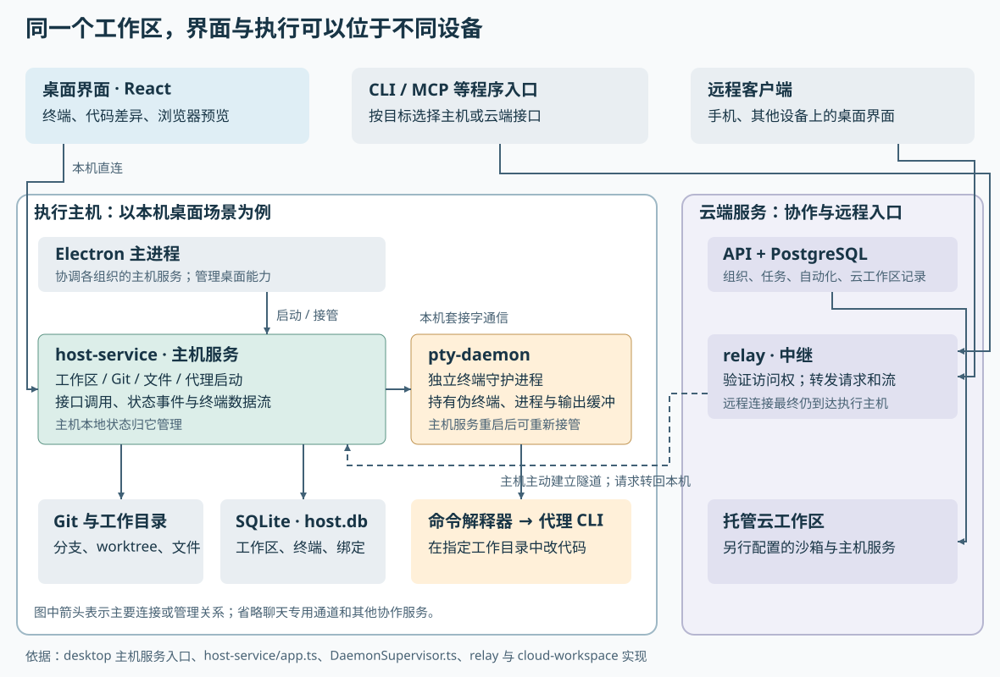
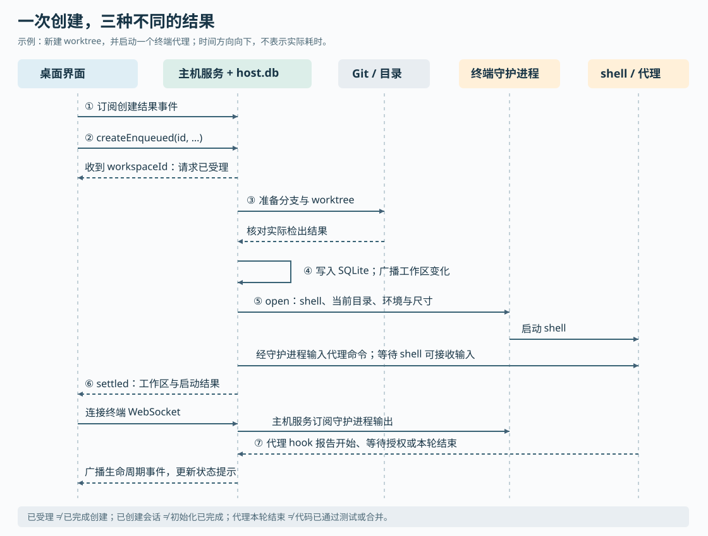

# Superset 如何把并行改代码变成可管理的工作区：从界面到 Git 与终端进程

假设你要同时修复登录错误、调整页面布局，还想让另一个代理检查测试。直接在一个目录里开三个终端，三个代理可能修改同一批文件、切换彼此正在使用的分支，最后也很难判断每份改动属于哪个任务。

Superset 给这些工作提供了各自的工作区：准备代码目录和分支，启动代理或普通命令，把终端、代码差异和浏览器预览放在一起，再把代理是否正在工作、是否需要处理显示出来。这里的“代理”指能够调用工具、修改代码的程序，例如通过命令行界面（CLI）运行的编码助手。Superset 管理它们的运行环境和交互入口；具体怎样理解需求、选择工具和生成代码，仍由所启动的代理实现。

理解这个项目的关键，是分清三件事：**文件放在哪里，进程由谁持有，状态由谁保存。** 本文沿“在本机创建一个独立工作区并启动终端代理”的真实代码路径，把这三件事串起来，再说明远程连接和云工作区怎样接入。

本次阅读依据执行器提供的 `input/repository/` 源码快照，版本为 `005a5f2198723990e62277e18428b32e249fd163`。历史研报为空，因此以建立整体认识为目标。下文链接用于定位源码，结论以本次快照为准；没有安装依赖、启动项目或运行仓库测试，测试部分仅说明实际读到的断言。

**先看工作区到底隔离了什么。** Git worktree 是 Git 为同一仓库建立额外检出目录的机制：多个目录共享仓库的对象和历史，各自拥有工作文件、索引以及检出的分支。前面的三个任务可以分别放入三个 worktree，避免直接争用同一份工作文件。它们最终仍需要合并，逻辑冲突也仍需处理。

但 Superset 的“工作区”不只一种。主机数据库和创建接口实际支持以下区别：

| 工作区类型 | 文件位置与用途 | 使用时要理解的边界 |
|---|---|---|
| `worktree` | 为项目使用独立检出目录，也能接管已有 worktree | 隔开工作文件；依然共享机器上的进程权限、端口和其他外部资源 |
| `local` | 直接使用项目原有检出目录 | 多个此类工作区共用文件、Git 索引和当前分支；创建不会替你切分支 |
| `session` | 没有项目关联的托管目录，初始化为独立 Git 仓库 | 适合临时会话；不具备项目仓库的原有上下文 |

这一区分来自 [`workspaces` 创建接口](https://github.com/superset-sh/superset/blob/main/packages/host-service/src/trpc/router/workspaces/workspaces.ts) 的 `checkout` 参数，以及 [`db/schema.ts`](https://github.com/superset-sh/superset/blob/main/packages/host-service/src/db/schema.ts) 中的项目、工作区和终端关系。因此，打算并行修改同一项目时，要确认使用的是独立 worktree。仅仅看到侧栏里有两个工作区，并不能证明文件已经分开。

**整个系统围绕执行主机组织。** 执行主机就是实际存放文件、运行 Git 和代理进程的那台机器。桌面界面可以连接本机，也可以操作另一台在线主机；托管云工作区则把执行环境交给云端配置。程序入口还包括 MCP（模型上下文协议，供代理接入工具）和 SDK（软件开发工具包）。

图中最值得注意的是 `host-service` 和 `pty-daemon` 分属不同进程。前者知道“哪个终端属于哪个工作区”，后者持有真实的终端进程。桌面窗口刷新、主机服务重启和命令解释器（shell）退出，因此可以分别处理。图中的 SQLite 是嵌入主机服务的数据库，PostgreSQL 则是云端使用的关系型数据库。

仓库采用单体仓库组织方式，即多个应用和共享包放在同一源码仓库中。主要职责可以这样对应：

| 源码位置 | 在系统中承担的工作 |
|---|---|
| `apps/desktop` | Electron 桌面程序；主进程协调本机服务，React 界面呈现工作区、终端和审阅入口 |
| `packages/host-service` | 主机上的执行服务；管理项目、工作区、Git、文件、代理启动、终端接入和状态事件 |
| `packages/pty-daemon` | 独立持有伪终端和 shell，处理输入、输出、尺寸变化、重新订阅与进程关闭 |
| `packages/workspace-client`、`packages/host-client` | 为不同客户端提供主机调用和流连接能力；前者包含 React 查询集成，后者提供不依赖界面框架的传输层 |
| `apps/api`、`packages/trpc`、`packages/db` | 云端业务接口及 PostgreSQL 数据；承载组织、任务、自动化、集成和云工作区等记录 |
| `apps/relay` | 中继服务；验证远程访问权，把请求和持续连接送到目标主机 |
| `packages/agent-setup`、`packages/chat*` | 前者准备代理包装命令与通知钩子；后者提供结构化聊天协议、界面和运行时 |
| `packages/cli`、`packages/mcp`、`packages/sdk`、`apps/mobile` | 命令行、代理工具协议、编程接口和移动端等入口；具体支持范围需看各自实现 |

这里的 tRPC 是一套让 TypeScript 客户端按函数式接口调用服务端过程的工具。这个仓库有两套需要分辨的主入口：主机服务在 `/trpc/*` 暴露 Git、工作区和终端等操作，云 API（应用编程接口）在 `/api/trpc` 暴露组织与协作业务。它们都使用 tRPC，并不意味着请求落在同一服务或同一数据库。

主机入口 [`createApp`](https://github.com/superset-sh/superset/blob/main/packages/host-service/src/app.ts) 把数据库、Git 凭据、文件管理器、Git 监视器、事件总线和路由接起来，并使用 Hono 提供 HTTP 与 WebSocket 服务。WebSocket 是可持续双向传输数据的连接，在这里分别承担终端流和状态事件。桌面版的[启动入口](https://github.com/superset-sh/superset/blob/main/apps/desktop/src/main/host-service/index.ts) 则注入本地凭据实现、组织编号、数据库路径和主机访问密钥，监听本机回环地址。

这也解释了为什么项目不能只按“桌面前端加一个后端”来理解：桌面主进程负责桌面能力和服务协调，主机服务执行工作区业务，终端守护进程维持 shell；云 API 又有自己的业务职责。构建时使用 Bun，也不能据此推断所有组件都由 Bun 运行。主机服务与终端守护进程的桌面生产路径使用 Node 运行，终端底层依赖 `node-pty` 创建系统伪终端。

**现在沿一次真实创建操作向下走。** 假设项目已导入，用户选择本机、新 worktree、一个终端代理，并输入“修复登录后跳转错误”。以下是路径说明，不是本次运行实验。

第一步，界面收集运行意图，并先建立接收结果的通道。创建表单的 `useSubmitWorkspace` 区分本机、远程主机和云工作区；本机路径把项目、分支、代理、提示词及模型等选择交给 `useWorkspaceCreates`。后者先在客户端缓存中放入待创建条目，让界面立即出现工作区，再由 `createViaEnqueue` 订阅 `workspace:create-settled` 事件，最后调用 `workspaces.createEnqueued`。

“先订阅，再提交”有实际用途：如果创建很快完成，结果事件也不会因为订阅晚了一步而被漏掉。`createEnqueued` 进行必要的快速检查，立即返回客户端生成的工作区编号；完整的 Git 操作和代理启动在主机服务进程内继续运行。实现注释明确指出，这样安排是为了避免长请求占住浏览器连接，也避免经过中继时超出请求时限。[界面实现见 `useWorkspaceCreates.ts`](https://github.com/superset-sh/superset/blob/main/apps/desktop/src/renderer/stores/workspace-creates/useWorkspaceCreates.ts)。

这里的“入队”需要准确理解：本条路径实际使用进程内异步调用，并没有在这一步写入一个能够跨进程恢复的持久任务队列。因此，收到工作区编号只能说明请求已受理，不能说明整个创建过程已经完成。

第二步，主机服务决定使用哪个分支、哪个目录。真正的实现是 `workspacesRouter.create`，通过服务端调用器被入队接口复用，而不是另写一套创建逻辑。它先验证代理选项和项目目录，再根据输入判断：打开已登记工作区、接管已有 worktree，还是创建新的检出目录。

普通新分支路径会解析起点、处理分支前缀与重名，然后进入 `addBranchWorktree`。对新分支，它组合 `git worktree add --no-track -b …` 所需参数；对已有分支或远程跟踪分支，采用不同参数，保证检出到正确的本地分支。若项目配置了稀疏检出，即只取出仓库指定部分目录，也在这条公共路径中处理。

它还考虑了“检查后状态又变了”的情况：如果预检查时分支尚未占用，实际添加时却被别的 worktree 占用，代码会重新读取 Git 的 worktree 列表，尝试接管真实路径。调用方提供同一个工作区编号重试时，服务端也会检查已有记录；匹配的已完成创建会返回已有工作区，避免再次启动同一批代理。锁的实现位于当前进程内，因此不能把这些保护扩展理解为任意跨进程操作都具有全局事务保证。[核心实现见 `workspaces.ts`](https://github.com/superset-sh/superset/blob/main/packages/host-service/src/trpc/router/workspaces/workspaces.ts) 和 [`addBranchWorktree`](https://github.com/superset-sh/superset/blob/main/packages/host-service/src/trpc/router/workspace-creation/shared/add-branch-worktree.ts)。

第三步，服务端把已经准备好的目录登记为工作区。`registerLocalWorkspace` 调用 `insertLocalWorkspace`，将编号、项目、目录、分支、名称、任务关联和标签写入主机 SQLite 数据库。工作区与标签在数据库事务内一起提交，随后发出 `workspace:changed` 事件。客户端最初放入的临时显示记录，因此可以被真实记录替换。

这里有一个重要的归属判断：**本机或自有远程主机上的工作区，以主机数据库为准。** `workspace.list` 从本地表读取，创建中的云端 `trackCreated` 调用只做尽力上报，失败不会撤销本地工作区。`CloudShapedWorkspace` 这样的类型名称保留了旧接口的数据形状，不能据此推断现在仍由云端保存权威副本。附近部分注释仍有旧同步方案的措辞，需要以实际调用和存储代码为准。[存储实现见 `local-workspace-store.ts`](https://github.com/superset-sh/superset/blob/main/packages/host-service/src/workspaces/local-workspace-store.ts)。

SQLite 事务只能覆盖数据库操作，不能把磁盘上的 Git 目录一起纳入事务。如果写入工作区记录失败，`registerLocalWorkspace` 会调用补偿清理，尝试移除刚创建的 worktree；清理本身失败会记录警告。因此，这是一组带补偿的跨资源操作，不能承诺任何异常下都不留下目录或分支。

第四步，主机服务把代理选择变成可以执行的命令。`dispatchSugarAgents` 遍历创建请求携带的代理，调用 `runAgentInWorkspace`。本例选择终端入口，最终进入 `runTerminalAgent`：`buildTerminalAgentLaunch` 查找主机上的代理配置，校验模型、推理强度、运行模式和恢复参数，解析附件路径，再通过 `buildAgentCommandString` 组合命令。

这不是把提示词直接拼到 shell 字符串末尾：实现会清理终端控制输入，按参数进行引用，并根据代理配置选择命令行参数传递或标准输入传递。这个适配层让不同代理保留自己的命令习惯，也让自定义命令能够接入。其代价是模型、恢复会话和通知能力仍需逐类适配，不能因为某个命令能运行，就认为它拥有全部深度集成能力。[实现见 `agents.ts`](https://github.com/superset-sh/superset/blob/main/packages/host-service/src/trpc/router/agents/agents.ts)。

第五步，真正的进程交给终端守护进程。`createTerminalSessionInternal` 检查终端编号归属、结束状态和工作目录是否可用；它按终端编号串行协调生命周期操作，避免同一会话的创建与关闭相互穿插。随后准备 shell、当前目录及环境，其中包含工作区编号、终端编号和代理通知地址。

主机服务通过 Unix socket——同一机器上进程间通信的套接字——调用守护进程的 `open`。守护进程的 `handleOpen` 使用 `node-pty` 创建伪终端；伪终端为程序提供类似真实终端的交互环境，使交互式 shell 和代理可以正常工作。主机服务随后通过 `queueInitialCommand`，在 shell 能够接收输入的时机投递代理命令。

界面不必先打开，代理才开始工作。服务端可以先创建会话，面板稍后通过 `/terminal/:terminalId` 的 WebSocket 接入输出。桌面 `TerminalPane` 使用 xterm，也就是终端显示组件，呈现这些字节；键盘输入和窗口尺寸变化再沿连接返回。[主机终端实现见 `terminal.ts`](https://github.com/superset-sh/superset/blob/main/packages/host-service/src/terminal/terminal.ts)，[守护进程入口操作见 `handlers.ts`](https://github.com/superset-sh/superset/blob/main/packages/pty-daemon/src/handlers/handlers.ts)。

**初始化、启动和完成，是三个不同的时间点。** 创建接口还会查找工作区初始化命令。`startSetupTerminalIfPresent` 使用公共配置解析器，优先解析配置中的 setup 命令，再考虑 `.superset/setup.sh`；多个命令用 `&&` 串联，前一步失败就不执行后一步。

但普通路径不会等初始化脚本执行完才启动代理：没有启用等待条件时，代码先发起代理启动，再建立初始化终端，两者运行时间可以重叠。只有满足“新工作区、开启等待、恰好一个终端代理、实际解析出初始化命令”等条件时，才把它们组合为 `setup && agent`，放入同一个终端。多个代理并不会自动获得同样的等待保证。初始化终端创建失败通常作为警告处理，单个代理启动失败则作为 `agents` 数组中的失败结果返回，不会自动删除已经建好的工作区。[对应实现见 `setup-terminal.ts`](https://github.com/superset-sh/superset/blob/main/packages/host-service/src/trpc/router/workspace-creation/shared/setup-terminal.ts) 及创建接口末段。

因此，`workspace:create-settled` 表达的是创建调用已经得到结果，其中还可能包含代理启动失败；终端会话创建成功也不证明依赖已安装完毕，更不证明代理修复已通过测试。

**代理状态走另一条回路。** 终端输出适合人阅读，却不天然说明“现在正在工作”还是“等用户授权”。`agent-setup` 为受支持代理准备包装命令和 hook。这里的 hook 是在代理发生特定事件时执行的通知钩子；通知脚本向主机服务的 `notifications.hook` 提交终端编号和事件。

接收端先用终端记录找出所属工作区，再将各代理不同的事件名归一化。例如，`SessionStart` 映射到 `Attached`，表示代理已关联到终端；`UserPromptSubmit` 等活动映射到 `Start`；等待授权映射到 `PermissionRequest`；一轮结束映射到 `Stop`。`TerminalAgentStore` 更新终端与代理会话的绑定，随后由事件总线广播。子代理的事件另记名册，不会直接把父代理状态改为结束。

这解释了两个容易混淆的信号：`Attached` 不等于已经开始做事，`Stop` 也不等于业务任务完成。项目甚至把云端任务状态放在独立规则里：关联任务开始工作时，`task.start` 只把待办类状态向前推进到进行中，并用条件更新避免把已经完成的任务拉回去。不能从一个停止提示推断任务已验收。[事件映射](https://github.com/superset-sh/superset/blob/main/packages/host-service/src/events/map-event-type.ts)、[通知接收](https://github.com/superset-sh/superset/blob/main/packages/host-service/src/trpc/router/notifications/notifications.ts) 和[任务状态实现](https://github.com/superset-sh/superset/blob/main/packages/trpc/src/router/task/task.ts) 分别负责这些语义。

通知接收端还有一个明确的信任边界：`notifications.hook` 使用公开过程，不要求普通主机访问密钥；常规工作区操作则要求认证。代码会忽略未知终端和无效事件，并对账号归属、转录路径等字段另作校验。这意味着生命周期提示应作为运行状态参考，不能把它当作证明代码正确或业务操作已获授权的凭据。

**断线和失败时，代码优先查清发生了什么。** 这套架构没有把所有失败都归结为“重新启动一次”，几个处理方式尤其能说明设计思想。

Git 命令返回失败，不一定意味着检出没有完成。`post-checkout` 钩子在检出后执行，钩子失败时目录可能已建立。`addBranchWorktree` 会核对 worktree 是否登记在目标路径、分支是否匹配，以及目录内 `HEAD`（当前检出位置）能否解析，满足实际成功条件才继续。仓库的[钩子容错测试](https://github.com/superset-sh/superset/blob/main/packages/host-service/src/trpc/router/workspaces/worktree-add-tolerance.test.ts) 实际构造失败钩子，断言新分支和已有分支仍可成功检出；无效起点仍必须失败。这不是把所有 Git 错误忽略掉。

创建结果事件丢失，也不一定意味着创建失败。客户端等待超时后会探查对应工作区记录；若记录存在，接受已经建成的工作区，并让后续会话发现路径补齐终端显示。服务端的[入队集成测试](https://github.com/superset-sh/superset/blob/main/packages/host-service/test/integration/workspace-create-enqueued.integration.test.ts) 检查了先返回、后广播，已有分支返回规范工作区编号，以及异步失败广播 `ok:false`。但测试通过替换广播方法捕获结果，并不构成真实网络断线场景已经全部验证的证明。

主机服务重启，也不一定意味着 shell 已死。生产模式下 `DaemonSupervisor` 以脱离父进程的方式启动终端守护进程，并留下可供重新接管的信息。新的主机服务发现守护进程仍持有该终端时，会接管并订阅输出，而不重复执行初始命令。若守护进程暂时不可达，接入路径返回可重试失败；只有确认它已不持有会话，才走丢失会话的重建路径。**接回仍活着的 shell，与启动一个新 shell，是不同的恢复。** 新 shell 也不会自动拥有旧代理的对话，代理恢复还依赖会话编号及对应代理的恢复能力。[监督器](https://github.com/superset-sh/superset/blob/main/packages/host-service/src/daemon/DaemonSupervisor.ts) 与 `terminal.ts` 的接入逻辑给出了这一区分。

持久化的终端记录也不是完整终端历史。`host.db` 记录终端归属、状态和代理会话绑定；守护进程的 `SessionStore` 另用有容量上限的内存缓冲保留近期输出。缓冲可帮助重连，但不会因数据库还在，就跨机器重启保存完整输出。分离进程带来连续运行能力，同时增加了“数据库记录还活跃，真实进程已经消失”的对账工作。

关闭失败则要留下后续可处理的意图。终端表的 `disposeRequestedAt` 标记“已请求销毁”；如果当次杀进程失败，后台 reaper——周期清理器——仍会重试。更底层的 `TreeKiller` 会结合进程树和进程组发送信号、升级终止并检查残留。工作区删除也先记录归档意图，再执行检查、拆除脚本和资源清理；进程中途崩溃时，启动对账尝试继续收尾，捕获到阻塞失败时则撤销归档，让工作区重新可见。它们都在用持久意图弥补一次性调用不可靠的问题，而不是承诺清理绝不失败。[清理器](https://github.com/superset-sh/superset/blob/main/packages/host-service/src/terminal/reaper/reaper.ts) 和[工作区销毁实现](https://github.com/superset-sh/superset/blob/main/packages/host-service/src/trpc/router/workspace-cleanup/workspace-cleanup.ts) 是进一步核验入口。

**远程操作改变的是连接路径，云工作区还改变了创建方式。** 自有远程主机依然由自己的 `host-service` 执行 Git 和终端操作。主机启动后向云 API 注册，再主动连到 relay；客户端通过中继访问目标主机。当前中继实现位于 Cloudflare Worker，并用 Durable Object——平台提供的有状态服务对象——维护每个主机的连接与转发状态。入口检查令牌、组织和主机访问权；主机不在线时，中继并不能代替它执行代码。[主机连接实现](https://github.com/superset-sh/superset/blob/main/packages/host-service/src/tunnel/connect.ts) 和[中继入口](https://github.com/superset-sh/superset/blob/main/apps/relay/src/index.ts) 证明了这条连接关系。

托管云工作区则从另一条创建入口开始。界面调用 `cloudWorkspace.create`；`startCloudWorkspace` 先在 PostgreSQL 写入 `provisioning`，即“正在配置环境”的记录，再交给后台配置流程。`provisionCloudWorkspace` 准备沙箱，推动状态变为 `ready` 或 `failed`。沙箱内复用主机服务执行能力，但它不等同于在用户电脑上再创建一个 worktree。[云端启动](https://github.com/superset-sh/superset/blob/main/packages/trpc/src/router/cloud-workspace/start.ts) 和[配置流程](https://github.com/superset-sh/superset/blob/main/packages/trpc/src/router/cloud-workspace/provision.ts) 展示了这条边界。

因此，“工作区由主机本地数据库管理”必须限定为前面追踪的自有主机路径；托管云工作区还具有云端生命周期记录。同样，不能从项目有多个入口，就推断接口能力完全一致：本次快照中，MCP 的创建工具按是否提供 `hostId` 选择主机或云端，而 SDK 的 `Workspaces` 资源主要面向云工作区。自动化的 `dispatchAutomation` 则负责选择目标、必要时创建工作区并启动代理；其 `dispatched` 状态说明已经派发，不能直接解释为代理完成了代码任务。

项目也存在结构化聊天入口。`host-service/chat-v3/mount.ts` 注册聊天专用接口，按需建立聊天运行时和独立的 `chat.db`，适配代理的结构化交互。本文追踪的 shell、伪终端和通知钩子，是终端代理路径；不能把它套到所有聊天会话上。仓库中仍并存旧版工作区代码和迁移逻辑，阅读时应从当前界面的注册与调用点进入，避免把相似名称的旧实现拼进同一条链路。

**这些实现带来的取舍，可以落实到日常使用和系统设计。** 首先，借助已有 Git 仓库和代理命令行，Superset 能保留熟悉的开发工具，同时把不同任务放进不同目录。适合并行处理相对独立的改动；涉及共享数据库、固定端口或机器级资源的任务，还需要另外安排资源隔离。文件隔离本身并不提供容器式的进程约束。

其次，让工作区归执行主机管理，可以使本地主机在云端不可用时仍读取和处理自身已有工作区；云端协作、远程认证、模型服务和 Git 网络操作则各有可用性条件。它减少了本地操作对云端工作区登记的依赖，代价是客户端必须汇总不同主机的结果，离线主机也不能提供实时真相。[离线优先设计记录](https://github.com/superset-sh/superset/blob/main/plans/20260703-offline-first-workspace-table.md) 陈述了这一动机；本次读取的本地列表与写入实现支持其核心方向，但设计文档里的全部历史清单不应直接视为当前实现。

再次，把长操作受理、实际创建、终端运行和状态广播分开，可以让界面及时响应，也让会话先于面板存在。代价是“已受理但未建成”“已建成但事件丢失”“记录仍在但进程已死”等中间状态必须被明确处理。这个项目值得借鉴的部分，正是客户端探查、服务端幂等检查、生命周期标记和后台对账一起承担恢复，而不是只给按钮加一个重试。

对使用者，具体做法是为独立改动选择 worktree，检查初始化等待条件，分别观察创建错误、初始化日志和代理提示，最后以差异审阅和实际测试决定是否验收。对实现类似系统的人，值得先确定哪些记录属于执行主机、哪些属于云端，以及“命令已接收”“进程已启动”“本轮已结束”“任务已完成”分别如何证明，再设计跨组件消息。

云沙箱供应商调用、全部聊天适配器、自动化调度与重复派发保证，以及各操作系统下的真实进程行为，仍需要进一步跟踪和运行验证；本文没有对这些部分作端到端验证结论。
