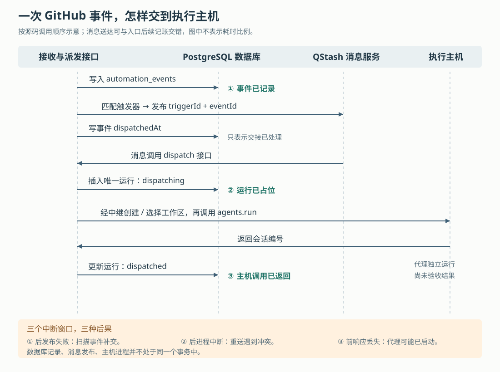

# Superset 自动化如何防止重复派发：从 GitHub 事件到代理启动的可靠性边界

假设你给团队仓库配置了一条自动化：“有人新建拉取请求，就让代理审阅改动。”拉取请求是 GitHub 上请求合并代码的记录，下文简称 PR。如果 GitHub 没收到及时回复，又把同一事件送来一次，会不会启动两个代理？如果执行电脑离线，这次审阅会不会等它上线后补做？如果代理已经启动，云端却没收到响应，运行历史又会显示什么？

Superset 把这些问题分段处理：先记录事件，再把匹配的执行请求交给消息服务，最后登记一次运行并请求主机启动代理。数据库中的唯一约束阻止相同运行重复进入启动流程；补交扫描负责修复“事件已记录，却没交给消息服务”的缺口。**但这套机制没有保证每个事件最终都执行，也没有把运行历史中的“已派发”当作代码任务完成。** 理解它的价值，在于知道何时可以等待自动恢复，何时必须检查真实工作区。

前篇已建立工作区、执行主机和终端进程的整体认识。本篇依据同一份 `input/repository/` 源码快照，深入自动化的事件入口、去重、重试和执行边界，重新核验相关实现。以下场景是解释代码的假设，没有实际配置 GitHub 集成、连接主机或运行仓库测试；链接用于定位文件，结论以本次本地快照为准。

**先把“发生了什么”和“为此做一次什么”分开。**

自动化不是一条收到消息就直接执行命令的回调。云端使用 PostgreSQL 关系型数据库，把它拆成四类记录：

| 记录 | 具体保存什么 | 在例子中的含义 |
|---|---|---|
| `automations` | 提示词、代理选择、目标主机或云环境、是否启用 | “审阅新 PR”这项长期配置 |
| `automation_triggers` | 事件种类和过滤条件；定时触发器另有下次执行时间 | “团队仓库出现普通新 PR” |
| `automation_events` | 外部事件编号、标题、原始内容及重新匹配所需输入 | GitHub 本次送来的 PR 事件 |
| `automation_runs` | 一次派发的原因、状态、工作区和会话编号、错误 | 因这个事件启动的一次审阅尝试 |

一个事件可以匹配多个触发器，各自产生一次运行。运行记录保存派发结果，代理真正审阅了什么则需要进入对应工作区查看。[表定义见 `packages/db/src/schema/schema.ts`](https://github.com/superset-sh/superset/blob/main/packages/db/src/schema/schema.ts)。

这个拆分直接决定了恢复方法：事件没交出去，可以重新匹配并补交；某次运行已登记但启动结果不确定，则不能简单视为“从未执行过”。

图中的 QStash 是项目使用的外部消息服务，负责接收执行请求，再调用派发接口。数据库、消息服务和执行主机分别完成自己的操作，并不共享一个能够全部提交或全部撤销的事务。

**正常路径：先把 GitHub 的通知变成可以判断的事件。**

真实入口是 `apps/api/src/app/api/github/webhook/route.ts` 的 `POST`。Webhook 指外部系统在事件发生时通过网络接口主动发送的通知。这个入口先验证 GitHub 签名，再解析和保存内容；通过安装记录找到组织。它还把投递记录写入独立的 `ingest.webhook_events`：已经处理完的投递直接返回，以前失败的投递允许重新进入处理。这里的接收记录与上表中的自动化事件是两层不同的数据，前者还服务于其他 GitHub 业务。[入口](https://github.com/superset-sh/superset/blob/main/apps/api/src/app/api/github/webhook/route.ts)与 [`recordWebhookDelivery`](https://github.com/superset-sh/superset/blob/main/apps/api/src/lib/ingest/recordWebhookDelivery.ts)可以相互核对。

接下来，`normalizeGithubDelivery` 把 GitHub 的内容整理成统一结构。它用投递编号作为 `externalEventId`，用仓库的数字编号识别仓库，并把事件名与动作组合起来。例如，接收到 `pull_request` 和 `opened` 后，得到 `pull_request.opened`；是否为草稿，还会影响产品层面匹配的事件名称。仓库改名不必改变数字编号，这是过滤条件能够跨改名继续工作的依据。[整理实现](https://github.com/superset-sh/superset/blob/main/apps/api/src/app/api/github/webhook/normalizeGithubDelivery.ts)及[事件名称映射](https://github.com/superset-sh/superset/blob/main/packages/shared/src/automation-matching/github.ts)展示了这一转换。

`ingestAutomationEvent` 随后调用 `recordAutomationEvent` 插入自动化事件。若唯一约束发现相同投递已经记录，它直接返回 `duplicate`，不再派发。对于有可匹配事件的记录，数据库还保存 `dispatchInput`，即重新判断触发条件所需的整理结果；这样补交时不必重新请求 GitHub，也不必重新运行该提供方的内容转换。[接收编排](https://github.com/superset-sh/superset/blob/main/apps/api/src/lib/automations/ingestAutomationEvent.ts)与[事件写入](https://github.com/superset-sh/superset/blob/main/apps/api/src/lib/automations/recordAutomationEvent.ts)给出了这条连接。

匹配工作由 `dispatchMatchingTriggers` 完成。它先按组织、提供方和自动化启用状态查询候选，再检查仓库、分支、标签和人员等条件。对按成员接入的服务，还会限制拥有者或连接编号，避免一个人的事件触发整个组织其他人的自动化。某些条件中的“我”，在这里按自动化拥有者当前连接的身份解析；它不是配置保存时永久写死的账号。

这些判断大多由不访问数据库的普通函数完成。比如 GitHub 的 `githubTriggerMatches` 只接收配置和整理好的事件，并返回是否匹配及拒绝原因。空的人员名单会拒绝匹配，只有明确选择 `any` 才表示不限人员。这让半填写的过滤条件倾向于不启动代理，也让规则能够单独测试。[候选与身份解析](https://github.com/superset-sh/superset/blob/main/apps/api/src/lib/automations/dispatchMatchingTriggers.ts)、[通用条件](https://github.com/superset-sh/superset/blob/main/packages/shared/src/automation-matching/core.ts)和 [GitHub 条件](https://github.com/superset-sh/superset/blob/main/packages/shared/src/automation-matching/github.ts)分别承担这些职责。

**第一次交接成功，只说明请求交给了消息服务。**

每个匹配项被交给 `qstash.batchJSON`，消息包含 `automationId`、`triggerId` 和 `eventId`，并设置由“触发器编号＋事件编号”组成的去重标识，以及 `retries: 2` 和投递失败回调地址。批量发布返回后，代码才给事件写入 `dispatchedAt`。

这个字段容易误读。它表示事件已经完成交接处理；如果没有触发器匹配，或者套餐规则拒绝触发，代码也会写入它。因此，`automation_events.dispatchedAt` 存在，既不证明启动过代理，也不证明产生了运行记录。[对应逻辑在 `dispatchMatchingTriggers`](https://github.com/superset-sh/superset/blob/main/apps/api/src/lib/automations/dispatchMatchingTriggers.ts)。

如果事件写入成功，但发布消息抛出异常，`ingestAutomationEvent` 会保留未标记的记录，返回 `dispatch_failed`。GitHub 接收入口仍可正常确认这次通知已处理。再次投递同一 GitHub 事件会被事件去重挡住，因而修复发布失败要靠另一条路径：自动化评估接口调用 `redispatchUndispatched`，扫描那些有 `dispatchInput`、没有 `dispatchedAt` 的事件，重新尝试匹配与发布。

扫描有明确边界：只看过去 24 小时内、已等待超过 60 秒的记录，每批最多 200 条，循环开始下一条前检查是否已耗时 60 秒。最后一个检查不会中断已经发出的网络请求，所以不能把它理解为严格的整批截止时间。单条失败会记日志，其他记录继续处理。[补交扫描实现](https://github.com/superset-sh/superset/blob/main/apps/api/src/lib/automations/redispatchUndispatched.ts)。

为避免多个扫描同时堆积，`singleFlight` 在 PostgreSQL 事务中尝试获取一个按任务名区分的咨询锁，也就是程序约定共同遵守的互斥锁；拿不到锁的调用直接跳过。事务结束时锁自动释放。扫描的网络发布并不在这笔数据库事务内，事务主要承担互斥。源码注释说明，连接长时间闲置在事务中会导致锁丢失，因此批次需要限制运行时间；本文没有复现注释描述的生产故障。[锁实现见 `singleFlight.ts`](https://github.com/superset-sh/superset/blob/main/apps/api/src/lib/singleFlight.ts)。

从实现可以推断，这是一种“先保存待交接意图，再补交”的设计，用较小成本覆盖常见的消息发布故障。代价是它有时效限制，而且补交会重新查询当前启用状态、过滤条件和账号身份。它重放的是事件输入，并没有冻结事件发生时的全部自动化配置。

**第二次交接：先占住一次运行，再请求主机。**

QStash 调用 `/api/automations/dispatch/[id]` 后，入口验证消息签名并读取自动化当前配置。如果配置已删除或暂停，它直接跳过。也就是说，已经入队的消息不会绕过后来的暂停操作；提示词等配置则以派发时读到的内容为准。[派发入口](https://github.com/superset-sh/superset/blob/main/apps/api/src/app/api/automations/dispatch/%5Bid%5D/route.ts)和[签名验证](https://github.com/superset-sh/superset/blob/main/apps/api/src/lib/verifyQstash.ts)负责这一步。

`dispatchAutomation` 随后选择目标。对自有主机，指定主机时只考虑它；未指定时从拥有者关联的主机中选择候选，并向中继查询实时连接状态。没有在线候选，会记录 `skipped_offline`。值得保留的不确定性是：查询连接状态失败也按离线处理，因此这个状态不能精确证明电脑关机。[目标选择见 `dispatch.ts`](https://github.com/superset-sh/superset/blob/main/packages/trpc/src/router/automation/dispatch.ts)，[状态查询见 `relay-presence.ts`](https://github.com/superset-sh/superset/blob/main/packages/trpc/src/lib/relay-presence.ts)。

选好主机后，内部函数 `dispatchRun` 首先插入一条 `dispatching` 运行，再执行远程动作。数据库以“触发器编号＋事件编号”建立唯一索引；如果插入冲突，函数返回 `conflict`，不再创建工作区或启动代理。这一步在启动之前，能挡住两个同时送达的相同运行请求。

真正的执行通过中继调用主机接口。云端签发带有运行编号、五分钟有效期的用户令牌；需要新工作区时先调用 `workspaces.create`，然后调用 `agents.run`。运行提示词前面还会附上结构化的触发信息，包括事件标题、链接、分支和经过长度限制的内容，所以“审阅这个 PR”能够带上“这个”究竟指什么。内容过长时会标记截断；这也意味着不能假设代理拿到了完整事件正文。[远程调用](https://github.com/superset-sh/superset/blob/main/packages/trpc/src/router/automation/relay-client.ts)与[提示词构造](https://github.com/superset-sh/superset/blob/main/packages/trpc/src/router/automation/triggerContext.ts)说明了传输和上下文准备。

在本例中，自动检出 PR 还需要额外确认：事件必须明确表示来源不是派生仓库，且自动化项目与事件指向同一个 GitHub 仓库，才把 PR 编号交给主机。PR 编号只在各自仓库内有意义，不能拿其他仓库的同号 PR 替代。主机明确回复错误时，这条路径可以改为创建普通新分支；网络超时则重新抛出，避免在“原工作区可能已经创建”的情况下立即创建另一份。这里对错误种类的检查比较宽，不能把它描述为只捕获 GitHub 登录错误。[检查与回退都在 `dispatch.ts`](https://github.com/superset-sh/superset/blob/main/packages/trpc/src/router/automation/dispatch.ts)。

主机的 `agents.run` 最终进入 `runAgentInWorkspace`。普通终端路径生成新终端编号，创建终端会话并安排初始命令，随后返回会话编号；支持结构化聊天且开启相应入口时，也可能转入聊天启动路径。云端拿到结果后，把工作区和会话编号写回运行，状态改为 `dispatched`。这条链路没有等待代理完成审阅或测试。[主机实现见 `agents.ts`](https://github.com/superset-sh/superset/blob/main/packages/host-service/src/trpc/router/agents/agents.ts)。

**去重究竟防住了什么，要看编号怎样生成。**

幂等指重复提交同一操作时，避免重复产生效果。Superset 没有一个覆盖所有入口的“同样内容只做一次”规则，而是在不同层使用不同身份：

| 层次 | 实际判重依据 | 使用边界 |
|---|---|---|
| 自动化事件记录 | 连接编号＋提供方＋外部事件编号；空连接也参与判重 | GitHub 同一投递编号可去重；同一 PR 的另一条新事件仍是新事件 |
| 事件触发的运行 | 触发器编号＋事件编号 | 两个触发器匹配同一事件，可以各执行一次 |
| 定时运行 | 自动化编号＋计划时间 | 评估器把计划时间归到分钟；同一自动化两条日程落在同一分钟，会竞争同一次运行 |
| 手动“立即运行” | 自动化编号＋调用时新生成的时间 | 不等于重试某条历史事件，也不是整项自动化的互斥锁 |

判重依据来自[数据库唯一索引](https://github.com/superset-sh/superset/blob/main/packages/db/src/schema/schema.ts)、`dispatch.ts` 的 `runDedupTarget`、[定时评估器](https://github.com/superset-sh/superset/blob/main/apps/api/src/app/api/automations/evaluate/route.ts)和 [`automation.runNow`](https://github.com/superset-sh/superset/blob/main/packages/trpc/src/router/automation/automation.ts)。这些约束依赖相应记录和关联编号仍然保留，不能理解为永久保存所有投递身份。

通用 Webhook 是尤其重要的例外。它的 `normalizeWebhookDelivery` 每次调用都生成随机事件编号，没有按请求体或调用方提供的幂等键去重。同样的 JSON（接口常用的结构化文本格式）内容发送两次，就是两个事件；每次还可能匹配这项自动化的多个 Webhook 触发器。这里下游唯一索引能挡住的是同一个内部事件的重复派发，无法认出上游其实重送了同一件事。[通用入口](https://github.com/superset-sh/superset/blob/main/apps/api/src/app/api/automations/webhook/%5BautomationId%5D/route.ts)及[编号生成](https://github.com/superset-sh/superset/blob/main/apps/api/src/app/api/automations/webhook/%5BautomationId%5D/normalizeWebhookDelivery.ts)明确支持这一结论。

因此，多个不同 PR、同一 PR 的不同事件，或不同时间的定时触发，仍可同时进入启动流程。本次追踪的派发实现没有按整项自动化建立“等上一轮完成才开始”的锁。即使数据库还保留 `resourceKey` 和相关索引，也不能仅凭字段存在就宣称当前路径已实现同一 PR 的事件合并；这里没有读到相应的判定和写入逻辑。

**失败与重试：消息重试和重新启动代理是两回事。**

最影响使用判断的，是下面几种情况：

| 发生的位置 | 当前代码怎样处理 | 可以期待什么 |
|---|---|---|
| 事件已写入，消息发布失败 | 保留空的事件 `dispatchedAt`，由扫描补交 | 在扫描窗口内还有恢复机会；不是无限期重试 |
| 尚未请求主机，已判断离线 | 写入 `skipped_offline`，派发接口正常回复 | 此次运行不会因为主机后来上线而自动补跑 |
| 启动调用抛出可捕获错误 | `dispatchRun` 写入 `dispatch_failed`，派发接口正常回复 | 已记录业务失败；配置的消息投递重试不等于再启动一次 |
| 派发服务抛出未处理异常或未正常响应 | 消息发布时配置了重试和失败回调 | 后续送达仍要经过数据库判重 |
| 插入 `dispatching` 后进程被终止 | 无法执行该进程中的 `catch`；相同运行重送时插入冲突 | 不能据此保证原执行会继续，或自动重新启动 |

前几种结果可从[接收编排](https://github.com/superset-sh/superset/blob/main/apps/api/src/lib/automations/ingestAutomationEvent.ts)、[运行编排](https://github.com/superset-sh/superset/blob/main/packages/trpc/src/router/automation/dispatch.ts)和[派发接口的正常响应](https://github.com/superset-sh/superset/blob/main/apps/api/src/app/api/automations/dispatch/%5Bid%5D/route.ts)直接核对。最后一种是依据操作顺序作出的故障推演，本次没有杀进程实验。

代码在 `dispatchRun` 上方写着“总会收束运行，避免停在 `dispatching`”。这个意图对进入 `try/catch` 后能够正常完成记账的情况成立，却不能覆盖进程突然消失、数据库持续不可写等情形。旧[自动化设计文档](https://github.com/superset-sh/superset/blob/main/plans/20260417-automations.md)曾提出把超过十分钟的 `dispatching` 标记失败；本次检索运行状态写入点，没有找到对应的过期回收实现。事件补交扫描也不扫描这张运行表。

这说明先登记运行的取舍：相同运行被占住后，后续请求倾向于停止，而不是冒险重复执行。它减少重复启动，却可能留下未启动或结果不明的运行。该结论限定于本文核验的调用链，不能延伸成整个系统在所有故障下的数学保证。

结果不明还可能发生在主机已经执行动作之后。比如主机已创建工作区，响应却丢失；或者 `agents.run` 已启动会话，调用方超时。云端通常只能按所收到的错误记录派发失败。若工作区创建结果从未返回，运行记录甚至可能没有工作区编号。`agents.run` 的业务输入也没有使用自动化运行编号作为主机端启动去重键，所以云端判重与主机动作之间并非一笔原子操作。**看到失败后，应先检查真实工作区和进程，再决定是否另开一次运行。**

消息服务耗尽投递重试时，还有 `/api/automations/run-failed`。它根据消息中的原始原因插入或更新失败记录，并发送错误监测信息；它不会停止主机代理。其冲突更新也没有先检查现有运行状态，所以这是按投递结果记账的路径，不能充当真实进程状态的最终裁决。[失败回调实现](https://github.com/superset-sh/superset/blob/main/apps/api/src/app/api/automations/run-failed/route.ts)。

**定时与续接会话，增加的是触发方式和上下文，不是完成保证。**

定时触发器保存重复规则、起点、时区和 `nextRunAt`。评估接口读取已到期且启用的条目，先计算下一次时间，再发布本次消息，发布返回后才推进 `nextRunAt`。这样，发布失败不会先把日程推进而丢掉此次机会；推进数据库失败时，下次评估仍可能重新发布同一个计划时间，交给消息标识和运行唯一索引去重。

这里推进的是日程，不等待执行主机或代理的业务结果。下一次时间从旧的 `nextRunAt` 向后计算，每次评估对每条触发器只推进一次；不能据此宣称评估中断后会一次补齐所有遗漏，也不能宣称一定直接跳到未来。无效规则会记录错误并停留待修复；套餐不允许时则不发布而继续推进。[评估器](https://github.com/superset-sh/superset/blob/main/apps/api/src/app/api/automations/evaluate/route.ts)与 [`nextOccurrenceAfter`](https://github.com/superset-sh/superset/blob/main/packages/shared/src/rrule.ts)给出了这些行为。实际部署中的周期任务配置未在本次阅读中确认。

如果选择固定工作区，并启用 `continueAgentSession`，云端会找这项自动化自己上一次已派发运行留下的终端，交给主机作为续接候选。这一选择避免随意挑中工作区内用户自己开的会话。主机仍会核对工作区、代理身份和活跃绑定，候选不可用就启动新会话。[候选查询见 `previousRunTerminal`](https://github.com/superset-sh/superset/blob/main/packages/trpc/src/router/automation/run.ts)，[最终判断见 `continuationTarget`](https://github.com/superset-sh/superset/blob/main/packages/host-service/src/trpc/router/agents/agents.ts)。

终端续接还会串行写入一条提示词及其提交按键，避免两次输入交错。不过，这只保证输入过程排好顺序，不会等待上一轮审阅完成。续接也会保留旧对话上下文，因此新一轮的行为可能不同于干净启动。[输入串行实现见 `writeSessionMessage`](https://github.com/superset-sh/superset/blob/main/packages/host-service/src/terminal/terminal.ts)。

托管云工作区还要进一步收紧“已派发”的解释：新建环境时，`runInCloud` 调用 `startCloudWorkspace`，等待工作区以 `provisioning` 状态登记并把配置环境和首次启动交给后台任务后，就可以返回；自动化运行随之写成 `dispatched`，会话编号可以为空。因此，云端这一路连“代理进程已经起来”也不能仅靠运行状态证明。[云派发](https://github.com/superset-sh/superset/blob/main/packages/trpc/src/router/automation/cloudDispatch.ts)及[云工作区启动](https://github.com/superset-sh/superset/blob/main/packages/trpc/src/router/cloud-workspace/start.ts)对此有直接实现。

**测试证据支持局部规则，端到端保证仍需另验。**

本次实际阅读了三组相关断言：GitHub 匹配测试检查事件种类、人员身份以及空名单拒绝匹配；提示词测试检查截断时保留用户指令，并明确超长指令本身仍交由调用方拒绝；主机代理测试检查续接候选的活跃绑定、工作区和代理身份等条件。[匹配测试](https://github.com/superset-sh/superset/blob/main/packages/shared/src/automation-matching/github.test.ts)、[提示词测试](https://github.com/superset-sh/superset/blob/main/packages/trpc/src/router/automation/triggerContext.test.ts)、[主机代理测试](https://github.com/superset-sh/superset/blob/main/packages/host-service/src/trpc/router/agents/agents.test.ts)均可定位到具体断言。

这些测试不能证明真实消息服务重送、数据库并发占位、派发服务中途退出和远程代理启动共同构成的链路已经验证。本次没有运行测试，也没有验证 QStash 服务端去重有效期、线上任务调度配置或真实故障恢复；文中的相应边界来自源码顺序和错误分支分析。

对使用者，这套自动化适合把 PR 通知、定时检查等事件送入可审阅的开发工作区。需要留意三件具体事情：通用 Webhook 重送会创建新事件；离线跳过不会等主机上线后补跑；“已派发”之后仍需查看工作区、代理输出和实际测试。当前运行历史还只允许拥有者对符合条件的失败定时运行发起“再运行”，因为 `runNow` 会生成新的时间原因，无法保留历史事件中的 PR 或消息上下文；它并不是完整的事件重试接口。[这一限制写在 `listOrgRuns` 的 `canRetry` 计算中](https://github.com/superset-sh/superset/blob/main/packages/trpc/src/router/automation/automation.ts)。

对实现类似系统的人，最值得借鉴的是给每次交接留下可查询的记录，并明确判重身份。若目标还包括“进程崩溃后继续推进，且远程副作用不重复”，则需要在运行占位、主机执行确认和过期恢复之间增加协议，并让重试保留原始触发原因；本文追踪的实现尚未把这些环节连成完整保证。自动化的运行记录由此更适合回答“这次派发走到了哪里”，任务是否完成，仍要由任务本身的结果来证明。
