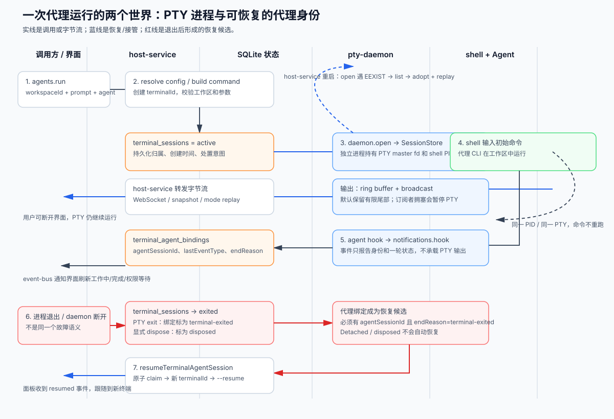

# Superset 怎样让代理终端在断线、重启和退出后仍可管理

假设你在一个工作区启动 Claude Code，输入“修复登录页并运行测试”，随后关闭 Superset 窗口。几分钟后重新打开，最需要知道的不是界面是否还显示一个标签，而是三个问题：代理进程还在不在，终端输出能不能接回来，代理自己的会话能不能继续。Superset 把这三件事交给不同的状态源处理：独立的 `pty-daemon` 持有真实伪终端（PTY，给命令行程序提供交互式输入输出的内核对象），host-service 负责连接和界面转发，数据库保存终端归属与代理会话的恢复信息。

这带来一个清晰但容易误读的结果：**“终端还活着”“代理还绑定在终端上”“云端或界面已经收到结果”不是同一个事实。** 理解它们的分工，才能判断一次断线是可接管、可恢复，还是只能重新启动。下图把一次启动、输出、退出和恢复放在同一条链路上。

本文依据执行器提供的 Superset 源码快照 `5e5e3072d45d7d208911ead7a519732ae29bfcd8`。前两篇研报已经解释工作区/Git worktree 隔离，以及自动化事件如何去重派发；本篇只追踪代理终端启动后的生命周期。没有启动完整应用或运行仓库测试，测试部分只说明源码中读到的断言。

**先看一次普通启动实际做了什么。** [`packages/host-service/src/trpc/router/agents/agents.ts`](https://github.com/superset-sh/superset/blob/5e5e3072d45d7d208911ead7a519732ae29bfcd8/packages/host-service/src/trpc/router/agents/agents.ts) 的 `agents.run` 最终进入 `runAgentInWorkspace`。它先确认工作区没有被归档，然后解析主机上的代理配置，校验模型、推理强度、模式、恢复或分叉参数，构造要输入 shell 的命令。`runTerminalAgent` 为这次启动生成新的 `terminalId`，调用 `createTerminalSessionInternal`，而不是直接执行一个子进程。

`createTerminalSessionInternal` 位于 [`packages/host-service/src/terminal/terminal.ts`](https://github.com/superset-sh/superset/blob/5e5e3072d45d7d208911ead7a519732ae29bfcd8/packages/host-service/src/terminal/terminal.ts)。它先用 `TerminalLifecycleOperations` 按终端编号串行化创建、接管和销毁，避免两个并发请求同时打开同一终端；随后检查工作区目录、等待启动时解析好的 shell 环境，并通过 `DaemonClient.open` 请求 `pty-daemon` 创建 shell。数据库插入或更新 `terminal_sessions` 行，把状态设为 `active`，记录工作区、创建时间和可选的用户自定义标题。这个数据库行描述的是“这台 host 认为应该存在的终端”，并不等于它本身拥有进程。

真正持有进程的是 `pty-daemon`。它的 `SessionStore` 是 daemon 内存中的 `Map`，每个条目包含 PTY、shell PID、窗口尺寸、退出状态，以及默认约 64 KiB 的输出环形缓冲区；这个缓冲区只保留最近一段字节，源码明确写着它不会持久化。[`packages/pty-daemon/src/SessionStore/SessionStore.ts`](https://github.com/superset-sh/superset/blob/5e5e3072d45d7d208911ead7a519732ae29bfcd8/packages/pty-daemon/src/SessionStore/SessionStore.ts) 和 [`handlers.ts`](https://github.com/superset-sh/superset/blob/5e5e3072d45d7d208911ead7a519732ae29bfcd8/packages/pty-daemon/src/handlers/handlers.ts) 说明了这一边界：`open` 只接受仍存活的同编号会话，`subscribe(replay: true)` 先发缓冲输出，再加入实时广播。

启动命令不会在数据库提交后直接 `exec`。host-service 订阅 daemon 的输出流，把初始命令输入 PTY；如果 shell 支持 OSC 133 的就绪标记，它会等 shell 到达可输入状态。命令过长时先写入临时脚本，只向终端输入一条短的 `source` 命令，避免内核规范模式的单行上限截断命令。没有就绪标记的 shell 会等待输出静默并做回显检查；这些都是为了降低“命令已经写入，但被 shell 启动脚本吞掉”的风险。它们解决的是输入时序，不是代理本身的可靠执行保证。

代理身份走另一条通道。host-service 在 [`env.ts`](https://github.com/superset-sh/superset/blob/5e5e3072d45d7d208911ead7a519732ae29bfcd8/packages/host-service/src/terminal/env.ts) 给 PTY 环境注入 `SUPERSET_TERMINAL_ID`、`SUPERSET_WORKSPACE_ID` 和 `SUPERSET_HOST_AGENT_HOOK_URL`。代理包装器或 hook（代理在会话开始、开始一轮工作、停止或退出时调用的小脚本）把事件 POST 到 [`notifications.hook`](https://github.com/superset-sh/superset/blob/5e5e3072d45d7d208911ead7a519732ae29bfcd8/packages/host-service/src/trpc/router/notifications/notifications.ts)。该路由先按 `terminalId` 查工作区，再把不同代理的事件名映射为统一的 `Attached`、`Start`、`Stop`、`PermissionRequest`、`Failed`、`Detached` 等类型，写入 `TerminalAgentStore`，并通过 event bus 广播给界面。它不传输 PTY 字节，也不等待代理完成任务。

因此，界面的“工作中”图标来自代理 hook，而终端的输出来自 PTY。两者可能短暂不一致：代理已经在屏幕上输出，但 hook 还未到达；或者最后一个 `Stop` hook 丢失，绑定仍显示工作中。源码为后者提供了 `clearWorkspaceStatuses` 这样的人工清理入口，并让后续 hook重新校正状态。这个设计把“代理语义”与“进程 I/O”分开，代价是任何一侧都不能单独作为最终真相。

**host-service 重启时，为什么不会重新启动一个代理。** daemon 与 host-service 是两个进程。host-service 重启只会清空自己的 `sessions` 内存 Map；daemon 仍可持有 PTY 和 shell。新 host-service 调用 `open` 时，如果 daemon 返回“session already exists”，就改为 `list` 找到同一个存活会话，再以 `adoptOnly` 路径接管。接管会重新订阅输出并等待 replay-complete；daemon 的环形缓冲区重放给 host-service，后者还用模式快照重建 headless xterm 的状态，例如括号粘贴、焦点或鼠标模式。

这条路径有两个刻意的保护。第一，接管后的 `initialCommandQueued` 被设为真，所以“启动代理”的命令不会再次输入；源码中的端到端测试专门检查了 host-service 重启后 setup 命令不会重复执行。第二，接管沿用数据库中的工作区归属；如果终端行属于另一个工作区，`getTerminalWorkspaceMismatchError` 会拒绝接管。这里的恢复是“重新连接同一个进程”，不是“从代理会话存储重新启动”。

输出流还必须处理慢客户端。[`pty-daemon/src/Server/Server.ts`](https://github.com/superset-sh/superset/blob/5e5e3072d45d7d208911ead7a519732ae29bfcd8/packages/pty-daemon/src/Server/Server.ts) 在向订阅 socket 写数据后检查 `writableLength`；超过阈值就暂停 PTY 读取，内核缓冲区填满后让前台程序自然阻塞。连接在约定时间内不排空，daemon 会断开这个订阅者并恢复其他订阅者。这样一个卡住的手机或浏览器页不会永久冻结同一终端的所有观察者。代价是被断开的观察者需要重新 attach；它最多能从有限 ring buffer 或 host-service 的 seq catch-up 机制拿回可保留的尾部，超出保留范围的字节无法凭空补回，只能依靠程序重绘。

**进程退出时，谁把状态收束。** 正常 PTY 退出由 `pty-daemon` 的 `Pty` 适配器报告。对新建 PTY，`NodePtyAdapter` 监听 node-pty 的 `onExit`；对 daemon 升级后接管的 PTY，`AdoptedPty` 同时监听 master fd 的 EOF/EIO 和 PID 存活轮询。daemon 收到退出后向订阅者发 `exit`，删除自己的 SessionStore 条目。删除动作很快，所以在一个狭窄窗口内才接入的订阅者可能收到 `ENOENT`，而不是完整的退出尾注；这是源码明确承认的取舍。

host-service 的订阅回调随后把内存会话标为 `exited`，更新 `terminal_sessions.status` 和 `endedAt`，注销端口扫描，并调用 `markTerminalAgentBindingEnded(..., "terminal-exited")`。此时代理绑定不会被删除，`agentSessionId` 会被保留下来，供恢复使用。相反，用户主动关闭面板走 `disposeSessionAndWait`：它先把 `disposeRequestedAt` 写进数据库并把绑定标成 `disposed`，再请求 daemon 发送 `SIGHUP`，取消 host-service 的 daemon 订阅，最后把行写成 `disposed`。因为主动处置会取消 `onExit` 订阅，代码会自行广播一次终端退出事件。这个顺序确保“用户明确杀掉的会话”不会在稍后被自动恢复。

杀进程也不是只给 shell 发一个信号。[`packages/pty-daemon/src/Pty/Pty.ts`](https://github.com/superset-sh/superset/blob/5e5e3072d45d7d208911ead7a519732ae29bfcd8/packages/pty-daemon/src/Pty/Pty.ts) 的 `TreeKiller` 记录控制终端、进程组和曾经见过的进程组，先按进程树/进程组/控制终端发送信号，随后延迟一秒发 `SIGKILL`，再用多轮 `ps` 快照检查新产生的后代。[`process-tree.ts`](https://github.com/superset-sh/superset/blob/5e5e3072d45d7d208911ead7a519732ae29bfcd8/packages/pty-daemon/src/process-tree.ts) 会保护调用方及其祖先进程组，避免一次清理误杀 host-service 自己的 shell。这个实现说明 Superset 把“终端关闭”当成一棵可能脱离父子关系的进程树来处理；它不是跨平台、数学上绝对无泄漏的保证，`ps` 读取失败时源码会把幸存者状态视为未知并继续尝试。

**代理会话怎样从死亡终端迁移到新终端。** [`terminal_agent_bindings` 的表定义](https://github.com/superset-sh/superset/blob/5e5e3072d45d7d208911ead7a519732ae29bfcd8/packages/host-service/src/db/schema.ts) 中的 `endReason` 是恢复策略的关键：

| 结束原因 | 代表什么 | 是否自动恢复 |
| --- | --- | --- |
| `detached` | 代理自己发出 SessionEnd 或包装器退出报告 | 否，视为主动结束 |
| `terminal-exited` | PTY、shell 或 daemon 在代理仍绑定时死亡 | 是，前提是有 `agentSessionId` 且代理配置支持恢复 |
| `resumed` | 候选已经被某次恢复消费 | 否，避免同一会话重复迁移 |
| `disposed` | 用户或清理逻辑明确杀掉终端 | 否，尊重用户的结束意图 |

[`resumeTerminalAgentSession`](https://github.com/superset-sh/superset/blob/5e5e3072d45d7d208911ead7a519732ae29bfcd8/packages/host-service/src/trpc/router/terminal-agents/terminal-agents.ts) 先用带完整候选条件的数据库 `UPDATE ... RETURNING` 把 `endReason` 从 `terminal-exited` 原子改成 `resumed`。因此两个窗口同时请求恢复时只有一个能 claim 成功；进程内的 `resumeInflight` Map 还会让同一 host-service 中的重复调用共享同一个 Promise。随后它调用 `runAgentInWorkspace` 创建新终端，并传入 `resumeSessionId`。启动成功后，旧绑定记录 `resumedIntoTerminalId`，旧终端被处置，event bus 发出 `resumed`，面板可以把仍指向旧终端的窗格跟随到新终端。

有一个细节避免了“恢复一个从未真正保存过的对话”。如果绑定最后只收到 `Attached`，恢复代码会检查代理自己的会话存储；明确查到没有会话时，它以空提示词启动一个新代理，而不是传入一个必然不存在的 `--resume` 编号。读取失败或无法确定时则保守地继续恢复，避免因为暂时不可读而丢掉历史。这个行为是源码注释和 `hasHarnessSession` 调用共同支持的设计解释，未在本次环境中实测供应商 CLI。

**daemon 断线与进程死亡必须分开判断。** host-service 收到 `DaemonClient` 的连接断开后，会关闭所有终端 WebSocket，促使界面重连；它不会立刻把代理绑定标为结束。`sweepAgentBindingsAfterDaemonLoss` 最多等待多轮探测，先询问新 daemon 是否仍拥有这些终端：如果会话仍在，说明可能是升级交接或短暂 socket 故障，绑定保持活动；只有确认会话消失，才把绑定标为 `terminal-exited`。如果多次探测都没有 daemon，才把旧 daemon 连同其 PTY 一起视为死亡。

更慢的兜底由 [`terminal/reaper/reaper.ts`](https://github.com/superset-sh/superset/blob/5e5e3072d45d7d208911ead7a519732ae29bfcd8/packages/host-service/src/terminal/reaper/reaper.ts) 完成。它比较 daemon 的存活列表和数据库中的 `active` 行，对刚创建的行保留一段宽限时间，并要求缺失观察至少持续两次；确认是 daemon 丢失后，普通缺失行转为可恢复的 `terminal-exited`，带 `disposeRequestedAt` 的行则转为 `disposed`。这解释了为什么“界面暂时看不到终端”不应立即被当作代理已经结束：主机服务的内存、daemon 的进程表和数据库行可能正处于重连窗口。

从这些实现可以得到几个实际边界。第一，host-service 重启只要 daemon 仍活着，恢复的是同一个 shell/代理进程，ring buffer 只能提供有限的输出回放；它没有把全部终端滚动历史写入数据库。第二，代理绑定的 `agentSessionId` 来自 hook，若代理没有上报会话编号，终端即使意外死亡也没有可用的自动恢复目标。第三，`terminal-exited` 说明“终端侧死亡”，不说明代理最后一轮是否成功；这需要结合 `lastEventType`、终端输出和代理自己的 transcript 判断。第四，数据库 claim、daemon 创建 PTY、代理 CLI 接受 `--resume` 是多个操作，没有一笔跨进程事务；创建成功但响应丢失、或恢复后清理旧终端失败，都可能留下需要 reaper 或人工检查的中间状态。

这些结论中，进程所有权、订阅顺序、数据库字段和恢复条件是直接读到的源码事实；“某个网络断线窗口会出现哪一种界面瞬态”是根据调用顺序作出的推断；本次没有实际杀 daemon、断 socket 或运行供应商代理来验证时序。对使用者而言，最可靠的检查顺序是先看 daemon 是否仍列出同一 `terminalId`，再看 `terminal_sessions` 是否为 `active`，最后看 `terminal_agent_bindings` 的 `agentSessionId` 和 `endReason`。只有这三层都指向同一会话，才可以把“代理仍在继续工作”当作已确认事实。
