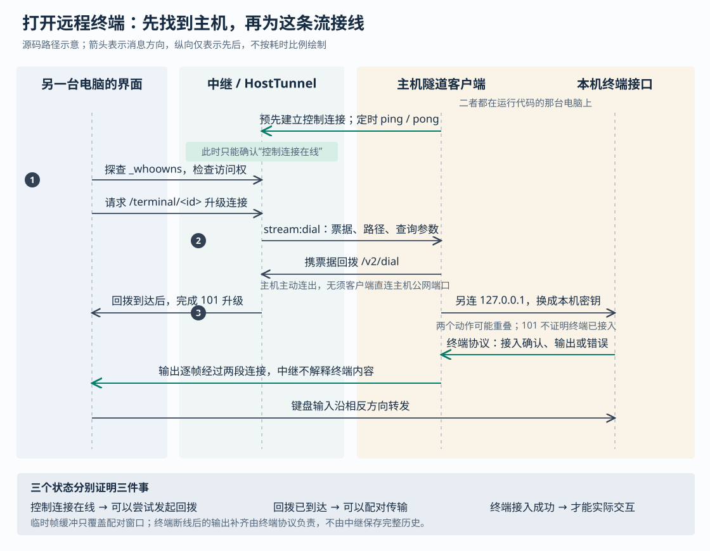

# Superset 怎样接通远程终端：主机回拨、在线判断与重试边界

假设家里的电脑正在运行编码代理——能够读代码、运行命令并修改文件的程序。你在另一台电脑上打开 Superset，想查看输出，再输入一句“先运行测试”。家里的电脑可能没有可供外部直接访问的地址；即使界面上的在线指示亮着，也不能证明终端已经能够交互。

Superset 的办法是让运行代码的电脑主动连接中继服务。真正打开终端时，中继再通知这台电脑为该终端建立一条新连接，把两端接起来。**控制连接在线、终端传输接通、终端接入成功，是逐层成立的三个事实。** 这个区别既解释了远程访问怎样工作，也决定了失败时应该等待重连、检查权限，还是先确认原操作是否已经执行。

前三篇研报已讨论工作区隔离、自动化派发和终端进程恢复。本篇依据执行器提供的当前源码快照 `efa5c3acca432754f221b8b031a18e5ad79f9aa4`，只追踪自有主机的远程连接与请求交接；示例是假设场景。没有启动项目、连接真实远程主机或运行仓库测试，文中的测试结论均指已阅读的断言。

**先让主机能够被找到，再为每条终端流接线。**

运行代码的电脑上，`host-service` 负责处理工作区、文件和终端请求。它的 `connectRelay` 先调用云端 `host.ensure` 登记主机，再向 `host.relayEndpoint` 查询应使用的中继地址，最后启动 `TunnelClient`。登记失败会退避重试：首次等待 30 秒，逐步增加，最多每隔五分钟再试；关闭信号可以中止等待。查中继地址失败则使用传入的备用地址。[入口见 `connect.ts`](https://github.com/superset-sh/superset/blob/efa5c3acca432754f221b8b031a18e5ad79f9aa4/packages/host-service/src/tunnel/connect.ts)。

因此，“本机服务已经启动”与“远程能够找到这台电脑”之间还有登记、地址解析和隧道连接几个步骤。`connectRelay` 返回隧道对象时，也没有等待控制连接真正打开。

同一台电脑可以属于不同组织，所以中继用“组织编号＋机器编号”组成路由键，而不是仅用机器编号。`TunnelClient.connect` 主动连接中继的 `/v2/control`，并携带用户凭据。这里的 WebSocket 是能够持续双向传输消息的网络连接；控制连接只负责保活，以及接收“请为这个请求连接回来”的指令。[路由键定义](https://github.com/superset-sh/superset/blob/efa5c3acca432754f221b8b031a18e5ad79f9aa4/packages/shared/src/host-routing.ts)和[主机隧道客户端](https://github.com/superset-sh/superset/blob/efa5c3acca432754f221b8b031a18e5ad79f9aa4/packages/host-service/src/tunnel/tunnel-client.ts)明确连接了这两层。

中继运行于 Cloudflare Worker，并用 `HostTunnel` 管理某台主机的控制连接和数据连接。`HostTunnel` 基于 Durable Object——平台提供的、可按名称定位并保存状态的服务对象。客户端请求通过目录记录找到相应对象，因而能与主机的连接汇合。

这里还有一个影响部署的细节：`placeHost` 只在主机自身连接时建立目录记录；客户端查询不会抢先创建对象。当前实现按主机所在大洲保留或更新对象代次，跨大洲后生成新的对象名称。设计意图是让对象的位置由主机连接决定，避免先到达的云端查询替主机选定位置。但目录使用键值存储，边缘进程还有 30 秒缓存，因此位置变化不是所有客户端瞬间一致的切换；本文没有测量传播时延。[实现见 `placement.ts`](https://github.com/superset-sh/superset/blob/efa5c3acca432754f221b8b031a18e5ad79f9aa4/apps/relay/src/placement.ts)。

**一次打开终端的请求，实际经过哪些动作？**

从桌面端现有终端的连接入口看，`terminal-ws-transport.ts` 的 `connect` 调用共享的 `createRelaySocket`。每次尝试都会重新取得令牌，并先请求 `/hosts/<路由键>/_whoowns` 探查主机。探查成功后，客户端才尝试升级 `/hosts/<路由键>/terminal/<终端编号>` 连接。[桌面入口](https://github.com/superset-sh/superset/blob/efa5c3acca432754f221b8b031a18e5ad79f9aa4/apps/desktop/src/renderer/lib/terminal/terminal-ws-transport.ts)、[共享连接器](https://github.com/superset-sh/superset/blob/efa5c3acca432754f221b8b031a18e5ad79f9aa4/packages/workspace-client/src/lib/relaySocket/relaySocket.ts)和[探查函数](https://github.com/superset-sh/superset/blob/efa5c3acca432754f221b8b031a18e5ad79f9aa4/packages/workspace-client/src/lib/probeRelayHost.ts)构成这段调用链。

收到升级请求后，中继入口生成随机票据，调用 `HostTunnel.prepareStream`。后者检查访问权、确认控制连接存在，把票据登记到 `pendingDials`，再沿控制连接发送 `stream:dial`，带上终端路径和查询参数。此时中继仍未向客户端确认 WebSocket 升级成功。

主机收到指令后，`handleDial` 让它携带票据连接 `/v2/dial`，这一步称为“回拨”：连接仍由主机主动向外建立，客户端不必直接连接主机的公网端口。中继对象找到等待中的票据，删除该等待项，并把 `prepareStream` 的结果置为 `ready`；未知、过期或已经消费的终端流票据会被拒绝。

回拨到达后，中继入口才完成客户端的 HTTP 101 响应，也就是确认切换为 WebSocket，然后在对象内将客户端连接与回拨连接配对。与此同时，主机另连自己的 `127.0.0.1:<端口>/terminal/<终端编号>` 接口，形成最后一段转发。**中继完成升级，只证明主机回拨已到达；它没有等待本机终端完成接入。** 本机接口仍可能拒绝认证、发现终端已结束，或者暂时无法接通终端守护进程。[中继入口](https://github.com/superset-sh/superset/blob/efa5c3acca432754f221b8b031a18e5ad79f9aa4/apps/relay/src/index.ts)、[`HostTunnel` 配对实现](https://github.com/superset-sh/superset/blob/efa5c3acca432754f221b8b031a18e5ad79f9aa4/apps/relay/src/host-tunnel.ts)及[本机终端接入](https://github.com/superset-sh/superset/blob/efa5c3acca432754f221b8b031a18e5ad79f9aa4/packages/host-service/src/terminal/terminal.ts)支持这一判断。

配对也存在很短的先后窗口：主机可能先发来数据，客户端却还未挂上。`HostTunnel` 暂存这些早到帧，配对后依次发送；最多暂存 256 帧，超过就关闭连接，未配对回拨等到 15 秒也会被关闭。主机本地的 `pipe` 同样在目标尚未打开时暂存最多 256 帧，溢出就拆掉该流。这是按消息帧数量设置的限制，不能换算成固定字节容量。

配对完成后，中继直接转发字符串或二进制帧，不解析“这是用户按键还是代理输出”。保活消息只在控制连接上解释，避免误吞数据流中恰好长得像保活消息的内容。这个分工使终端、状态事件等长连接可以使用同一套接线方式，而不要求中继理解各自的业务协议。

**能够找到主机，并不等于有权操作它。**

中继先验证 JWT，即带签名的身份令牌，并检查路由键所属组织是否出现在令牌中。随后，`HostTunnel.authorize` 通过云 API 的 `host.checkAccess` 查询“这个用户是否关联到这台主机”。当前查询实际检查用户、组织和机器三者对应的 `v2UsersHosts` 记录；仅仅同属一个组织并不足以放行。[令牌验证](https://github.com/superset-sh/superset/blob/efa5c3acca432754f221b8b031a18e5ad79f9aa4/packages/shared/src/verify-jwt.ts)、[中继访问检查](https://github.com/superset-sh/superset/blob/efa5c3acca432754f221b8b031a18e5ad79f9aa4/apps/relay/src/access.ts)与[云端 `checkAccess`](https://github.com/superset-sh/superset/blob/efa5c3acca432754f221b8b031a18e5ad79f9aa4/packages/trpc/src/router/host/host.ts)分别承担这些判断。

访问结果集中缓存在主机对象的持久存储中：允许结果保留 15 分钟，拒绝结果保留 30 秒。主机自身注册控制连接则每次直接查询 API，不使用这份缓存。这样的安排减少了频繁打开终端或查询状态时的云 API 请求，但也保留了权限变化的延迟：在其他检查仍通过的条件下，取消某条主机关联不会立即使允许缓存失效；刚获得关联也可能暂时遇到旧的拒绝结果。

已经配对的数据连接也没有在每帧上重新查询访问权。因此，不能把缓存的 15 分钟理解为“既有连接最长再存活 15 分钟”，更不能从这些代码推出权限撤销后立即断开所有流。当前链路没有这样的逐帧或定时重新授权步骤。

最后一段连接使用另一套凭据。主机隧道客户端把远程请求里的 `token` 替换为本机共享密钥；本机 `wsAuth` 接受该密钥后才进入终端接口。普通接口转发还会移除客户端的 `Authorization`，由主机客户端补入本机密钥；发起用户编号由中继从已验证身份生成，覆盖客户端同名头。这里的共享密钥只用于主机内部转发，远程用户携带的是自己的身份令牌。[头部处理](https://github.com/superset-sh/superset/blob/efa5c3acca432754f221b8b031a18e5ad79f9aa4/packages/shared/src/host-routing.ts)、[`forwardHttp` 和 `handleDial`](https://github.com/superset-sh/superset/blob/efa5c3acca432754f221b8b031a18e5ad79f9aa4/packages/host-service/src/tunnel/tunnel-client.ts)、[本机认证中间件](https://github.com/superset-sh/superset/blob/efa5c3acca432754f221b8b031a18e5ad79f9aa4/packages/host-service/src/app.ts)给出了实际连接。

由此可以作出一个架构判断：中继是受信任的访问入口，并会处理转发内容；这些路径没有实现客户端到主机、连中继也无法读取内容的额外端到端加密协议。这个判断限定于已读的隧道实现，不是对其他通信路径的安全审计结论。

**“在线”为什么仍可能打不开终端？**

`presenceInfo` 和 `isConnected` 都以 `hostConn()` 是否找到一条打开的控制连接为依据。它们不创建测试终端，也不探查代理进程。云端 `host.list` 再用中继返回的状态补充主机列表；当前代码在未取得对应结果时给出 `online:false`，所以列表显示离线也不必然证明电脑已经关机。[在线判断见 `host-tunnel.ts`](https://github.com/superset-sh/superset/blob/efa5c3acca432754f221b8b031a18e5ad79f9aa4/apps/relay/src/host-tunnel.ts)，[列表处理见 `host.ts`](https://github.com/superset-sh/superset/blob/efa5c3acca432754f221b8b031a18e5ad79f9aa4/packages/trpc/src/router/host/host.ts)。

突然断网时，连接对象还可能短暂保持打开。主机每隔 30 秒发送保活消息；中继记录最后接收时间，每隔 45 秒检查一次，发现超过 90 秒没有保活才关闭陈旧连接。主机侧另有每隔 10 秒运行的看门狗，收到消息的间隔超过 75 秒时强制重连；控制连接持续不打开，也有额外的重连唤醒机制。这些是代码中的时间阈值，不是实测恢复时延，也不是“断网后恰好 90 秒一定变离线”的保证。

连接状态没有业务结果那么强，客户端因此还需要分辨失败发生在哪一层：

| 信号或结果 | 当前代码能说明什么 | 不能据此认定什么 |
|---|---|---|
| `_whoowns` 返回 200 | 调用者通过检查，控制连接存在 | 终端接口、守护进程和代理都正常 |
| 探查返回 401 / 403 | 凭据无效，或访问检查拒绝 | 电脑已经离线 |
| 探查返回 503 | 当前找到的主机对象没有可用控制连接，或没有目录记录 | 电脑必然关机、本机开发进程已结束 |
| 终端升级返回 502 / 504 | 主机报告回拨失败，或没有在等待窗口内回拨 | 原终端进程已经死亡 |
| 探查失败或超时，函数返回空结果 | 本次未取得中继诊断 | 主机的真实在线状态 |

浏览器的 WebSocket 接口通常不能把升级失败的 HTTP 状态交给业务代码，因此客户端先用普通 HTTP 做三秒限时探查。探查与真实连接是两次操作，状态可以在中间改变；它提供诊断线索，而不是一份锁住主机状态的承诺。桌面终端遇到探查 403 会停止自动重试；共享连接器也允许调用方配置较慢的权限重查。状态事件连接就配置了权限和离线冷却，并在重新打开后重发当前仍需要的文件、Git 监听请求。[探查实现](https://github.com/superset-sh/superset/blob/efa5c3acca432754f221b8b031a18e5ad79f9aa4/packages/workspace-client/src/lib/probeRelayHost.ts)及[事件连接调用方](https://github.com/superset-sh/superset/blob/efa5c3acca432754f221b8b031a18e5ad79f9aa4/packages/workspace-client/src/lib/eventBus.ts)展示了不同调用者的恢复策略。

**普通接口也经由回拨，但不会像终端一样持续流式返回。**

例如远程读取工作区列表，请求会进入 `/hosts/<路由键>/trpc/...`。tRPC 是这里用于远程调用后端函数的接口框架。中继的 `proxyHostHttp` 读完整个请求体，交给 `HostTunnel.proxyHttp`；后者登记一个 `HttpExchanges` 项，并通知主机打开 `kind:"http"` 的回拨连接。

回拨到达后，`HttpExchanges.onDialConnect` 发送方法、路径和请求头，再把请求体按 256 KiB 分块发送，最后发送 `http:end`。主机的 `serveHttpDial` 收齐后，才由 `forwardHttp` 请求本机服务。本机响应同样会先被主机读完，再分块送回；中继收齐响应体后，才向原客户端构造响应。[中继 HTTP 交接](https://github.com/superset-sh/superset/blob/efa5c3acca432754f221b8b031a18e5ad79f9aa4/apps/relay/src/http-exchange.ts)及[主机 HTTP 转发](https://github.com/superset-sh/superset/blob/efa5c3acca432754f221b8b031a18e5ad79f9aa4/packages/host-service/src/tunnel/tunnel-client.ts)完整串起了这条链路。

因此，分块只解决连接单条消息的大小问题，并没有把普通 HTTP 路径变成持续输出通道。大请求和大响应仍需在两端收集到内存；即使本机接口能够流式返回，经此路径也要等完整响应。不能因为桌面客户端使用了名为 `httpBatchStreamLink` 的批量流式接口组件，就推断中继也保留了逐项提前返回的能力。终端持续输出使用独立 WebSocket，正好避开这个限制。

HTTP 交换从登记开始最多等待 65 秒，即回拨等待预算再加 30 秒；这不是回拨成功后重新获得完整 65 秒。更重要的是，`HttpExchanges` 超时只删除交换记录、向调用方报告失败，没有向主机传播取消信号；`forwardHttp` 的本机请求也没有绑定这个超时。由操作顺序可以推断，**调用方已经看到超时，本机操作仍可能继续，并产生实际效果。** 本次未通过延迟请求实验复现这一窗口。

共享 `host-client` 传输层只在 HTTP 401 后强制刷新令牌并重试一次，对普通网络失败和 502 等结果直接抛错。这个结论限定于该传输层，不能代替所有界面调用方的策略。对于创建工作区、启动代理等会改变状态的操作，中继也没有附带一个统一的业务去重编号；是否能安全重试，仍由具体接口决定。[实现与范围见 `transport.ts`](https://github.com/superset-sh/superset/blob/efa5c3acca432754f221b8b031a18e5ad79f9aa4/packages/host-client/src/transport/transport.ts)。

**重新建立连接，不等于重做已经送达的操作。**

`TunnelClient.dialRelay` 使用单调计时器 `performance.now()` 计算 30 秒总预算，避免系统校时改变等待时间。显式连接失败后最多再尝试一次，两次共享原来的预算；如果第一次一直卡到截止，就直接报告失败。中继给终端回拨的等待窗口是 35 秒，为消息到达和失败返回留下余量。一旦回拨连接已打开，这个票据就不再因流关闭而重新尝试；后续恢复应由客户端发起新一轮连接。

当前控制连接丢失时，`HostTunnel.handleGone` 会关闭关联的数据连接，并让等待中的 HTTP 交换失败；如果关闭事件属于已经被新控制连接替换的旧连接，则不拆掉新连接下的数据流。这避免了“旧连接迟来的退出事件把新连接一起清掉”。代码也有一个需要保留的差异：协议把关闭码 `4409` 注释为“被新连接替换后应让位”，但当前主机客户端的关闭处理只记录原因，没有按该码停止重连。不能仅凭协议注释承诺旧实例会永久退出；本次没有模拟两个主机实例争用连接。[协议定义](https://github.com/superset-sh/superset/blob/efa5c3acca432754f221b8b031a18e5ad79f9aa4/packages/shared/src/tunnel-protocol.ts)与[客户端关闭处理](https://github.com/superset-sh/superset/blob/efa5c3acca432754f221b8b031a18e5ad79f9aa4/packages/host-service/src/tunnel/tunnel-client.ts)可以对照核验。

终端输出的补齐则留在终端协议中：桌面客户端记录输出位置，以 `seq` 参数重新接入，本机终端实现决定补发哪些仍保留的字节。中继只有配对窗口内的短暂缓冲，不保存整段终端历史。这与前篇讨论的进程存活、代理会话恢复分工一致，但本篇通过当前的中继转发和终端调用方重新核验了连接边界。

输入也没有被简单交给网络库无限缓存。共享连接器默认关闭发送队列，桌面终端显式保持这一设置；不过桌面业务层另外保存“正在连接时”输入的短暂内容，接入后只发送仍在五秒有效期内的待输入，追加内容还受字符上限约束。因此，不能说断线期间的输入一定全部丢弃，也不能说一定会在恢复后发送。这个取舍照顾短暂接入延迟，同时避免长时间断线后突然执行陈旧命令。[输入缓冲与发送见 `queuePendingInput`、`flushPendingInput`](https://github.com/superset-sh/superset/blob/efa5c3acca432754f221b8b031a18e5ad79f9aa4/apps/desktop/src/renderer/lib/terminal/terminal-ws-transport.ts)。

**为什么选择每条流单独连接，代价又在哪里？**

[中继重构设计记录](https://github.com/superset-sh/superset/blob/efa5c3acca432754f221b8b031a18e5ad79f9aa4/plans/20260804-1815-relay2-durable-objects-canonical.md)解释过动机：旧方案把多条流塞进同一连接，需要消息包装、二进制转文本编码、流编号和额外的分发状态；当前方案借助同一主机对象汇合连接，让每条数据流直接转发原始帧。当前 `HostTunnel.onMessage` 和主机 `pipe` 的实现支持这一方向。

它减少了中继解释业务内容的工作，也让单条终端流的关闭可以局部处理；代价是每次打开流都要回拨、配对并建立连接，多条流仍共同依赖主机控制连接和相应服务对象。HTTP 为不能持有长连接的调用方保留了普通请求入口，但承担完整缓冲和结果不明的超时窗口。这里没有测量足以支持“更快”或“能承载更多用户”的性能结论。

设计记录还有已经变化的内容，例如曾计划让中继保存可恢复输出、把全部访问检查放在边缘入口。当前代码把终端补发放在终端层，把主机访问缓存集中在 `HostTunnel`，保活也在控制消息处理器内完成。理解方案时，应把文档当作设计动机和演变记录，再用实际注册点与调用方判断现在如何工作。

本次阅读的测试支持几项局部契约：[`tunnel-client.test.ts`](https://github.com/superset-sh/superset/blob/efa5c3acca432754f221b8b031a18e5ad79f9aa4/packages/host-service/src/tunnel/tunnel-client.test.ts) 检查两次回拨共用预算、系统时间变化不延长预算，以及已打开的流关闭后不重试；[`host-tunnel.test.ts`](https://github.com/superset-sh/superset/blob/efa5c3acca432754f221b8b031a18e5ad79f9aa4/apps/relay/src/host-tunnel.test.ts) 用模拟连接检查旧控制连接关闭不会误拆新流；[`http-exchange.test.ts`](https://github.com/superset-sh/superset/blob/efa5c3acca432754f221b8b031a18e5ad79f9aa4/apps/relay/src/http-exchange.test.ts) 检查交换超时、失败通知和完成后的迟到帧处理。

另有[主机回拨集成测试](https://github.com/superset-sh/superset/blob/efa5c3acca432754f221b8b031a18e5ad79f9aa4/packages/host-service/src/tunnel/tunnel-client.integration.test.ts)，在本地建立真实网络连接，模拟首次升级被拒绝、第二次延迟打开，断言最终只请求本机接口一次，并注入正确的本机认证头。它比纯模拟更接近连接时序，但没有运行真实 Cloudflare 对象或云端身份验证。上述测试本次均未执行；真实部署迁移、权限撤销时效和双实例争用仍需专项验证。

对使用者，最有用的是按层检查：先看访问检查是否通过，再看控制连接与回拨，最后看终端自己的接入结果。远程创建或启动操作超时时，先查真实工作区和会话，再决定重试；短暂断线后也要确认输入是否到达。对类似系统的设计者，可迁移的思想是让中继负责身份检查、定位与接线，让终端负责输出补齐，让具体业务负责操作去重和完成证明。这样，每种恢复动作都有明确对象，也能看清还有哪些失败需要人工确认。

交付检查：正文引用的源码路径与配图文件均已核对存在，SVG 已通过 XML 结构检查。当前执行环境无法运行可用的图形渲染器或浏览器，因此配图尚未完成实际渲染后的视觉核验。
