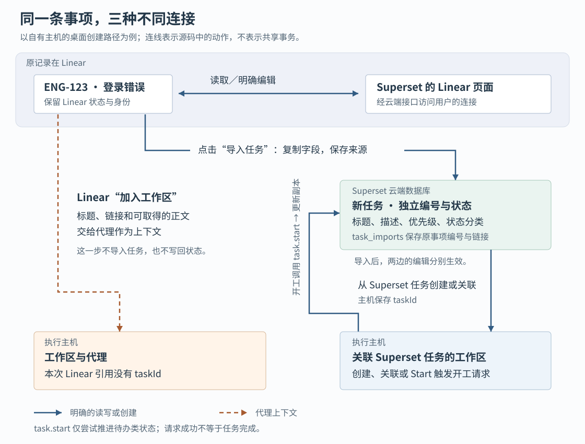

# Superset 的任务状态由谁决定：Linear 直连、导入副本与代理开工之间的边界

假设团队在 Linear——用于分配事项、安排进度的协作系统——中记录了一个登录错误 `ENG-123`。你在 Superset 里找到它，点击“加入工作区”，让编码代理开始修复。另一个同事则先把这条事项“导入任务”，再从导入结果创建工作区。两个人都在处理同一个错误，但他们操作的记录、状态变化和失败恢复并不相同。

Superset 把代码目录、终端和编码代理放在工作区中管理，同时提供任务入口。本篇要解释的是：**事项内容怎样交给代理，任务状态怎样被推进，以及哪些操作真正写回 Linear。** 当前源码中，查看 Linear、导入 Superset 任务、给工作区关联任务各走一条路径。分清这些路径，才能判断“进行中”说明了什么，也能避免更新了副本却以为团队的原始事项已经同步。

本文依据执行器提供的源码快照 `bdf1e2e4fc7b960f79e8cefde87e0d7d62505f18`，结合完整的四篇历史研报，继续研究任务与执行之间的连接。前文已介绍工作区创建、自动化派发、终端生命周期和远程连接，这里只在必要处重新核验相关调用。下文例子均为假设；本次只读源码和测试，没有启动服务、连接 Linear、运行仓库测试或执行迁移脚本。

**先看用户点了什么，再确定记录归谁管理。**

任务页面的 `TasksView` 根据组织的 `taskTracker` 设置，选择展示 Superset 任务或 Linear 事项；两者使用不同的数据组件。这个设置决定默认入口，没有在切换时执行数据搬迁。Superset 自有任务保存在云端 PostgreSQL 关系型数据库，执行主机上的工作区则在自己的数据库里保存 `taskId`，即关联任务的编号。这里的“自有任务”不能理解成“仅存在本机的任务”。[页面分支见 `TasksView.tsx`](https://github.com/superset-sh/superset/blob/bdf1e2e4fc7b960f79e8cefde87e0d7d62505f18/apps/desktop/src/renderer/routes/_authenticated/_dashboard/tasks/components/TasksView/TasksView.tsx)，[任务表定义](https://github.com/superset-sh/superset/blob/bdf1e2e4fc7b960f79e8cefde87e0d7d62505f18/packages/db/src/schema/schema.ts)与[主机工作区表定义](https://github.com/superset-sh/superset/blob/bdf1e2e4fc7b960f79e8cefde87e0d7d62505f18/packages/host-service/src/db/schema.ts)可以交叉核对。

| 用户操作 | 实际处理的记录 | 修改会落在哪里 |
|---|---|---|
| 在 Linear 列表修改状态或负责人 | Linear 自己的事项 | 经 Superset 云端接口请求 Linear |
| “导入任务”后修改导入结果 | 新建的 Superset 任务，另附来源记录 | Superset 的任务表 |
| 从 Linear 事项“加入工作区” | 创建草稿中的事项上下文 | 标题、链接和可取得的正文进入代理提示词；本条路径不建立 Superset 任务编号关联 |
| 从 Superset 任务创建或关联主机工作区 | 工作区保存的 `taskId` | 主机发起云端 `task.start`，尝试将该任务推进到进行中 |

图中实线表示明确的读写或创建动作，虚线表示把内容交给代理。来源链接保留“从哪里导入”，不承担持续同步。

**直接查看 Linear 时，请求每次需要读取数据都沿着用户自己的连接向外走。**

列表组件的 `useLinearIssues` 调用 `integration.linear.issues`，详情页调用 `integration.linear.issue`。服务端实际注册的是 `linearRouter` 展开的 `linearLiveRouter`；后者通过 `withLinear` 检查调用者的组织成员身份，再由 `callLinear` 找到这个用户在该组织下的 Linear 连接。最终的 `listIssues`、`getIssue` 向 Linear 发出 GraphQL 请求——一种由客户端明确列出所需字段的接口请求。读取结果不先写入 Superset 的 `tasks` 表。[注册和访问封装见 `linear.ts`、`live.ts`](https://github.com/superset-sh/superset/blob/bdf1e2e4fc7b960f79e8cefde87e0d7d62505f18/packages/trpc/src/router/integration/linear/linear.ts)，[实际外部查询见 `api.ts`](https://github.com/superset-sh/superset/blob/bdf1e2e4fc7b960f79e8cefde87e0d7d62505f18/packages/trpc/src/router/integration/linear/api.ts)。

用户在这一路修改事项时，`useLinearIssueActions.update` 调用 `integration.linear.updateIssue`，服务端再请求 Linear 的 `issueUpdate`。收到成功结果后，界面更新按事项编号和可读标识分别缓存的详情，并使列表缓存失效，让下次查询重新读取。这是一条明确的外部写入链，不依赖先导入任务。[界面调用与缓存处理见 `useLinearIssueActions.ts`](https://github.com/superset-sh/superset/blob/bdf1e2e4fc7b960f79e8cefde87e0d7d62505f18/apps/desktop/src/renderer/routes/_authenticated/_dashboard/tasks/hooks/useLinearIssueActions/useLinearIssueActions.ts)。

“直连”也有时间和可用性边界。列表把查询结果在 30 秒内视为新鲜，并关闭查询失败后的自动重试；这不表示它每隔 30 秒轮询一次，更不表示外部变化会即时推送到页面。服务端每页请求 50 条事项，每条只取前 10 个标签，团队与用户选择数据也有明确数量上限。因此不能把列表结果当成完整导出的所有字段和关联数据。[客户端查询策略](https://github.com/superset-sh/superset/blob/bdf1e2e4fc7b960f79e8cefde87e0d7d62505f18/apps/desktop/src/renderer/routes/_authenticated/_dashboard/tasks/components/TasksView/components/LinearIssuesContent/hooks/useLinearIssues/useLinearIssues.ts)及 `api.ts` 中的查询字段支持这些限制。

认证失败与请求过多也被分开处理。`callLinear` 遇到认证错误会尝试刷新授权令牌，再执行一次原回调；`withLinear` 把没有可用连接转换为“请连接 Linear”，把可识别的限流错误转换为“请求过多”。普通网络错误继续向上抛出。这条路径没有把失败编辑存成等待日后补写的任务。[认证恢复见 `refresh.ts`](https://github.com/superset-sh/superset/blob/bdf1e2e4fc7b960f79e8cefde87e0d7d62505f18/packages/trpc/src/router/integration/linear/refresh.ts)，[错误转换见 `live.ts`](https://github.com/superset-sh/superset/blob/bdf1e2e4fc7b960f79e8cefde87e0d7d62505f18/packages/trpc/src/router/integration/linear/live.ts)。

**导入会生成一份独立任务，复制范围比完整事项小。**

点击“导入任务”后，入口是 `task.importFromLinear`，实现函数为 `importLinearIssue`。它先以当前用户的 Linear 连接读取事项，再查 `task_imports`，确认同一 Superset 组织是否已有这个 Linear 内部编号的导入结果。已有且未删除时，直接返回原任务，并报告 `imported:false`；不会重新覆盖任务内容。

第一次导入则调用公共的 `createTask`，生成新的 Superset 任务编号。任务本身与来源记录在同一个数据库事务里写入：事务要么一起提交，要么一起回滚。来源记录保存提供方、外部编号、外部链接和导入者。后续详情页据此提供跳回原事项的入口。[导入、创建及查重逻辑均见 `task.ts`](https://github.com/superset-sh/superset/blob/bdf1e2e4fc7b960f79e8cefde87e0d7d62505f18/packages/trpc/src/router/task/task.ts)。

实际传给 `createTask` 的只有标题、描述、优先级和转换后的状态。Linear 的负责人、标签、项目、周期、截止日期与建议分支名没有在这次导入中逐项带入。新任务的创建者是导入者，负责人默认为空，团队按 Superset 自己的创建规则处理。不能从“保留来源”推出“完整复制”。

状态转换也只保留粗分类。`nativeStatusIdFor` 把 Linear 的 `triage`（待分诊）归入 Superset 的 `backlog`（积压），其他类型按对应类别查找 Superset 自有状态，再按位置取第一个。假设 Linear 的“In Review”属于 `started`，导入时可能落到 Superset 的“In Progress”：两者都表示已开工，但具体阶段名称没有被保留。默认配置中“In Progress”和“In Review”确实都属于 `started`，区别由排序和显示进度表达。[默认状态见 `seed-default-statuses.ts`](https://github.com/superset-sh/superset/blob/bdf1e2e4fc7b960f79e8cefde87e0d7d62505f18/packages/db/src/seed-default-statuses.ts)。

导入后，编辑 Superset 任务进入 `task.update`，只更新任务表并记录活动，没有调用 Linear 更新接口。反方向上，本次读取的 Linear Webhook 处理器——接收外部事件通知的入口——将事项事件交给自动化事件接收流程，没有更新导入任务的标题和状态。因此，**当前已追踪链路支持的是一次复制、保留来源、之后各自维护。** [任务更新见 `task.ts`](https://github.com/superset-sh/superset/blob/bdf1e2e4fc7b960f79e8cefde87e0d7d62505f18/packages/trpc/src/router/task/task.ts)，[外部通知的实际消费见 `processDelivery.ts`](https://github.com/superset-sh/superset/blob/bdf1e2e4fc7b960f79e8cefde87e0d7d62505f18/apps/api/src/app/api/integrations/linear/webhook/processDelivery.ts)。

仓库仍有“外部同步”字段注释和兼容逻辑，但它们不能单独证明双向同步还在运行。清理脚本 `prune-linear-mirror.ts` 明确描述了退役旧镜像、把保留任务改为自有状态并保存导入来源的意图；本篇用现行路由、调用方和 Webhook 消费者核验现在的行为，没有执行该脚本，也不能据此断言线上迁移已经完成。[清理脚本](https://github.com/superset-sh/superset/blob/bdf1e2e4fc7b960f79e8cefde87e0d7d62505f18/packages/trpc/scripts/prune-linear-mirror.ts)。

**两个窗口同时导入时，真正防重复的是数据库；删除则留下一个特殊边界。**

“先查询、再创建”本身挡不住并发：两个请求都可能先查到不存在。`task_imports` 因此为“组织＋提供方＋外部编号”建立唯一约束。并发创建撞上约束时，失败事务回滚；`importLinearIssue` 还设置了恢复分支：识别对应的约束错误后，重新查询已导入任务，把竞争另一方的结果返回。数据库负责阻止重复记录，恢复分支则尝试让失败请求也取得已有结果。

但恢复分支有一个不能略过的条件。任务模块的 `isConstraintError` 只检查异常顶层的错误码和约束名；仓库另一处通用的 `isUniqueViolation` 会沿 `cause`——异常包装中保留的原始原因——向内查找，相关测试也专门构造了数据库访问库包装错误的情况。若导入路径收到同样的包装，顶层检查就认不出冲突，直接向调用者抛错。**阻止重复记录与让并发请求都成功返回，是两项不同保证。** 本次没有连接数据库确认实际异常形状，不能把恢复意图写成已经验证的并发体验。[异常识别实现及其测试见 `unique-violation.ts`](https://github.com/superset-sh/superset/blob/bdf1e2e4fc7b960f79e8cefde87e0d7d62505f18/packages/trpc/src/router/utils/unique-violation.ts)、[`unique-violation.test.ts`](https://github.com/superset-sh/superset/blob/bdf1e2e4fc7b960f79e8cefde87e0d7d62505f18/packages/trpc/src/router/utils/unique-violation.test.ts)。

这里的身份是 Linear 内部编号，不是 `ENG-123` 这样的显示文本；不同 Superset 组织可以各自导入，同一组织的不同用户则共享查重结果。不过导入先读 Linear、再查已有任务，所以即使副本已存在，重复导入仍要求本次能访问原事项。

删除会暴露另一种情况。`task.delete` 只写 `deletedAt`，即软删除标记，没有删除来源记录；`findImportedTask` 又只返回未删除任务。由此可以推演：删除后再次导入，查询会认为没有可用任务，新建来源记录却可能撞上仍然保留的唯一约束，捕获错误后也找不到未删除的竞争结果，最终继续抛错。**“重复导入返回原任务”不能扩展成“删除后再次导入会自动恢复”。** 这是依据当前查询与约束作出的故障推演，本次未运行数据库实验。

**把 Linear 事项交给代理，并不会顺便建立任务状态关联。**

回到开头第一位用户。`useLinearIssueActions.addToWorkspace` 把事项转成创建草稿，`linkedIssueFromLinear` 只保留显示编号、标题、来源、链接和建议分支，没有生成 Superset 的 `taskId`。准备提示词时，`fetchLinearIssueBody` 尝试取得正文，`buildSubmitPrompt` 把标题、链接与已经准备好的正文拼入代理输入。正文获取失败或等待结束时，仍可只带标题和链接继续创建。[草稿转换见 `linkedIssueFromLinear.ts`](https://github.com/superset-sh/superset/blob/bdf1e2e4fc7b960f79e8cefde87e0d7d62505f18/apps/desktop/src/renderer/routes/_authenticated/utils/linkedIssueFromLinear/linkedIssueFromLinear.ts)，[正文读取](https://github.com/superset-sh/superset/blob/bdf1e2e4fc7b960f79e8cefde87e0d7d62505f18/apps/desktop/src/renderer/stores/new-workspace-prompt-context/fetchers.ts)与[提示词拼装](https://github.com/superset-sh/superset/blob/bdf1e2e4fc7b960f79e8cefde87e0d7d62505f18/apps/desktop/src/renderer/stores/new-workspace-prompt-context/buildSubmitPrompt.ts)展示了内容如何传递。

自有主机的提交路径 `useSubmitWorkspace` 只从 `source === "internal"` 的草稿事项中取第一个 `taskId`，交给 `workspaces.create`；Linear 来源不会进入这个字段。因此，在这条真实界面路径中，代理可以理解 `ENG-123`，工作区却没有可供 `task.start` 使用的 Superset 任务关联。代码也没有在这里调用 Linear 的 `updateIssue`，所以不能期待“加入工作区”自动把原事项改为进行中。[提交逻辑见 `useSubmitWorkspace.ts`](https://github.com/superset-sh/superset/blob/bdf1e2e4fc7b960f79e8cefde87e0d7d62505f18/apps/desktop/src/renderer/routes/_authenticated/components/DashboardNewWorkspaceModal/components/DashboardNewWorkspaceForm/PromptGroup/hooks/useSubmitWorkspace/useSubmitWorkspace.ts)。

第二位用户先导入，再从 Superset 任务创建主机工作区，便能建立 `taskId` 关联。但自动开工改变的是导入副本；原 Linear 事项仍需通过明确的 Linear 编辑路径更新。这也细化了首篇对“关联任务”的解释：提示词中提到一条事项，与工作区保存可更新的任务编号，是两种不同连接。

**自动推进到进行中，既有开工约定，也有防倒退条件。**

当前主机路径有三个入口会请求 `task.start`：带任务创建工作区、通过 `workspace.update` 关联任务，以及已关联工作区收到代理 `Start` 事件。创建入口还检查复用工作区是否实际保留了请求的任务关联，避免把另一个任务误当成已经关联。[创建末段见 `workspaces.ts`](https://github.com/superset-sh/superset/blob/bdf1e2e4fc7b960f79e8cefde87e0d7d62505f18/packages/host-service/src/trpc/router/workspaces/workspaces.ts)，[关联更新见 `workspace.ts`](https://github.com/superset-sh/superset/blob/bdf1e2e4fc7b960f79e8cefde87e0d7d62505f18/packages/host-service/src/trpc/router/workspace/workspace.ts)。

这意味着“为任务建好或关联工作区”本身就被视作开工，不必等到代理真正执行第一条工具调用。该状态表达一种协作约定，不能用来证明进程已经运行成功。

代理事件的入口另有一条完整链：`notifications.hook` 先按终端编号找到工作区，将代理事件归一化、记录绑定，然后调用 `fanOutAgentLifecycle`。这里的 hook 是代理在特定时刻执行的通知钩子。共享分发函数先广播界面事件，再在事件为 `Start` 时查询工作区关联的任务，发起云端调用。子代理通知走独立名册分支，不直接触发这条父会话路径。结构化聊天也由 `chatAgentBridge` 把运行状态映射到同一个分发函数，因此当前自动开工并非只有终端通知一种来源。[通知接收](https://github.com/superset-sh/superset/blob/bdf1e2e4fc7b960f79e8cefde87e0d7d62505f18/packages/host-service/src/trpc/router/notifications/notifications.ts)、[分发实现](https://github.com/superset-sh/superset/blob/bdf1e2e4fc7b960f79e8cefde87e0d7d62505f18/packages/host-service/src/trpc/router/notifications/fan-out-agent-lifecycle.ts)与[聊天桥接](https://github.com/superset-sh/superset/blob/bdf1e2e4fc7b960f79e8cefde87e0d7d62505f18/packages/host-service/src/chat-v3/chatAgentBridge.ts)共同支持这条连接。

云端的 `task.start` 在数据库事务中执行以下判断：先确认调用者能访问任务；只有当前状态类别是 `backlog` 或 `unstarted` 才继续；在同一组织、同一状态来源集合中，选位置最靠前的 `started` 状态；任务原本无人负责时，附上调用者作为负责人。任务与活动记录一起提交，活动记录分别描述状态和负责人变化。

写入时还要求 `statusId` 仍等于之前读到的值。这叫比较后更新：读取之后若有人已改变状态，本次更新就不再命中，不把对方的改动覆盖掉。例如同事已将任务标为完成，迟到的代理开工通知不会再把它拉回进行中。没有可用的进行中状态、任务已经开工、完成或取消时，接口都可以正常返回空结果。[条件更新与活动写入见 `task.ts`](https://github.com/superset-sh/superset/blob/bdf1e2e4fc7b960f79e8cefde87e0d7d62505f18/packages/trpc/src/router/task/task.ts)，[活动拆分见 `activity.ts`](https://github.com/superset-sh/superset/blob/bdf1e2e4fc7b960f79e8cefde87e0d7d62505f18/packages/trpc/src/router/task/activity.ts)。

保护范围仍需说准确。注释称既有负责人不会被覆盖，对读取时已经存在的负责人确实如此；但更新条件只比较状态，没有比较负责人。假设读取时无人负责，同事随后只设置负责人而没有改状态，自动开工更新仍可能命中并把负责人设为调用者。事务并不自动让所有先前读取的字段保持不变。这是根据读写条件作出的并发推演，尚未实测；它说明“防状态倒退”成立的理由，不能顺带证明“任何并发下都不会覆盖负责人”。

同样，`Start` 是归一化后的活动信号。源码把提交提示词、部分工具调用完成甚至工具调用失败，都归入这个类别。`Stop` 表示本轮结束；分发函数不会因此把任务写成完成，`Failed` 也不会自动取消任务。[事件映射见 `map-event-type.ts`](https://github.com/superset-sh/superset/blob/bdf1e2e4fc7b960f79e8cefde87e0d7d62505f18/packages/host-service/src/events/map-event-type.ts)。任务是否验收，仍需根据改动与测试，由人或明确的业务操作决定。

**开工通知怎样重试，决定了状态为什么可能落后。**

`fan-out-agent-lifecycle.ts` 用进程内的 `startedTaskIds` 集合控制调用次数：发送前放入任务编号，后续同任务的 `Start` 跳过；调用失败才移除，让下一次事件能够再试。它没有把每次工具调用都变成云端写入，也没有把等待重试的意图持久化。

| 发生的情况 | 这条路径的结果 |
|---|---|
| 云端暂时不可达，之后又收到 `Start` | 失败释放集合项，后续事件可再调用 |
| 云端调用失败后，代理不再产生 `Start` | 没有新的事件触发重试 |
| 云端正常返回，但因为任务状态不符合条件而未更新 | 集合项保留；之后同进程的 `Start` 不再调用 |
| 主机服务重启 | 集合清空；后续 `Start` 可以重新调用，云端仍重新检查状态 |

由第三种情况还可推演：若一次请求正常返回后，有人把任务移回待办，当前进程中的后续代理活动不会仅靠这条事件分发路径再次推进它；重新关联或创建入口另算。这里“每任务一次”只是减少调用的本进程策略，并不是任务永久开工记录。

创建、关联和事件分发的云端调用都不等待成功再完成本地主流程，错误主要记日志。因此工作区可继续使用，界面工作指示也可正常变化，而云端任务仍留在待办。任务列表本身通过 `task.listPage` 和状态列表查询读取，配置了 15 秒刷新间隔；主机先广播的代理事件并不等于任务表已经提交。[任务列表读取见 `useTasksData.tsx`](https://github.com/superset-sh/superset/blob/bdf1e2e4fc7b960f79e8cefde87e0d7d62505f18/apps/desktop/src/renderer/routes/_authenticated/_dashboard/tasks/components/TasksView/hooks/useTasksData/useTasksData.tsx)。这个间隔是客户端配置，不能当作网络故障时的更新时限。

用户手动修改 Superset 任务又有另一种显示顺序：`useOptimisticActions` 先改界面缓存，再请求 `task.update`；失败时恢复缓存并提示错误，最后使任务查询失效。这里的“乐观更新”就是先展示预计成功的结果，以减少等待感。它没有让云端写入变成离线队列，也没有让修改自动写回 Linear。[实现见 `useOptimisticActions.ts`](https://github.com/superset-sh/superset/blob/bdf1e2e4fc7b960f79e8cefde87e0d7d62505f18/apps/desktop/src/renderer/routes/_authenticated/hooks/useOptimisticActions/useOptimisticActions.ts)。

**测试说明了哪些局部规则，还有哪些只能按源码推演。**

本次阅读的 `notifications.test.ts` 用替代的云端调用检查：连续两次 `Start` 只调用一次；第一次失败后，下一个 `Start` 再试；没有关联任务或收到 `Stop` 时不调用。主机集成测试 `local-workspaces-edge.integration.test.ts` 检查创建时保存 `taskId` 并发起开工调用，但云端接口被替换，不能据此证明真实数据库已变更。[通知测试](https://github.com/superset-sh/superset/blob/bdf1e2e4fc7b960f79e8cefde87e0d7d62505f18/packages/host-service/src/trpc/router/notifications/notifications.test.ts)、[主机集成测试](https://github.com/superset-sh/superset/blob/bdf1e2e4fc7b960f79e8cefde87e0d7d62505f18/packages/host-service/test/integration/local-workspaces-edge.integration.test.ts)。

Linear 的 `api.test.ts` 检查筛选转换、优先级转换、翻页游标、外部更新失败抛错等；`linkedIssueFromLinear.test.ts` 明确断言转换后的引用没有 `taskId`。这些都是实际读到的断言，本次没有运行。已读测试没有验证真实数据库下的导入竞争、软删除后重导入或负责人并发变化；前文相应描述保留为实现分析与故障推演。[Linear 接口测试](https://github.com/superset-sh/superset/blob/bdf1e2e4fc7b960f79e8cefde87e0d7d62505f18/packages/trpc/src/router/integration/linear/api.test.ts)、[事项引用测试](https://github.com/superset-sh/superset/blob/bdf1e2e4fc7b960f79e8cefde87e0d7d62505f18/apps/desktop/src/renderer/routes/_authenticated/utils/linkedIssueFromLinear/linkedIssueFromLinear.test.ts)。

**这些取舍怎样影响使用和系统设计。**

直接读写 Linear，把团队原有的状态、身份和权限判断留给外部系统，减少维护两份持续一致数据的工作；代价是查询和编辑依赖用户连接及外部接口。导入则为 Superset 自己的任务流程提供独立记录，但复制时会压缩状态含义、舍弃部分字段，之后还需要明确两边谁负责更新。这些取舍可以从数据流推得，源码没有给出足以证明性能更优的测量。

自动开工只从待办推进到进行中，并以条件更新避免迟到事件覆盖新的状态；它让代理活动可以辅助团队协作，同时把完成判定留给实际工作结果。减少云端调用和允许本地主流程继续，也带来缺少后续事件时状态可能不再补齐的代价。若业务要求断线后一定补写，就需要持久待办与对账机制；本文追踪的事件重试没有提供这项保证。

对使用者，处理开头的登录错误时，应先决定继续以 Linear 为准，还是在 Superset 中另建独立任务。前者通过明确的 Linear 编辑操作维护进度；后者应接受来源链接与独立状态并存，必要时人工协调两边。检查“为什么仍是待办”时，先确认工作区是否真的保存了 Superset 的 `taskId`，再检查云端开工调用与当前状态，而不是只看代理是否已经输出文字。

对编写自动化脚本的人，还需固定操作对象。CLI（命令行工具）和 MCP（供代理调用工具的协议）默认按组织设置选择任务系统；显式传入 `tracker` 才固定到 Superset 或 Linear，每次调用只到一个系统。修改组织默认设置后，同一个“更新任务”入口可能进入不同分支；来源记录不会替调用方自动转发。可重复使用的脚本应明确指定目标系统，并分别处理它支持的状态、用户和字段。[CLI 路由选择](https://github.com/superset-sh/superset/blob/bdf1e2e4fc7b960f79e8cefde87e0d7d62505f18/packages/cli/src/commands/tasks/tracker.ts)与[MCP 更新分支](https://github.com/superset-sh/superset/blob/bdf1e2e4fc7b960f79e8cefde87e0d7d62505f18/packages/mcp/src/tools/tasks/update.ts)给出了这项实践建议的依据。
